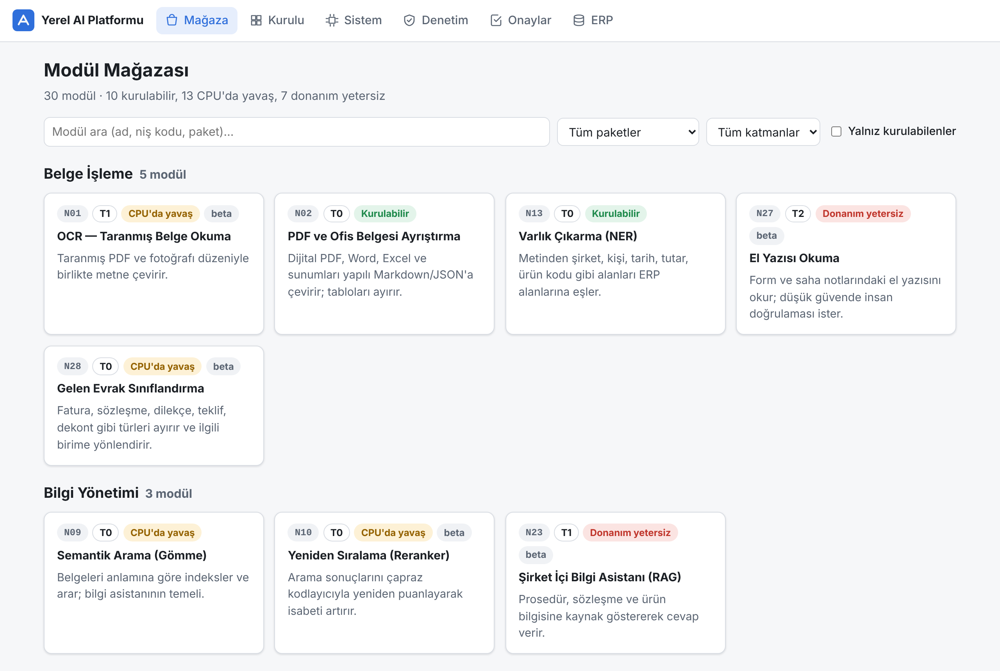
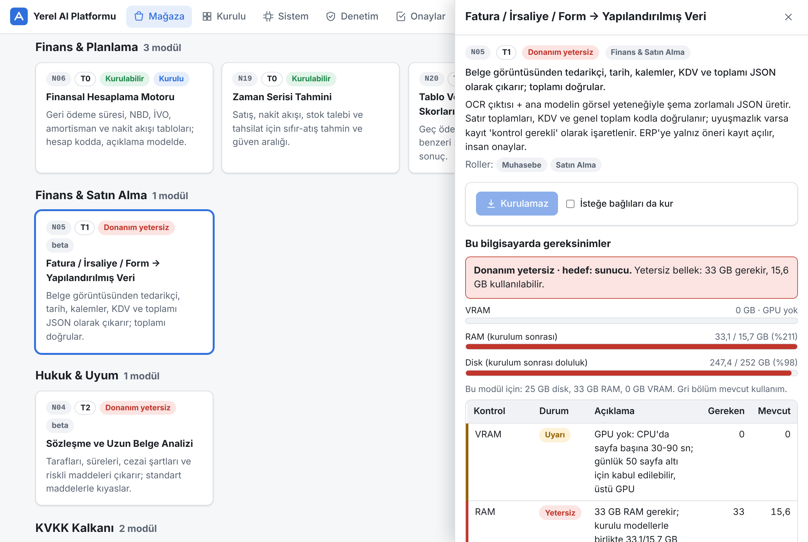
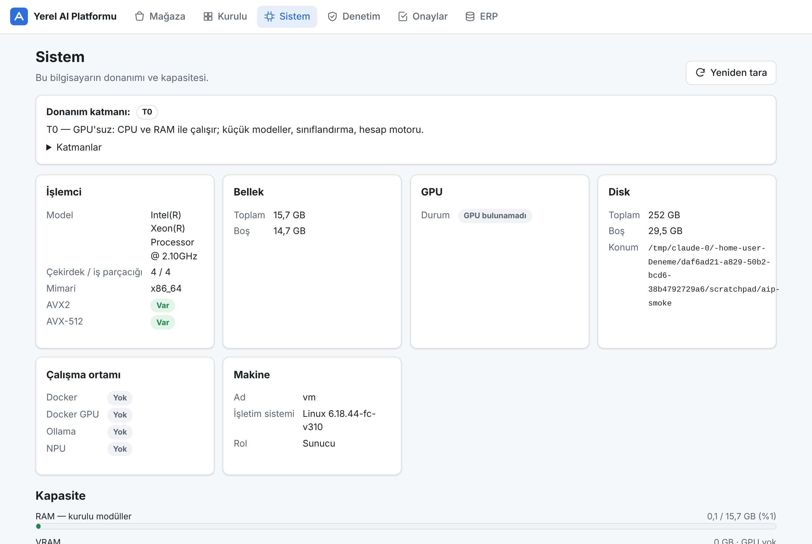

# Yerel AI Platformu — ERP'ye eklenti, modül modül kurulan, KVKK uyumlu yapay zekâ

Bir şirketin metin tabanlı yapay zekâ ihtiyaçlarını (OCR, özetleme, fatura okuma, finansal hesap, doğal
dilde ERP sorgusu, çeviri, ses, tahmin…) **tek GPU sunucu + çalışan bilgisayarları** ile, veri şirket
dışına çıkmadan karşılayan platform. 30 modül bir **mağazadan tek tıkla** kurulur; her modül kurulmadan
önce bilgisayarın yeterli olup olmadığı Türkçe açıklamayla gösterilir.

```
Mağaza → "Kur" → donanım uygunluk → pip bağımlılıkları → model indirme (HF) → motor başlat → sağlık → hazır
```

| | |
| --- | --- |
| Modüller | 30 (N00 ana model + 29 niş) — `catalog/modules.yaml` |
| Modeller | 40 kayıt, hepsi 8 Kasım 2026'da Hugging Face API ile doğrulandı — `catalog/models.yaml`, `docs/model_dogrulama_2026-11-08.json` |
| Ana model | Qwen3.5-35B-A3B (Apache-2.0, 3B aktif MoE, görsel girdi); alternatif Gemma 4 26B-A4B |
| Lisans çizgisi | Yalnız Apache/MIT/CC-BY ve koşullu (Gemma Terms, Llama) modeller; ticari kullanımı yasak model şema tarafından reddedilir |
| Çalışma | `aiplatform serve --role server` (GPU sunucu) / `--role client` (çalışan PC) — aynı paket |
| LLM motoru | vLLM (GPU+Docker) · Ollama · llama-server — hepsi OpenAI uyumlu `/v1` |
| ERP | salt-okunur SQL, REST araçları (yazma = insan onayı), webhook; `POST /api/modules/{id}/run/{action}` ve `/v1/chat/completions` |
| KVKK | istemci tarafı maskeleme (TCKN/VKN/IBAN sağlama algoritmaları + GLiNER), şifreli eşleme, denetim günlüğü, onaysız yazma yok |

## Hızlı başlangıç

```bash
cd ai-platform
python -m venv .venv && source .venv/bin/activate
pip install -e ".[kvkk,belge,gomme,text2sql,erp-sql,dev]"
aiplatform probe                 # bu bilgisayar hangi katman? (T0 GPU'suz … T3 çoklu GPU)
aiplatform check fatura-cikarim  # modül bu makinede çalışır mı, ne kadar bellek ister?
aiplatform serve                 # http://127.0.0.1:8080  → yönetim arayüzü
```

Satış demosu: arayüzde **Demo ERP** sekmesi → "Demo verisini kur" → ERP görünümlü ekranlar (cari kartlar, gelen evrak,
faturalar, raporlar, nakit ve yatırım, onay kutusu, KVKK göstergesi); her düğme gerçek modül API'sini çağırır,
kurulu olmayan modülde Türkçe hata ve mağaza bağlantısı gösterir. Ayrıntı: `docs/demo/DEMO.md`.

## Ekran görüntüleri

| Mağaza | Gereksinim paneli | Sistem |
| --- | --- | --- |
|  |  |  |

## Belgeler

| Belge | İçerik |
| --- | --- |
| [docs/MIMARI.md](docs/MIMARI.md) | bileşenler, veri yolu, HTTP API sözleşmesi, tablolar |
| [docs/KURULUM.md](docs/KURULUM.md) | sunucu / istemci / Docker / internetsiz kurulum, ayarlar |
| [docs/DONANIM.md](docs/DONANIM.md) | katmanlar, GPU bellek bütçesi, şirket boyutuna göre paket |
| [docs/ERP_ENTEGRASYON.md](docs/ERP_ENTEGRASYON.md) | SQL / REST / webhook, onay kuyruğu, örnek istekler |
| [docs/KVKK.md](docs/KVKK.md) | maskeleme tasarımı, ilkeler, müşteri bazında doldurulacaklar |
| [docs/MODUL_SEMASI.md](docs/MODUL_SEMASI.md) | katalog alanları, yeni modül ekleme |
| [docs/demo/DEMO.md](docs/demo/DEMO.md) | Demo ERP ekranları: kurulum, 15 dakikalık demo senaryosu, LLM yokken neler çalışır |
| [docs/sunum/README.md](docs/sunum/README.md) | keşif toplantısı sunum şablonu (14 slayt) |

## Proje yapısı

```
ai-platform/
├─ catalog/            models.yaml, modules.yaml        ← içerik: hangi modül hangi modelle
├─ aiplatform/
│  ├─ catalog/         şema + yükleyici
│  ├─ hardware/        donanım tarama, uygunluk denetimi
│  ├─ installer/       iş kuyruğu, HF indirme, pip, LLM motoru (vLLM/Ollama/llama-server)
│  ├─ kvkk/            TCKN/VKN/IBAN sağlama, Presidio tanıyıcılar, maskeleme, denetim günlüğü
│  ├─ runtimes/        LLM istemcisi (OpenAI uyumlu), gömme + vektör deposu, tembel yükleme
│  ├─ modules/         ModuleRuntime sözleşmesi + 30 modülün çalışma zamanı + istemler
│  ├─ erp/             salt-okunur SQL, REST araçları, onaylar, webhook, demo ERP
│  ├─ api/             FastAPI uygulaması ve yönlendiriciler
│  └─ web/             yönetim arayüzü (derleme adımı yok, CDN yok)
├─ docker/             compose (gpu/cpu/ollama profilleri), Dockerfile
├─ scripts/            verify_models.py (katalog ↔ Hugging Face doğrulama)
└─ tests/
```

## Durum

İlk sürüm (0.1.0). Çalışma zamanlarının çoğu ilgili kütüphane kurulu değilse açıklayıcı "hazır değil"
yanıtı verir ve mağazadan kurulumu işaret eder; saf Python modüller (finans hesabı, KVKK kural tabanlı
maskeleme, kayıt eşleştirme, demo ERP, Text2SQL doğrulama) ek kurulum olmadan çalışır. Ağır modellerle
(OCR, Whisper, Chronos, LightGBM) uçtan uca testler gerçek donanımda yapılmalıdır; bkz. `pytest -m slow`.

Lisans: Apache-2.0 (platform kodu). Modellerin lisansları katalogda ayrı ayrı belirtilir.
