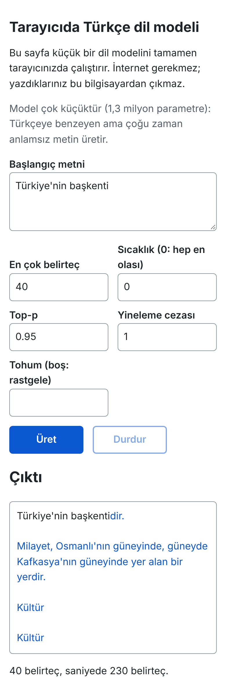

# dil-modeli — sıfırdan dil modeli temeli

Kendi metninizden **tokenizer ve dil modeli eğiten**, metin üreten, sohbet verisiyle **LoRA ince
ayarı** yapan, modeli **Hugging Face / Ollama (GGUF) / tarayıcı / ONNX** biçimlerine taşıyan ve
**OpenAI uyumlu bir sunucuyla** yayınlayan, eksiksiz ve testlerle korunan bir Python paketi
(`dil_modeli`). Yanında bağımlılıksız bir **JavaScript çalışma zamanı** (`tarayici/`) ve CPU'da
13 dakikada eğitilmiş minik bir **Türkçe örnek model** (`ornek-model/`) vardır.

Her şey sıfırdan yazıldı: tokenizer eğitimi ve kodlaması saf Python, model saf PyTorch
(`nn.Module`), tarayıcıdaki ileri geçiş düz JavaScript. Dış kütüphaneler (`tokenizers`,
`transformers`, `onnxruntime`) yalnız **eşlik testlerinde** "aynı sonucu veriyor mu?" diye
karşılaştırma için kullanılır.



## 5 dakikada çalıştırma

Gerekenler: Python ≥ 3.11 (`uv` önerilir), isteğe bağlı Node 22 (tarayıcı testleri için).
Bütün komutlar bu klasörden (`havuz/dil-modeli/`) çalışır.

```bash
# 1) Kurulum (torch dahil; uv önbelleği varsa saniyeler sürer)
uv venv .venv
uv pip install --python .venv/bin/python -e ".[dev,sun,hf]"
source .venv/bin/activate

# 2) Depodaki örnek modelle metin üret
python -m dil_modeli uret --model ornek-model --istem "İstanbul Boğazı" --azami 60

# 3) OpenAI uyumlu sunucu (deneme sayfası: http://127.0.0.1:8430/)
python -m dil_modeli sun --model ornek-model

# 4) Tarayıcıda, internetsiz: bir yerel sunucuyla açın, sonra http://127.0.0.1:8430/tarayici/
python -m http.server 8430 --bind 127.0.0.1      # (3. adımdaki sunucu kapalıyken)

# 5) Kendi metninizle birkaç dakikalık deneme eğitimi
python -m dil_modeli tokenizer-egit --girdi metnim.txt --cikti calisma/tokenizer.json --sozluk 4096
python -m dil_modeli veri-hazirla --girdi metnim.txt --tokenizer calisma/tokenizer.json --cikti veri/hazir
python -m dil_modeli egit --yapilandirma yapilandirma/cpu-deneme.toml
python -m dil_modeli uret --model calisma/cpu-deneme/en-iyi --istem "Bir varmış"
python -m dil_modeli rapor --egitim calisma/cpu-deneme     # kayıp eğrisi: calisma/cpu-deneme/rapor.html
```

Eğitim yarıda kalırsa (Ctrl+C, süre sınırı, elektrik) aynı komuta `--surdur` ekleyin: kaldığı
adımdan **bire bir aynı sonuca** devam eder. Daha büyük model ve GPU için: `docs/EGITIM_REHBERI.md`.

## Komutlar

| Komut            | Ne yapar                                                                 |
| ---------------- | ------------------------------------------------------------------------ |
| `tokenizer-egit` | .txt / .jsonl metinden bayt düzeyi BPE tokenizer eğitir (`--hizli`, `--karakter`) |
| `veri-hazirla`   | metni belirteçlere çevirip diskte eğitim/doğrulama parçalarına yazar     |
| `egit`           | modeli eğitir; `--yapilandirma dosya.toml`, `--ayar anahtar=değer`, `--surdur` |
| `degerlendir`    | şaşkınlık (perplexity) ve karakter başına bit ölçer                     |
| `boyutlar`       | hazır model boyutlarını ve parametre sayılarını listeler                |
| `uret`           | istemin devamını üretir (sıcaklık, top-k, top-p, yineleme cezası, durdurma yazısı, toplu üretim) |
| `sohbet`         | uçbirimde sohbet (sohbet ince ayarı yapılmış modelle anlamlıdır)        |
| `ince-ayar`      | `{"messages": [...]}` JSONL verisiyle LoRA (ya da `--tam`) ince ayar     |
| `disa-aktar`     | `--bicim kendi \| hf \| tarayici \| onnx`                                 |
| `sun`            | OpenAI uyumlu sunucu: `/v1/models`, `/v1/completions`, `/v1/chat/completions` (SSE akışı) |
| `rapor`          | eğitim günlüğünden bağımlılıksız HTML kayıp eğrisi raporu               |

Her komutun Türkçe yardımı: `python -m dil_modeli <komut> --help`.

## Neler var

| Parça | Dosyalar | Not |
| ----- | -------- | --- |
| Tokenizer | `dil_modeli/tokenizer*.py`, `bytelevel.py` | GPT-2 tarzı bayt düzeyi BPE; dosyası Hugging Face `tokenizer.json` ile uyumlu, `tokenizers` aynı kimlikleri üretir (test) |
| Model | `config.py`, `layers.py`, `model.py` | LLaMA ile bire bir: RMSNorm, RoPE, SwiGLU, GQA, KV önbelleği; hazır boyutlar `bebek` (1,3–1,9 M), `mini` (4,3–5,3 M), `kucuk` (27–30 M), `orta` (88–91 M) |
| Veri | `corpus.py`, `data.py`, `batches.py` | akışla okuma, belge sınırı belirteçleri, belge bazında doğrulama ayrımı, `np.memmap` |
| Eğitim | `train*.py`, `optim.py`, `device.py` | AdamW + ısınma + kosinüs, gradyan biriktirme/kırpma, karışık duyarlık (CUDA), bire bir sürdürme |
| Üretim | `sampling.py`, `generate.py` | akışla ve toplu üretim, durdurma yazıları |
| Sohbet + ince ayar | `chat.py`, `lora.py`, `finetune.py` | kayıp yalnız asistan belirteçlerinde; LoRA sıfırdan |
| Dışa aktarım | `model_io.py`, `export_hf.py`, `export_web.py`, `export_onnx.py` | HF `LlamaForCausalLM` (logit eşliği test), tarayıcı float16/int8, ONNX |
| Sunucu | `serve.py`, `serve_schemas.py`, `web/` | FastAPI, güvenli varsayılanlar (yalnız 127.0.0.1, CORS kapalı, isteğe bağlı anahtar) |
| Tarayıcı | `tarayici/` | bağımlılıksız ES modülleri; Python ile eşlik testleri (`node --test tarayici/`) |
| Örnek model | `ornek-model/` | 1,33 M parametre, Türkçe Vikipedi; bkz. `ornek-model/MODEL_KARTI.md` |

Örnek model (doğrulama verisinde, `ornek-model/egitim-kaydi.json`): şaşkınlık 51,2, karakter başına
1,83 bit; int8 nicemleme (1,37 MB) float32 (5,32 MB) ile aynı kalite. Türkçe'ye benzer ama
anlamca tutarsız metin üretir.

## Denetim

```bash
python scripts/check.py           # ruff + biçim + mypy + pytest (+ JS biçim ve testleri): ~1 dk, ağsız
node --test tarayici/              # yalnız JS testleri (bağımlılık gerekmez)
npm ci && PLAYWRIGHT_CHROMIUM_EXECUTABLE=/yol/chromium python scripts/check.py --uzun   # + tarayıcı uçtan uca
```

Eşlik testleri: tokenizer ↔ `tokenizers`, model ↔ `transformers` (logitler ve açgözlü üretim),
tarayıcı ↔ Python (kimlikler, logitler, üretim), ONNX ↔ PyTorch (uzun denetimde, `.[onnx]` gerekir).

## Belgeler

- `AGENTS.md` — kodu genişletecek model için: harita, kurallar, tarifler.
- `docs/MIMARI.md` — her bileşenin matematiği ve dosyası.
- `docs/EGITIM_REHBERI.md` — kendi verinizle eğitim, boyut/veri/süre tahminleri, sık sorunlar.
- `docs/OLLAMA.md` — GGUF'a dönüştürme ve Ollama.
- `docs/KARARLAR.md` — neden böyle yapıldı.

## Sınırlar

- **GPU'da denenmedi.** Bütün geliştirme ve ölçümler yalnız CPU'lu bir makinede yapıldı. CUDA,
  karışık duyarlık (bf16/fp16 + ölçekleyici) ve MPS yolları PyTorch'un belgelenmiş kalıplarıyla
  yazıldı ama çalıştırılmadı; `yapilandirma/colab-t4.toml` ve `tek-gpu-24gb.toml` içindeki sayılar
  tahmindir. `torch.compile` yalnız CPU'da küçük bir eğitimle denendi (derlemesizle aynı kayıp).
- **Ollama / llama.cpp ile çalıştırma doğrulanmadı.** GGUF dönüşümü llama.cpp'nin kendi betiğiyle
  yapıldı ve üretilen dosya numpy ile llama.cpp'nin hesap düzeninde doğrulandı (`docs/OLLAMA.md`);
  llama.cpp ikilisi ya da Ollama bu makinede çalıştırılmadı.
- **Örnek model çok küçüktür**: bilgi vermez, anlamlı paragraf kuramaz; yalnız gösterim içindir.
  Sohbet ince ayarlı bir örnek model yoktur (depoya sohbet eğitim verisi yazılmadı; açık lisanslı
  bir veri kümesiyle `ince-ayar` komutunu çalıştırın).
- Tek makine: dağıtık/çok GPU'lu eğitim (DDP/FSDP) yoktur.
- Sunucu istekleri **sırayla** işler (aynı anda tek üretim); yüksek trafik için değildir.
  `n > 1`, araç çağrısı ve `response_format` desteklenmez; `frequency_penalty`/`presence_penalty`
  yok sayılır (yerine `repetition_penalty` alanı vardır).
- Tarayıcıda tohumlu örnekleme Python'unkinden farklı rastgele sayı üreteci kullanır: aynı tohum
  iki tarafta farklı metin verir (açgözlü üretim aynıdır).
- Hugging Face'e aktarılan modelde `apply_chat_template`, ileti içeriğindeki "<|bitti|>" gibi
  yazıları özel belirtece çevirir; bu paket çevirmez (enjeksiyon koruması). Böyle yazı içermeyen
  iletilerde iki taraf aynı kimlikleri üretir (test).
- ONNX çizgesi önbelleksizdir (her adımda bütün dizi); hızlı üretim için tarayıcı ya da GGUF yolu.
- Tokenizer saf Python'dadır: çok büyük derlemlerde (yüzlerce MB) `--hizli` seçeneğini kullanın
  (aynı sonucu `tokenizers` ile üretir).
- `transformers` eşliği yalnız 5.23 sürümüyle denendi; dışa aktarım 4.x için de `rope_theta` yazar
  ama 4.x ile denenmedi.
