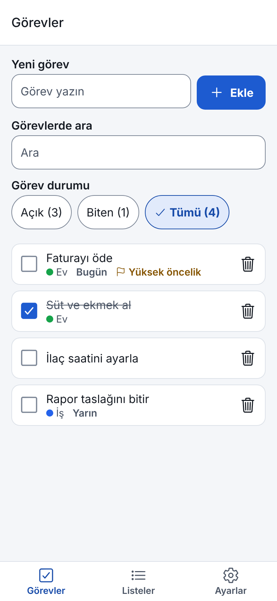

# Yerel mobil uygulama temeli (`mobil`)

App Store ve Google Play'e çıkabilen **yerel (native) bir telefon uygulamasının hazır temeli**. Expo + React
Native ile yazıldı; [`havuz/uygulama`](../uygulama/README.md)'nın API'sine ve **aynı eşitleme protokolüne** bağlanır.
Örnek olarak bir **görev ve liste** uygulaması içerir; kendi uygulamanızı bu örneği kopyalayıp uyarlayarak ya da
üreteçle (`npm run gen`) kurarsınız.

- **Önce telefon:** her yazma önce telefondaki SQLite veritabanına gider; internet gerekmez. Bağlantı gelince eşitlenir.
- **İki kip:** hesapsız (veri yalnız bu telefonda) ya da hesaplı (cihazlar arası eşitleme, paylaşımlı alanlar).
- **Güvenli oturum:** belirteç telefonun güvenli deposunda (iOS Keychain / Android Keystore).
- **Türkçe ve erişilebilir:** bütün metinler tek sözlükte; ekran okuyucu adları, ≥ 48 dp dokunma alanı, koyu tema,
  telefonun yazı boyutuna uyum.



## Belgeler

| Belge                                    | İçinde                                                                   |
| ---------------------------------------- | ------------------------------------------------------------------------ |
| [`AGENTS.md`](AGENTS.md)                 | model için: komutlar, harita, kurallar, tarifler, sık hatalar            |
| [`docs/MIMARI.md`](docs/MIMARI.md)       | parçalar ve veri akışı (depo, eşitleme, oturum, ekranlar)                |
| [`docs/KARARLAR.md`](docs/KARARLAR.md)   | hangi teknoloji neden seçildi, hangisi neden elendi                      |
| [`docs/YAYINLAMA.md`](docs/YAYINLAMA.md) | mağazaya hazırlık: kimlikler, simgeler, EAS Build/Submit, imza, gizlilik |
| [`docs/AYARLAR.md`](docs/AYARLAR.md)     | ortam değişkenleri (API adresi vb.)                                      |
| [`docs/ekran/`](docs/ekran)              | ekran görüntüleri (390×844, açık ve koyu)                                |

Eşitleme protokolünün kendisi `havuz/uygulama`'dadır: [`../uygulama/docs/ESITLEME.md`](../uygulama/docs/ESITLEME.md).

## 5 dakikada çalıştırma

Gereken: bilgisayarda **Node 22.18 ya da üstü** (bu temel Node 22.23.4 ile denendi); telefonda **Expo Go**
uygulaması (App Store / Google Play'den ücretsiz).

```bash
cd havuz/mobil
npm ci            # bağımlılıklar (bir kez, ~1 dk)
npm start         # Expo geliştirme sunucusu; terminalde bir QR kodu çıkar
```

- **Telefonda denemek:** telefon ile bilgisayar aynı Wi-Fi'da olsun. iPhone'da Kamera ile, Android'de Expo Go'nun
  "Scan QR code" düğmesiyle QR kodu okutun. Uygulama Expo Go içinde açılır; kodu kaydettikçe yenilenir.
- **Tarayıcıda hızlı bakış:** `npm run web` (yalnız deneme içindir; asıl hedef telefon).
- Bu hâliyle uygulama **hesapsız** çalışır (sunucu gerekmez). Hesaplı denemek için önce API'yi açın ve adresini verin:

```bash
# 1. pencere: API (havuz/uygulama), telefonun ulaşabilmesi için bütün ağ arabirimlerinde
cd havuz/uygulama && npm ci && HOST=0.0.0.0 npm start
# 2. pencere: bilgisayarın yerel ağ adresiyle (ör. 192.168.1.20; 127.0.0.1 telefonda ÇALIŞMAZ)
cd havuz/mobil && API_URL=http://192.168.1.20:8310 npx expo start --clear
```

Windows'ta ortam değişkeni: PowerShell'de `$env:API_URL="http://192.168.1.20:8310"; npx expo start --clear`.
Ayrıntı: [`docs/AYARLAR.md`](docs/AYARLAR.md).

## `uygulama` (PWA) ile farkı

|                | `havuz/uygulama` (PWA)             | `havuz/mobil` (bu temel)                                   |
| -------------- | ---------------------------------- | ---------------------------------------------------------- |
| Nasıl kurulur  | tarayıcıdan "ana ekrana ekle"      | App Store / Google Play (ya da geliştirmede Expo Go)       |
| Yerel veri     | IndexedDB (Dexie)                  | SQLite (expo-sqlite)                                       |
| Oturum         | çerez (aynı alan adı)              | belirteç, güvenli depoda (`Authorization: Bearer`)         |
| Eşitleme       | aynı protokol, aynı `shared/` kodu | aynı protokol; `shared/` buraya **kopyalanır**             |
| Anlık bildirim | var (SSE)                          | yok: ön plana gelince, ağ gelince, yazınca ve 60 sn'de bir |
| Alan yönetimi  | alan açma, davet, üyeler           | yalnız alanları görme ve seçme                             |
| Sunucu         | aynı API                           | aynı API (kopyası değil, kendisi)                          |

## Neler var

| Bölüm              | Ne yapar                                                                                                                                              |
| ------------------ | ----------------------------------------------------------------------------------------------------------------------------------------------------- |
| Karşılama ve hesap | Hesapsız devam / giriş / kayıt / şifremi unuttum; çıkış (veriyi bırak ya da sil); uygulama içinden hesap silme                                        |
| Görevler           | Hızlı ekleme, tamamla, Türkçe arama ("ILAC" → "İlaç al"), durum süzgeci, son tarih (Bugün/Yarın/elle), öncelik, liste, sil + "Geri al"                |
| Listeler           | Liste ekle (ad + renk), açık görev sayısı, listeye göre görevler, yeniden adlandır, sil + "Geri al"                                                   |
| Alanlar            | Kişisel ve paylaşımlı alanlar arasında geçiş; izleyici rolünde yazma kapalı                                                                           |
| Ayarlar            | Tema (sistem/açık/koyu), eşitleme durumu ve "Şimdi eşitle", sunucu yedeğe döndüyse karar, hakkında                                                    |
| Yerel depo         | SQLite: kayıtlar + giden kutusu + üst veri, şema göçleri, canlı okuma kancaları (`useRecords`…)                                                       |
| Eşitleme motoru    | Tek uçuş, sayfalama (`more`), üstel geri çekilme, 401/sürüm/reset/erişim kaybı, ön plan/ağ/yazma tetikleyicileri                                      |
| Testler            | Depo ve eşitleme (gerçek SQLite + bellek içi sunucu), **eşdeğerlik kanıtı**, ekran testleri, kural testleri, web duman testi, gerçek API bütünleşmesi |
| Üreteç             | `npm run gen -- entity <ad>` (liste + ayrıntı ekranı + sekme + sözlük + test), `npm run gen -- screen <ad>`                                           |
| Mağaza hazırlığı   | `app.config.ts` (kimlikler, sürüm, izinler), betikle üretilen simgeler, `eas.json`, [`docs/YAYINLAMA.md`](docs/YAYINLAMA.md)                          |

## Komutlar (bu klasörden)

| Komut                 | Ne yapar                                                                     |
| --------------------- | ---------------------------------------------------------------------------- |
| `npm start`           | Expo geliştirme sunucusu (Expo Go ile telefonda açılır)                      |
| `npm run web`         | Tarayıcıda geliştirme                                                        |
| `npm run check`       | Tip denetimi + lint + biçim + bütün Jest testleri (ağsız, ~30 sn)            |
| `npm run e2e`         | Web derlemesi + Playwright duman testi (390×844 ve 360×800, erişilebilirlik) |
| `npm run e2e:api`     | Gerçek API'yle bütünleşme (API'yi `../uygulama`'nın kopyasından başlatır)    |
| `npm run shots`       | `docs/ekran/` ekran görüntülerini yeniler                                    |
| `npm run test:gen`    | Üretecin kanıt testi (geçici kopyada üretir, denetler)                       |
| `npm run gen -- …`    | Üreteç (bkz. AGENTS.md)                                                      |
| `npm run shared:sync` | Ortak sözleşmeyi `../uygulama/shared/src`'den yeniden kopyalar               |
| `npm run icons`       | `assets/` simgelerini ve açılış görselini betikle üretir                     |
| `npm run doctor`      | Expo paket sürümlerinin SDK ile uyumunu denetler                             |
| `npm run build:web`   | Web derlemesi (`dist/`; yalnız deneme ve test için)                          |

Uçtan uca testler önceden kurulu Chromium ile: `PLAYWRIGHT_CHROMIUM_EXECUTABLE=/yol/chromium npm run e2e`.

## Klasörler

```
src/app/         rotalar (Expo Router: dosya adı = adres); her dosya tek satır, ekranı features/'tan alır
src/features/    ekranlar ve özellik mantığı (tasks, lists, settings, auth, welcome, workspaces, session)
src/navigation/  yerleşimler: kök yığın, sekmeler, hata ekranları
src/ui/          bileşenler (Düğme, Metin alanı, Seçim, Bildirim, Onay penceresi, Ekran) ve tema
src/lib/         yerel depo (store), eşitleme (sync), oturum (session), API istemcisi, tarih, platform
src/i18n/        arayüz metinleri (tr.json)
shared/          ortak sözleşme: havuz/uygulama/shared/src'nin DEĞİŞTİRİLMEMİŞ kopyası
test/            Jest testleri (store, sync, lib, features, ui, rules, integration)
e2e/             Playwright testleri (web derlemesi)
scripts/         üreteç, simgeler, ortak sözleşme kopyası, web sunucusu, API bütünleşmesi
assets/          simgeler ve açılış görseli (scripts/icons.ts üretir)
docs/            belgeler ve ekran görüntüleri
```

## Sınırlar

- **Gerçek telefonda ve Expo Go'da denenmedi.** Bu ortamda Android SDK, Xcode ve telefon yok; yerel derleme (EAS
  Build ya da `expo run:ios/android`) **denenmedi**. Doğrulananlar: Jest (React Native test ortamı, gerçek SQLite
  motoru `node:sqlite`), web derlemesi (Chromium'da gerçek expo-sqlite/OPFS) ve gerçek API'yle bütünleşme.
  Telefonun JavaScript motoruna (Hermes) özgü farklar için tamamlayıcılar eklendi (`src/lib/platform/polyfills.ts`)
  ama Hermes'te koşturulmadı.
- **Arka planda eşitleme yok.** Uygulama ön plandayken eşitlenir (açılınca, ön plana dönünce, ağ gelince, yazınca,
  60 sn'de bir). Anlık bildirim (SSE) ve itme bildirimi (push) yok.
- **Alan yönetimi yok:** paylaşımlı alan açma, davet etme, üyeler web uygulamasından yapılır; telefonda alanlar
  görülür ve seçilir. Şifre sıfırlama bağlantısı da web uygulamasında açılır.
- **Hesapsız kayıtlar hesaba taşınmaz:** hesapsız yazılan kayıtlar giriş yapınca hesaba aktarılmaz (web'de var).
- **Son tarih hatırlatması (bildirim) ve görev fotoğrafı yok** (isteğe bağlı maddelerdi; yazılmadı).
- **Tarih seçimi** hazır düğmeler (Bugün, Yarın, Gelecek hafta) + elle yazma (`17.11.2026`); telefonun takvim
  seçicisi yok.
- **Web derlemesi yalnız deneme ve test içindir:** belirteç tarayıcının `localStorage`'ında durur (güvenli depo
  değil); aynı anda tek sekme desteklenir; sunucu COOP/COEP başlıklarını vermelidir. Web için `havuz/uygulama`
  PWA'sını kullanın.
- **Aynı alana eşzamanlı yazmada biri kazanır** (alan düzeyinde son yazan kazanır) — protokolün sınırı:
  [`../uygulama/docs/ESITLEME.md`](../uygulama/docs/ESITLEME.md) → "Sınırlar".
- `expo-doctor` 20 denetimin 18'inden geçti; kalan 2'si Expo sunucusuna bağlanmak istediği için bu ortamda
  koşamadı (ağ kapalı). Mağaza adımları (EAS hesabı, imza, gönderim) **denenmedi**; belgedeki ayrıntılar Expo
  belgelerine göre yazıldı ve "doğrulanmadı" diye işaretlendi.
