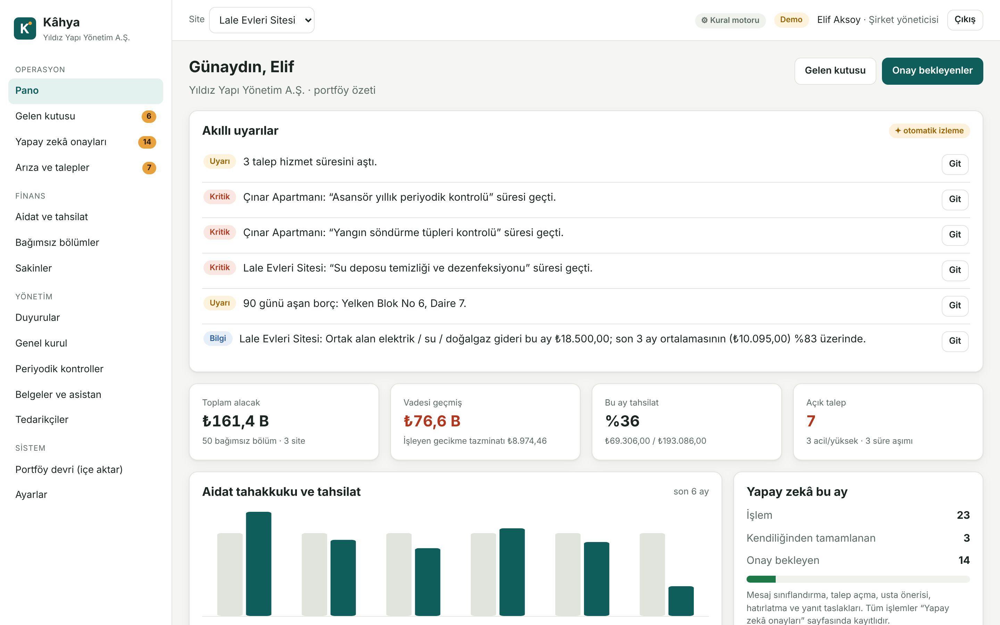
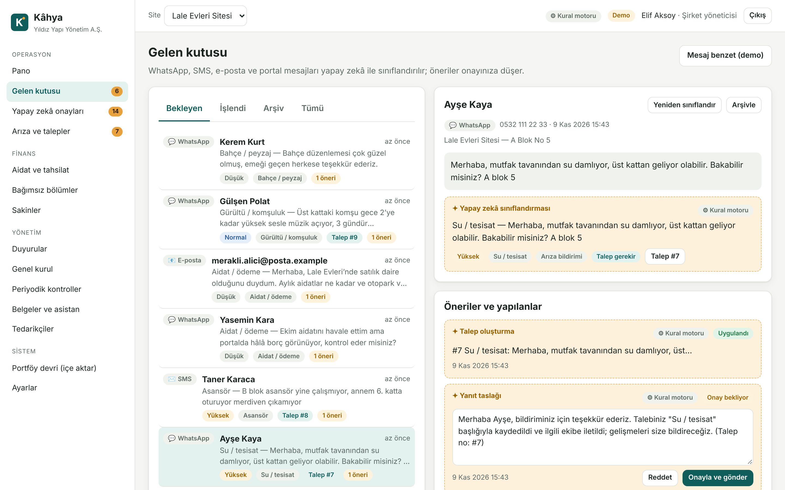
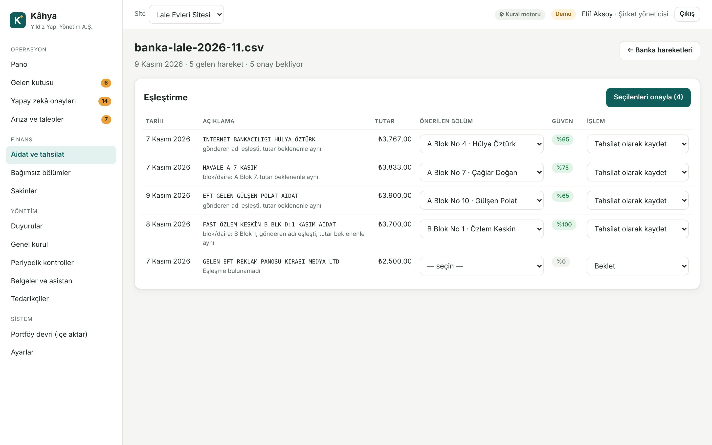
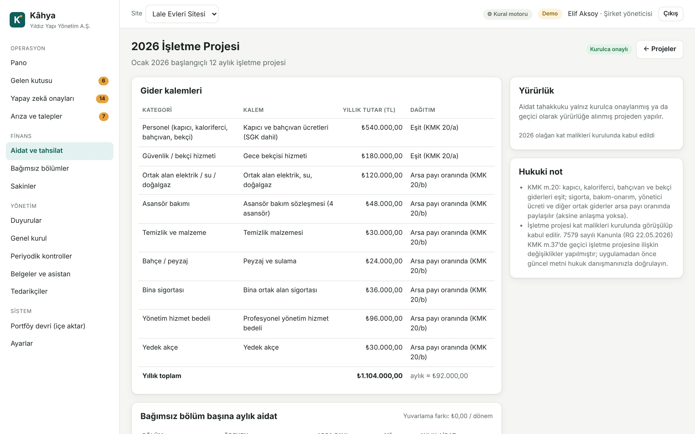
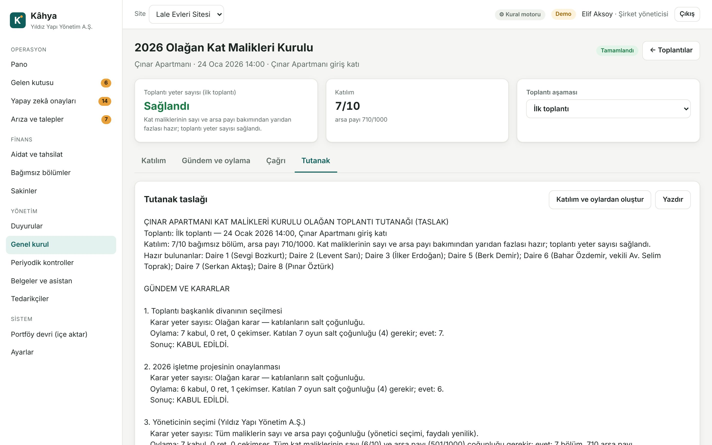
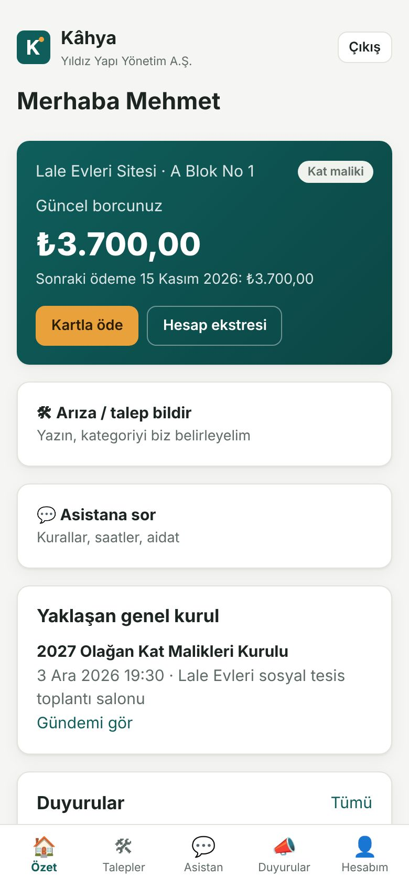

# Kâhya — yapay zekâ destekli site ve apartman yönetimi

Türkiye’deki profesyonel site yönetim şirketleri için uçtan uca yazılım: sakinlerden WhatsApp, SMS, e-posta ve portal
üzerinden gelen her mesajı yapay zekâ sınıflandırır, arıza kaydı açar, uygun ustayı önerir, yanıt taslağı hazırlar;
aidatı Kat Mülkiyeti Kanunu’na göre dağıtıp tahakkuk ettirir, banka dökümündeki havaleleri dairelerle eşler, gecikme
tazminatını gün esaslı hesaplar, genel kurulun yeter sayılarını denetler. Yönetici yalnız onaylar.

> Model: İngiltere’de Supa’nın yaptığı gibi “yapay zekâ ile çalışan yönetim şirketi” — yazılım katmanı bu depodadır.
> Yerel yönetim firmalarını devralıp portföyü hızla taşımak için içe aktarma araçları da dahildir (bkz. [docs/SATIS.md](docs/SATIS.md)).

| Pano                                                  | Gelen kutusu (yapay zekâ)                         | Banka eşleştirme                                        |
| ----------------------------------------------------- | ------------------------------------------------- | ------------------------------------------------------- |
|                        |    |  |
| **İşletme projesi**                                   | **Genel kurul tutanağı**                          | **Sakin portalı (telefon)**                             |
|  |  |                 |

## Neler var

| Bölüm                   | Özellikler                                                                                                                                                                                                 |
| ----------------------- | ---------------------------------------------------------------------------------------------------------------------------------------------------------------------------------------------------------- |
| Yapay zekâ gelen kutusu | WhatsApp Cloud API, SMS ve e-posta webhook’ları; gönderen kişi ve daire tespiti; niyet / kategori / aciliyet; otomatik talep, usta önerisi, yanıt taslağı; acil durumda güvenlik talimatı ve nöbetçi SMS’i |
| Onay kuyruğu            | Her öneri düzenlenip onaylanır ya da reddedilir; işlem başına “kapalı / öneri / otomatik” özerklik ayarı; tüm yapay zekâ işlemlerinin günlüğü (motor, model, token, maskelenen veri sayısı)                |
| Aidat ve tahsilat       | İşletme projesi editörü (KMK m.20: personel eşit, diğerleri arsa payı), aylık tahakkuk, ek toplama, tahsilat, FIFO borç kapama, hesap ekstresi, yaşlandırma, gelir-gider ve bütçe-gerçekleşen raporu       |
| Banka dökümü            | Türk bankalarının CSV dökümleri (Windows-1254 dahil); açıklamadaki blok/daire, gönderen adı ve tutara göre eşleştirme önerisi; mükerrer dekont koruması                                                    |
| Gecikme tazminatı       | KMK m.20: aylık %5, gün esaslı, basit; tahakkuk edilen dönem tekrar hesaplanmaz                                                                                                                            |
| Hatırlatmalar           | Üç aşamalı (nazik / ikinci / son) şablon metinler, kişi bazında kanal izinleri, tekrar koruması                                                                                                            |
| Arıza ve talepler       | Öncelikli hizmet süresi, usta atama ve iş emri SMS’i, zaman çizelgesi, sakine bildirim, talebe bağlı gider                                                                                                 |
| Kat malikleri kurulu    | Çağrı metni ve 15 gün / ikinci toplantı 7–15 gün denetimi, katılım ve arsa payı yeter sayısı, oy sınırları ve vekâlet uyarıları, karar yeter sayıları, tutanak taslağı                                     |
| Periyodik kontroller    | Asansör (etiket rengiyle), yangın, doğalgaz, su deposu, sigorta, havuz…; geciken ve yaklaşan uyarıları                                                                                                     |
| Belgeler ve asistan     | Yönetim planı, iç yönetmelik, kurul kararları; sakin sorularına kaynak göstererek yanıt; bilinmeyen soruyu yönetime aktarma                                                                                |
| Sakin portalı (mobil)   | Telefon + SMS koduyla giriş, borç ve ekstre, kartla ödeme (PayTR), talep açma ve izleme, asistan, duyurular, toplantılar, iletişim tercihleri, KVKK veri dökümü                                            |
| Portföy devri           | CSV ile bağımsız bölüm + malik/kiracı ve devir bakiyesi aktarımı (önce kontrol, sonra kayıt)                                                                                                               |
| KVKK                    | Yapay zekâya gitmeden TCKN, IBAN, kart, telefon, e-posta ve kişi adları maskelenir; ilgili kişi veri dökümü ve anonimleştirme; denetim günlüğü                                                             |

## Hızlı başlangıç

Gereken: Node.js 22.18 ya da üstü (TypeScript doğrudan çalışır, derleme adımı yoktur).

```bash
cd kahya
npm install
npm run dev
```

Arayüz: http://localhost:5174 (API: http://localhost:8787). Demo verisiyle açılır:

| Rol               | Giriş                                                                  |
| ----------------- | ---------------------------------------------------------------------- |
| Şirket yöneticisi | `elif@yildizyonetim.example` / `Kahya!2026`                            |
| Site yöneticisi   | `murat@yildizyonetim.example` / `Kahya!2026` (yalnız iki siteyi görür) |
| Muhasebe          | `deniz@yildizyonetim.example` / `Kahya!2026`                           |
| Sakin             | `0532 111 22 33` — SMS kodu demo modunda ekranda görünür               |

Yapay zekâyı Claude ile çalıştırmak için `ANTHROPIC_API_KEY` tanımlayın (yoksa yerel Türkçe kural motoru çalışır):

```bash
cp .env.example .env   # ANTHROPIC_API_KEY=... ve diğer anahtarlar
```

Canlı kurulum (Docker, HTTPS, WhatsApp/Netgsm/PayTR bağlama, yedekleme): [docs/KURULUM.md](docs/KURULUM.md).

## Komutlar

| Komut                         | Ne yapar                                                                    |
| ----------------------------- | --------------------------------------------------------------------------- |
| `npm run dev`                 | API (izlemeli) + Vite arayüzü, demo modu ve örnek veriyle                   |
| `npm run demo`                | Arayüzü derler, bellek içi demo sunucusunu başlatır (http://localhost:8787) |
| `npm run build` · `npm start` | Arayüzü `dist/`e derler · sunucuyu canlı ayarlarla başlatır                 |
| `npm run kurulum -- …`        | İlk yönetim şirketi ve şirket yöneticisi hesabını oluşturur                 |
| `npm run seed -- --sifirla`   | Demo veritabanını yeniden kurar                                             |
| `npm run check`               | Tip denetimi + 104 birim ve API testi                                       |
| `npm run e2e`                 | Derler; Playwright ile tarayıcıda 5 uçtan uca akış                          |
| `npm run shots`               | `docs/ekran/` ekran görüntülerini yeniler                                   |

Kod biçimi ve lint depo kökündeki ayarlarla denetlenir: `npx prettier --check kahya` ve `npx eslint kahya`.

## Mimari özeti

- **Sunucu:** Node.js + [Hono](https://hono.dev), TypeScript doğrudan çalışır (`node server/index.ts`). Veritabanı Node’un
  yerleşik SQLite’ı (`node:sqlite`, WAL). Tutarlar kuruş cinsinden tamsayı; iş tarihleri İstanbul saatine göre.
- **Arayüz:** React 19 + React Router, Vite ile derlenir; sunucu `dist/`i yayınlar. Telefona “ana ekrana ekle” ile kurulur.
- **Yapay zekâ:** Claude (`claude-opus-5-5` varsayılan) yapılandırılmış çıktı + sunucu tarafı yedek model; anahtar yoksa
  ya da hata olursa aynı şemayı üreten kural motoru. Ayrıntı: [docs/YAPAY_ZEKA.md](docs/YAPAY_ZEKA.md).
- **Çok kiracılı:** her sorgu kuruluşa göre süzülür; site yöneticisi yalnız atandığı siteleri görür; sakin yalnız kendi
  bağımsız bölümlerini. Ayrıntı: [docs/MIMARI.md](docs/MIMARI.md).

## Belgeler

| Belge                                          | İçerik                                                                       |
| ---------------------------------------------- | ---------------------------------------------------------------------------- |
| [docs/MIMARI.md](docs/MIMARI.md)               | Bileşenler, veri modeli, API, güvenlik, ölçekleme yolu                       |
| [docs/YAPAY_ZEKA.md](docs/YAPAY_ZEKA.md)       | Görevler, istemler, özerklik, KVKK maskeleme, maliyet tahmini, kalite ölçümü |
| [docs/HUKUK_VE_UYUM.md](docs/HUKUK_VE_UYUM.md) | Koda işlenen KMK kuralları, KVKK, İYS, ödeme; doğrulanması gerekenler        |
| [docs/KURULUM.md](docs/KURULUM.md)             | Canlı kurulum, entegrasyonlar, yedekleme                                     |
| [docs/SATIS.md](docs/SATIS.md)                 | Türkiye’de satış ve “devral + yapay zekâ ile işlet” oyun planı               |

> Kâhya bir yönetim yazılımıdır; hukuki görüş vermez. Koda işlenen kurallar 634 sayılı Kat Mülkiyeti Kanunu’na göre
> hazırlanmıştır; canlıya almadan önce [docs/HUKUK_VE_UYUM.md](docs/HUKUK_VE_UYUM.md) içindeki listeyi bir avukatla gözden geçirin.
