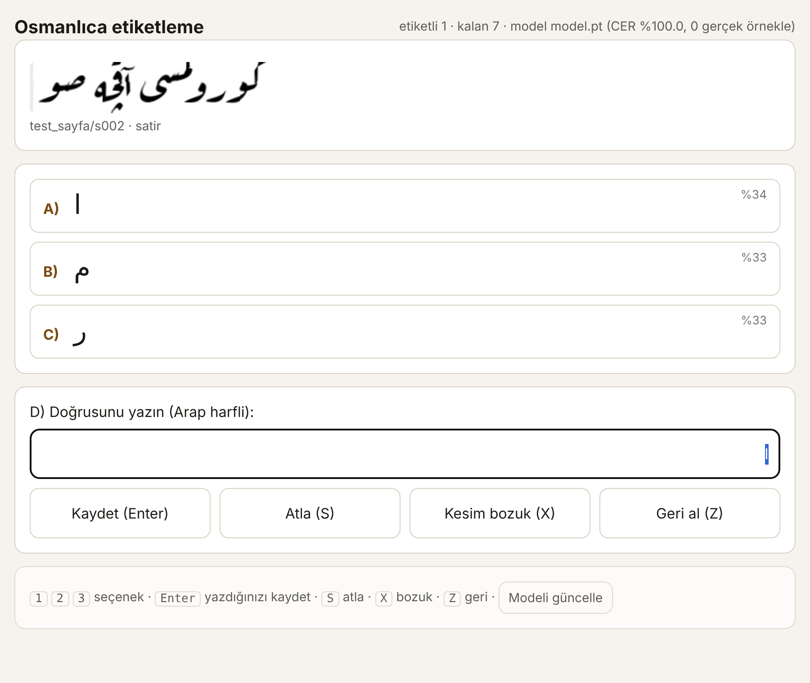

# Osmanlıca HTR — rik'a için küçük satır/kelime tanıma modeli

Osmanlıca (öncelik: **rik'a** el yazısı) satır ve kelime görüntülerini Arap harfli metne çeviren, ~1,9 M parametreli
CRNN+CTC modeli ve onu gerçek veriyle büyütmek için bir **A/B/C/D etiketleme döngüsü**.

- Model telefona sığar: fp32 7,8 MB, **int8 ONNX 2,0 MB**.
- Gerçek veri yokken yazı tiplerinden (4'ü rik'a) sentetik veriyle **ön eğitim**; sonra sizin etiketlerinizle ince ayar.
- Etiketleme: sayfa → satır (→ kaba kelime) kesilir, model her kesit için **A / B / C** önerir, doğrusu yoksa **D** ile
  yazarsınız. Her etiket anında eğitim manifestine düşer; "Modeli güncelle" düğmesi ince ayarı arka planda başlatır.
- **Gerçek veritabanı** tek komutla kurulur: 37.852 çevriyazılı satır (Muharaf rik'a el yazısı 24.494, OpenITI Osmanlıca
  matbu 9.893, MAKHZAN Osmanlıca el yazması 3.465). Ayrıntı ve lisanslar: [`docs/veritabani.md`](docs/veritabani.md).
- **LoRA yolu** da var: hazır bir Arapça TrOCR modeline Osmanlıca harfleri sözlük genişletme + LoRA ile öğretir
  (`osm lora`); büyük modeli öğretmen yapıp küçük modeli damıtmak için.
- Neden klasik OCR olmuyor, güncel Arapça HTR/OCR depoları ve veri kümeleri: [`docs/arastirma.md`](docs/arastirma.md).



## Kurulum

```bash
cd osmanlica-htr
python3 -m venv .venv && source .venv/bin/activate
pip install -e ".[disa,test]"          # torch, numpy, pillow, scipy (+ onnx, pytest)
python -m pytest -q tests              # 8 test
```

GPU gerekmez; CPU'da çalışır (GPU varsa otomatik kullanılır). Yazı tipleri `fonts/` içinde gelir (SIL OFL).

## Hızlı akış

```bash
# 1) Sentetik ön eğitim verisi (bir kez, ~3 dk)
osm sentez --adet 24000 --cikti veri/sentez_v0

# 2) Açık kaynak gerçek veritabanı (≈ 6,5 GB indirme; Muharaf + OpenITI + MAKHZAN → veri/veritabani.jsonl)
osm veri hepsi

# 2b) Ön eğitim: önce sentetik (CPU'da 24k × 10 dönem ≈ 2 sa), sonra gerçek veritabanıyla devam
osm egit --manifest veri/sentez_v0/manifest.jsonl --cikti cikti/v0 --donem 10 --ogrenme-orani 2e-3
osm egit --manifest veri/veritabani.jsonl --manifest veri/sentez_v0/manifest.jsonl --sentez-ust-sinir 8000 \
         --baslangic cikti/v0/model.pt --cikti cikti/v2 --donem 8

# 3) Sayfalarınızı satırlara böl, etiket kuyruğuna ekle
osm bolut belgeler/ --duzey satir            # ya da --duzey kelime (kaba kelime kesimi)
#    eScriptorium/Transkribus'tan PAGE-XML varsa satırlar oradan alınır:
osm bolut belgeler/ --pagexml belgeler/page/

# 4) Etiketle: tarayıcıda http://127.0.0.1:8765
osm etiketle --model cikti/v0/model.pt
#    1/2/3 → A/B/C · Enter → D'yi kaydet · S atla · X kesim bozuk · Z geri al · "Modeli güncelle" → ince ayar

# 5) İnce ayar (arayüzdeki düğme de aynısını yapar)
osm egit --manifest veri/etiket_manifest.jsonl --manifest veri/sentez_v0/manifest.jsonl \
         --sentez-ust-sinir 4000 --baslangic cikti/v0/model.pt --cikti veri/model_ince --donem 8 --ogrenme-orani 5e-4

# 6) Tahmin ve dışa aktarma
osm tahmin satir.png --model veri/model_ince/model.pt --kelimeler    # A/B/C + kelime kutuları
osm disa --model veri/model_ince/model.pt --int8                      # ONNX + int8
```

Etiketleme sunucusu modeli dosya değiştiğinde kendiliğinden yeniler; ince ayar bitince öneriler yeni modelden gelir.

## LoRA ile hazır büyük modele Osmanlıca öğretme

```bash
osm lora --taban RayR1/trocr-base-arabic-handwritten --manifest veri/veritabani.jsonl --cikti cikti/lora_ota --donem 3
osm lora-tahmin satir.png --adaptor cikti/lora_ota
```

- LoRA tek başına yeni harf **üretemez**: Osmanlıca harfler (پ چ ژ گ ڭ ی…) çözücünün sözlüğünde yoksa model onları
  yazamaz. Betik eksik karakterleri yeni token olarak ekler, gömme ve çıkış katmanını büyütüp tam eğitir, dikkat
  katmanlarına LoRA takar (eğitilebilir pay ≈ %5–8).
- Byte düzeyi tokenizer kullanan modellerde (HATFormer, Qwen tabanlı VLM'ler) sözlük genişletmeye gerek yoktur; LoRA yeter.
- Bu yol "en küçük model" hedefine terstir (TrOCR-large ≈ 600 M parametre, GPU ister). Önerilen kullanım: LoRA'lı büyük
  modeli **öğretmen** yapıp etiketsiz satırları sahte etiketlemek ve 1,9 M'lik CRNN'i bununla eğitmek (damıtma).
  Literatürde (Al-azzawi vd. 2026) 100–1.000 satırlık rejimde küçük CRNN zaten Transformer'ı geçiyor; LoRA'lı büyük model
  ancak on binlerce satırla fark yaratır.

## Tasarım kararları

| Karar | Gerekçe |
| --- | --- |
| **Satır düzeyi CTC**, karakter kesme yok | Rik'a bitişik ve ligatür ağırlıklı; karakter kesen OCR motorları Arapça el yazısında %90'ın üzerinde hata verir (bkz. araştırma). |
| **Kelime sınırı = CTC'deki boşluk sembolü** | Satırdaki boşluklara bakarak kelime bölme rik'ada güvenilmez: 6 yazı tipi, 150 satırlık ölçümde en iyi eşik bile satırların yalnızca ~%50'sinde doğru kelime sayısını buldu. Model boşluğu bir karakter gibi öğrenir; `tahmin.kelime_kutulari` zaman eksenini piksele çevirir. |
| **Çıktı Arap harfli**; Latin çevriyazı yok | İki işi tek modele yüklemek veriyi böler; çevriyazı ayrı, kural tabanlı bir adım olabilir. |
| Harekeler atılır, ى/ي/ی tek sembole, ک→ك | Arşiv belgelerinde hareke yok; son konumda üç ye aynı görünür, ayrı etiketlemek CTC'yi şaşırtır (`alfabe.normallestir`). |
| **1,9 M parametre** (6 konv. blok + 2 katman BiLSTM 128) | 100–1.000 satırlık düşük kaynak rejiminde CRNN+CTC Transformer'ı geçer (Al-azzawi vd. 2026); int8'de 2 MB. |
| Gerçek örnekler eğitimde ×4 tekrarlanır | Az sayıda gerçek etiket sentetik yığının içinde kaybolmasın. |
| Etiketleme birimi varsayılan **satır** | Kaba kelime kesimi rik'ada hatalı; satır etiketi hem daha güvenilir hem kelime bilgisini (boşluk) taşır. |

## Klasör yapısı

```
osmanlica_htr/
  alfabe.py    Osmanlıca alfabe, normalleştirme, kodlama
  sentez.py    yazı tiplerinden sentetik kelime/satır üretimi + el yazısı bozulmaları
  bolut.py     sayfa → satır → kaba kelime (Sauvola, eğim düzeltme, izdüşüm); PAGE-XML içe aktarma
  veri.py      ön işleme (yükseklik 64), manifest, Dataset, CER
  model.py     CRNN+CTC, kaydet/yükle
  kodcoz.py    açgözlü ve ön-ek ışın araması (A/B/C için farklı top-k)
  egit.py      eğitim döngüsü (OneCycle, en iyi CER'i kaydeder)
  tahmin.py    Tahminci, CTC hizalamasından kelime kutuları
  etiketle.py  yalnızca stdlib ile etiketleme sunucusu (A/B/C/D, geri al, arka planda ince ayar)
  veritabani.py Muharaf / OpenITI / MAKHZAN / Commons indirme ve tek veritabanına dönüştürme
  lora.py      hazır TrOCR modeline sözlük genişletme + LoRA (peft) ile Osmanlıca öğretme
  cli.py       `osm` komutları
fonts/         17 Arap harfli OFL yazı tipi (4 rik'a)
metin/         sentetik veri için ~1.700 kelimelik Osmanlıca tohum sözlük (kendi listenizi ekleyin)
veri/          (git dışı) sentetik veri, veritabanı (kaynak/ ham indirmeler, gercek/ satırlar), kırpımlar, kuyruk, etiketler
docs/          araştırma raporu, veritabanı belgesi, ekran görüntüsü
```

## Veri biçimleri

- **Manifest** (`manifest.jsonl`): `{"dosya": "goruntuler/x.png", "metin": "دولت علیه", "kaynak": "sentez|etiket"}`.
  Yollar manifestin klasörüne görelidir; birden çok manifest birleştirilebilir.
- **Kuyruk** (`veri/kuyruk.jsonl`): bölütleyicinin ürettiği öğeler (kimlik, kesit dosyası, satır bağlamı, kutular, tür).
- **Etiketler** (`veri/etiketler.jsonl`): her karar (`secim`: A/B/C/D/atla/bozuk, `metin`, zaman). Son satır silinerek geri alınır.
- **Etiket manifesti** (`veri/etiket_manifest.jsonl`): etiketlerden otomatik türetilen eğitim manifesti (`kaynak: etiket`).

Kendi verinizi elle hazırlayacaksanız yalnızca manifest biçimine uymanız yeterlidir.

## Beklentiler ve sınırlar

- Sentetik ön eğitim yazı tipi rik'asını öğretir; **gerçek el yazısını öğretmez**. İlk gerçek etiketlerde öneriler
  zayıf olacaktır; 200–300 satırdan sonra A/B/C'nin isabeti belirgin biçimde artar, 1.000+ satırda kullanışlı olur.
  Literatürde rik'a için %10–15 CER iyi bir sonuçtur.
- Bölütleyici düzgün taranmış, tek sütunlu belgeler içindir. Kenar notları, eğik satırlar ve iç içe yazılar için
  eScriptorium'da (Kraken `blla`) bölütleyip PAGE-XML'i `--pagexml` ile verin.
- Cumhurbaşkanlığı Devlet Arşivleri gibi kaynaklardaki görüntülerin kullanım koşullarını kontrol edin; yazı tipleri OFL'dir.

## Yol haritası

1. Etiketlenen satırlardan zorlanmış hizalama ile otomatik kelime kırpımı (veriyi kelime düzeyinde çoğaltma).
2. Hafif bir karakter n-gram dil modeliyle ışın araması (A/B/C'nin daha anlamlı olması).
3. Muharaf (CC BY-NC-SA, çoğunluk ruk'a) ve OpenITI Osmanlıca baskı satırlarıyla ek ön eğitim seçeneği.
4. Tarayıcıda çalışan ONNX Runtime Web demo (Köprü PWA ile aynı çevrimdışı ilke).

## Telefondan etiketleme (tarayıcı sürümü)

`web/index.html`, aynı modeli tarayıcıda çalıştıran, kurulum gerektirmeyen sürümdür: sayfa fotoğrafı yüklenir,
satırlara bölme ve A/B/C tahmini telefonda (onnxruntime-web) yapılır, satır kırpımları ve etiketler artifact'ın
veritabanında birikir. Yayımlı adres: <https://claude.ai/artifact/WfoJPfRokkckLaXtJYeha5> (özel; sahibinin paylaşması gerekir).

### Hazır kuyruk: 123 sayfa, 1.607 satır

Telefon sayfasında etiketlenmeyi bekleyen 123 gerçek sayfa var: 1841–1933 arası Osmanlı resmî yazışmaları (rik'a; çoğu Devlet
Arşivleri kaynaklı Bulgaristan koleksiyonu), hatt-ı hümayunlar, bir ferman, Atatürk mektupları ve BnF'deki Türkçe-Farsça
şiir mecmuasından nesih/talik sayfaları. Tümü Wikimedia Commons'tan; 122'si kamu malı, 1'i CC0. Kaynak listesi:
[`docs/kuyruk_kaynaklar.md`](docs/kuyruk_kaynaklar.md). Sıra: önce rik'a belgeler, sonra mecmua.

Etiketler artifact veritabanında (`sayfalar` koleksiyonu, satır başına `durum`/`metin`/`secim`) birikir; eğitime almak için
ArtifactData ile okunup `etiket_manifest.jsonl` biçimine çevrilir.

### Risale-i Nur el yazmaları (bilinen metin): 185 sayfa, 3.177 satır

Kuyruk seçicinin varsayılanı. Milli Kütüphane arşivinden iki el yazması (archive.org): **22. ve 23. Sözler** (120 sayfa,
1.657 satır) ve **Asâ-yı Mûsâ**'nın ilk 65 sayfası (1.520 satır). Metin bilindiği için satırı yazmazsınız. Satırın
bittiği kelimeye dokunursunuz ya da metinden çıkarılan A/B/C aralıklarından birini seçersiniz. Sonraki satır kaldığınız
kelimeden devam eder. Model gerekmez.

Etiketler Latin harfli çeviriyazıdır; Arapça ibareler Arap harfiyle kalır. Eserler 2030 sonuna kadar telif
korumasındadır, bu yüzden veri yalnızca kişisel araştırma içindir. Ayrıntılar, eşleme notları ve yeniden üretme komutları:
[`docs/risale_kaynak.md`](docs/risale_kaynak.md).

Yeniden yayımlamak için gereken dosyalar (`web/` içinde, git dışı): `ort.min.js`, `ort-wasm-simd-threaded.mjs`,
`ort-wasm-simd-threaded.wasm` (npm `onnxruntime-web@1.20.1` dist), `model-agirlik.wasm` (= `osm disa` çıktısı
`model.onnx`, servis edilebilir uzantıyla), `model.alfabe.json`, `model.json`, ayrıca `kuyruk/` altındaki sprite'lar ve
`kuyruk/metin/*.json`. Etiketleri geri almak: `sayfalar` koleksiyonu (satır başına durum, metin, secim; Risale
satırlarında bas/son) + sprite görüntüleri (`sprite_yol` yayımlanmış dosya ya da `sprite` asset kimliği).
