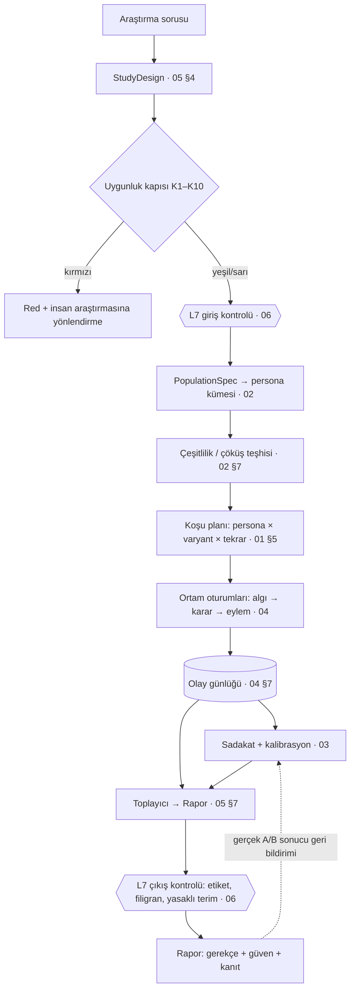

# Persona Katmanı — bütünleşik mimari

Bu belge yedi rol bölümünü (`mimari/01`–`07`) tek çerçevede toplar, bölümler arası sözleşmeleri sabitler ve
çelişen noktalarda bütünleştirme kararı verir. Ayrıntı her zaman ilgili bölümdedir; burada tekrar edilmez.
Değer ve ilke soruları karar verilmeden `FELSEFI-KARARLAR.md`'ye taşınmıştır.

## 1. Tek cümlelik tez

Katman, **nüfus dağılımından örneklenmiş, kanıta bağlı, sürümlü personaları** gerçek bir ortamda (web, uygulama, Figma,
reklam) **davranmaya** bırakır; her bulguyu **gerekçe + belirsizlik + kanıt** ile raporlar ve kendini **gerçek sonuçlarla
sürekli kalibre eder**. Simülasyon ölçümün yerine geçmez; hangi soruya uygun olmadığını söyleyen bir kapı en önde durur.

## 2. Literatür uyarısı → mimari karşılık (özet)

| Uyarı (00-arastirma §3) | Karşılık | Bölüm |
| --- | --- | --- |
| Kalıp yargı çöküşü, düşük çeşitlilik | Önce dağılım sonra birey; küme ve yanıt düzeyinde çöküş teşhisi; varyans oranı ve kuyruk kapsaması metrikleri (P3, P4) | 02, 03 |
| Ortalama tutar, varyans/ilişki sapar | Dört eksenli zorunlu metrik seti (konum, yayılım, ilişki, kalibrasyon); tek eksenli rapor "eksik" sayılır | 03 |
| Düzleşme ve karikatür | Alt grup fark oranı (P5) ve en kötü grup hatası (P7); kültürel işaretçi sözlüğü insan gözden geçirmeli | 02, 03 |
| Nüfusa hizasız persona kümesi | `PopulationSpec` + hücre ağırlıkları; art tabakalama; temsil kaynağı yoksa kapı sarı/kırmızı (K5) | 02, 05 |
| Kimlik kayması | Kimlik çapası + her N adımda çapa sondası; kayma eğimi metriği (U2); kaymış oturum raporlama politikası | 01, 02, 03 |
| Kanıtsız kesinlik | Kaynağı olmayan alan yok (`unknown`); kanıt yoksa "bilmiyorum" birinci sınıf çıktı; atıf oranı (U3) | 02, 03 |
| Aşırı güven | Rapor ilk ekranında güven sınıfı + "ne bilmiyoruz"; sentetik etiketi her alıntıda; filigran | 05, 06 |
| Düşük riskli kararlar için | Uygunluk kapısı K1–K10; ödeme istekliliği ve ihtiyaç keşfi varsayılan kırmızı | 05 |

## 2b. İki kaynaklı davranış modeli (ADR-001, ADR-002, ADR-003) ve etki kitaplığı

Proje sahibinin iki kararı birlikte okunur: katman gerçek müşteriler için istatistiksel profil üretir (ADR-001), ama bunu bir
kişinin psikolojisini kopyalayarak değil, **sosyolog gibi, genelden özele** inerek yapar (ADR-002). Birim "X kişisinin ikizi"
değil, **seviye bazlı davranış profili**dir; kişi düzeyi veri yalnızca genel çıkarım için işlenir, hedefleme ve kişiye gösterim yoktur.

```
KAYNAK A · Genel model (genelden özele)
S0 Dünya ──► S1 Türkiye ──► S2 Şehir / bölge ──► S3 Konum (mağaza) / site
literatür      TR çalışmaları,  bölgesel istatistik,   konum türü veya sitenin
etki kitaplığı GPS ülke puanı,  kiracının şehir logu   toplu olay günlüğü
               TÜİK
   her seviye üsttekini öncül alır, kendi verisiyle günceller; veri yoksa "miras" etiketiyle taşır

KAYNAK B · Gerçek müşteri modeli (bağımsız, sıfırdan)
kiracının gerçek müşterilerinin gözlemleri ──► kendi öncülü, kendi belirsizliği; A'dan öncül almaz

SUNUM: yalnız A · yalnız B · A+B birleşik + FARK (parametre başına yön, büyüklük, anlamlılık)
```

- **Parametre vektörü θ** (kayıptan kaçınma, şimdicilik, risk, sosyal kanıt, reklam toleransı, fiyat ve yorum duyarlılığı,
  kıtlık, güven işareti, sabır, dikkat eşiği, varsayılan yapışkanlığı + 07'nin eklediği karar gürültüsü, dalgınlık, okuma hızı,
  hayal kırıklığı eşiği, yenilik arayışı, söz-davranış farkı, kategori sapması) her seviyede ayrı kestirilir.
- **S0 ve S1 literatürden:** `data/davranis-etkileri.xlsx` 176 bulgu ve 152 kaynaktan etki büyüklüklerini, güven aralıklarını ve
  moderatörleri taşır; her satır bir parametreye, bir prior önerisine ve bir seviyeye (S0 Dünya / S1 Türkiye) bağlanır.
  "Fark matrisi" sayfası yaş, cinsiyet, gelir, eğitim, kültür, deneyim, cihaz ve kategori farklarının hangi parametreyi etkilediğini gösterir.
- **S2–S3 kiracının toplu verisinden:** şehir bazlı davranış, konum türü (AVM, cadde, semt) veya sitenin olay günlüğü. Kiracılar arası
  paylaşım yalnızca S1'e toplulaştırılmış hata istatistiği olarak gider (F-9 ile uyumlu).
- **Kaynak B sıfırdan:** gerçek müşteri gözlemlerinden, A'dan bağımsız kestirilir; genel öncülle yumuşatılmaz ki müşterinin gerçek
  farkı silinmesin. A ile B'nin farkı kendi başına bulgudur ve iki kaynak birbirini doğrular (ADR-003).
- **Kullanım serbestliği:** çalışma tasarımında `parameter_source ∈ {A, B, A+B}` ve A için `level ∈ {S0..S3}` seçilir; rapor her parametrenin
  hangi kaynaktan ve seviyeden geldiğini gösterir; A+B kipinde fark tablosu zorunludur.
- **Ölçek analizi:** her seviyede davranışın ne kadar yaygın ve ne büyüklükte olduğu `BehaviorScale` nesnesiyle (oran, etki, varyans, n, güven) raporlanır.
- **Aşırı kesinliğe karşı:** her parametre "miras / kısmen yerel / yerel" etiketi taşır; bir parametre ancak o seviyede onu tanımlayan
  gözlem varsa serbest bırakılır.
- **Hibrit karar:** model kapsamındaki karar noktalarında olasılığı istatistik motoru verir ve eylemi örnekler; LLM özellik çıkarır
  ve gerekçeyi sonradan yazar; `override_rate` ile LLM'in sayıyı ezmesi izlenir.
- **Gizlilik:** Kaynak B'deki kişi düzeyi veri yalnızca kestirim için işlenir, kişi kimliğiyle dışa aktarılmaz, bireysel arayüz yoktur; standart
  KVKK silme (06'nın sonraki turu).

## 3. Katmanlar ve akış

Yedi sınırlı bağlam (01 §2): **L1** Persona üretimi · **L2** Persona çalışma zamanı · **L3** Ortam · **L4** Orkestrasyon ·
**L5** Değerlendirme · **L6** İçgörü/rapor · **L7** Yönetişim (kesen düzlem).



Kritik tasarım noktaları:

- Persona ajanı LLM'e doğrudan gitmez; her çağrı **model yönlendiriciden** geçer (önbellek, bütçe, soy kaydı, tekrar oynatma). (01 §8)
- **Söz kanalı ve davranış kanalı ayrı** tutulur: `thought` ve `action` olayları ayrı, rapor ikisini ayrı gösterir; aradaki fark
  "modelin iki kanalı arasındaki fark" diye adlandırılır, insanlardaki say-do gap'in kanıtı diye değil. (02 §9, 04 §7, F-7)
- Dış dikkat/sabır modeli oturumu sonlandırdığında bu **ayrı etiketlenir** ("sabır modeli sonlandırdı" ≠ "persona vazgeçti"). (04 §6)
- Her koşu bir **sürüm demetine** (`config_bundle`: model politikası, persona kümesi, ortam sürümü, kalibrasyon düzelticisi, seed)
  bağlanır; demet değişmeden sonuç karşılaştırması yapılmaz. (01 §4.7, 03 §10)
- **Kör tahmin mühürleme**: rapor üretilmeden önce tahminler mühürlenir; müşteri gerçek sonucu geri bildirir; kalibrasyon kaydı buradan birikir. (03 §8.4)

## 4. Bütünleştirme kararları (bölümler arası çelişki ve boşluklar)

Bölümler bağımsız yazıldığı için aşağıdaki noktalarda tek bir tanım seçildi. İlgili bölümler bir sonraki turda buna uyarlanır.

| # | Konu | Durum | Karar |
| --- | --- | --- | --- |
| B1 | Karar/kullanım sınıfı taksonomisi | 01 `karar_sınıfı` (4 değer), 02 §10 (7 sınıf), 03 `decision_type`, 05 K1–K10 kapısı | Tek sözlük: **05 §6 kapı kuralları** kaynak; 02 §10 sınıfları bu kuralların "yeşil" kümesi olarak yeniden adlandırılır; 01 ve 03 aynı `decision_type` enum'unu kullanır. Sahibi: 05. |
| B2 | Şema dili | 01 alan adları Türkçe (`nüfus_ref`), 02/04/05 İngilizce (`population.strata`, `device_profile`) | Makine alanları **İngilizce**, belge ve arayüz metni Türkçe. 01'in YAML'ı bir sonraki turda çevrilir. |
| B3 | Çeşitlilik/kalıp yargı metrikleri | 02 §7 ve 03 §7 benzer metrikleri ayrı tanımlıyor | Formül sahibi **03** (P2–P7); 02 bu kodlara atıf yapar, kendi formülünü tutmaz. Eşikler 02'de "varsayım", 03 kalibre eder. |
| B4 | Persona şeması ile ortamın beklediği alanlar | 04 §12 `device_profile, reading_speed, patience_profile, frustration_threshold, assistive_tech, digital_literacy, language` istiyor; 02 §5 `context.devices` var, diğerleri yok | 02 şemasına `behavioral_profile` bloğu eklenir; ortam eksik alanda oturumu başlatmaz (04 kuralı korunur). |
| B5 | Çağrı kaydı saklama süresi | 01 tekrar oynatma için istem+yanıt saklamak istiyor; 06 ham müşteri metninin loglarda tutulmamasını istiyor | **Hash + referans** loglarda; ham istem/yanıt kiracı anahtarıyla şifreli ayrı depoda, 06'nın saklama süresine tabi; süre dolunca tekrar oynatma "istatistiksel" moda düşer (01 §9.4). |
| B6 | Kullanıcı tasarımı persona (U7) | 01 F5, 05 S5 | Teknik varsayılan: ayrı "keşif" katmanı, istatistiğe girmez, raporda işaretli. Nihai karar: FELSEFI-KARARLAR F-5. |
| B7 | Global kalibrasyon düzelticisine müşteri verisi | 03 F5, 06 §4 | Teknik varsayılan: yalnızca toplulaştırılmış hata istatistiği, açık izinle. Nihai karar: F-9. |
| B8 | Ortam havuzu ile LLM havuzu ölçeklemesi | 01 ve 04 uyumlu | Ayrı ölçeklenir; `EnvironmentRunner.run(job) -> SessionRef` sözleşmesi (04 §12) kabul. |
| B10 | Davranış profili ↔ persona şeması | 07 iki kaynak (A: S0–S3, B: gerçek müşteri); 02 §5 en küçük birimi hücre sayıyordu | 02 §5 sınıfları `general_profile` (A), `customer_profile` (B), `fused_profile` (A+B) olur; `behavioral_profile` (B4) alanları 07'nin profil bloğundan beslenir. |
| B11 | Kaynak B metrikleri ve A–B uyuşmazlığı | 07 yeni metrik ailesi istiyor (B'nin tutulan oturum isabeti, A ile B'nin fark anlamlılığı) | 03 §7'ye "T" kodlu metrik ailesi eklenir; B genel modeli (A) geçemezse "müşteriye özgü" iddiası düşer; A–B farkı raporda güven aralığıyla verilir. |
| B9 | Çok ajanlı B2B komite | 05 istiyor, 01 §7 destekliyor | Rol bazlı ajan grubu; komite içi etkileşim MVP'de yok (sıralı bireysel koşu + sentez), ikinci aşamada. |

## 5. Bileşen sözleşmeleri (kısa)

| Sözleşme | İmza / içerik | Sahibi |
| --- | --- | --- |
| `StudyDesign` | soru, `decision_type`, `population`, `scenario`, `success_metrics`, `confidence_threshold`, `gate_result`; koşudan önce kilitlenir | 05 |
| `generate_persona_set(PopulationSpec, EvidenceStore, seed) -> PersonaSet` | hücre ağırlıklı küme + teşhis raporu | 02 |
| `Persona` | 7 blok + `behavioral_profile`; her alan `value/source/evidence_refs/confidence`; `class ∈ {population_sampled, evidence_grounded_cell, user_authored}` | 02 |
| `route(role, budget, policy) -> ModelRef` | gerçek hizmet veren model, token, önbellek isabeti, gecikme döner | 01 |
| `EnvironmentRunner.run(job) -> SessionRef`; `job = {persona_ref, env_spec, variant, seed, task, budget}` | her ortamda `abandon`/`hold` eylemi zorunlu | 04 |
| Olay zarfı | `event_id, session_id, t_virtual, kind ∈ {perceive, thought, action, action_rejected, abandon, milestone, probe}, provenance` | 04 |
| `Evaluator` | U/S/P/D/C/O metrikleri; regresyon kapıları G1–G3; kör tahmin mühürü | 03 |
| `Report` | zorunlu: güven sınıfı, aralık, geçmiş isabet, kapsam etiketi, sürüm künyesi, "ne bilmiyoruz", sentetik etiketi, filigran | 05 + 06 |
| `PolicyChecker` | giriş: veri sınıfı, hukuki dayanak, yüksek riskli sektör, sahiplik doğrulaması; çıkış: yasaklı terim, etiket, filigran | 06 |

## 6. Teknoloji önerisi (01 §12 kabul edildi)

Python çalışma zamanı ve değerlendirme; TypeScript API ve Figma eklentisi. Temporal ile dayanıklı iş akışı; Postgres (+pgvector)
başlangıç, analitik için ClickHouse'a akış; Playwright tabanlı tarayıcı sandbox havuzu; kendi ince ajan çalışma zamanı
(TinyTroupe/Concordia desenlerinden esinli, çerçeve bağımlılığı yok); kendi model yönlendiricisi + sağlayıcı bağdaştırıcıları.
Referans model ailesi Claude: ağır akıl yürütme ve tutarlılık denetimi için Opus sınıfı, toplu koşular için Haiku sınıfı;
ucuz katmanın sadakat maliyeti (O2) ölçülmeden oran sabitlenmez.

## 7. Yol haritası (öneri)

| Aşama | Kapsam | Çıkış ölçütü |
| --- | --- | --- |
| 0 · Omurga (6-8 hafta) | Uygunluk kapısı, `PopulationSpec` + persona üretimi (TÜİK/kamu istatistiği + müşteri anketi), **etki kitaplığından prior üretimi (07 §3)**, web sandbox, olay günlüğü, yönlendirici, temel rapor | Bir e-ticaret sepet akışında 200 persona × 2 varyant koşusu; rapor ilk ekranda güven sınıfı gösteriyor |
| 1 · Kalibrasyon (8 hafta) | Kör tahmin mühürü, backtest veri kümesi, metrik panosu, regresyon kapıları, reklam görseli ortamı, **kiracı düzeyi hiyerarşik model ve ilk sıcak ikizler (07 §7)** | 10 gerçek A/B sonucuyla ilk kalibrasyon kaydı; P3 ve P5 raporlanıyor |
| 2 · Genişleme | Figma, mobil, video reklam, B2B komite, Türkiye sektör şablonları, SOC 2 kontrol kanıtları | İkinci sektör şablonu canlı; kalibre edilmiş hücrede koşullu temsil dili |
| 3 · Strateji merceği | Pazar/segment ölçeğinde simülasyon | Yalnızca 03'ün nüfus düzeyi metrikleri eşiği geçince |

## 8. Açık riskler (bölümlerden derlenmiş)

- Ucuz model katmanının sadakate etkisi ölçülmedi; tüm maliyet oranları varsayım.
- Model emekliliği eski koşuların tekrarını bozar; kalibrasyon kayıtları model politikası sürümüyle anahtarlanır.
- Erken durdurma ve eksik blok tasarımı yanlış uygulanırsa sahte kesinlik üretir; 03 onayı olmadan varsayılan açık değil.
- Türkiye için kamu istatistiği granülaritesi düşük olabilir; küçük hücrelerde yeniden tanımlama riski ile temsil arasında gerilim (02, 06).
- Hukuki ifadeler (KVKK/GDPR) hukuki görüş değildir; 06'daki "doğrulanmalı" işaretleri avukat incelemesi bekler.
- Talp'ın gerçek ilan metinleri görülmedi; roller rakip ilanlarından türetildi (01-roller.md).
- Etki kitaplığındaki sayıların çoğu makale özetlerinden ve ikincil kaynaklardan alındı; 176 satırın 77'sinde sayısal etki var, kalanında yalnızca yön/moderatör. `notlar` sütununda "doğrulanmadı" yazanlar prior olarak kullanılmadan önce makaleden kontrol edilmeli. Türkiye'ye özgü hakemli etki büyüklüğü çok az (Global Preferences Survey ülke puanları, iki anket).
