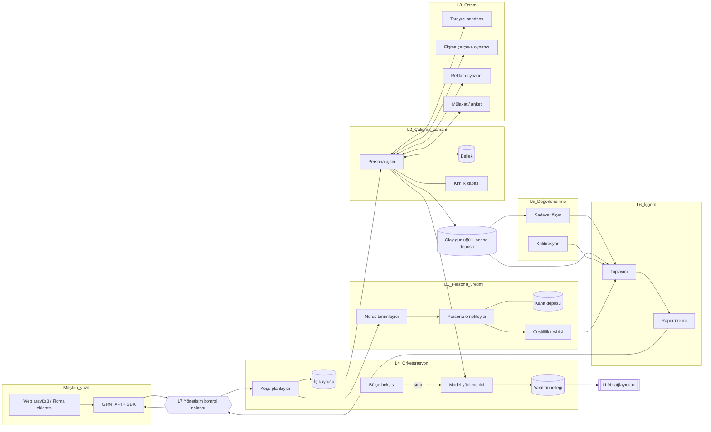

# 01 · Sistem mimarisi: katmanlar, veri modeli, çalışma zamanı, ölçek ve maliyet

Yazar: `pk-simulasyon-mimari` · Tarih: 2026-11-07 · Durum: taslak v0.1
Girdi: `../00-arastirma.md` (§3-4), `../01-roller.md`. Diğer bölümlerle sınırlar §13 "Arayüzler"de toplanır.


---

## 1. Tasarım ilkeleri: literatürün uyarılarını mimariye gömmek

Farkı pazarlamada değil mimaride yaratıyoruz: her uyarı bir bileşene ya da veri alanına karşılık gelir.

| # | Literatür uyarısı | Mimarideki karşılığı |
| --- | --- | --- |
| U1 | Persona koşullu LLM çıktısı kalıp yargı kümesine çöker (arXiv 2602.03545, 2607.18310) | Nüfus nesnesi önce **dağılım** olarak tanımlanır; her koşuda `çeşitlilik_teşhisi` zorunlu Gözlem türüdür (§4, §5) |
| U2 | Ortalama tutarken varyans ve ilişkiler sapabilir (arXiv 2609.07987) | Rapor tek skor taşıyamaz: şema düzeyinde `dağılım`, `belirsizlik`, `sadakat_profili` alanları zorunlu (§4.6) |
| U3 | Kültürel düzleşme ve karikatür (arXiv 2609.29928) | Persona sürümüne `kültürel_bağlam` ve teşhis bulguları iliştirilir; karikatür bayrağı Rapor'a taşınır |
| U4 | Nüfusa hizalı persona kümesi şart (arXiv 2509.10127) | Nüfus'un `hedef_dağılım` ile `gerçekleşen_dağılım` arasındaki uzaklık her koşuda hesaplanır ve eşiği aşarsa koşu "uyarılı" olur |
| U5 | Uzun ufukta kimlik kayması (arXiv 2608.15844) | Persona çalışma zamanında **kimlik çapası** ve periyodik kayma ölçümü (§6.3) |
| U6 | Kanıta dayalı persona, kanıt yoksa "bilmiyorum" (arXiv 2601.22288) | Her Gözlem `kanıt_referansları` ve `bilmiyorum` seçeneği taşır; kanıtsız iddia işaretlenir |
| U7 | Katılım aşırı güven doğurur (arXiv 2607.21757) | Kullanıcının elle düzenlediği persona `kaynak = kullanıcı_tasarımı` olarak etiketlenir; raporda ayrı gösterilir |
| U8 | Sentetik kullanıcı düşük riskli, geri alınabilir kararlar içindir | Senaryo nesnesinde `karar_sınıfı` alanı; kapsam dışı sınıflar (ör. ödeme istekliliği) yönetişim katmanında engellenir ya da uyarılır |

**Mimari ilke:** "Bir uyarının karşılığı bir şema alanı veya bir boru hattı adımı değilse, o uyarı mimaride yok sayılır."

Diğer üç ilke:

- **Model bağımsızlık:** Hiçbir bileşen belirli bir sağlayıcının API biçimine bağlı değildir. Referans Claude ailesidir
  (ağır akıl yürütme için Opus, toplu koşular için Haiku), ama yönlendirici (§8) arkasında değiştirilebilir.
- **Tekrarlanabilirlik birinci sınıftır:** Her koşu kayıttan yeniden oynatılabilir (§9.4).
- **Karar desteği, ölçüm değil:** Ürün çıktısı, gerçek kullanıcı ölçümünün yerine geçme iddiası taşımaz. Bu, rapor şablonunda
  ve API yanıtlarında makine tarafından okunur bir `kullanım_sınırı` alanıyla taşınır.

---

## 2. Bağlam sınırları ve katmanlar

Alan güdümlü tasarım (domain-driven design) diliyle yedi sınırlı bağlam (bounded context) tanımlıyoruz. Her bağlamın kendi veri
sahipliği vardır; bağlamlar arasında yalnızca sürümlü nesne kimlikleri ve olaylar (event) dolaşır.

| Katman / bağlam | Sorumluluk | Sahip olduğu nesneler | Ayrıntı bölümü |
| --- | --- | --- | --- |
| **L1 Persona üretimi** | Hedef nüfus dağılımından birey personalar örnekler, temellendirir (grounding), çeşitlilik teşhisi yapar | Nüfus, Persona, KanıtDeposu | 02 |
| **L2 Persona çalışma zamanı** | Bir personayı bir senaryo içinde "yaşatır": algı, bellek, karar, ifade | AjanOturumu, Bellek | bu belge §6 |
| **L3 Ortam** | Personanın etkileştiği dünya: web/uygulama tarayıcısı, Figma çerçevesi, reklam oynatıcı, anket/mülakat | Ortam, EylemAlanı, OlayAkışı | 04 |
| **L4 Orkestrasyon** | Koşu planlama, parçalama, kuyruk, model yönlendirme, önbellek, yeniden deneme, bütçe | Koşu, İş (job), Bütçe | bu belge §5, §7-10 |
| **L5 Değerlendirme** | Sadakat metrikleri, kalibrasyon, geriye dönük test (backtest), gözlemlenebilirlik | Değerlendirme, KalibrasyonKaydı | 03 |
| **L6 İçgörü / rapor** | Gözlemleri toplar, segment karşılaştırması, gerekçe özetleri, belirsizlik gösterimi | Rapor, Bulgu | 05 |
| **L7 Yönetişim** | Veri sınıfları, erişim, saklama, kötüye kullanım filtreleri, denetim izi | Politika, DenetimKaydı | 06 |

L7 kesen bir düzlemdir (cross-cutting): her bağlam girişte ve çıkışta yönetişim kontrolünden geçer.

---

## 3. Bileşen diyagramı



Kritik nokta: persona ajanı LLM'e **doğrudan** gitmez; her çağrı yönlendiriciden geçer. Bu, model değişimini, önbelleği,
bütçe sınırını ve tekrar oynatmayı tek noktada toplar.

---

## 4. Temel veri modeli ve sürümleme

### 4.1 Genel kurallar

- Her ana nesne **değişmez sürümlerden** (immutable versions) oluşur: `id` kalıcı, `sürüm` artan; düzenleme yeni sürüm üretir.
- Kimlik biçimi: `<tür>_<ulid>@v<n>` (ör. `per_01J..@v3`). Bir Koşu, girdilerinin tam sürümlerine işaret eder; "en son sürüm" ile
  koşu başlatılamaz (çözümleme planlama anında yapılır ve kaydedilir).
- Her nesne `içerik_özeti` (content hash) taşır; aynı içerikli iki sürüm tekilleştirilir ve önbellek anahtarına girer.
- Her nesnede `veri_sınıfı` (06'nın tanımladığı sınıflar: sentetik / türetilmiş / müşteri-gerçek / kişisel) zorunludur.

### 4.2 Varlık-ilişki özeti

```
Nüfus 1 ──< n Persona            (bir nüfus örneklemi, çok persona)
Senaryo 1 ──< n Varyant          (A/B/... konsept, reklam, akış)
Koşu  n >── 1 Nüfus@v , n >── 1 Senaryo@v , 1 ── 1 ÇalışmaYapılandırması
Koşu  1 ──< n AjanOturumu        (persona × varyant × tekrar)
AjanOturumu 1 ──< n Gözlem       (olay, ifade, karar, teşhis)
Koşu  1 ──< n Değerlendirme      (03)
Koşu  n >──< n Rapor             (bir rapor birden çok koşuyu karşılaştırabilir)
```

### 4.3 Nüfus (Population)

```yaml
Nüfus:
  id, sürüm, içerik_özeti, veri_sınıfı
  tanım:                     # 02 doldurur
    hedef_dağılım:           # marjinaller + ortak dağılım kısıtları
      - boyut: yaş_grubu; değerler: {...}; kaynak: "TÜİK 2025 (varsayım)"
    korelasyon_kısıtları: [...]
    kültürel_bağlam: { ülke, dil, bölge_ağırlıkları }
  örneklem:
    yöntem: "dağılım-önce" | "kanıt-temelli" | "kullanıcı_tasarımı"
    tohum: int               # örnekleme tohumu (seed)
    boyut: int
  gerçekleşen_dağılım: {...} # örnekleme sonrası ölçülen
  hizalama_uzaklığı: float   # hedef ile gerçekleşen arası (metrik 02/03'te)
```

### 4.4 Persona

```yaml
Persona:
  id, sürüm, nüfus_ref, veri_sınıfı
  kaynak: "örneklenmiş" | "kanıt-temelli" | "kullanıcı_tasarımı"   # U7
  öznitelikler: { demografi, psikografi, dijital_alışkanlık, alan_bilgisi }
  anlatı: str                # kısa biyografi; sistem isteminin çekirdeği
  kanıt_referansları: [kanıt_id]   # U6; boşsa "kanıtsız" bayrağı
  kimlik_çapası:             # §6.3
    değişmez_iddialar: [str] # "40 yaşında, iki çocuklu, Konya'da"
    tutum_vektörü: {...}     # ölçeklenmiş tutum yanıtları (kayma referansı)
  teşhis: { karikatür_riski, kalıp_yargı_yakınlığı }  # 02 doldurur
```

### 4.5 Senaryo, Varyant, Koşu

```yaml
Senaryo:
  id, sürüm
  araştırma_sorusu: str      # 05'in "soru → simülasyon" çevirisinin çıktısı
  karar_sınıfı: "mesaj_iterasyonu" | "konsept_eleme" | "akış_kullanılabilirliği" | "kapsam_dışı:*"   # U8
  ortam_türü: "web" | "uygulama" | "figma" | "reklam" | "mülakat"
  ortam_yapılandırması: {...}  # 04'ün şeması
  görev: str                 # "Ürünü sepete ekle ve ödemeye geç"
  ölçütler: [ölçüt_tanımı]   # dönüşüm, terk noktası, algılanan güven...
  varyantlar: [Varyant{ id, içerik_ref, açıklama }]

Koşu:
  id                          # koşular sürümlenmez; değişmez kayıttır
  nüfus_ref@v, senaryo_ref@v
  yapılandırma:
    tekrar_sayısı: k          # her persona × varyant için bağımsız tekrar
    model_politikası_ref@v    # §8
    sıcaklık_politikası, tohum_kökü
    bütçe: { tavan_birim, erken_durdurma_kuralı }
  durum: §5'teki durum makinesi
  ortam_görüntüleri: [özet]   # tarayıcı/uygulama sürümü, varlık özetleri
  sağlayıcı_kaydı: [{ model_kimliği, tarih }]   # tekrar oynatma için
```

### 4.6 Gözlem ve Rapor

```yaml
Gözlem:
  id, oturum_ref, sıra_no, zaman
  tür: "eylem" | "algı" | "ifade" | "karar" | "duraksama" | "teşhis" | "hata"
  içerik: {...}              # 04'ün olay şeması + serbest metin
  gerekçe: str?              # personanın kendi sözleriyle
  güven: float? ; bilmiyorum: bool   # U6
  kanıt_referansları: [...]
  llm_çağrı_ref: çağrı_id    # yönlendirici kaydına bağ

Rapor:
  id, sürüm, koşu_refleri
  bulgular: [Bulgu{ iddia, segment, etki_büyüklüğü, dağılım, belirsizlik_aralığı, dayanak_gözlemler }]
  sadakat_profili: {...}     # 03'ten: çeşitlilik, hizalama, kayma, kalibrasyon geçmişi   (U2)
  uyarılar: [...]            # hizalama eşiği, karikatür bayrağı, kapsam dışı karar sınıfı
  kullanım_sınırı: str       # makine-okur; "karar desteği; ölçümün yerine geçmez"
```

**Tasarım kararı:** Rapor şemasında tek `skor` alanı yoktur; en küçük birim `etki_büyüklüğü` + `belirsizlik_aralığı` çiftidir
("skor değil gerekçe" ilkesinin şema karşılığı).

### 4.7 Sürümleme ve soy (lineage)

Her Rapor, bir soy grafiği üzerinden en alttaki kanıta kadar izlenebilir:
`Rapor → Bulgu → Gözlem → AjanOturumu → Persona@v → Kanıt` ve `Gözlem → LLM çağrısı → model_kimliği`.
Silme talebinde etkilenen türetilmiş nesneler grafikten bulunur ve
"geçersiz kılındı" olarak işaretlenir.

---

## 5. Bir simülasyon koşusunun yaşam döngüsü

```
  TASLAK ──planla──> PLANLANDI ──onay/bütçe──> KUYRUKTA ──> ÇALIŞIYOR ──> TOPLANIYOR ──> DEĞERLENDİRİLİYOR ──> RAPORLANDI
     │                  │                                     │   │                              │
     │                  └──(yönetişim reddi)──> REDDEDİLDİ     │   └─(bütçe tavanı / erken durdurma)─> KISMİ ──┘
     │                                                        └─(kalıcı hata oranı > eşik)──> BAŞARISIZ
     └── her durumda: İPTAL (kullanıcı)            RAPORLANDI ──(kaynak veri silindi)──> GEÇERSİZ
```

Adımlar:

1. **Taslak:** Kullanıcı (veya 05'in şablonu) Senaryo ve Nüfus seçer.
2. **Planlama:** Planlayıcı sürümleri sabitler, `N persona × V varyant × k tekrar` iş sayısını çıkarır, maliyet tahmini (§10) ve
   **istatistiksel güç** tahmini yapar (V varyant arasındaki beklenen farkı ayırt etmek için k ne olmalı; yöntem 03'te).
   Yönetişim kontrolü: karar sınıfı, veri sınıfı, kötüye kullanım filtresi (06).
3. **Kuyruğa alma:** İşler parça (shard) olarak kuyruğa düşer; parçalama anahtarı `persona_id` (aynı personanın oturumları aynı
   işçide toplanır, persona bağlamı önbelleği ısınır).
4. **Çalışma:** Her iş bir AjanOturumu açar (§6). Gözlemler olay günlüğüne **yalnızca ekleme** (append-only) ile yazılır.
5. **Toplama:** Toplayıcı, parça tamamlandıkça artımlı istatistik üretir. **Ardışık erken durdurma** (sequential early stopping):
   varyantlar arasındaki fark güven aralığı ile netleştiyse ya da açıkça belirsiz kalacağı görülürse kalan tekrarlar iptal
   edilebilir; bu, maliyetin en büyük kaldıracıdır. Kural koşu başında sabitlenir (sonradan "bakıp durdurma" yanlılığını önler).
6. **Değerlendirme:** 03'ün koşum takımı çeşitlilik, hizalama, kayma metriklerini hesaplar; varsa eski kalibrasyon kayıtlarıyla
   güven aralıklarını düzeltir.
7. **Rapor:** 06'nın çıkış kontrolünden geçer (ör. kişisel veri sızıntısı taraması), sonra yayımlanır.

---

## 6. Persona çalışma zamanı

### 6.1 Ajan döngüsü

Her AjanOturumu "algıla → hatırla → düşün → eyle → ifade et" döngüsüdür; Generative Agents (arXiv 2304.03442) ve Concordia'nın
oyun yöneticisi (game master) ayrımından (arXiv 2312.03664) esinlenir, kısa ufka göre sadeleştirilmiştir.

```
döngü (adım ≤ maks_adım ve görev bitmedi):
    algı     = ortam.gözlemle()                       # 04: DOM özeti, ekran görüntüsü, video karesi, soru
    bağlam   = bellek.getir(algı, sınır=B)            # ilgili anılar + kimlik çapası (her zaman)
    düşünce  = llm(persona_istemi, bağlam, algı, rol="karar")
    eylem    = eylem_alanı.doğrula(düşünce.eylem)     # 04'ün eylem şeması; geçersizse onar ya da "vazgeç"
    sonuç    = ortam.uygula(eylem)
    gözlem_yaz(algı, düşünce.gerekçe, eylem, sonuç, düşünce.güven)
    bellek.ekle(özetle(algı, eylem, sonuç))
    eğer adım % R == 0: kayma_ölç(oturum)             # §6.3
son: ifade = llm(..., rol="mülakat_sonrası")          # "neden bıraktın?" gibi yansıtıcı sorular
```

Önemli seçimler:

- **Düşünce ile ifade ayrılır.** Eylemi seçen çağrı ile "kendi sözleriyle anlatan" çağrı farklıdır. Böylece söylenen-yapılan
  farkı (say-do gap) sistem içinde de ölçülebilir: personanın eylemi ile sonradan verdiği gerekçe çelişiyorsa bu bir Gözlem'dir.
- **Vazgeçme meşru bir eylemdir.** Eylem alanında `terk_et`, `beklemeye_al`, `bilmiyorum` her zaman bulunur. LLM'lerin "görevi
  tamamlama" eğilimi dönüşüm tahminini yukarı çeker (varsayım; 03 bunu geriye dönük testte ölçmeli).

### 6.2 Bellek

Oturumlar kısadır (onlarca adım); üç katman yeterlidir:

| Bellek | İçerik | Ömür | Depolama |
| --- | --- | --- | --- |
| Çalışma belleği | Son m adımın ham özeti | Oturum | İşçi belleği |
| Epizodik bellek | Oturum içi önemli olaylar, özetlenmiş | Oturum (çok oturumlu senaryolarda koşu) | Olay günlüğü + vektör dizini |
| Anlamsal / kimlik | Persona anlatısı, değişmez iddialar, kanıt parçaları | Persona sürümü | Nesne deposu (salt okunur) |

Çok oturumlu senaryolar (ör. "bir hafta boyunca üç reklam gördü, sonra siteye geldi") için epizodik bellek oturumlar arasında
taşınır; bu durumda **bellek de sürümlenir** ve koşuya bağlanır. Varsayılan: oturumlar arası bellek kapalı; açmak senaryo
düzeyinde açık bir karardır, çünkü bağımsız tekrar varsayımını bozar.

### 6.3 Kimlik çapası ve kayma

Kimlik kayması (arXiv 2608.15844) için iki mekanizma:

1. **Çapa enjeksiyonu:** Değişmez iddialar her çağrıda bağlamın sabit, önbelleklenebilir önekinde (prefix) yer alır; bellek
   getirme bütçesi ne olursa olsun kesilmez.
2. **Kayma sondası:** Her R adımda (ve oturum sonunda) personaya, tutum vektörünü oluşturan kısa ölçek maddelerinden bir alt küme
   yönlendiricinin ucuz katmanında, **oturum bağlamından ayrı bir yan çağrıyla** sorulur; başlangıç vektörüyle uzaklık Gözlem olarak
   yazılır. Eşik aşılırsa oturum "kaymış" bayrağı alır; rapor toplayıcısı bu oturumları ayrı tabakada gösterir ya da dışlar
   (politika 03'te).

### 6.4 Çok kiplilik

Algı kip etiketi taşır; yönlendirici (§8) kip yeteneğine göre model seçer. Video, 04'ün kare örnekleme politikasıyla görüntü
dizisine çevrilir (varsayım: en küçük ortak payda budur).

---

## 7. Çoklu ajan orkestrasyonu

Ürün senaryolarının çoğu **bağımsız ajanlar**dır: her persona tek başına bir sayfada gezinir. Çoklu ajan etkileşimi üç sınırlı
desenle desteklenir; serbest "toplum simülasyonu" (OASIS, arXiv 2411.11581; AgentSociety) ilk sürümün kapsamı dışıdır.

| Desen | Örnek | Uygulama |
| --- | --- | --- |
| **Bağımsız havuz** (varsayılan) | 2.000 persona × 4 açılış sayfası | Utanç verici derecede paralel (embarrassingly parallel); iş = oturum |
| **Moderatörlü grup** | Sentetik odak grubu (6-8 persona + moderatör ajan) | Concordia benzeri oyun yöneticisi; sıra alma moderatörde; tek iş = tüm grup |
| **Yayılım** (diffusion) | "Arkadaşım önerdi" etkisi, ağızdan ağıza | İki aşamalı: önce bağımsız tepki, sonra seçili komşuların özet ifadeleri ikinci tura bağlam olarak girer |

Grup desenlerinde **konformite yanlılığı** riski vardır (varsayım; ölçümü 03'e). Bu yüzden moderatörlü grupta her persona **önce yazılı bireysel yanıt** verir, sonra
tartışmaya girer; iki yanıt arasındaki fark raporlanır.

---

## 8. Model yönlendirme ve çıkarım zamanı hesaplama

### 8.1 Yönlendirici sözleşmesi

```ts
interface LlmÇağrısı {
  rol: "karar" | "ifade" | "kayma_sondası" | "algı_özeti" | "moderatör" | "rapor_özeti" | "teşhis";
  kip: ("metin" | "görüntü")[];
  istem_önekleri: ÖnbellekBloku[];   // persona anlatısı + çapa: sabit, önbelleklenebilir
  değişken_bağlam: Mesaj[];
  çıktı_şeması?: JSONŞeması;          // eylem / gözlem yapılandırılmış çıktı
  tohum_anahtarı: string;            // koşu_id/oturum_id/adım
  bütçe_etiketi: string;             // koşu_id
}
interface Yönlendirici {
  çağır(ç: LlmÇağrısı, politika: ModelPolitikası@v): Promise<Yanıt & { çağrı_id, model_kimliği, önbellek_isabeti }>;
}
```

`ModelPolitikası` sürümlü bir nesnedir: rol × kip → model katmanı eşlemesi, yedek (fallback) sıralaması, maksimum bağlam,
sıcaklık. Koşu, politikanın sürümüne bağlanır; böylece "Haiku'dan Sonnet'e geçince sonuç değişti mi?" sorusu iki koşunun
karşılaştırmasıyla cevaplanır.

### 8.2 Varsayılan katman eşlemesi (referans: Claude ailesi)

| Rol | Katman | Gerekçe |
| --- | --- | --- |
| karar, ifade (toplu koşu) | Hızlı/ucuz katman (Haiku sınıfı) | Hacmin %80+'ı (varsayım); oturum başına çok adım |
| algı_özeti (görüntü → metin) | Görüntü destekli orta/ucuz katman | Bir ekran görüntüsü birden çok persona için bir kez özetlenebilir (§9.2) |
| moderatör, teşhis | Orta katman | Grup dinamiği ve teşhis daha çok akıl yürütme ister |
| rapor_özeti, senaryo tasarım yardımcısı | Ağır katman (Opus sınıfı) | Düşük hacim, yüksek etki |
| kayma_sondası | En ucuz katman | Kısa, yapılandırılmış, sık |

Fiyat ve limit rakamı bilerek yazılmadı; maliyet modeli (§10) katmanlar arası **oranlarla** çalışır ve oranlar yapılandırmadan okunur.

### 8.3 Çıkarım zamanı hesaplama (test-time compute) stratejisi

Ek hesaplamanın üç kullanım yeri vardır ve her biri ölçülmeden açılmaz:

1. **Tekrar (k) ile dağılım tahmini:** En temel kaldıraç. Aynı persona-varyant çiftinde k bağımsız örnek, tek bir uzun akıl
   yürütmeden daha değerlidir çünkü çıktı bir **dağılım** olmalıdır (U2). Varsayılan: genişlik derinlikten önce.
2. **Uzatılmış düşünme (extended thinking) yalnızca belirsiz adımlarda:** Karar çağrısı düşük güven veya şema dışı eylem
   döndürürse, aynı adım ağır katmana veya düşünme bütçesi açık çağrıya yükseltilir (kademeli yükseltme, cascade). Uyarı:
   daha fazla akıl yürütme personayı **daha rasyonel** ve "ortalama kullanıcıdan farklı" yapabilir (varsayım). Bu yüzden
   yükseltilmiş adımlar Gözlem'de işaretlenir ve 03 yükseltilmiş/yükseltilmemiş oturumların davranış farkını izler.
3. **Doğrulayıcı geçişi:** Persona yanıtının kendi kimliğiyle tutarlılığını (yaşı, bilgisi, dili) ucuz bir eleştirmen çağrısı
   denetler; tutarsızlık ölçülür ve raporlanır, **sessizce düzeltilmez** (düzeltmek, tutarsızlık oranını gizler).

---

## 9. Ölçek: kuyruk, önbellek, determinizm

### 9.1 Boyutlandırma

Hedef zarf: tek koşuda **N = 1.000-10.000 persona × V = 2-200 varyant × k = 1-5 tekrar**, oturum başına 5-40 LLM çağrısı.
Üst uçta bu 10⁷ mertebesinde çağrıdır; dolayısıyla:

- Tam çapraz çarpım varsayılan değildir. Planlayıcı **dengeli eksik blok tasarımı** önerir: her persona tüm varyantları değil,
  bir alt kümesini görür; varyant başına persona sayısı ve segment dengesi korunur (istatistik yöntemi 03 ile birlikte).
  Bu, yüzlerce varyantlı reklam taramalarında çağrı sayısını bir büyüklük mertebesi düşürür.
- Çok aşamalı eleme: 200 varyant → ucuz katman, küçük örneklem → en iyi 10-20 varyant → tam nüfus. (Konsept eleme kullanım
  senaryosunun doğal yapısıdır.)

### 9.2 Kuyruk ve işçiler

- **İş birimi = AjanOturumu** (bağımsız havuz) veya **grup** (moderatörlü). İşler idempotenttir: `(koşu, persona, varyant, tekrar)`
  anahtarıyla; yeniden deneme aynı anahtarı yazar, olay günlüğü tekrarları eler.
- **Oran sınırlama (rate limiting) sağlayıcı başına küresel** tutulur; işçi sayısı değil, token/dk ve istek/dk bütçesi darboğazdır.
  Kuyruk, sağlayıcının toplu işlem (batch) API'si varsa gecikmeye duyarsız koşuları oraya yönlendirir (varsayım: indirimli
  toplu işlem çoğu sağlayıcıda mevcut; oran yapılandırmadan okunur).
- **Öncelik sınıfları:** etkileşimli (Figma eklentisinde 20 persona, dakikalar içinde) > standart > toplu (gece). Etkileşimli
  sınıf küçük N ile çalışır ve raporu "ön izleme" olarak işaretler.

### 9.3 Önbellek katmanları

| Önbellek | Anahtar | İsabet senaryosu |
| --- | --- | --- |
| **İstem öneki önbelleği** (sağlayıcı tarafı prompt caching) | persona anlatısı + çapa + senaryo talimatı | Aynı personanın bütün adımları ve varyantları; en büyük tasarruf (varsayım) |
| **Algı önbelleği** | ortam_görüntüsü_özeti + kip | 2.000 persona aynı açılış sayfasını görür; ekran/DOM özeti bir kez çıkarılır |
| **Yanıt önbelleği** | tam çağrı içeriği özeti + model_kimliği + tohum_anahtarı | Tekrar oynatma ve kesintiden sonra devam; **farklı tekrarlar arasında kasıtlı olarak paylaşılmaz** (tohum anahtarı farklı) |


### 9.4 Determinizm

LLM sağlayıcıları sıfır sıcaklıkta bile bit düzeyinde determinizm garanti etmez (varsayım; genel kabul görmüş gözlem).
Bu yüzden üç düzey tanımlıyoruz:

1. **Kayıttan yeniden oynatma (replay):** Her çağrının girdi ve çıktısı saklanır; rapor, LLM'e gitmeden yeniden üretilebilir.
   Denetim ve hata ayıklama için zorunlu.
2. **Yapısal determinizm:** Örnekleme tohumları, persona-varyant ataması, iş sıralaması, erken durdurma kararları tohumdan
   türetilir; aynı girdiyle aynı *plan* çıkar.
3. **İstatistiksel tekrarlanabilirlik:** Aynı plan yeniden koşulduğunda bulguların güven aralıkları örtüşmelidir. 03 bunu
   "test-tekrar test güvenirliği" olarak düzenli ölçer; örtüşmeyen bulgu raporda "kararsız" etiketi alır.


---

## 10. Maliyet modeli (oransal)

Mutlak fiyat yazmıyoruz; model **birim** cinsindendir ve birim fiyatları yapılandırmadan okunur.

```
Maliyet(koşu) ≈ Σ_rol  Çağrı_sayısı(rol) × [ (Girdi_tok − Önbellekli_tok) × f_girdi(katman)
                                            + Önbellekli_tok × f_önbellek(katman)
                                            + Çıktı_tok × f_çıktı(katman) ] × f_toplu
               + Ortam_maliyeti (sandbox-dakika) + Depolama

Çağrı_sayısı(karar) ≈ N × V_etkin × k_etkin × adım_ort
  V_etkin = eksik blok tasarımında persona başına görülen varyant sayısı
  k_etkin = k × (1 − erken_durdurma_oranı)
```

Kaldıraçlar, büyükten küçüğe (oranlar varsayım, 03'ün ölçmesi gereken değerler):

| Kaldıraç | Etki türü | Not |
| --- | --- | --- |
| Eksik blok tasarımı + çok aşamalı eleme | Çağrı sayısını V/V_etkin oranında düşürür | Yüzlerce varyantta baskın |
| Katman seçimi (ucuz vs. ağır) | Birim fiyatı katmanlar arası oran kadar değiştirir | Ağır katman yalnızca düşük hacimli rollerde |
| İstem öneki önbelleği | Girdi maliyetinin önbelleklenen payını indirimli fiyata taşır | Persona anlatısı uzun, adımlar çok → yüksek pay |
| Ardışık erken durdurma | k_etkin'i düşürür | Kural koşu başında sabit |
| Algı önbelleği | Görüntü token'larını N'den 1'e indirir | Sadakat bedeli: özet nesnel tutulur, "neye dikkat ettim" persona çağrısında kalır |
| Toplu işlem API'si | f_toplu < 1 | Yalnızca gecikmeye duyarsız sınıf |

Planlayıcı koşu başlamadan **tahmini maliyet aralığı** ve **istatistiksel güç** gösterir; kullanıcı ikisi arasında takas yapar
("bu bütçeyle %X farkı ayırt edebilirsiniz"). Bütçe bekçisi (BUD) tavanı aşan koşuyu KISMİ durumuna alır, sessizce kesmez.

**Birim ekonomisi göstergesi:** Ürün içinde izlenecek tek sayı "ayırt edilebilir bulgu başına maliyet"tir (güven aralığı eşiği
geçen bulgu sayısına bölünen maliyet). Ham "persona başına maliyet" yanıltıcıdır; çünkü personayı ucuzlatmak çeşitliliği
düşürüp (U1) daha az değerli bulgu üretebilir.

---

## 11. Eklenti ve API yüzeyi

### 11.1 Genel API (kaynak odaklı, REST + olay akışı)

```
POST   /v1/populations                 # Nüfus@v1 oluştur (tanım veya şablon_ref)
GET    /v1/populations/{id}@v{n}/diagnostics
POST   /v1/scenarios                   # Senaryo + varyantlar
POST   /v1/runs                        # { population_ref@v, scenario_ref@v, config } → plan + maliyet/güç tahmini (TASLAK)
POST   /v1/runs/{id}:start             # onay → KUYRUKTA
GET    /v1/runs/{id}                   # durum, ilerleme, ara istatistik
GET    /v1/runs/{id}/events            # SSE/WebSocket: canlı ilerleme
POST   /v1/reports                     # { run_refs[] } → Rapor
GET    /v1/reports/{id}@v{n}
POST   /v1/calibrations                # gerçek sonuç yükle (A/B, kampanya) → 03'e
```

Her yanıt `kullanım_sınırı` ve `veri_sınıfı` başlıklarını taşır. Webhook'lar: `run.completed`, `run.partial`, `report.ready`,
`report.invalidated`.

### 11.2 Eklenti noktaları (genişletme arayüzleri)

```ts
interface OrtamBağdaştırıcısı {          // 04 uygular: web, uygulama, Figma, reklam, mülakat
  başlat(yapı: OrtamYapılandırması, tohum): Promise<OrtamOturumu>;
  gözlemle(o: OrtamOturumu): Promise<Algı>;
  uygula(o: OrtamOturumu, e: Eylem): Promise<EylemSonucu>;
  eylemAlanı(): JSONŞeması;
  görüntü(o): OrtamGörüntüsü;            // tekrar oynatma için özet
}
interface PersonaÜreteci {                // 02 uygular
  örnekle(n: Nüfus, boyut, tohum): AsyncIterable<Persona>;
  teşhis(personalar): ÇeşitlilikRaporu;
}
interface Değerlendirici {                // 03 uygular
  ölç(koşu: KoşuKaydı): Promise<Değerlendirme[]>;
}
interface RaporŞablonu {                  // 05 uygular (sektör şablonları)
  oluştur(gözlemler, değerlendirmeler, şablon_ayarı): Rapor;
}
interface PolitikaDenetçisi {             // 06 uygular
  giriş(istek): Karar; çıkış(nesne): Karar;
}
```

Figma eklentisi ve MCP sunucusu genel API'nin özel yetkisiz istemcileridir; MCP istekleri etkileşimli sınıfta, küçük N ile sınırlıdır.

---

## 12. Teknoloji seçenekleri ve gerekçeli öneri

| Konu | Seçenekler | Öneri | Gerekçe |
| --- | --- | --- | --- |
| İş akışı / orkestrasyon | Temporal; Ray; Celery/RQ + Redis; bulut kuyruk (SQS/PubSub) + işçiler | **Temporal** (koşu ve oturum düzeyi iş akışları) + basit işçi havuzu | Uzun süren, durumlu, yeniden denenebilir iş akışları ve KISMİ/İPTAL durumları için dayanıklı yürütme (durable execution) hazır; Ray, ağır sayısal iş olmadığı için gereksiz karmaşa |
| Ajan çerçevesi | TinyTroupe; Concordia; LangGraph; kendi ince çalışma zamanı | **Kendi ince çalışma zamanı**, Concordia desenlerinden esinlenerek | TinyTroupe deneysel ve API'si sık değişiyor (`00-arastirma.md` §3); gözlem şemamızı ve yönlendiricimizi dayatmamız gerekiyor; çerçeve bağımlılığı tekrar oynatmayı zorlaştırır |
| Olay günlüğü | Postgres (ekleme tablosu); Kafka/Redpanda; ClickHouse | **Postgres** başlangıç, analitik için **ClickHouse**'a akış | 10⁷ Gözlem/koşu üst ucunda sütunlu depo gerekir; başlangıçta tek veritabanı işletme yükünü azaltır |
| LLM erişimi | Doğrudan sağlayıcı SDK'ları; ağ geçidi (gateway) | **Kendi yönlendiricimiz** + sağlayıcı bağdaştırıcıları | Rol bazlı politika, önbellek, bütçe ve kayıt bizim sözleşmemiz; hazır ağ geçidi bunların bir kısmını yapar ama soy kaydını yapmaz |
| Dil | Python; TypeScript | Çalışma zamanı ve değerlendirme **Python**; API ve Figma eklentisi **TypeScript** | İstatistik/ML ekosistemi Python'da; Figma eklentisi TS zorunlu |

MVP: bağımsız havuz + web ve reklam görseli ortamı, Postgres + Temporal + pgvector, tek sağlayıcı.

---

## 13. Arayüzler

### Arayüz: `02-persona-uretimi.md`
- **Ben veriyorum:** `Nüfus` ve `Persona` şemalarının iskeleti (§4.3-4.4), `PersonaÜreteci` arayüzü, sürümleme/kimlik kuralları,
  `kimlik_çapası` alanının çalışma zamanında nasıl kullanıldığı (§6.3).
- **Ondan bekliyorum:** `hedef_dağılım` ve `hizalama_uzaklığı` metriğinin tanımı; `teşhis` alanlarının içeriği; kanıt deposunun
  yapısı ve "kanıtsız" persona politikası; tutum vektörünü oluşturan ölçek maddeleri.
- **Açık nokta:** Kullanıcı tasarımı personaların (U7) nüfus hizalama hesabına girip girmeyeceği.

### Arayüz: `03-degerlendirme.md`
- **Ben veriyorum:** Olay günlüğü ve soy grafiği (§4.7), kayıttan yeniden oynatma (§9.4), `Değerlendirici` arayüzü, erken durdurma
  kancası, yükseltilmiş adım işaretleri (§8.3).
- **Ondan bekliyorum:** İstatistiksel güç ve erken durdurma yöntemi; eksik blok tasarımının geçerlilik koşulları; kayma eşiği;
  kaymış oturumların raporlama politikası; test-tekrar test ölçümü; kalibrasyon kayıtlarının güven aralığını nasıl düzelttiği;
  maliyet kaldıraçlarının gerçek oranları (§10'daki varsayımlar).

### Arayüz: `04-ortamlar.md`
- **Ben veriyorum:** `OrtamBağdaştırıcısı` arayüzü, ajan döngüsünün ortamla temas noktaları (§6.1), algı önbelleği anahtarı (§9.3),
  sandbox havuzunun LLM havuzundan ayrı ölçeklenmesi.
- **Ondan bekliyorum:** Eylem alanı şeması (her ortamda `terk_et`/`beklemeye_al` zorunlu), olay şeması (Gözlem.içerik), ortam
  görüntüsü (snapshot) tanımı, video kare örnekleme politikası, Figma çerçeve geçiş modeli.

### Arayüz: `05-icgoru-ve-urun.md`
- **Ben veriyorum:** `Rapor` şeması (tek skor yok, zorunlu belirsizlik), `RaporŞablonu` arayüzü, planlama aşamasında maliyet/güç
  takası, öncelik sınıfları (etkileşimli "ön izleme" etiketi).
- **Ondan bekliyorum:** Araştırma sorusu → Senaryo çevirisi; `karar_sınıfı` sözlüğü ve kapsam dışı sınıfların listesi; sektör
  şablonları; belirsizliğin kullanıcıya gösterim biçimi.

### Arayüz: `06-guven-gizlilik.md`
- **Ben veriyorum:** Her nesnede `veri_sınıfı`; giriş/çıkış kontrol noktaları (`PolitikaDenetçisi`); soy grafiği üzerinden
  silme etkisi ve `GEÇERSİZ` durumu; çağrı kayıtlarının saklanması (tekrar oynatma için).
- **Ondan bekliyorum:** Veri sınıfları sözlüğü; çağrı kayıtlarının (istem + yanıt) saklama süresi (tekrar oynatma ile çatışır);
  müşteri verisinin LLM sağlayıcısına gönderilme koşulları ve bölge kısıtları; kötüye kullanım kategorileri (ör. siyasi
  mikro hedefleme, manipülatif karanlık desen optimizasyonu) ve Senaryo düzeyinde nasıl engelleneceği.

---

## 14. Açık riskler ve varsayımlar

- **Model emekliliği** eski koşuların istatistiksel tekrarını bozar; kalibrasyon kayıtları `model_politikası@v` ile anahtarlanır.
- **Ucuz katmanın sadakati** ölçülmedi; 03 anlamlı fark bulursa §8.2 ve §10 değişir.
- **Erken durdurma ve eksik blok tasarımı** yanlış uygulanırsa sahte kesinlik üretir; 03'ün onayı olmadan varsayılan açık olmaz.
- Belgedeki tüm oransal tasarruf tahminleri **varsayımdır**.

## Kaynaklar

- Proje içi: `persona-katmani/docs/00-arastirma.md`, `persona-katmani/docs/01-roller.md`
- Generative Agents: arXiv 2304.03442
- Concordia (DeepMind): arXiv 2312.03664
- OASIS: arXiv 2411.11581
- TinyTroupe: https://github.com/microsoft/tinytroupe
- Literatür uyarıları U1-U8: arXiv 2602.03545, 2607.18310, 2609.07987, 2609.29928, 2509.10127, 2608.15844, 2601.22288, 2607.21757
  (künyeler `00-arastirma.md`'den; yeniden doğrulanmadı)

---

## Felsefi sorular (proje sahibine)

### F1. Bir persona "gerçek bir insanı" temsil ettiğini iddia edebilir mi?

- **Soru:** Kanıt-temelli personalar (müşterinin gerçek görüşme/CRM verisinden türetilen) "Ayşe Hanım, 42, gerçek müşterinizin
  dijital ikizi" olarak mı sunulmalı, yoksa her zaman "bu segmentin sentetik bir örneği" olarak mı?
- **Neden teknik değil:** İki seçenek de teknik olarak aynı veri modeliyle yapılabilir; fark, ürünün kullanıcıya ve dolaylı
  olarak o gerçek kişiye karşı ne iddia ettiğidir (temsil, rıza, onur).
- **Seçenekler:** (a) Asla birey iddiası yok, yalnızca segment örneği; (b) kanıt-temelli personalar "ikiz" olabilir ama açık rıza
  şartıyla; (c) müşteriye bırak.
- **Önerim:** (a). Hem U7 aşırı güven riskini azaltır hem 06'nın yükünü hafifletir.
- **Etkilediği parça:** `Persona.kaynak`, `anlatı` üretimi (02), rapor dili (05), veri sınıfları ve rıza (06).

### F2. Sentetik bulgu ne zaman "yeterli kanıt" sayılır?

- **Soru:** Bir müşteri yalnızca simülasyon sonucuna dayanarak ürün kararı verebilir mi, yoksa ürün belirli karar sınıflarında
  gerçek kullanıcı doğrulamasını şart mı koşmalı?
- **Neden teknik değil:** Kalibrasyon bir hata oranı verir; o hata oranının hangi karar için kabul edilebilir olduğu bir risk ve
  sorumluluk tercihidir.
- **Seçenekler:** (a) Ürün yalnızca uyarır; (b) `karar_sınıfı` kapsam dışıysa koşu engellenir; (c) belirli sınıflarda rapor,
  "gerçek doğrulama önerilir" adımı eklenmeden dışa aktarılamaz.
- **Önerim:** (b) ödeme istekliliği ve karşılanmamış ihtiyaç keşfi için; diğerlerinde (a).
- **Etkilediği parça:** Senaryo `karar_sınıfı`, yönetişim giriş kontrolü (L7), rapor dışa aktarma (05).

### F3. Kalıp yargıyı modellemek ne zaman meşrudur?

- **Soru:** Bir segmentin gerçekten kalıp yargıya uyan bir davranışı varsa (veriyle destekli), persona onu yansıtmalı mı? Yoksa
  kalıp yargı yakınlığı her durumda bastırılacak bir hata mı?
- **Neden teknik değil:** Teşhis ölçülebilir; ama "doğru ama incitici" bir örüntüyü yeniden üretmenin meşruiyeti bir değer kararıdır.
- **Seçenekler:** (a) Her zaman bastır; (b) kanıtla desteklenirse yansıt, raporda kaynak göster; (c) yansıt ama korunan
  özellikler (din, etnik köken vb.) üzerinden segment raporlamayı yasakla.
- **Önerim:** (c).
- **Etkilediği parça:** `Persona.teşhis` (02), Nüfus boyutları, rapor segmentleme (05), kötüye kullanım politikası (06).

### F4. Kullanıcıya ne kadar belirsizlik gösterilmeli?

- **Soru:** Rapor geniş güven aralıkları ve "kararsız" etiketleriyle dolu olabilir. Bu, satılabilirliği düşürür. Belirsizlik
  her zaman tam mı gösterilmeli, yoksa sadeleştirilmiş bir özet mi kabul edilir?
- **Neden teknik değil:** Şema belirsizliği zaten taşıyor (§4.6); soru, ticari çekicilik ile dürüstlük arasındaki tercih.
- **Seçenekler:** (a) Her bulguda tam belirsizlik, gizlenemez; (b) özet görünümde sadeleştirme, ayrıntıda tam; (c) müşteri seçer.
- **Önerim:** (b), ancak "kararsız" etiketi özet görünümde de gizlenemez.
- **Etkilediği parça:** Rapor şeması zorunlu alanları, API yanıtları, 05'in gösterim tasarımı.

### F5. Kullanıcının elle tasarladığı personalar nüfus temsiline sayılmalı mı?

- **Soru:** Müşteri "kendi personamı yazayım" dediğinde, bu persona nüfus hizalama ve rapor istatistiklerine girer mi?
- **Neden teknik değil:** İki yol da uygulanabilir; fark, müşterinin sezgisine ne kadar yetki tanındığı ve U7 aşırı güven riskinin
  ne ölçüde kabul edildiği.
- **Seçenekler:** (a) Girer; (b) ayrı "keşif" katmanında gösterilir, istatistiğe girmez; (c) girer ama ağırlığı sınırlanır.
- **Önerim:** (b).
- **Etkilediği parça:** `Persona.kaynak`, toplayıcı (L6), hizalama hesabı (02).

### F6. Simülasyonun manipülatif optimizasyon için kullanımı

- **Soru:** Ürün, "en çok terk ettirmeyen" karanlık deseni (dark pattern) veya en ikna edici yanıltıcı mesajı bulmak için
  kullanılabilir. Bunu ürün düzeyinde sınırlamalı mıyız?
- **Neden teknik değil:** Teknik olarak bir dönüşüm optimizasyonu ile manipülasyon aynı boru hattıdır; ayrım etik bir ayrımdır.
- **Seçenekler:** (a) Sınırlama yok, kullanım koşulları yeterli; (b) belirli Senaryo türleri (siyasi ikna, savunmasız gruplar)
  engellenir; (c) (b) + persona "manipüle edildiğini fark etti mi?" gözlemi zorunlu ölçüt olur.
- **Önerim:** (c).
- **Etkilediği parça:** Senaryo `ölçütler`, yönetişim giriş kontrolü (06), çalışma zamanı ifade çağrısı (§6.1).
