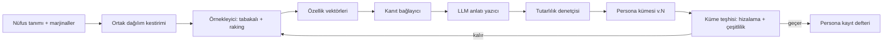

# 02 — Persona üretimi: nüfustan bireye, kanıttan yanıta

Yazar rolü: İnsan Simülasyonu Araştırmacısı (`pk-insan-sim-arastirmacisi`). Tarih: 2026-11-07.
Girdi: `../00-arastirma.md` (özellikle §3 ve §4), `../01-roller.md`. Bu belge mimari belgesidir; kod değil, şema, arayüz imzası
ve sözde kod içerir. Kaynak gösterilmeyen her niceliksel eşik **varsayım** olarak işaretlidir ve kalibrasyonla
(`03-degerlendirme.md`) değiştirilmek üzere başlangıç değeridir.

## 1. Amaç ve tasarım ilkeleri

Bu bölüm, bir müşterinin "hedef kitlem" dediği şeyi, simülasyonda kullanılabilecek bir **persona kümesine** (persona set)
çevirir ve bu kümenin hem nüfusu temsil ettiğini hem de zamanla bozulmadığını ölçer. Beş ilke bütün kararları yönlendirir:

1. **Önce dağılım, sonra birey.** Persona tek tek "hayal edilmez"; önce hedef nüfusun ortak dağılımı (joint distribution)
   kurulur, bireyler bu dağılımdan örneklenir, LLM yalnızca örneklenmiş özellikleri anlatıya dönüştürür.
2. **Kanıt yoksa iddia yok.** Bir persona yalnızca bağlı olduğu kanıtın desteklediği ölçüde konuşur; desteksiz sorularda
   "bilmiyorum" ya da "kanıt yetersiz" der (PersonaCite yaklaşımı, arXiv:2601.22288).
3. **Tek metrikle sadakat yok.** Ortalama tutması yetmez; varyans, alt grup yapısı ve değişkenler arası ilişkiler ayrıca
   ölçülür (arXiv:2609.07987).
4. **Söz ile davranış ayrı kanallardır.** Personanın "ne dediği" ile ortamda "ne yaptığı" ayrı kaydedilir, ayrı raporlanır
   ve birbirine karıştırılmaz.
5. **Her persona sürümlü bir varlıktır.** Bir simülasyon sonucu, hangi persona sürümüyle, hangi kanıt anlık görüntüsüyle
   (snapshot) ve hangi modelle üretildiğini söyleyemiyorsa geçersizdir.

## 2. Literatür uyarılarından mimari karşılıklara

`00-arastirma.md` §3'teki sekiz uyarının her biri, bu bölümde somut bir bileşene ya da kurala bağlanır. Tablo bütün
belgenin özetidir; ayrıntı ilgili başlıktadır.

| # | Uyarı (kaynak) | Mimari karşılık | Bölüm |
| --- | --- | --- | --- |
| 1 | Persona koşullu LLM daha olumlu, daha ilerici, daha az çeşitli; kalıp yargıya çöker (arXiv:2602.03545, 2607.18310) | Özellikler LLM'e değil istatistiksel örnekleyiciye üretilir; LLM yalnızca anlatı yazar. Yanıt dağılımı **olumluluk kayması** ve **çeşitlilik oranı** ile her koşuda ölçülür; eşik aşılırsa koşu "çökmüş" etiketi alır. | §4, §7 |
| 2 | Ortalama tutarken varyans ve regresyon ilişkileri sapar (arXiv:2609.07987) | Sadakat raporu dört katmanlıdır: marjinal, varyans, ilişki (korelasyon/regresyon katsayısı işaret ve büyüklüğü), alt grup. Tek bir "doğruluk %"si üretilmez. | §7.2 |
| 3 | Kültürel düzleşme ve karikatür (arXiv:2609.29928) | İki yönlü teşhis: alt gruplar arası farkın **küçülmesi** (düzleşme) ve **abartılması** (karikatür) ayrı metriklerdir; referans fark, gerçek veriden gelir. Kültürel işaretçilerin (dil, şive, din, bölge) anlatıdaki yoğunluğu sınırlanır. | §7.3 |
| 4 | Nüfusa hizalı persona kümesi şart (arXiv:2509.10127) | Persona kümesi hedef marjinallere ağırlıklandırma (raking / iterative proportional fitting) ile hizalanır; hizalama hatası kümeyle birlikte saklanır ve raporda görünür. | §3, §4 |
| 5 | Uzun ufukta kimlik kayması (arXiv:2608.15844) | Her personaya sabit bir **çapa soru seti** (anchor probes) bağlanır; uzun koşularda belli aralıklarla sorulur, ilk yanıtlarla karşılaştırılır; kayma skoru eşik aşınca persona yeniden yüklenir ve olay kaydedilir. | §8 |
| 6 | Kanıta dayalı persona; kanıt yoksa "bilmiyorum" (arXiv:2601.22288) | Her özellik ve her yanıt bir **kanıt kaynağına** (evidence ref) bağlanır; kanıt kapsaması düşükse yanıt çekimser (abstain) olur. Çekimserlik hata değil, birinci sınıf çıktıdır. | §5 |
| 7 | Katılım aşırı güven doğurur; kullanıcı personayı tasarlayınca ona fazla inanır (arXiv:2607.21757) | Elle tasarlanan personalar "kullanıcı tanımlı" sınıfına girer, nüfus sonuçlarına karışmaz ve rapora otomatik "temsil iddiası yok" etiketi düşer. Kimlik kartı her personanın temellendirme düzeyini gösterir. | §6, §9 |
| 8 | Sentetik kullanıcı düşük riskli, geri alınabilir kararlar için; ödeme istekliliği ve karşılanmamış ihtiyaç keşfi için değil | Soru tipi sınıflandırıcısı: persona katmanı her soruyu bir **kullanım sınıfına** etiketler; "ödeme istekliliği", "keşif" sınıfları persona üretim tarafında desteklenmez ya da yalnızca uyarıyla döner. | §10 |

## 3. Hedef nüfusun tanımı ve veri kaynakları

### 3.1 Nüfus tanımı (population spec)

Müşteri bir nüfusu üç eksende tanımlar: **demografi** (yaş, cinsiyet, bölge, eğitim, gelir bandı, hane yapısı),
**psikografi** (değer yönelimleri, risk tutumu, teknoloji yatkınlığı, marka ilişkisi) ve **davranış** (kanal kullanımı,
satın alma sıklığı, sepet büyüklüğü, cihaz, oturum örüntüsü). Tanım bir LLM istemi değil, yapılandırılmış bir belgedir:

```json
{
  "population_id": "pop_eticaret_tr_2026q4",
  "version": "1.2.0",
  "scope": "Türkiye, 18-65, son 12 ayda en az 1 çevrimiçi alışveriş",
  "dimensions": [
    {"name": "yas_bandi", "type": "categorical", "levels": ["18-24","25-34","35-44","45-54","55-65"], "source": "src_tuik_2025"},
    {"name": "bolge", "type": "categorical", "levels": ["Marmara","Ege","Akdeniz","İç Anadolu","Karadeniz","Doğu","Güneydoğu"], "source": "src_tuik_2025"},
    {"name": "mobil_odeme_kullanimi", "type": "ordinal", "levels": ["hiç","ara sıra","sık"], "source": "src_musteri_anket_2026"},
    {"name": "fiyat_duyarliligi", "type": "continuous", "range": [0,1], "source": "src_davranis_log_2026"}
  ],
  "marginals": "ref://marginals/pop_eticaret_tr_2026q4.parquet",
  "joint_constraints": ["ref://joint/yas_x_mobil_odeme.parquet"],
  "subgroups_of_interest": ["yas_bandi", "bolge"]
}
```

### 3.2 Veri kaynakları ve güven katmanları

| Katman | Örnek | Verdiği şey | Not |
| --- | --- | --- | --- |
| K1 Resmi istatistik | TÜİK, Eurostat, nüfus sayımı mikro verisi | Demografik marjinaller | Davranış vermez |
| K2 Müşteri birinci taraf verisi | CRM, davranış logları, satın alma geçmişi | Davranış dağılımları, ortak dağılımlar | KVKK/GDPR kapsamı, bkz. Arayüz: `06-guven-gizlilik.md` |
| K3 Anket | Müşteri anketleri, panel verisi | Tutum ve psikografi | Söz verisidir; say-do gap taşır |
| K4 Nitel | Görüşme transkriptleri, destek kayıtları, yorumlar | Gerekçe, dil, karar sezgileri | Küçük örneklem; temsil iddiası taşımaz |
| K5 Açık literatür | Akademik çalışmalar, sektör raporları | Önsel (prior) ilişkiler | Bağlamı farklı olabilir |
| K0 Model önseli | LLM'in kendi "bilgisi" | Hiçbir şey kabul edilmez | Yalnızca anlatı dili için |

Kural: Bir boyutun kaynağı en az K1–K4'ten biri olmalıdır. **K0 (model önseli) tek başına hiçbir boyutun kaynağı olamaz**;
bu uyarı 1'e verilen temel yanıttır, çünkü olumluluk ve ilericilik kayması tam olarak model önselinden gelir.

## 4. Üretim hattı: dağılımdan bireye



**Adım 1 — Ortak dağılım kestirimi.** Marjinaller ve varsa ortak tablolardan bir ortak dağılım kurulur. Mikro veri varsa
doğrudan ondan örneklenir (en sadık yol); yoksa kopula (copula) ya da Bayes ağı ile ilişkiler korunarak sentezlenir.
Bilinmeyen ilişkiler için bağımsızlık varsayılmaz; "bilinmiyor" olarak işaretlenir ve o çiftin ilişkisi raporda doğrulanmamış
gösterilir.

**Adım 2 — Örnekleyici.** Tabakalı örnekleme (stratified sampling) ile `subgroups_of_interest` hücrelerinin her biri en az
`n_min` personayla doldurulur (varsayım: `n_min = 30`, alt grup karşılaştırmasında anlamlı varyans için kaba bir başlangıç).
Küçük hücreler fazla örneklenir ve ağırlıkla düzeltilir; böylece azınlık alt grupları ne kaybolur ne de nüfus sonucunu
şişirir. Raking ile her persona bir **ağırlık** (weight) taşır; nüfus düzeyindeki her sonuç ağırlıklı hesaplanır.

**Adım 3 — Kanıt bağlayıcı.** Her özellik değeri, kaynağına ve varsa onu destekleyen kanıt parçalarına (anket yanıtı kümesi,
transkript alıntısı, log özeti) bağlanır. Benzer gerçek kişilerden (aynı hücredeki anket katılımcıları, aynı segmentteki
kullanıcı logları) toplanan kanıt, personanın **kanıt deposu** (evidence store) olur. Bireysel gerçek kişi verisi değil,
hücre düzeyinde toplulaştırılmış ya da anonimleştirilmiş kanıt kullanılır (Arayüz: `06-guven-gizlilik.md`).

**Adım 4 — LLM anlatı yazıcı.** LLM'e sabit bir özellik vektörü ve kanıt özeti verilir; görevi yalnızca bunları tutarlı bir
anlatıya, dile ve karar sezgisine çevirmektir. Yasaklar: vektörde olmayan demografik özellik eklemek, değer yönelimini
"yumuşatmak", kültürel işaretçiyi süslemek. Bu adım için Claude ailesinden ağır akıl yürütme modeli (varsayılan Opus sınıfı)
önerilir, çünkü persona başına bir kez çalışır; toplu simülasyon koşuları daha hafif modelle (Haiku sınıfı) yapılır
(Arayüz: `01-sistem.md`, model yönlendirme).

**Adım 5 — Tutarlılık denetçisi.** Üretilen anlatıdan özellikler geri çıkarılır (round-trip extraction) ve vektörle
karşılaştırılır. Uyuşmazlık varsa (ör. "fiyat duyarlılığı 0,85" olan persona anlatıda "markaya bağlı, fiyata bakmaz" diye
yazılmışsa) anlatı reddedilir. Ayrıca bir **olumluluk denetçisi** anlatının duygu tonunu aynı hücredeki gerçek kanıtın tonuyla
karşılaştırır.

**Adım 6 — Küme teşhisi.** §7'deki metrikler küme düzeyinde koşar; küme ancak geçerse kayıt defterine yazılır.

### 4.1 Arayüz imzası

```text
generate_persona_set(
  population: PopulationSpec,
  n: int,
  evidence_snapshot: SnapshotId,
  narrator_model: ModelRef,
  seed: int
) -> PersonaSet { personas[], weights[], alignment_report, diversity_report, set_version }
```

`seed` ve `evidence_snapshot` zorunludur: aynı girdilerle aynı küme (anlatı hariç, özellikler birebir) yeniden üretilebilir
olmalıdır (Arayüz: `03-degerlendirme.md`, tekrarlanabilirlik).

## 5. Persona şeması

Şema yedi blok taşır: kimlik, değerler, hedefler, kısıtlar, karar sezgileri, bilişsel yanlılıklar, bağlam. Her alan
`value`, `source`, `evidence_refs` ve `confidence` taşır. **Kaynağı olmayan alan yoktur**; kaynağı yoksa alan `unknown`dur.

```json
{
  "persona_id": "per_7f3a91",
  "set_id": "pset_eticaret_tr_2026q4",
  "version": "1.2.0+e2026-11-01",
  "class": "population_sampled",
  "weight": 1.84,
  "cell": {"yas_bandi": "45-54", "bolge": "İç Anadolu"},
  "identity": {
    "display_name": {"value": "Persona 7F3A", "source": "generated"},
    "age_band": {"value": "45-54", "source": "src_tuik_2025", "confidence": "high"},
    "household": {"value": "evli, 2 çocuk, biri üniversitede", "source": "src_musteri_anket_2026", "evidence_refs": ["ev_112"], "confidence": "medium"},
    "occupation": {"value": "kamu çalışanı", "source": "src_musteri_anket_2026", "confidence": "medium"}
  },
  "values": [
    {"value": "güvenlik ve öngörülebilirlik", "source": "src_musteri_anket_2026", "evidence_refs": ["ev_201","ev_202"], "confidence": "medium"}
  ],
  "goals": [
    {"value": "çocuğun yurt masraflarını aksatmamak", "source": "src_gorusme_2026", "evidence_refs": ["ev_310"], "confidence": "low"}
  ],
  "constraints": [
    {"value": "aylık harcama tavanı sıkı", "source": "src_davranis_log_2026", "confidence": "high"},
    {"value": "akşamları mobil, gündüz masaüstü kısıtlı", "source": "src_davranis_log_2026", "confidence": "high"}
  ],
  "decision_heuristics": [
    {"value": "kargo ücretsiz değilse sepeti bırakma eğilimi", "source": "src_davranis_log_2026", "evidence_refs": ["ev_455"], "confidence": "high"},
    {"value": "yorum sayısı düşükse güvenmez", "source": "src_gorusme_2026", "confidence": "low"}
  ],
  "cognitive_biases": [
    {"value": "kayıptan kaçınma", "strength": 0.6, "source": "src_literatur_k5", "confidence": "low"}
  ],
  "context": {
    "devices": ["Android orta segment"],
    "channels": ["Instagram", "e-posta"],
    "language_register": {"value": "gündelik, kısaltma az", "source": "src_gorusme_2026"}
  },
  "evidence_store": "ref://evidence/pset_eticaret_tr_2026q4/per_7f3a91",
  "anchor_probes": "ref://anchors/per_7f3a91.v1",
  "unknowns": ["din", "siyasi yönelim", "ödeme istekliliği"],
  "provenance": {
    "population_version": "1.2.0",
    "evidence_snapshot": "snap_2026-11-01",
    "narrator_model": "claude-opus-class@<sürüm>",
    "seed": 4471,
    "generated_at": "2026-11-07T10:12:00Z"
  }
}
```

Tasarım notları:

- **`display_name` bilerek kodludur** ("Persona 7F3A"). İnsan adı ve fotoğraf, katılım kaynaklı aşırı güveni (uyarı 7)
  artırır (varsayım: bu etki adlandırmada da geçerlidir; arXiv:2607.21757 tasarım katılımını inceler, isimlendirmeyi
  doğrudan değil). Ad verilip verilmeyeceği bir değer kararıdır; bkz. Felsefi soru 3.
- **`unknowns` alanı zorunludur.** Hiçbir persona "her şeyi bilen" olamaz. Hassas boyutlar (din, siyasi görüş, etnik köken,
  sağlık) varsayılan olarak `unknown`dur; modellenmesi felsefi karar gerektirir (Felsefi soru 2).
- **`cognitive_biases` düşük güvenle başlar.** Literatürden alınan genel yanlılıklar bireye özgü kanıt değildir; bu yüzden
  K5 kaynaklıdır ve rapora "literatür önseli" olarak düşer.
- **`class` alanı** üç değer alır: `population_sampled` (§4 hattından), `evidence_grounded_individual` (tek bir gerçek
  segmentin kanıtından, nüfus ağırlığı yok), `user_defined` (müşteri elle tasarladı). Sınıflar raporlamada asla karışmaz.

## 6. Kanıta temellendirme ve "bilmiyorum" davranışı

### 6.1 Yanıt zamanı akışı

PersonaCite yaklaşımına (arXiv:2601.22288) dayanarak, persona her soruya cevap üretmeden önce kendi kanıt deposunda arama
yapar ve bir **kapsama skoru** (coverage) hesaplar:

```text
answer(persona, question, stimulus):
  q_class   = classify_question(question)            # tutum | davranış | gerekçe | ödeme istekliliği | keşif
  if q_class in UNSUPPORTED: return Abstain(reason="kullanım sınıfı dışı", class=q_class)
  hits      = retrieve(persona.evidence_store, question, stimulus)
  coverage  = score_coverage(hits, question)          # 0..1
  if coverage < τ_abstain:
      return Abstain(reason="kanıt yetersiz", nearest=hits[:3])
  draft     = narrate(persona, question, stimulus, hits)
  claims    = extract_claims(draft)
  unsupported = [c for c in claims if not entailed(c, hits ∪ persona.traits)]
  if unsupported: draft = revise_or_hedge(draft, unsupported)
  return Answer(text=draft, evidence_refs=ids(hits), coverage=coverage,
                support="grounded" if coverage ≥ τ_grounded else "extrapolated")
```

Varsayılan eşikler varsayımdır: `τ_abstain = 0,3`, `τ_grounded = 0,7`. Arada kalan yanıtlar "kanıttan uzatılmış"
(extrapolated) etiketiyle döner; rapor bu etiketleri sayar ve oranını gösterir.

### 6.2 Neden "bilmiyorum" birinci sınıf çıktıdır

Çekimserlik bir hata olarak sayılırsa, değerlendirme hattı onu azaltmaya çalışır ve sistem tam da literatürün uyardığı
"her şeye akıcı cevap veren" personaya geri döner. Bu yüzden:

- Çekimserlik oranı her simülasyon raporunda soru başına gösterilir (Arayüz: `05-icgoru-ve-urun.md`, rapor biçimi).
- Bir sorunun çekimserlik oranı yüksekse sistem "bu soruya cevap veremem" demez, **"bu soruyu cevaplamak için şu kanıt eksik"**
  der ve eksik kanıtı adlandırır (ör. "45-54 yaş, Doğu bölgesi için kargo ücreti tepkisine dair log yok"). Bu, müşteriyi
  gerçek veri toplamaya yönlendiren bir çıktıdır.
- Kalibrasyonda (Arayüz: `03-degerlendirme.md`) çekimser kalınan sorular "yanlış" değil, ayrı bir sütunda puanlanır;
  doğru çekimserlik ölçüsü: gerçek sonucun gerçekten belirsiz ya da veri dışı olduğu durumlarda çekimser kalınmış mı.

### 6.3 Kanıt türleri ve sözlü/davranışsal ayrımı

Her kanıt parçası `kind` alanı taşır: `stated` (anket, görüşme: söz), `observed` (log, A/B sonucu: davranış),
`aggregate` (resmi istatistik). Yanıt üretilirken, davranış sorusuna yalnızca `stated` kanıtla cevap veriliyorsa yanıt
"söze dayalı" etiketlenir. Bu, say-do gap'in (§9) şema düzeyindeki ilk savunmasıdır.

## 7. Çeşitlilik ve kalıp yargı çöküşü teşhisleri

Teşhisler iki düzeyde çalışır: **küme düzeyi** (persona üretildiğinde, özellik ve anlatı üzerinde) ve **yanıt düzeyi** (her
simülasyon koşusunda, persona yanıtları üzerinde). Referans her zaman gerçek veridir; gerçek referans yoksa metrik
"referanssız" etiketiyle yalnızca iç tutarlılık olarak raporlanır.

### 7.1 Küme düzeyi

| Metrik | Ne ölçer | Hesap | Başlangıç eşiği (varsayım) |
| --- | --- | --- | --- |
| Hizalama hatası | Kümenin hedef marjinallere uyumu | Ağırlıklı marjinal ile hedef arasında toplam varyasyon mesafesi (TVD), boyut başına | Boyut başına TVD ≤ 0,03 |
| Ağırlık sağlığı | Raking'in aşırı ağırlığa dayanıp dayanmadığı | Etkin örneklem büyüklüğü (Kish n_eff) / n | ≥ 0,6 |
| Anlatı çeşitliliği | Anlatıların birbirine benzeme derecesi | Gömme (embedding) uzayında ortalama ikili uzaklık; aynı hücrede ve hücreler arası ayrı | Hücre içi uzaklık, hücreler arası uzaklığın %50'sinden az olmamalı |
| Şablon tekrarı | Anlatıda kalıp ifadeler | Hücre başına en sık n-gram'ların kapsama oranı | Gözlemle belirlenecek |
| Olumluluk kayması | Anlatıların gerçekten daha "iyimser" olması | Anlatı duygu skoru − aynı hücredeki gerçek kanıt metninin duygu skoru | Ortalama fark ≤ 0,1 (normalize ölçek) |

### 7.2 Yanıt düzeyi: dört katmanlı sadakat

Uyarı 2'ye (arXiv:2609.07987) doğrudan yanıt olarak, gerçek referans verisi olan her soru için dört katman ayrı raporlanır:

1. **Marjinal sadakat:** Yanıt dağılımı ile gerçek dağılım arasındaki mesafe (kategorik için TVD ya da Jensen-Shannon;
   sürekli için Wasserstein).
2. **Varyans korunumu:** `var_sim / var_gercek` oranı. 1'in belirgin altında olması "daralma", çöküşün en erken
   belirtisidir. Rapor bu oranı alt grup başına da verir.
3. **İlişki korunumu:** Gerçek veride bilinen ilişkiler (ör. yaş ↔ mobil ödeme, fiyat duyarlılığı ↔ kargo eşiği) simülasyonda
   işaretini ve büyüklük sırasını koruyor mu. Regresyon katsayılarının işaret uyumu ve büyüklük oranı ayrı ayrı verilir.
4. **Alt grup yapısı:** Alt gruplar arası farkların (ör. 18-24 ile 55-65 arasındaki fark) gerçek farkla oranı.

Bu dört katman birleştirilip tek skora indirilmez. Arayüzde de tek bir "sadakat %"si gösterilmez; gösterilip
gösterilmeyeceği felsefi bir sorudur (Felsefi soru 4).

### 7.3 Düzleşme ve karikatür

Uyarı 3 (arXiv:2609.29928) için alt grup fark oranı `ρ = |Δ_sim| / |Δ_gercek|` iki yönlü okunur:

- `ρ < 1 − ε` → **düzleşme** (flattening): model alt grupları birbirine benzetiyor; çoğunlukla "ortalama, şehirli,
  ilerici" yanıta çekilme.
- `ρ > 1 + ε` → **karikatür** (caricature): model alt grup farkını abartıyor; kalıp yargıyı yeniden üretiyor.

Varsayım: `ε = 0,25`. Ek olarak anlatı ve yanıtlarda **kültürel işaretçi yoğunluğu** (bölgesel deyim, dini referans, yöresel
yemek vb.) ölçülür; gerçek görüşme transkriptlerindeki yoğunluğun çok üzerindeyse karikatür bayrağı kalkar. Bu işaretçi
sözlüğünün kim tarafından ve hangi ölçütle kurulacağı kısmen değer sorusudur (Felsefi soru 2).

### 7.4 Çöküş tespit edilince ne olur

```text
on_collapse(run, metric):
  run.flags += metric
  if metric in {variance_ratio < 0.6, flattening, caricature}:     # eşikler varsayım
      raporu "teşhisli" olarak işaretle; ilgili alt grup sonuçlarını gri göster
      onarım adayları: (a) sıcaklık/örnekleme ayarı, (b) anlatı yazıcıya kanıt alıntısı ekleme,
                       (c) yanıtı dağılım düzeyinde üretme (aşağı bakınız), (d) o alt grubu "desteklenmiyor" ilan etme
  never: sonuçları sessizce yeniden ağırlıklandırıp çöküşü gizlemek
```

Onarım (c) için: bazı soru tiplerinde (Likert, seçim) personalardan tek tek yanıt toplamak yerine, alt grup düzeyinde
dağılım istemek ve bu dağılımdan bireylere örneklemek çeşitliliği daha iyi koruyabilir; bu, "Distribution-First Population
Simulation" (arXiv:2607.18310) yaklaşımının yanıt tarafındaki karşılığıdır (varsayım: etkinliği bizim alanımızda
doğrulanmamıştır, A/B ile `03-degerlendirme.md` hattında sınanmalı).

## 8. Kimlik kayması ölçümü

Uyarı 5 (MicroVerse, arXiv:2608.15844) uzun ufuklu simülasyonlarda personanın başka birine dönüşmesini anlatır. Ürünümüzde
bunun iki biçimi beklenir: (a) bir ortamda uzun bir akışta gezinen persona (Arayüz: `04-ortamlar.md`), (b) çok turlu
odak grubu/çoklu ajan tartışması, burada personalar birbirine benzeşir (konformite).

**Çapa sondaları (anchor probes).** Persona üretilirken 8-12 kısa soru seçilir (varsayım), personanın kimlik vektörünün
farklı bloklarını yoklar: bir değer sorusu, bir kısıt sorusu, bir karar sezgisi sorusu, bir dil/üslup örneği. İlk yanıtlar
`anchor_baseline` olarak saklanır.

**Ölçüm.** Uzun koşuda her `k` adımda (varsayım: her 20 eylem ya da her 5 konuşma turu) çapa soruları **ana bağlamı
kirletmeden** yan kanalda sorulur (ana konuşma geçmişi + kısa çapa istemi, yanıt ana geçmişe yazılmaz). Kayma skoru:

```text
drift(t) = 1 − mean_i  sim(answer_i(t), anchor_baseline_i)        # anlamsal benzerlik
         + λ · |trait_extract(history_t) − persona.traits|          # davranıştan geri çıkarılan özellik farkı
```

**Grup konformitesi.** Çoklu persona tartışmalarında personalar arası yanıt çeşitliliği tur tur izlenir; çeşitlilik ilk turun
belirli bir oranının altına düşerse (varsayım: %70) tartışma "yakınsamış" bayrağı alır. Gerçek odak gruplarında da
konformite olur; fark, referans transkriptlerle karşılaştırılmadıkça "kusur" sayılmaz, yalnızca raporlanır.

**Müdahale.** Eşik aşılınca persona kimlik kartından yeniden yüklenir (bağlam sıkıştırma + kimlik özeti yeniden enjeksiyonu),
olay `identity_drift_event` olarak kaydedilir ve o noktadan sonraki eylemler raporda işaretlenir. Kayma sık yaşanıyorsa
sorun personada değil, ortam süresindedir; ortam tasarımına geri bildirim gider.

## 9. Say-do gap: söz kanalı ve davranış kanalı

Talp'ın satış argümanı "söylenen ile yapılan arasındaki fark"tır (`00-arastirma.md` §1). Ancak bir LLM personası için bu
argüman tersine de işler: persona da bir "söz üreticisi"dir; ona "bu reklamı tıklar mıydın?" diye sormak, anket yapmanın
sentetik bir kopyasıdır. Mimari yanıt üç parçalıdır:

1. **İki kanal, iki şema.** Her simülasyon koşusu iki ayrı çıktı üretir:
   - `verbal_response`: personanın sorulduğunda söylediği (tutum, gerekçe, niyet).
   - `behavioral_trace`: ortamda (web, uygulama, reklam akışı) yaptığı eylemler; olay şeması `04-ortamlar.md`'dedir.
   Persona davranış kanalında **soru sorulmadan** görev bağlamında hareket eder ("haftalık alışverişini yap"), "bu tasarımı
   değerlendir" çerçevesiyle değil. Böylece gözlemci etkisi azaltılır (varsayım: LLM'de gözlemci etkisinin büyüklüğü
   bilinmemektedir).
2. **Gerekçe sonradan alınır.** Davranış izi tamamlandıktan sonra ayrı bir oturumda "neden durdun?" diye sorulur ve bu yanıt
   `post_hoc_rationale` olarak etiketlenir; davranışın nedeni olarak değil, personanın kendi anlatısı olarak raporlanır.
3. **Simüle edilmiş say-do farkı bir metriktir.** Aynı persona için niyet (söz) ile eylem (davranış) arasındaki fark ölçülür.
   Gerçek veride bu fark bilinen bir büyüklüktedir; simülasyonda fark **sıfıra yakınsa** bu bir başarı değil, uyarıdır:
   persona sözüyle tutarlı davranacak şekilde "fazla rasyonel" çalışıyor demektir. Kalibrasyon, bu farkın gerçek
   A/B ve kampanya verisindeki farka yaklaşmasını hedefler (Arayüz: `03-degerlendirme.md`).

Kanıt tarafında da ayrım korunur (§6.3): davranış kanalındaki karar sezgileri öncelikle `observed` kanıttan, söz kanalındaki
tutumlar `stated` kanıttan beslenir. Davranış kanalında yalnızca söz kanıtı olan bir sezgi kullanılmışsa iz
"söze dayalı davranış" etiketi taşır.

## 10. Kullanım sınıfı kapısı

Uyarı 8 doğrultusunda persona katmanı her soruyu/simülasyon isteğini sınıflandırır:

| Sınıf | Örnek | Persona katmanının tutumu |
| --- | --- | --- |
| Mesaj iterasyonu | Başlık A mı B mi | Desteklenir |
| Konsept eleme | 8 konseptten hangi 3'ü sahaya çıksın | Desteklenir |
| Akış sürtünmesi | Ödeme adımında nerede duraksıyor | Desteklenir (davranış kanalı) |
| Segment karşılaştırması | Hangi segment hangi kancaya tepki verir | Desteklenir, alt grup teşhisi zorunlu |
| Ödeme istekliliği | Bu ürüne kaç TL öder | Varsayılan kapalı; açılırsa "doğrulanmamış" filigranı |
| Karşılanmamış ihtiyaç keşfi | Müşterilerin bilmediğimiz derdi ne | Varsayılan kapalı; persona yeni ihtiyaç "icat eder", kanıta dayanamaz |
| Yüksek riskli/geri alınamaz | Fiyat politikası, işten çıkarma, kredi kararı | Desteklenmez |

Sınıflandırma kuralının ve kapalı sınıfların açılıp açılamayacağının son kararı ürün ve değer kararıdır
(Arayüz: `05-icgoru-ve-urun.md`; Felsefi soru 1).

## 11. Persona sürümleme ve kimlik kartı

### 11.1 Sürümleme

Sürüm biçimi: `MAJOR.MINOR.PATCH+e<kanıt anlık görüntüsü tarihi>`.

- **MAJOR:** Nüfus tanımı değişti (boyut eklendi/çıkarıldı, kapsam değişti). Eski sonuçlarla doğrudan karşılaştırılamaz.
- **MINOR:** Marjinaller ya da kanıt deposu güncellendi; özellik vektörleri değişebilir.
- **PATCH:** Yalnızca anlatı yeniden yazıldı (ör. anlatı yazıcı model değişti); özellikler aynı.
- **+e:** Kanıt anlık görüntüsü; aynı sürüm farklı kanıtla yeniden üretilemez.

Persona ve kümeler değiştirilemezdir (immutable); güncelleme yeni sürüm üretir. Her simülasyon sonucu `set_version`,
`persona_version`, `narrator_model`, `simulator_model` ve `seed` taşır. Model sağlayıcı değişince aynı personanın yanıt
dağılımı değişebilir; bu yüzden model değişikliği bir **yeniden kalibrasyon tetikleyicisidir** (Arayüz: `03-degerlendirme.md`).
Bir kanıt kaynağı silinme talebiyle (KVKK/GDPR) kaldırılırsa, ona bağlı personalar "geri çekildi" durumuna geçer ve yeni sürüm
üretilir; eski raporlar bu durumu gösterir (Arayüz: `06-guven-gizlilik.md`).

### 11.2 Kimlik kartı (persona card)

Her persona ve her küme için insan okunur bir kart üretilir; raporun eki ve arayüzün varsayılan görünümüdür. Amaç, uyarı 7'deki
aşırı güveni kartın kendisiyle dengelemektir.

| Alan | İçerik |
| --- | --- |
| Ne olduğu | "Bu bir sentetik personadır. Gerçek bir kişi değildir; [hücre] için [n] kaynaktan türetilmiştir." |
| Sınıf | Nüfustan örneklenmiş / kanıta dayalı birey / kullanıcı tanımlı |
| Temellendirme profili | Alanların yüzde kaçı K1-K4 kaynaklı, yüzde kaçı literatür önseli, yüzde kaçı bilinmiyor |
| Kanıt türü dengesi | stated / observed / aggregate oranları |
| Bilinmeyenler | `unknowns` listesi, açıkça |
| Ağırlık | Nüfus sonucundaki payı |
| Son teşhis | Kayma olayları, çöküş bayrakları |
| Geçerlilik | Kanıt anlık görüntüsü tarihi; "bu tarihten sonraki değişimleri bilmez" |
| Desteklenen kullanım | §10 sınıfları |

Küme kartı ek olarak hizalama hatası, n_eff, alt grup başına n ve son kalibrasyon sonucunu gösterir.

## 12. Arayüzler

### Arayüz: `01-sistem.md`
- Persona kayıt defteri (registry) ve kanıt deposu veri modeli; değiştirilemez sürümler, içerik adresli depolama önerisi.
- Model yönlendirme: anlatı yazıcı ve tutarlılık denetçisi ağır model; toplu yanıt/ortam koşusu hafif model. Model
  sağlayıcısı soyutlanmış olmalı, `ModelRef` her çıktıya yazılmalı.
- Çapa sondası yan kanalı: ana bağlamı kirletmeyen ikincil çağrı yolu.
- `generate_persona_set` ve `answer` imzaları (§4.1, §6.1).

### Arayüz: `03-degerlendirme.md`
- §7.2 dört katmanlı sadakat metrikleri ve §7.1 küme metrikleri, eval koşum takımında birinci sınıf olmalı.
- Çekimserliğin ayrı puanlanması (§6.2); say-do farkının kalibrasyon hedefi olması (§9).
- Eşiklerin (τ, ε, varyans oranı, kayma eşiği) bu belgede varsayım; kalibrasyon döngüsü bunları gerçek sonuçlarla güncellemeli
  ve sürüm notu düşmeli.
- Tekrarlanabilirlik: `seed` + `evidence_snapshot` + model sürümü ile yeniden üretim testi.

### Arayüz: `04-ortamlar.md`
- `behavioral_trace` olay şeması; ortam görevi "değerlendir" değil "yap" çerçevesinde verilmeli.
- Kayma ölçüm aralığı (`k` adım) ortamın olay sayacına bağlanmalı.
- Davranış kanalında kullanılan karar sezgisinin kanıt türü (`observed`/`stated`) izde taşınmalı.

### Arayüz: `05-icgoru-ve-urun.md`
- Kullanım sınıfı kapısı (§10) soru → simülasyon tasarımı adımında uygulanmalı.
- Rapor biçimi: tek skor yok; dört katman, çekimserlik oranı, eksik kanıt listesi, kimlik kartı eki, persona sınıfı ayrımı.

### Arayüz: `06-guven-gizlilik.md`
- Kanıt deposunda bireysel değil hücre düzeyinde toplulaştırılmış kanıt; küçük hücrelerde yeniden tanımlama
  (re-identification) riski için minimum hücre büyüklüğü kuralı orada belirlenmeli.
- Silme talebinin persona sürümlerine yayılması (§11.1).
- Hassas boyutların (din, siyaset, etnik köken, sağlık) varsayılan `unknown` olması ve açılma koşulları.

## 13. Açık riskler ve sınırlar

- **Referans verisi olmayan müşteri.** K2-K4 verisi olmayan bir müşteri için küme yalnızca K1 demografisine dayanır; psikografi
  ve davranış büyük ölçüde `unknown` kalır, çekimserlik oranı yüksek çıkar. Bu dürüst ama ticari olarak zor bir sonuçtur.
- **Eşiklerin kaynağı yok.** Bu belgedeki sayısal eşiklerin hepsi başlangıç varsayımıdır; ilk 5-10 müşteri kalibrasyonundan
  sonra gözden geçirilmelidir (varsayım).
- **Gömme tabanlı çeşitlilik ölçüsü** modelin kendi temsil uzayına dayanır; aynı model ailesinin önyargısını taşıyabilir.
  Mümkünse farklı sağlayıcının gömme modeli ölçüm için kullanılmalıdır.
- **Literatür hızla değişiyor.** §3 kaynaklarının çoğu 2025-2026 ön baskılarıdır; hakemli sonuçlar farklı çıkabilir.

## Kaynaklar

- `00-arastirma.md` §3 ve §4 (bu belgenin ana girdisi).
- Persona Generators — arXiv:2602.03545
- Distribution-First Population Simulation — arXiv:2607.18310
- When Can LLM Digital Twins Reduce Human Measurement — arXiv:2609.07987
- Cultural Divergence Preservation — arXiv:2609.29928
- Population-Aligned Persona Generation — arXiv:2509.10127
- MicroVerse (kimlik kayması) — arXiv:2608.15844
- PersonaCite — arXiv:2601.22288
- Katılım ve aşırı güven — arXiv:2607.21757
- Generative Agents (bellek, yansıtma, planlama) — arXiv:2304.03442
- PersonaHub — arXiv:2406.20094
- Sentetik tüketicilerin kullanım sınırları: https://www.pymc-labs.com/blog-posts/synthetic-consumers-a-practical-guide
- Microsoft TinyTroupe: https://github.com/microsoft/tinytroupe

## Felsefi sorular (proje sahibine)

**1. Persona bir nüfusu "temsil ettiğini" iddia edebilir mi?**
- Soru: Ürün, sentetik bir kümenin sonucunu "Türk e-ticaret kullanıcıları şöyle düşünüyor" diye sunabilir mi, yoksa yalnızca
  "modelin bu nüfus tanımından ürettiği tahmin" mi?
- Neden teknik değil: Metrikler sadakatin derecesini ölçer, ama bir temsil iddiasının ne zaman meşru olduğu epistemik ve
  etik bir eşiktir; müşterinin karar sorumluluğunu kimin taşıdığını belirler.
- Seçenekler: (a) hiçbir zaman temsil iddiası yok, her sonuç "tahmin"; (b) kalibrasyon belirli düzeyi geçen kümelerde sınırlı
  temsil dili; (c) müşteriye bırakmak.
- Önerim: (b), dil kalibrasyon sonucuna bağlı ve otomatik; ödeme istekliliği ve keşif sınıflarında her durumda (a).
- Etkilediği parça: Kimlik kartı metni (§11.2), rapor dili (`05`), kullanım sınıfı kapısı (§10).

**2. Hassas özellikleri ve kalıp yargıya yakın alt grup farklarını modellemek meşru mu?**
- Soru: Din, siyasi yönelim, etnik köken gibi boyutlar persona şemasına girmeli mi; girerse bir alt grubun "ortalama
  davranışını" modellemek kalıp yargıyı yeniden üretmek midir?
- Neden teknik değil: Teknik olarak ölçebiliriz (düzleşme/karikatür, §7.3), ama hangi farkın "gerçek ve modellenmeye değer",
  hangisinin "kalıp yargı" olduğu, ayrıca hangi işaretçinin kültürel saygı sınırını aştığı bir değer yargısıdır.
- Seçenekler: (a) hassas boyutlar tamamen yasak; (b) varsayılan kapalı, müşteri gerekçe ve gerçek veriyle açar, karikatür
  teşhisi zorunlu; (c) serbest.
- Önerim: (b); kültürel işaretçi sözlüğü kurulurken o topluluktan insan gözden geçirmesi.
- Etkilediği parça: `unknowns` varsayılanları (§5), §7.3 işaretçi sözlüğü, `06-guven-gizlilik.md`.

**3. Personaya insan adı, yüz ve yaşam öyküsü verilmeli mi?**
- Soru: "Persona 7F3A" mı, "Ayşe, 48, Kayseri" mi?
- Neden teknik değil: İsim ve yüz kullanılabilirliği artırır ama aşırı güveni de artırabilir (uyarı 7); ayrıca sentetik bir
  varlığı gerçek bir kişi gibi sunmanın dürüstlüğü sorusudur.
- Seçenekler: (a) yalnızca kod; (b) isim var, fotoğraf yok, kartta "sentetik" uyarısı sürekli; (c) tam insanlaştırma.
- Önerim: (b); fotoğraf hiçbir koşulda gerçek kişi fotoğrafı olmamalı.
- Etkilediği parça: `identity.display_name` (§5), kimlik kartı (§11.2), arayüz tasarımı (`05`).

**4. Kullanıcıya ne kadar belirsizlik gösterilmeli; tek bir "sadakat skoru" olmalı mı?**
- Soru: Dört katmanlı sadakat, çekimserlik oranı ve teşhis bayrakları ham mı gösterilmeli, yoksa satış ve okunurluk için tek
  bir özet skora mı indirilmeli?
- Neden teknik değil: Özet skor hesaplanabilir; ama hangi bilgiyi gizlemenin kabul edilebilir olduğu, ürünün dürüstlük
  çizgisi ve müşteriyle ilişkisi hakkında bir karardır.
- Seçenekler: (a) yalnızca katmanlı görünüm; (b) özet skor + her zaman bir tık uzakta katmanlar; (c) yalnızca özet.
- Önerim: (a) varsayılan, (b) yönetici özetinde; "%90 korelasyon" türü tek sayının pazarlamada kullanılmaması.
- Etkilediği parça: §7.2, rapor biçimi (`05`), değerlendirme panosu (`03`).

**5. Sentetik sonuç gerçek ölçümün yerine geçebilir mi?**
- Soru: Bir müşteri, persona sonucuna dayanarak gerçek A/B testini atlamak isterse ürün buna izin vermeli mi, uyarmalı mı,
  engellemeli mi?
- Neden teknik değil: Kalibrasyon güvenin derecesini söyler, ama "yeterince güvenilir" eşiği müşterinin ve son kullanıcının
  maruz kalacağı riskle ilgili bir değer kararıdır.
- Seçenekler: (a) ürün "karar desteği"dir, gerçek ölçümü asla ikame etmez, raporda kalıcı not; (b) düşük riskli sınıflarda
  ikameye izin; (c) müşteri sorumluluğu.
- Önerim: (b) yalnızca §10'daki geri alınabilir sınıflar için; diğerlerinde (a).
- Etkilediği parça: Kullanım sınıfı kapısı (§10), kalibrasyon döngüsü (`03`), konumlandırma (`05`).

**6. Gerçek bir kişinin verisinden "dijital ikiz" üretmek meşru mu?**
- Soru: `evidence_grounded_individual` sınıfı, tek bir gerçek müşterinin (ör. bir görüşmecinin) kanıtından onun ikizini
  üretmeye kadar inebilir mi?
- Neden teknik değil: Teknik olarak mümkündür; ama bir insanın "sentetik kopyası"nın onun onayı olmadan konuşturulması, rıza
  ve kişilik hakkı sorusudur.
- Seçenekler: (a) yasak, en küçük birim hücre; (b) yalnızca açık ve geri alınabilir rızayla; (c) anonimleştirilmişse serbest.
- Önerim: (a) başlangıçta; (b) ancak `06` rıza akışı tasarlandıktan sonra.
- Etkilediği parça: Persona `class` alanı (§5), kanıt bağlayıcı (§4 Adım 3), `06-guven-gizlilik.md`.
