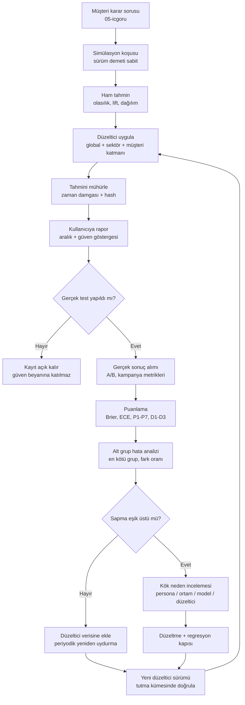

# 03 · Değerlendirme, kalibrasyon ve verim mimarisi

Yazar: `pk-degerlendirme-muhendisi` · Tarih: 2026-11-07 · Durum: taslak v1
Girdiler: `../00-arastirma.md`, `../01-roller.md`. Diğer mimari bölümler (01, 02, 04, 05, 06) bu belge yazılırken henüz yoktu;
onlara dokunan noktalar §15'te "Arayüz" başlıklarıyla toplandı.

## 1. Amaç ve yön veren ilkeler

Bu bölüm tek bir soruya cevap veren altyapıyı tanımlar: **"Simülasyonun bu kararda söylediğine ne kadar güvenebiliriz ve
bunu nereden biliyoruz?"** Persona katmanının satış argümanı öngörüdür; değerlendirme katmanı olmadan bu argüman
doğrulanamaz bir iddiadır. Araştırma notundaki uyarılar (bkz. `00-arastirma.md` §3) mimariye şu ilkelerle girer:

1. **Ortalama yetmez.** Her ölçüm en az dört eksende yapılır: konum (ortalama/oran), yayılım (varyans, dağılım şekli),
   ilişki (alt gruplar arası fark ve regresyon katsayıları), sıralama (hangi seçenek kazanır). Ortalamada tutup varyansta
   tutmama tuzağı açıkça belgelenmiştir (arXiv 2609.07987).
2. **Gerçek sonuç tek hakemdir.** Persona tutarlılığı, LLM-hakem (LLM-as-judge) puanları ve uzman görüşü ara sinyaldir;
   ürün düzeyindeki güven beyanı yalnızca gerçek A/B ve kampanya sonuçlarıyla yapılan geriye dönük testten (backtest) türetilir.
3. **Her sayı bir sürüme bağlıdır.** Model, istem (prompt), persona kümesi, ortam ve toplama kodu sürümü olmadan raporlanan
   bir sonuç geçersizdir.
4. **Ucuzlatma bir deneydir.** Toplu çıkarım, önbellek ve küçük modele yönlendirme sadakati değiştirebilir; her verim
   optimizasyonu aynı koşum takımından geçer ve sadakat maliyeti raporlanır.
5. **Belirsizlik ürünün parçasıdır.** Kullanıcıya tek skor değil, aralık ve "bu tür kararlarda geçmiş isabetimiz" gösterilir
   (ayrıntı §14; ne kadar gösterileceği felsefi soru F4).

## 2. Terimler

| Terim | Bu belgedeki anlamı |
| --- | --- |
| Koşum takımı (evaluation harness) | Değerlendirme görevlerini tanımlayan, koşturan, puanlayan ve sonuçları sürümle saklayan altyapı |
| Görev (eval task) | Girdi (uyaran + persona/nüfus + ortam), beklenen/ölçülen gerçek sonuç ve puanlayıcıdan oluşan birim |
| Koşu (run) | Bir görevin belirli bir sürüm demeti (config bundle) ile bir kez yürütülmesi; N tekrar içerebilir |
| Sürüm demeti | `{model_id, model_snapshot, prompt_hash, persona_set_version, env_version, aggregator_version, seed_policy}` |
| Geriye dönük test (backtest) | Sonucu zaten bilinen geçmiş bir kararın, sonucu görmeden simüle edilip gerçekle karşılaştırılması |
| Kalibrasyon (calibration) | "%70 olasılıkla A kazanır" dendiğinde, bu tür ifadelerin gerçekte ~%70 oranında doğru çıkması |
| Düzeltici (recalibrator) | Ham simülasyon çıktısını gerçek sonuçlara göre ayarlayan, sürümlenen istatistiksel eşleme |
| Sadakat (fidelity) | Simüle dağılımın, ilgili gerçek insan dağılımına konum, yayılım, ilişki ve sıralamada yakınlığı |

## 3. Koşum takımının genel yapısı

Koşum takımı üç düzeyde çalışır ve her düzey bir üsttekinin ön koşuludur. Birim düzeyde bozuk bir persona, senaryo düzeyinde
gürültü, nüfus düzeyinde sistematik sapma üretir.

```
                 ┌───────────────────────────────────────────────┐
                 │  Görev kataloğu (eval registry, sürümlü)      │
                 └───────────────┬───────────────────────────────┘
                                 │
     ┌───────────────────────────┼────────────────────────────────┐
     ▼                           ▼                                ▼
 BİRİM (persona)          BÜTÜNLEŞİK (senaryo)              SİSTEM (nüfus)
 - kimlik tutarlılığı     - akış/reklam/mesaj görevi        - dağılım sadakati
 - kanıta bağlılık        - davranış izi doğrulama          - alt grup hataları
 - kayma, reddetme        - gerekçe ↔ eylem tutarlılığı     - backtest + kalibrasyon
     │                           │                                │
     └───────────────┬───────────┴───────────────┬────────────────┘
                     ▼                           ▼
            Puanlayıcılar (kural, istatistik,   Sonuç deposu (koşu + sürüm demeti
            LLM-hakem, insan etiketi)           + iz + maliyet), panolar, kapılar
```

Görev tanımı (sözde şema):

```yaml
EvalTask:
  id: string                 # örn. "unit.identity.drift.turn50"
  level: unit | scenario | population
  stimulus_ref: uri          # reklam, akış, mesaj; 04-ortamlar olay şemasına bağlı
  population_ref: uri        # 02-persona-uretimi nüfus/persona kümesi sürümü
  ground_truth_ref: uri?     # backtest kaydı; birim görevlerde boş olabilir
  scorers: [ScorerRef]       # her biri metrik kodu (§7) üretir
  repeats: int               # aynı persona için tekrar sayısı (varyans ölçümü için ≥ 5)
  tags: [sector, modality, decision_type, risk_tier]
  owner: string
```

Puanlayıcı arayüzü:

```text
score(task: EvalTask, run: RunRecord) -> list[Metric{code, value, ci_low, ci_high, n, subgroup?}]
```

Güven aralıkları varsayılan olarak persona düzeyinde küme bootstrap'ı (cluster bootstrap) ile hesaplanır; aynı personanın
tekrarları bağımsız gözlem sayılmaz. Bu, LLM simülasyonunda örneklem büyüklüğünün yapay şişirilmesini önleyen en önemli
tek karardır.

## 4. Birim düzey: tek persona

Amaç: personanın kendisiyle, tanımıyla ve kanıtıyla tutarlı olup olmadığı. Gerçek sonuç gerekmez; ucuz ve sık koşar
(her istem veya model değişikliğinde).

- **Kimlik tutarlılığı:** Persona kartındaki özniteliklere (yaş, gelir bandı, kanal alışkanlığı, tutum) dair yoklama
  soruları farklı sıralarda ve araya gürültü konuşma girerek sorulur; yanıtların karta uyumu ölçülür.
- **Kimlik kayması (identity drift):** Uzun ufuklu oturumda (örn. 10, 50, 100 tur) aynı yoklamalar tekrarlanır; uyumun tur
  sayısına göre eğimi raporlanır (arXiv 2608.15844 bu riskin ölçülmesini önerir).
- **Kanıta bağlılık:** Kanıta dayalı personalarda (PersonaCite yaklaşımı, arXiv 2601.22288) iddiaların ne kadarının saklı
  kanıta atıf yapabildiği; kanıt yokken "bilmiyorum/emin değilim" deme oranı. Burada hem sahte kesinlik hem aşırı reddetme
  hatadır; ikisi ayrı metrik.
- **Tekrar içi varyans:** Aynı persona, aynı uyaran, farklı seed ile N kez; yanıt dağılımının entropisi. Sıfıra yakın
  entropi "deterministik karikatür", çok yüksek entropi "kimliksiz gürültü" işaretidir. Kabul bandı nüfus düzeyindeki
  gerçek birey içi tutarlılık verisiyle (test-retest) ayarlanır; bu veri yoksa bant geçici olarak "varsayım" etiketiyle tutulur.
- **Olumluluk eğilimi:** Persona koşullu modellerin daha olumlu yanıt verme eğilimi (arXiv 2602.03545) birim düzeyde,
  bilinen olumsuz tepkili uyaranlarla (kontrol uyaranları) test edilir.

## 5. Bütünleşik düzey: senaryo

Amaç: bir persona bir ortamda (web akışı, uygulama, reklam izleme) görev yaparken davranış izinin ve gerekçesinin
anlamlı olması.

- **İz geçerliliği:** `04-ortamlar.md` olay şemasındaki eylemler yasal mı (var olmayan butona tıklama, imkânsız sıra)?
- **Gerekçe ↔ eylem tutarlılığı:** Persona "fiyat çok yüksek, çıktım" diyor ama iz fiyat ekranına hiç ulaşmamış mı?
  Bu, say-do farkının (say-do gap) simülasyondaki ayna görüntüsüdür ve ayrı metrik olarak tutulur.
- **Altın senaryolar (golden scenarios):** Sonucu tartışmasız bilinen küçük bir küme (örn. çalışmayan ödeme butonu olan akış;
  okunmaz kontrastlı reklam). Simülasyonun bunları yakalama oranı bir regresyon kapısıdır.
- **Kip duyarlılığı:** Aynı içeriğin görsel/video/metin versiyonlarında tepki farkı; kip değişince sonuç tersine dönüyorsa
  algı katmanı sorunu işaretlenir.

## 6. Sistem düzeyi: nüfus

Amaç: nüfus ölçeğinde simüle edilen dağılımın gerçek dağılıma yakınlığı ve karar düzeyinde isabet. İki girdi türü vardır:

1. **Anket/panel referansı:** Kamuya açık veya müşteriye ait anket dağılımlarına karşı tutum ve tercih dağılımı
   karşılaştırması. Bu yaklaşımın temeli "silicon sampling" çalışmasıdır (Argyle ve ark., arXiv 2209.06899); dil
   modellerinin hangi grupların görüşünü yansıttığına dair ölçüm yöntemi de buradan alınır (Santurkar ve ark., arXiv 2303.17548).
2. **Davranış referansı:** Geçmiş A/B testleri ve kampanya sonuçları (§8). Ürün güven beyanının tek kaynağı budur.

Nüfus düzeyinde ayrıca **kalıp yargı çöküşü** (stereotype collapse) ve **kültürel düzleşme** ölçülür: alt gruplar arası
simüle farkların gerçek farklara oranı. Oran 1'den büyükse karikatür (fark abartılıyor), 0'a yakınsa düzleşme (fark siliniyor).
Bu ölçüm `02-persona-uretimi.md`'nin çeşitlilik metrikleriyle ortak tanımlanmalıdır (bkz. §15).

## 7. Metrik seti

"Ortalama tutuyor, varyans tutmuyor" tuzağına karşı her nüfus görevi aşağıdaki **dört eksenin hepsinden** en az bir metrik
raporlamak zorundadır; tek eksenli rapor panoda "eksik" olarak işaretlenir.

| Kod | Metrik | Eksen | Düzey | Neyi yakalar | Varsayılan kabul ölçütü (varsayım, kalibre edilecek) |
| --- | --- | --- | --- | --- | --- |
| U1 | Kimlik uyum oranı | Tutarlılık | Birim | Persona kartından sapma | ≥ 0,90 |
| U2 | Kayma eğimi (uyum / 10 tur) | Tutarlılık | Birim | Uzun oturumda kimlik kaybı | \|eğim\| ≤ 0,01 |
| U3 | Kanıt atıf oranı / gereksiz ret oranı | Temellendirme | Birim | Uydurma kesinlik ve aşırı çekingenlik | ≥ 0,85 / ≤ 0,10 |
| U4 | Tekrar içi entropi bandı | Yayılım | Birim | Karikatür veya gürültü | Gerçek test-retest bandı içinde |
| U5 | Kontrol uyaranında olumsuzluk isabeti | Konum | Birim | Olumluluk eğilimi | ≥ 0,80 |
| S1 | İz geçerlilik oranı | Geçerlilik | Senaryo | İmkânsız eylemler | ≥ 0,99 |
| S2 | Gerekçe-eylem tutarlılığı | Tutarlılık | Senaryo | Sözde gerekçe | ≥ 0,90 |
| S3 | Altın senaryo yakalama | Konum | Senaryo | Bariz sorunu kaçırma | 1,00 (kapı) |
| P1 | Ortalama/oran mutlak hatası | Konum | Nüfus | Merkez sapması | Karar türüne göre |
| P2 | Wasserstein-1 veya Jensen-Shannon uzaklığı | Yayılım/şekil | Nüfus | Dağılım şekli bozulması | Referans gürültü tabanının ≤ 1,5 katı |
| P3 | Varyans oranı (simüle / gerçek) | Yayılım | Nüfus | Daralmış çeşitlilik | 0,7 – 1,3 |
| P4 | Kuyruk kapsaması (gerçek %5 ve %95 dilimlerinin simülede bulunma oranı) | Yayılım | Nüfus | Uç kullanıcıları silme | ≥ 0,8 |
| P5 | Alt grup fark oranı (simüle Δ / gerçek Δ) | İlişki | Nüfus | Karikatür (>1) veya düzleşme (≈0) | 0,6 – 1,4 |
| P6 | Regresyon katsayısı işaret ve büyüklük uyumu | İlişki | Nüfus | Yanlış nedensel hikâye | İşaret uyumu ≥ 0,8 |
| P7 | Alt grup bazlı en kötü hata (worst-group error) | İlişki | Nüfus | Ortalamanın gizlediği grup | Ortalama hatanın ≤ 2 katı |
| D1 | Kazanan isabeti (top-1) | Sıralama | Karar | A/B'de doğru seçenek | Rastgele tabanın anlamlı üstü |
| D2 | Sıra korelasyonu (Kendall τ) | Sıralama | Karar | Çok seçenekli eleme | ≥ 0,5 |
| D3 | Etki büyüklüğü hatası (lift tahmini − gerçek lift) | Konum | Karar | "Kazanır ama ne kadar?" | Raporlanır, kapı değil |
| C1 | Brier puanı ve Brier beceri puanı (BSS) | Kalibrasyon | Karar | Olasılık beyanlarının doğruluğu | BSS > 0 (iklim tabanının üstü) |
| C2 | Beklenen kalibrasyon hatası (ECE) + güvenilirlik eğrisi | Kalibrasyon | Karar | Aşırı/eksik güven | ECE ≤ 0,05 (düzeltici sonrası) |
| C3 | Aralık kapsaması (%80 aralığın gerçeği içerme oranı) | Kalibrasyon | Karar | Dar/geniş aralık | 0,75 – 0,85 |
| O1 | Persona başına maliyet, p50/p95 gecikme, token | İşletim | Hepsi | Verim | Bütçeye göre |
| O2 | Sadakat maliyeti (Δ metrik / optimizasyon) | İşletim | Hepsi | Ucuzlatmanın bedeli | §12 |

Notlar:

- Kabul ölçütlerinin tamamı **varsayımdır**; ilk 3 ayın backtest verisiyle yeniden belirlenir ve sürümlenir.
- P2 için "referans gürültü tabanı": gerçek veriyi ikiye bölüp iki yarı arasında aynı uzaklığı ölçmek. Simülasyon, gerçeğin
  kendisiyle olan örnekleme gürültüsünden çok daha iyi olamaz; bu taban olmadan uzaklık sayıları yorumsuzdur.
- D1 tek başına yanıltıcıdır: iki seçenek arasında fark gerçekte anlamsızsa "kazanan" gürültüdür. Backtest kayıtlarında
  gerçek farkın istatistiksel anlamlılığı tutulur ve D1 yalnızca anlamlı farklı kayıtlarda raporlanır; anlamsız kayıtlarda
  doğru cevap "fark yok" kabul edilir ve ayrı puanlanır.
- C1 Brier puanı için kaynak: Brier (1950), *Monthly Weather Review* 78(1). Modern sinir ağlarında kalibrasyon ve sıcaklık
  ölçekleme (temperature scaling): Guo ve ark., arXiv 1706.04599.

## 8. Geriye dönük test veri kümesi

### 8.1 Kayıt şeması

```yaml
BacktestRecord:
  id: string
  source: customer_ab | customer_campaign | public_study | internal_dogfood
  consent_ref: uri            # 06-guven-gizlilik veri sınıfı ve izin kaydı
  sector: ecommerce | aviation | b2b | media | retail | finance
  decision_type: ad_creative | flow_variant | message | concept_screen
  stimuli: [StimulusRef]      # A, B, ... (04-ortamlar biçiminde)
  target_population: PopulationSpec   # 02-persona-uretimi biçiminde
  outcome:
    metric: ctr | cvr | completion | stated_pref | ...
    per_arm: [{arm, value, n, ci_low, ci_high}]
    per_subgroup: [{subgroup, arm, value, n}]?   # varsa P5-P7 için zorunlu kaynak
    winner: arm | none        # anlamlılık testi sonrası
    test_window: [date, date]
  known_confounders: [string] # sezonsallık, bütçe kayması, kanal karması
  model_knowledge_risk: low | medium | high   # §8.3
  split: calibration | validation | holdout
```

### 8.2 Toplama ve bölme ilkeleri

- **Zaman temelli bölme:** Kalibrasyon kümesi her zaman doğrulama ve dokunulmaz tutma (holdout) kümesinden **daha eski**
  tarihlerden gelir. Rastgele bölme, geleceği görerek kalibre etme sızıntısı yaratır.
- **Müşteri bazlı bölme:** Bir müşterinin kayıtları hem kalibrasyonda hem tutmada yer almaz (genelleme sınanır). Müşteriye özel
  düzeltici ayrı bir katmandır (§9.3).
- **Dokunulmaz tutma kümesi:** Yalnızca model yükseltme ve çeyreklik güven beyanında açılır; erişim kaydı tutulur. Sık açılan
  tutma kümesi zamanla kalibrasyon kümesine dönüşür.
- **Denge:** Sektör × karar türü × kip hücrelerinin her biri için hedef asgari kayıt sayısı (varsayım: 30). Altında kalan
  hücrelerde güven göstergesi "yetersiz geçmiş" der (§14).

### 8.3 Model bilgisi sızıntısı (contamination)

Kamuya açık, ünlü kampanyaların sonucu modelin eğitim verisinde olabilir; model "simüle etmez, hatırlar". Önlemler:
eğitim kesim tarihinden sonraki kayıtları tercih etmek; uyaranlardan marka adlarını maskeleyip maskeli/maskesiz farkını ölçmek;
`model_knowledge_risk = high` kayıtları ürün güven beyanından dışlamak. Müşteri iç A/B verisi bu açıdan en temiz kaynaktır.

### 8.4 Kaynaklar ve soğuk başlangıç

İlk aşamada müşteri verisi azdır. Soğuk başlangıç için: (a) kendi ürün denemelerimiz (dogfooding) ve tasarım ortağı müşterilerin
geçmiş A/B arşivleri, (b) açık anket veri kümeleri (yalnızca tutum dağılımı; davranış iddiası için kullanılmaz), (c) ileriye
dönük "kör tahmin" programı: müşteri bir A/B testini başlatmadan önce simülasyon tahmini mühürlenir (zaman damgası + hash),
sonuç gelince puanlanır. (c) sızıntı riski sıfır olduğu için en değerli kaynaktır ve varsayılan iş akışına gömülmelidir
(bkz. Arayüz: 05).

## 9. Kalibrasyon döngüsü

### 9.1 Döngü



### 9.2 Düzeltici seçenekleri

| Yöntem | Ne zaman | Risk |
| --- | --- | --- |
| Sıcaklık/Platt ölçekleme (tek parametre, lojistik) | Az veri (< 100 kayıt), ikili kazanan tahmini | Esnek değil; sistematik eğriliği düzeltemez |
| İzotonik regresyon (isotonic regression) | Orta veri (≥ 300 kayıt varsayımı) | Az veride aşırı uyum |
| Ağırlıklandırma / art tabakalama (post-stratification) | Simüle nüfus bileşimi hedef nüfustan saptığında | Hücreler küçükse varyans patlar |
| Hiyerarşik Bayes kısmi havuzlama (partial pooling) | Global → sektör → müşteri katmanları | Daha karmaşık; öncül seçimi belgelenmeli |
| Konformal tahmin aralığı (conformal prediction) | Lift ve oran tahminine dağılımdan bağımsız aralık | Değiştirilebilirlik (exchangeability) varsayımı zaman kaymasında zayıflar |

Varsayılan öneri: başlangıçta Platt ölçekleme + konformal aralık; kayıt sayısı eşiği aşınca hiyerarşik kısmi havuzlama.
Konformal tahmin için genel giriş: Angelopoulos ve Bates, arXiv 2107.07511.

### 9.3 Katmanlı düzeltici

`raw → global → sektör → müşteri` sırası. Müşteri katmanı yalnızca o müşterinin kendi verisiyle uydurulur ve başka müşteriye
taşınmaz (gizlilik; bkz. Arayüz: 06). Her katman kaydı: `{recalibrator_id, method, fitted_on: [record_ids], fitted_at,
config_bundle_hash, metrics_before, metrics_after}`. Bir düzeltici, uydurulduğu sürüm demeti dışındaki bir modele
uygulanamaz; model değişince düzeltici geçersiz sayılır (§13).

### 9.4 Alt grup bazlı hata

Her puanlamada sonuç alt gruplara (yaş bandı, bölge, cihaz, yeni/eski müşteri; mevcutsa) ayrılır. Raporlanan iki sayı:
**ağırlıklı ortalama hata** ve **en kötü grup hatası** (P7). Alt grup gerçek verisi yoksa bu eksik açıkça işaretlenir; nüfus
ortalamasındaki başarı alt gruplara genellenmez. Küçük gruplarda tek kayıt yüksek gürültü üretir; grup başına asgari n
(varsayım: 200 gerçek kullanıcı) altındaki gruplar raporda gri görünür.

## 10. Tekrarlanabilirlik

LLM çıkarımı bit düzeyinde deterministik değildir (sağlayıcı tarafı toplu işleme ve kayan nokta sırası nedeniyle aynı seed
farklı çıktı verebilir — varsayım; sağlayıcıdan sağlayıcıya değişir). Bu yüzden hedef **bit düzeyinde değil, dağılım düzeyinde
tekrarlanabilirlik**tir: aynı sürüm demetiyle iki koşunun nüfus metrikleri, kendi güven aralıkları içinde örtüşmelidir.

Mekanizmalar:

- **Model sürümü sabitleme:** Takma ad (alias) değil, tarihli anlık görüntü (snapshot) kimliği kullanılır. Sağlayıcı soyutlama
  katmanı (bkz. Arayüz: 01) her çağrıda gerçekten hizmet veren model kimliğini döndürmeli ve bu kaydedilmelidir.
- **Seed politikası:** Persona örnekleme, uyaran sırası, ortam rastgeleliği ve (destekleniyorsa) model örnekleme için ayrı seed
  akışları; kök seed koşu kaydına yazılır.
- **İstem ve şablon hash'i:** Sistem istemi, persona kartı oluşturma şablonu ve araç tanımları içerik hash'iyle sürümlenir.
- **Yanıt önbelleği (response cache):** Anahtar = `hash(model_snapshot, tam istem, örnekleme parametreleri, seed)`.
  Önbellek değerlendirme koşularında **yeniden oynatma** (replay) sağlar: puanlayıcı veya toplayıcı değiştiğinde LLM'i yeniden
  çağırmadan metrikler yeniden hesaplanır. Üretim koşularında önbellek isabeti, aynı personanın aynı uyarana verdiği tekrarlı
  yanıtları dondurmamalıdır; bu yüzden tekrar indeksi anahtara dahildir.
- **Koşu kaydı:** Her koşu değişmez (append-only) bir kayıttır; ham yanıtlar, izler ve metrikler birlikte saklanır.

## 11. Regresyon kapıları

| Kapı | Tetikleyici | İçerik | Engelleme kuralı |
| --- | --- | --- | --- |
| G0 Hızlı | Her istem/kod değişikliği (CI) | Birim görevler (U1-U5), S1, S3; küçük persona örneklemi | S3 < 1 veya herhangi bir U metriği eşiğin altına düşerse birleştirme engellenir |
| G1 Senaryo | Günlük / ortam sürümü değişince | Tüm senaryo kataloğu, S1-S3 | Önceki sürüme göre anlamlı düşüş (bootstrap %95 güven) |
| G2 Nüfus | Persona kümesi, düzeltici veya model değişikliği | Doğrulama kümesinde P1-P7, D1-D3, C1-C3 | Herhangi bir ekseni kötüleştiren değişiklik gerekçeli istisna olmadan yayına çıkmaz |
| G3 Tutma | Model yükseltme, çeyreklik güven beyanı | Dokunulmaz tutma kümesi | Kullanıcıya gösterilen güven sayıları yalnızca buradan güncellenir |

Kapı kararları "ortalama iyileşti" ile verilmez: bir eksende iyileşip başka eksende (özellikle P3, P5, P7) kötüleşen değişiklik
**takas raporu** ister ve insan onayıyla geçer.

## 12. Gözlemlenebilirlik, verim ve maliyet

### 12.1 İzleme

Her LLM çağrısı bir **iz aralığı** (span) üretir; hiyerarşi `koşu → senaryo → persona → tur → çağrı`. Önerilen biçim
OpenTelemetry'nin üretken AI anlamsal kuralları (GenAI semantic conventions; https://opentelemetry.io/docs/specs/semconv/gen-ai/),
böylece sağlayıcı değişse de panolar değişmez. Aralık öznitelikleri: model kimliği, giriş/çıkış token sayısı, önbellek isabeti,
gecikme, yeniden deneme sayısı, maliyet tahmini, persona ve görev kimliği. Persona metni ve müşteri uyaranı izlere
**referansla** girer, ham olarak değil (bkz. Arayüz: 06).

Panolar: koşu başına maliyet ve süre; persona başına p50/p95 gecikme; token dağılımı; hata/ret oranı; önbellek isabet oranı;
ve en önemlisi **metrik zaman serisi** (C1-C3'ün haftalık seyri). Alarm: kalibrasyon kayması (C2 iki ardışık pencerede eşiği
aşarsa), sağlayıcının hizmet verdiği model kimliğinin beklenenden farklı dönmesi.

### 12.2 Verim kaldıraçları

Fiyat ve oran limiti sayıları burada bilinçli olarak yazılmadı; sağlayıcı belgelerinden çekilip yapılandırmada tutulur.

| Kaldıraç | Beklenen etki | Sadakate olası etkisi |
| --- | --- | --- |
| Toplu çıkarım API'si (batch) | Birim maliyet düşer, gecikme artar; gece koşuları için | Doğrudan etki beklenmez; model kimliği aynı olmalı |
| İstem önbelleği (prompt caching) | Ortak öneki (sistem istemi, uyaran) tekrar eden çağrılarda maliyet/gecikme düşer | Beklenmez; yine de G2 ile doğrulanır |
| Yanıt önbelleği | Yeniden puanlamada sıfır LLM maliyeti | Üretimde yanlış kullanılırsa varyans çöker (P3) |
| Küçük modele yönlendirme | Basit adımlar (ör. form doldurma, gezinme) küçük modelle, akıl yürütme ağır modelle | Yüksek risk: çeşitlilik ve olumluluk eğilimi değişebilir |
| Kademeli koşu (önce küçük model ile eleme, finalistlere büyük model) | Konsept elemede maliyet düşer | Eleme hatası: küçük modelin elediği iyi seçenek geri gelmez |
| Erken durdurma (sequential testing) | Fark erkenden belirginse koşu kesilir | Uygun ardışık test yoksa yanlış pozitif artar |

### 12.3 Optimizasyonun sadakat maliyetinin ölçümü

Her verim optimizasyonu bir **eşleştirilmiş deney** olarak koşar: aynı görevler, aynı seed politikası, referans yapılandırma
(ağır model, önbelleksiz) ve aday yapılandırma. Çıktı, **maliyet-sadakat sınırı** (Pareto frontier) grafiğidir: x ekseni
persona başına maliyet, y ekseni bileşik sadakat (P2, P3, P5, C2'nin normalize ortalaması değil, **en kötüsü**). Bileşikte
ortalama yerine en kötü eksen kullanılır, çünkü ucuzlatma tipik olarak ortalamayı korur ve varyansı düşürür.
Yönlendirme politikası (hangi adım hangi modele) bu sınır üzerinden, karar türü ve risk düzeyine göre seçilir ve sürümlenir:

```text
route(step_type, decision_type, risk_tier) -> model_snapshot
  # Politika tablosu G2'den geçmeden değişemez.
```

## 13. Model yükseltme protokolü

Yeni model sürümü veya sağlayıcı değişimi ürün için en büyük tek sadakat riskidir; tüm düzelticileri geçersiz kılar.

1. **Gölge koşu (shadow run):** Yeni model, doğrulama kümesinin tamamında ve son 30 günün üretim koşularının örneklemiyle
   paralel koşturulur; kullanıcıya gösterilmez.
2. **Ham karşılaştırma:** Düzeltici uygulanmadan önce eski ve yeni modelin ham metrikleri (P1-P7, D1-D3) karşılaştırılır.
   Ham sadakat kötüleşiyorsa düzelticiyle gizlenmez; rapor edilir.
3. **Yeniden kalibrasyon:** Yeni model için düzeltici kalibrasyon kümesinde yeniden uydurulur.
4. **Tutma testi (G3):** Kalibre edilmiş yeni model tutma kümesinde eskisiyle eşit veya daha iyi olmalı; her eksen ayrı.
5. **Davranış farkı incelemesi:** Kararların ters döndüğü kayıtlar (eski A dedi, yeni B diyor) elle incelenir; özellikle
   alt grup fark oranı (P5) ve olumluluk eğilimi (U5).
6. **Kademeli geçiş:** Önce iç kullanım, sonra yeni projeler; süren projeler eski sürüm demetinde tamamlanır (bir projenin
   ortasında model değişmez).
7. **Kullanıcıya duyuru:** Güven göstergeleri yeni modelin G3 sonuçlarıyla güncellenir; raporlarda "model sürümü değişti"
   notu yer alır.
8. **Geri dönüş:** Eski sürüm demeti, eski düzeltici ve önbellek en az bir çeyrek saklanır.

Sağlayıcı bir anlık görüntüyü emekliye ayırırsa (deprecation) aynı protokol zorunlu ve takvimli işler; bu nedenle model
yaşam döngüsü tarihleri yapılandırmada izlenir.

## 14. Kullanıcıya gösterilecek güven göstergeleri

Literatür, kullanıcıların kendi tasarladıkları personaya aşırı güvendiğini gösteriyor (arXiv 2607.21757). Göstergelerin işi bu
güveni hak edilen düzeye çekmektir.

1. **Tahmin aralığı:** "B'nin tıklama oranı A'dan %4–%11 yüksek (%80 aralık)". Tek nokta tahmin aralıksız gösterilmez.
2. **Geçmiş isabet şeridi:** "Bu sektörde ve bu karar türünde, son 40 doğrulanmış tahminimizin 29'u doğru kazananı seçti."
   Kaynak: G3 tutma sonuçları; hücre asgari kaydın altındaysa "Bu tür kararda yeterli geçmişimiz yok" yazılır.
3. **Fark yok uyarısı:** Simüle fark düzeltici sonrası aralık sıfırı içeriyorsa sonuç "ayırt edilemiyor" olarak gösterilir;
   kazanan ilan edilmez.
4. **Alt grup uyarısı:** En kötü grup hatası yüksekse veya alt grup gerçek verisi yoksa: "Genç kullanıcılar için tahmin güvenilirliği düşük."
5. **Kapsam etiketi:** Karar türü kalibre edilmiş alanların dışındaysa (ödeme istekliliği, karşılanmamış ihtiyaç keşfi;
   bkz. `00-arastirma.md` §3 madde 8) rapor "keşif amaçlı, kalibre edilmemiş" damgasıyla çıkar.
6. **Sürüm künyesi:** Raporun dibinde sürüm demeti özeti; yeniden üretim için gerekli her şey.

Göstergelerin kendisi de değerlendirilir: kullanıcı araştırmasıyla "bu raporu gördükten sonra gerçek test yapmaya devam etme
eğilimi" ölçülür. Göstergeler gerçek testi ikame ettiriyorsa tasarım başarısızdır (bkz. F2).

## 15. Arayüzler

### Arayüz: 01-sistem.md

- Sağlayıcı soyutlama katmanı her çağrıda **gerçekten hizmet veren model kimliğini**, token sayılarını, önbellek isabetini
  ve gecikmeyi döndürmeli; değerlendirme bunları span özniteliği olarak kaydeder.
- Sürüm demeti (`config_bundle`) çalışma zamanının birinci sınıf nesnesi olmalı; her koşu bir demete bağlanır.
- Yönlendirme politikası (`route(...)`) çalışma zamanında uygulanır ama politikanın kendisi bu bölümün G2 kapısından geçer.
- Değişmez koşu kaydı deposu ve yanıt önbelleği 01'in veri modelinde yer almalı; değerlendirme yalnızca okur/yeniden oynatır.

### Arayüz: 02-persona-uretimi.md

- Persona kartı yoklanabilir öznitelikler içermeli (U1 için); kanıt kaynakları adreslenebilir olmalı (U3).
- Çeşitlilik/kalıp yargı metrikleri (P3, P5) 02 ile **tek tanım** paylaşmalı; iki bölüm aynı adla farklı formül kullanmamalı.
- `PopulationSpec` biçimi backtest kayıtlarındaki hedef nüfusu ifade edebilmeli; art tabakalama için hücre ağırlıkları dışa verilmeli.

### Arayüz: 04-ortamlar.md

- Olay şeması, iz geçerliliği (S1) ve gerekçe-eylem tutarlılığı (S2) için eylem ön koşullarını içermeli.
- Ortam rastgeleliği seed alabilmeli; ortam sürümü sürüm demetine girer.
- Altın senaryolar (S3) ortam sandbox'larında sabit fikstür olarak tutulmalı.

### Arayüz: 05-icgoru-ve-urun.md

- Rapor biçimi §14 göstergelerini zorunlu alan olarak taşımalı (aralık, geçmiş isabet, kapsam etiketi, sürüm künyesi).
- Simülasyon tasarımı akışına "kör tahmin mühürleme" adımı ve "gerçek test sonucunu geri bildir" çağrısı eklenmeli (§8.4).
- Karar türü taksonomisi (`decision_type`) iki bölümde aynı olmalı; güven hücreleri bu taksonomiye göre tutulur.

### Arayüz: 06-guven-gizlilik.md

- Backtest kayıtları müşteri verisidir: izin kaydı (`consent_ref`), saklama süresi, müşteri bazlı yalıtım.
- Müşteri katmanı düzeltici başka müşteriye taşınmaz; global düzelticiye müşteri verisi girip girmeyeceği sözleşme kararıdır.
- İz ve log'larda ham müşteri uyaranı ve kişisel veri tutulmaz; referans ve hash tutulur.

## 16. Varsayımlar ve açık riskler

- Kabul eşiklerinin hepsi varsayımdır ve ilk backtest dalgasıyla yeniden belirlenecektir.
- Müşterilerin A/B sonuçlarını (özellikle alt grup kırılımıyla) paylaşacağı varsayılıyor; paylaşmazlarsa P5-P7 ölçülemez ve
  ürün nüfus düzeyinde yalnızca ortalama iddiası yapabilir. Bu durumda §14 gösterge 4 kalıcı uyarıya dönüşür.
- A/B sonuçları da gürültülüdür (yenilik etkisi, sezonsallık, kanal karması). "Gerçek" hakemin kendi belirsizliği puanlamaya
  aralık olarak girer; simülasyonun gerçek testin tekrar güvenilirliğinden daha iyi görünmesi bir uyarı işaretidir.
- Simüle edilen "niyet/tepki" ile ölçülen "davranış" (tıklama, dönüşüm) aynı şey değildir; eşleme fonksiyonu düzelticinin
  içinde örtük kalır. Bu, ürünün en zayıf epistemik halkasıdır.
- Hedef bir metrik haline gelen kalibrasyon puanı aşırı uydurulabilir (Goodhart). Tutma kümesi disiplini (§8.2) bu yüzden katıdır.

## Felsefi sorular (proje sahibine)

### F1. Kalibre edilmiş isabet, "personalar insanları temsil ediyor" demeye yeter mi?

- **Soru:** Backtest'te iyi kalibre olan bir simülasyon için pazarlamada ve raporda "X kitlesini temsil eden personalar" ifadesi
  kullanılabilir mi, yoksa yalnızca "geçmişte şu oranda doğru tahmin eden bir model" mi denmeli?
- **Neden teknik değil:** Metrikler isabeti ölçer; temsil iddiası ise bir anlam ve dürüstlük iddiasıdır. Aynı sayılar her iki
  söylemle de sunulabilir; hangisinin meşru olduğu değer sorusudur.
- **Seçenekler:** (a) Yalnızca araçsal dil ("tahmin modeli"); (b) koşullu temsil dili ("bu karar türünde bu kitlenin tepkisini
  şu isabetle yaklaşıklayan"); (c) serbest temsil dili.
- **Önerim:** (b). Temsil dili yalnızca kalibre edilmiş hücrelerde ve yanında isabet şeridiyle.
- **Etkilediği parça:** §14 gösterge metinleri, 05 rapor şablonu, pazarlama metinleri.

### F2. Simülasyon gerçek testin yerine geçebilir mi?

- **Soru:** Geçmiş isabet yüksek olduğunda ürün, müşteriye "artık A/B testine gerek yok" demeyi önermeli mi, ima etmesine izin
  vermeli mi, yoksa açıkça engellemeli mi?
- **Neden teknik değil:** Kalibrasyon verisi yalnızca gerçek test yapılmaya devam ettikçe birikir; ikame başarılı olursa doğrulama
  kaynağı kurur. Bu, ürünün iş modeliyle epistemik dürüstlüğü arasındaki bir tercihtir.
- **Seçenekler:** (a) Hep "karar desteği, ölçümün yerine geçmez"; (b) düşük riskli, geri alınabilir kararlarda ikameye izin,
  yüksek riskte zorunlu gerçek test; (c) müşteriye bırak.
- **Önerim:** (b), ve ikame edilen kararların rastgele bir yüzdesinde (örn. %10) gerçek test yaptırmayı sözleşmeye bağlamak
  (sürekli doğrulama örneklemi).
- **Etkilediği parça:** §8.4 kör tahmin programı, §14 kapsam etiketi, 05 kullanım sınırları, fiyatlama.

### F3. Alt grup farklarını modellemek kalıp yargıyı meşrulaştırır mı?

- **Soru:** P5 metriği simülasyonu gerçek alt grup farklarını (yaş, bölge, cinsiyet) yeniden üretmeye zorlar. Gerçek veride var
  olan ama ayrımcılıkla ilişkili bir farkı doğru yeniden üretmek bir başarı mıdır, yoksa bazı özniteliklerde fark üretmek
  baştan yasaklanmalı mıdır?
- **Neden teknik değil:** Metrik "gerçeğe yakınlık" der; ama gerçeği yeniden üretmenin, o farkı hedefleme veya dışlama kararlarına
  dönüştürmesi etik ve hukuki bir sorudur.
- **Seçenekler:** (a) Tüm özniteliklerde gerçeğe sadakat; (b) korunan özniteliklerde (06 ile tanımlanır) farklar ölçülür ama
  hedefleme raporlarında gösterilmez; (c) korunan özniteliklerle koşullandırma tamamen kapalı.
- **Önerim:** (b). Ölçmek, düzleşmeyi ve karikatürü teşhis için gerekli; raporda bu özniteliklere göre hedefleme önerisi verilmez.
- **Etkilediği parça:** §7 P5-P7, §9.4, 02 öznitelik şeması, 06 kötüye kullanım önlemleri.

### F4. Kullanıcıya ne kadar belirsizlik gösterilmeli?

- **Soru:** Geniş aralıklar ve "ayırt edilemiyor" sonuçları dürüsttür ama ürünü kararsız gösterir. Belirsizlik varsayılan olarak
  tam mı gösterilmeli, sadeleştirilmeli mi?
- **Neden teknik değil:** Hesaplanan belirsizlik aynıdır; ne kadarının yüzeye çıkacağı kullanıcıya karşı sorumluluk ile ticari
  çekicilik arasında bir tercihtir.
- **Seçenekler:** (a) Her zaman tam aralık + isabet şeridi; (b) özet görünümde sadeleştirilmiş üç kademe (güçlü/zayıf/ayırt
  edilemiyor), ayrıntıda tam aralık; (c) yalnızca nokta tahmin, aralık isteğe bağlı.
- **Önerim:** (b), ama "ayırt edilemiyor" kademesi hiçbir görünümde gizlenmez ve kazanan ilan edilmez.
- **Etkilediği parça:** §14, 05 rapor tasarımı, §11 G3 (gösterilen sayıların kaynağı).

### F5. Müşteri verisi ortak düzelticiye girmeli mi?

- **Soru:** Bir müşterinin A/B sonuçları global düzelticiyi iyileştirerek tüm müşterilere fayda sağlayabilir. Bu, müşteri izniyle
  bile yapılmalı mı?
- **Neden teknik değil:** Teknik olarak isabet artar; ama bir müşterinin pazar bilgisinin dolaylı olarak rakibine fayda
  sağlaması bir güven ve adalet sorusudur.
- **Seçenekler:** (a) Hiçbir müşteri verisi global katmana girmez; (b) açık izinle, yalnızca toplulaştırılmış (aggregate) hata
  istatistikleri girer; (c) varsayılan dahil, çıkış hakkı (opt-out).
- **Önerim:** (b).
- **Etkilediği parça:** §9.3 katmanlı düzeltici, 06 veri sınıfları ve sözleşme şablonu.

## Kaynaklar

- `../00-arastirma.md` (bu projedeki araştırma notu) ve oradaki arXiv kimlikleri: 2602.03545, 2607.18310, 2609.07987, 2609.29928,
  2509.10127, 2608.15844, 2601.22288, 2607.21757.
- Argyle ve ark., "Out of One, Many: Using Language Models to Simulate Human Samples", arXiv 2209.06899.
- Santurkar ve ark., "Whose Opinions Do Language Models Reflect?", arXiv 2303.17548.
- Guo ve ark., "On Calibration of Modern Neural Networks", arXiv 1706.04599.
- Angelopoulos ve Bates, "A Gentle Introduction to Conformal Prediction and Distribution-Free Uncertainty Quantification", arXiv 2107.07511.
- Brier, G. W. (1950), "Verification of Forecasts Expressed in Terms of Probability", *Monthly Weather Review* 78(1).
- OpenTelemetry GenAI semantic conventions: https://opentelemetry.io/docs/specs/semconv/gen-ai/
