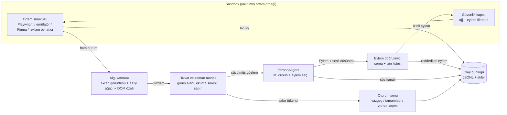

# 04 — Ortamlar, algı, eylem ve olay şeması

Yazar: `pk-ortam-muhendisi` (Software Engineer, Simulation — Product/Ad Intelligence yüzü) · Tarih: 2026-11-07
Girdi: `../00-arastirma.md`, `../01-roller.md`. Bu belge mimari belgesidir; kod değil, şema ve arayüz imzası içerir.

## 1. Amaç ve kapsam

Persona Katmanı'nda bir persona (LLM ile koşullandırılmış sentetik kullanıcı) bir şeyi "deneyimlemeden" görüş bildirmemelidir.
Bu bölüm, personaların içinde davrandığı **ortamları** (environment) tanımlar: canlı web sitesi, mobil uygulama, Figma prototipi
ve reklam (görsel, video, oynanabilir). Her ortam aynı sözleşmeyi uygular: personaya bir **gözlem** (observation) verir,
ondan bir **eylem** (action) alır, sonucu **olay** (event) olarak kaydeder.

Bölümün kapsamındakiler:

1. Ortam türleri ve her birinin sandbox'ı (yalıtılmış çalışma alanı).
2. Algı katmanı: ekran görüntüsü + erişilebilirlik ağacı (accessibility tree) + DOM.
3. Eylem alanı (action space): tıkla, kaydır, yaz, bekle, vazgeç ve türevleri.
4. Zaman ve dikkat modeli: duraksama, öfkeyle bırakma (rage-quit), kaydırıp geçme.
5. Olay şeması (gözlem günlüğü) ve oturum kaydı.
6. Deterministik yeniden oynatma (deterministic replay).
7. Sandbox güvenliği: gerçek satın alma, form gönderimi, çerezler.
8. Ölçek için ortam havuzu (environment pool).
9. Mevcut analitik olay adlarıyla eşleme (GA4/Amplitude benzeri).

Kapsam dışı konular için bkz. bölüm 12 (Arayüzler).

### 1.1 Tasarım ilkeleri (bu bölüme özgü)

- **Davranış önce, söz sonra.** Araştırma notundaki "say-do gap" argümanı ancak persona gerçekten bir ortamda hareket ederse
  anlamlıdır. Bu yüzden her koşuda iki ayrı kanal tutulur: *davranış kanalı* (olaylar) ve *söz kanalı* (personanın sesli düşünmesi,
  think-aloud). İkisi asla birbirinden türetilmez; rapor aradaki farkı gösterir.
- **Ortam gerçeği değiştirmez.** Persona hiçbir koşulda gerçek para harcamaz, gerçek form göndermez, gerçek kullanıcı hesabına dokunmaz.
- **Her koşu yeniden oynatılabilir.** Bir bulgu, ilgili oturum adım adım yeniden oynatılamıyorsa rapora "doğrulanamaz" etiketiyle girer.
- **Algı insanınkinden fazla olamaz.** Persona, insanın göremeyeceği bilgiyi (gizli DOM öğeleri, ekran dışı içerik, kaynak kodu) kullanamaz.
  Bu, LLM ajanlarının "makine gibi gezinme" eğilimini kısıtlamak için bilinçli bir sınırdır.

## 2. Algı-eylem döngüsü

Tüm ortamlar aynı döngüyü çalıştırır. Döngünün sahibi `EnvironmentRunner`'dır; LLM çağrısı `PersonaAgent` üzerinden yapılır
(persona istemi ve belleği `02` bölümünün sorumluluğundadır).



Sözde kod:

```text
function run_session(env_spec, persona, task, seed):
    env   = pool.acquire(env_spec, seed)            # bölüm 9
    clock = VirtualClock(seed)                      # bölüm 6
    state = AttentionState(persona.patience_profile)
    log.emit("session_start", ...)
    while true:
        raw   = env.capture()                       # ekran + a11y + DOM
        obs   = perceive(raw, persona.device, state)# bölüm 4
        obs   = attention.filter(obs, state, clock) # bölüm 6
        log.emit("observation", obs.digest)
        if attention.should_quit(state, clock): log.emit("abandon", reason); break
        step  = agent.decide(persona, task, obs, memory)   # LLM çağrısı
        log.emit("thought", step.think_aloud)
        act   = validate(step.action, env.action_space)
        if act.rejected: log.emit("action_rejected", act.reason); continue
        res   = guard.execute(env, act, clock)      # bölüm 8
        log.emit("action", act, res)
        state = attention.update(state, act, res, clock)
        if task.done(res) or step.action.type == "give_up": break
        if clock.elapsed > task.budget: log.emit("timeout"); break
    log.emit("session_end", outcome, survey = agent.debrief())
    pool.release(env)
```

## 3. Ortam türleri

Hepsi tek bir arayüzü uygular:

```ts
interface Environment {
  kind: "web" | "mobile" | "figma" | "ad_static" | "ad_video" | "ad_playable";
  reset(spec: EnvSpec, seed: number): Promise<void>;
  capture(): Promise<RawState>;               // ekran görüntüsü, a11y ağacı, DOM/katman ağacı, URL/ekran kimliği
  actionSpace(): ActionSpec[];                // bu ortamda geçerli eylemler
  execute(a: Action, clock: VirtualClock): Promise<ActionResult>;
  snapshot(): Promise<EnvSnapshotRef>;        // yeniden oynatma için
  close(): Promise<void>;
}
```

### 3.1 Canlı web sitesi

- **Sürücü:** Başsız (headless) Chromium; referans uygulama Playwright (https://playwright.dev). Playwright tercih nedeni:
  `page.accessibility` / ARIA anlık görüntüleri, `context.route()` ile ağ yakalama ve HAR kaydı/oynatma
  (https://playwright.dev/docs/mock#mocking-with-har-files), cihaz öykünmesi (device emulation) ve `clock` API'si
  (https://playwright.dev/docs/clock). Sağlayıcı bağımsızlığı için sürücü bir adaptör arkasındadır (CDP doğrudan, Puppeteer veya
  bir tarayıcı-ajan hizmeti de takılabilir).
- **Hedef türleri:** (a) müşterinin hazırlık (staging) ortamı — tercih edilen; (b) üretim sitesi salt okunur modda — yalnızca
  güvenlik kapısı "üretim profili" ile; (c) HAR ile dondurulmuş site kopyası — yeniden oynatma ve A/B varyantı için.
- **A/B varyantı:** Varyant, müşterinin özellik bayrağı (feature flag) çerezi/sorgu parametresi ile ya da HAR üzerinde yerel yama
  (DOM enjeksiyonu yasak; yalnızca müşterinin verdiği varyant dosyaları) ile seçilir.
- **Literatür referansı:** Web ajanı kıyaslamaları (WebArena, arXiv:2307.13854; Mind2Web, arXiv:2306.06070; VisualWebArena,
  arXiv:2401.13649) bu ortamın teknik zorluklarını belgeler: uzun sayfa, dinamik içerik, görsel-metin hizalama. Bizim farkımız
  hedefin "görevi başarmak" değil "bir insan gibi başarmak veya başaramamak" olmasıdır.

### 3.2 Mobil uygulama

İki mod, müşterinin elindeki varlığa göre:

| Mod | Ne gerekir | Nasıl çalışır | Sınır |
| --- | --- | --- | --- |
| **Emülatör** | Android APK (iOS için simülatör derlemesi) | Android Emulator + UI Automator/Appium sürücüsü; algı = ekran görüntüsü + görünüm hiyerarşisi (view hierarchy) | Pahalı ve yavaş; iOS ölçeklemesi macOS donanımı ister (varsayım: bulut Mac havuzu gerekir) |
| **Akış tanımı** | Ekran görüntüleri + geçiş tablosu (ekran A'da "Devam" → ekran B) | Durum makinesi; her ekran bir görüntü + tıklanabilir bölge listesi | Gerçek etkileşim yok (klavye, hata durumu, yükleme süresi simüle edilir) |

AndroidWorld (arXiv:2405.14573) emülatör tabanlı yaklaşımın tekrar üretilebilir kurulabildiğini gösterir. Akış tanımı modu,
Figma modu ile aynı durum makinesi motorunu paylaşır.

### 3.3 Figma prototipi

- **Kaynak:** Figma REST API (https://www.figma.com/developers/api) ile dosya düğümleri (`GET /v1/files/:key`), çerçeve görüntüleri
  (`GET /v1/images/:key`) ve prototip bağlantıları (düğümlerdeki `transitionNodeID`/etkileşim alanları) okunur. Figma'nın
  MCP sunucusu varsa aynı veriler oradan alınabilir (varsayım: MCP sunucusunun prototip etkileşimlerini döndürme kapsamı sürümden
  sürüme değişir; adaptör iki yolu da destekler).
- **Derleme:** Figma dosyası bir **prototip grafiğine** (prototype graph) derlenir: düğüm = çerçeve (frame) görüntüsü + katman ağacı
  (erişilebilirlik ağacının yerine geçer), kenar = etkileşim (tıklama, kaydırma, gecikmeli geçiş).
- **Sınır:** Prototipte bağlanmamış bir öğeye tıklama "ölü tıklama" (dead click) olayı üretir; bu, tasarım aşamasında en değerli
  bulgulardan biridir ve ayrı raporlanır. Metin girişi prototipte genellikle yoktur; `type` eylemi "niyet" olarak kaydedilir.
- **Katman ağacından algı:** Figma katman adları ("Frame 123") anlamsız olabilir; algı katmanı ekran görüntüsünden görsel
  öğe tespiti ile katman ağacını birleştirir. Katman adı personaya hiçbir zaman gösterilmez (insan onu göremez — ilke 4).

### 3.4 Reklam ortamları

| Tür | Girdi | Algı | Eylem alanı |
| --- | --- | --- | --- |
| Statik görsel | PNG/JPG + yerleşim bağlamı (akış içi, hikâye, banner) | Görüntü + yerleşim maketi (örn. sosyal akışta iki gönderi arasında) | `dwell`, `scroll_past`, `tap_cta`, `expand`, `hide_ad` |
| Video | MP4 | Kare örnekleme (sahne değişiminde + sabit aralıkla), altyazı/ses dökümü, sesin kapalı/açık durumu | `watch(t)`, `skip`, `unmute`, `rewatch`, `tap_cta`, `scroll_past` |
| Oynanabilir (playable) | HTML5 paketi (MRAID benzeri) | Web ortamıyla aynı (başsız tarayıcı, mobil görüntü alanı) | Web eylemleri + `install_cta` (her zaman sandbox içinde kesilir) |

Video için kritik nokta **ilk saniyeler**dir; kare örnekleme ilk 3 saniyede yoğun (varsayım: 4 kare/sn), sonra sahne değişimi
tetiklemeli olur. Persona her kare kümesinden sonra "izlemeye devam / geç" kararı verir; bu, sanal saatle birleşince
"kaçıncı saniyede bıraktı" eğrisini (retention curve) üretir. Sesli izleme ile sessiz izleme ayrı koşulardır; sosyal akışlarda
varsayılan sessizdir (varsayım; platforma göre şablonda ayarlanır).

## 4. Algı katmanı

### 4.1 Üç kanal

| Kanal | İçerik | Ne işe yarar | Risk |
| --- | --- | --- | --- |
| Ekran görüntüsü | Görüntü alanı (viewport) PNG'si, cihaz çözünürlüğünde | Görsel hiyerarşi, renk, kontrast, reklam/estetik tepki | Görsel modeller küçük metni yanlış okuyabilir |
| Erişilebilirlik ağacı | Rol, ad, durum (ARIA) — yalnızca görünür düğümler | Etkileşimli öğeleri güvenilir biçimde adreslemek | Kötü işaretlenmiş sitelerde eksik; bu da bir bulgudur |
| DOM özeti | Sadeleştirilmiş, görünür metin + bağlantı hedefleri, form alanları | Uzun metin, fiyat, form kuralları | İnsandan fazla bilgi sızdırma (gizli öğe, `alt` metni) |

Birleştirme yöntemi: **işaretli ekran görüntüsü** (Set-of-Mark istemleme, arXiv:2310.11441) — etkileşimli öğelerin üzerine
numaralı kutular çizilir; persona "7 numaraya dokun" der, sürücü bunu erişilebilirlik ağacındaki düğüme çevirir. SeeAct
(arXiv:2401.01614) görsel temellendirmenin (grounding) web ajanlarında ana hata kaynağı olduğunu gösterir; bu yüzden eylem
hedefi her zaman *kimlik + koordinat + erişilebilir ad* üçlüsüyle kaydedilir.

### 4.2 İnsan sınırı süzgeci

`perceive()` şunları **çıkarır**: görüntü alanı dışındaki içerik (kaydırılmadıkça), `display:none`/`visibility:hidden`/sıfır
opaklık öğeleri, `aria-hidden` olsa da görünür olmayanlar, HTML yorumları, meta etiketler, betik içerikleri. Ekran okuyucu
kullanan bir persona profili (bkz. `02`) için ise tersine çalışır: ekran görüntüsü kapatılır, yalnızca erişilebilirlik ağacı
doğrusal okunur. Bu, erişilebilirlik testini aynı altyapıyla mümkün kılar.

### 4.3 Cihaz ve bağlam

`DeviceProfile` = görüntü alanı, piksel yoğunluğu, dokunmatik/fare, ağ hızı (Playwright/CDP ağ kısıtlama), yazı tipi ölçeği.
Personanın cihazı `02` bölümündeki nüfus dağılımından gelir; ortam bunu yalnızca uygular.

## 5. Eylem alanı

Eylemler küçük ve kapalı bir kümedir; LLM serbest metin üretir ama yalnızca şemaya uyan eylem yürütülür.

| Eylem | Parametreler | Web | Mobil | Figma | Reklam | Not |
| --- | --- | --- | --- | --- | --- | --- |
| `click` / `tap` | `target` (işaret no), `button?` | ✓ | ✓ | ✓ | CTA | Koordinat, işaretten türetilir |
| `type` | `target`, `text`, `submit?` | ✓ | ✓ | niyet | — | Metin sentetik veri havuzundan (bölüm 8) |
| `scroll` | `direction`, `amount` (ekran oranı) | ✓ | ✓ | ✓ | akış | Hız dikkat modelinden gelir |
| `wait` | `ms` veya `until` (yüklenme) | ✓ | ✓ | ✓ | ✓ | Sanal saatte ilerler |
| `back` | — | ✓ | ✓ | ✓ | — | Tarayıcı/OS geri |
| `hover` | `target` | ✓ | — | ✓ | — | Yalnızca fare cihazlarda |
| `select` | `target`, `option` | ✓ | ✓ | niyet | — | |
| `read` | `region`, `depth` | ✓ | ✓ | ✓ | ✓ | Ekranda kalma; okuma süresi modelden |
| `watch` | `seconds` | — | — | — | video | |
| `skip` / `scroll_past` | — | — | — | — | ✓ | Reklamı geçme |
| `give_up` | `reason` (serbest metin) | ✓ | ✓ | ✓ | ✓ | Vazgeç; oturumu bitirir |
| `ask_help` | `channel` (sohbet, SSS) | ✓ | ✓ | — | — | Destek arayışı da bir sinyaldir |

Kurallar:

- Her adımda **tek eylem**. Çoklu eylem (örn. formu tek adımda doldurma) yasak; insan da alan alan doldurur ve her alanda
  vazgeçebilir.
- `give_up` her zaman erişilebilirdir; istem personaya bunu açıkça hatırlatır. LLM'lerin "görevi ne pahasına olursa olsun
  bitirme" eğilimi (araştırma notu §3'teki olumluluk yanlılığının davranış karşılığı — varsayım, ölçülmeli) aksi hâlde terk
  oranlarını sistematik olarak düşürür.
- Reddedilen eylem (şemaya uymayan, var olmayan hedef) kaydedilir ve persona bir kez yeniden dener; üçüncü ret "ajan hatası"
  olarak işaretlenir ve **davranış verisine katılmaz** — insan davranışı ile ajan beceriksizliği karıştırılmamalıdır.

## 6. Zaman ve dikkat modeli

LLM'in düşünme süresi insan davranış süresi değildir. Bu yüzden zaman **sanal saat** (virtual clock) ile modellenir; duvar saati
yalnızca maliyet ölçümü için tutulur.

### 6.1 Sanal saat

Her eylemin sanal süresi: `t = t_algı + t_karar + t_motor`.

- `t_algı`: okunan metin uzunluğu / personanın okuma hızı (dağılım `02`'den; kelime/dakika) + görsel tarama sabiti.
- `t_karar`: seçenek sayısına bağlı (Hick-Hyman yasası biçiminde log artış — klasik HCI modeli; parametreler kalibrasyonla
  belirlenir, `03`).
- `t_motor`: hedef boyutu ve uzaklığına bağlı (Fitts yasası biçimi); dokunmatikte farklı sabitler.
- Sayfa yükleme süreleri gerçekten ölçülür ve sanal saate eklenir (yavaş site gerçekten sabır tüketir).

Parametreler **literatür değeri değil, kalibre edilecek başlangıç değeri**dir; müşterinin gerçek oturum süresi dağılımları (GA4
`engagement_time_msec` gibi) geldiğinde `03` bölümünün kalibrasyon döngüsü bunları günceller.

### 6.2 Dikkat durumu

```ts
interface AttentionState {
  patience: number;          // 0..1, personanın sabır profiliyle başlar
  frustration: number;       // 0..1, olumsuz olaylarla artar
  goal_clarity: number;      // 0..1, "nerede olduğumu biliyorum" hissi
  scroll_velocity: number;   // ekran/sn
  seen_regions: RegionId[];  // gerçekten görüş alanına giren bölgeler
}
```

Güncelleme kuralları (başlangıç; hepsi parametreli):

| Tetikleyici | Etki | Kaydedilen olay |
| --- | --- | --- |
| Tıklama sonrası 1 sn içinde görünür değişiklik yok | `frustration +` | `dead_click` |
| Aynı hedefe kısa aralıkla ≥3 tıklama | `frustration ++` | `rage_click` |
| Sayfa yükleme > personanın eşiği | `patience −` | `slow_load` |
| Geri + aynı sayfaya dönüş döngüsü | `goal_clarity −` | `pogo_stick` |
| Form doğrulama hatası | `frustration +`, hata metninin tonu personaya gösterilir | `form_error` |
| Hedefe yaklaşan ilerleme (adım çubuğu vb.) | `goal_clarity +` | — |
| Ekranda `t < okuma eşiği` ile geçiş | — | `skim` |
| `patience ≤ 0` veya `frustration ≥ eşik` | Oturum biter | `abandon` (`reason: rage_quit`) |

**Kaydırıp geçme:** Akış/uzun sayfa bağlamında her bölge için *maruz kalma süresi* (exposure) hesaplanır; IAB/MRC görünürlük
tanımına benzer biçimde (varsayım: ≥%50 piksel, ≥1 sn — standart değer müşteri şablonunda doğrulanmalı) eşik altı bölgeler
"görülmedi" sayılır. Persona görmediği bölge hakkında soru sonrası ankette görüş bildiremez; bildirirse bu "uydurma" olarak işaretlenir.

**Önemli ayrım:** Dikkat modeli *kural tabanlı* bir dış katmandır ve LLM'in kararını **geçersiz kılabilir** (sabır bitti →
oturum biter, LLM devam etmek istese bile). Bunun nedeni, LLM'lerin içsel "sabır" taklidinin tutarsız olması ve kalibre
edilememesidir; dış model parametrelidir ve gerçek veriyle ayarlanabilir. Bu ayrımın felsefi boyutu için bkz. Soru 3.

## 7. Olay şeması ve oturum kaydı

### 7.1 Kayıt biçimi

- Oturum başına bir **JSONL** dosyası (satır başına bir olay), ekler (ekran görüntüleri, video kareleri, DOM anlık görüntüleri)
  içerik adresli (content-addressed, SHA-256) nesne deposunda.
- Web oturumları için ek olarak **rrweb** (https://github.com/rrweb-io/rrweb) DOM kaydı ve Playwright iz dosyası (trace) —
  insanın izleyebileceği görsel yeniden oynatma için.
- Olay şeması sürümlüdür (`schema_version`); geriye uyumsuz değişiklik yeni ana sürüm ister.

### 7.2 Ortak zarf (envelope)

```json
{
  "schema_version": "1.0",
  "event_id": "01JC9Z3V7K...",
  "session_id": "ses_8f2c...",
  "run_id": "run_2026_11_07_a",
  "persona_id": "per_4471",
  "persona_version": "pv_12",
  "env": { "kind": "web", "spec_hash": "sha256:...", "variant": "B", "device": "mobile_360x800" },
  "seq": 42,
  "t_virtual_ms": 18350,
  "t_wall": "2026-11-07T10:14:03.221Z",
  "type": "action",
  "payload": { },
  "provenance": { "model": "<sağlayıcı/model kimliği>", "prompt_hash": "sha256:...", "seed": 1337, "temperature": 0.7 },
  "synthetic": true
}
```

`synthetic: true` her olayda zorunludur ve değiştirilemez; sentetik olayın gerçek analitik akışına karışmasını engellemenin son
savunma hattıdır (bkz. Arayüz: `06-guven-gizlilik.md`).

### 7.3 Olay türleri

| `type` | Kanal | `payload` alanları (özet) | Örnek |
| --- | --- | --- | --- |
| `session_start` | davranış | `task`, `entry_url`/`entry_frame`, `persona_snapshot_ref` | Görev: "Bir uçuş bileti bul" |
| `observation` | algı | `screen_id`, `screenshot_ref`, `a11y_ref`, `visible_marks[]`, `viewport_scroll_y` | |
| `exposure` | algı | `region_id`, `visible_ratio`, `duration_ms` | Reklam bölgesi 1,4 sn görüldü |
| `thought` | söz | `text`, `stance` (olumlu/olumsuz/nötr, persona kendi beyanı) | "Fiyat nerede yazıyor?" |
| `action` | davranış | `action`, `target{mark,a11y_name,role,xy}`, `result{changed,new_screen_id,latency_ms}` | |
| `action_rejected` | sistem | `raw`, `reason` | Var olmayan işaret no |
| `blocked_by_guard` | sistem | `rule`, `would_have` | Ödeme API çağrısı kesildi |
| `friction` | türetilmiş | `kind` (dead_click, rage_click, slow_load, pogo_stick, form_error, skim), `evidence_event_ids[]` | |
| `milestone` | davranış | `name` (müşterinin dönüşüm adımları), `mapped_analytics_event` | `begin_checkout` |
| `abandon` | davranış | `reason` (rage_quit, gave_up, timeout, confused), `last_screen_id`, `persona_reason_text` | |
| `session_end` | davranış | `outcome` (completed / abandoned / agent_error), `duration_virtual_ms`, `steps` | |
| `debrief` | söz | `answers[]` (oturum sonrası anket), `cited_event_ids[]` | |

**Kanıt bağı:** `debrief` yanıtlarındaki her iddia `cited_event_ids` ile oturumdaki olaylara bağlanır (PersonaCite yaklaşımının,
arXiv:2601.22288, ortam karşılığı). Kanıtsız iddia raporda "kanıtsız" etiketiyle görünür.

### 7.4 Örnek oturum dilimi

```json
{"seq":17,"t_virtual_ms":9200,"type":"observation","payload":{"screen_id":"checkout/shipping","visible_marks":[1,2,3,4,5,6,7]}}
{"seq":18,"t_virtual_ms":9200,"type":"thought","payload":{"text":"Kargo ücreti şimdi mi çıktı? Sepette yazmıyordu.","stance":"olumsuz"}}
{"seq":19,"t_virtual_ms":12900,"type":"action","payload":{"action":"click","target":{"mark":7,"a11y_name":"Geri","role":"button"},"result":{"changed":true,"new_screen_id":"cart"}}}
{"seq":20,"t_virtual_ms":12900,"type":"friction","payload":{"kind":"pogo_stick","evidence_event_ids":["...16","...19"]}}
{"seq":24,"t_virtual_ms":21400,"type":"abandon","payload":{"reason":"gave_up","last_screen_id":"cart","persona_reason_text":"Sürpriz ücret sevmem."}}
```

## 8. Sandbox güvenliği

Persona gerçek dünyada iz bırakmamalıdır. Güvenlik kapısı (guard) üç katmandır:

1. **Ağ katmanı.** Her ortam örneği kendi ağ ad alanında (network namespace) ve bir çıkış vekil sunucusunun (egress proxy)
   arkasında çalışır. Varsayılan politika *izin listesi*dir: yalnızca müşterinin bildirdiği alan adları. Bilinen ödeme
   sağlayıcıları, analitik toplayıcıları ve reklam pikselleri **kesilir veya yerel taklitle (mock) yanıtlanır**. Analitik
   piksellerinin kesilmesi kritik: sentetik oturumlar müşterinin gerçek GA4/Amplitude verisini kirletmemelidir.
2. **Eylem katmanı.** Yan etkili eylemler (POST/PUT/DELETE, `submit`, ödeme düğmeleri, "satın al", "hesap sil", e-posta/SMS
   gönderimi) **hedef ortamın profiline** göre ele alınır:

   | Profil | Yan etkili istek | Not |
   | --- | --- | --- |
   | `staging` | Geçer | Müşteri hazırlık ortamı; test kartları ve test hesapları |
   | `frozen` (HAR) | Kaydedilmiş yanıtla karşılanır; kayıt yoksa sentetik 200 + `blocked_by_guard` | Yeniden oynatma için varsayılan |
   | `production_readonly` | Kesilir, persona'ya "başarılı" gibi görünen taklit yanıt gösterilmez — oturum o noktada `milestone` olarak sonlanır | Gerçek sitede sahte başarı göstermek davranışı çarpıtır |

3. **Veri katmanı.** `type` eylemindeki metinler (ad, e-posta, telefon, adres, kart) yalnızca **sentetik veri havuzundan** gelir
   (rezerve alan adları, örn. `example.com` — RFC 2606; test kart numaraları — ödeme sağlayıcısının test belgelerinden).
   Persona serbest metin üretse bile kişisel veri kalıbına uyan girdi havuzdaki değerle değiştirilir.

**Çerezler ve oturum durumu:** Her oturum temiz tarayıcı bağlamıyla (browser context) başlar. "Geri dönen kullanıcı" senaryosu
gerekiyorsa çerez durumu açıkça tanımlanmış bir **depolama durumu** (storage state) dosyasından yüklenir; gerçek kullanıcı
çerezleri asla kullanılmaz. Çerez onay bannerları ayrı bir davranış noktasıdır: personanın "kabul / reddet / kapat" tepkisi
kaydedilir, ancak reddettiğinde de oturum sürer.

**Kötüye kullanım sınırı:** Ortam katmanı, müşterinin sahibi olmadığı bir siteye yük bindirmek (kazıma, rakip analizi) için
kullanılmamalıdır. Teknik önlem: hedef alan adı için sahiplik doğrulaması (DNS TXT kaydı veya müşteri sözleşmesi) ve oturum
hız sınırı. Rakip sitelerinin salt okunur gezilmesinin meşruiyeti bir değer sorusudur (Soru 4).

## 9. Ölçek: ortam havuzu

Binlerce koşu, ortam açmanın maliyetini baskın kılar. Havuz, `spec_hash` anahtarıyla **sıcak örnekler** (warm pool) tutar:
web için tarayıcı süreci başına çok sayıda bağlam, mobil için emülatör anlık görüntüsünden hızlı açılış, Figma/reklam için
durumsuz önbellek. Her örneğin kirlenme sayacı vardır; eşikte geri dönüştürülür. Çalışan düğümler konteynerdir (ağ ad alanı +
egress proxy).

- **Birim maliyet sırası (varsayım, ölçülmeli):** reklam statik < Figma < web (HAR) < web (canlı) < mobil emülatör. Planlayıcı
  aynı soruyu önce ucuz ortamda (örn. Figma veya HAR) çalıştırıp yalnızca belirsiz kalan segmentleri pahalı ortama taşıyabilir.
- **Darboğaz LLM çağrısıdır, ortam değil** (varsayım). Bu yüzden ortam adımları LLM yanıtını beklerken askıya alınır; bir
  tarayıcı süreci birçok bağlamı eşzamanlı tutar. Toplu koşular küçük/ucuz modelle (varsayılan referans Haiku sınıfı),
  belirsiz ya da anlatısal kritik oturumlar büyük modelle (Opus sınıfı) yürütülür; model seçimi `01-sistem.md`'nin kararıdır.
- **Adım bütçesi:** Her görevin maksimum adım ve sanal süre bütçesi vardır; bütçeyi aşan oturum `timeout` ile biter, maliyeti
  sınırlar.
## 10. Deterministik yeniden oynatma

İki ayrı "yeniden oynatma" vardır ve karıştırılmamalıdır:

| Tür | Ne sabit | Ne değişir | Amaç |
| --- | --- | --- | --- |
| **Kayıt oynatma** (replay) | Ortam + persona kararları (günlükten) | Hiçbir şey | Hata ayıklama, denetim, "bu bulgu gerçekten oldu mu" |
| **Yeniden koşma** (re-run) | Ortam anlık görüntüsü + seed | LLM kararları (sağlayıcı determinizmi garanti etmez) | Sonucun kararlılığını ölçmek (bkz. `03`) |

Kayıt oynatma için sabitlenenler:

- **Ağ:** HAR dosyası; kayıtta olmayan istek → hata (sessizce canlı ağa çıkmaz).
- **Zaman:** Sayfa içi `Date`/zamanlayıcılar Playwright `clock` ile sabitlenir; sanal saat günlükteki `t_virtual_ms`'i izler.
- **Rastgelelik:** Sayfa içi `Math.random` tohumlanır (init script); müşteri tarafı A/B atama mantığı varyant parametresiyle zorlanır.
- **Yazı tipleri ve render:** Aynı konteyner imajı ve tarayıcı sürümü (`env.spec_hash` bunu içerir).
- **LLM:** Kayıt oynatmada LLM çağrılmaz; eylemler günlükten okunur. Günlükteki eylem oynatma sırasında hedefini bulamazsa
  (`replay_divergence`), oturum "kayıt bozuk" olarak işaretlenir.

LLM çıktısının bit düzeyinde tekrarlanabilirliği sağlayıcıya bağlıdır ve garanti edilmez (varsayım: sıcaklık 0'da bile toplu
çıkarım farklılıkları olabilir). Bu nedenle "deterministik" iddiası yalnızca kayıt oynatma için yapılır; yeniden koşma
istatistiksel olarak ele alınır.

## 11. Analitik olay eşlemesi

Müşteri sonuçları kendi panolarıyla karşılaştırmak ister. Bu yüzden her ortam bir **eşleme tablosu** (mapping) alır:
`milestone` ve `friction` olaylarımız ↔ müşterinin analitik olay adları.

| Bizim olay | GA4 karşılığı (önerilen olay adları) | Amplitude benzeri (müşterinin taksonomisi) | Eşleme kaynağı |
| --- | --- | --- | --- |
| `session_start` | `session_start` (otomatik) | `Session Start` | sabit |
| `observation` (yeni ekran) | `page_view` / `screen_view` | `Viewed <Ekran>` | URL/ekran kimliği kuralı |
| `milestone: view_item` | `view_item` | `Product Viewed` | seçici kuralı (CSS/a11y) |
| `milestone: add_to_cart` | `add_to_cart` | `Product Added` | ağ isteği veya seçici |
| `milestone: begin_checkout` | `begin_checkout` | `Checkout Started` | URL kuralı |
| `milestone: purchase` | `purchase` (yalnızca staging; aksi hâlde "purchase_intent") | `Order Completed` | guard profili |
| `exposure` (reklam) | — (reklam platformu metriği: gösterim/görünür gösterim) | — | şablon |
| `friction: rage_click` | yok (oturum kaydı araçlarında var) | özel olay | — |
| `abandon` | yok (hunide düşüş olarak türetilir) | yok | türetilir |

GA4 önerilen olay adları: https://support.google.com/analytics/answer/9267735 ve e-ticaret olayları:
https://developers.google.com/analytics/devguides/collection/ga4/ecommerce. Amplitude için sabit bir standart yoktur; müşterinin
izleme planı (tracking plan) içe aktarılır (varsayım: CSV/JSON taksonomi dışa aktarımı).

Eşlemenin iki yöntemi:

1. **Pasif yakalama (tercih):** Ağ katmanı analitik piksellerini keser ama *içeriğini okur*; sitenin kendi gönderdiği
   `add_to_cart` isteği yakalanıp `milestone` olarak kaydedilir. Böylece eşleme sitenin gerçek enstrümantasyonundan gelir.
2. **Kural tabanlı:** Pasif yakalama yoksa (Figma, akış tanımı) müşteri ekran/öğe → olay kuralı yazar.

Çıktı, müşterinin hunisiyle aynı adımlardan oluşan **sentetik huni**dir. Rapor, sentetik huni ile gerçek huniyi yan yana
gösterir; fark `03` bölümünün kalibrasyon girdisidir.

## 12. Arayüzler

### Arayüz: `01-sistem.md` (simülasyon mimarı)

- `EnvironmentRunner.run(job) -> SessionRef`; `job = {persona_ref, env_spec, variant, seed, task, budget}`.
- Ortam havuzu `01`'in iş kuyruğu ve çalışan düğüm modeline oturur; havuz yalnızca `acquire/release/recycle` sunar.
- Model seçimi (Haiku/Opus sınıfı yönlendirme) `01`'in kararıdır; ortam katmanı yalnızca `agent.decide()` çağırır ve
  `provenance` alanını doldurur.
- Olay günlüğü depolama biçimi (JSONL + içerik adresli ekler) `01`'in veri modeline kayıt olarak girer.

### Arayüz: `02-persona-uretimi.md` (insan simülasyonu araştırmacısı)

- Ortamın personadan beklediği alanlar: `device_profile`, `reading_speed`, `patience_profile`, `frustration_threshold`,
  `assistive_tech` (ekran okuyucu, büyütme), `digital_literacy`, `language`.
- Bu alanlar nüfus dağılımından gelir; ortam bunları uydurmaz, eksikse oturumu başlatmaz.
- Uzun oturumda kimlik kayması (arXiv:2608.15844) ölçümü için ortam, her N adımda personanın kısa bir öz-beyanını (`thought`
  içinde etiketli) toplayabilir; ölçüm yöntemi `02`'nindir.

### Arayüz: `03-degerlendirme.md` (değerlendirme mühendisi)

- `03`'e verilenler: olay günlüğü, sentetik huni, sürtünme olayları, `replay_divergence` oranı, ajan hatası oranı.
- `03`'ten alınanlar: zaman/dikkat modeli parametreleri (kalibrasyon sonrası), eşikler.
- Ajan hatası (`action_rejected` ×3, `agent_error`) ile persona davranışı (`abandon`) ayrımı `03`'ün metriklerinde korunmalı.

### Arayüz: `05-icgoru-ve-urun.md` (içgörü mimarı)

- Görev tanımı (`task`) ve sektör şablonları (`milestone` listesi, reklam yerleşim bağlamı) `05`'ten gelir.
- Rapor; söz kanalı ile davranış kanalını ayrı gösterir, her alıntı `event_id` ile oturum kaydına bağlıdır.

### Arayüz: `06-guven-gizlilik.md` (güven ve gizlilik)

- `synthetic: true` işareti, analitik piksel kesimi, sentetik veri havuzu, alan adı sahiplik doğrulaması.
- Ekran görüntüleri gerçek kişisel veri içerebilir (staging'de bile gerçek müşteri kayıtları olabilir): saklama süresi ve
  maskeleme kuralları `06`'nın kararıdır; ortam katmanı maskeleme kancası (`redact(screenshot)`) sunar.

## 13. Riskler ve açık teknik sorular

| Risk | Etki | Önlem |
| --- | --- | --- |
| Ajan beceriksizliği insan sürtünmesi sanılır | Yanlış "UX sorunu" bulguları | Ajan hatası ayrı sınıf; aynı akışta "uzman ajan" kontrol koşusu (persona yok, yalnızca görev) — o da takılıyorsa sorun büyük olasılıkla ajandadır |
| Olumluluk yanlılığı terk oranını düşürür | İyimser huniler | `give_up` her zaman görünür; dış dikkat modeli; gerçek huniyle kalibrasyon |
| Bot algılama / CAPTCHA | Canlı sitede koşu kesilir | Staging/HAR tercih; CAPTCHA aşma yapılmaz, `blocked_by_guard` ile kaydedilir |
| Görsel algı hatası (küçük metin) | Persona "fiyatı göremedim" der ama sorun model | Algı kanalları çapraz kontrol: a11y ağacında var, persona görmedi → "algı belirsiz" etiketi |

Literatür bağlamı: OSWorld (arXiv:2404.07972) ve web kıyaslamaları, ajanların ortamda gezinme becerisinin hâlâ insan
seviyesinin altında olduğunu gösterir; ilk riskin en önemli risk olmasının nedeni budur.

## Kaynaklar

- Playwright: https://playwright.dev ; HAR: https://playwright.dev/docs/mock#mocking-with-har-files ; Clock: https://playwright.dev/docs/clock
- Figma REST API: https://www.figma.com/developers/api
- rrweb: https://github.com/rrweb-io/rrweb
- GA4 önerilen olaylar: https://support.google.com/analytics/answer/9267735 ; e-ticaret: https://developers.google.com/analytics/devguides/collection/ga4/ecommerce
- RFC 2606 (rezerve alan adları): https://www.rfc-editor.org/rfc/rfc2606
- WebArena arXiv:2307.13854 · Mind2Web arXiv:2306.06070 · VisualWebArena arXiv:2401.13649 · SeeAct arXiv:2401.01614 ·
  Set-of-Mark arXiv:2310.11441 · AndroidWorld arXiv:2405.14573 · OSWorld arXiv:2404.07972
- Araştırma notundan: PersonaCite arXiv:2601.22288 · MicroVerse arXiv:2608.15844 · Persona Generators arXiv:2602.03545

## Felsefi sorular (proje sahibine)

### Soru 1 — Söz ile davranış çelişirse hangisi "personanın görüşü"dür?

- **Soru:** Persona sesli düşünmede "çok beğendim" deyip üç adım sonra vazgeçerse, raporda personanın tutumu ne olarak sunulur?
- **Neden teknik değil:** İkisi de aynı modelin ürettiği metindir; hangisinin "gerçek niyet"i temsil ettiği, sentetik bir
  varlığa niyet atfetmenin anlamı sorusudur. "Say-do gap" insanlarda ölçülmüş bir olgudur; LLM'de aynı adı taşıyan farkın aynı
  olgu olup olmadığı bilinmiyor.
- **Seçenekler:** (a) Davranış öncelikli — söz yalnızca açıklayıcı; (b) ikisi eşit, çelişki ayrı bulgu; (c) çelişki görünce
  oturum "tutarsız persona" sayılır ve dışlanır.
- **Önerim:** (b), ama çelişkiyi "insanlardaki say-do gap'in kanıtı" diye pazarlamamak; "modelin iki kanalı arasında fark" diye adlandırmak.
- **Etkilediği parça:** Olay şeması (`thought` vs `action` ayrımı), rapor biçimi (`05`), kalibrasyon hedefleri (`03`).

### Soru 2 — Personaya insanın göremeyeceğini göstermemek ne kadar katı olmalı?

- **Soru:** Algı süzgeci (bölüm 4.2) personanın DOM'dan gizli bilgi almasını engelliyor. Ama ekran görüntüsünü okuyan model
  insandan *daha iyi* (hiç yorulmadan, her pikseli) görüyor. "İnsan gibi algı" hedefi için bilerek bozulmuş algı (bulanıklaştırma,
  çevresel görüş kaybı) eklemeli miyiz?
- **Neden teknik değil:** Hangi kusurların "insanı temsil etmek" için gerekli, hangilerinin bir grubu (örn. yaşlı, az gören)
  karikatürleştirmek olduğu bir temsil ve saygı sorusudur.
- **Seçenekler:** (a) Yalnızca bilgi sınırı (şimdiki tasarım); (b) parametreli algı bozulması, gerçek ölçümlerle (göz izleme
  verisi) kalibre edilene kadar kapalı; (c) bozulma profillerini erişilebilirlik grupları için açıkça sunmak.
- **Önerim:** (b) — kalibrasyon verisi olmadan bozulma eklemek kalıp yargı modellemeye dönüşür.
- **Etkilediği parça:** Algı katmanı, `DeviceProfile`, `02`'deki erişilebilirlik özellikleri.

### Soru 3 — Dış dikkat modeli LLM'in "iradesini" geçersiz kılabilir mi?

- **Soru:** Sabır modeli oturumu bitirdiğinde persona "devam etmek istiyordum" demişse, sonuç personanın mı yoksa bizim kuralımızın mı?
- **Neden teknik değil:** Raporlanan "terk", artık kısmen bizim varsayımımızdır. Müşteriye "personalar terk etti" demek ile
  "modelimiz terk ettirdi" demek arasındaki fark bir dürüstlük ve sorumluluk sorusudur.
- **Seçenekler:** (a) Dış model üstün, raporda ayrı etiketle ("sabır modeli sonlandırdı"); (b) dış model yalnızca uyarı verir, karar LLM'de;
  (c) iki koşu türü de raporlanır.
- **Önerim:** (a), etiket zorunlu; kalibrasyon kanıtı birikene kadar raporda iki oranı (model sonlandırması / persona kararı) ayrı göstermek.
- **Etkilediği parça:** Dikkat modeli, `abandon.reason` alanı, rapor (`05`), kalibrasyon (`03`).

### Soru 4 — Müşterinin sahibi olmadığı sitelerde persona koşturmak meşru mu?

- **Soru:** Müşteri, rakibinin ödeme akışını personalarla karşılaştırmak isterse izin verilir mi?
- **Neden teknik değil:** Teknik olarak salt okunur gezinme mümkündür; sorun, üçüncü tarafın rızası olmadan onun ürününü
  sistematik biçimde "test etmenin" ve sonuçlarını satmanın etik ve hukuki meşruiyetidir.
- **Seçenekler:** (a) Yalnızca sahiplik doğrulanmış alanlar; (b) herkese açık sayfalar hız sınırıyla serbest, yan etkili hiçbir şey yok;
  (c) yalnızca müşterinin kendi kaydettiği ekran görüntüleri/HAR ile (canlı erişim yok).
- **Önerim:** (a) varsayılan; (c) istisna olarak ve `06`'nın hukuki görüşüyle.
- **Etkilediği parça:** Güvenlik kapısı (sahiplik doğrulaması), ortam havuzu, `06-guven-gizlilik.md`.

### Soru 5 — Sentetik huniyi gerçek huninin yanına koymak ne kadar belirsizlikle sunulmalı?

- **Soru:** Sentetik huni ile müşterinin GA4 hunisi aynı adlarla yan yana durunca kullanıcı ikisini aynı türden ölçüm sanabilir.
  Ne kadar belirsizlik ve uyarı gösterilmeli?
- **Neden teknik değil:** Araştırma notundaki aşırı güven bulgusu (arXiv:2607.21757) bunun bir algı ve sorumluluk sorusu olduğunu
  gösteriyor; doğru format, ürünün "karar desteği" mi "ölçüm" mü olduğuna dair konumlanmaya bağlı.
- **Seçenekler:** (a) Sentetik huni yalnızca göreli (A vs B) gösterilir, mutlak oran gösterilmez; (b) mutlak oran + güven aralığı + kalibrasyon geçmişi;
  (c) kalibrasyon yapılmamış müşteride huni hiç gösterilmez, yalnızca sürtünme bulguları.
- **Önerim:** Kalibrasyon öncesi (a), sonrası (b).
- **Etkilediği parça:** Analitik eşleme (bölüm 11), rapor biçimi (`05`), kalibrasyon (`03`).
