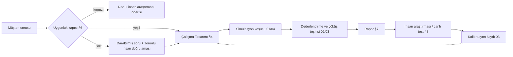

# 05 · İçgörü ve ürün: soru → simülasyon → karar

Yazar: `pk-icgoru-mimari` (İçgörü Mimarı; müşteri yüzü Simulation Architect karşılığı). Tarih: 2026-11-07.
Girdiler: `../00-arastirma.md`, `../01-roller.md`. Bu belge kod değil, ürün ve araştırma tasarımı mimarisidir.

## 0. Bu bölümün tezi

Persona Katmanı'nın değeri motorun kaç persona koşturduğunda değil, **doğru soruyu doğru simülasyona çevirmesinde** ve
**sonucu dürüst bir biçimde teslim etmesindedir.** Literatürün uyarıları (persona çıktılarının olumluya kayması, kalıp yargı
kümesine çöküş, ortalamanın tutup varyansın sapması, katılımcı tasarımcının aşırı güveni; bkz. §11 kaynaklar) ürün yüzeyinde
üç kuralla karşılanır:

1. **Kapı:** Her çalışma bir *uygunluk kapısından* geçer; simülasyona uygun olmayan soru reddedilir ya da insan araştırmasına
   yönlendirilir (§6).
2. **Şablon:** Hiçbir simülasyon serbest metin istemle başlamaz; her çalışma doldurulmuş bir *Çalışma Tasarımı* (study design)
   nesnesidir: soru, nüfus, senaryo, başarı ölçütü, güven eşiği (§4).
3. **Rapor:** Çıktı tek skor değildir; her bulgu **gerekçe + güven + kanıt** üçlüsüyle gelir ve "ne bilmiyoruz" bölümü zorunludur (§7).

Ürün kendini "karar desteği" olarak konumlar; "ölçümün yerine geçer" iddiası yapmaz (`00-arastirma.md` §4).

## 1. Hedef kullanıcılar ve işleri

Kullanıcıyı unvanla değil, yapmaya çalıştığı işle (jobs-to-be-done) tanımlıyoruz. Her satırın son sütunu, o kullanıcının
ürünü yanlış kullanma eğilimini ve tasarımın buna karşı koyduğu önlemi gösterir.

| Kullanıcı | Asıl işi | Bugün nasıl yapıyor | Persona Katmanı'ndan beklediği | Yanlış kullanım riski → önlem |
| --- | --- | --- | --- | --- |
| Performans pazarlamacısı | Yayına çıkmadan zayıf kreatifi elemek | Küçük bütçeli canlı A/B, sezgi | Saatler içinde 6 varyanttan 2'ye inmek; neden zayıf olduğunun dili | Simülasyon kazananını "kesin" sanıp canlı testi atlamak → rapor her zaman "canlı doğrulama önerisi" taşır |
| Marka / iletişim yöneticisi | Mesaj ve konumlandırmanın segmentlerde nasıl okunduğunu görmek | Odak grubu, ajans sezgisi | Segment bazında yanlış okuma, ton riski, rakip çağrışımı | Kalıp yargıyı "segment içgörüsü" sanmak → çöküş teşhisi raporda görünür (§7.3) |
| Ürün yöneticisi | Akıştaki sürtünmeyi, terk noktasını bulmak | Analitik + az sayıda kullanılabilirlik testi | Figma veya canlı akışta duraksama, geri dönme, yanlış anlama | Persona davranışını gerçek dönüşüm oranı sanmak → oran değil sıralama ve sebep raporlanır |
| UX araştırmacısı | Çalışmanın insan oturumlarını doğru yere harcamak | Pilot oturum, tarama anketi | Pilot öncesi kaba hataları temizlemek, görüşme kılavuzunu keskinleştirmek | Sentetik pilotu ana çalışma yerine koymak → insan araştırmasıyla birlikte akış (§8) |
| Strateji / içgörü ekibi | Pazar, segment, konumlandırma seçeneklerini daraltmak | Masa başı araştırma, danışman | Senaryo karşılaştırması, varsayımların görünür hâle gelmesi | Nüfus ölçeğinde tahmini pazar payı gibi okumak → strateji çıktısı "senaryo duyarlılığı" olarak etiketlenir |

Ortak paydaş: **karar sahibi** (çoğu zaman raporu okuyan ama çalışmayı tasarlamayan kişi). Rapor biçimi ona göre yazılır:
ilk ekran kararı ve güveni söyler, kanıt bir dokunuş aşağıdadır.

## 2. Kullanım senaryoları

Her senaryo için: soru tipi, ortam (bkz. `04-ortamlar.md`), tipik çıktı ve uygunluk notu.

### 2.1 Reklam ön testi (ad pre-test)

- **Soru tipi:** "Bu 4 kreatiften hangisinin kancası (hook) hedef segmentte ilk 3 saniyede tutar ve neden?"
- **Ortam:** Görsel/video/oynanabilir reklam sandbox'ı; persona reklamı akış içinde, rakip içeriklerin arasında görür.
- **Çıktı:** Varyant sıralaması + her persona kümesinden doğrudan alıntılı gerekçeler + "yanlış anlama" listesi
  (marka karışıklığı, teklifin okunmaması, rahatsız edici öğe).
- **Uygunluk:** Yüksek. Karar düşük riskli ve geri alınabilir; canlı A/B ile doğrulanabilir.

### 2.2 Akış / UX testi

- **Soru tipi:** "Yeni üyelik akışında personalar nerede duraksıyor, nerede geri dönüyor, hangi alanı yanlış anlıyor?"
- **Ortam:** Tarayıcı/uygulama ajanı veya Figma prototipi.
- **Çıktı:** Adım bazında sürtünme haritası, terk nedeni sınıflaması, ekran görüntüsüne bağlı alıntılar.
- **Uygunluk:** Yüksek, ancak erişilebilirlik ve motor beceri sorunları (yaşlı kullanıcı, tek el, ekran okuyucu) için
  simülasyon **kanıt sayılmaz**; yalnızca hipotez üretir (varsayım: ajanların fiziksel etkileşim modeli gerçeği temsil etmez).

### 2.3 Mesaj ve konumlandırma

- **Soru tipi:** "Üç değer önerisinden hangisi KOBİ muhasebecileri için anlaşılır, inandırıcı ve rakipten ayrışır?"
- **Ortam:** Metin/sayfa sunumu; isteğe bağlı rakip mesajlarıyla yan yana.
- **Çıktı:** Anlaşılırlık / inandırıcılık / ayrışma eksenlerinde segment bazlı gerekçe; persona kendi sözleriyle mesajı
  yeniden anlatır (geri anlatım testi, "playback").
- **Uygunluk:** Yüksek; iterasyon döngüsü için en uygun alan.

### 2.4 Konsept eleme (concept screening)

- **Soru tipi:** "12 ürün konseptinden hangi 3'ü insan araştırmasına gitmeye değer?"
- **Çıktı:** Eleme gerekçesi, "kimin için" notu, birbirine çok benzeyen konseptlerin birleştirilme önerisi.
- **Uygunluk:** Orta-yüksek. Huni daraltma için uygun; **kazanan seçmek** için değil. Rapor dili "ele / insana götür"
  ikilisidir, "kazandı" değil.

### 2.5 Fiyat sayfası okunurluğu

- **Soru tipi:** "Paket farkları anlaşılıyor mu? Persona kendisine uygun paketi doğru seçebiliyor mu?"
- **Çıktı:** Seçim doğruluğu (persona profiline göre "doğru" paket önceden tanımlıdır), kafa karıştıran satırlar, gizli
  maliyet algısı.
- **Uygunluk:** Yüksek **yalnızca okunurluk için.** "Bu fiyatı öder mi?" sorusu §6'daki kırmızı çizgiye takılır.
  Talp'ın kendi B2B sayfasındaki sınır ("davranışı simüle eder, ödeme istekliliğini değil") burada ürün kuralına çevrilir.

## 3. Uygunluk kapısının yeri



## 4. Soru → simülasyon tasarım şablonu

### 4.1 Şablonun alanları

Çalışma Tasarımı (StudyDesign) bir sürümlenen nesnedir; koşu onu değiştiremez, yalnızca referans verir.

```yaml
StudyDesign:
  id: string
  version: int
  # 1. Soru
  decision: string            # bu çalışmanın besleyeceği karar, tek cümle
  research_question: string   # ölçülebilir hâle getirilmiş soru
  question_type: enum[preference_rank, comprehension, friction, message_fit, concept_screen, pricing_legibility]
  reversibility: enum[reversible, costly_to_reverse, irreversible]
  gate_result: enum[green, yellow, red]   # §6 kurallarından türetilir, elle yazılmaz
  # 2. Nüfus
  population:
    frame: string             # kimi temsil ediyoruz (ör. "TR, 25-54, son 6 ayda online ayakkabı alan")
    source: enum[public_stats, client_first_party, panel, mixed]   # bkz. 02, 06
    strata: [ {dimension, levels, target_share} ]
    n_personas: int           # tasarım alanı; sayı motor tarafından önerilir, sabit değil
    exclusions: [string]
  # 3. Senaryo
  scenario:
    environment: enum[ad_feed, web, app, figma, page, message_card]   # bkz. 04
    stimuli: [ {id, kind, uri, variant_label} ]
    context: string           # personanın o anki durumu (saat, cihaz, niyet)
    task: string              # personaya verilen görev; yönlendirici olmamalı
    blinding: bool            # varyant etiketleri ve marka adı gizli mi
    order: enum[randomized, fixed]
  # 4. Başarı ölçütü
  metrics:
    primary: {name, definition, direction}
    secondary: [ {name, definition} ]
    qualitative_codes: [string]   # gerekçe kodlama sözlüğü
  decision_rule: string       # hangi sonuçta hangi eylem, koşudan ÖNCE yazılır
  # 5. Güven eşiği
  confidence:
    min_agreement_across_seeds: float    # tohum/örneklem tekrarları arası tutarlılık
    min_segment_separation: string       # segmentler ayrışıyor mu, yoksa çöküş mü
    calibration_prior: ref               # bu soru tipinin geçmiş isabet kaydı (03)
    human_validation_required: bool
  known_limits: [string]      # tasarımcının baştan kabul ettiği sınırlar
```

Kurallar:

- `decision_rule` koşudan önce kilitlenir (ön kayıt, pre-registration). Sonradan değişirse rapor bunu gösterir.
- `task` alanı bir "yönlendirme denetçisi" ile taranır: "bu reklamı beğendiniz mi?" gibi olumlu yanıt çeken ifadeler
  reddedilir; "akışta ilerliyorsunuz, ne yaparsınız?" gibi davranış istemine çevrilir. Gerekçe: persona koşullu LLM'lerin
  olumluya kayma eğilimi (2602.03545).
- `blinding` varsayılan olarak açıktır; marka adı ancak marka algısı sorusunda açılır.
- `gate_result` kırmızıysa nesne koşuya gönderilemez.

### 4.2 Doldurulmuş örnek: e-ticaret sepet sayfası, kargo mesajı

Müşteri cümlesi (ham): "Sepette 'Kargo bedava' yerine '250 TL üzeri kargo bedava' yazınca terk artar mı?"

İçgörü Mimarı'nın çevirisi: Terk oranı bir sayı tahminidir ve simülasyon onu güvenilir veremez; ama **mesajın nasıl okunduğu,
eşik algısı ve sepet tamamlama davranışındaki sebep** sorulabilir. Soru daraltılır, gate sarı olur, canlı A/B şart koşulur.

```yaml
StudyDesign:
  id: ecom-cart-shipping-01
  version: 2
  decision: "Sepet sayfasında hangi kargo mesajıyla canlı A/B'ye çıkacağız (en fazla 2 varyant)?"
  research_question: >
    Üç kargo mesajı varyantı, sepet tutarı eşiğin altında ve üstünde olan alışverişçilerde
    (a) doğru anlaşılıyor mu, (b) sepete ürün ekleme / terk etme niyeti ve gerekçesi nasıl farklılaşıyor?
  question_type: comprehension
  reversibility: reversible
  gate_result: yellow        # davranış sebebi uygun; oran tahmini uygun değil → canlı A/B zorunlu
  population:
    frame: "TR, 18-60, son 6 ayda en az 2 online moda alışverişi yapmış"
    source: mixed             # TÜİK hane BT kullanım dağılımı + müşterinin anonim sepet tutarı dağılımı (06 onayıyla)
    strata:
      - {dimension: yas_grubu, levels: [18-24, 25-39, 40-60], target_share: kaynaktan}
      - {dimension: il_tipi, levels: [buyuksehir, diger], target_share: kaynaktan}
      - {dimension: sepet_tutari, levels: [esik_alti, esik_ustu], target_share: [0.5, 0.5]}   # bilinçli aşırı örnekleme
      - {dimension: odeme_aliskanligi, levels: [kart_taksit, tek_cekim, kapida], target_share: kaynaktan}
    n_personas: motor_onerisi
    exclusions: ["şirket çalışanları", "kurumsal alıcı"]
  scenario:
    environment: web
    stimuli:
      - {id: A, kind: page, uri: figma://.../cart-A, variant_label: "Kargo bedava"}
      - {id: B, kind: page, uri: figma://.../cart-B, variant_label: "250 TL üzeri kargo bedava"}
      - {id: C, kind: page, uri: figma://.../cart-C, variant_label: "Kargo bedavaya 40 TL kaldı + ilerleme çubuğu"}
    context: "Akşam, telefondan, bir mont bakıyorsunuz; sepetinizde 1 ürün var."
    task: "Alışverişinizi bitirmek ya da bırakmak sizin kararınız. Sepet sayfasında ne yaparsınız?"
    blinding: true
    order: randomized
  metrics:
    primary:
      name: mesaj_dogru_anlama
      definition: "Persona geri anlatımında eşik koşulunu doğru ifade ediyor mu (kodlayıcı + insan örneklem denetimi)"
      direction: higher_better
    secondary:
      - {name: niyet_dagilimi, definition: "tamamla / ürün ekle / bırak / sonraya kaydet oranları — yalnızca varyantlar arası sıralama için"}
      - {name: surtunme_anlari, definition: "duraksama, geri dönme, kargo bilgisini arama olayları (04 olay şeması)"}
    qualitative_codes: [esik_algisi_adil, esik_algisi_tuzak, gizli_maliyet_suphesi, ihtiyac_disi_urun_ekleme, kapida_odeme_endisesi]
  decision_rule: >
    Anlama oranı en düşük varyant elenir. Kalan ikisi arasında niyet sıralaması tohumlar arası tutarlıysa
    ikisi de canlı A/B'ye gider; tutarsızsa C (ilerleme çubuğu) + kontrol (A) canlıya gider.
    Hiçbir koşulda terk oranı tahmini rapora konmaz.
  confidence:
    min_agreement_across_seeds: "tasarım alanı; değeri 03 kalibrasyon kaydından gelir"
    min_segment_separation: "eşik altı/üstü katmanları gerekçe kodlarında ayrışmalı; ayrışmazsa çöküş uyarısı"
    calibration_prior: ref://03/calibration/comprehension/ecommerce
    human_validation_required: true
  known_limits:
    - "Gerçek fiyat hassasiyeti ve bütçe kısıtı simüle edilemez."
    - "Kampanya dönemi (11.11, Black Friday) davranışı ayrı çalışma gerektirir."
    - "Kapıda ödeme davranışı bölgesel; kaynak dağılımı zayıf olabilir."
```

Bu örnekte İçgörü Mimarı'nın üç müdahalesi şablonun işini gösterir: (1) "terk artar mı" oran sorusu, sebep ve anlama
sorusuna çevrildi; (2) karar kuralı koşudan önce yazıldı; (3) simülasyonun söyleyemeyeceği şey (`known_limits`) baştan kayda geçti.

## 5. Sektör şablonları ve Türkiye uyarlaması

Sektör şablonu, `StudyDesign`'ın ön doldurulmuş bir hâlidir: varsayılan nüfus katmanları, tipik uyaranlar, kodlama sözlüğü,
sık yapılan hatalar. Şablon önerir, dayatmaz; her alan düzenlenebilir.

| Sektör | Varsayılan nüfus katmanları | Tipik soru | Özel kodlama sözlüğü | Tuzak |
| --- | --- | --- | --- | --- |
| E-ticaret | yaş, il tipi, cihaz, sepet tutarı, ödeme alışkanlığı | sepet, ürün sayfası, kampanya bandı | güven sinyali, kargo/iade algısı, taksit | Kampanya dönemi ile normal dönem karışır |
| B2B satın alma komitesi | **rol** (kullanıcı, teknik değerlendirici, finans, satın alma, onaylayan), şirket büyüklüğü, sektör | demo sayfası, teklif dokümanı, vaka çalışması | risk azaltma, entegrasyon kaygısı, iç savunulabilirlik | Tek persona = tek alıcı sanmak. Komite çok ajanlı simüle edilir (bkz. 01); rapor rol bazında ayrışır |
| Medya | izleme alışkanlığı, platform, tür tercihi, abonelik durumu | fragman, kapak görseli, bülten başlığı | merak boşluğu, tık tuzağı algısı, ton | Beğeni ≠ izleme süresi; yalnızca ilk izlenim sorulmalı |
| Perakende (fiziksel + çok kanallı) | bölge, mağaza erişimi, sadakat kartı, hane yapısı | broşür, raf etiketi, uygulama kampanyası | indirim okunurluğu, "gerçek indirim mi" şüphesi | Raf/mağaza fiziksel deneyimi simüle edilemez; görsel temsil sınırlıdır |
| Havacılık | yolculuk amacı (iş/tatil/aile ziyareti), sıklık, sadakat üyeliği, iç/dış hat | ek hizmet (bagaj, koltuk) akışı, bilet değiştirme, sefer iptali iletişimi | şeffaflık, ceza algısı, stres altında anlama | Kriz iletişimi yüksek riskli; §6 sarı kural, insan doğrulaması zorunlu |

### 5.1 Türkiye pazarı için uyarlama

Bunlar şablon varsayılanlarına gömülür; her biri bir **varsayım** olarak işaretlidir ve müşteri verisi geldikçe kalibre edilir.

- **Nüfus kaynağı:** TÜİK hane halkı BT kullanım araştırması, adrese dayalı nüfus kayıt sistemi dağılımları gibi kamu
  istatistikleri birinci kat; müşteri birinci taraf verisi ikinci kat (KVKK işleme koşulları `06-guven-gizlilik.md`'de).
- **Ödeme ve fiyat dili:** Taksit, kapıda ödeme, "peşin fiyatına taksit", BNPL ve kampanya kodu alışkanlıkları kodlama
  sözlüğüne girer. Yüksek enflasyon ortamında fiyat çapası (anchor) davranışı hızlı değişir; fiyat sayfası okunurluk
  çalışmalarında "fiyat güncelliği" ayrı bir kod (varsayım: davranışın yönü kaynakla doğrulanmamıştır).
- **Dil ve kayıt:** Türkçe uyaranlarda "siz/sen" hitabı, resmiyet düzeyi ve İngilizce terim karışımı (ör. "checkout",
  "free shipping") ayrı katman olarak test edilebilir. Personaların Türkçesi düz, çeviri kokan bir dile kayabilir; çıktı
  dil kalitesi değerlendirmede ölçülür (bkz. 03).
- **Bölgesel çeşitlilik:** Büyükşehir / Anadolu ikiliği kaba bir katmandır; şablon en az il tipi + bölge önerir. Karikatür
  riski yüksek bölge: dindarlık, etnik köken, siyasi eğilim. Bunlar **varsayılan katman değildir**; açılması §12 S3'e tabidir.
- **Kültürel düzleşme teşhisi:** LLM'lerin Batı merkezli varsayılanlara düzleşme eğilimi (2609.29928) için her TR çalışmasına
  bir "kontrol sorusu" eklenir: aynı uyaranın TR ve nötr nüfus koşusu arasındaki fark raporlanır; fark sıfıra yakınsa
  "yerelleşme zayıf" uyarısı düşer.
- **Takvim:** Ramazan, bayramlar, 11.11, Black Friday ("Efsane Cuma" vb.), okul açılışı. Senaryo `context` alanı bunları seçenek
  olarak sunar.

## 6. "Bu soruya simülasyon uygun değil" kuralları

Kapı kural tabanlıdır ve açıklanabilirdir; LLM yalnızca soruyu sınıflandırmaya yardım eder, kararı kural verir.

| # | Kural | Sonuç | Gerekçe |
| --- | --- | --- | --- |
| K1 | Soru **ödeme istekliliği** (willingness to pay), fiyat esnekliği, "kaç TL'ye alır" ise | Kırmızı | Literatür ve satıcıların kendi sınırı (Talp B2B sayfası); LLM'ler fiyat yanıtında gerçek bütçe kısıtı taşımaz |
| K2 | Soru **karşılanmamış ihtiyaç keşfi** (bilinmeyen sorunları bulmak) ise | Kırmızı | Model yalnızca eğitim verisindeki bilinen ihtiyaçları yeniden üretir; keşif insan görüşmesidir (pymc-labs, kromatic rehberleri) |
| K3 | Karar **geri alınamaz veya yüksek riskli** (ürün kapatma, işten çıkarma, sağlık/finans güvenliği iletişimi, büyük sermaye) ise | Kırmızı → yalnızca "hipotez üretimi" modunda sarı | Yanlış pozitifin maliyeti asimetrik |
| K4 | Çıktı olarak **mutlak oran / pazar payı / satış tahmini** isteniyorsa | Sarı: soru sıralama ve sebebe çevrilir | Ortalamalar tutsa bile varyans sapar (2609.07987) |
| K5 | Hedef nüfus için **temsil kaynağı yoksa** (niş meslek, kapalı topluluk) | Sarı veya kırmızı | Nüfusa hizasız küme sonucu saptırır (2509.10127) |
| K6 | Soru **hassas özellik** üzerinden ayrıştırma (din, etnisite, sağlık, cinsel yönelim, siyasi görüş) gerektiriyorsa | Kırmızı (varsayılan); bkz. §12 S3 | Kalıp yargı modelleme riski, KVKK özel nitelikli veri (06) |
| K7 | Kullanıcı **erişilebilirlik / motor beceri / bilişsel engel** sonucunu kanıt olarak istiyorsa | Sarı: yalnızca hipotez | Ajanların fiziksel etkileşimi temsil etmez |
| K8 | Uzun ufuklu davranış (sadakat, 6 ay sonra yenileme) | Sarı | Kimlik kayması (2608.15844); ölçülmeden raporlanmaz |
| K9 | Çalışmanın amacı **gerçek bir kişiyi** veya tanınabilir bir grubu taklit etmek | Kırmızı | Etik ve hukuki; bkz. 06 ve §12 S1 |
| K10 | Simülasyon sonucu **insan araştırması yapmamak için gerekçe** olarak kullanılacaksa ve karar sarı/kırmızı sınıfta | Sarı → zorunlu insan adımı | Aşırı güven riski (2607.21757) |

Kırmızı yanıt bir çıkmaz değildir: sistem her reddi bir **yönlendirme** ile verir (ör. K1 → "Van Westendorp / conjoint ile
insan anketi; simülasyon yalnızca fiyat sayfasının okunurluğunu test edebilir").

## 7. Rapor biçimi: gerekçe + güven + kanıt

### 7.1 İlkeler

- **Tek skor yok.** Ana ekranda "B kazandı: 78" gibi bir sayı yoktur. Yerine: karar önerisi + güven sınıfı + en güçlü üç gerekçe.
- **Her bulgu üçlüdür:** *gerekçe* (neden, persona dilinden sentez), *güven* (sınıf + neden o sınıf), *kanıt* (alıntılar,
  olay izleri, ekran görüntüsü bağlantısı, kaç persona/hangi katman).
- **Ayrışma görünür:** Segmentler arası fark yoksa bu bir bulgu değil, **olası çöküş uyarısıdır** (2602.03545, 2607.18310).
- **"Ne bilmiyoruz" bölümü zorunlu** ve `known_limits` + koşu sırasında ortaya çıkan boşluklardan otomatik doldurulur.
- **Kanıt sınırı:** Persona yanıtı kanıta dayanmıyorsa "bilmiyorum" der ve bu sayılır (PersonaCite yaklaşımı, 2601.22288).
  "Bilmiyorum" oranı yüksekse rapor bunu düşük kapsama olarak gösterir; gizlemez.
- **Ölçek ifadesi:** Persona sayıları "n persona" diye verilir, "n kişi" diye asla. Yüzde, yalnızca simülasyon içi
  karşılaştırma için ve etiketle ("simülasyon içi pay") gösterilir.

### 7.2 Güven sınıfları

Sayısal güven aralığı `03-degerlendirme.md`'nin kalibrasyon kaydından gelir; ürün yüzünde dört sınıf kullanılır.

| Sınıf | Anlamı | Koşul (özet; eşikler 03'te) |
| --- | --- | --- |
| Güçlü | Tohumlar ve katmanlar arası tutarlı; bu soru tipinde geçmiş isabet iyi | tutarlılık + ayrışma + kalibrasyon önsel |
| Orta | Tutarlı ama kalibrasyon kaydı az veya ayrışma zayıf | iki koşuldan biri eksik |
| Zayıf | Tohumlar arası tutarsız veya çöküş şüphesi | tutarlılık düşük |
| Hipotez | Sarı kapıdan gelmiş; insan doğrulaması olmadan karar verilmez | `gate_result: yellow` |

### 7.3 Örnek rapor iskeleti (§4.2 çalışması için)

```text
═══════════════════════════════════════════════════════════════════════
ÇALIŞMA: ecom-cart-shipping-01 v2 · Kapı: SARI (oran tahmini yok)
KARAR: Hangi kargo mesajlarıyla canlı A/B'ye çıkılacak?
───────────────────────────────────────────────────────────────────────
1. ÖNERİ (ilk ekran)
   → Canlı A/B: C (ilerleme çubuğu) vs A (kontrol). B elendi.
   Güven: ORTA   Neden orta: anlama bulgusu tutarlı; niyet sıralaması
   eşik-üstü katmanda zayıf ayrışıyor; bu soru tipinde kalibrasyon kaydı <az>.
   Bu rapor terk oranı tahmini İÇERMEZ.

2. BULGULAR (her biri: gerekçe · güven · kanıt)
   B1  B varyantında eşik koşulu sık yanlış okunuyor ("kargo bedava" kısmı
       görülüp "250 TL üzeri" atlanıyor).
       Güven: GÜÇLÜ · Kanıt: <n> persona, 3/3 tohum; alıntılar [q12][q31][q44];
       olay izi: kargo satırına geri dönme [e-…]; insan örneklem denetimi: <uyum>.
   B2  C'de eşik-altı katman "ürün ekleme" gerekçesi üretiyor, fakat bir alt küme
       bunu "tuzak" olarak kodluyor (esik_algisi_tuzak).
       Güven: ORTA · Kanıt: katman kırılımı tablosu [t2]; zıt alıntılar [q7][q58].
   B3  Kapıda ödeme alışkanlığı olan personalar kargo mesajından bağımsız olarak
       ödeme adımında endişe gösteriyor.
       Güven: ZAYIF · Kanıt: az sayıda persona; kaynak dağılımı zayıf (known_limits #3).

3. AYRIŞMA VE ÇÖKÜŞ TEŞHİSİ (02/03'ten)
   - Katmanlar arası gerekçe çeşitliliği: <değer> (referans: <eşik>)
   - Olumluluk sapması kontrolü: <değer>
   - TR vs nötr nüfus kontrol farkı: <değer> → yerelleşme <yeterli/zayıf>
   - Kimlik kayması: tek oturum, uygulanmadı

4. NE BİLMİYORUZ
   - Gerçek terk oranı ve gelir etkisi (canlı A/B ile ölçülecek)
   - Kampanya dönemi davranışı
   - Kapıda ödeme davranışının bölgesel dağılımı

5. SONRAKİ ADIM (§8)
   - Canlı A/B tasarımı: C vs A, birincil metrik sepet tamamlama
   - Paralel: 5-8 insan görüşmesi, odak B2 ("tuzak" algısı)
   - Sonuç geldiğinde: kalibrasyon kaydına işle (03)

EKLER: tam alıntı listesi · olay izleri · StudyDesign v2 (kilitli) · koşu meta verisi
(model sağlayıcı/sürüm, tohumlar, maliyet) · değişiklik günlüğü
═══════════════════════════════════════════════════════════════════════
```

Gösterim kuralları: alıntılar hiçbir zaman gerçek kişi adıyla sunulmaz; persona kimliği "P-0412 · 25-39 · büyükşehir ·
kart taksit" gibi katman etiketidir. Rapor dışa aktarıldığında (PDF/slayt) başlıkta "sentetik simülasyon çıktısıdır" ibaresi
kaldırılamaz (bkz. 06 açıklama ilkeleri; metnin kesin biçimi §12 S4'e bağlı).

## 8. İnsan araştırmasıyla birlikte kullanım akışı

Simülasyon insan araştırmasının **önünde** (huni daraltma, kılavuz keskinleştirme) ve **arkasında** (bulguları farklı varyantlara
genelleme hipotezi) durur; **yerine** geçmez.

```text
 Keşif (insan)  ──►  Hipotez listesi
                        │
                        ▼
              Simülasyon: eleme / iterasyon  ◄──┐
                        │                       │ (hızlı döngü: saatler)
                        ▼                       │
              Daraltılmış set (2-3 seçenek) ────┘
                        │
                        ▼
      İnsan doğrulaması: canlı A/B, görüşme, anket (günler/haftalar)
                        │
                        ▼
              Kalibrasyon kaydı (03): simülasyon ne dedi, gerçek ne oldu
                        │
                        ▼
              Bir sonraki çalışmanın güven önseli güncellenir
```

Akış kuralları:

1. **Kalibrasyon kaydı olmayan soru tipi en fazla "Orta" güven alır.** Müşteri ilk çalışmalarında canlı sonucu geri
   bildirmeye teşvik edilir; bu bir veri değil, ürünün dürüstlük mekanizmasıdır.
2. **Görüşme kılavuzu çıktısı:** Her raporda, insan araştırmacıya "bu üç bulguyu insanlarla sına" diye hazır sorular verilir.
   Simülasyon kılavuz üretir, cevap üretmez.
3. **Çelişki bir bulgudur:** İnsan sonucu simülasyonla çeliştiğinde rapor güncellenir ve çelişki sözlüğe eklenir
   (ör. "bu sektörde personalar indirime gerçekten olduğundan duyarlı"). Bu, 03'teki sapma kataloğunu besler.
4. **Katılım aşırı güveni:** Personayı müşteri kendisi düzenlediyse rapor bunu belirtir ve güveni bir sınıf düşürür
   (2607.21757). Bu ürün kuralı mı yoksa yalnızca uyarı mı olmalı: §12 S5.

## 9. Fiyatlandırma ve paketleme ilkeleri

Sayı yok; mantık var. Rakamlar maliyet modeline (01) ve pazar doğrulamasına bağlıdır.

1. **Karar başına değer, token başına değil.** Müşteri "çalışma" (StudyDesign + koşu + rapor) satın alır. Persona sayısı veya
   model çağrısı fiyat birimi olursa müşteri gereksiz büyük nüfusa teşvik edilir; bu da yanlış kesinlik hissi doğurur.
2. **Uygun olmayana para alınmaz.** Kapıdan kırmızı dönen soru ücretlendirilmez. Bu, kapının satış baskısıyla gevşemesini
   önleyen yapısal bir güvencedir.
3. **Kalibrasyon teşvik edilir.** Canlı sonucu geri bildiren müşteriye kredi/indirim mantığı; çünkü kalibrasyon verisi ürünün
   kalitesini tüm müşteriler için artırır (gizlilik ve veri ayrımı: 06).
4. **Katmanlar soru tipine göre, büyüklüğe göre değil:** (a) hızlı iterasyon (mesaj, kreatif; düşük maliyetli model, toplu koşu),
   (b) akış/ortam çalışması (tarayıcı ajanı, daha pahalı), (c) danışmanlı çalışma (İçgörü Mimarı tasarımı yapar, insan
   araştırmasıyla eşleştirir). Model seçimi (ör. toplu koşu için Haiku sınıfı, ağır akıl yürütme için Opus sınıfı) müşteriye
   fiyat değil kalite/hız seçeneği olarak sunulur.
5. **Odak grubuyla fiyat kıyası yapılmaz.** "Odak grubunun onda biri" gibi argümanlar ürünü ikame gibi konumlar; §0 tezine aykırı.
   Kıyas, "insan araştırmasına giden seçenek sayısını azaltma" üzerinden kurulur.
6. **Şeffaf maliyet dökümü:** Rapor ekinde koşunun hesaplama maliyeti görünür; müşteri neden ödediğini görür.

## 10. Arayüzler (diğer bölümlerle kesişim)

### Arayüz: `01-sistem.md`
- `StudyDesign` nesnesi sistemin birinci sınıf varlığıdır; sürümlenir, koşudan önce kilitlenir. 01'in veri modelinde
  `Study → Run → Report` ilişkisi ve `gate_result`'ın koşu kuyruğuna erişimi engellemesi gerekir.
- Çok ajanlı B2B komite senaryosu için 01'in orkestrasyon katmanı rol bazlı ajan grupları desteklemelidir.
- Maliyet dökümü (§9.6) için 01 her koşuda maliyet meta verisi üretmelidir.

### Arayüz: `02-persona-uretimi.md`
- `population.strata` → 02'nin "önce dağılım, sonra birey" üretim girdisi. Katman adları ortak sözlükten gelir.
- Rapor §7.3 bölüm 3'teki çöküş, olumluluk sapması ve yerelleşme göstergeleri 02'de tanımlanır; bu belge yalnızca gösterir.
- "Bilmiyorum" davranışı (kanıta bağlı persona) 02'nin persona sözleşmesinin parçasıdır.

### Arayüz: `03-degerlendirme.md`
- Güven sınıflarının (§7.2) sayısal eşikleri, `calibration_prior` ve soru tipine göre isabet kaydı 03'e aittir.
- §8'deki çelişki sözlüğü 03'ün sapma kataloğuna yazılır.
- `task` alanı yönlendirme denetçisi bir değerlendirme bileşenidir.

### Arayüz: `04-ortamlar.md`
- `scenario.environment` değerleri 04'ün sandbox türleriyle birebir eşleşmelidir.
- Akış testinin sürtünme metrikleri (duraksama, geri dönme, arama) 04'ün olay şemasından türetilir; adlandırma 04'e uyar.
- `blinding` ve `order` uygulaması ortam katmanında yapılır.

### Arayüz: `06-guven-gizlilik.md`
- `population.source: client_first_party` KVKK/GDPR işleme koşullarına bağlıdır; kapı K6 ve K9 06'nın kötüye kullanım
  politikalarıyla aynı listeden beslenmelidir.
- Dışa aktarımda "sentetik çıktı" ibaresi ve persona alıntılarının gerçek kişi gibi sunulmaması 06'nın açıklama ilkeleridir.
- Kalibrasyon için müşteriden gelen canlı sonuç verisinin saklama süresi ve müşteri arası ayrımı 06'ya aittir.

## 11. Kaynaklar

- Talp ürün ve sektör sayfaları (talp.ai, `00-arastirma.md` §1'deki 2026-11-07 çekimi); B2B sayfasındaki ödeme istekliliği sınırı.
- Aaru Simulation Architect ilanı: https://aaru.com/careers/8aeb5666-2bc1-44ef-bb40-5c3e1ca0233a (rol tanımı kaynağı, `01-roller.md`).
- Persona çıktılarının olumluya kayması ve çöküş: arXiv 2602.03545; 2607.18310.
- Ortalama tutar, varyans sapar: arXiv 2609.07987.
- Kültürel düzleşme: arXiv 2609.29928.
- Nüfusa hizalı persona kümesi: arXiv 2509.10127.
- Kimlik kayması: arXiv 2608.15844.
- Kanıta dayalı persona (PersonaCite): arXiv 2601.22288.
- Katılım kaynaklı aşırı güven: arXiv 2607.21757.
- Kullanım sınırı rehberleri: https://www.pymc-labs.com/blog-posts/synthetic-consumers-a-practical-guide ,
  https://kromatic.com/blog/synthetic-personas-customer-discovery/ , https://www.stackmatix.com/blog/synthetic-users
- Microsoft TinyTroupe (reklam değerlendirme kullanım örneği): https://github.com/microsoft/tinytroupe
- Not: Yukarıdaki arXiv iddiaları `00-arastirma.md`'deki özetlere dayanır; bu bölüm için makaleler ayrıca okunmadı (varsayım:
  özetler doğrudur). TÜİK kaynak adları genel bilgidir; tablo düzeyi uygunluk ayrıca doğrulanmalıdır.

## 12. Felsefi sorular (proje sahibine)

### S1. Persona "gerçek bir insanı" temsil ettiğini iddia edebilir mi?
- **Soru:** Raporda persona alıntıları "bir 34 yaşındaki İzmirli kadın şunu düşünüyor" gibi mi, yoksa "bu katmandan üretilmiş
  sentetik bir profilin çıktısı" gibi mi sunulmalı?
- **Neden teknik değil:** İki dil de teknik olarak üretilebilir; seçim, ürünün gerçeklik iddiasının ne olduğu ve okura karşı
  dürüstlük yükümlülüğüdür.
- **Seçenekler:** (a) insan dili, küçük yazı uyarısıyla; (b) katman etiketi + "sentetik" ibaresi her alıntıda; (c) alıntı yok,
  yalnızca sentezlenmiş gerekçe.
- **Önerim:** (b). İnsan dili okunabilirlik kazandırır ama aşırı güveni besler (2607.21757).
- **Etkilediği parça:** §7.3 rapor iskeleti, 06 açıklama ilkeleri, dışa aktarım biçimi.

### S2. Sentetik sonuç, insan araştırması yapmamak için meşru bir gerekçe olabilir mi?
- **Soru:** Yeşil kapıdan geçmiş, "Güçlü" güvenli bir sonuçla müşteri canlı testi atlayabilir mi, yoksa ürün her zaman
  insan doğrulaması mı önermeli?
- **Neden teknik değil:** Bu, sentetik verinin gerçeğin yerine geçip geçemeyeceği sorusudur; risk iştahı ve ürün kimliği kararıdır.
- **Seçenekler:** (a) her raporda zorunlu insan adımı önerisi; (b) yalnızca sarı/kırmızıda zorunlu, yeşilde isteğe bağlı;
  (c) kalibrasyon kaydı belirli bir eşiği geçen soru tiplerinde ikame izni.
- **Önerim:** (b), (c)'ye ancak kalibrasyon kaydı birikip bağımsız denetimden geçtikten sonra geçiş.
- **Etkilediği parça:** §6 K10, §8 akış kuralları, §9.5 konumlandırma, 03 kalibrasyon eşikleri.

### S3. Hassas özellikleri (din, etnisite, siyasi görüş) nüfus katmanı olarak modellemek meşru mu?
- **Soru:** Türkiye'de birçok tüketim davranışı dindarlık veya bölgesel kimlikle ilişkilendirilir. Bunları persona katmanı
  yapmak içgörü mü, kalıp yargıyı makineleştirmek mi?
- **Neden teknik değil:** Model bu katmanları üretebilir; soru, bir kalıp yargıyı modellemenin ve müşteriye satmanın meşruiyetidir.
- **Seçenekler:** (a) tamamen yasak; (b) yalnızca kamu istatistiğiyle temellendirilmiş, toplu raporlanan, etik incelemeli
  çalışmalarda; (c) müşteri isteğine açık.
- **Önerim:** (a) varsayılan, (b) istisna yolu olarak; (c) hayır.
- **Etkilediği parça:** §5.1, §6 K6, 02 katman sözlüğü, 06 kötüye kullanım politikası.

### S4. Kullanıcıya ne kadar belirsizlik gösterilmeli?
- **Soru:** Karar sahibi net bir öneri ister; dürüst rapor ise "Orta güven, şu üç şeyi bilmiyoruz" der. Belirsizliği ilk ekrana
  mı koyuyoruz, eke mi?
- **Neden teknik değil:** Gösterim tercihi, kullanışlılık ile dürüstlük arasında bir değer dengesidir; satış etkisi de vardır.
- **Seçenekler:** (a) ilk ekranda güven sınıfı + "ne bilmiyoruz" özeti; (b) ilk ekranda yalnızca güven sınıfı, ayrıntı aşağıda;
  (c) yalnızca ekte.
- **Önerim:** (a). Belirsizliği gizleyen rapor, kategorinin literatürdeki temel eleştirisini doğrular.
- **Etkilediği parça:** §7.1, §7.3 bölüm 1, arayüz tasarımı.

### S5. Müşterinin personayı düzenlemesine izin verilmeli mi?
- **Soru:** Müşteri "bizim müşterimiz böyle değil" diyerek personayı elle değiştirmek isteyebilir. Bu bilgi katkısı mı,
  sonucu kendi beklentisine yontma mı?
- **Neden teknik değil:** Kontrolün kimde olduğu ve ürünün tarafsızlık iddiası meselesidir.
- **Seçenekler:** (a) serbest düzenleme; (b) düzenleme serbest ama raporda işaretlenir ve güven bir sınıf düşer; (c) düzenleme
  yok, yalnızca kanıt (veri) yükleyerek nüfusu değiştirme.
- **Önerim:** (c) varsayılan, (b) gelişmiş mod.
- **Etkilediği parça:** §8 kural 4, 02 persona üretimi girdi yolları, 03 güven hesabı.

### S6. Kapının ticari baskıya karşı ne kadar katı olacağı
- **Soru:** Büyük bir müşteri ödeme istekliliği simülasyonu isterse ürün "hayır" mı der, yoksa "hipotez modu" etiketiyle mi verir?
- **Neden teknik değil:** Gelir ile ilke arasında bir tercih; ürünün kimliğini belirler.
- **Seçenekler:** (a) K1-K3 ve K9 mutlak kırmızı; (b) imzalı feragatle hipotez modu; (c) müşteri bazında esnek.
- **Önerim:** (a) K1, K6, K9 için; K2-K3 için (b).
- **Etkilediği parça:** §6 kapı tablosu, §9.2 fiyatlandırma, 06 kötüye kullanım.
