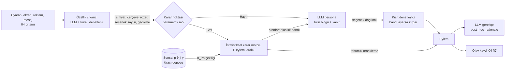

# 07 · Dijital ikiz: kişi başı parametre kestirimi ve hiyerarşik model

Durum: Taslak (ADR-001 sonucu) · Sahibi: İnsan Simülasyonu Araştırmacısı · Girdi: `ADR-001-dijital-ikiz.md`, `data/SEMA.md`,
`02-persona-uretimi.md` §5-§11, `03-degerlendirme.md` §7-§9, `MIMARI.md` §4.

**Terimler.** Bu bölümde *kiracı* (tenant), Persona Katmanı'nın müşterisi olan şirkettir; *kişi*, kiracının gerçek müşterisidir.
*İkiz* (digital twin), bir kişinin gözlemlenen davranışından kestirilen parametre vektörünün sonsal dağılımı (posterior) ile
bu dağılımdan beslenen LLM personasının birleşimidir. İkiz kişinin kendisi değildir; rapor dili "bu kişinin modeli böyle
davrandı" kalıbını kullanır (ADR-001, F-1 dil kuralı).

## 1. Amaç ve ilkeler

İstek: "Tüm müşterilerimiz için ayrı persona üretebilmeliyiz, istatistikle." Bunun mimari karşılığı dört ilkedir:

1. **Sayı istatistikten, anlatı LLM'den gelir.** Bir davranışın olasılığı (sepeti bırakma, reklamı atlama) kişinin parametre
   sonsalından hesaplanır; LLM bu sınırın içinde bağlamı yorumlar ve gerekçe yazar (§5).
2. **Belirsizlik birinci sınıf veridir.** İkiz bir nokta tahmini değil, bir dağılımdır. Her simülasyon koşusu sonsaldan yeni bir
   çekiliş kullanır; az veriyle kesin görünen ikiz bir hatadır (ADR-001 açık riski).
3. **Kişisellik kazanılır, varsayılmaz.** Bir parametre ancak kişinin verisi onu öncülden (prior) anlamlı biçimde uzaklaştırdıysa
   "kişiye özgü" etiketi alır; aksi halde "segmentten miras" ya da "literatür önseli" olarak gösterilir.
4. **Literatür öncüldür, hakikat değil.** `data/davranis-etkileri.xlsx` (varsayım: tablo derleme aşamasında; `data/kaynak/*.csv`
   şu an boş) öncülleri besler; öncül ile veri çatışırsa veri kazanır ve çatışma raporlanır.

## 2. Parametre vektörü θ_i

Her parametre kısıtsız bir gizil ölçekte (z) tahmin edilir ve dönüşümle yorumlanabilir ölçeğe çevrilir. Öncül sütunu
varsayımdır; gerçek değer §3.1'deki sentezden gelecek.

| Parametre | Tanım | Ölçek / dönüşüm | Öncül örneği (varsayım) | Davranışsal yorum |
| --- | --- | --- | --- | --- |
| `lambda_kayip` | Kayıpların eşit büyüklükteki kazançlara göre ağırlığı | λ > 0; z = ln λ | lognormal(ln 1,9; 0,5) | Ek ücret, iptal cezası, "kaçırırsınız" çerçevesine tepki |
| `beta_simdicilik` | Yarı-hiperbolik iskontoda "şimdi"ye verilen ek ağırlık (β) | β ∈ (0,1]; z = logit β | beta(8,2) | Düşük β: "hemen al, sonra öde", hızlı kargoya ek ödeme |
| `delta_iskonto` | Uzun dönem günlük iskonto | r = −ln δ; z = ln r | lognormal(ln 0,001; 1) | Taksit vs peşin, yıllık abonelik vs aylık |
| `rho_risk` | Fayda eğriliği / risk kaçınması | ℝ (CRRA ρ) | normal(0,5; 0,4) | Bilinmeyen marka, iadesiz ürün, garanti satın alma |
| `w_sosyal_kanit` | Popülerlik işaretinin ("1.200 kişi aldı") fayda ağırlığı | ℝ (negatif = züppe etkisi) | normal(0,3; 0,3) | Çok satanlar, "sepette 40 kişi" rozeti |
| `tau_reklam_tolerans` | Reklam maruziyetine dayanma (atlama tehlikesinin tersi) | τ > 0; z = ln τ | lognormal(0; 0,7) | Video reklamı atlama zamanı, araya giren reklamda uygulamayı kapatma |
| `eta_fiyat` | Log fiyat katsayısı (esneklik benzeri) | η < 0; z = ln(−η) | lognormal(ln 1,5; 0,6) | Fiyat karşılaştırma, indirim eşiği |
| `w_yorum` | Yorum puanı ve içeriğinin karara ağırlığı | ≥ 0; z = ln w | lognormal(ln 0,5; 0,7) | Yorum sekmesi açma, düşük puanda vazgeçme |
| `kappa_secim_yuku` | Seçenek sayısı başına karar maliyeti | ≥ 0; z = ln κ | lognormal(ln 0,05; 1) | Uzun liste sayfasında terk, filtre kullanımı |
| `theta_kitlik` | Kıtlık/aciliyet işaretine tepki | ℝ | normal(0,2; 0,3) | "Son 3 ürün", geri sayım sayacı |
| `phi_guven_isareti` | Güven işaretlerinin (güvenli ödeme, iade garantisi) ağırlığı | ℝ | normal(0,3; 0,3) | Yeni satıcıdan alım, ödeme adımında terk |
| `sabir` | Bekleme/gecikme toleransı (04 `patience_profile`) | sn; z = ln | lognormal(ln 4; 0,6) | Yavaş sayfada terk, uzun formda vazgeçme |
| `dikkat_esigi` | Bir öğenin "görüldü" sayılması için gereken maruziyet/belirginlik | sn; z = ln | lognormal(ln 1; 0,5) | Banner körlüğü, kaydırıp geçme |
| `varsayilan_yapiskanlik` | Ön seçili seçenekte kalma eğilimi | ∈ (0,1); z = logit | beta(6,3) | Ön işaretli sigorta, otomatik yenileme |

**Eklenmesi gerekenler.** Aşağıdakiler olmadan yukarıdaki tablo ya tanımlanamaz ya da 04'ün beklediği alanları (B4) karşılamaz:

| Parametre | Neden gerekli |
| --- | --- |
| `tau_karar` (karar gürültüsü, ters sıcaklık) | Lojit modelde fayda ağırlıkları yalnızca gürültüye göre tanımlıdır; ölçek sabitlenmezse "fiyata duyarlı" ile "tutarlı" ayırt edilemez (§4.2). |
| `epsilon_dalginlik` (dalgınlık / lapse) | Yanlış tıklama ve rastgele geri dönüşler parametreleri saptırmasın; uç gözlemlere karşı sağlamlık. |
| `okuma_hizi` | 04 `reading_speed`; yorum okuma süresini `w_yorum`dan ayırmak için zorunlu ölçüm düzeltmesi. |
| `hayal_kirikligi_esigi` | 04 `frustration_threshold`; `sabir` ile karışan ama farklı süreç (bekleme değil, hata birikimi). |
| `nu_yenilik` | Yeni ürün/marka deneme eğilimi; `rho_risk` ile ters yönde karışır, ayrı tutulmazsa risk kaçınması yanlış tahmin edilir. |
| `b_soz_davranis` | Kişinin söz (anket) ile davranış arasındaki sistematik sapması; 02 §9'daki say-do gap'in kişi düzeyi karşılığı. |
| `c_kategori` (kategoriye özgü sapma) | Fiyat duyarlılığı gıdada ve elektronikte aynı değildir; `eta_fiyat`, `w_yorum`, `rho_risk` için kişi × kategori rastgele etkisi. |

Toplam boyut d ≈ 20 (kategori sapmaları hariç). Bu, kişi başı veri azken neden güçlü havuzlama gerektiğinin de nedenidir.

## 3. Hiyerarşik Bayesçi model

### 3.1 Literatür öncülü: Excel'den öncüle

Her parametre k için `persona_parametresi = k` olan satırlar toplanır:

1. **Köprü fonksiyonu.** Tablodaki etkiler çoğu zaman nüfus ortalaması etkisidir ("kıtlık rozeti dönüşümü 8 yüzde puan
   artırır"), parametre değil. Her satır için belgelenmiş bir dönüşüm, satırdaki ölçüyü (lambda, Cohen d, OR, esneklik)
   gizil z ölçeğine çevirir. Dönüşümü olmayan satır öncüle girmez, yalnız not olarak kalır.
2. **Rastgele etkiler sentezi.** z ölçeğindeki etkiler, `orneklem_n` ve `kanit_gucu` ağırlığıyla rastgele etkiler meta-analizine
   girer: m_k (öncül ortalaması) ve çalışmalar arası heterojenlik τ_k². `bireysel_fark_olcegi` dolu satırlar kişiler arası
   standart sapma σ_k için ayrı bir öncül üretir; literatür çoğunlukla ortalamayı verir, oysa ikiz için asıl gereken kişiler
   arası yayılımdır.
3. **Moderatör regresyonu.** `moderator_yonu_ve_buyuklugu` sütunu, öncül ortalamasının kişinin ortak değişkenlerine (x_i: yaş,
   gelir bandı, ülke/dil, cihaz) bağımlılığına çevrilir: μ_k(x_i) = α_k + Γ_k·x_i. Sayısal moderatör ("β=0,08/10 yıl") Γ öncülünün
   ortalamasıdır; yalnız yönü bilinen moderatör, işaretli fakat geniş bir öncül alır (ör. normal(0,05; 0,1)); yönü
   tartışmalı olan sıfır merkezli kalır. Korunan özellikler (din, etnik köken, sağlık) x_i'ye girmez (F-3).
4. **Aktarım şişirmesi.** Laboratuvar veya Türkiye dışı örneklem kaynaklı öncüllerin standart sapması bir aktarım çarpanıyla
   genişletilir (varsayım: laboratuvar 1,5×, tek ülke dışı 1,3×). Literatürün büyük bölümü WEIRD örneklemlerdendir.
5. **Sağlam karışım öncülü** (robust mixture prior; Schmidli ve ark. 2014, doi:10.1111/biom.12242): öncül = 0,8 ·
   bilgilendirici + 0,2 · zayıf bileşen. Kiracının verisi literatürle çatışırsa zayıf bileşen ağırlık kazanır ve öncül kendiliğinden
   gevşer. Çatışma §6'da raporlanır.

Örnek: kayıptan kaçınma için kapsamlı meta-analiz (Brown, Imai, Vieider & Camerer, *J. Economic Literature*, 2024,
doi:10.1257/jel.20221698) λ için 2 civarında bir merkez bildirir (varsayım: tam değer tablo satırından alınacak); Kahneman &
Tversky'nin 1979 çerçevesi (doi:10.2307/1914185) parametrenin tanımını verir. Yarı-hiperbolik iskonto tanımı Laibson 1997
(doi:10.1162/003355397555253). Seçim yükü ortalamada sıfıra yakın, moderatörlere çok bağlıdır (Chernev, Böckenholt & Goodman
2015, doi:10.1016/j.jcps.2014.08.002); bu yüzden `kappa_secim_yuku` öncülü geniş tutulur.

Öncül sürümü, tablo sürümüne bağlıdır (`prior_version = tablo hash'i + köprü fonksiyonları sürümü`). Öncül değişince bütün
ikizler yeniden uydurulur; bu bir MAJOR olaydır (§8).

### 3.2 Katmanlar ve kısmi havuzlama

```text
 Düzey 0  Literatür          m_k, σ_k öncülü, Γ_k öncülü         ← davranis-etkileri.xlsx (§3.1)
             │
 Düzey 1  Kiracı t           α_tk = α_k + u_tk,  u_tk ~ N(0, s_k)  ← kiracının tüm kişileri
             │               σ_tk ~ halfnormal(σ_k)                 (sektör, ürün kategorisi farkı)
             │
 Düzey 2  Segment g (isteğe  α_tgk = α_tk + v_gk                    ← kiracının tanımladığı segmentler
          bağlı)             v ~ N(0, s_g)
             │
 Düzey 3  Kişi i             z_i = α_tg + Γ·x_i + diag(σ_t)·L·e_i   ← kişinin oturumları
                             e_i ~ N(0, I),  L L' = Ω ~ LKJ(4)
             │
 Gözlem   Oturum j, olay e   y_ije ~ p(y | z_i, bağlam_ije, ξ_ij)   ← §4 olabilirlikleri
                             ξ_ij: oturum niyeti, cihaz etkisi
```

- **Kısmi havuzlama** (partial pooling): kişi i'nin tahmini, kendi verisi ile kiracı/segment ortalaması arasında, verinin
  bilgi miktarına göre ağırlıklanır. Tek değişkenli normal yaklaşımla: E[z_i | y] ≈ w_i·ẑ_i + (1−w_i)·μ(x_i),
  w_i = n_i·σ² / (n_i·σ² + s_y²). Az oturumlu kişi segmentine yakın, zengin loglu kişi kendi verisine yakın durur. Pazarlamada
  bireysel heterojenliğin bu yapıyla kestirimi yerleşik bir yöntemdir (Allenby & Rossi 1998, doi:10.1016/S0304-4076(98)00055-4).
- **Korelasyonlu parametreler.** Ω (LKJ öncülü; Lewandowski, Kurowicka & Joe 2009, doi:10.1016/j.jmva.2009.04.008) parametreler
  arası ilişkiyi öğrenir; örneğin `eta_fiyat` ile `theta_kitlik` ilişkiliyse, kişinin fiyat verisi kıtlık parametresi hakkında da
  bilgi taşır. Bu, az veride bilgi paylaşımının ikinci yoludur.
- **Merkezsiz parametrelendirme** (non-centered parameterization; Betancourt & Girolami, arXiv:1312.0906): az veri durumunda
  örnekleyicinin "huni" geometrisinde takılmasını önler; varsayılan budur.
- **Kiracılar arası havuzlama yalnız düzey 0'da.** Bir kiracının verisi başka bir kiracının öncülüne girmez (03 §9.3, F-9).
  Düzey 0 yalnız literatürden beslenir; kiracılar arası ortak düzeltici yalnız toplulaştırılmış hata istatistiğidir (B7).

### 3.3 Az veriyle aşırı kesinliğe karşı koruma

1. **Daralma oranı** (posterior contraction): c_ik = 1 − Var_sonsal(z_ik) / Var_öncül(z_ik | x_i). Kimlik kartında her parametrenin
   yanında gösterilir. c < 0,3 → "segmentten miras", 0,3–0,6 → "kısmen kişisel", ≥ 0,6 → "kişiye özgü" (eşikler varsayım).
2. **Olabilirlik tavlaması** (likelihood tempering / power likelihood): aynı oturumdaki olaylar bağımsız değildir (aynı niyet,
   aynı ruh hâli). Olayları bağımsız saymak etkin örneklem sayısını şişirir. Oturum içi olaylar oturum rastgele etkisi ξ_ij ile
   modellenir; buna ek olarak kişi başı log olabilirlik α ∈ (0,1] ile çarpılır; α, tutma oturumlarında aralık kapsamasının (C3)
   hedefte kalacağı biçimde kalibre edilir.
3. **Kişiler arası varyans için alt sınırlı öncül.** σ_tk'nın sıfıra çökmesi bütün kişileri aynı yapar (kalıp yargı çöküşünün
   istatistiksel karşılığı). Yarı-normal öncül literatürdeki bireysel fark ölçüsünden beslenir; sonsal σ_tk öncülün alt
   %5'inin altına düşerse uyarı açılır.
4. **Öncül-veri çatışma testi.** Kişinin verisinin öncül öngörü dağılımında (prior predictive) kuyruğa düşmesi işaretlenir; kişi
   "atipik" bayrağı alır ve ikizi otomatik olarak geniş aralıkla raporlanır.
5. **Sonsaldan çekiliş, ortalama değil.** Simülasyon her koşuda θ_i^(s) çeker. Böylece bilmediğimiz şey, ikizin davranışındaki
   yayılım olarak görünür; ortalama ile koşmak 03'ün P3 (varyans oranı) metriğini sistematik olarak bozar.

### 3.4 Soğuk → ılık → sıcak

Aşamalar oturum sayısıyla değil, **bilgiyle** tanımlanır (ortalama daralma oranı c̄_i):

| Aşama | Koşul (varsayım) | Elimizdeki | Çıkarım | Raporlama |
| --- | --- | --- | --- | --- |
| Soğuk | Yalnız x_i (demografi, segment) veya c̄ < 0,15 | Öncül öngörüsü: p(θ | x_i, kiracı) | Hesap gerekmez; hiperparametrelerden doğrudan | "İkiz henüz kişiye özgü değil; segment örneği gibi davranır." Raporda nüfus sınıfıyla aynı ağırlığa sahiptir. |
| Ilık | Birkaç oturum, 0,15 ≤ c̄ < 0,5 | Seyrek olaylar, çoğu parametre miras | Sabit hiperparametre koşullu hızlı güncelleme (Laplace veya amorti çıkarım, §7) | Kartta parametre başına kaynak etiketi; "kişiye özgü" yalnız daralanlar |
| Sıcak | Zengin log, c̄ ≥ 0,5 ve §6 testleri geçti | Çok oturum, çok uyaran türü | Tam NUTS (kişi bloğu) + periyodik hiper uydurma | Tam kimlik kartı; tutma isabeti gösterilir |

Soğuk ikiz teknik olarak 02'nin nüfus örneklemesiyle aynıdır; fark yalnızca kimliktir (tek kişiye bağlı, rıza kaydı taşır).
Ürün bunu "ikiz" diye adlandırıp adlandırmayacağına karar vermelidir (Felsefi soru 3).

## 4. Veri → olabilirlik

### 4.1 Gözlem–parametre haritası

Ortam olayları 04 §7 şemasından gelir; kiracı logları aynı olay sözlüğüne eşlenir.

| Gözlem | Ölçüm modeli (olabilirlik) | Tanımladığı parametreler | Not |
| --- | --- | --- | --- |
| Ürün/seçenek seçimi (sepete ekleme, satın alma) | Karışık lojit: U = −η·ln p + w_yorum·puan + w_sosyal_kanit·pop + θ_kitlik·kıtlık + φ·güven + ξ; P ∝ exp(U/τ_karar) | `eta_fiyat`, `w_*`, `theta_kitlik`, `phi_guven_isareti` | Uyaran özellikleri sayfadan çıkarılır (§5.3) |
| Sepet terki (kargo/ek ücret görününce) | Lojistik: ek ücretin referansa göre kayıp terimi λ·Δ | `lambda_kayip`, `eta_fiyat` | λ ancak aynı tutar farklı çerçevede görülürse tanımlıdır (§4.2) |
| İndirim/kampanya tepkisi | Çerçeve (kazan/kaybetme) × tutar etkileşimli lojistik | `lambda_kayip`, `eta_fiyat`, `theta_kitlik` | Kiracı A/B'si rastgeleleştirilmişse nedensel; değilse gözlemsel etiketi |
| Taksit/peşin, hızlı kargo ek ücreti, "şimdi al sonra öde" | Yarı-hiperbolik indirgenmiş fayda ile ikili seçim | `beta_simdicilik`, `delta_iskonto` | β için "şimdi" seçeneği olan seçimler gerekir |
| Garanti/sigorta ek ürünü, bilinmeyen marka | Beklenen fayda (CRRA) ile seçim | `rho_risk`, `nu_yenilik` | |
| Reklam atlama zamanı | Sağkalım (survival) modeli: h(t) = h₀(t)·exp(−ln τ_reklam + uyaran etkisi); atlanamayan reklamda uygulama kapatma ayrı risk | `tau_reklam_tolerans`, `sabir` | Sağdan sansür: reklam bitti, atlanmadı |
| Yorum okuma süresi, yorum sekmesi açma | Açma: lojistik; süre: lognormal, ortalaması kelime sayısı / `okuma_hizi` ile ölçeklenir | `w_yorum`, `okuma_hizi` | Süre okuma hızıyla düzeltilmezse yavaş okuyucu "yoruma önem veren" sanılır |
| Uzun liste sayfasında karar süresi ve terk | Karar süresi: kayıp sürelerine dayalı model (shifted lognormal) seçenek sayısıyla; terk: lojistik | `kappa_secim_yuku`, `sabir` | |
| Ön seçimden ayrılma | Lojistik, varsayılanın kişinin olası tercihine uzaklığı kontrol edilerek | `varsayilan_yapiskanlik` | |
| Yavaş yükleme, form hatası sonrası terk | Rekabet eden riskler (bekleme vs hata birikimi) | `sabir`, `hayal_kirikligi_esigi` | 04 §6.2 kurallarının parametreleri |
| Görünür alan maruziyeti ve sonraki etkileşim | Maruziyet süresi eşik altıysa "görülmedi" gizil değişkeni | `dikkat_esigi` | Görünürlük olayı yoksa tanımlanamaz |
| Anket/görüşme yanıtı (`stated`) | y_söz = f(θ) + b_soz_davranis + gürültü (ayrı varyans) | Tüm parametreler zayıfça; `b_soz_davranis` | Söz verisi davranış parametresini tek başına daraltamaz (02 §6.3) |

### 4.2 Tanımlanabilirlik sorunları ve çözümleri

| Sorun | Neden | Çözüm |
| --- | --- | --- |
| Ölçek belirsizliği | Lojitte U ve τ_karar birlikte ölçeklenebilir | Ödeme istekliliği uzayında parametrelendirme (WTP space; Train & Weeks 2005, *Applications of Simulation Methods in Environmental and Resource Economics*, doi:10.1007/1-4020-3684-1_1): ağırlıklar TL karşılığı olarak tahmin edilir, `eta_fiyat` ölçeği taşır |
| `lambda_kayip` ↔ `rho_risk` | Yalnız kayıp veya yalnız kazanç gözleniyorsa eğrilik ile asimetri karışır | ρ kiracı düzeyinde ortak (kişi rastgele etkisi kapalı) tutulur; kişi düzeyinde yalnız λ. Karma (kazanç+kayıp) uyaran yoksa λ "miras" kalır |
| `beta_simdicilik` ↔ `delta_iskonto` | "Şimdi" seçeneği içermeyen seçimler yalnız toplam iskontoyu tanımlar | δ kiracı düzeyinde, β kişi düzeyinde; β yalnız anlık seçenek gözlenince daralır (Andreoni & Sprenger 2012, doi:10.1257/aer.102.7.3333, tasarım mantığı) |
| `w_sosyal_kanit` ↔ `w_yorum` ↔ `phi_guven_isareti` | Popüler ürünlerde üç işaret birlikte bulunur (eşdoğrusallık) | Kiracı A/B'lerindeki rastgele rozet varyasyonu; kişi içi varyasyon; ayrışmazsa bileşik "kanıt duyarlılığı" faktörü raporlanır ve korelasyon kartta gösterilir |
| Seçim yanlılığı (endojen maruziyet) | Öneri sistemi indirimi zaten fiyata duyarlı kişiye gösterir | Nedensel yorumlu parametreler yalnız rastgele maruziyetten öğrenilir; gözlemsel maruziyete eğilim skoru (propensity) eklenir ve olay `observational` etiketlenir |
| `sabir` ↔ düşük niyet | Kişi sabırsız olduğu için değil, zaten almak istemediği için terk eder | Oturum niyeti rastgele etkisi ξ_ij; giriş kanalı (arama vs reklam) ve sepet içeriği niyet göstergesi olarak ölçüm modeline girer |
| Varsayılan ↔ gerçek tercih | Varsayılan zaten tercih edilen seçenekse yapışkanlık sanılır | Yalnız varsayılanın kişinin olası tercihinden farklı olduğu durumlar bilgilendirici sayılır |
| Hesap ≠ kişi | Paylaşılan hesap/cihaz iki kişinin karışımıdır | İki bileşenli karışım testi; çift tepeli sonsal "paylaşılan hesap şüphesi" bayrağı; ikiz bu durumda sıcak aşamaya geçemez |
| Eksik ölçüm | İzleme rızası vermeyen oturumlar, reklam engelleyici | Rastgele olmayan eksiklik (MNAR) varsayılır; görünürlük olayı olmayan oturumlar `dikkat_esigi` olabilirliğine girmez |

Genel kural: **bir parametrenin kişi düzeyinde serbest bırakılması, onu tanımlayan uyaranın kişide gözlenmesine bağlıdır.**
Uyaran yoksa parametre hiyerarşide miras kalır ve kart bunu söyler. Bu, "LLM uydurmasın" ilkesinin istatistiksel eşidir.

### 4.3 Ölçüm modelinin genel biçimi

```text
y_ije ~ Olay_e( g_e( z_i , s_ije , ξ_ij , d_ij ) ) ^ α        (α: §3.3 tavlama)
  s_ije : uyaran özellikleri (fiyat, çerçeve, rozet, seçenek sayısı, gecikme)  ← ortam/log
  ξ_ij  : oturum niyeti ve durumu ~ N(0, σ_ξ)
  d_ij  : cihaz ve kanal etkisi (kiracı düzeyi sabit etki)
  Olay_e: Bernoulli / kategorik / sağkalım / lognormal süre, olay türüne göre
```

## 5. θ_i → LLM persona: hibrit karar mimarisi

### 5.1 İş bölümü



- **Parametrik karar noktası:** modelin olabilirliği olan eylemler (satın al/terk, reklamı atla, ön seçimden ayrıl, kampanyayı kabul et,
  sayfayı bekle/bırak). Olasılık istatistiksel motordan gelir ve tohumlu (seeded) olarak örneklenir; LLM eylemi seçmez.
- **Parametrik olmayan nokta:** modelin bilmediği eylemler (hangi menüye bakılır, arama kutusuna ne yazılır, bir mesajı nasıl anlar).
  LLM karar verir, ama motorun verdiği sınırlar içinde (§5.2).
- **Gerekçe her zaman sonradandır.** LLM'e örneklenmiş eylem ve onu belirleyen terimlerin katkısı verilir ("ek ücret faydayı en çok
  düşüren terim"); yazdığı metin 02 §9'daki gibi `post_hoc_rationale` etiketi taşır.

### 5.2 "LLM sayıyı ezmesin" kısıtları

1. **Mimari ayrım:** Parametrik noktada LLM çağrısı eylem çıktısı üretmez; yalnız özellik çıkarır ve gerekçe yazar. Bu, 04 §6.2'deki
   dikkat modelinin LLM'i geçersiz kılma kuralının genellemesidir.
2. **Olasılık bandı:** Parametrik olmayan bir eylem, parametrik bir sonucu dolaylı etkileyebilir (ör. LLM "çıkış" menüsüne yönelir).
   Motor, oturum sonunda terk olasılığının %80 sonsal aralığını verir; LLM kararları bu bandın dışına düşen bir oturum oranı
   üretirse kısıt denetleyici o yoldaki LLM dağılımını kırpar ve olay kaydına `llm_clamped` yazar.
3. **Sayı istem metninde sözel olarak verilir, ama karar orada alınmaz.** LLM'e "λ=2,3" yazmak yetersizdir; dil modelleri sayısal
   parametreyi tutarsız uygular (varsayım; 03'te ölçülecek). İstemde sözel çeviri ("ek ücretlere belirgin biçimde tepkili, kesinlik:
   orta") yalnız anlatı tutarlılığı içindir.
4. **Ezme oranı metriği:** Ablasyon koşusunda aynı oturum yalnız LLM ile koşulur; LLM'in seçtiği eylemin motorun %5 altındaki
   olasılıklı eylemlerden olma oranı `override_rate` olarak 03'e raporlanır. Bu oran yüksekse LLM'in davranışı ikizi değil kendi
   önyargısını (olumluluk eğilimi, 00-arastirma uyarı 1) yansıtıyordur.
5. **Özellik çıkarımı denetimi:** Karar motoru LLM'in ekrandan çıkardığı s vektörüne bağımlıdır. Fiyat ve rozet gibi alanlar DOM'dan
   kuralla doğrulanır; uyuşmazlık olayı açılır. Aksi halde LLM sayıyı karar yerine girdiden ezer.

### 5.3 Persona şemasına `twin` bloğu

02 §5 şemasına şu blok eklenir; `class: evidence_grounded_individual` olan personalarda zorunludur. Makine alanları İngilizce (B2).

```json
{
  "persona_id": "per_tw_91c2e0",
  "class": "evidence_grounded_individual",
  "weight": null,
  "identity": {"display_name": {"value": "İkiz 91C2", "source": "generated"}},
  "twin": {
    "subject_ref": "pseud://tenant_acme/subj_5f0a…",
    "consent_ref": "consent://tenant_acme/c_2026_10_14_771",
    "stage": "warm",
    "model": {"name": "hb_twin", "version": "1.3.0", "prior_version": "lit_2026-11-01#a91f", "hyper_fit_id": "hf_acme_2026-11-03"},
    "data_window": {"from": "2026-05-01", "to": "2026-11-05", "sessions": 14, "informative_events": 212},
    "covariates_used": ["age_band", "income_band", "country", "device_class"],
    "parameters": {
      "lambda_kayip": {"median": 2.4, "ci80": [1.8, 3.1], "contraction": 0.58, "source": "person", "prior_refs": ["EK-004", "EK-011"]},
      "beta_simdicilik": {"median": 0.86, "ci80": [0.71, 0.95], "contraction": 0.12, "source": "inherited_segment"},
      "eta_fiyat": {"median": -1.9, "ci80": [-2.5, -1.4], "contraction": 0.66, "source": "person"},
      "tau_reklam_tolerans": {"median": 0.6, "ci80": [0.3, 1.1], "contraction": 0.41, "source": "partial"},
      "rho_risk": {"median": 0.5, "ci80": [0.2, 0.8], "contraction": 0.0, "source": "tenant_shared"},
      "w_sosyal_kanit": {"median": 0.2, "ci80": [-0.1, 0.5], "contraction": 0.05, "source": "literature_prior"}
    },
    "notable_correlations": [{"pair": ["w_sosyal_kanit", "w_yorum"], "r": 0.62, "note": "ayrıştırılamadı"}],
    "posterior_draws": "ref://twin/acme/per_tw_91c2e0/draws.v7",
    "flags": ["prior_data_conflict:lambda_kayip"],
    "validation": {"heldout_sessions": 3, "brier_person": 0.17, "brier_segment_baseline": 0.21, "ci80_coverage": 0.78, "ppc_pass": true},
    "verbal_summary": {"value": "ek ücret ve kayıp çerçevesine belirgin tepki; fiyata duyarlı; reklama sabrı düşük–orta", "generated_from": "parameters"}
  },
  "behavioral_profile": {
    "patience_profile": {"derived_from": "twin.parameters.sabir"},
    "reading_speed": {"derived_from": "twin.parameters.okuma_hizi"},
    "frustration_threshold": {"derived_from": "twin.parameters.hayal_kirikligi_esigi"}
  },
  "unknowns": ["din", "siyasi yönelim", "ödeme istekliliği"]
}
```

Notlar: `weight: null` — ikiz bir nüfus ağırlığı taşımaz; nüfus sonucu istenirse ikizler ayrıca art tabakalamayla (post-stratification)
ağırlıklanır ve rapor bunu ayrı bir sınıf olarak gösterir (02 §5 "sınıflar karışmaz"). `posterior_draws` bir referanstır; çekilişler
şifreli kişi deposunda durur (§9). `verbal_summary` parametrelerden şablonla üretilir, LLM tarafından serbest yazılmaz.

## 6. Doğrulama

1. **Model düzeyi, veri görmeden:** Simülasyon tabanlı kalibrasyon (SBC; Talts ve ark., arXiv:1804.06788): parametreler öncülden
   çekilir, sahte veri üretilir, model geri kestirir; sıra istatistikleri düzgün değilse çıkarım hatalıdır. Her model sürümünde kapı.
2. **Öncül öngörü kontrolü:** Öncülden üretilen davranışların akla yatkın olması (ör. sepet terk oranı %20–%95 arasında; varsayım).
3. **Sonsal öngörü kontrolü** (posterior predictive check; Gabry ve ark., arXiv:1709.01449): kişi ve kiracı düzeyinde gerçek ile
   yeniden üretilmiş veri karşılaştırılır: terk oranı, atlama zamanı dağılımı, kişiler arası varyans (03 P3), kuyruklar (P4), alt grup
   farkları (P5). Kişi düzeyinde test istatistiği kuyrukta kalan ikizler "uyumsuz" bayrağı alır.
4. **Tutulan oturumlarla kişi düzeyi isabet:** Zaman temelli bölme (03 §8.2 ile aynı ilke): kişinin son k oturumu tutulur. Ölçütler:
   log öngörü yoğunluğu (PSIS-LOO yalnız model seçimi için; Vehtari, Gelman & Gabry, arXiv:1507.04544), olay başına Brier, %80
   aralık kapsaması. **Dört temel çizgiyle** karşılaştırılır: (i) yalnız literatür öncülü, (ii) segment ortalaması, (iii) havuzsuz kişi
   frekansı, (iv) ikiz. İkiz (ii)'yi geçemiyorsa "kişiye özgü" iddiası düşürülür; (iii)'ü geçemiyorsa havuzlama fazla güçlüdür.
5. **Aktarım testi:** İkizin değeri, görmediği yeni uyaranda ortaya çıkar. Kiracının yeni bir A/B'sinde ikizler ortamda koşulur ve
   gerçek kişinin aynı koldaki davranışıyla karşılaştırılır (hibrit ve yalnız istatistik modları ayrı). Bu, 03 §8.4(c) mühürlü kör
   tahmin akışının kişi düzeyi sürümüdür.
6. **Kalibrasyon (Arayüz: 03):** Kişi düzeyi olasılıklar 03'ün C1–C3 metriklerine girer; düzeltici katmanı (03 §9.3) ikiz çıktısına da
   uygulanır, ama düzeltici kişi sonsalını değiştirmez, yalnız rapor olasılığını. Tavlama katsayısı α (§3.3) C3 hedefiyle ayarlanır.

**İkizin kimlik kartı** (02 §11.2'ye ek alanlar):

| Alan | Gösterim |
| --- | --- |
| Ne olduğu | "Bu, [kiracı] müşterisi bir kişinin davranış verisinden kestirilmiş bir modeldir. Kişinin kendisi değildir." |
| Aşama | Soğuk / ılık / sıcak ve ortalama daralma |
| Parametreler | Her biri için ortanca, %80 aralık çubuğu öncül aralığın üstüne bindirilmiş; kaynak etiketi (kişi / kısmi / segment mirası / kiracı ortak / literatür) |
| Neyi bilmiyoruz | Hiç tanımlayıcı uyaran görülmemiş parametreler, ayrıştırılamayan çiftler |
| İsabet | Tutma oturumlarında Brier, segment temel çizgisine göre kazanç, aralık kapsaması |
| Bayraklar | Öncül-veri çatışması, paylaşılan hesap şüphesi, atipik |
| Rıza ve geçerlilik | Rıza tarihi, veri penceresi, "bu tarihten sonraki değişimleri bilmez" |

## 7. Uygulama notu

| Seçenek | Güçlü | Zayıf | Rol önerisi |
| --- | --- | --- | --- |
| Stan (CmdStan; Carpenter ve ark. 2017, doi:10.18637/jss.v076.i01) | NUTS'un olgun ve iyi tanılanmış uygulaması; SBC ve tanı araçları zengin | Toplu (vectorized) milyonlarca bağımsız kişi için GPU yok; derleme döngüsü | Referans model, SBC, model değişikliği doğrulaması |
| PyMC (Abril-Pla ve ark. 2023, doi:10.7717/peerj-cs.1516) | Analist dostu, ArviZ ile tanı; NumPyro/nutpie arka ucu kullanabilir | Üretim ölçeğinde ek katman | Keşif, öncül öngörü, bilim ekibi defterleri |
| NumPyro (Phan, Pradhan & Jankowiak, arXiv:1912.11554) | JAX: GPU/TPU, `vmap` ile binlerce kişinin bağımsız sonsalını paralel; NUTS ve SVI aynı model kodunda | JAX bağımlılığı, hata ayıklama zorluğu | **Üretim** |

**Öneri:** Üretimde NumPyro; aynı modelin Stan karşılığı referans olarak tutulur ve her model sürümünde iki uygulamanın sonsal
özetleri karşılaştırılır (uyuşmazlık kapıdır). Gerekçe: ikiz hesabı yapısal olarak "az sayıda ortak hiperparametre + çok sayıda
koşullu bağımsız kişi bloğu"dur; bu, `vmap` ile vektörleşen JAX'e doğal uyar.

**İki kademeli çıkarım:**

1. **Hiper uydurma:** Kiracı/segment hiperparametreleri (α, Γ, σ, Ω) kiracının kişilerinden tabakalı bir alt örneklem (varsayım:
   birkaç bin–birkaç on bin kişi) üzerinde tam NUTS ile.
2. **Kişi bloğu:** Hiper sonsaldan birkaç çekilişe koşullu olarak her kişinin sonsalı bağımsız ve paralel hesaplanır. Hiperparametre
   belirsizliğinin tamamen atılmaması için tek nokta değil birkaç hiper çekilişi kullanılır (deneysel Bayes'in aşırı kesinlik riskine
   karşı).
3. **Ilık aşama için amorti çıkarım:** Kiracı modeli üzerinde eğitilmiş bir sinirsel sonsal kestirici (BayesFlow tipi; Radev ve ark.,
   arXiv:2003.06281) veya Laplace yaklaşımı; yeni oturumdan sonra anında güncelleme. Amorti sonuç, sıcak aşamaya geçişte NUTS ile
   doğrulanır; SBC amorti kestiriciye de uygulanır.

**Maliyet (oransal, varsayım):** Kişi bloğu maliyeti kişi sayısı × bilgilendirici olay sayısıyla doğrusal ölçeklenir. Kişi başına
Laplace güncellemesi 1 birim alınırsa kısa NUTS koşusu kabaca 10–100 birim, eğitilmiş amorti kestirici 1 birimin altındadır; amorti
kestiricinin eğitimi kiracı başına tek seferlik ve hiper uydurmayla karşılaştırılabilir büyüklüktedir. Simülasyon sırasında istatistiksel
karar motorunun çağrı maliyeti LLM çağrısının yanında ihmal edilebilir düzeydedir; baskın maliyet 01/03'te ölçülen LLM tokenıdır.

**Yeniden tahmin sıklığı:**

| Ne | Ne zaman |
| --- | --- |
| Kişi (ılık) | Her yeni oturum toplu işinden sonra (günlük), amorti/Laplace |
| Kişi (sıcak) | Haftalık tam NUTS veya kişi c̄ eşiği geçtiğinde |
| Kiracı hiperparametreleri | Aylık; ayrıca kiracı düzeyi kayma (yeni ürün kategorisi, fiyat politikası değişimi) tespit edilince |
| Öncül (literatür) | Tablo sürümü değişince; MAJOR, tüm ikizler yeniden uydurulur |
| Zaman kayması | Eski oturumlar yarı ömürlü ağırlıkla (varsayım: 180 gün) tavlanır; uzun pencerede durum uzayı (random walk) uzantısı ikinci aşama |

## 8. Sürümleme

02 §11.1 biçimi korunur, anlamlar ikiz için şöyle eşlenir: **MAJOR** = model yapısı veya öncül tablosu değişti; **MINOR** = hiper
uydurma veya kişinin yeni verisiyle sonsal güncellendi; **PATCH** = yalnız sözel özet/anlatı; **+e** = veri penceresi sonu. Her
simülasyon sonucu ikizin `model.version`, `prior_version`, `hyper_fit_id` ve kullanılan çekiliş tohumlarını taşır.

## 9. Gizlilik ve rıza

Arayüz: `06-guven-gizlilik.md` (ADR-001 gereği 06 bir sonraki turda bunu tasarlar; aşağısı 07'nin istatistik tarafındaki ihtiyaçlarıdır).

- **Veri sınıfı.** Kişi düzeyi olay dizisi, sonsal çekilişler ve parametre özeti kişisel veridir; θ_i bir profil çıkarımıdır
  (GDPR Md. 4(4) "profilleme" tanımı; KVKK karşılığı hukuki görüşle doğrulanmalı). Kiracı anahtarıyla şifreli kişi deposunda tutulur.
- **k-anonimlik yerine kişi rızası.** 06 §3.3'ün k ≥ 50 eşiği ikiz için anlamsızdır (k = 1). Onun yerine: ikiz yalnız `consent_ref`
  geçerliyken var olur; rıza geri çekilirse ikiz "geri çekildi" durumuna geçer. **Ancak** hiperparametreler, segment raporları ve
  kiracı düzeyi özetler k ≥ 50 kuralına tabi kalır.
- **Silme hakkının sonsala yayılması.**
  1. Kişinin olayları, sonsal çekilişleri ve ikizi silinir (doğrudan).
  2. Kişinin hiperparametrelere katkısı: kişi hiper uydurma alt örnekleminde yer aldıysa bir sonraki planlı hiper uydurma onsuz
     yapılır ve en geç bir hiper döngüsü içinde (varsayım: ≤ 30 gün; yasal süreyle doğrulanmalı) etkisi kalkar. Alt örneklem üyeliği
     kaydedilir; üye değilse hiperparametre etkilenmez. Daha sıkı bir gereklilik çıkarsa alt örneklem parçalara (shard) bölünür ve
     yalnız ilgili parça yeniden uydurulur (SISA mantığı; Bourtoule ve ark., arXiv:1912.03817).
  3. İkizin kullanıldığı simülasyon raporları "geri çekilmiş kaynak" işaretini alır (02 §11.1).
  4. Amorti kestirici kişinin verisiyle eğitilmediyse etkilenmez; kiracının sentetik veriyle eğitilmesi varsayılandır.
- **Erişim hakkı.** Kişi kendi ikizinin kartını sade dille görebilmelidir; kartın bu sürümü için bkz. Felsefi soru 2.
- **Kiracılar arası sızıntı yok.** Kişi sonsalı kiracı sınırını aşmaz; düzey 0 yalnız literatürdür (§3.2).
- **LLM sağlayıcısına giden veri.** İstem yalnız sözel özet ve uyaran içerir; ham olay dizisi ve `subject_ref` gönderilmez
  (06 §5 ve B5 ile uyumlu).
- **Korunan özellikler.** x_i'ye korunan özellik girmez; ama davranıştan hassas bir çıkarım (ör. finansal sıkıntı) üretilebilir. Bu
  riskin sınırı Felsefi soru 1'dedir.

## 10. Arayüzler

### Arayüz: `02-persona-uretimi.md`

- §5 `class: evidence_grounded_individual` tanımı "tek bir gerçek segmentin kanıtından" yerine "tek bir rızalı kişinin davranış
  sonsalından" olarak değişmeli (ADR-001). `twin` bloğu §5.3'teki biçimde eklenir; `behavioral_profile` (B4) alanları ikizde `twin`
  parametrelerinden türetilir.
- §6 kanıta temellendirme: ikizde "kanıt", parametre ve onu daraltan olay sayısıdır; daralmamış parametre hakkında soruya yanıt
  "kanıttan uzatılmış" etiketi alır.
- §9 say-do: `b_soz_davranis` kişi düzeyi söz-davranış farkını verir; simüle fark bu değere göre değerlendirilir.
- §11.2 kimlik kartına §6'daki alanlar eklenir.

### Arayüz: `03-degerlendirme.md`

- Kişi düzeyi metrikler: olay başına Brier, %80 aralık kapsaması, temel çizgilere göre kazanç ve `override_rate` (§5.2) metrik setine
  "İ" (ikiz) ailesi olarak eklenmeli; formül sahibi 03'tür (B3).
- Tutma bölmesi 03 §8.2'nin zaman temelli kuralını izler; kişi başına son k oturum.
- Düzeltici katmanı ikiz olasılıklarına uygulanır, sonsalı değiştirmez.

### Arayüz: `04-ortamlar.md`

- Karar motoru, ortamın karar noktalarını "parametrik / parametrik değil" diye etiketlemesine ihtiyaç duyar; 04'ün eylem alanına
  (§5) `decision_point_type` alanı önerilir.
- Özellik çıkarımı (fiyat, çerçeve, rozet, seçenek sayısı, gecikme) DOM'dan doğrulanabilir olmalı; `llm_clamped` ve özellik uyuşmazlığı
  olay türleri 04 §7.3'e eklenmeli.

### Arayüz: `06-guven-gizlilik.md`

- §9'daki gereksinimler; ADR-001'in kaldırdığı §6.2 engel 6'nın yerine rıza akışı ve kişi deposu.

### Arayüz: `05-icgoru-ve-urun.md`

- İkiz sonuçları raporda ayrı sınıf; nüfus sonucuna art tabakalamayla girerse yöntem notu zorunlu.

## 11. Açık riskler ve varsayımlar

- Literatür tablosu henüz yok; öncüllerin tamamı bu belgede örnektir.
- Çoğu e-ticaret logunda `lambda_kayip`, `beta_simdicilik`, `rho_risk` için tanımlayıcı uyaran nadirdir; bu parametreler
  kişilerin çoğunda "miras" kalacaktır. Ürün mesajı buna göre kurulmalı: ikizin en kişisel kısmı büyük olasılıkla fiyat, sabır ve
  reklam toleransı olacaktır.
- Hibrit mimaride LLM'in sözel çeviriyi ne kadar tutarlı uyguladığı bilinmiyor; `override_rate` ölçülene kadar parametrik noktalar
  istatistik motorunda kalır.
- Kişi düzeyi veri, LLM personalarının bireyleri yeniden üretme kapasitesini sınar; literatürde 1.000 kişilik görüşme temelli
  ajanların genel sosyal anket yanıtlarını kişilerin kendi test-tekrar tutarlılığına yakın düzeyde yeniden ürettiği bildirilmiştir
  (Park ve ark., arXiv:2411.10109), ama bu söz kanalıdır; davranış kanalında karşılığı bizim aktarım testimizle (§6.5) ölçülmelidir.

## Kaynaklar

- ADR-001; `data/SEMA.md`; `02-persona-uretimi.md`; `03-degerlendirme.md`; `MIMARI.md` §4.
- Allenby & Rossi (1998), Marketing models of consumer heterogeneity — doi:10.1016/S0304-4076(98)00055-4
- Andreoni & Sprenger (2012), Estimating time preferences from convex budgets — doi:10.1257/aer.102.7.3333
- Betancourt & Girolami, Hamiltonian Monte Carlo for hierarchical models — arXiv:1312.0906
- Bourtoule ve ark., Machine Unlearning — arXiv:1912.03817
- Brown, Imai, Vieider & Camerer (2024), Meta-analysis of empirical estimates of loss aversion — doi:10.1257/jel.20221698
- Carpenter ve ark. (2017), Stan — doi:10.18637/jss.v076.i01
- Chernev, Böckenholt & Goodman (2015), Choice overload meta-analysis — doi:10.1016/j.jcps.2014.08.002
- Gabry ve ark., Visualization in Bayesian workflow — arXiv:1709.01449
- Kahneman & Tversky (1979), Prospect theory — doi:10.2307/1914185
- Laibson (1997), Golden eggs and hyperbolic discounting — doi:10.1162/003355397555253
- Lewandowski, Kurowicka & Joe (2009), LKJ — doi:10.1016/j.jmva.2009.04.008
- Abril-Pla ve ark. (2023), PyMC — doi:10.7717/peerj-cs.1516
- Park ve ark., Generative agent simulations of 1,000 people — arXiv:2411.10109
- Phan, Pradhan & Jankowiak, NumPyro — arXiv:1912.11554
- Radev ve ark., BayesFlow — arXiv:2003.06281
- Schmidli ve ark. (2014), Robust meta-analytic-predictive priors — doi:10.1111/biom.12242
- Talts ve ark., Simulation-based calibration — arXiv:1804.06788
- Train & Weeks (2005), Preference space vs WTP space — doi:10.1007/1-4020-3684-1_1 (varsayım: DOI doğrulanmalı)
- Vehtari, Gelman & Gabry, PSIS-LOO — arXiv:1507.04544

## Felsefi sorular (proje sahibine)

ADR-001 (birey ikizi) kabul edilmiştir ve burada yeniden sorulmaz. Aşağıdakiler o kararın açtığı yeni değer sorularıdır.

**1. İkiz, kişinin zaaflarını bulup ona özel hedeflemede kullanılabilir mi?**
- Soru: Yüksek şimdicilik, düşük sabır veya güçlü kıtlık tepkisi kestirilen bir kişiye kiracı, simülasyonda "en çok işe yarayan"
  aciliyet mesajını ya da kişiye özel fiyatı seçebilir mi?
- Neden teknik değil: Model bunu yapabilir; soru kişiselleştirme ile istismar arasındaki çizginin nerede olduğudur. 06 §8 karanlık
  desenleri nüfus düzeyinde ele alıyor; birey ikizi bunu kişiye indirir.
- Seçenekler: (a) İkiz yalnız tasarım kararlarını (hangi akış, hangi mesaj genel olarak) test etmek için; kişi başı hedefleme çıktısı
  ürünün dışında. (b) Kişi başı öneri serbest, ama zaaf parametrelerine (`beta_simdicilik`, `theta_kitlik`, `sabir`) dayalı öneriler
  ve kişiye özel fiyat yasak. (c) Kiracıya bırakılır.
- Önerim: (a); ikiz çıktısı kişi kimliğiyle kiracının pazarlama sistemine geri yazılamaz.
- Etkilediği parça: §5 karar motoru çıktı API'si, 05 rapor biçimi, 06 §8.

**2. Kişi kendi ikizini gördüğünde ne görmeli ve itiraz edebilmeli mi?**
- Soru: Erişim hakkı kapsamında kişiye "kayıptan kaçınmanız yüksek, reklam sabrınız düşük" demek doğru mu? Kişi "ben böyle
  değilim" derse bu beyan sonsala girer mi, ikizi geçersiz mi kılar?
- Neden teknik değil: Teknik olarak beyan `stated` veridir ve zayıf ağırlıkla girebilir; ama kişinin kendisi hakkındaki sözü ile
  davranış verisi çatıştığında hangisinin "o kişi" sayılacağı, onur ve öz-tanım sorusudur (F-7'nin bireysel hâli).
- Seçenekler: (a) Kart sade dille gösterilir, itiraz yalnız ikizi silme hakkı olarak; (b) itiraz `stated` veri olarak girer ve kartta
  "kişinin kendi beyanı" ayrı satır; (c) itiraz ikizi otomatik dondurur.
- Önerim: (b) + kişi isterse (a).
- Etkilediği parça: §6 kimlik kartı, `b_soz_davranis`, 06 erişim hakkı akışı.

**3. Soğuk ikiz "ikiz" diye adlandırılabilir mi?**
- Soru: Yalnız demografi ve segmentten oluşan, hiçbir parametresi kişiye özgü olmayan bir kayıt müşteriye "X kişisinin ikizi"
  olarak sunulabilir mi?
- Neden teknik değil: Daralma oranını hesaplayabiliriz; ama "kişiye ait" demenin eşiği bir dürüstlük ve pazarlama dili kararıdır;
  soğuk ikizi ikiz diye satmak, aşırı güven riskini (00-arastirma uyarı 7) büyütür.
- Seçenekler: (a) Sıcak aşamaya kadar "ikiz" adı yok, nüfus sınıfında kalır; (b) ad var, aşama etiketi zorunlu ve görünür;
  (c) aşama dahili bilgi.
- Önerim: (b), soğuk aşamada ad "segment ikizi taslağı".
- Etkilediği parça: §3.4, kimlik kartı, 05 ürün dili.

**4. Literatür öncülleri Türk müşterisine kültür moderatörüyle uyarlanmalı mı?**
- Soru: Ülke/kültür moderatörü öncül ortalamasını kaydırırsa, veri gelmeden bir kişiye "kültürü gereği" parametre atanmış olur.
  Bu meşru bir öncül müdür, kalıp yargı mı?
- Neden teknik değil: Moderatör etkisi ölçülebilir ve shrinkage veri gelince onu siler; ama veri gelene kadar kişiye grup
  ortalaması üzerinden atıf yapmanın kabul edilebilirliği F-3'ün birey düzeyindeki yüzüdür.
- Seçenekler: (a) Kültür moderatörü yok, tek global öncül + geniş aralık; (b) ülke/dil düzeyi moderatör, yalnız kanıt gücü ≥ 4
  satırlardan; (c) tüm moderatörler serbest.
- Önerim: (b); kart soğuk aşamada "bu değer kişiden değil, nüfus öncülünden" der.
- Etkilediği parça: §3.1 adım 3, x_i değişken listesi.

**5. Rıza geri çekildiğinde geçmiş simülasyon sonuçları ne olur?**
- Soru: Bir kişinin ikiziyle yapılmış ve karara dönüşmüş simülasyon raporları rıza geri çekilince silinmeli mi, işaretlenmeli mi,
  kişinin katkısı sonuçtan çıkarılıp yeniden mi hesaplanmalı?
- Neden teknik değil: Üçü de yapılabilir; soru kiracının geçmiş karar kaydının bütünlüğü ile kişinin "unutulma" beklentisi
  arasındaki dengedir (hukuki görüş de gerekir).
- Seçenekler: (a) İşaretle, sonuç kalsın; (b) kişinin katkısını çıkarıp raporu yeniden hesapla; (c) raporu sil.
- Önerim: (a) toplu sonuçlarda (k ≥ 50 ikiz), (b) tek ikiz veya küçük ikiz gruplarında.
- Etkilediği parça: §9 silme akışı, 02 §11.1 geri çekme, 05 rapor arşivi.
