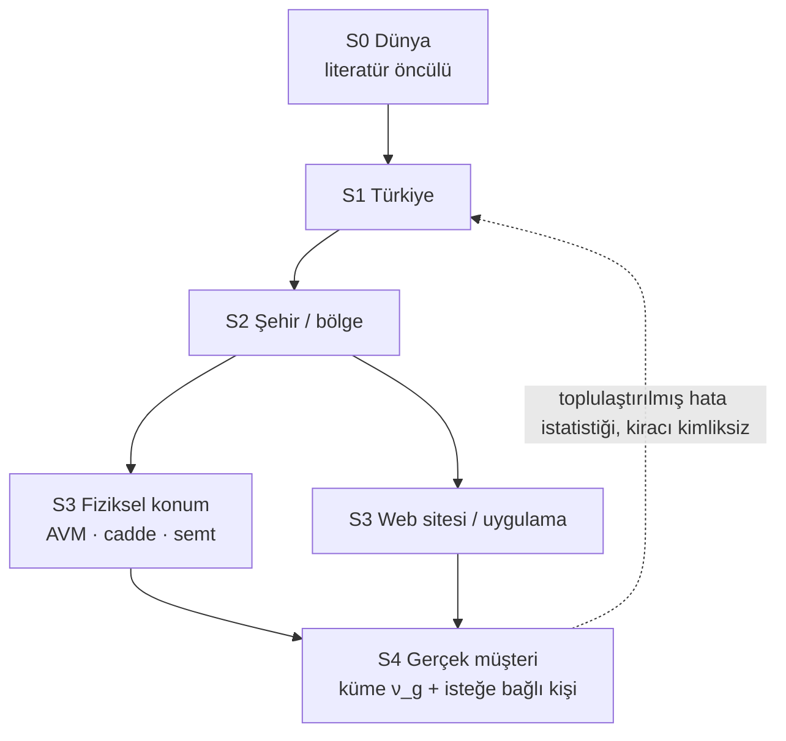
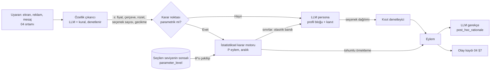

# 07 · Genelden özele davranış profili: seviye zinciri, parametre kestirimi ve ölçek analizi

Durum: Taslak, 2. tur (ADR-001 + ADR-002 sonucu) · Sahibi: İnsan Simülasyonu Araştırmacısı · Girdi: `ADR-001-dijital-ikiz.md`,
`ADR-002-genelden-ozele.md`, `data/SEMA.md`, `02-persona-uretimi.md` §5-§11, `03-degerlendirme.md` §7-§9, `MIMARI.md` §4.

**Terimler.** *Kiracı* (tenant), Persona Katmanı'nın müşterisi olan şirkettir; *gerçek müşteri*, kiracının mağazasına veya sitesine
gelen kişidir. *Davranış profili* (behavior profile), bir seviyedeki birimin (Türkiye nüfusu, bir şehir, bir mağaza konumu, bir
müşteri kümesi) parametre vektörünün sonsal dağılımıdır (posterior). *İkiz* (digital twin) kelimesi ürün dilinde yalnızca S4
**kümesi** için kullanılır, tek kişi için kullanılmaz (ADR-002 md. 6). Rapor dili "bu profil böyle davrandı" kalıbını kullanır;
gerçek kişilere atıf yapılmaz (F-1 dil kuralı).

## 1. Amaç ve ilkeler

Proje sahibinin çerçevesi: "Psikolog değilsin, sosyologsun. Gelen tüm müşterilerimizin davranışlarını ve o davranışın ölçeğini
analiz edeceksin; dünyadan Türkiye'ye, şehre, mağazanın konumuna ya da web sitesine, sonra gerçek müşteriden gelen gerçek
parametrelere iner." Bu bölüm bunun istatistik karşılığıdır. Analiz birimi tek bir insanın zihni değil, **seviye bazlı davranış
profili**dir. Kişi düzeyi kestirim yalnızca üst seviyelere daha doğru bir genel çıkarım taşımak için yapılır; kişi hedeflenmez,
kişiye bir şey gösterilmez (ADR-002 md. 1-2).

1. **Genelden özele, her seviye kendi parametresini üretir.** S0 Dünya → S1 Türkiye → S2 Şehir/bölge → S3 Konum/site → S4 Gerçek
   müşteri. Her alt seviye üstünü öncül (prior) alır, kendi verisiyle günceller; veri yoksa üstünün değerini "miras" etiketiyle taşır.
2. **Davranış ve ölçeği birlikte raporlanır.** "Kıtlık rozetine tepki var" yetmez; ne kadar yaygın, ne büyüklükte, birimler arasında
   ne kadar yayılmış ve kaç gözleme dayanıyor sorularının yanıtı her seviyede aynı nesneyle verilir (`BehaviorScale`, §10).
3. **Sayı istatistikten, anlatı LLM'den gelir.** Bir eylemin olasılığı profil sonsalından hesaplanır; LLM bu sınırın içinde bağlamı
   yorumlar ve gerekçe yazar (§5).
4. **Belirsizlik birinci sınıf veridir.** Profil bir dağılımdır; her koşu sonsaldan yeni bir çekiliş kullanır. Az veriyle kesin görünen
   profil bir hatadır.
5. **Yerellik kazanılır, varsayılmaz.** Bir parametre ancak o seviyenin verisi onu üst seviyenin öncülünden anlamlı biçimde
   uzaklaştırdıysa "yerel" etiketi alır (§3.5).
6. **Gerçek müşteri parametreleri ayrı ve özellikle vurgulanır** (ADR-002 md. 4); ama kişi düzeyi sonuç hiçbir çıktıda kişi kimliğiyle
   görünmez (§11).
7. **Literatür öncüldür, hakikat değil.** Öncül ile veri çatışırsa veri kazanır ve çatışma raporlanır (§9.4).

## 2. Parametre vektörü θ

Her parametre kısıtsız bir gizil ölçekte (z) tahmin edilir ve dönüşümle yorumlanabilir ölçeğe çevrilir. Aynı vektör her seviyede
kullanılır; seviyeler arasında değişen yalnızca dağılımın merkezi, yayılımı ve dayandığı veridir. Öncül sütunu S0 için örnektir
(varsayım); gerçek değer §3.3'teki sentezden gelecek.

| Parametre | Tanım | Ölçek / dönüşüm | S0 öncül örneği (varsayım) | Davranışsal yorum |
| --- | --- | --- | --- | --- |
| `lambda_kayip` | Kayıpların eşit kazançlara göre ağırlığı | λ > 0; z = ln λ | lognormal(ln 1,9; 0,5) | Ek ücret, iptal cezası, "kaçırırsınız" çerçevesi |
| `beta_simdicilik` | Yarı-hiperbolik iskontoda "şimdi"ye ek ağırlık (β) | β ∈ (0,1]; logit | beta(8,2) | "Hemen al sonra öde", hızlı kargoya ek ödeme |
| `delta_iskonto` | Uzun dönem günlük iskonto | r = −ln δ; z = ln r | lognormal(ln 0,001; 1) | Taksit/peşin, yıllık/aylık abonelik |
| `rho_risk` | Fayda eğriliği (CRRA ρ) | ℝ | normal(0,5; 0,4) | Bilinmeyen marka, garanti satın alma |
| `w_sosyal_kanit` | Popülerlik işaretinin fayda ağırlığı | ℝ (negatif = züppe etkisi) | normal(0,3; 0,3) | "1.200 kişi aldı" rozeti |
| `tau_reklam_tolerans` | Reklam maruziyetine dayanma | τ > 0; ln | lognormal(0; 0,7) | Video reklamı atlama zamanı |
| `eta_fiyat` | Log fiyat katsayısı | η < 0; z = ln(−η) | lognormal(ln 1,5; 0,6) | Fiyat karşılaştırma, indirim eşiği |
| `w_yorum` | Yorum puanı/içeriğinin ağırlığı | ≥ 0; ln | lognormal(ln 0,5; 0,7) | Yorum sekmesi açma |
| `kappa_secim_yuku` | Seçenek başına karar maliyeti | ≥ 0; ln | lognormal(ln 0,05; 1) | Uzun listede terk, filtre kullanımı |
| `theta_kitlik` | Kıtlık/aciliyet işaretine tepki | ℝ | normal(0,2; 0,3) | "Son 3 ürün", geri sayım |
| `phi_guven_isareti` | Güven işaretlerinin ağırlığı | ℝ | normal(0,3; 0,3) | Ödeme adımında terk |
| `sabir` | Bekleme toleransı (04 `patience_profile`) | sn; ln | lognormal(ln 4; 0,6) | Yavaş sayfada terk |
| `dikkat_esigi` | "Görüldü" için gereken maruziyet | sn; ln | lognormal(ln 1; 0,5) | Banner körlüğü |
| `varsayilan_yapiskanlik` | Ön seçili seçenekte kalma | ∈ (0,1); logit | beta(6,3) | Ön işaretli sigorta, otomatik yenileme |

**Eklenmesi gerekenler** (tanımlanabilirlik ve 04'ün B4 alanları için):

| Parametre | Neden gerekli |
| --- | --- |
| `tau_karar` (karar gürültüsü) | Lojitte fayda ağırlıkları yalnızca gürültüye göre tanımlıdır (§4.2). |
| `epsilon_dalginlik` (lapse) | Yanlış tıklama ve rastgele dönüşler parametreleri saptırmasın. |
| `okuma_hizi` | 04 `reading_speed`; yorum okuma süresini `w_yorum`dan ayırır. |
| `hayal_kirikligi_esigi` | 04 `frustration_threshold`; `sabir`dan farklı süreç (hata birikimi). |
| `nu_yenilik` | Yeni marka deneme; ayrı tutulmazsa `rho_risk` yanlış tahmin edilir. |
| `b_soz_davranis` | Söz (anket) ile davranış arasındaki sistematik sapma; 02 §9 say-do gap'in parametresi. |
| `c_kategori` | Fiyat duyarlılığı gıdada ve elektronikte aynı değildir; birim × kategori rastgele etkisi. |

Toplam boyut d ≈ 20. Bu boyut, alt seviyelerde güçlü havuzlamanın neden zorunlu olduğunu açıklar.

## 3. Genelden özele hiyerarşik model

### 3.1 S0–S4 zinciri

```text
 S0 Dünya            μ⁰_k, σ⁰_k, Γ_k             ← davranis-etkileri.xlsx, çok ülkeli çalışmalar      [ortak, kiracıdan bağımsız]
   │  δ¹_k ~ N(m_TR,k , τ¹_k)
 S1 Türkiye          μ¹_k = μ⁰_k + δ¹_k           ← TR örneklemli çalışmalar, GPS, TÜİK                [ortak]
   │                                              + kiracılar arası toplulaştırılmış hata istatistiği (F-9)
   │  δ²_ck ~ N(Γ²·w_c , τ²_k)    (küçük alan kestirimi)
 S2 Şehir/bölge c    μ²_ck = μ¹_k + δ²_ck          ← bölgesel istatistik [ortak] + kiracının şehir logu [kiracıya özel]
   │  δ³_lk ~ N(Γ³·tür_l , τ³_k)
 S3 Konum/site l     μ³_lk = μ²_c(l)k + δ³_lk      ← konum türü (AVM/cadde/semt) veya sitenin kendi logu  [kiracıya özel]
   │  küme g ~ Kategorik(π_l);  e_i ~ N(0, I)
 S4 Gerçek müşteri   z_i = μ³_l + ν_g + diag(σ_l)·L·e_i   ← müşterinin ziyaret/oturum gözlemleri        [kiracıya özel]
   │
 Gözlem              y_ije ~ p(y | z_i, bağlam_ije, ξ_ij)   ← §4 olabilirlikleri
```



**Eşleme (eski yapı → yeni).** Önceki turdaki "literatür → kiracı → segment → kişi" zinciri şöyle eşlenir: *literatür* = S0;
*kiracı* düzeyi artık tek bir düğüm değil, S2'nin kiracıya özel kısmı ile S3'e dağılır (kiracı = S3'te yaşar; birden çok şehirde
mağazası olan kiracı birden çok S3 düğümüne sahiptir); *segment* = S4 kümesi ν_g; *kişi* = S4 kişi etkisi e_i. Yeni olan S1 ve S2'nin
ortak (kiracıdan bağımsız) kısmıdır.

**Kiracılar arası sınır (F-9, 03 §9.3).** S0, S1 ve S2'nin kamu istatistiği kısmı herkese ortaktır. S2'nin kiracı logu kısmı, S3 ve S4
kiracıya özeldir; bir kiracının verisi başka bir kiracının S2–S4 öncülüne girmez. Kiracılardan S1'e giden tek akış, kiracı kimliği
silinmiş ve en az beş kiracıdan toplanmış **kalibrasyon hata istatistiği**dir (B7; örn. "TR'de `eta_fiyat` S1 öncülü, kiracı sonsallarına
göre ortalama 0,2 SD düşük kalıyor"). Bu istatistik S1 öncülünün ortalamasını değil yalnızca genişliğini ve yanlılık düzeltmesini
günceller; varsayım: en az beş kiracı ve her birinde k ≥ 50.

### 3.2 Seviye seviye kaynaklar ve davranış

| Seviye | Veri kaynakları | Mirası nasıl alır | Nasıl güncellenir | Veri yokken |
| --- | --- | --- | --- | --- |
| **S0 Dünya** | `data/davranis-etkileri.xlsx` (şema: `data/SEMA.md`); çok ülkeli meta-analizler | Yok (kök) | Tablo sürümü değişince (§3.3) | Geniş zayıf öncül; parametre "tanımsız" bayrağı |
| **S1 Türkiye** | `populasyon_ulke` TR içeren satırlar; Global Preferences Survey ülke puanları (Falk ve ark. 2018, doi:10.1093/qje/qjy013; TR dahil 76 ülke); TÜİK Hanehalkı Bilişim Teknolojileri Kullanım Araştırması ve gelir/tüketim istatistikleri (data.tuik.gov.tr); kiracılar arası hata istatistiği | μ¹ = μ⁰ + δ¹; δ¹'in merkezi TR verisinden, yayılımı aktarım şişirmesiyle | Yılda bir veya yeni TR çalışması tabloya girince | δ¹ = 0, τ¹ geniş: "S0'dan miras" |
| **S2 Şehir/bölge** | TÜİK İBBS-1/2 bölge istatistikleri (gelir, yaş yapısı, kentleşme, e-ticaret kullanımı); kiracının o şehirdeki toplu davranış verisi | μ² = μ¹ + δ²; δ² bölge değişkenleri w_c üzerine regresyonla (küçük alan kestirimi) | Kamu kısmı yılda bir; kiracı kısmı aylık hiper uydurmayla | Bölge değişkenlerinden öngörü (kalıp yargı riski; Felsefi soru 1) veya doğrudan S1 |
| **S3 Konum/site** | Fiziksel: konum türü (AVM/cadde/semt/otoyol), ziyaret ve kasa verisi, kampanya tepkisi. Web/uygulama: sitenin olay günlüğü (§3.6) | μ³ = μ² + δ³; konum türü sabit etkisi Γ³ kiracının kendi konumlarından | Aylık hiper uydurma; ayrıca kayma tespitinde | Konum türü etkisi + S2; yeni açılan mağaza "S2'den miras" |
| **S4 Gerçek müşteri** | Kiracının gerçek müşterilerinin ziyaret, sepet, oturum ve kampanya gözlemleri | z_i = μ³ + ν_g + kişi etkisi | Küme: aylık; kişi: günlük amorti / haftalık NUTS (§7) | Kişi soğuk: yalnız küme; küme boş: S3 |

S2 için klasik araç küçük alan kestirimidir (small area estimation; Fay & Herriot 1979, doi:10.1080/01621459.1979.10482505):
doğrudan şehir tahmini, örneklemi küçükse bölge değişkenleriyle yapılan regresyon öngörüsüne doğru büzülür. Bu, §3.4'teki
kısmi havuzlamanın coğrafi biçimidir ve aynı ağırlık formülüne tabidir.

### 3.3 S0: literatür tablosundan öncüle

Her parametre k için `persona_parametresi = k` olan satırlar toplanır; her satır ayrıca bir `seviye` etiketi taşır (ADR-002 sonuçları:
dünya / türkiye / şehir / konum-site / müşteri) ve yalnızca kendi seviyesinin öncülüne girer.

1. **Köprü fonksiyonu.** Tablodaki etkiler çoğu zaman nüfus ortalaması etkisidir ("kıtlık rozeti dönüşümü 8 yüzde puan artırır").
   Belgelenmiş bir dönüşüm satırdaki ölçüyü (lambda, Cohen d, OR, esneklik) gizil z ölçeğine çevirir. Dönüşümü olmayan satır
   öncüle girmez, not olarak kalır.
2. **Rastgele etkiler sentezi.** z ölçeğindeki etkiler `orneklem_n` ve `kanit_gucu` ağırlığıyla meta-analize girer: μ⁰_k ve çalışmalar
   arası heterojenlik. `bireysel_fark_olcegi` dolu satırlar birimler arası standart sapma σ⁰_k için ayrı öncül üretir; ölçek analizi
   (§10) için asıl gereken bu yayılımdır.
3. **Moderatör regresyonu.** `moderator_yonu_ve_buyuklugu`, μ'nün ortak değişkenlere (yaş bandı, gelir bandı, ülke, cihaz) bağımlılığına
   çevrilir: μ_k(x) = α_k + Γ_k·x. Sayısal moderatör Γ öncülünün ortalamasıdır; yalnız yönü bilinen moderatör işaretli ama geniş öncül
   alır; tartışmalı olan sıfır merkezli kalır. Korunan özellikler (din, etnik köken, sağlık) x'e girmez (F-3).
4. **Aktarım şişirmesi.** Laboratuvar veya TR dışı örneklemden gelen öncüllerin SD'si genişletilir (varsayım: laboratuvar 1,5×,
   TR dışı 1,3×). S1'e inerken bu çarpan δ¹'in yayılımına dönüşür.
5. **Sağlam karışım öncülü** (robust mixture prior; Schmidli ve ark. 2014, doi:10.1111/biom.12242): her seviyede öncül = 0,8 ·
   üst seviyenin sonsalı + 0,2 · zayıf bileşen. Alt seviyenin verisi üstüyle çatışırsa zayıf bileşen ağırlık kazanır; bu ağırlık
   §9.4'teki tutarsızlık raporunun ana göstergesidir.

Örnek: kayıptan kaçınma meta-analizi (Brown, Imai, Vieider & Camerer 2024, doi:10.1257/jel.20221698) λ için 2 civarında bir merkez
bildirir (varsayım: tam değer tablo satırından); tanım Kahneman & Tversky 1979 (doi:10.2307/1914185). Yarı-hiperbolik iskonto:
Laibson 1997 (doi:10.1162/003355397555253). Seçim yükü ortalamada sıfıra yakın, moderatöre çok bağlıdır (Chernev, Böckenholt &
Goodman 2015, doi:10.1016/j.jcps.2014.08.002); öncülü geniş tutulur. GPS'in sabır, risk alma ve güven boyutları `delta_iskonto`,
`rho_risk` ve `phi_guven_isareti` için S1 kaymasının yönünü verir; ölçek dönüşümü bir köprü fonksiyonudur (varsayım: GPS puanı
SD birimindedir, z ölçeğine doğrudan geçmez).

`prior_version` = tablo hash'i + köprü fonksiyonları sürümü + S1/S2 kamu verisi sürümü. Değişirse altındaki tüm profiller yeniden
uydurulur (MAJOR, §8).

### 3.4 Miras ve güncelleme: kısmi havuzlama

Her seviyede birimin kestirimi, kendi verisi ile üst seviye arasında bilgi miktarına göre ağırlıklanır. Tek değişkenli normal
yaklaşımla, L seviyesindeki birim u için:

```text
E[μ^L_u | y] ≈ w_u · μ̂^L_u + (1 − w_u) · μ^(L−1)_parent(u),     w_u = n_u·σ²_L / (n_u·σ²_L + s²_y)
```

Az gözlemli şehir veya konum üst seviyesine yakın, zengin loglu olan kendi verisine yakın durur. Pazarlamada heterojenliğin bu
yapıyla kestirimi yerleşik bir yöntemdir (Allenby & Rossi 1998, doi:10.1016/S0304-4076(98)00055-4).

- **Korelasyonlu parametreler.** Ω ~ LKJ(4) (Lewandowski, Kurowicka & Joe 2009, doi:10.1016/j.jmva.2009.04.008) parametreler arası
  ilişkiyi S3 içinde öğrenir; fiyat verisi kıtlık parametresi hakkında da bilgi taşır.
- **Merkezsiz parametrelendirme** (Betancourt & Girolami, arXiv:1312.0906) her seviyede varsayılandır; az veride örnekleyicinin huni
  geometrisinde takılmasını önler.
- **Seviye atlama.** Bir kiracı belirli bir şehre ait veri sağlamazsa S2 düğümü kamu kısmıyla kalır; S3 doğrudan bu düğüme bağlanır.
  Zincir hiçbir zaman kopmaz; eksik seviye "miras" olarak geçilir.

### 3.5 Seviye etiketi ve az veriyle aşırı kesinliğe karşı koruma

Önceki turdaki kişi / kısmen kişisel / segment mirası üçlüsü her seviyeye genellenir. L seviyesinde k parametresi için daralma oranı
(posterior contraction), **bir üst seviyenin öncülüne göre** hesaplanır:

```text
c^L_k = 1 − Var_sonsal(z^L_k) / Var_öncül(z^L_k | L−1)
```

| c^L_k (eşikler varsayım) | Etiket | Anlamı |
| --- | --- | --- |
| < 0,3 | **miras** (`inherited:S{L−1}`) | Bu seviyenin verisi parametreyi değiştirmedi; değer üst seviyeden gelir |
| 0,3–0,6 | **kısmen yerel** (`partial:S{L}`) | Veri katkı yaptı, üst seviye hâlâ belirleyici |
| ≥ 0,6 | **yerel** (`local:S{L}`) | Değer büyük ölçüde bu seviyenin verisinden |

Etiket zincir boyunca izlenir: S4'te `inherited:S1` diyen parametre, S2, S3 ve S4'ün hiçbirinde daralmamış demektir. Rapordaki
"kaynak seviye" sütunu (§9.3) bu izden üretilir.

Koruma kuralları her seviyede geçerlidir:

1. **Olabilirlik tavlaması.** Aynı oturumdaki veya aynı ziyaretteki olaylar bağımsız değildir; oturum rastgele etkisi ξ_ij ve log
   olabilirlik çarpanı α ∈ (0,1] (C3 kapsamasıyla kalibre) etkin örneklem şişmesini önler.
2. **Birimler arası varyansın alt sınırı.** σ_L'nin sıfıra çökmesi bütün şehirleri veya müşterileri aynı yapar (kalıp yargı
   çöküşünün istatistik karşılığı). Sonsal σ, öncülün alt %5'inin altına düşerse uyarı açılır.
3. **Öncül-veri çatışma testi.** Birimin verisi üst seviyenin öncül öngörü dağılımında (prior predictive) kuyruğa düşerse "atipik"
   bayrağı ve geniş aralık; ayrıntı §9.4.
4. **Sonsaldan çekiliş, ortalama değil.** Her koşu θ^(s) çeker; ortalama ile koşmak 03 P3 (varyans oranı) metriğini bozar.
5. **Küçük örneklem eşiği.** S2 ve S3 birimleri n < 50 (varsayım) bağımsız müşteri gözleminde "yerel" etiketi alamaz; en fazla
   "kısmen yerel" (Felsefi soru 1).

### 3.6 S3'te gözlem türleri: fiziksel konum ve web sitesi

S3 iki farklı veri dünyasıdır; aynı parametreleri farklı gözlemlerle tanımlar.

| Fiziksel mağaza konumu | Ne tanımlar | Not |
| --- | --- | --- |
| Ziyaret sayısı ve saat dağılımı (kapı sayacı, toplu) | Konum trafiği, ölçeğin paydası | Kişi tanımaz; yalnız toplu |
| Kasa (POS) fiş verisi: sepet içeriği, tutar, ödeme biçimi, taksit | `eta_fiyat`, `beta_simdicilik` (taksit/peşin), `c_kategori` | Sadakat kartı yoksa kişiye bağlanmaz, yalnız S3 |
| Sadakat kartı ile bağlanmış fişler | S4'e geçiş kapısı | Rızalı üyelik gerekir (§11) |
| Kampanya tepkisi (kupon kullanımı, raf etiketi A/B'si, "son gün" afişi) | `theta_kitlik`, `lambda_kayip`, `eta_fiyat` | Mağazalar arası rastgele kampanya atanırsa nedensel |
| Konum türü ve çevresi (AVM, cadde, semt; otopark, toplu taşıma) | Γ³ sabit etkileri | Kamu verisi + kiracı beyanı |

| Web sitesi / uygulama | Ne tanımlar | Not |
| --- | --- | --- |
| Olay günlüğü (04 §7 olay sözlüğü): görüntüleme, tıklama, kaydırma, görünürlük | `dikkat_esigi`, `w_yorum`, `kappa_secim_yuku` | En zengin kaynak; oturum kimliği takma adlı |
| Sepet, ödeme adımı, terk | `lambda_kayip`, `eta_fiyat`, `phi_guven_isareti` | |
| Sayfa yükleme süresi ve hata olayları | `sabir`, `hayal_kirikligi_esigi` | |
| Reklam oynatma ve atlama | `tau_reklam_tolerans` | Sağdan sansürlü |
| Kiracı A/B testleri | Nedensel tanımlama | Rastgeleleştirme kaydı zorunlu |

Fiziksel konumda kişi düzeyi gözlem azdır; S3 profili çoğunlukla toplu kasa verisiyle, S4 yalnız sadakat kartı üzerinden kurulur.
Web'de durum terstir: S4 verisi bol, konum kavramı yerine "site + kanal" kullanılır (giriş kanalı S3 içinde sabit etkidir).

### 3.7 S4: gerçek müşteri parametreleri

**Küme düzeyi (varsayılan).** S3 düğümünün altında müşteriler sonlu bir karışımla modellenir: z_i = μ³_l + ν_g(i) + kişi etkisi,
g(i) ~ Kategorik(π_l), ν_g ~ N(0, Σ_ν). Bu, hiyerarşik Bayes'in gizil sınıf (latent class) biçimidir (Allenby, Arora & Ginter 1998,
*J. Marketing Research*, doi:10.2307/3152035; varsayım: DOI doğrulanmalı). k-means kullanılmaz, çünkü (i) kişinin belirsizliğini atar,
az verili müşteriyi kesin bir kümeye zorlar; (ii) kümeleri ham davranış uzayında değil, tanımlanabilir parametre uzayında
istiyoruz; (iii) küme sayısının ve atamanın belirsizliğini rapora taşımak gerekir. Bunun yerine:

- Her müşterinin kümeye üyelik olasılığı p(g | y_i) sonsaldan gelir; kesin atama yapılmaz.
- Küme sayısı G, PSIS-LOO (Vehtari, Gelman & Gabry, arXiv:1507.04544) ve **en küçük küme ≥ 50 etkin müşteri** kuralıyla seçilir;
  kuralı geçemeyen küme komşusuyla birleşir.
- Etiket değişimi (label switching) sorunu, kümeleri `eta_fiyat` sırasına göre kanonik biçime sokarak çözülür.
- Her küme bir `customer_grounded` profil üretir (02 sınıfı) ve kendi `BehaviorScale` nesnelerini taşır (§10). Kümenin adı şablonla,
  parametrelerden üretilir (Felsefi soru 2).

**Kişi düzeyi (isteğe bağlı).** Kişi etkisi e_i kestirilir, çünkü (a) küme ortalaması kişiler arası yayılımı tam yansıtmaz ve
simülasyonda kuyrukları (03 P4) korumak için kişi çekilişleri gerekir; (b) art tabakalamayla (post-stratification) yeniden ağırlıklı
nüfus sonucu kişi düzeyinde daha doğrudur. Kullanım sınırı kesindir:

- Kişi düzeyi profil simülasyonda koşabilir, ama **çıktıları yalnızca toplulaştırılmış olarak** (≥ 50 kişi) rapora girer.
- Kişi kimliğiyle (müşteri no, e-posta, kart no) dışa aktarım yoktur; `subject_ref` takma adı kiracı deposundan çıkmaz.
- Kişiye özel mesaj, fiyat veya hedefleme üretilmez; karar motoru API'si kişi başı öneri uç noktası sunmaz (ADR-002 md. 1).
- Bireye yönelik arayüz yoktur (ADR-002 md. 2).

### 3.8 Soğuk → ılık → sıcak

Aşamalar oturum sayısıyla değil bilgiyle tanımlanır (ortalama daralma c̄). Aynı ölçek S2 ve S3 düğümlerine de uygulanır.

| Aşama | Koşul (varsayım) | Çıkarım | Raporlama |
| --- | --- | --- | --- |
| Soğuk | Yalnız ortak değişkenler veya c̄ < 0,15 | Üst seviyenin öncül öngörüsü | "Bu birim henüz yerel değil; üst seviye gibi davranır." |
| Ilık | 0,15 ≤ c̄ < 0,5 | Hiper koşullu hızlı güncelleme (Laplace / amorti, §7) | Parametre başına seviye etiketi |
| Sıcak | c̄ ≥ 0,5 ve §6 testleri geçti | Tam NUTS + periyodik hiper uydurma | Tam kimlik kartı ve tutma isabeti |

Soğuk S4 kümesi teknik olarak S3 nüfus örneklemesiyle aynıdır; "ikiz" adı yalnız ılık ve sıcak kümeler için kullanılır.

## 4. Veri → olabilirlik

### 4.1 Gözlem–parametre haritası

Olaylar 04 §7 şemasından gelir; kiracı logları ve kasa verisi aynı olay sözlüğüne eşlenir. Aynı olabilirlik, S2–S4'ün hangisinde
toplanırsa o seviyenin parametresini günceller.

| Gözlem | Ölçüm modeli (olabilirlik) | Tanımladığı parametreler | Not |
| --- | --- | --- | --- |
| Ürün seçimi (sepete ekleme, satın alma, fiş satırı) | Karışık lojit: U = −η·ln p + w_yorum·puan + w_sosyal_kanit·pop + θ_kitlik·kıtlık + φ·güven + ξ; P ∝ exp(U/τ_karar) | `eta_fiyat`, `w_*`, `theta_kitlik`, `phi_guven_isareti` | Uyaran özellikleri sayfadan veya raf kaydından |
| Sepet terki (kargo/ek ücret görününce) | Lojistik: ek ücretin referansa göre kayıp terimi λ·Δ | `lambda_kayip`, `eta_fiyat` | λ ancak aynı tutar farklı çerçevede görülürse tanımlıdır |
| İndirim/kampanya tepkisi (kupon, afiş, e-posta) | Çerçeve × tutar etkileşimli lojistik | `lambda_kayip`, `eta_fiyat`, `theta_kitlik` | Rastgeleleştirilmişse nedensel; değilse `observational` |
| Taksit/peşin, hızlı kargo, "şimdi al sonra öde" | Yarı-hiperbolik indirgenmiş faydayla ikili seçim | `beta_simdicilik`, `delta_iskonto` | β için "şimdi" seçeneği gerekir |
| Garanti/sigorta ek ürünü, bilinmeyen marka | CRRA beklenen fayda ile seçim | `rho_risk`, `nu_yenilik` | |
| Reklam atlama zamanı | Sağkalım: h(t) = h₀(t)·exp(−ln τ_reklam + uyaran etkisi) | `tau_reklam_tolerans`, `sabir` | Sağdan sansür |
| Yorum okuma | Açma: lojistik; süre: lognormal, kelime sayısı / `okuma_hizi` | `w_yorum`, `okuma_hizi` | Okuma hızı düzeltmesi zorunlu |
| Uzun listede karar süresi ve terk | Shifted lognormal süre + lojistik terk | `kappa_secim_yuku`, `sabir` | |
| Ön seçimden ayrılma | Lojistik, olası tercihe uzaklık kontrol edilerek | `varsayilan_yapiskanlik` | |
| Yavaş yükleme, form hatası sonrası terk | Rekabet eden riskler | `sabir`, `hayal_kirikligi_esigi` | 04 §6.2 |
| Görünür alan maruziyeti | Eşik altı maruziyette "görülmedi" gizil değişkeni | `dikkat_esigi` | Görünürlük olayı yoksa tanımsız |
| Anket/görüşme yanıtı (`stated`) | y_söz = f(θ) + b_soz_davranis + gürültü | Tümü zayıfça; `b_soz_davranis` | Söz tek başına davranış parametresini daraltamaz (02 §6.3) |
| Mağaza ziyareti ve sepet tutarı (toplu) | Poisson/negatif binom ziyaret; tutar lognormal, konum etkisi | S3 Γ³, `eta_fiyat` (toplu) | Kişiye bağlanmaz |

### 4.2 Tanımlanabilirlik sorunları ve çözümleri

| Sorun | Neden | Çözüm |
| --- | --- | --- |
| Ölçek belirsizliği | Lojitte U ve τ_karar birlikte ölçeklenebilir | Ödeme istekliliği uzayında parametrelendirme (WTP space; Train & Weeks 2005, doi:10.1007/1-4020-3684-1_1): ağırlıklar TL karşılığı, `eta_fiyat` ölçeği taşır |
| `lambda_kayip` ↔ `rho_risk` | Yalnız kayıp veya yalnız kazanç gözlenirse eğrilik ile asimetri karışır | ρ S3 düzeyinde ortak; S4'te yalnız λ serbest. Karma uyaran yoksa λ "miras" |
| `beta_simdicilik` ↔ `delta_iskonto` | "Şimdi" seçeneksiz seçimler yalnız toplam iskontoyu tanımlar | δ S3'te, β S4'te; β yalnız anlık seçenek gözlenince daralır (Andreoni & Sprenger 2012, doi:10.1257/aer.102.7.3333) |
| `w_sosyal_kanit` ↔ `w_yorum` ↔ `phi_guven_isareti` | Popüler ürünlerde üç işaret birlikte (eşdoğrusallık) | A/B'lerdeki rastgele rozet varyasyonu; ayrışmazsa bileşik "kanıt duyarlılığı" faktörü |
| Seçim yanlılığı | Öneri sistemi indirimi zaten fiyata duyarlı kişiye gösterir | Nedensel parametre yalnız rastgele maruziyetten; gözlemsele eğilim skoru ve `observational` etiketi |
| `sabir` ↔ düşük niyet | Kişi sabırsız olduğu için değil, almak istemediği için terk eder | Oturum niyeti etkisi ξ_ij; giriş kanalı ve sepet içeriği niyet göstergesi |
| Varsayılan ↔ gerçek tercih | Varsayılan zaten tercih edilense yapışkanlık sanılır | Yalnız varsayılanın olası tercihten farklı olduğu durumlar bilgilendirici |
| Hesap ≠ kişi | Paylaşılan hesap/kart iki kişinin karışımıdır | İki bileşenli karışım testi; "paylaşılan hesap şüphesi" bayrağı; sıcak aşamaya geçemez |
| Eksik ölçüm | İzleme rızası olmayan oturumlar, reklam engelleyici | MNAR varsayılır; görünürlük olayı olmayan oturum `dikkat_esigi`ne girmez |
| Konum ↔ müşteri bileşimi | AVM mağazası farklı davranıyorsa sebep konum mu, gelen kitle mi? | S3 konum etkisi yalnız S4 bileşimi (küme payları π_l) kontrol edildikten sonra yorumlanır; ayrışmazsa "bileşim etkisi olabilir" notu |
| Ekolojik yanılgı | S2/S3 toplu ilişki bireye aktarılamaz | Toplu düzeyde bulunan ilişki S4'e öncül olarak iner ama kişi düzeyi iddia olarak raporlanmaz |

Genel kural: **bir parametrenin bir seviyede serbest bırakılması, onu tanımlayan uyaranın o seviyede gözlenmesine bağlıdır.**
Uyaran yoksa parametre üstten miras kalır ve kart bunu söyler.

### 4.3 Ölçüm modelinin genel biçimi

```text
y_ije ~ Olay_e( g_e( z_i , s_ije , ξ_ij , d_ij ) ) ^ α        (α: §3.5 tavlama)
  z_i   : S4 kişi (veya küme) gizil parametresi; S4 yoksa μ³_l
  s_ije : uyaran özellikleri (fiyat, çerçeve, rozet, seçenek sayısı, gecikme)
  ξ_ij  : oturum/ziyaret niyeti ~ N(0, σ_ξ)
  d_ij  : cihaz, kanal veya konum etkisi (S3 sabit etkisi)
```

## 5. θ → LLM persona: hibrit karar mimarisi

### 5.1 İş bölümü



- **Parametrik karar noktası:** olabilirliği olan eylemler (satın al/terk, reklamı atla, ön seçimden ayrıl, kampanyayı kabul et,
  bekle/bırak). Olasılık istatistik motorundan gelir ve tohumlu örneklenir; LLM eylemi seçmez.
- **Parametrik olmayan nokta:** modelin bilmediği eylemler (hangi menüye bakılır, aramaya ne yazılır). LLM karar verir, motorun
  sınırları içinde.
- **Gerekçe her zaman sonradandır** ve `post_hoc_rationale` etiketi taşır (02 §9).

### 5.2 "LLM sayıyı ezmesin" kısıtları

1. **Mimari ayrım:** Parametrik noktada LLM eylem üretmez; yalnız özellik çıkarır ve gerekçe yazar (04 §6.2 kuralının genellemesi).
2. **Olasılık bandı:** LLM kararları oturum sonu terk olasılığının %80 sonsal aralığı dışına düşen bir oran üretirse kısıt denetleyici
   o yoldaki dağılımı kırpar, olay kaydına `llm_clamped` yazar.
3. **Sözel çeviri yalnız anlatı içindir.** İstemde "ek ücretlere belirgin tepkili, kesinlik: orta" yazılır; karar orada alınmaz
   (varsayım: dil modelleri sayısal parametreyi tutarsız uygular; 03'te ölçülecek).
4. **Ezme oranı:** Ablasyonda aynı oturum yalnız LLM ile koşulur; motorun %5 altındaki olasılıklı eylemleri seçme oranı
   `override_rate` olarak 03'e raporlanır.
5. **Özellik çıkarımı denetimi:** Fiyat ve rozet alanları DOM'dan kuralla doğrulanır; uyuşmazlık olayı açılır.

### 5.3 Persona şemasına `behavior_profile_ref` bloğu

02 §5 şemasına eklenir; `population_sampled`, `site_grounded` ve `customer_grounded` sınıflarında zorunludur. Makine alanları
İngilizce (B2). Örnek bir S4 kümesi:

```json
{
  "persona_id": "per_cg_3a71",
  "class": "customer_grounded",
  "weight": 0.18,
  "identity": {"display_name": {"value": "Küme K3 · fiyat karşılaştıran, sabırlı", "source": "template"}},
  "profile": {
    "level": "S4",
    "unit": {"type": "cluster", "id": "acme/ist-kadikoy-cadde/K3", "n_eff": 1840, "membership": "probabilistic"},
    "chain": ["S0:lit_2026-11-01#a91f", "S1:tr_2026-10", "S2:TR10-acme", "S3:ist-kadikoy-cadde", "S4:K3"],
    "parameter_level_used": "S0-S4",
    "model": {"name": "hb_levels", "version": "2.0.0", "hyper_fit_id": "hf_acme_2026-11-03"},
    "data_window": {"from": "2026-05-01", "to": "2026-11-05"},
    "parameters": {
      "eta_fiyat": {"median": -1.9, "ci80": [-2.3, -1.6], "contraction": 0.71, "source": "local:S4"},
      "lambda_kayip": {"median": 2.1, "ci80": [1.6, 2.8], "contraction": 0.34, "source": "partial:S3", "prior_refs": ["EK-004"]},
      "beta_simdicilik": {"median": 0.84, "ci80": [0.70, 0.94], "contraction": 0.10, "source": "inherited:S1"},
      "w_sosyal_kanit": {"median": 0.25, "ci80": [-0.05, 0.5], "contraction": 0.04, "source": "inherited:S0"}
    },
    "level_conflicts": [{"param": "theta_kitlik", "upper": "S1", "lower": "S4", "z": 2.6}],
    "posterior_draws": "ref://profile/acme/K3/draws.v4",
    "validation": {"brier": 0.17, "brier_S3_baseline": 0.20, "ci80_coverage": 0.79, "ppc_pass": true},
    "verbal_summary": {"value": "fiyata duyarlı; kayıp çerçevesine orta tepki; aciliyete beklenenden az tepki", "generated_from": "parameters"}
  },
  "behavioral_profile": {"patience_profile": {"derived_from": "profile.parameters.sabir"}},
  "unknowns": ["din", "siyasi yönelim"]
}
```

Notlar: `weight` kümenin S3 nüfusundaki payıdır (π_l). Kişi düzeyi profil aynı bloğu `unit.type: "person"` ile kullanır, ama
`identity` ve `weight` dışa açılmaz ve persona yalnız toplu koşularda örneklenir (§3.7). `verbal_summary` şablonla üretilir.

## 6. Doğrulama

1. **Simülasyon tabanlı kalibrasyon** (SBC; Talts ve ark., arXiv:1804.06788): parametreler öncülden çekilir, sahte veri üretilir, model
   geri kestirir. Her model sürümünde ve her seviye için kapı.
2. **Öncül öngörü kontrolü:** Her seviyenin öncülünden üretilen davranışlar akla yatkın mı (ör. sepet terk %20–%95; varsayım).
3. **Sonsal öngörü kontrolü** (Gabry ve ark., arXiv:1709.01449): terk oranı, atlama zamanı dağılımı, birimler arası varyans (03 P3),
   kuyruklar (P4), alt grup farkları (P5) S2, S3 ve S4'te ayrı ayrı.
4. **Tutma isabeti ve seviye temel çizgileri.** Zaman temelli bölme (03 §8.2). Ölçütler: log öngörü yoğunluğu, olay başına Brier, %80
   aralık kapsaması. **Her seviye bir üstüyle karşılaştırılır:** S1 profili S0'ı, S2 S1'i, S3 S2'yi, S4 kümesi S3'ü geçmelidir; ayrıca
   havuzsuz frekans tahmini bir temel çizgidir. Bir seviye üstünü geçemiyorsa "yerel" iddiası düşer ve rapor üst seviyeyi önerir;
   havuzsuz tahmini geçemiyorsa havuzlama fazla güçlüdür.
5. **Aktarım testi:** Kiracının yeni bir A/B'sinde profiller ortamda koşulur, gerçek kollarla karşılaştırılır (03 §8.4(c) mühürlü kör
   tahmin akışı).
6. **Kalibrasyon (Arayüz: 03):** Olasılıklar C1–C3'e girer; düzeltici katmanı (03 §9.3) rapor olasılığına uygulanır, sonsala değil.

**Profil kimlik kartı** (02 §11.2'ye ek alanlar):

| Alan | Gösterim |
| --- | --- |
| Ne olduğu | "Bu, [seviye] düzeyinde gözlenen davranıştan kestirilmiş bir profildir. Belirli bir kişi değildir." |
| Zincir | S0 → … → bu seviye; atlanan seviyeler "miras" olarak |
| Aşama | Soğuk / ılık / sıcak ve ortalama daralma |
| Parametreler | Ortanca, %80 aralık çubuğu üst seviyenin aralığı üstüne bindirilmiş; kaynak seviye etiketi |
| Ölçek | Seçili davranışlar için `BehaviorScale` özeti (§10) |
| Neyi bilmiyoruz | Tanımlayıcı uyaranı görülmemiş parametreler, ayrışmayan çiftler |
| İsabet | Tutma Brier'i, bir üst seviyeye göre kazanç, aralık kapsaması |
| Bayraklar | Seviye tutarsızlığı, küçük örneklem, paylaşılan hesap, atipik |

## 7. Uygulama notu

| Seçenek | Güçlü | Zayıf | Rol önerisi |
| --- | --- | --- | --- |
| Stan (Carpenter ve ark. 2017, doi:10.18637/jss.v076.i01) | Olgun NUTS, zengin tanı | Milyonlarca bağımsız blok için GPU yok | Referans model, SBC |
| PyMC (Abril-Pla ve ark. 2023, doi:10.7717/peerj-cs.1516) | Analist dostu, ArviZ | Üretimde ek katman | Keşif, öncül öngörü |
| NumPyro (Phan, Pradhan & Jankowiak, arXiv:1912.11554) | JAX, `vmap` ile binlerce bloğu paralel; NUTS ve SVI aynı kodda | JAX bağımlılığı | **Üretim** |

**Öneri:** Üretimde NumPyro, referans olarak Stan; her model sürümünde iki uygulamanın sonsal özetleri karşılaştırılır. Model
yapısal olarak "az sayıda ortak hiperparametre + çok sayıda koşullu bağımsız blok"tur.

**Kademeli çıkarım (seviyelere göre):**

1. **S0–S1 (ortak):** Meta-analitik sentez ve S1 kayması; kiracı verisi kullanılmaz. Bilim ekibi tarafından sürümlenir.
2. **S2–S3 hiper uydurma (kiracı başına):** Şehir ve konum etkileri, Γ, σ, Ω ve küme yapısı; kiracının müşterilerinden tabakalı alt
   örneklem (varsayım: birkaç bin–birkaç on bin) üzerinde tam NUTS.
3. **S4 kişi blokları:** Hiper sonsaldan birkaç çekilişe koşullu, paralel. Tek nokta yerine birkaç hiper çekilişi deneysel Bayes'in
   aşırı kesinliğini sınırlar.
4. **Ilık aşama için amorti çıkarım** (BayesFlow tipi; Radev ve ark., arXiv:2003.06281) veya Laplace; sıcak aşamaya geçişte NUTS ile
   doğrulanır, SBC amorti kestiriciye de uygulanır.

**Maliyet (oransal, varsayım):** S4 maliyeti müşteri sayısı × bilgilendirici olay sayısıyla doğrusal. Laplace = 1 birim ise kısa NUTS
10–100 birim, eğitilmiş amorti kestirici 1'in altında. Karar motoru çağrısı LLM tokenı yanında ihmal edilebilir.

| Ne | Ne zaman |
| --- | --- |
| S4 kişi (ılık) | Günlük toplu işten sonra, amorti/Laplace |
| S4 kişi (sıcak) ve kümeler | Haftalık NUTS; küme yapısı aylık |
| S2–S3 hiperparametreleri | Aylık; ayrıca kayma tespitinde (yeni kategori, fiyat politikası, mağaza açılışı) |
| S1 | Yılda bir veya yeni TR kaynağı; kiracılar arası hata istatistiği çeyrekte bir |
| S0 | Tablo sürümü değişince; MAJOR |
| Zaman kayması | Eski oturumlar yarı ömürlü ağırlıkla (varsayım: 180 gün) tavlanır |

## 8. Sürümleme

02 §11.1 biçimi korunur: **MAJOR** = model yapısı, S0 tablosu veya S1/S2 kamu verisi değişti; **MINOR** = S2–S4 hiper uydurma veya
yeni veriyle sonsal güncelleme; **PATCH** = yalnız sözel özet; **+e** = veri penceresi sonu. Her simülasyon sonucu zincirin her
halkasının sürümünü (`chain`), `parameter_level_used` değerini ve çekiliş tohumlarını taşır.

## 9. Seviye seçimi ve kullanım serbestliği

### 9.1 Çalışma tasarımında `parameter_level`

ADR-002 md. 4 gereği simülasyonu tasarlayan kişi hangi seviyenin parametrelerinin kullanılacağını seçer (Arayüz: 05). Seçim
çalışma tasarımının bir alanıdır ve raporun başında görünür.

```json
{
  "parameter_level": {
    "mode": "chain",
    "deepest": "S3",
    "anchor": {"S2": "TR10", "S3": "acme/ist-kadikoy-cadde"},
    "overrides": {"eta_fiyat": "S4", "w_sosyal_kanit": "S1"},
    "s4_unit": "cluster"
  }
}
```

| Mod | Anlamı | Ne zaman |
| --- | --- | --- |
| `S0` | Yalnız literatür | Kiracı verisi yokken, kavram testinde; "evrensel davranış ne derdi?" |
| `S0-S1` | Türkiye geneli | Yeni pazar, ulusal kampanya |
| `S0-S2` | Şehir/bölge | Bölgesel lansman, şehir kıyası |
| `S0-S3` | Konum veya site | Belirli bir mağaza veya sitede tasarım kararı |
| `S0-S4` | Gerçek müşteri dahil | Kiracının mevcut müşterileriyle test; en kişisel ama en dar |
| `mixed` | Parametre bazında farklı seviye (`overrides`) | Ör. S1 + S4: S4 kümeleri, S2–S3 atlanarak **doğrudan S1 öncülüyle** yeniden uydurulur |

**Karışık kullanımın kuralı.** "S1 + S4" iki anlam taşıyabilir ve tasarım hangisi olduğunu açıkça söyler: (a) S4 kümeleri S1'i
öncül alarak yeniden kestirilir (S2–S3 atlanır; şehir/konum bilgisi bilerek dışarıda bırakılır); (b) parametrelerin bir kısmı S1'den,
bir kısmı S4'ten alınır. (b)'de korelasyon matrisi Ω tutarsızlaşabilir; motor karışık vektörü S4 sonsalının koşullu dağılımından
çeker (S1'den gelen parametreler sabitlenip kalanlar koşullanır). İki parametre arasında |r| > 0,5 (varsayım) ise ve farklı
seviyelerden isteniyorsa tasarım uyarı verir.

**Daha derin seviye her zaman daha iyi değildir.** S4 en kişisel ama yalnız mevcut müşteriyi temsil eder; yeni kitleye yönelik
kararda S2 veya S3 daha uygundur. Rapor, seçilen seviyenin bir üst seviyeye göre tutma isabeti kazancını (§6.4) gösterir.

### 9.2 Seçilen seviyede veri yoksa

Seçilen en derin seviye bir parametre için miras durumundaysa motor o parametreyi miras alınan seviyeden kullanır ve raporun
kaynak sütunu bunu gösterir. Kullanıcı "S0-S4 seçtim" dediğinde parametrelerin çoğu `inherited:S1` olabilir; bu sessizce
gizlenmez (§9.3 özet satırı).

### 9.3 Rapor: "parametre kaynağı seviyesi" sütunu

Her rapor bir parametre kaynak tablosu taşır (Arayüz: 05):

| Parametre | İstenen seviye | Kullanılan seviye | Etiket | Daralma | Ortanca [%80] | Üst seviyeye göre fark |
| --- | --- | --- | --- | --- | --- | --- |
| `eta_fiyat` | S4 | **S4 (K1–K5)** | yerel | 0,71 | −1,9 [−2,3; −1,6] | −0,4 SD |
| `lambda_kayip` | S3 | S3 | kısmen yerel | 0,34 | 2,1 [1,6; 2,8] | +0,1 SD |
| `beta_simdicilik` | S3 | S1 | miras | 0,10 | 0,84 [0,70; 0,94] | — |

Özet satırı: "Bu çalışmada 20 parametreden 3'ü gerçek müşteri verisinden (S4), 4'ü konumdan (S3), 9'u Türkiye öncülünden (S1),
4'ü dünya literatüründen (S0) geldi."

**S4 vurgusu.** S4'ten gelen parametreler ve sonuçlar raporda ayrı bir blokta, belirgin bir "gerçek müşteri verisi" işaretiyle
gösterilir: kaç kümeden, toplam etkin kaç müşteriden, hangi veri penceresinden geldiği yazılır. Görsel vurgu tasarımı 05'e aittir;
07'nin şartı, S4 parametresinin hiçbir tabloda diğerleriyle aynı görünümde karışmamasıdır.

### 9.4 Seviyeler arası tutarsızlık

S4 (veya S2, S3) verisi üst seviye öncülünden çok saparsa bu bir **bulgu**dur, hata değil; ama üç olası açıklaması vardır ve rapor
hangisinin olası olduğunu söylemelidir.

1. **Ölçü:** z = (μ_alt − μ_üst) / √(Var_öncül,üst + Var_sonsal,alt). Ek olarak sağlam karışım öncülündeki zayıf bileşenin sonsal
   ağırlığı (§3.3 adım 5) ve Box'ın öncül öngörü p-değeri (Box 1980, doi:10.2307/2982063).
2. **Eşikler (varsayım):** |z| < 2 tutarlı; 2 ≤ |z| < 3 "belirgin yerel fark"; |z| ≥ 3 veya zayıf bileşen ağırlığı > 0,5 "seviye çatışması".
3. **Tahmin tarafı:** Kestirimde veri kazanır (karışım öncülü kendiliğinden gevşer); üst seviye değeri ezilmez, raporda yan yana durur.
4. **Rapor tablosu:** parametre · üst seviye değeri · alt seviye değeri · z · karışım ağırlığı · olası açıklama:
   (a) *gerçek yerel fark* (örneklem büyük, uyaran rastgele, alt birimler arasında tutarlı); (b) *ölçüm/eşleme farkı* (köprü
   fonksiyonu literatür ölçüsünü yanlış çeviriyor olabilir; aynı sapma birçok kiracıda görülürse bu güçlenir ve S1'e giden hata
   istatistiğine yansır); (c) *seçim yanlılığı* (gözlemsel maruziyet, kitle bileşimi; §4.2).
5. **Ürün davranışı:** "Seviye çatışması" olan parametre, rapor özetinde ana bulgudan ayrı bir "beklenmedik" kutusunda gösterilir;
   karar önerisi bu parametreye dayanıyorsa, öneri bir üst seviyeyle de yeniden koşulur ve iki sonuç birlikte verilir (duyarlılık).

## 10. Ölçek analizi: `BehaviorScale`

Proje sahibinin "davranışın ölçeği" isteği, her seviyede aynı biçimde raporlanan bir özet nesnesiyle karşılanır. Bir davranış
(ör. "kargo ücreti görününce sepeti bırakma", "kıtlık rozetine tepki") için dört soruyu yanıtlar: ne kadar yaygın, ne büyüklükte,
birimler arasında ne kadar yayılmış, ne kadar eminiz.

```json
{
  "behavior_id": "cart_abandon_on_shipping_fee",
  "level": "S3",
  "unit": "acme/ist-kadikoy-cadde",
  "window": {"from": "2026-08-01", "to": "2026-11-01"},
  "prevalence": {"value": 0.27, "ci80": [0.24, 0.31], "definition": "ücret gören oturumların terk oranı"},
  "effect_size": {"value": 0.09, "ci80": [0.06, 0.12], "measure": "yüzde puan", "contrast": "ücretsiz kargo koluna göre", "causal": true},
  "parameter_link": {"param": "lambda_kayip", "median": 2.1, "source": "partial:S3"},
  "heterogeneity": {"between_unit_sd": 0.35, "scale": "z", "quantiles": {"p10": 0.11, "p50": 0.25, "p90": 0.46}, "multimodal": false},
  "subunits": {"type": "S4_cluster", "count": 5, "range_prevalence": [0.14, 0.41]},
  "n": {"units": 3120, "events": 18450, "n_eff": 2400},
  "confidence": {"label": "orta", "drivers": ["rastgele A/B", "tek konum"], "contraction": 0.34},
  "vs_parent": {"level": "S2", "prevalence": 0.24, "z": 1.1},
  "k_anon_ok": true,
  "provenance": ["S0:EK-004", "S3:ab_2026_09_kargo"]
}
```

| Alan | Soru | Kural |
| --- | --- | --- |
| `prevalence` | Ne kadar yaygın? | Davranışın görüldüğü birim/olay oranı; tanım cümlesi zorunlu |
| `effect_size` | Ne büyüklükte? | Ölçü adı ve karşıtlık zorunlu; `causal: false` ise rapor "ilişki" der |
| `heterogeneity` | Dağılımı nasıl? | Birimler arası SD ve yüzdelikler; çok tepeli ise belirtilir (alt grup sinyali) |
| `subunits` | Alt seviyede nasıl dağılıyor? | Bir alt seviyenin aralığı (S2 için şehir aralığı, S3 için küme aralığı) |
| `n` | Kaç gözleme dayanıyor? | Birim, olay ve etkin örneklem ayrı |
| `confidence` | Ne kadar eminiz? | Sözel etiket (düşük/orta/yüksek) şu üçünden türetilir: aralık genişliği, daralma, nedensellik |
| `vs_parent` | Üstünden farkı? | §9.4 z değeri |
| `k_anon_ok` | Yayınlanabilir mi? | S4'te birim < 50 ise nesne üretilir ama rapora girmez |

Seviyelere göre: S0 ve S1'de `BehaviorScale` literatür ve kamu verisinden üretilir, `causal` alanı kaynak yöntemine bağlıdır;
S2–S4'te gözlem ve simülasyondan. Simülasyon sonucu da aynı nesneyle döner (`source: "simulated"`), böylece gözlenen ve simüle
ölçek yan yana karşılaştırılır; fark 03'ün kalibrasyon metriklerine girer.

## 11. S4 verisinin işlenmesi

Arayüz: `06-guven-gizlilik.md`. ADR-002 ile önceki turdaki kişiye gösterim, erişim/itiraz ve kişi düzeyi dışa aktarma bölümleri
kaldırılmıştır. 07'nin istatistik tarafındaki ihtiyaçları:

- **Amaç sınırı.** S4 verisi (kişi olay dizisi, sonsal çekilişler, küme üyelik olasılıkları) yalnızca S4 kestirimi ve ondan türeyen
  toplu çıkarım için işlenir. Kişi kimliğiyle rapor, dışa aktarım, CRM'e geri yazım ve bireysel arayüz yoktur.
- **Depo.** Kiracı anahtarıyla şifreli kişi deposu; `subject_ref` takma adı depodan çıkmaz. S4 kümeleri ve S2–S3 özetleri k ≥ 50
  kuralına tabidir (06 §3.3).
- **Standart KVKK silme.** Kişinin olayları, sonsal çekilişleri ve üyelik kayıtları silinir. Hiper uydurma alt örneklemindeyse bir
  sonraki planlı uydurma onsuz yapılır (varsayım: ≤ 30 gün, hukuki görüşle doğrulanmalı); daha sıkı gereklilik çıkarsa alt örneklem
  parçalara bölünür (SISA; Bourtoule ve ark., arXiv:1912.03817). Kişi kimliğiyle rapor olmadığından geçmiş raporlar değişmez
  (F-15'in daralmış hâli).
- **LLM sağlayıcısına giden veri.** Yalnız sözel özet ve uyaran; ham olay dizisi ve takma ad gönderilmez (06 §5, B5).
- **Fiziksel mağazada.** S4'e yalnız rızalı sadakat kartı ile bağlanmış fişler girer; kamera, yüz tanıma veya cihaz (MAC/Wi-Fi)
  izleme 07'nin veri kaynağı değildir (Felsefi soru 3).
- **Hassas çıkarım.** Korunan özellik x'e girmez; ama davranıştan hassas bir çıkarım (ör. finansal sıkıntı kümesi) doğabilir. Küme
  adlandırması ve raporu bu çıkarımı açık etmez (Felsefi soru 2).

## 12. Arayüzler

### Arayüz: `02-persona-uretimi.md`

- §5 sınıflar ADR-002'ye göre: `population_sampled` (S0–S2), `site_grounded` (S3), `customer_grounded` (S4, küme veya kişi);
  `evidence_grounded_individual` kalkar. Profil bloğu §5.3 biçiminde; B4 alanları profil parametrelerinden türetilir.
- §6 kanıta temellendirme: "kanıt" = parametre, onu daraltan olay sayısı ve kaynak seviyesi; miras parametreye dair yanıt "üst
  seviyeden uzatılmış" etiketi alır.
- §11.2 kimlik kartına §6'daki alanlar eklenir.

### Arayüz: `03-degerlendirme.md`

- Metrik setine seviye ailesi: olay başına Brier, %80 aralık kapsaması, bir üst seviyeye göre kazanç, `override_rate`, seviye
  çatışma oranı. Formül sahibi 03'tür (B3).
- Gözlenen ve simüle `BehaviorScale` farkı kalibrasyon girdisidir.

### Arayüz: `04-ortamlar.md`

- Eylem alanına `decision_point_type` (parametrik / değil); `llm_clamped` ve özellik uyuşmazlığı olay türleri.
- Fiziksel mağaza olayları (fiş satırı, kupon kullanımı, ziyaret sayacı) olay sözlüğüne toplu olay türü olarak.

### Arayüz: `05-icgoru-ve-urun.md`

- Çalışma tasarımına `parameter_level` (§9.1); rapora parametre kaynak tablosu, S4 bloğu ve seviye çatışması kutusu (§9.3–9.4);
  davranış özetleri `BehaviorScale` (§10).

### Arayüz: `06-guven-gizlilik.md`

- §11 gereksinimleri; ADR-001'in açtığı kişiye gösterim/rıza akışı yerine amaç sınırı ve standart silme.

## 13. Açık riskler ve varsayımlar

- Literatür tablosu henüz derlenmedi; öncüllerin tamamı örnektir. S1 için TR örneklemli davranış çalışması sayısı az olabilir;
  bu durumda S1 büyük ölçüde S0 + GPS kayması olarak kalır.
- S2 için kamu istatistiği davranış parametresi değil, ortak değişkendir; şehir kayması kiracı logu olmadan yalnız regresyon
  öngörüsüdür ve kalıp yargıya en açık seviyedir.
- Çoğu logda `lambda_kayip`, `beta_simdicilik`, `rho_risk` için tanımlayıcı uyaran nadirdir; S4'te bunlar büyük olasılıkla miras
  kalır. En yerel parametreler fiyat, sabır ve reklam toleransı olacaktır.
- Fiziksel mağazada kişi düzeyi veri, sadakat kartı kullanımıyla seçilmiş bir alt kitledir; S4 kümeleri kart sahiplerini temsil eder.
- LLM'in sözel çeviriyi tutarlı uygulayıp uygulamadığı `override_rate` ölçülene kadar bilinmiyor.
- Görüşme temelli ajanlar genel sosyal anket yanıtlarını kişilerin test-tekrar tutarlılığına yakın yeniden üretmiştir (Park ve ark.,
  arXiv:2411.10109), ama bu söz kanalıdır; davranış kanalında karşılığı §6.5 aktarım testiyle ölçülmelidir.

## Kaynaklar

- ADR-001; ADR-002; `data/SEMA.md`; `02-persona-uretimi.md`; `03-degerlendirme.md`; `MIMARI.md` §4.
- Allenby & Rossi (1998), Marketing models of consumer heterogeneity — doi:10.1016/S0304-4076(98)00055-4
- Allenby, Arora & Ginter (1998), On the heterogeneity of demand — doi:10.2307/3152035 (varsayım: DOI doğrulanmalı)
- Andreoni & Sprenger (2012), Estimating time preferences from convex budgets — doi:10.1257/aer.102.7.3333
- Betancourt & Girolami, Hamiltonian Monte Carlo for hierarchical models — arXiv:1312.0906
- Bourtoule ve ark., Machine Unlearning — arXiv:1912.03817
- Box (1980), Sampling and Bayes' inference in scientific modelling and robustness — doi:10.2307/2982063
- Brown, Imai, Vieider & Camerer (2024), Meta-analysis of empirical estimates of loss aversion — doi:10.1257/jel.20221698
- Carpenter ve ark. (2017), Stan — doi:10.18637/jss.v076.i01
- Chernev, Böckenholt & Goodman (2015), Choice overload meta-analysis — doi:10.1016/j.jcps.2014.08.002
- Falk ve ark. (2018), Global evidence on economic preferences (Global Preferences Survey) — doi:10.1093/qje/qjy013
- Fay & Herriot (1979), Estimates of income for small places — doi:10.1080/01621459.1979.10482505
- Gabry ve ark., Visualization in Bayesian workflow — arXiv:1709.01449
- Kahneman & Tversky (1979), Prospect theory — doi:10.2307/1914185
- Laibson (1997), Golden eggs and hyperbolic discounting — doi:10.1162/003355397555253
- Lewandowski, Kurowicka & Joe (2009), LKJ — doi:10.1016/j.jmva.2009.04.008
- Abril-Pla ve ark. (2023), PyMC — doi:10.7717/peerj-cs.1516
- Park ve ark., Generative agent simulations of 1,000 people — arXiv:2411.10109
- Phan, Pradhan & Jankowiak, NumPyro — arXiv:1912.11554
- Radev ve ark., BayesFlow — arXiv:2003.06281
- Schmidli ve ark. (2014), Robust meta-analytic-predictive priors — doi:10.1111/biom.12242
- Talts ve ark., Simulation-based calibration — arXiv:1804.06788
- TÜİK veri portalı — https://data.tuik.gov.tr
- Train & Weeks (2005), Preference space vs WTP space — doi:10.1007/1-4020-3684-1_1 (varsayım: DOI doğrulanmalı)
- Vehtari, Gelman & Gabry, PSIS-LOO — arXiv:1507.04544

## Felsefi sorular (proje sahibine)

ADR-001 ve ADR-002 ile kapanan sorular burada yeniden sorulmaz: zaaf temelli hedefleme (kapandı: yok), kişinin kendi profilini
görmesi ve itirazı (kapandı: bireysel arayüz yok), soğuk kaydın "ikiz" adı (kapandı: ad yalnız S4 kümesi), kültür öncülü (kapandı:
S0→S1→S2 zinciri kabul), rıza geri çekmede geçmiş raporlar (daraldı: F-15, hukuki görüşle kapanır). Aşağıdakiler yeni çerçeveden
çıkan sorulardır.

**1. Şehir ve konum düzeyinde küçük örneklemle "yerel kalıp yargı" üretilebilir mi?**
- Soru: Bir semtteki mağazanın 40 müşterisinden "bu semtin insanı fiyata çok duyarlı, kampanyaya hemen atlar" profili çıkarsa, ya da
  hiç veri yokken S2 profili yalnız bölgenin gelir ve yaş istatistiğinden öngörülürse, bu profil raporda yer almalı mı?
- Neden teknik değil: Küçük alan kestirimi bunu hesaplayabilir ve büzülme aşırı kesinliği sınırlar; ama bir yerin insanlarına
  istatistikten türetilmiş bir karakter yüklemenin, özellikle gelir gibi sosyoekonomik göstergeler üzerinden, kabul edilebilir
  olup olmadığı bir değer sorusudur (F-3'ün coğrafi yüzü; "semt profillemesi" ayrımcılık riskini taşır).
- Seçenekler: (a) S2/S3 profili yalnız kiracının o yerdeki kendi davranış verisinden; kamu istatistiğinden öngörü yok. (b) Kamu
  istatistiğinden öngörü serbest, ama n < 50 ise "yerel" etiketi ve sözel karakter özeti yok, yalnız sayı ve geniş aralık.
  (c) Serbest, kiracıya bırakılır.
- Önerim: (b); ayrıca gelir bandı gibi sosyoekonomik göstergeler S2 regresyonunda kullanılabilir, ama rapor bir yeri bu göstergeyle
  adlandıramaz ("düşük gelirli semt profili" yazılmaz).
- Etkilediği parça: §3.2 S2 satırı, §3.5 kural 5, §10 `confidence`, 05 rapor dili.

**2. S4 kümeleri nasıl adlandırılmalı?**
- Soru: Kümeler kiracıya "Aceleci indirim avcıları", "Kararsız gezginler" gibi akılda kalıcı adlarla mı, "K3 · fiyat karşılaştıran,
  sabırlı" gibi parametreden türetilmiş betimleyici adlarla mı, yoksa yalnız kodla mı sunulmalı?
- Neden teknik değil: Ad, kümenin nasıl kullanılacağını belirler; akılda kalıcı ad bir kitleyi karikatürleştirir ve hedeflemeye
  davet eder (ADR-002 md. 1 ile gerilim), zaaf çağrıştıran ad ("dürtüsel", "kolay ikna olan") zayıf noktadan hedeflemeyi dil
  düzeyinde geri getirir. Kodla sunmak ise ürünü kullanışsız kılar.
- Seçenekler: (a) Yalnız kod (K1–K5). (b) Kod + parametreden şablonla üretilen nötr betimleme; zaaf parametrelerine (`beta_simdicilik`,
  `theta_kitlik`, `sabir`) dayalı sıfatlar yasak listesinde. (c) Kiracı serbest ad verir.
- Önerim: (b); kiracı ek ad verebilir ama yasak liste ona da uygulanır.
- Etkilediği parça: §3.7, §5.3 `display_name`, 02 kimlik kartı, 05 ürün dili.

**3. Fiziksel mağaza verisi hangi yollarla toplanabilir?**
- Soru: S3/S4 için fiziksel mağazada yalnız kasa fişi ve rızalı sadakat kartı mı kullanılmalı, yoksa kapı sayacı, Wi-Fi/Bluetooth
  cihaz izleme, kamera ile raf önü davranışı ve yüz/demografi tahmini de veri kaynağı olabilir mi?
- Neden teknik değil: Kamera ve cihaz izleme `dikkat_esigi` ve `kappa_secim_yuku` gibi parametreleri fiziksel mağazada tanımlamanın
  tek yoludur; ama müşterinin haberi olmadan mağaza içinde izlenmesi, web'deki çerez izleminden çok daha müdahaleci algılanır ve
  "veri telefonda/sitede bırakılan iz" ile "bedenin gözlenmesi" arasındaki çizgi bir değer kararıdır (hukuki görüş de gerekir).
- Seçenekler: (a) Yalnız fiş + rızalı sadakat kartı + toplu kapı sayacı. (b) (a) + kişiyi tanımayan, cihazda toplulaştıran kamera
  sayımı (yüz yok, yalnız raf önü bekleme süresi istatistiği). (c) Kiracının hukuken topladığı her veri.
- Önerim: (a) ilk sürüm için; (b) ayrı bir ADR ve hukuki görüşten sonra.
- Etkilediği parça: §3.6 fiziksel tablo, §4.1 son satır, §11, 04 olay sözlüğü, 06.
