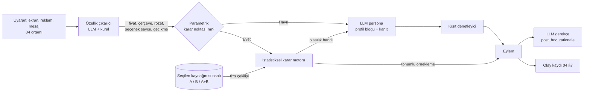

# 07 · İki kaynaklı davranış modeli: genel model (A), gerçek müşteri modeli (B), birleştirme ve ölçek analizi

Durum: Taslak, 2. tur (ADR-001, ADR-002, ADR-003) · Sahibi: İnsan Simülasyonu Araştırmacısı · Girdi: ADR-001/002/003, `data/SEMA.md`,
`02-persona-uretimi.md` §5-§11, `03-degerlendirme.md` §7-§9, `MIMARI.md` §4.

**Terimler.** *Kiracı* (tenant), Persona Katmanı'nın müşterisi olan şirkettir; *gerçek müşteri*, kiracının mağazasına veya sitesine
gelen kişidir. *Davranış profili*, bir birimin (Türkiye, bir şehir, bir konum, bir müşteri kümesi) parametre vektörünün sonsal
dağılımıdır (posterior). **Kaynak A (genel model)**: S0 Dünya → S1 Türkiye → S2 Şehir → S3 Konum/site zinciri. **Kaynak B (gerçek
müşteri modeli)**: kiracının gerçek müşteri gözlemlerinden, A'dan öncül almadan sıfırdan kestirilen model (ADR-003). *İkiz* adı yalnız
Kaynak B **kümesi** için kullanılır, tek kişi için kullanılmaz (ADR-002 md. 6). Rapor dili "bu profil böyle davrandı" der (F-1).

## 1. Amaç ve ilkeler

Çerçeve (proje sahibi): "Psikolog değilsin, sosyologsun"; tüm müşterilerin davranışı ve ölçeği, genelden özele ve özellikle gerçek
müşteri parametreleriyle analiz edilir. Birim bir insanın zihni değil, **davranış profili**dir. Kişi düzeyi kestirim yalnız toplu çıkarım için yapılır; kişi hedeflenmez, kişiye bir şey
gösterilmez (ADR-002 md. 1-2; Kaynak B için aynen geçerli, ADR-003).

1. **İki bağımsız kaynak.** A, dünyadan konuma inen genel modeldir; her seviye üstünü öncül alır. B, kiracının müşterilerinden
   sıfırdan kurulur; A'nın hiçbir değeri B'ye girmez. Bağımsızlık, B'nin müşterinin gerçek farkını yumuşatmadan göstermesi ve iki
   kaynağın birbirini doğrulaması içindir.
2. **Üç sunum kipi:** yalnız A, yalnız B, A+B birleşik + fark (§10). Fark kendi başına bulgudur.
3. **Davranış ölçeğiyle raporlanır:** ne kadar yaygın, ne büyüklükte, nasıl dağılmış, kaç gözleme dayanıyor (`BehaviorScale`, §11).
4. **Sayı istatistikten, anlatı LLM'den gelir** (§5).
5. **Belirsizlik birinci sınıf veridir.** Her koşu sonsaldan yeni çekiliş kullanır; az veriyle kesin görünen profil hatadır.
6. **Yerellik kazanılır, varsayılmaz** (A'da miras / kısmen yerel / yerel; B'de belirlenmiş / zayıf / belirlenmemiş, §3.5).
7. **Literatür yalnız A'ya girer** (ADR-003: Excel yalnız S0/S1 öncüllerini taşır).

## 2. Parametre vektörü θ

Her parametre kısıtsız gizil ölçekte (z) tahmin edilir. A ve B aynı vektörü ve aynı ölçüm modellerini (§4) kullanır; yalnız böylece
fark (§10) anlamlıdır. Öncül sütunu A'nın S0 örneğidir (varsayım).

| Parametre | Tanım | Dönüşüm | S0 öncül örneği (varsayım) |
| --- | --- | --- | --- |
| `lambda_kayip` | Kayıpların eşit kazançlara göre ağırlığı | z = ln λ | lognormal(ln 1,9; 0,5) |
| `beta_simdicilik` | Yarı-hiperbolik iskontoda "şimdi" ağırlığı | logit β | beta(8,2) |
| `delta_iskonto` | Uzun dönem günlük iskonto | ln(−ln δ) | lognormal(ln 0,001; 1) |
| `rho_risk` | Fayda eğriliği (CRRA) | ℝ | normal(0,5; 0,4) |
| `w_sosyal_kanit` | Popülerlik işaretinin ağırlığı | ℝ | normal(0,3; 0,3) |
| `tau_reklam_tolerans` | Reklam maruziyetine dayanma | ln τ | lognormal(0; 0,7) |
| `eta_fiyat` | Log fiyat katsayısı | ln(−η) | lognormal(ln 1,5; 0,6) |
| `w_yorum` | Yorumun karar ağırlığı | ln w | lognormal(ln 0,5; 0,7) |
| `kappa_secim_yuku` | Seçenek başına karar maliyeti | ln κ | lognormal(ln 0,05; 1) |
| `theta_kitlik` | Kıtlık/aciliyet işaretine tepki | ℝ | normal(0,2; 0,3) |
| `phi_guven_isareti` | Güven işaretlerinin ağırlığı | ℝ | normal(0,3; 0,3) |
| `sabir` | Bekleme toleransı (04 `patience_profile`) | ln sn | lognormal(ln 4; 0,6) |
| `dikkat_esigi` | "Görüldü" için gereken maruziyet | ln sn | lognormal(ln 1; 0,5) |
| `varsayilan_yapiskanlik` | Ön seçili seçenekte kalma | logit | beta(6,3) |

Ek olarak: `tau_karar` (karar gürültüsü), `epsilon_dalginlik`, `okuma_hizi`, `hayal_kirikligi_esigi`, `nu_yenilik`, `b_soz_davranis`
(02 §9 say-do farkı) ve `c_kategori` (birim × kategori sapması). Toplam d ≈ 20.

## 3. İki kaynaklı model

### 3.1 Genel bakış

```text
 KAYNAK A · GENEL MODEL (literatür + kamu istatistiği + kiracının TOPLU konum/site verisi)
 S0 Dünya         μ⁰, σ⁰, Γ                ← davranis-etkileri.xlsx                [ortak]
   │ δ¹ ~ N(m_TR, τ¹)
 S1 Türkiye       μ¹ = μ⁰ + δ¹              ← TR çalışmaları, GPS, TÜİK             [ortak]
   │     ▲── kiracılar arası kimliksiz A–B fark istatistiği (F-9; §6.7)
   │ δ²_c ~ N(Γ²·w_c, τ²)   küçük alan kestirimi
 S2 Şehir c       μ²_c = μ¹ + δ²_c           ← bölge istatistiği + kiracının şehir toplamları
   │ δ³_l ~ N(Γ³·tür_l, τ³)
 S3 Konum/site l  μ³_l = μ²_c(l) + δ³_l       ← konum türü, toplu kasa/ziyaret, site toplamları
        │ p_A(θ | seçilen seviye)
        ▼
   BİRLEŞTİRME ve FARK  (§10)   p_A+B ∝ p_B · p_A / p₀ ;  Δ = θ_B − θ_A
        ▲
        │ p_B(θ | y_B)
 KAYNAK B · GERÇEK MÜŞTERİ MODELİ (yalnız müşteri gözlemleri; A'dan öncül YOK)
 B0 zayıf bağımsız öncül p₀    μ^B ~ N(m₀, s₀²)
   │
 B1 kiracının müşteri nüfusu   μ^B, Σ^B
   │ g ~ Kategorik(π)
 B2 müşteri kümesi g           μ^B + ν_g
   │ e_i ~ N(0, I)
 B3 kişi (isteğe bağlı)        z_i = μ^B + ν_g + diag(σ^B)·L·e_i   ← ziyaret/oturum gözlemleri
```

**Eski yapıdan eşleme.** Literatür = A'nın S0'ı; kiracı düzeyi ikiye ayrılır: toplu konum/site verisi A'nın S3'ü, müşteri gözlemleri
B; segment = B kümesi; kişi = B kişi etkisi. ADR-002'nin "S4"ü kalkmıştır.

**Kiracılar arası sınır (F-9, 03 §9.3).** S0, S1 ve S2'nin kamu kısmı ortaktır; S2'nin kiracı kısmı, S3 ve tüm B kiracıya özeldir.
Kiracılardan S1'e tek akış, kimliksizleştirilmiş ve en az beş kiracıdan (her birinde k ≥ 50; varsayım) toplanmış **A–B fark
istatistiği**dir (§6.7). Bu istatistik S1'in yalnız genişliğini ve yanlılık düzeltmesini günceller; B'ye hiçbir şey geri akmaz.

### 3.2 Kaynak A: seviyeler, kaynaklar, miras

| Seviye | Veri kaynakları | Miras ve güncelleme | Veri yokken |
| --- | --- | --- | --- |
| **S0 Dünya** | `data/davranis-etkileri.xlsx` (`seviye = dünya`), çok ülkeli meta-analizler | Kök; tablo sürümüyle | Geniş zayıf öncül, "tanımsız" bayrağı |
| **S1 Türkiye** | TR örneklemli satırlar; Global Preferences Survey ülke puanları (Falk ve ark. 2018, doi:10.1093/qje/qjy013; TR dahil 76 ülke); TÜİK Hanehalkı Bilişim Teknolojileri Kullanım Araştırması ve gelir/tüketim istatistikleri (https://data.tuik.gov.tr); kiracılar arası fark istatistiği | μ¹ = μ⁰ + δ¹; merkez TR verisinden, yayılım aktarım şişirmesinden. Yıllık | δ¹ = 0: "S0'dan miras" |
| **S2 Şehir/bölge** | TÜİK İBBS-1/2 istatistikleri (gelir, yaş yapısı, e-ticaret kullanımı) ortak değişken olarak; kiracının o şehirdeki toplu davranış göstergeleri | μ² = μ¹ + δ²; küçük alan regresyonu (Fay & Herriot 1979, doi:10.1080/01621459.1979.10482505). Kamu kısmı yıllık, kiracı kısmı aylık | Bölge değişkenlerinden öngörü (Felsefi soru 1) veya S1 |
| **S3 Konum/site** | Fiziksel: konum türü (AVM, cadde, semt), toplu ziyaret, toplu kasa, mağaza düzeyi kampanya tepkisi. Web: site düzeyi toplu metrikler (§3.6) | μ³ = μ² + δ³; konum türü etkisi Γ³. Aylık + kayma tespiti | Konum türü + S2; yeni mağaza "S2'den miras" |

A'nın S3'ü **toplu** veriyle kurulur (mağaza/gün, sayfa/gün oranları); müşteri düzeyi gözlem A'ya girmez, o B'nin malzemesidir.
Bu ayrım A+B birleştirmesinde aynı verinin iki kez sayılmaması için zorunludur (§10.1).

### 3.3 S0: literatür tablosundan öncüle

Her parametre k için `persona_parametresi = k` satırları toplanır; satırın `seviye` etiketi hangi A seviyesine gireceğini belirler.

1. **Köprü fonksiyonu.** Tablodaki etki çoğu zaman nüfus ortalaması etkisidir ("kıtlık rozeti dönüşümü 8 yüzde puan artırır");
   belgelenmiş dönüşüm ölçüyü (lambda, Cohen d, OR, esneklik) z ölçeğine çevirir. Dönüşümsüz satır yalnız not kalır.
2. **Rastgele etkiler sentezi.** `orneklem_n` ve `kanit_gucu` ağırlıklı meta-analiz μ⁰_k ve heterojenliği verir; `bireysel_fark_olcegi`
   dolu satırlar birimler arası σ⁰_k öncülünü besler (ölçek analizinin yayılım kısmı).
3. **Moderatör regresyonu:** μ_k(x) = α_k + Γ_k·x (yaş bandı, gelir bandı, ülke, cihaz). Korunan özellikler x'e girmez (F-3).
4. **Aktarım şişirmesi:** laboratuvar ve TR dışı öncüllerin SD'si genişletilir (varsayım: 1,5× ve 1,3×).
5. **Sağlam karışım öncülü** (Schmidli ve ark. 2014, doi:10.1111/biom.12242): her A seviyesinde öncül = 0,8 · üst seviye sonsalı +
   0,2 · zayıf bileşen; alt seviyenin toplu verisi üstle çatışırsa zayıf bileşen ağırlık kazanır.

Örnekler: λ için meta-analitik merkez 2 civarı (Brown, Imai, Vieider & Camerer 2024, doi:10.1257/jel.20221698; tanım Kahneman &
Tversky 1979, doi:10.2307/1914185); yarı-hiperbolik iskonto Laibson 1997 (doi:10.1162/003355397555253); seçim yükü moderatöre bağlı
(Chernev, Böckenholt & Goodman 2015, doi:10.1016/j.jcps.2014.08.002). GPS'in sabır, risk ve güven boyutları S1 kaymasının yönünü
verir (köprüyle). `prior_version` = tablo hash'i + köprü sürümü + S1/S2 kamu verisi sürümü.

### 3.4 Kısmi havuzlama (A içinde ve B içinde ayrı ayrı)

Bir birimin kestirimi kendi verisi ile bir üstü arasında bilgi miktarına göre ağırlıklanır (normal yaklaşım):

```text
E[μ_u | y] ≈ w_u · μ̂_u + (1 − w_u) · μ_üst(u),     w_u = n_u·σ² / (n_u·σ² + s²_y)
```

A'da "üst" bir önceki seviyedir (konum → şehir → Türkiye). B'de "üst" yalnız B'nin kendi iç düzeyleridir (kişi → küme → kiracı
müşteri nüfusu); B'nin tepesinde A değil zayıf bağımsız öncül vardır. Yöntem pazarlamada yerleşiktir (Allenby & Rossi 1998,
doi:10.1016/S0304-4076(98)00055-4). Parametre korelasyonu Ω ~ LKJ(4) (Lewandowski, Kurowicka & Joe 2009,
doi:10.1016/j.jmva.2009.04.008) her kaynakta ayrı öğrenilir; merkezsiz parametrelendirme (Betancourt & Girolami, arXiv:1312.0906)
varsayılandır.

### 3.5 Etiketler ve aşırı kesinliğe karşı koruma

Daralma oranı c_k = 1 − Var_sonsal / Var_öncül. A'da öncül bir üst seviyenindir; B'de zayıf bağımsız öncüldür, bu yüzden etiketlerin
anlamı farklıdır:

| c_k (varsayım) | Kaynak A etiketi | Kaynak B etiketi |
| --- | --- | --- |
| < 0,3 | **miras** (`inherited:S{L−1}`): bu seviyenin verisi değeri değiştirmedi | **belirlenmemiş** (`B:unidentified`): müşteri verisi bu parametreyi söylemiyor |
| 0,3–0,6 | **kısmen yerel** (`partial:S{L}`) | **zayıf belirlenmiş** (`B:weak`) |
| ≥ 0,6 | **yerel** (`local:S{L}`) | **belirlenmiş** (`B:identified`) |

B "belirlenmemiş" bir parametreyi A'dan doldurmaz; yalnız-B kipinde o parametre geniş aralıkla ve "veriniz bunu söylemiyor" notuyla
görünür. Doldurma yalnız A+B kipinde, açık birleştirmeyle olur (§10). Ortak koruma kuralları:

1. **Olabilirlik tavlaması:** oturum içi olaylar bağımsız değildir; oturum etkisi ξ_ij ve çarpan α ∈ (0,1] (C3 ile kalibre).
2. **Varyans alt sınırı:** σ sıfıra çökerse birimler aynılaşır (kalıp yargı çöküşü); öncülün alt %5'inin altında uyarı.
3. **Öncül-veri çatışma testi** (A içinde): birimin toplu verisi üst seviyenin öncül öngörüsünde kuyruktaysa "atipik" bayrağı.
4. **Sonsaldan çekiliş, ortalama değil** (03 P3).
5. **Küçük örneklem eşiği:** A'da S2–S3 birimi n < 50 (varsayım) bağımsız gözlemde "yerel" alamaz; B'de toplam etkin müşteri < 50 ise
   B hiçbir parametrede "belirlenmiş" alamaz.

### 3.6 S3 ve B'de gözlem türleri: fiziksel konum ve web sitesi

| Kanal · gözlem | A (S3, toplu) | B (müşteri düzeyi) |
| --- | --- | --- |
| Mağaza · ziyaret sayısı, saat dağılımı (kapı sayacı) | Trafik, ölçeğin paydası | — |
| Mağaza · kasa (POS) fişi: sepet, tutar, taksit | Mağaza/gün oranları → `eta_fiyat`, `beta_simdicilik` | Yalnız sadakat kartına bağlı fişler |
| Mağaza · kampanya tepkisi (kupon, raf etiketi, afiş) | Mağaza düzeyi tepki → `theta_kitlik`, `lambda_kayip` | Kartlı kupon kullanımı |
| Web · olay günlüğü (04 §7), görünürlük | Sayfa düzeyi oranlar | Oturum dizisi → `dikkat_esigi`, `w_yorum`, `kappa_secim_yuku` |
| Web · sepet, ödeme, terk; yükleme ve hata | Site terk ve sabır eğrisi | `lambda_kayip`, `eta_fiyat`, `sabir`, `hayal_kirikligi_esigi` |
| Web · reklam atlama; A/B testleri | Toplu atlama eğrisi; kol etkisi | `tau_reklam_tolerans`; kişi içi nedensel tanımlama |

Fiziksel mağazada B ancak rızalı sadakat kartıyla kurulur ve kart sahiplerini temsil eder; web'de B verisi boldur. Konum türü
(AVM, cadde, semt) A'da Γ³ sabit etkisi, B'de yalnız ortak değişkendir.

### 3.7 Kaynak B: sıfırdan gerçek müşteri modeli

**Bağımsız öncül.** B'nin tepesinde literatür yoktur. Öncül zayıf bilgilendiricidir (weakly informative): z ölçeğinde μ^B_k ~ N(m₀, s₀²),
m₀ ölçüm modelinin nötr noktası (ör. ağırlık 0, λ = 1, β = 1), s₀ yalnız fiziksel olarak makul aralığı kapsayacak genişlikte (varsayım:
λ için %95 aralık 0,3–8). Amaç bilgi vermek değil imkânsızı dışlamaktır (§6.2 ile denetlenir); s₀ ikiye katlanınca sonsalın oynaması raporlanır.

**Küme düzeyi (varsayılan).** Müşteriler sonlu karışımla modellenir: z_i = μ^B + ν_g(i) + kişi etkisi, g(i) ~ Kategorik(π); hiyerarşik
Bayes'in gizil sınıf biçimi (Allenby, Arora & Ginter 1998, doi:10.2307/3152035; varsayım: DOI doğrulanmalı). **k-means kullanılmaz:**
kişinin belirsizliğini atar, az verili müşteriyi kesin kümeye zorlar; kümeleri ham davranış uzayında değil parametre uzayında istiyoruz.
Üyelik olasılığı p(g | y_i) sonsaldan gelir; küme sayısı PSIS-LOO (Vehtari, Gelman & Gabry, arXiv:1507.04544) ve **en küçük küme ≥ 50
etkin müşteri** kuralıyla seçilir; etiket değişimi kümeleri `eta_fiyat` sırasıyla kanonikleştirerek çözülür. Her küme bir
`customer_profile` üretir; adı şablonla türetilir (Felsefi soru 2).

**Kişi düzeyi (isteğe bağlı).** Kuyrukları (03 P4) korumak ve art tabakalamayla (post-stratification) nüfus sonucu üretmek için e_i
kestirilir. Kişi profili simülasyonda koşabilir ama çıktısı yalnız ≥ 50 kişilik toplulaştırmayla rapora girer; kişi kimliğiyle dışa
aktarım, kişiye özel mesaj/fiyat, kişi başı öneri uç noktası ve bireysel arayüz yoktur.

**Bilgi aşamaları.** Ortalama daralma c̄ < 0,15 soğuk (yalnız-B kipi "henüz söylenecek bir şey yok" der), 0,15–0,5 ılık (Laplace/amorti),
≥ 0,5 ve §6 testleri geçmiş sıcak (tam NUTS). "İkiz" adı yalnız ılık ve sıcak B kümeleri içindir.

## 4. Veri → olabilirlik

### 4.1 Gözlem–parametre haritası

Olaylar 04 §7 şemasından gelir. Aynı ölçüm modeli A'da toplu düzeyde (oran olabilirliği, binom/negatif binom), B'de müşteri düzeyinde
kullanılır.

| Gözlem | Ölçüm modeli (olabilirlik) | Tanımladığı parametreler | Not |
| --- | --- | --- | --- |
| Ürün seçimi (sepete ekleme, satın alma, fiş satırı) | Karışık lojit: U = −η·ln p + w_yorum·puan + w_sosyal_kanit·pop + θ_kitlik·kıtlık + φ·güven + ξ; P ∝ exp(U/τ_karar) | `eta_fiyat`, `w_*`, `theta_kitlik`, `phi_guven_isareti` | Uyaran özellikleri sayfadan/raftan |
| Sepet terki (kargo/ek ücret görününce) | Lojistik: kayıp terimi λ·Δ | `lambda_kayip`, `eta_fiyat` | λ ancak aynı tutar farklı çerçevede görülürse tanımlı |
| İndirim/kampanya tepkisi | Çerçeve × tutar etkileşimli lojistik | `lambda_kayip`, `eta_fiyat`, `theta_kitlik` | Rastgeleyse nedensel, değilse `observational` |
| Taksit/peşin, hızlı kargo, "şimdi al sonra öde" | Yarı-hiperbolik faydayla ikili seçim | `beta_simdicilik`, `delta_iskonto` | β için "şimdi" seçeneği gerekir |
| Garanti/sigorta, bilinmeyen marka | CRRA beklenen fayda | `rho_risk`, `nu_yenilik` | |
| Reklam atlama zamanı | Sağkalım: h(t) = h₀(t)·exp(−ln τ_reklam + uyaran) | `tau_reklam_tolerans`, `sabir` | Sağdan sansür |
| Yorum okuma | Açma lojistik; süre lognormal, kelime / `okuma_hizi` | `w_yorum`, `okuma_hizi` | Okuma hızı düzeltmesi zorunlu |
| Uzun listede karar süresi ve terk | Shifted lognormal + lojistik | `kappa_secim_yuku`, `sabir` | |
| Ön seçimden ayrılma | Lojistik, olası tercihe uzaklık kontrol | `varsayilan_yapiskanlik` | |
| Yavaş yükleme, form hatası sonrası terk | Rekabet eden riskler | `sabir`, `hayal_kirikligi_esigi` | 04 §6.2 |
| Görünür alan maruziyeti | Eşik altında "görülmedi" gizil değişkeni | `dikkat_esigi` | Görünürlük olayı yoksa tanımsız |
| Anket/görüşme (`stated`) | y_söz = f(θ) + b_soz_davranis + gürültü | Tümü zayıfça; `b_soz_davranis` | Söz tek başına daraltamaz (02 §6.3) |
| Mağaza işlem verisi: fiş tutarı, fiş sayısı, mağaza toplamı (ADR-004) | Negatif binom ziyaret/fiş sayısı; lognormal tutar; kampanya dönemi × tutar | A: S3 Γ³, toplu `eta_fiyat`; B: müşteri kimliği varsa küme düzeyinde `eta_fiyat`, `beta_simdicilik` (taksit varsa), `nu_yenilik` (kategori çeşitliliği) | Ayrıntı §4.4 |

### 4.2 Tanımlanabilirlik sorunları ve çözümleri

| Sorun | Neden | Çözüm |
| --- | --- | --- |
| Ölçek belirsizliği | Lojitte U ve τ_karar birlikte ölçeklenir | Ödeme istekliliği uzayı (WTP space; Train & Weeks 2005, doi:10.1007/1-4020-3684-1_1); `eta_fiyat` ölçeği taşır |
| `lambda_kayip` ↔ `rho_risk` | Yalnız kayıp veya kazanç gözlenirse karışır | ρ nüfus düzeyinde ortak, kişi/kümede yalnız λ; karma uyaran yoksa λ miras (A) / belirlenmemiş (B) |
| `beta_simdicilik` ↔ `delta_iskonto` | "Şimdi"siz seçimler yalnız toplam iskontoyu tanımlar | δ nüfus düzeyinde, β küme/kişide (Andreoni & Sprenger 2012, doi:10.1257/aer.102.7.3333) |
| `w_sosyal_kanit` ↔ `w_yorum` ↔ `phi_guven_isareti` | Popüler üründe üç işaret birlikte | Rastgele rozet A/B'si; ayrışmazsa bileşik "kanıt duyarlılığı" |
| Seçim yanlılığı | Öneri sistemi indirimi fiyata duyarlıya gösterir | Nedensel parametre yalnız rastgele maruziyetten; eğilim skoru ve `observational` |
| `sabir` ↔ düşük niyet | Almak istemediği için terk | Oturum niyeti etkisi ξ_ij; giriş kanalı niyet göstergesi |
| Varsayılan ↔ gerçek tercih | Varsayılan zaten tercih edilense yapışkanlık sanılır | Yalnız varsayılanın olası tercihten farklı olduğu durumlar |
| Hesap ≠ kişi | Paylaşılan hesap/kart iki kişinin karışımı | İki bileşenli karışım testi; bayrak; sıcak aşama yok |
| Eksik ölçüm | İzleme rızasız oturum, reklam engelleyici | MNAR; görünürlük olayı yoksa `dikkat_esigi`ne girmez |
| Konum ↔ kitle bileşimi | Konum farkı kitle farkı olabilir | A'nın S3 etkisi ile B'nin küme payları karşılaştırılır; ayrışmazsa "bileşim etkisi olabilir" |
| Ekolojik yanılgı | A'nın toplu ilişkisi bireye aktarılamaz | A–B farkı nüfus düzeyinde yorumlanır, kişi iddiası yapılmaz |

Genel kural: **bir parametre ancak onu tanımlayan uyaran gözlenirse serbest bırakılır**; yoksa A'da miras kalır, B'de belirlenmemiş
olarak görünür.

### 4.3 Ölçüm modelinin genel biçimi

```text
y_ije ~ Olay_e( g_e( z_i , s_ije , ξ_ij , d_ij ) ) ^ α        (α: §3.5 tavlama)
  z_i: B kişi/küme parametresi, ya da A'da μ³_l     s_ije: uyaran özellikleri
  ξ_ij: oturum/ziyaret niyeti ~ N(0, σ_ξ)           d_ij: cihaz, kanal veya konum etkisi
```

### 4.4 Mağaza işlem verisi: ne tanımlar, ne tanımlamaz (ADR-004)

Fiziksel mağaza verisi doğrudan şirketten gelir: müşteri bazında fiş (sepet) tutarları ve mağaza bazında toplam tutarlar. Bu veri
tarayıcı olay günlüğünden çok daha seyrektir; aşağıdaki tablo hangi ayrıntı düzeyinde hangi parametrenin serbest bırakılabileceğini söyler.
Tabloda olmayan parametreler (`dikkat_esigi`, `tau_reklam_tolerans`, `w_yorum`, `okuma_hizi`, `kappa_secim_yuku`, `varsayilan_yapiskanlik`)
mağaza verisinden **tanımlanamaz**; A'da miras kalır, B'de "belirlenmemiş" görünür.

| Veri ayrıntısı | Gözlem | Tanımladığı parametre | Düzey | Not |
| --- | --- | --- | --- | --- |
| Yalnız mağaza toplamı (gün/hafta) | Toplam tutar, fiş sayısı, kampanya dönemi | S3 Γ³ (konum etkisi); toplu `eta_fiyat` (kampanya dönemi tutar/fiş değişimi) | A | Kitle bileşimi ile konum etkisi ayrışmaz (§4.2); "bileşim olabilir" etiketi |
| Müşteri kimlikli fiş tutarı | Kişi başı tutar dağılımı, ziyaret aralığı | B kümeleri: harcama düzeyi, ziyaret sıklığı; `sabir` yalnız ziyaret aralığı düzensizliği üzerinden zayıfça | B | Harcama düzeyi θ'da değil, küme betimleyicisidir; `BehaviorScale` ile raporlanır |
| + kampanya/indirim dönemi işareti | Kampanya içi vs dışı tutar ve sıklık farkı | `eta_fiyat` (küme), `theta_kitlik` (süreli kampanyaysa) | A, B | Rastgele atanmamışsa `observational` |
| + fiş satırı (ürün, adet, indirimli mi) | Ürün seçimi; indirimli/indirimsiz ikame | `eta_fiyat` kişi/küme; `nu_yenilik` (yeni kategori oranı); `lambda_kayip` yalnız fiyat artışı sonrası ikame gözlenirse | B | Karışık lojit §4.1 satır 1 ile aynı model |
| + ödeme biçimi (taksit sayısı, peşin) | Taksit tercihi × tutar | `beta_simdicilik`, `delta_iskonto` (zayıf; faiz/vade farkı bilinmeli) | B | Türkiye'de taksit yaygın (S1 TR-033); "şimdi" seçeneği yoksa β tanımsız (§4.2) |
| + iade/değişim kaydı | İade oranı, iade süresi | `lambda_kayip` (zayıf), `rho_risk` (bilinmeyen marka iadesi) | B | Pişmanlık ölçütü olarak yorumlanır, kanıt gücü düşük |

Kurallar: (1) mağaza verisi A'nın S3'üne **toplu**, B'ye **müşteri kimlikli** girer; aynı fiş iki yere birden tam ağırlıkla girmez
(§10.1 çift sayım kontrolü). (2) Müşteri kimliği yoksa B beslenmez; rapor "mağaza için yalnız Kaynak A" der. (3) Kişi başı tutar
"zenginlik" olarak adlandırılmaz; küme adı §Felsefi soru 2 kurallarına tabidir. (4) Online ve mağaza verisi aynı müşteriye bağlanabiliyorsa
`c_kategori` benzeri bir **kanal sapması** (`c_kanal`) parametresi B'de serbest bırakılır; bağlanamıyorsa iki ayrı B kümesi seti tutulur.

## 5. θ → LLM persona: hibrit karar mimarisi

### 5.1 İş bölümü



Parametrik noktada (satın al/terk, reklamı atla, kampanyayı kabul et) olasılık motordan gelir, tohumlu örneklenir; LLM eylem seçmez.
Parametrik olmayan noktada (hangi menüye bakılır) LLM motorun sınırları içinde karar verir. Gerekçe sonradandır ve `post_hoc_rationale` etiketi taşır (02 §9).

### 5.2 "LLM sayıyı ezmesin" kısıtları

1. **Mimari ayrım:** parametrik noktada LLM yalnız özellik çıkarır ve gerekçe yazar (04 §6.2'nin genellemesi).
2. **Olasılık bandı:** LLM yolları oturum sonu terk olasılığının %80 sonsal aralığı dışına taşarsa kırpılır; olaya `llm_clamped` yazılır.
3. **Sözel çeviri yalnız anlatı içindir**; dil modelleri sayısal parametreyi tutarsız uygular (varsayım; 03'te ölçülecek).
4. **Ezme oranı:** yalnız-LLM ablasyonunda motorun %5 altında olasılık verdiği eylemlerin seçilme oranı `override_rate` olarak 03'e gider.
5. **Özellik denetimi:** fiyat ve rozet DOM'dan doğrulanır; uyuşmazlık olayı açılır.

### 5.3 Persona şemasına `profile` bloğu

02 §5'e eklenir; `general_profile` (A), `customer_profile` (B), `fused_profile` (A+B) sınıflarında zorunlu. Örnek birleşik profil:

```json
{
  "persona_id": "per_fu_3a71",
  "class": "fused_profile",
  "weight": 0.18,
  "profile": {
    "source": "A+B",
    "A": {"level": "S3", "chain": ["S0:lit_2026-11-01#a91f", "S1:tr_2026-10", "S2:TR10", "S3:ist-kadikoy-cadde"]},
    "B": {"unit": {"type": "cluster", "id": "acme/K3", "n_eff": 1840}, "fit_id": "bfit_acme_2026-11-03"},
    "fusion": {"method": "bayes_prior_swap", "a_variance": "predictive_S3", "double_count_check": "disjoint"},
    "parameters": {
      "eta_fiyat": {"A": [-1.5, -1.9, -1.1], "B": [-2.0, -2.3, -1.7], "fused": [-1.9, -2.2, -1.7], "B_label": "B:identified", "diff": "significant"}
    },
    "verbal_summary": {"value": "Türkiye geneline göre daha fiyata duyarlı", "generated_from": "parameters"}
  }
}
```

Üçlüler [ortanca, %80 alt, %80 üst]. `weight` kümenin B nüfusundaki payıdır. Kişi düzeyi B profili `unit.type: "person"` kullanır;
`identity` ve `weight` dışa açılmaz, yalnız toplu koşularda örneklenir. `verbal_summary` şablonla üretilir.

## 6. Doğrulama

1. **SBC** (Talts ve ark., arXiv:1804.06788): A'nın her seviyesi, B ve birleştirme için ayrı kapı.
2. **Öncül öngörü kontrolü:** A seviyeleri ve B'nin zayıf öncülü akla yatkın davranış üretmeli (ör. sepet terk %20–%95; varsayım).
3. **Sonsal öngörü kontrolü** (Gabry ve ark., arXiv:1709.01449): terk oranı, atlama zamanı, varyans (03 P3), kuyruklar (P4), alt grup
   farkları (P5).
4. **Tutma isabeti.** Zaman temelli bölme (03 §8.2); log öngörü yoğunluğu, olay başına Brier, %80 aralık kapsaması. Temel çizgiler:
   A'da her seviye bir üstünü geçmeli (geçemeyen "yerel" iddiasını kaybeder); B havuzsuz frekans tahminini ve A'nın S3 öngörüsünü
   geçmeli; A+B hem A'yı hem B'yi geçmeli, geçemiyorsa birleştirme ağırlığı yanlıştır.
5. **Aktarım testi:** kiracının yeni A/B'sinde profiller koşulur, gerçek kollarla karşılaştırılır (03 §8.4(c) mühürlü kör tahmin).
6. **B'nin aşırı kesinlik testi (A'ya karşı).** B'nin %80 aralığı A'nın öngörü aralığını dışlıyor ve n_eff küçükse (varsayım: < 500), ya
   gerçek fark vardır ya B aşırı kesindir. B'nin tutma kapsaması hedefin altındaysa (< %70) B aşırı kesindir: α düşürülür, "fark"
   bulgusu askıya alınır; kapsama hedefteyse fark kabul edilir.
7. **A'nın Türkiye öncüllerinin kalibrasyonu (B'ye karşı).** Kiracılar boyunca standartlaştırılmış farklar z_t = Δ_t / sd(Δ_t) toplanır.
   A iyi kalibre ise z_t ortalaması ≈ 0 ve varyansı ≈ 1'dir; ortalama sistematik olarak sapıyorsa S1 yanlıdır, varyans > 1 ise S1–S3
   aralıkları dardır. Bu istatistik kimliksiz ve en az beş kiracıdan S1'e akar (§3.1, F-9); S1'in yanlılık düzeltmesi ve aktarım çarpanı
   buna göre güncellenir. Tek kiracı içinde aynı test S2/S3 için yapılır.
8. **Kalibrasyon (Arayüz: 03):** olasılıklar C1–C3'e girer; düzeltici (03 §9.3) rapor olasılığına uygulanır, sonsala değil.

**Profil kimlik kartı** (02 §11.2'ye ek alanlar):

| Alan | Gösterim |
| --- | --- |
| Ne olduğu ve kaynak | "[A, seviye] / [B, veri penceresi, n_eff] / [A+B, yöntem] kestirilmiş profil. Belirli bir kişi değildir." |
| Parametreler | A, B, birleşik aralıklar yan yana; etiketler (§3.5) |
| Fark | Parametre başına fark sınıfı (§10.2) |
| Ölçek | `BehaviorScale` özeti (§11) |
| Neyi bilmiyoruz | B'de belirlenmemiş, A'da tanımsız parametreler; ayrışmayan çiftler |
| İsabet ve bayraklar | Tutma Brier'i, kapsama; B aşırı kesinlik, küçük örneklem, paylaşılan hesap |

## 7. Uygulama notu

| Seçenek | Güçlü | Zayıf | Rol |
| --- | --- | --- | --- |
| Stan (Carpenter ve ark. 2017, doi:10.18637/jss.v076.i01) | Olgun NUTS, zengin tanı | Çok sayıda bağımsız blok için GPU yok | Referans, SBC |
| PyMC (Abril-Pla ve ark. 2023, doi:10.7717/peerj-cs.1516) | Analist dostu, ArviZ | Üretimde ek katman | Keşif |
| NumPyro (Phan, Pradhan & Jankowiak, arXiv:1912.11554) | JAX `vmap` ile binlerce blok paralel; NUTS ve SVI aynı kodda | JAX bağımlılığı | **Üretim** |

Üretimde NumPyro, referans Stan; her sürümde iki uygulamanın sonsal özetleri karşılaştırılır. Kademeli çıkarım:

1. **A, S0–S1 (ortak):** meta-analitik sentez ve S1 kayması; bilim ekibi sürümler.
2. **A, S2–S3 (kiracı başına):** toplu veriyle şehir/konum etkileri; ucuz, aylık.
3. **B hiper uydurma (kiracı başına):** μ^B, Σ^B, Ω^B ve küme yapısı; tabakalı alt örneklemde (varsayım: birkaç bin–on binlerce müşteri)
   tam NUTS.
4. **B kişi blokları:** hiper sonsaldan birkaç çekilişe koşullu, paralel; ılık aşamada amorti çıkarım (BayesFlow tipi; Radev ve ark.,
   arXiv:2003.06281) veya Laplace.
5. **Birleştirme:** B çekilişlerinin yeniden ağırlıklanması (§10.1); ek örnekleme gerekmez, etkin örneklem düşükse yeniden NUTS.

Maliyet B'de müşteri × olay sayısıyla doğrusaldır; baskın maliyet yine LLM tokenıdır. Yeniden tahmin: B ılık günlük, kümeler aylık;
A S2–S3 aylık; S1 yıllık; eski oturumlar yarı ömürlü ağırlıkla tavlanır (varsayım: 180 gün).

## 8. Sürümleme

02 §11.1 biçimi: **MAJOR** = model yapısı, S0 tablosu, S1/S2 kamu verisi veya B öncülü; **MINOR** = A S2–S3 güncellemesi, B hiper
uydurma veya sonsal güncelleme; **PATCH** = sözel özet; **+e** = veri penceresi sonu. Her sonuç `parameter_source`, A zinciri, B
`fit_id`, birleştirme yöntemi ve çekiliş tohumlarını taşır.

## 9. Kaynak ve seviye seçimi, kullanım serbestliği

### 9.1 Çalışma tasarımında `parameter_source` ve `level`

ADR-002 md. 4 ve ADR-003 gereği tasarımcı kaynağı ve A için seviyeyi seçer (Arayüz: 05); seçim raporun başında görünür.

```json
{"parameter_source": "A+B",
 "A": {"level": "S3", "anchor": {"S2": "TR10", "S3": "acme/ist-kadikoy-cadde"}},
 "B": {"unit": "cluster", "window": {"from": "2026-05-01", "to": "2026-11-01"}},
 "fusion": {"method": "bayes_prior_swap"},
 "overrides": {"rho_risk": "A"}}
```

| Seçim | Anlamı | Ne zaman |
| --- | --- | --- |
| `A`, `level: S0` | Yalnız literatür | "Evrensel davranış ne derdi?" |
| `A`, `level: S1` | Türkiye geneli | Yeni pazar, ulusal kampanya, müşteri verisi yok |
| `A`, `level: S2` | Şehir/bölge | Bölgesel lansman |
| `A`, `level: S3` | Konum veya site | Belirli mağaza/sitede karar, müşteri verisi yok |
| `B` | Yalnız gerçek müşteri | "Bizim müşterimiz nasıl davranıyor?"; dış varsayım yok |
| `A+B` | Birleşik + fark | "Müşterimiz Türkiye genelinden nerede ayrışıyor?"; en bilgilendirici kip |

**Karışık kullanım.** `overrides` parametre bazında kaynak seçtirir (ör. `rho_risk` B'de belirlenmemişse yalnız A'dan). Karışık vektörde
motor, sabitlenen parametrelere koşullu olarak kalanları ilgili sonsaldan çeker; farklı kaynaktan istenen iki parametre arasında
|r| > 0,5 (varsayım) ise tasarım uyarı verir. **A'nın seviyesi her zaman seçilebilir:** A+B'de A'yı S1'de tutmak, "Türkiye genelinden
farkımız" sorusunu; S3'te tutmak, "bu konumun tipik kitlesinden farkımız" sorusunu yanıtlar.

Yalnız B her zaman daha iyi değildir: B yalnız mevcut müşteriyi temsil eder.

### 9.2 Rapor: "parametre kaynağı" sütunu ve B vurgusu

| Parametre | Kaynak | A (seviye, etiket) | B (etiket, n_eff) | Kullanılan [%80] | Fark sınıfı |
| --- | --- | --- | --- | --- | --- |
| `eta_fiyat` | A+B | S3, kısmen yerel | **belirlenmiş, 1840** | −1,9 [−2,2; −1,7] | anlamlı fark |
| `lambda_kayip` | A+B | S1, miras | zayıf, 1840 | 2,0 [1,6; 2,5] | belirsiz |
| `rho_risk` | A (override) | S1, miras | belirlenmemiş | 0,5 [0,2; 0,8] | — |

Özet satırı: "20 parametreden 6'sı sizin müşteri verinizle belirlendi (B), 9'u Türkiye öncülünden (A, S1), 5'i dünya literatüründen
(A, S0) geldi." **B vurgusu:** B'den gelen parametre ve sonuçlar ayrı blokta, "gerçek müşteri verisi" işaretiyle; veri penceresi ve n_eff
yazılır. Görsel tasarım 05'indir; 07'nin şartı B'nin hiçbir tabloda A ile aynı görünümde karışmamasıdır.

## 10. Birleştirme ve fark raporu

### 10.1 Birleştirme yöntemi

İki yöntem tanımlanır; hangisinin kullanıldığı raporda yazar (ADR-003). Varsayılan Bayesçidir.

**(a) Bayesçi birleştirme: A öncül, B veri (`bayes_prior_swap`).** B zayıf öncül p₀ ile uydurulduğundan, A'yı öncül yapmak B'yi yeniden
uydurmayı gerektirmez; öncül değişimi önem ağırlığıyla yapılır:

```text
p_A+B(θ | y_B) ∝ p_B(θ | y_B) · p_A(θ) / p₀(θ)        ağırlık w_s = p_A(θ_s) / p₀(θ_s),  θ_s ~ p_B
```

Ağırlıklar PSIS ile kararlı kılınır (Vehtari ve ark., arXiv:1507.02646); k̂ > 0,7 ise B, A öncülüyle yeniden NUTS ile uydurulur. Birleştirmede A, **sağlam karışım** biçiminde girer (0,8 · p_A + 0,2 · geniş bileşen): B, A ile çatışıyorsa
geniş bileşen ağırlık kazanır ve birleşik kestirim B'ye kayar. Böylece müşterinin gerçek farkı A tarafından "yumuşatılıp" silinmez
(ADR-003 gerekçesi).

**(b) Ters varyans ağırlıklı ortalama (`inverse_variance`).** Normal yaklaşımda parametre başına:
θ_A+B = (θ_A/v_A + θ_B/v_B) / (1/v_A + 1/v_B), v_A+B = 1 / (1/v_A + 1/v_B). Hızlı ve açıklanabilir; ama parametre korelasyonunu ve
çatışmayı yok sayar. Yalnız iki kaynak tutarlıyken (§10.2 sınıfı "pratik eşdeğer" veya "belirsiz") ve hızlı önizlemede kullanılır.

İki kural her iki yöntemde geçerlidir:

- **v_A öngörü varyansıdır, Türkiye ortalamasının belirsizliği değil.** A'nın söylediği "bu seviyedeki tipik bir müşteri nüfusu"dur;
  v_A seviyeler arası heterojenliği (τ², τ³) içerir. Aksi halde A, B'ye karşı sahte biçimde kesin görünür.
- **Çift sayım yok.** A'nın S3'ü ile B aynı ham veriden besleniyorsa (aynı mağazanın aynı dönemdeki fişleri) birleştirmede A, S3 yerine
  S2'de kesilir ya da S3, B ile kesişmeyen veriden (farklı dönem, kartsız müşteri toplamları) yeniden kestirilir. `double_count_check`
  alanı hangisinin yapıldığını kaydeder.

### 10.2 Fark raporu

Fark Δ_k = θ_B,k − θ_A,k. A ve B bağımsız olduğundan Δ'nın dağılımı bağımsız çekiliş çiftlerinden doğrudan elde edilir. Parametre
başına raporlanan alanlar:

| Alan | Tanım |
| --- | --- |
| Yön | P(Δ > 0); ≥ 0,9 "B daha yüksek", ≤ 0,1 "B daha düşük", arası "yön belirsiz" (eşikler varsayım) |
| Büyüklük | Δ z ölçeğinde (SD birimi), doğal ölçekte (ör. λ: 1,9 → 2,6) ve davranış ölçeğinde (ör. kargo ücretinde terk +6 yp) |
| Güven aralığı | Δ için %80 ve %95 aralık |
| Anlamlılık | Pratik eşdeğerlik bölgesi (ROPE; Kruschke 2018, doi:10.1177/2515245918771304), varsayım ±0,1 SD: %95 aralık ROPE dışı → **anlamlı fark**; tamamen içi → **pratik eşdeğer**; diğer → **belirsiz** |
| n | B için müşteri, olay, n_eff; A için seviye ve kaynak sayısı |
| Bayraklar | §6.6 B aşırı kesinlik testi sonucu; B etiketi "belirlenmemiş" ise fark raporlanmaz |

**Çoklu karşılaştırma.** Yaklaşık 20 parametrede rastlantısal "anlamlı fark" çıkar. Farklar ayrıca ortak bir hiyerarşik modelde birlikte
büzülür (Δ_k ~ N(0, s_Δ)); rapordaki sınıf büzülmüş Δ'dan hesaplanır (Gelman, Hill & Yajima 2012, doi:10.1080/19345747.2011.618213).

**Fark kendi başına bulgudur.** Şablon: "Türkiye genelinde (A, S1) kargo ücreti görülünce sepet terki %22 [%17; %28]; sizin
müşterilerinizde (B, n = 3.120) %31 [%27; %35]. Fark +9 yp [+3; +15], anlamlı." Olası açıklama yanında verilir: (a) *gerçek fark*;
(b) *köprü/ölçüm farkı* (aynı sapma birçok kiracıda görülürse güçlenir, §6.7); (c) *seçim yanlılığı* (§4.2). A içindeki seviyeler arası tutarsızlık (S3 toplu verisi S1'den
|z| ≥ 3 sapıyor) aynı tabloda "A iç çatışması" satırı olarak gösterilir.

Anlamlı fark taşıyan parametreye dayanan bir karar önerisi, raporda A ve B ile ayrı ayrı da koşulur ve üç sonuç birlikte verilir.

## 11. Ölçek analizi: `BehaviorScale`

"Davranışın ölçeği" isteği her kaynak ve seviyede aynı biçimde dönen bir özet nesnesiyle karşılanır:

```text
BehaviorScale {
  behavior_id   : "cart_abandon_on_shipping_fee"
  source, level : "B" | "A" (S0..S3) | "A+B";  unit: "acme/K3"; window: 2026-08-01..2026-11-01
  prevalence    : 0.31 [0.27, 0.35]   tanım: "ücret gören oturumların terk oranı"
  effect_size   : +9 yp [6, 12]       ölçü: yüzde puan; karşıtlık: ücretsiz kargo kolu; causal: true
  parameter_link: lambda_kayip, B:identified
  heterogeneity : between_unit_sd 0.35 (z); p10/p50/p90 = 0.11/0.25/0.46; multimodal: false
  subunits      : B kümeleri, 5 adet, yaygınlık 0.14–0.41
  n             : units 3120, events 18450, n_eff 2400
  confidence    : "orta" ← aralık genişliği, daralma, nedensellik
  vs_other      : A(S1) yaygınlık 0.22; Δ = +9 yp [+3, +15], "anlamlı fark"
  k_anon_ok     : true;  origin: observed | simulated
}
```

Kurallar: `prevalence` tanım cümlesi ve `effect_size` ölçü + karşıtlık olmadan geçersizdir; `causal: false` ise rapor "ilişki" der;
`heterogeneity` çok tepeliyse alt grup sinyali açılır; `n` birim, olay ve etkin örneklemi ayrı verir; `confidence` aralık genişliği,
daralma ve nedensellikten türetilir; B'de birim < 50 ise nesne üretilir ama `k_anon_ok: false` ile rapora girmez.

A'da nesne literatür, kamu verisi ve toplu konum verisinden; B'de müşteri gözleminden üretilir. Simülasyon sonucu da aynı nesneyle döner
(`origin: simulated`); gözlenen ve simüle ölçek yan yana durur, fark 03'ün kalibrasyonuna girer.

## 12. Kaynak B verisinin işlenmesi

Arayüz: `06-guven-gizlilik.md`. Kişiye gösterim, erişim/itiraz arayüzü ve kişi düzeyi dışa aktarma kaldırılmıştır (ADR-002, ADR-003).

- **Amaç sınırı:** B verisi yalnız B kestirimi, birleştirme ve toplu çıkarım için işlenir; kişi kimliğiyle rapor, dışa aktarım, CRM'e geri
  yazım ve bireysel arayüz yoktur.
- **Depo:** kiracı anahtarıyla şifreli; `subject_ref` takma adı depodan çıkmaz. B kümeleri ve A'nın S2–S3 özetleri k ≥ 50 kuralına tabidir (06 §3.3).
- **Standart KVKK silme:** kişinin olayları, çekilişleri, üyelikleri silinir; hiper uydurma alt örneklemindeyse sonraki planlı uydurma onsuz
  yapılır (varsayım: ≤ 30 gün, hukuki görüşle doğrulanmalı); gerekirse alt örneklem parçalara bölünür (SISA; Bourtoule ve ark.,
  arXiv:1912.03817). Kişi kimliğiyle rapor olmadığından geçmiş raporlar değişmez (F-15'in daralmış hâli).
- **LLM sağlayıcısına** yalnız sözel özet ve uyaran gider (06 §5).
- **Fiziksel mağazada** veri doğrudan şirketin POS/ERP dışa aktarımından gelir: müşteri bazlı fiş tutarları (B) ve mağaza toplamları (A, S3). Kamera, yüz tanıma, cihaz izleme kaynak değildir (ADR-004).

## 13. Arayüzler

- **02:** sınıflar `general_profile` (A), `customer_profile` (B), `fused_profile` (A+B); `evidence_grounded_individual` kalkar; `profile`
  bloğu §5.3; B'de belirlenmemiş parametreye yanıt "verimiz bunu söylemiyor" der; §11.2 karta §6 alanları.
- **03:** B'nin kendi kalibrasyonu (tutulan oturum); A–B uyuşmazlık metriği (§6.6-6.7: z_t ortalaması ve varyansı); birleşiğin A ve B'ye
  göre kazancı; `override_rate`. Formül sahibi 03'tür (B3).
- **04:** `decision_point_type`; `llm_clamped` ve özellik uyuşmazlığı olayları; fiziksel mağaza toplu olay türleri.
- **05:** `parameter_source`, A için `level` (§9.1); kaynak tablosu, B bloğu, **fark tablosu** (§10.2); `BehaviorScale` (§11).
- **06:** §12 gereksinimleri.
- **Excel (`data/SEMA.md`):** yalnız A'nın S0/S1 öncüllerini taşır; B'ye literatür girmez.

## 14. Açık riskler ve varsayımlar

- Literatür tablosu henüz yok; öncüllerin tamamı örnektir. TR örneklemli çalışma azsa S1 büyük ölçüde S0 + GPS kayması kalır.
- S2'de kamu istatistiği davranış değil ortak değişkendir; kiracı verisi olmadan şehir kayması regresyon öngörüsüdür ve kalıp yargıya
  en açık seviyedir.
- `lambda_kayip`, `beta_simdicilik`, `rho_risk` için tanımlayıcı uyaran nadirdir; B'de çoğu kiracıda belirlenmemiş kalacaktır. A+B
  kipinde bunlar fiilen A'dan gelir ve rapor bunu söylemelidir.
- B'nin zayıf öncülü küçük kiracıda geniş aralık üretir; bu doğrudur, ürün mesajı buna hazır olmalıdır.
- Görüşme temelli ajanların anket yanıtı başarısı (Park ve ark., arXiv:2411.10109) söz kanalıdır; davranış kanalı §6.5 ile ölçülür.

## Kaynaklar

- ADR-001; ADR-002; ADR-003; `data/SEMA.md`; 02; 03; `MIMARI.md` §4.
- Abril-Pla ve ark. (2023) — doi:10.7717/peerj-cs.1516
- Allenby & Rossi (1998) — doi:10.1016/S0304-4076(98)00055-4
- Allenby, Arora & Ginter (1998) — doi:10.2307/3152035 (varsayım: DOI doğrulanmalı)
- Andreoni & Sprenger (2012) — doi:10.1257/aer.102.7.3333
- Betancourt & Girolami — arXiv:1312.0906
- Bourtoule ve ark. — arXiv:1912.03817
- Brown, Imai, Vieider & Camerer (2024) — doi:10.1257/jel.20221698
- Carpenter ve ark. (2017) — doi:10.18637/jss.v076.i01
- Chernev, Böckenholt & Goodman (2015) — doi:10.1016/j.jcps.2014.08.002
- Falk ve ark. (2018) — doi:10.1093/qje/qjy013
- Fay & Herriot (1979) — doi:10.1080/01621459.1979.10482505
- Gabry ve ark. — arXiv:1709.01449
- Gelman, Hill & Yajima (2012) — doi:10.1080/19345747.2011.618213
- Kahneman & Tversky (1979) — doi:10.2307/1914185
- Kruschke (2018) — doi:10.1177/2515245918771304
- Laibson (1997) — doi:10.1162/003355397555253
- Lewandowski, Kurowicka & Joe (2009) — doi:10.1016/j.jmva.2009.04.008
- Park ve ark. — arXiv:2411.10109
- Phan, Pradhan & Jankowiak, NumPyro — arXiv:1912.11554
- Radev ve ark. — arXiv:2003.06281
- Schmidli ve ark. (2014) — doi:10.1111/biom.12242
- Talts ve ark. — arXiv:1804.06788
- Train & Weeks (2005) — doi:10.1007/1-4020-3684-1_1 (varsayım: DOI doğrulanmalı)
- TÜİK veri portalı — https://data.tuik.gov.tr
- Vehtari, Gelman & Gabry, PSIS-LOO — arXiv:1507.04544
- Vehtari ve ark. — arXiv:1507.02646

## Felsefi sorular (proje sahibine)

ADR-001/002/003 ile kapananlar (hedefleme, bireysel arayüz, "ikiz" adı, kültür öncülü, B'nin A ile yumuşatılması; F-15 hukuki görüşe
kaldı) yeniden sorulmaz. Yeni sorular:

**1. Şehir ve konum düzeyinde küçük örneklemle "yerel kalıp yargı" üretilebilir mi?**
- Soru: Bir semt mağazasının az sayıda gözleminden "bu semtin insanı fiyata çok duyarlı" profili çıkarsa, ya da veri yokken S2 profili
  yalnız bölgenin gelir ve yaş istatistiğinden öngörülürse, bu profil raporda yer almalı mı?
- Neden teknik değil: Küçük alan kestirimi bunu hesaplar; ama bir yerin insanlarına sosyoekonomik göstergeden karakter yüklemek
  F-3'ün coğrafi yüzüdür ve ayrımcılık riski taşır.
- Seçenekler: (a) S2/S3 yalnız kiracının o yerdeki toplu davranış verisinden; kamu istatistiğinden öngörü yok. (b) Öngörü serbest, ama
  n < 50 ise "yerel" etiketi ve sözel karakter özeti yok, yalnız sayı ve geniş aralık. (c) Kiracıya bırakılır.
- Önerim: (b); ayrıca rapor bir yeri sosyoekonomik göstergeyle adlandıramaz ("düşük gelirli semt profili" yazılmaz).
- Etkilediği parça: §3.2 S2 satırı, §3.5 kural 5, §11 `confidence`, 05 rapor dili.

**2. Kaynak B kümeleri nasıl adlandırılmalı?**
- Soru: Kümeler "Aceleci indirim avcıları" gibi akılda kalıcı adlarla mı, "K3 · fiyat karşılaştıran, sabırlı" gibi parametreden türetilmiş
  betimlemeyle mi, yalnız kodla mı sunulmalı?
- Neden teknik değil: Ad kullanımı yönlendirir; zaaf çağrıştıran ad ("dürtüsel", "kolay ikna olan") kapatılmış olan zayıf noktadan
  hedeflemeyi dil düzeyinde geri getirir; yalnız kod ürünü kullanışsız kılar.
- Seçenekler: (a) Yalnız kod. (b) Kod + şablonla nötr betimleme; zaaf parametrelerine (`beta_simdicilik`, `theta_kitlik`, `sabir`) dayalı
  sıfatlar yasak listesinde. (c) Kiracı serbest ad verir.
- Önerim: (b); kiracı ek ad verebilir ama yasak liste ona da uygulanır.
- Etkilediği parça: §3.7, §5.3 `display_name`, 02 kimlik kartı, 05 ürün dili.

**3. Fiziksel mağaza verisi hangi yollarla toplanabilir?** — **Karar verildi (ADR-004):** doğrudan şirketten, müşteri sepet tutarları ve mağaza başı tutarlar. Kamera ve cihaz izleme gündemde değil. Bkz. §4.4.
