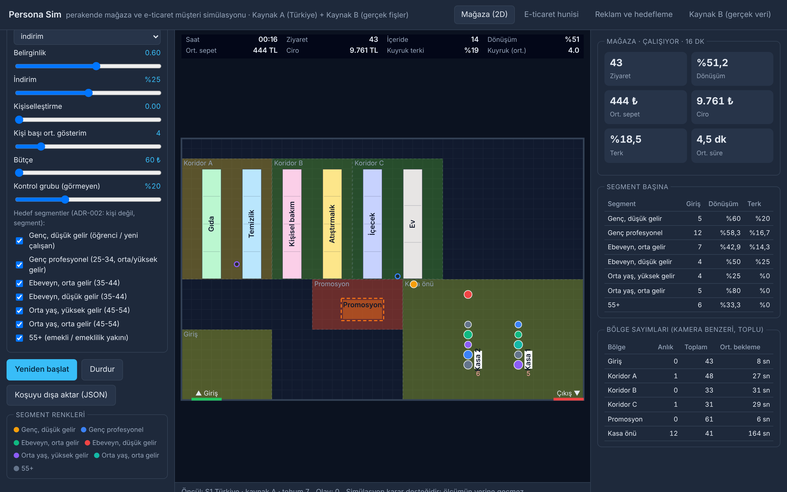
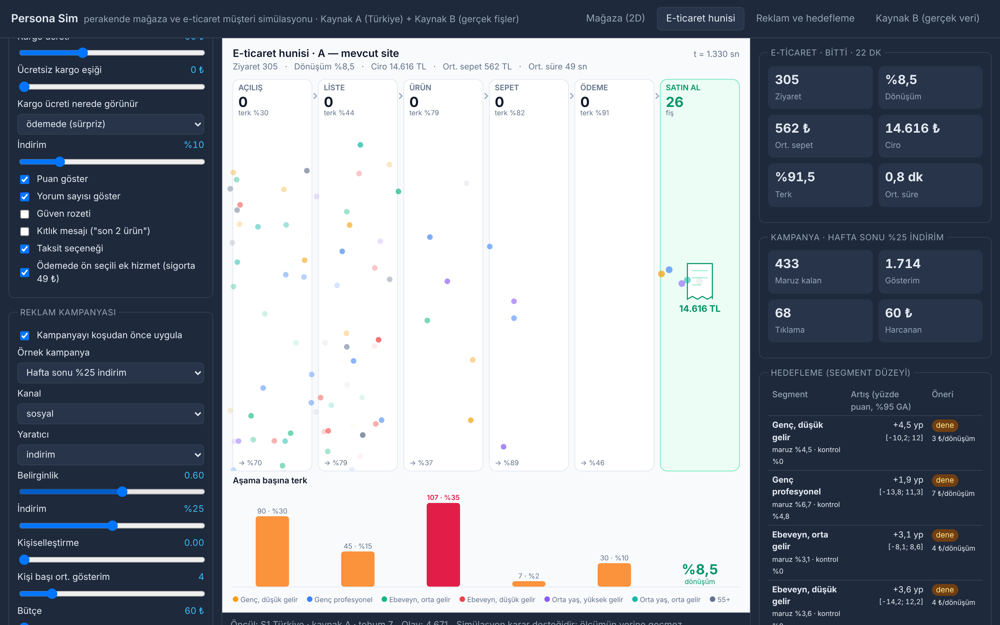

# Persona Sim

Perakende mağaza ve e-ticaret müşterilerini **2D olarak** simüle eden, reklam kampanyasının hangi **segmentte** işe yaradığını
kontrol grubuyla ölçen tarayıcı uygulaması. Tasarımı `../persona-katmani/` (mimari, kararlar, literatür Excel'i, veritabanı).

> Simülasyon karar desteğidir; ölçümün yerine geçmez. Hedefleme yalnız segment düzeyindedir, kişi değil (ADR-002).

## Çalıştırma

```bash
cd persona-sim
npm install
npm run dev        # http://localhost:5173/persona-sim/
npm run check      # tip denetimi + 56 birim testi
npm run build      # dist/
PLAYWRIGHT_CHROMIUM_EXECUTABLE=/yol/chrome node scripts/goruntu.mjs   # 4 sekmenin ekran görüntüsü → docs/shots/
```

URL parametreleri (demo): `?seed=7&n=400&sure=1800&hiz=240&sekme=eticaret&kampanya=1`.

## Sekmeler

| Sekme | Ne gösterir |
| --- | --- |
| Mağaza (2D) | Üstten görünüm: giriş, 3 koridor × 2 raf (6 kategori, 23 ürün), promosyon adası, kasalar; müşteriler segment renginde; bölge ısı haritası; kasa kuyruğu ve terk; kamera benzeri **toplu** bölge sayımları; fişler |
| E-ticaret hunisi | Açılış → liste → ürün → sepet → ödeme → satın al; varyant A/B (ücretsiz kargo eşiği, rozet, kargo ücretinin nerede göründüğü, ön seçili ek hizmet, taksit, seçenek sayısı, yükleme süresi); aşama başına terk |
| Reklam ve hedefleme | Kampanya (kanal, yaratıcı, indirim, kişiselleştirme, sıklık, bütçe, hedef segmentler, kontrol grubu) → koşu → segment başına maruz/kontrol dönüşümü, artış (yüzde puan) ve %95 güven aralığı, artan dönüşüm başına maliyet, rahatsızlık, öneri (hedefle / dene / hedefleme / kaçın) |
| Kaynak B (gerçek veri) | Şirketin fiş CSV'si → sepet tutarı dağılımı (Kaynak B) → Kaynak A ile fark raporu → davranış kümeleri (ADR-006: ≥ 50 müşteri, nötr ad) → "A+B" seçilince nüfus kümelere göre ölçeklenir; kümeler reklamda hedef birimi olur |




## Mimari (kod)

```
src/core        θ parametreleri ve S0/S1 öncülleri (parametreler.ts), Türkiye segmentleri (nufus.ts), karar ilkelleri (karar.ts),
                olay günlüğü (olay.ts), Ortam arayüzü (arayuz.ts), tohumlu RNG
src/magaza      ızgara düzeni, BFS yol bulma, raf/promosyon kararı, kasa kuyruğu, bölge sayımı, çizim
src/eticaret    huni durum makinesi, katalog, varyantlar, çizim
src/reklam      kampanya uygulama (Poisson maruziyet, holdout), segment hedefleme raporu, rapor metni
src/kalibrasyon POS CSV okuma, Kaynak B lognormal uydurma, A–B fark raporu, bütçe çarpanı
src/ui, main.ts kabuk: sekmeler, kontroller, koşu döngüsü, KPI, dışa aktarım (JSON → persona-katmani/db/pk_db.py yukle-kosu)
```

Tüm kararlar `core/karar.ts` üzerinden geçer: aynı θ mağazada, sitede ve reklamda aynı anlama gelir. Sayısal sabitler
"varsayım" statüsündedir; kalibrasyon döngüsü (03) ve Kaynak B günceller. Modül notları: `src/*/NOTLAR.md`.

## Veri akışı

```
Excel (S0/S1 öncülleri) ─► core/parametreler ─► nüfus (segment × θ) ─► [kampanya] ─► mağaza | e-ticaret ─► olay günlüğü
                                                                                                        ├─► KPI, huni, bölge sayımı
Şirket fiş CSV ─► kalibrasyon (Kaynak B) ─► fark raporu, bütçe çarpanı ────────────────────────────────┤
                                                                                                        └─► hedefleme raporu (segment)
Koşu JSON ─► persona-katmani/db/pk_db.py yukle-kosu ─► simulasyon_kosusu, sim_olay, sim_kpi, hedefleme_raporu
```
