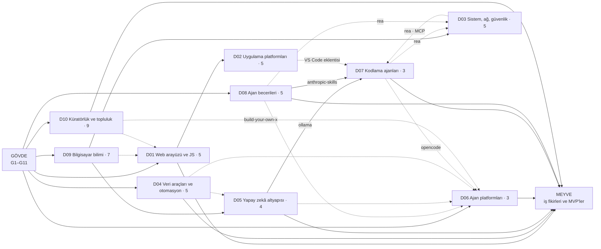
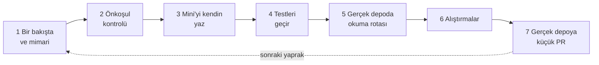

# Öğrenme ağacı — 51 depoyu sıfırdan yazmanın dallanan yolu

Bu dosya atlasın haritasıdır. Yol bir ağaç gibi dallanır:

| Katman     | Ne                                                       | Nerede                                                      |
| ---------- | -------------------------------------------------------- | ----------------------------------------------------------- |
| **Gövde**  | 11 ortak temel (G1–G11): terminal, Git, dil, ağ…         | [govde/README.md](govde/README.md)                          |
| **Dallar** | 10 alan (D01–D10); her biri birkaç depoyu toplar         | `dallar/NN-…/README.md`                                     |
| **Yaprak** | 51 deponun her biri: mimari + sıfırdan yol; 49'unda mini | `dallar/NN-…/<depo>/README.md` ve (44 yaprakta) `sifirdan/` |
| **Meyve**  | Bu depolarla kurulabilecek iş fikirleri ve MVP'ler       | [is-fikirleri/README.md](is-fikirleri/README.md)            |

## "Sıfırdan yazmak" burada ne demek?

Dürüst olalım: Linux'u, TensorFlow'u ya da VS Code'u tek başına baştan yazmak gerçekçi değil; bunlar binlerce
kişinin yıllarca biriktirdiği işler (Linux'un incelenen commit'inde 97.362 dosya var). Bu atlasta "sıfırdan" dört
somut beceri anlamına gelir:

1. **Çekirdek mekanizmayı küçük ölçekte kurabilmek.** React'in uzlaştırma algoritmasını, Vue'nun reaktivitesini,
   yt-dlp'nin çıkarıcı mimarisini, bir kodlama ajanının araç döngüsünü birkaç yüz satırda yazmak. 44 yaprağın
   `sifirdan/` klasöründe bunun testli, aşamalı bir örneği var. D10'un beş yaprağı (project-based-learning,
   free-programming-books, awesome-python, build-your-own-x, 996.ICU) ortak araç kutusunu (`awesome/sifirdan`)
   kullanır; D09'un iki Çince yaprağında (CS-Notes, Python-100-Days) mini yerine çeviri iş akışı var.
2. **Gerçek kodu okuyabilmek.** Mini sürümü yazdıktan sonra gerçek depoda aynı parçayı bulup farkları anlamak
   (her dosyadaki "Gerçek depoda okuma rotası").
3. **Gerçek depoya katkı verebilmek.** Küçük bir hata düzeltmesiyle ilk PR'ını açmak.
4. **Aynı mimariyle kendi ürününü kurabilmek.** Meyve katmanı tam olarak bu.

Kod dışı depolarda (51 deponun 24'ü: liste, eğitim içeriği, ajan yapılandırması, topluluk) "sıfırdan" kod yazmak
değil; içeriği ayakta tutan **bilgi mimarisini, biçim kurallarını, denetim araçlarını (lint, bağlantı kontrolü, site
üretici) ve topluluk düzenini** kurmak demek.

`massgravel/Microsoft-Activation-Scripts` bu yolun dışında tutuldu. Lisans atlatma aracı olduğu için atlas onu
yalnızca hukuk ve etik vaka çalışması olarak inceler; aracın sıfırdan yolunu vermez. Onun yerine yasal karşılığını
kurdurur: kurulu yazılımı satın alınan lisanslarla karşılaştıran bir lisans uyum raporu (SAM).

## Büyük resim

Düz oklar "önce bunu bil" (önerilen önceki dal ya da yaprak), kesikli oklar "faydalı ya da isteğe bağlı bağlantı"
anlamına gelir. Okun üstündeki ad, bağlantının hangi yapraktan geçtiğini söyler. Örneğin D07'deki kodlama ajanlarına
çıkmadan önce D05'in tamamını değil, yalnızca ollama yaprağını (yerel model sunucusu) ve D08'in anthropic-skills
yaprağını (beceri biçimi) bitirmen yeter. D06 ise yalnızca gövde düğümlerini ister; D08, D05, D04, D07'nin opencode
yaprağı ve D10'un build-your-own-x yaprağı orada işini kolaylaştırır. Gövdeden doğrudan çıkan altı dal var (D10, D09,
D01, D04, D08, D06); başlangıç için en uygunları D10, D01 ve D04. Hangi gövde düğümünden sonra hangi dala
başlayabileceğin, gövdedeki [tırmanış tablosunda](govde/README.md#önerilen-tırmanış-sırası).

## Tam ağaç

Her yaprağın yanında, o depoyu "sıfırdan" kurarken öğreneceğin çekirdek mekanizma yazıyor. Yapraklar dal
dosyalarındaki önerilen sırayla dizildi. Dal satırındaki saat, mini'ler, okuma rotaları ve alıştırmalarla birlikte
dalın toplamıdır (ayrıntı: [Gerçekçi takvim](#gerçekçi-takvim)).

- **[Gövde](govde/README.md)** — [G1 Terminal](govde/README.md#g1) · [G2 Git](govde/README.md#g2) ·
  [G3 Python](govde/README.md#g3) · [G4 JS/TS](govde/README.md#g4) · [G5 Algoritmalar](govde/README.md#g5) ·
  [G6 Ağ ve web](govde/README.md#g6) · [G7 Test ve CI](govde/README.md#g7) · [G8 Kod okuma](govde/README.md#g8) ·
  [G9 Açık kaynak](govde/README.md#g9) · [G10 C ve bellek](govde/README.md#g10) · [G11 LLM API](govde/README.md#g11)
- **[D01 Web arayüzü ve JavaScript](dallar/01-web-arayuzu/README.md)** — önkoşul: G1 G2 G4 G7 + HTML, CSS, DOM
  (dal içinde); faydalı: G5 G6 G8; yardımcı dallar: D09, D10 · 208–232 saat
  - [getify/You-Dont-Know-JS](dallar/01-web-arayuzu/you-dont-know-js/README.md) — dilin kendisi: kapsam, closure,
    `this`, prototip, tipler, async
  - [vuejs/core](dallar/01-web-arayuzu/vue3-core/README.md) — Proxy tabanlı reaktivite, şablon derleyicisi, sanal DOM yaması
  - [vuejs/vue](dallar/01-web-arayuzu/vue2/README.md) — `Object.defineProperty` reaktivitesi; Vue 3'e neden geçildi
  - [react/react](dallar/01-web-arayuzu/react/README.md) — fiber mimarisi, uzlaştırma, hook'lar, zamanlayıcı
  - [twbs/bootstrap](dallar/01-web-arayuzu/bootstrap/README.md) — tasarım değişkenleri → Sass → CSS, ızgara, data-API eklentileri
- **[D02 Uygulama platformları ve geliştirici araçları](dallar/02-uygulama-platformlari/README.md)** — önkoşul: G1
  G2 G4 G7 G8, önce D01 önerilir; faydalı: G5 G6 G9 G10 · 163–242 saat
  - [ohmyzsh/ohmyzsh](dallar/02-uygulama-platformlari/ohmyzsh/README.md) — kabuk başlangıç zinciri, eklenti ve tema yükleyici
  - [nilbuild/developer-roadmap](dallar/02-uygulama-platformlari/developer-roadmap/README.md) — yol haritası içeriği
    (Markdown) ve grafik verisi → görsel ağaç; site kodu bu depoda değil
  - [freeCodeCamp/freeCodeCamp](dallar/02-uygulama-platformlari/freecodecamp/README.md) — müfredat biçimi, testli
    meydan okuma motoru, monorepo
  - [microsoft/vscode](dallar/02-uygulama-platformlari/vscode/README.md) — metin tamponu, komut ve tuş sistemi,
    süreç ayrımı, eklenti sunucusu
  - [flutter/flutter](dallar/02-uygulama-platformlari/flutter/README.md) — Widget → Element → RenderObject ağaçları,
    kısıt tabanlı yerleşim
- **[D03 Sistem, ağ ve güvenlik](dallar/03-sistem-ag-guvenlik/README.md)** — önkoşul: G1 G2 G3 G5 G6 G8 G9 G10,
  D09 (önce ya da birlikte), REA için D07 ve D08 (paralel); faydalı: G4 G7 G11 · 370–380 saat
  - [trimstray/the-book-of-secret-knowledge](dallar/03-sistem-ag-guvenlik/the-book-of-secret-knowledge/README.md) —
    sistem yönetimi araç kutusu, savunma odaklı denetimler
  - [DigitalPlatDev/FreeDomain](dallar/03-sistem-ag-guvenlik/freedomain/README.md) — DNS protokolü, yetkili sunucu,
    alan adı kayıt işletmesi
  - [torvalds/linux](dallar/03-sistem-ag-guvenlik/linux/README.md) — açılış, sistem çağrıları, süreç, bellek, dosya
    sistemi; önce kabuk, sonra mini çekirdek
  - [morluto/rea](dallar/03-sistem-ag-guvenlik/rea/README.md) — tersine mühendislik araçlarını MCP sunucusu olarak sunmak
  - [massgravel/Microsoft-Activation-Scripts](dallar/03-sistem-ag-guvenlik/microsoft-activation-scripts/README.md) —
    yalnızca hukuk ve etik vaka çalışması; mini'si yasal karşılık: lisans uyum raporu (SAM)
- **[D04 Veri toplama, dönüştürme ve otomasyon](dallar/04-veri-araclari-otomasyon/README.md)** — önkoşul: G1 G2 G3
  G6 G7, son iki yaprak için ayrıca G4 G5; faydalı: G8 G9 · 217 saat
  - [public-apis/public-apis](dallar/04-veri-araclari-otomasyon/public-apis/README.md) — tablo biçimi denetimi, bağlantı kontrolü
  - [microsoft/markitdown](dallar/04-veri-araclari-otomasyon/markitdown/README.md) — dönüştürücü kaydı, biçim algılama
  - [yt-dlp/yt-dlp](dallar/04-veri-araclari-otomasyon/yt-dlp/README.md) — çıkarıcı mimarisi, format seçimi, son işlemciler
  - [firecrawl/firecrawl](dallar/04-veri-araclari-otomasyon/firecrawl/README.md) — tarama kuyruğu, robots.txt,
    HTML → Markdown, iş kuyruğu API'si
  - [n8n-io/n8n](dallar/04-veri-araclari-otomasyon/n8n/README.md) — iş akışı JSON'u, düğüm kaydı, yürütme motoru, ifadeler
- **[D05 Yapay zekâ altyapısı](dallar/05-yapay-zeka-altyapisi/README.md)** — önkoşul: G1 G2 G3 G5 G6 G7 G11, D09,
  dal içi matematik (lineer cebir, türev, olasılık); faydalı: G8 G9 G10 · 190–192 saat
  - [tensorflow/tensorflow](dallar/05-yapay-zeka-altyapisi/tensorflow/README.md) — tensör, otomatik türev, grafik, eğitim döngüsü
  - [huggingface/transformers](dallar/05-yapay-zeka-altyapisi/transformers/README.md) — model ve yapılandırma deseni,
    tokenizer, `generate`, Auto sınıfları
  - [ollama/ollama](dallar/05-yapay-zeka-altyapisi/ollama/README.md) — model kaydı, Modelfile, akışlı HTTP API,
    çıkarım motorunu sarmalamak
  - [666ghj/MiroFish](dallar/05-yapay-zeka-altyapisi/mirofish/README.md) — persona üretimi, sosyal graf, çok ajanlı simülasyon
- **[D06 Kişisel ve otonom ajan platformları](dallar/06-ajan-platformlari/README.md)** — önkoşul: G1 G2 G3 G4 G6 G7
  G8 G11; faydalı: G5 G9, D08, D10; isteğe bağlı: D05, D04, D07 · 188 saat
  - [Significant-Gravitas/AutoGPT](dallar/06-ajan-platformlari/autogpt/README.md) — blok ve graf yürütücü
  - [NousResearch/hermes-agent](dallar/06-ajan-platformlari/hermes-agent/README.md) — öğrenen ajan döngüsü, hafıza,
    kendi becerisini yazan ajan
  - [openclaw/openclaw](dallar/06-ajan-platformlari/openclaw/README.md) — çok kanallı ağ geçidi, oturum yönlendirme,
    beceriler, zamanlanmış işler
- **[D07 Kodlama ajanları ve harness'lar](dallar/07-kodlama-ajanlari/README.md)** — önkoşul: G1 G2 G4 G6 G7 G8 G11,
  D08 → anthropic-skills, D05 → ollama (claw-code için ayrıca Rust temelleri); faydalı: G10 · 139–163 saat
  - [anomalyco/opencode](dallar/07-kodlama-ajanlari/opencode/README.md) — ajan döngüsü, araçlar, izin sistemi, bağlam yönetimi
  - [deepseek-ai/deepseek-harness](dallar/07-kodlama-ajanlari/deepseek-harness/README.md) — "her şey bir eklenti":
    bağlam, servis, bağımlılık enjeksiyonu, yaşam döngüsü
  - [ultraworkers/claw-code](dallar/07-kodlama-ajanlari/claw-code/README.md) — Rust ile harness çekirdeği; ajanların
    yürüttüğü bir depo
- **[D08 Ajan becerileri ve yapılandırma](dallar/08-ajan-becerileri/README.md)** — önkoşul: G1 G2 G3 G4 G7 G11;
  faydalı: G8 G9 · 185 saat
  - [anthropics/skills](dallar/08-ajan-becerileri/anthropic-skills/README.md) — SKILL.md biçimi, kademeli yükleme
  - [multica-ai/andrej-karpathy-skills](dallar/08-ajan-becerileri/karpathy-skills/README.md) — tek dosyalık davranış ilkeleri
  - [obra/superpowers](dallar/08-ajan-becerileri/superpowers/README.md) — yöntem olarak beceriler: plan → alt ajan →
    TDD → inceleme
  - [mattpocock/skills](dallar/08-ajan-becerileri/mattpocock-skills/README.md) — küçük, birleştirilebilir beceriler
  - [affaan-m/ECC](dallar/08-ajan-becerileri/ecc/README.md) — çok harness'lı yapılandırma, kancalar, hafıza, güvenlik
- **[D09 Bilgisayar bilimi, algoritmalar, sistem tasarımı](dallar/09-bilgisayar-bilimi/README.md)** — önkoşul: G1 G2
  G3 G5 G7; faydalı: G4 G6 G9 G10 · 325,5 saat (Python-100-Days'siz 259,5)
  - [jwasham/coding-interview-university](dallar/09-bilgisayar-bilimi/coding-interview-university/README.md) — çalışma planı
  - [trekhleb/javascript-algorithms](dallar/09-bilgisayar-bilimi/javascript-algorithms/README.md) — veri yapıları ve
    algoritmalar, testleriyle
  - [TheAlgorithms/Python](dallar/09-bilgisayar-bilimi/thealgorithms-python/README.md) — algoritma deposu düzeni, doctest, CI
  - [ossu/computer-science](dallar/09-bilgisayar-bilimi/ossu-computer-science/README.md) — müfredat ve önkoşul grafı
  - [donnemartin/system-design-primer](dallar/09-bilgisayar-bilimi/system-design-primer/README.md) — sistem tasarımı yapı taşları
  - [CyC2018/CS-Notes](dallar/09-bilgisayar-bilimi/cs-notes/README.md) — mülakat temelleri (Çince)
  - [jackfrued/Python-100-Days](dallar/09-bilgisayar-bilimi/python-100-days/README.md) — 100 günlük Python müfredatı
    (Çince; sıra dışı, isteğe bağlı)
- **[D10 Küratörlük, listeler ve topluluk](dallar/10-kuratorluk-topluluk/README.md)** — önkoşul: G2 G3 G7 G9 (ilk PR
  için G1 + G2 yeter); faydalı: G1 G4 G5 G6 · 283 saat
  - [sindresorhus/awesome](dallar/10-kuratorluk-topluluk/awesome/README.md) — awesome biçimi ve lint kuralları
  - [practical-tutorials/project-based-learning](dallar/10-kuratorluk-topluluk/project-based-learning/README.md) — proje listesi
  - [EbookFoundation/free-programming-books](dallar/10-kuratorluk-topluluk/free-programming-books/README.md) — çok dilli
    liste yönetimi
  - [avelino/awesome-go](dallar/10-kuratorluk-topluluk/awesome-go/README.md) — liste, Go ile site üretici
  - [vinta/awesome-python](dallar/10-kuratorluk-topluluk/awesome-python/README.md) — liste ve site üretimi
  - [awesome-selfhosted/awesome-selfhosted](dallar/10-kuratorluk-topluluk/awesome-selfhosted/README.md) — veriden liste üretmek
  - [codecrafters-io/build-your-own-x](dallar/10-kuratorluk-topluluk/build-your-own-x/README.md) — rehber listesi ve
    arkasındaki iş modeli
  - [521xueweihan/HelloGitHub](dallar/10-kuratorluk-topluluk/hellogithub/README.md) — aylık dergi üretimi
  - [996icu/996.ICU](dallar/10-kuratorluk-topluluk/996-icu/README.md) — GitHub ile toplumsal hareket, lisansla aktivizm
- **[Meyve: iş fikirleri ve MVP'ler](is-fikirleri/README.md)** — her depo için en az bir fikir, kime satılacağı ve
  kodlanmış 6 MVP

## Bir yaprakta nasıl ilerlenir: 7 adımlık döngü

1. Depo dosyasının **"Bir bakışta"** ve **"Nasıl yapılmış: mimari"** bölümlerini oku; klasör haritasını gerçek depoda
   aç ve karşılaştır.
2. **"Öğrenmen gerekenler"** bölümündeki gövde düğümlerinden eksik olan varsa önce onu kapat.
3. `sifirdan/` klasörüne bakmadan, aşama tablosundaki ilk aşamayı **kendin** yaz. Takılınca bizim çözümümüze bak.
4. Bizim testlerimizi kendi koduna karşı çalıştır. Hepsi geçince sonraki aşamaya geç.
5. **"Gerçek depoda okuma rotası"**nı izle: mini'deki her parçanın gerçek karşılığını bul, farkları not et.
6. **Alıştırmaları** yap; öz değerlendirme sorularını cevaplara bakmadan yanıtla.
7. Gerçek depoda "good first issue" etiketli bir iş bul ya da küçük bir belge veya test düzeltmesi için PR aç.

## Hedefe göre rotalar

Ağacın tamamını sırayla gezmek zorunda değilsin. Hedefine göre bir rota seç:

| Rota                                | Gövde                        | Dallar ve yapraklar (sırayla)                                                                                                                                                          | Süre, gövde dahil: yalnızca mini'ler · tam | Meyve (MVP)    |
| ----------------------------------- | ---------------------------- | -------------------------------------------------------------------------------------------------------------------------------------------------------------------------------------- | ------------------------------------------ | -------------- |
| **A. Yapay zekâ ürünü geliştirici** | G1 G2 G3 G4 G5 G6 G7 G11     | D04 markitdown → firecrawl → D05 (önce lineer cebir, türev ve olasılık) tensorflow → transformers → ollama → D08 anthropic-skills → D07 opencode → D06 hermes-agent                    | 11,5–15 ay · 16–20 ay                      | 01, 02, 04, 05 |
| **B. Web ürünü / ön yüz**           | G1 G2 G4 G7 G9               | D01 You-Dont-Know-JS → (G5'ten ağaç dolaşımı, bağlı liste, ikili arama) → Vue 3 → React → Bootstrap → D02 developer-roadmap → freeCodeCamp → VS Code → D10 HelloGitHub                 | 6–8,5 ay · 9,5–12,5 ay                     | 06             |
| **C. Sistem ve altyapı**            | G1 G2 G3 G5 G6 G7 G9 G10 G11 | D09 OSSU (işletim sistemi ve ağ dersleri, G6 ve G10 haftalarında) → D03 the-book-of-secret-knowledge → FreeDomain → Linux (kabuk → çekirdek) → D05 ollama                              | 12–15 ay · 15,5–19 ay                      | —              |
| **D. Mülakat ve kariyer**           | G1 G2 G3 G5 G6 G7 G9         | D09 coding-interview-university → TheAlgorithms (JavaScript biliyorsan yerine javascript-algorithms; G4 yoksa +4–6 hafta) → system-design-primer → D10 awesome → bir portfolyo yaprağı | 7–9,5 ay · 9,5–12,5 ay (portfolyo hariç)   | —              |
| **E. Otomasyon girişimcisi**        | G1 G2 G3 G4 G5 G6 G7 G11     | D04 public-apis → firecrawl → n8n → D06 AutoGPT → openclaw                                                                                                                             | 10–13 ay · 13–16 ay                        | 03, 04         |

MVP numaraları [iş fikirleri kataloğundaki](is-fikirleri/README.md) kodlanmış örneklere karşılık gelir. Rota
süreleri, rotanın gövde düğümleriyle yapraklarının saatlerinin toplamıdır. Gövde düğümlerini yalnızca rotanın
istediği kadar öğrenirsen ("tam zamanında öğrenme") alt sınıra yaklaşırsın. G8 (büyük kod tabanı okuma) her rotada
sürekli uygulanır; süreye ayrıca eklenmez.

## Gerçekçi takvim

Haftada yaklaşık 10 saat ayırdığını varsayarsak:

| Parça                              | Yalnızca mini'lerle      | Mini + okuma rotası + alıştırmalar |
| ---------------------------------- | ------------------------ | ---------------------------------- |
| Asgari gövde (G1, G2, bir dil, G7) | 11–16 hafta (2,5–4 ay)   | 11–16 hafta (2,5–4 ay)             |
| Tam gövde (G1–G11)                 | 37–53 hafta (9–12 ay)    | 37–53 hafta (9–12 ay)              |
| Bir dal (dala göre değişir)        | 70–220 saat (7–22 hafta) | 139–380 saat (14–38 hafta)         |
| Bir rota (A–E, gövde dahil)        | 6–15 ay                  | 9,5–20 ay                          |
| Ağacın tamamı (gövde + 51 yaprak)  | ~3–3,5 yıl               | ~5–5,5 yıl                         |

"Yalnızca mini'lerle" hızlı geçiştir: her yaprağın mini'sini yazarsın, gerçek kodu okumayı ve alıştırmaları sonraya
bırakırsın. Haftada 20 saat ve üstüyle bu süreler kabaca yarıya iner. Ağacın tamamını gezmen gerekmez; ağacı en
verimli kullanma yolu bir rota seçmektir.

Dal bazında saatler (her dal dosyası hesabını yaprak yaprak gösterir):

| Dal    | Yaprak | Yalnızca mini'ler | Mini + okuma + alıştırma | Not                                                                  |
| ------ | ------ | ----------------- | ------------------------ | -------------------------------------------------------------------- |
| D01    | 5      | 85–109            | 208–232                  |                                                                      |
| D02    | 5      | 88–135            | 163–242                  |                                                                      |
| D03    | 5      | 210–220           | 370–380                  | isteğe bağlı +80–130 (Linux ileri aşamaları, yan dallar)             |
| D04    | 5      | 101               | 217                      |                                                                      |
| D05    | 4      | 88–90             | 190–192                  | dal içi matematik hariç                                              |
| D06    | 3      | 110               | 188                      |                                                                      |
| D07    | 3      | 70–94             | 139–163                  | Rust yeniyse +20–30                                                  |
| D08    | 5      | 91                | 185                      | dal sonundaki rehberli alıştırma +8                                  |
| D09    | 7      | 143,5             | 325,5                    | Python-100-Days'siz 259,5; CIU ve OSSU müfredatlarının kendisi hariç |
| D10    | 9      | 138               | 283                      |                                                                      |
| Toplam | 51     | ~1.125–1.230      | ~2.270–2.410             |                                                                      |

Kural: 1 gün ≈ 5 saat, 1 hafta ≈ 10 saat; toplam = mini (Sıfırdan yol aşamaları) + okuma rotası + alıştırmalar.
Okuma adımına ve alıştırmalara verilen saat dallar arasında biraz farklıdır (ör. D08 ve D10 okuma adımını yarım saat
sayar). Bu yüzden rakamları söz değil, planlama aracı olarak kullan.

## Bu ağaç nasıl hazırlandı

- 51 deponun her biri 9 Kasım 2026'da sığ ve seyrek klonla çekildi; her depo dosyası incelediği commit'i başında
  belirtir. Klasör ve dosya yolları o commit'te doğrulandı; doğrulanamayan bilgiler `(doğrulanmadı)` diye işaretlidir.
- Her dalı ayrı bir "öğretmen" ajanı hazırladı; iş fikirlerini iki ayrı "iş fikri" ajanı çıkardı ve kodladı.
- Ardından her dal ve her MVP ayrı bir doğrulama ve onarım turundan geçti: iddialar klonla yeniden karşılaştırıldı,
  süreler ve önkoşullar bu dosyadaki tek kurala bağlandı (ayrıntı: [README](README.md#nasıl-hazırlandı)).
- `sifirdan/` klasörlerindeki kodlar özgündür: orijinal depolardan kod kopyalanmadı (lisanslar farklı), yalnızca
  karşılaştırma için orijinal dosya yollarına atıf yapıldı. Testler internetsiz çalışır.
- Yıldız sayıları ve tarihler için: [ENVANTER.md](ENVANTER.md).
