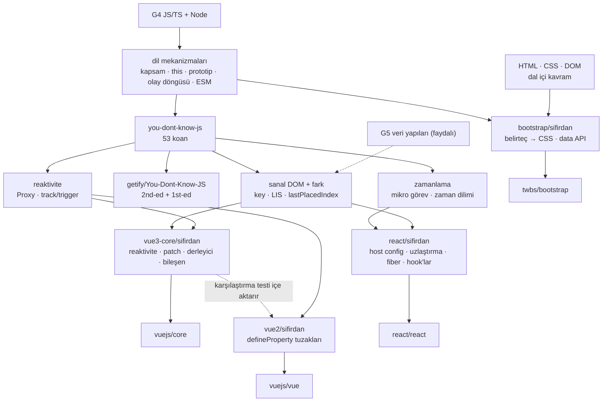

# D01 — Web arayüzü ve JavaScript

Bu dal, tarayıcıda çalışan arayüzlerin **nasıl** çalıştığını kaynak koddan öğretir: dilin kendisi (You Don't Know JS),
iki büyük arayüz çatısı (React ve Vue 3), bir önceki kuşağın tasarımı (Vue 2) ve bir CSS/JS tasarım sistemi
(Bootstrap). Ortak soru şudur: **durum değişince ekran nasıl, ne kadar az işle güncellenir?** React bunu "yeniden
render et ve farkı bul" (uzlaştırma + Fiber) ile, Vue "kimin neyi okuduğunu izle" (reaktivite + derleyici ipuçları)
ile çözer. Bootstrap ise ayrı bir durum modeli kurmaz: durum DOM'un kendisindedir (`.show` sınıfı, `aria-expanded`),
bileşen örnekleri öğeye bağlı bir kayıtta (`Data`) tutulur ve DOM'u doğrudan, emirli (imperative) biçimde değiştirir;
tetikleme "HTML nitelikleri + olay delegasyonu" ile olur. Her yaprağın `sifirdan/` klasöründe bu mekanizmaların
özgün, küçük ve test edilmiş bir yeniden yazımı (YDKJS için çalıştırılabilir koanlar) var.

## Ön koşullar

| Düğüm                                                           | Gerek   | Bu dalda nerede gerekir                                                                                                                                                                                                                                       |
| --------------------------------------------------------------- | ------- | ------------------------------------------------------------------------------------------------------------------------------------------------------------------------------------------------------------------------------------------------------------- |
| [G1 Terminal ve kabuk](../../govde/README.md#g1)                | zorunlu | `node --test`, `npm run`, `git switch` ile dal/baskı değiştirme                                                                                                                                                                                               |
| [G2 Git ve GitHub](../../govde/README.md#g2)                    | zorunlu | Uzun ömürlü sürüm dalları (Bootstrap `main`=v6 / `v5-dev`, Vue `main` / `minor`, YDKJS `1st-ed` / `2nd-ed`)                                                                                                                                                   |
| [G4 JavaScript/TypeScript ve Node.js](../../govde/README.md#g4) | zorunlu | Dalın ana dili. Kapanış ve `this` her yaprakta; Proxy + `WeakMap` Vue 3 reaktivitesinde; mikro görev React (`scheduleMicrotask`) ve Vue (`Promise.then` → `flushJobs`) zamanlayıcılarında                                                                     |
| [G7 Test, CI ve kod kalitesi](../../govde/README.md#g7)         | zorunlu | Bütün mini'ler `node:test` ile; gerçek depolar Jest (React), Vitest (Vue, Bootstrap) ve Playwright kullanır                                                                                                                                                   |
| HTML, CSS ve DOM temelleri (dal içi kavram; gövdede düğümü yok) | zorunlu | DOM ağacı ve olay kabarcıklanması (Bootstrap data API'si), kutu modeli, flexbox, medya sorguları, özgüllük ve `@layer`. Kaynak: MDN Web Docs; free-programming-books `courses/free-courses-tr.md` → "HTML and CSS" (Kodluyoruz'un HTML ve Bootstrap serileri) |
| [G5 Veri yapıları ve algoritmalar](../../govde/README.md#g5)    | faydalı | LIS (Vue 3 `getSequence`), bağlı liste (React fiber, Vue 3.5 `Link`), min-heap (React scheduler), ağaç dolaşımı, bit maskesi (şeritler). React ve Vue 3 yapraklarından önce en azından ağaç dolaşımı, bağlı liste ve ikili arama                              |
| [G6 Ağ ve web temelleri](../../govde/README.md#g6)              | faydalı | HTTP ve tarayıcı geliştirici araçları: Bootstrap demosu küçük bir HTTP sunucusuyla açılır; React ve Vue'nun SSR/RSC yan dallarında HTML akışı                                                                                                                 |
| [G8 Büyük kod tabanı okuma](../../govde/README.md#g8)           | faydalı | React (~7.300 dosya, Yarn çalışma alanları) ve vuejs/core (~700 dosya, pnpm çalışma alanı) monorepoları; Bootstrap (~1.000 dosya) tek paketli bir depo, ama kütüphane, belge sitesi ve dağıtım (npm, NuGet, Composer) aynı yerde                              |

"Zorunlu" düğümler bitmeden dala başlama; "faydalı" olanları dalda ihtiyaç duydukça tamamla. Gövdede DOM/CSS'i
öğreten bir düğüm yok: G6 ağ katmanını (TCP/IP, DNS, HTTP) öğretir, sayfanın içini değil. Yalnızca bir yaprağın
istediği dal içi kavramlar o yaprağın dosyasında anlatılır: derleyici temelleri ([vue3-core](vue3-core/README.md)),
Sass ve erişilebilirlik ([bootstrap](bootstrap/README.md)).

Yardımcı dallar: [D09 Bilgisayar bilimi](../09-bilgisayar-bilimi/README.md) (ağaçlar, LIS, öncelik kuyruğu/heap) ve
[D10 Kürasyon](../10-kuratorluk-topluluk/README.md) (build-your-own-x, free-programming-books Türkçe listeleri).

## Dalın ağacı



## Önerilen yaprak sırası

1. **[you-dont-know-js](you-dont-know-js/README.md)** — Çatıların kaynağını okurken takılacağın her şey dildedir:
   hook'lar kapanıştır, Vue reaktivitesi Proxy + `WeakMap`'tir, iki çatı da mikro görev kuyruğuna yaslanır. En azından
   koan 1 (kapsam/kapanış), 2 (`this`) ve 5 (olay döngüsü) bitmeden diğerlerine geçme.
2. **[vue3-core](vue3-core/README.md)** — En küçük, en kendi içinde kapalı çekirdek mekanizma reaktivitedir (~280
   satırlık mini). Ardından gelen VNode + anahtarlı fark, sanal DOM'un en okunur hâlidir. Derleyici aşaması "çalışma
   zamanı ile derleme zamanı iş bölümü"nü öğretir.
3. **[vue2](vue2/README.md)** — Kısa bir karşılaştırma durağı: Vue 3'ün reaktivitesi tazeyken, `defineProperty`'nin
   neden yetmediğini aynı testleri iki sürümde koşarak görürsün. "Neden yeniden yazıldı?" sorusunun cevabı burada.
   vue2 mini'sinin karşılaştırma testleri vue3-core mini'sini doğrudan içe aktarır; önce onu bitir.
4. **[react](react/README.md)** — Dalın en zor yaprağı. Fiber'ın kesilebilir iş döngüsü ve hook'lar, sanal DOM ve
   farkı bildiğini varsayar (dosyası vue3-core'u dal içi ön koşul sayar). Vue'dan sonra gelmesi bir artıdır: "izle"
   (Vue) ile "yeniden render et" (React) yaklaşımı arasındaki farkı ve liste algoritmalarını (LIS ile
   `lastPlacedIndex`) doğrudan karşılaştırırsın.
5. **[bootstrap](bootstrap/README.md)** — Durumu DOM'da tutan, emirli dünya: belirteçlerden CSS üreten bir tasarım
   sistemi ve çatısız eklenti mimarisi. Diğer çatılardan bağımsızdır; yalnızca dil temeli (YDKJS) ister.

**Alternatif (görsel öncelikli) rota:** HTML/CSS temellerini yeni bitirdiysen ya da hızlı görünür sonuç istiyorsan
Bootstrap'i YDKJS koan 1–2'den hemen sonra yap (demo sayfası tarayıcıda canlı çalışır), sonra Vue 3 → Vue 2 → React ile devam et.

## Yapraklar

| Depo                                                  | Tür                      | Zorluk (1–5) | Mini                                                                                              | Mini (saat) | Toplam (saat) |
| ----------------------------------------------------- | ------------------------ | ------------ | ------------------------------------------------------------------------------------------------- | ----------- | ------------- |
| [getify/You-Dont-Know-JS](you-dont-know-js/README.md) | eğitim içeriği           | 2            | [53 koan + boşaltma aracı](you-dont-know-js/sifirdan/README.md) (56 test)                         | 31–39       | 47–55         |
| [vuejs/core](vue3-core/README.md)                     | kod tabanı               | 4            | [mini Vue 3](vue3-core/sifirdan/README.md): reaktivite, patch + LIS, derleyici, bileşen (33 test) | 20–25       | 50–55         |
| [vuejs/vue](vue2/README.md)                           | kod tabanı (ömrü bitmiş) | 2            | [Vue 2 gözlemcisi + Vue 3 karşılaştırması](vue2/sifirdan/README.md) (14 test)                     | 7–9         | 29–31         |
| [react/react](react/README.md)                        | kod tabanı               | 5            | [mini React](react/sifirdan/README.md): host config, uzlaştırma, fiber, hook'lar (29 test)        | 16–24       | 46–54         |
| [twbs/bootstrap](bootstrap/README.md)                 | kod tabanı               | 3            | [belirteç → CSS üreteci + data API](bootstrap/sifirdan/README.md) (16 test)                       | 11–12       | 36–37         |
| **Dal toplamı**                                       |                          |              |                                                                                                   | **85–109**  | **208–232**   |

**Süre kuralı.** Bu daldaki bütün süreler saat cinsindendir. Birim varsayımı: 1 gün ≈ 5 saat odaklı çalışma,
1 hafta ≈ 10 saat (haftada ~10 saatlik tempo).

- **Mini (saat):** yaprağın dosyasındaki "Sıfırdan yol" tablosunda aşamaların toplamı. YDKJS'te bir aşama, bölümleri
  okumak ve koanları doldurmaktır; oradaki süreler bölümlerin sözcük sayısından ölçüldü.
- **Toplam (saat):** mini + okuma rotası (adım başına ~1 saat) + alıştırmalar (Kolay ~1, Orta ~2, Zor ~4 saat).
  YDKJS'te okuma rotası aşamalardaki okumayla çakıştığından rota için yalnızca +2 saat sayıldı.
- Dosyalardaki isteğe bağlı "yan dallar" (SSR, şeritler, Vapor modu...) toplama girmez.

**Toplam:** dalın tamamı 208–232 saat, yani haftada ~10 saatle yaklaşık 21–23 hafta. Yalnızca mini'ler (aşama
tabloları) 85–109 saat, yani yaklaşık 9–11 hafta.

Tüm mini'leri tek seferde koşmak için:

```bash
cd repo-atlasi/dallar/01-web-arayuzu
for d in you-dont-know-js vue3-core vue2 react bootstrap; do (cd $d/sifirdan && npm test); done   # 148 test
```

## Dallar arası bağlantılar

- **[D02 Uygulama platformları](../02-uygulama-platformlari/README.md):**
  [freeCodeCamp](../02-uygulama-platformlari/freecodecamp/README.md) istemcisi React 18 + Gatsby ile yazılmış
  (`client/package.json`) — bu daldaki React bilgisiyle gerçek bir büyük uygulamanın bileşen düzenini okuyabilirsin.
  [developer-roadmap](../02-uygulama-platformlari/developer-roadmap/README.md) artık yalnızca içerik deposu;
  `roadmaps/javascript`, `roadmaps/react`, `roadmaps/vue`, `roadmaps/frontend`, `roadmaps/css` bu dalın konu haritasıdır.
  [vscode](../02-uygulama-platformlari/vscode/README.md)'un çalışma tezgâhı (`src/vs/`) React/Vue kullanmaz: kendi DOM
  bileşenleri (`src/vs/base/browser/ui/`) ve kendi observable sistemi (`src/vs/base/common/observableInternal/`) vardır
  — Vue reaktivitesiyle karşılaştırmaya değer. (Depodaki yerleşik Copilot eklentisinin test simülasyon aracı ise
  React 17 kullanır: `extensions/copilot/package.json`.)
- **[D04 Veri araçları ve otomasyon](../04-veri-araclari-otomasyon/README.md):** [n8n](../04-veri-araclari-otomasyon/n8n/README.md)
  iş akışı editörü Vue 3 + Pinia + vue-router (`packages/frontend/editor-ui/package.json`): büyük bir Vue 3 uygulaması.
- **[D06](../06-ajan-platformlari/README.md) ve [D07](../07-kodlama-ajanlari/README.md):**
  [AutoGPT](../06-ajan-platformlari/autogpt/README.md) platform ön yüzü React 19 + Next.js (`autogpt_platform/frontend`);
  [opencode](../07-kodlama-ajanlari/opencode/README.md) arayüzleri SolidJS (ince taneli sinyaller — Vue 3.6'nın
  alien-signals yönelimiyle akraba bir fikir).
- **[D08 Ajan becerileri](../08-ajan-becerileri/README.md):** Bootstrap deposu `skills/` altında yapay zekâ ajanları
  için 11 `SKILL.md` (v5 → v6 göçü, kurulum, utility API...) taşıyor; React ise `.claude/skills/` altında bakımcı iş
  akışları için 7 `SKILL.md` (test, flow, feature-flags...) ve `.claude/settings.json` taşıyor. React kökünde
  `CLAUDE.md`, Bootstrap kökünde `AGENTS.md` var — bunlar bu atlasta inceleme konusu, talimat değil. Aynı beceri
  biçiminin iki kullanımını karşılaştır: Bootstrap'te kullanıcıya yönelik rehberler, React'te bakımcı iş akışları.
- **[D09 Bilgisayar bilimi](../09-bilgisayar-bilimi/README.md):**
  [javascript-algorithms](../09-bilgisayar-bilimi/javascript-algorithms/README.md) (ağaçlar, yığın/heap, dinamik
  programlama → LIS), derleyici dersleri için [ossu-computer-science](../09-bilgisayar-bilimi/ossu-computer-science/README.md).
- **[D10 Kürasyon](../10-kuratorluk-topluluk/README.md):** [build-your-own-x](../10-kuratorluk-topluluk/build-your-own-x/README.md)
  "Front-end Framework / Library" bölümü (Build your own React, didact, kendi sanal DOM'unu yaz);
  [free-programming-books](../10-kuratorluk-topluluk/free-programming-books/README.md) `courses/free-courses-tr.md`
  (JavaScript, React, HTML/CSS ve Bootstrap için Türkçe video seriler).
- İş fikirleri: [is-fikirleri](../../is-fikirleri/README.md) · Tüm ağaç: [AGAC.md](../../AGAC.md)

## Bu dalı bitirdiğinde ne yapabilirsin

- Bir arayüz çatısının çekirdeğini (reaktivite ya da uzlaştırma + zamanlayıcı) sıfırdan yazıp test edebilirsin.
- React ve Vue kaynak kodunda bir hatayı ya da davranışı dosya ve fonksiyon adıyla takip edebilir, issue/PR
  tartışmalarını okuyabilirsin.
- "Neden yavaş?" sorusunu doğru katmanda sorarsın: gereksiz render mı, büyük commit mi, liste fark algoritması mı,
  stil yeniden hesaplama ve yerleşim (layout) maliyeti mi.
- Bir stilin neden uygulanmadığını özgüllük ve `@layer` sırasıyla açıklarsın.
- Liste anahtarlarını, efekt temizliğini, `nextTick`/toplu güncellemeyi ve katı kip davranışlarını bilinçli kullanırsın.
- Belirteçlerden tema üreten bir tasarım sistemi ve HTML nitelikleriyle çalışan erişilebilir bileşenler kurabilirsin.
- Bir kod tabanının sürüm/dal stratejisini (Bootstrap v5/v6, Vue main/minor, Vue 2 EOL) okuyup proje kararı verirsin.
