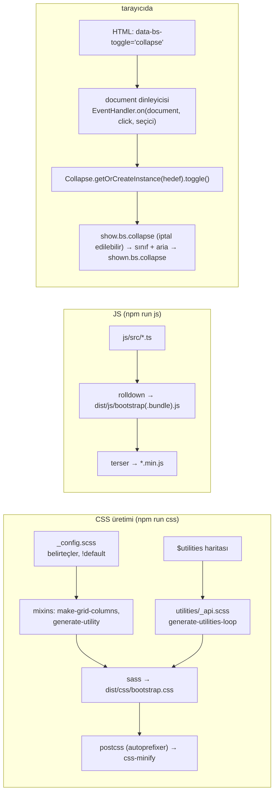
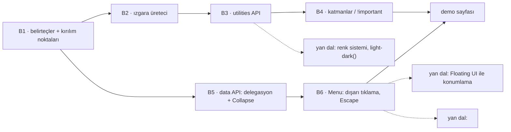

# twbs/bootstrap — Sass ile üretilen CSS tasarım sistemi + data API'li JavaScript bileşenleri

> **Dal:** [D01 Web arayüzü ve JavaScript](../README.md) · **Tür:** kod tabanı
> **Dil:** SCSS, TypeScript, MDX (GitHub "MDX" gösterir) · **Lisans:** MIT · **Yıldız:** 175.021 (9 Kasım 2026)
> **İncelenen commit:** `9062790` (2026-11-04, `main` = v6.0.0-alpha.1) · karşılaştırma için `v5-dev` dalı: `ea8d6a2` (2026-11-04)

## 1. Bir bakışta

Bootstrap, duyarlı (responsive) ve "mobil önce" web arayüzü için hazır CSS ve JavaScript sunar: ızgara, yardımcı
sınıflar (utilities), bileşenler (menü, diyalog, akordeon...). 2011'de Mark Otto ve Jacob Thornton'ın
(README → "Creators") Twitter'daki iç aracı olarak doğdu (Twitter kısmı doğrulanmadı); tasarımcı olmayan
geliştiricilerin de tutarlı arayüz kurabilmesini sağladığı için web'in en yaygın CSS çatısı oldu. İçinde iki ayrı
öğreti var: **Sass ile tasarım sistemi üretmek** (belirteçler → döngüler → binlerce sınıf) ve **çatısız (framework'süz)
JavaScript bileşen mimarisi** (HTML nitelikleriyle çalışan "data API"). Dikkat: bu commit'te varsayılan `main` dalı
**v6 alfa**dır ve v5'ten büyük kırılmalar içerir; kararlı v5.3 çizgisi `v5-dev` dalında sürer (incelenen `ea8d6a2`'de
sürüm `5.3.8`; `v5-dev`'e 9 Kasım 2026'da `v5.3.9` sürüm commit'i girdi).

## 2. Nasıl yapılmış: mimari

### Klasör haritası (`main`, v6 alfa)

```text
scss/
  bootstrap.scss          giriş: @forward ile config, colors, theme, root, content, layout, forms, bileşenler, utilities
  _config.scss            ayarlar: $enable-*, $spacers, $breakpoints, $grid-columns, defaults() birleştirme fonksiyonu
  _theme.scss _colors.scss renk haritaları ($theme-colors...); _root.scss → @layer sırası ve :root değişkenleri
  layout/                 _breakpoints.scss (breakpoint-prefix, media-breakpoint-up), _grid.scss, _containers.scss
  mixins/                 _grid.scss (make-row, make-col, make-grid-columns), _utilities.scss (generate-utility),
                          _tokens.scss (tokens($map) → CSS değişkenleri), _border-radius.scss, _transition.scss...
  _utilities.scss         $utilities haritası (~1.070 satır); utilities/_api.scss → generate-utilities-loop
  buttons/ content/ forms/ helpers/   alt sistemler; _menu.scss, _dialog.scss, _drawer.scss... bileşen stilleri
  tests/                  sass-true + Jasmine ile Sass birim testleri (mixins/_utilities.test.scss vb.)
js/src/
  index.ts                tüm bileşenlerin dışa aktarımı
  base-component.ts       ortak taban: Data kaydı, getOrCreateInstance, dispose, DATA_KEY/EVENT_KEY
  dom/                    data.ts (öğe → örnek kaydı), event-handler.ts (ad alanlı olaylar, delegasyon),
                          selector-engine.ts, manipulator.ts (data-bs-* okuma)
  util/                   config.ts, floating-ui.ts (konumlama), sanitizer.ts, scroll-lock.ts, swipe.ts...
  collapse.ts menu.ts dialog.ts drawer.ts tooltip.ts popover.ts tab.ts toast.ts carousel.ts scrollspy.ts
  combobox.ts datepicker.ts chips.ts otp-input.ts strength.ts range.ts toggler.ts nav-overflow.ts (v6'da yeni olanlar)
js/tests/unit/            Vitest tarayıcı kipi (Playwright Chromium) ile *.spec.js; js/tests/types/ tip API testleri
build/                    rolldown.config.mjs, build-plugins.mjs, postcss.config.mjs, css-minify.mjs, generate-sri.mjs...
site/                     belgeler: Astro + MDX (site/src/content/docs/**, 141 dosya), pagefind araması
dist/                     derlenmiş CSS/JS (depoya işlenir)
skills/                   yapay zekâ ajanları için SKILL.md'ler (v5→v6 göçü, kurulum, utility API...)
AGENTS.md                 ajanlara yönelik kurallar (konu olarak: SCSS/TS yazım kuralları burada özetlenmiş)
.github/workflows/        css.yml, js.yml, lint.yml, docs.yml, bundlewatch.yml, codeql.yml, cspell.yml, linkinator.yml...
```

v5 (`v5-dev`) farkları: `scss/_variables.scss`, `_maps.scss`, `_variables-dark.scss` (Sass `@import` düzeni),
`js/src/*.js` (TypeScript değil), `dropdown.js`, `modal.js`, `offcanvas.js` (v6'da `menu.ts`, `dialog.ts`, `drawer.ts`).

### Ana bileşenler ve veri akışı



CSS tarafında her şey **belirteçlerden** başlar: `_config.scss`'teki `!default` değişkenler ve haritalar kullanıcı
tarafından `@use "bootstrap" with (...)` ile ezilebilir. Karışımlar (mixins) bu haritalar üzerinde döner:
`make-grid-columns` her kırılım noktası için `.col-*`, `.offset-*`, `.g-*` üretir; `generate-utilities-loop`
`$utilities` haritasındaki her girdiden (property, class, values, responsive, print...) sınıf üretir. JS tarafında her
bileşen `BaseComponent`'ten türer; dosyanın sonundaki "Data API implementation" bölümü `document` üzerine **tek**
delegasyonlu dinleyici kaydeder. Kullanıcı yalnızca HTML nitelikleri yazar; bileşen örneği ilk tıklamada oluşturulur.

### Önce okunacak dosyalar

1. `scss/_config.scss` — `defaults()` fonksiyonu, `$breakpoints`, `$grid-columns`, `$spacers`: sistemin "anayasası".
2. `scss/layout/_breakpoints.scss` — `breakpoint-min`, `breakpoint-prefix`, `media-breakpoint-up` (aralık sözdizimi `width >=`).
3. `scss/mixins/_grid.scss` → `make-grid-columns`; sonra `scss/layout/_grid.scss`.
4. `scss/mixins/_utilities.scss` → `generate-utility` (geçerli anahtarlar, sınıf adı kurma, `important`) ve `generate-utilities-loop`.
5. `scss/_utilities.scss` — `$utilities` haritasından birkaç girdi (`display`, `margin`, `opacity`).
6. `scss/_root.scss` — `@layer` sırası; `scss/mixins/_tokens.scss` — bileşen belirteçleri.
7. `js/src/dom/event-handler.ts` → `bootstrapDelegationHandler`, `addHandler`, `trigger`.
8. `js/src/base-component.ts` ve `js/src/dom/data.ts` — örnek yaşam döngüsü.
9. `js/src/collapse.ts` — en kısa tam bileşen; sonra `js/src/menu.ts` (Floating UI, klavye, `clearMenus`).
10. `skills/bootstrap-v5-v6-migration/SKILL.md` — v5 → v6 değişikliklerinin derli toplu listesi (ajanlar için yazılmış, insan için de okunur).

### Teknoloji yığını, derleme, test, CI, sürüm

- **CSS:** Dart Sass (`sass` ^1.103) ile `@use`/`@forward` modül sistemi (v6'da `@import` yok), PostCSS +
  Autoprefixer, kendi küçültücüsü (`build/css-minify.mjs`), Stylelint, kullanılmayan değişken/içe aktarma denetimleri
  (`css-lint-vars`, `css-lint-imports`). Sass birim testleri: `sass-true` + Jasmine (`npm run css-test`).
- **JS:** TypeScript 6 (yalnızca tip denetimi ve `.d.ts`), derleme **Rolldown** (`build/rolldown.config.mjs`;
  `build/browser-targets.mjs` hedefleri `.browserslistrc`'den türetir), küçültme Terser. Konumlama için
  `@floating-ui/dom`, tarih seçici için `vanilla-calendar-pro` (peer bağımlılıklar; `bootstrap.bundle.js` içerir).
- **Test:** Vitest tarayıcı kipi, gerçek Chromium (Playwright); kapsam eşikleri `js/tests/vitest.config.mts`'te.
- **Belgeler:** `site/` Astro (`package.json`: `astro` ^7.4.2) + MDX; `docs-build`, `docs-lint`, HTML doğrulama,
  pagefind araması. (`AGENTS.md` "Astro 5" der; `package.json` daha yeni sürümü gösterir.)
- **Hedef tarayıcılar:** `.browserslistrc` v6 için çok yeni tabanlar ister (Chrome/Edge ≥ 138, Firefox ≥ 147,
  Safari/iOS ≥ 26) çünkü `light-dark()`, `color-mix()`, aralık medya sorguları kullanılıyor.
- **CI:** `css.yml` (derleme + Sass testleri), `js.yml` (dist + Vitest), `lint.yml`, `docs.yml`, `bundlewatch.yml`
  (boyut bütçesi, `.bundlewatch.config.json`), `codeql.yml`, `cspell.yml`, `linkinator.yml`, `publish-nuget.yml`.
- **Dağıtım:** npm (`package.json` `exports`: `./dist/css/*`, `./scss/*`, `./js/src/*.js`...), NuGet (`nuget/`),
  Composer (`composer.json`); sürüm adımları `npm run release` (dist + SRI özetleri + zip).

### Tasarım kararları ve ödünleşimler

1. **Belirteç → döngü → sınıf.** Tüm sistem birkaç harita ve `!default` değişkenden türetilir; sütun sayısını ya da
   kırılım noktalarını değiştirmek tüm ızgarayı yeniden üretir. Bedeli: çıktı CSS büyüktür (kullanılmayan sınıflar da
   üretilir); kullanıcı kendi `@use ... with` ayarıyla ya da `bootstrap-grid`, `bootstrap-utilities` gibi parçalı
   girişlerle küçültür.
2. **Utilities API.** Yardımcı sınıflar bir veri haritasıdır; ekleme, çıkarma, `responsive`/`print` açma bir harita
   işlemidir. Tailwind'in "her şey yardımcı sınıf" yaklaşımına bir köprü, ama bileşen sınıflarını korur.
3. **v6: önek adlandırma ve katmanlar.** `.col-md-6` → `.md:col-6`, `xxl` → `2xl`; yardımcılar `!important` yerine
   `@layer` sırasıyla kazanır; mantıksal özellikler (`margin-inline`) sağdan sola dilleri kendiliğinden destekler;
   CSS değişkenleri artık `--bs-` öneksiz (`--gutter-x`). Bedeli: v5'ten göç zahmetli (bu yüzden `skills/` altında
   göç rehberleri var).
4. **Çatısız JS ve data API.** v5'te jQuery zorunlu bağımlılık olmaktan çıktı (yine de varsa eklentiler jQuery'ye de
   kaydoluyordu: `v5-dev` → `js-test-jquery` betiği); v6 kaynağında jQuery izi yok. Bileşenler saf DOM API'leriyle
   yazılır, HTML nitelikleri yeter.
   Tek belge dinleyicisi + delegasyon, sonradan eklenen öğelerde de çalışır ve bellek dostudur. Bedeli: React/Vue
   gibi bildirimsel çatılarla birlikte kullanımda DOM'u iki taraf yönetir (react-bootstrap gibi sarmalayıcılar bu yüzden var).
5. **Yerel platforma yaslanma.** v6'da `Dialog` tarayıcının `<dialog>` öğesini (`showModal()`) kullanır, konumlama
   Popper yerine Floating UI'dır. Bedeli: daha yeni tarayıcı tabanı.
6. **İptal edilebilir ad alanlı olaylar.** `show.bs.collapse` gibi "önce" olayları `preventDefault` ile durdurulabilir;
   "sonra" olayları (`shown.bs.collapse`) bitişi bildirir. Uygulama kodu bileşenin içine girmeden davranışı bükebilir.

## 3. Öğrenmen gerekenler

| Ön koşul                                                | Bu depo için neden                                                  | Ücretsiz kaynak                                                     |
| ------------------------------------------------------- | ------------------------------------------------------------------- | ------------------------------------------------------------------- |
| HTML, CSS ve DOM temelleri (dal içi kavram)             | HTML, CSS kutu modeli, flexbox, medya sorguları, özgüllük, `@layer` | MDN Web Docs (developer.mozilla.org) (doğrulanmadı)                 |
| [G4 JavaScript/TypeScript](../../../govde/README.md#g4) | DOM olayları, kabarcıklanma, `this`, sınıflar, ES modülleri         | [You-Dont-Know-JS koanları](../you-dont-know-js/sifirdan/README.md) |
| [G6 Web temelleri](../../../govde/README.md#g6)         | Faydalı: demo sayfası küçük bir HTTP sunucusuyla açılır             | MDN — HTTP (developer.mozilla.org)                                  |
| [G7 Test ve CI](../../../govde/README.md#g7)            | Görsel olmayan davranışı (aria, olay sırası) test etmek             | `js/tests/unit/collapse.spec.js`                                    |
| [G2 Git ve GitHub](../../../govde/README.md#g2)         | Uzun ömürlü sürüm dalları (`main` v6, `v5-dev`), etiketler          | —                                                                   |
| Sass temelleri (dal içi kavram)                         | Değişken, harita, `@each`, `@mixin`, `@use/@forward`                | sass-lang.com belgeleri (doğrulanmadı)                              |
| Erişilebilirlik (dal içi kavram)                        | `aria-expanded`, odak yönetimi, `Escape` ile kapatma                | WAI-ARIA Authoring Practices (doğrulanmadı)                         |

Türkçe video seriler: [free-programming-books](../../10-kuratorluk-topluluk/free-programming-books/README.md) →
`courses/free-courses-tr.md`, "HTML and CSS" başlığında "Bootstrap Eğitim Serisi" (Kodluyoruz).

## 4. Sıfırdan yol (dallanma)



| Aşama | Ne inşa edersin                      | Öğrendiğin kavram                                    | Bitti ölçütü                         | Süre (tahmini) |
| ----- | ------------------------------------ | ---------------------------------------------------- | ------------------------------------ | -------------- |
| B1    | `v5Tokenlar`, `v6Tokenlar`           | Tasarım belirteci, mobil önce                        | Değerler kaynakla aynı               | 1 saat         |
| B2    | `gridUret`, `sinifAdi`, `kacis`      | Sass döngüsü = JS döngüsü; seçici kaçışlama          | `uretec.test.js` ızgara testleri     | 2–3 saat       |
| B3    | `yardimciUret`, `yardimcilarUret`    | Veri güdümlü sınıf üretimi                           | Utilities testleri                   | 2 saat         |
| B4    | `cssUret` (v5 düz, v6 `@layer`)      | Özgüllük ve katmanlar                                | "tam çıktı" testi                    | 1 saat         |
| B5    | `delegeHedefi`, `Collapse`, `baslat` | Olay delegasyonu, örnek kaydı, iptal edilebilir olay | `veri_api.test.js` collapse testleri | 3 saat         |
| B6    | `Menu`                               | Dışarı tıklama, odak yönetimi                        | Menü testleri                        | 2 saat         |

B1–B6 toplamı **11–12 saat**; dalın [yaprak tablosu](../README.md#yapraklar) bu sayıyı ve süre kuralını kullanır.

**Mini uygulama:** [sifirdan/](sifirdan/README.md) — 16 test, bağımlılıksız; demo sayfası CSS'i tarayıcıda canlı üretir.

**Gerçek ölçeğe giden yol:** (1) renk ve tema sistemi (`_theme.scss`, `light-dark()`, `data-bs-theme`); (2) bileşen
belirteçleri (`tokens($map)` ile CSS değişkenleri); (3) geçiş animasyonları ve `prefers-reduced-motion`; (4) Floating UI
ile konumlama ve klavye gezinmesi (`menu.ts`); (5) odak tuzağı ve kaydırma kilidi (`dialog-base.ts`,
`util/scroll-lock.ts`); (6) RTL ve mantıksal özellikler; (7) gerçek Sass derlemesi + PostCSS + boyut bütçesi
(bundlewatch); (8) belge sitesi ve örnek sayfalar.

## 5. Gerçek depoda okuma rotası

1. `scss/bootstrap.scss`: `@forward` sırası neden önemli? `config` ve `theme` neden "CSS üretmez" diye not düşülmüş?
2. `scss/_config.scss` → `defaults()`: `null` değer bir anahtarı nasıl siler? (`@use ... with` ile harita küçültme.)
3. `scss/mixins/_grid.scss` → `make-grid-columns`: `.offset-0` neden tabanda üretilmiyor? (Mini'deki test de bunu denetler.)
4. `scss/mixins/_utilities.scss` → `generate-utility`: `$valid-keys` listesi; `values` liste ise haritaya nasıl
   çevriliyor; `null` anahtarı neden soneksiz sınıf üretiyor?
5. `scss/utilities/_api.scss`: `@property` kayıtları neden katmanın dışında?
6. `js/src/dom/event-handler.ts` → `bootstrapDelegationHandler`: `for (let { target } = event; target && target !== this; ...)`
   döngüsünü mini'deki `delegeHedefi` ile karşılaştır.
7. `js/src/base-component.ts`: aynı öğeye ikinci örnek oluşturulursa ne olur? `dispose` neden tüm alanları `null` yapar?
8. `js/src/collapse.ts`: "Data API implementation" bölümünde `<a>` için neden `preventDefault`? Akordeon (`parent`) nasıl çalışır?
9. `js/tests/unit/collapse.spec.js`: bir testi seç, mini'deki karşılığını bul ya da yaz.

## 6. Alıştırmalar ve öz değerlendirme

1. (Kolay) `yardimciHaritasi`'na `gap` ve `flex-direction` ekle; responsive olsunlar.
2. (Kolay) `containerUret`'e `.container-fluid` ve `.container-md` gibi kırılım noktalı container'ları ekle.
3. (Orta) Utilities API'ye `state: ['hover']` desteği ekle: v6'da `.hover\:opacity-50:hover` biçimi.
4. (Orta) `Collapse`'a `collapsing` ara sınıfı ve `transitionend` beklemesi ekle (mini DOM'da sahte olayla test et).
5. (Orta) `Menu`'ye ok tuşlarıyla öğe gezinmesi ekle (`ArrowDown`/`ArrowUp`), odaklanan öğeyi test et.
6. (Zor) Üretecin çıktısını gerçek Sass çıktısıyla karşılaştıran bir betik: aynı belirteçlerle `npm run css-compile`
   (Bootstrap deposunun kendi kopyasında) çalıştırıp `.col-*` kurallarını farklayın.
7. (Zor) Dialog: `<dialog>` öğesi, odak tuzağı, `Escape`, arka plan tıklamasıyla kapanma.

**Öz değerlendirme**

1. "Mobil önce" ızgarada neden en küçük kırılım noktası medya sorgusu almaz?
   <details><summary>Cevap</summary>Taban kurallar her genişlikte geçerlidir; daha geniş ekranlar `min-width`
   (v6: `width >=`) sorgularıyla üzerine yazar. En küçük nokta 0 olduğu için sorguya gerek yoktur; sıralama da tabandan
   başlayıp büyüyerek gider.</details>
2. v5 yardımcıları neden `!important`, v6 neden değil?
   <details><summary>Cevap</summary>Yardımcı sınıfın bileşen kuralını her zaman ezmesi istenir. v5 bunu
   `!important` ile yapar. v6 cascade katmanlarını kullanır: `utilities` katmanı en son bildirildiği için özgüllükten
   bağımsız kazanır; kullanıcının kendi `!important`'ı da yine çalışır.</details>
3. Data API neden her düğmeye ayrı dinleyici koymaz?
   <details><summary>Cevap</summary>Belgeye tek dinleyici + delegasyon: sayfaya sonradan eklenen düğmeler de çalışır,
   dinleyici sayısı sabit kalır, bileşen örneği yalnızca gerektiğinde (ilk tıklamada) oluşturulur.</details>
4. `show.bs.collapse` ile `shown.bs.collapse` farkı nedir?
   <details><summary>Cevap</summary>İlki işlem başlamadan tetiklenir ve `preventDefault` ile iptal edilebilir;
   ikincisi işlem (ve geçiş) bittikten sonra bilgi verir.</details>

## 7. İş fikri tohumları

- **Kurumsal tasarım sistemi kurulumu:** markanın renk/boşluk/tipografi belirteçlerinden Bootstrap teması + belge
  sitesi. **Kime:** kendi iç uygulamalarında tutarlılık isteyen bankalar, belediyeler, holding BT birimleri.
- **v5 → v6 göç aracı:** HTML/şablonlarda `.col-md-6` → `.md:col-6`, `modal` → `dialog` dönüşümünü yapan ve rapor
  üreten komut satırı aracı. **Kime:** Bootstrap tabanlı tema satan geliştiriciler ve ajanslar.
- **Erişilebilirlik denetimi + düzeltme paketi:** data API bileşenlerinde aria/odak hatalarını bulan tarama.
  **Kime:** kamu sitelerinin yüklenicileri (erişilebilirlik yükümlülüğü olan projeler).

Ayrıntılı katalog: [is-fikirleri](../../../is-fikirleri/README.md).

## 8. Kaynaklar

Depo içi bağlantılar incelenen commit'e sabitlenmiştir; depo dışı bağlantılar bellekten verilmiştir (doğrulanmadı).

- [scss/_config.scss](https://github.com/twbs/bootstrap/blob/9062790/scss/_config.scss) · [scss/mixins/_utilities.scss](https://github.com/twbs/bootstrap/blob/9062790/scss/mixins/_utilities.scss) · [scss/mixins/_grid.scss](https://github.com/twbs/bootstrap/blob/9062790/scss/mixins/_grid.scss)
- [js/src/dom/event-handler.ts](https://github.com/twbs/bootstrap/blob/9062790/js/src/dom/event-handler.ts) · [js/src/base-component.ts](https://github.com/twbs/bootstrap/blob/9062790/js/src/base-component.ts) · [js/src/collapse.ts](https://github.com/twbs/bootstrap/blob/9062790/js/src/collapse.ts)
- [skills/bootstrap-v5-v6-migration/SKILL.md](https://github.com/twbs/bootstrap/blob/9062790/skills/bootstrap-v5-v6-migration/SKILL.md)
- [.github/CONTRIBUTING.md](https://github.com/twbs/bootstrap/blob/9062790/.github/CONTRIBUTING.md)
- v5 karşılaştırması: [scss/_variables.scss @ v5-dev](https://github.com/twbs/bootstrap/blob/ea8d6a2/scss/_variables.scss)
- Belgeler: <https://getbootstrap.com> (v5.3 ve v6 belgeleri ayrı; doğrulanmadı)
