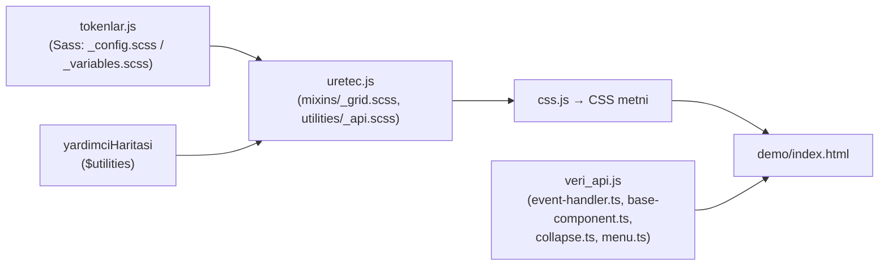

# Sıfırdan mini Bootstrap: belirteçlerden CSS üreteci + data API eklentisi

İki parça: (1) bir **tasarım belirteçleri** (design tokens) nesnesinden 12 sütunlu duyarlı ızgarayı, `.container`'ı ve
Bootstrap'in **Utilities API**'sine benzeyen yardımcı sınıfları üreten saf JavaScript üreteci; (2) `data-bs-toggle`
nitelikleri ve **olay delegasyonu** ile çalışan küçük bir eklenti katmanı (Collapse + akordeon, Menu/Dropdown).
Üreteç iki "lehçe" bilir: kararlı **v5** (`.col-md-6`, `--bs-` önekli değişkenler, `!important` yardımcılar) ve
`main` dalındaki **v6 alfa** (`.md:col-6`, öneksiz değişkenler, mantıksal özellikler, `@layer`). Kod özgündür.

## Gereksinimler ve çalıştırma

- Node.js 22+, bağımlılık yok. Demo için herhangi bir tarayıcı.

```bash
cd repo-atlasi/dallar/01-web-arayuzu/bootstrap/sifirdan
npm test                         # = node --test "test/**/*.test.js"  → 16 test
node scripts/uret.js v5 | head   # v5 lehçesiyle CSS'i standart çıktıya yaz
node scripts/uret.js v6 cikti/mini.css   # dosyaya yaz (cikti/ .gitignore'da)
node scripts/sunucu.js           # demo: http://127.0.0.1:8080/  (PORT ortam değişkeniyle değişir)
```

Demo sayfası (`demo/index.html`) CSS'i tarayıcıda canlı üretir: lehçeyi ya da sütun sayısını değiştirince ızgara
anında yeniden çizilir. ES modülleri `file://` üzerinden yüklenmediği için küçük statik sunucu gerekir.

## Dosyalar

| Dosya                                  | Ne öğretir                                                                                                                     |
| -------------------------------------- | ------------------------------------------------------------------------------------------------------------------------------ |
| `src/tokenlar.js`                      | `v5Tokenlar`, `v6Tokenlar` (kırılım noktaları, sütun, gutter, boşluk ölçeği) + `yardimciHaritasi()` (`$utilities` alt kümesi)  |
| `src/css.js`                           | Küçük CSS ağacı (`kural`, `medya`, `katman`), seçici kaçışlama (`md\:col-6`, `\32 xl\:...`), yazıcı                            |
| `src/uretec.js`                        | `sinifAdi` (infix/prefix), `gridUret`, `containerUret`, `yardimciUret`, `yardimcilarUret`, `cssUret`                           |
| `src/veri_api.js`                      | `delegeHedefi`, `hedefSecicisi`, `veriNitelikleri`, `Data`, `TemelBilesen`, `Collapse`, `Menu`, `on`, `baslat`                 |
| `src/mini_dom.js`                      | Testler için ~150 satırlık sahte DOM (seçici eşleme, kabarcıklanan olaylar, `preventDefault`)                                  |
| `scripts/uret.js`, `scripts/sunucu.js` | CSS dosyası üretimi; yalnızca `node:http` ile statik demo sunucusu (klasör dışına çıkışa 403, bozuk URL kodlamasına 400 verir) |
| `demo/index.html`                      | Canlı ızgara + collapse + menü                                                                                                 |



## Nasıl çalışıyor

**Izgara.** `gridUret` Sass'taki `make-grid-columns` döngüsünün aynısını yapar: her kırılım noktası için (en küçüğü
medya sorgusuz, "mobil önce") `.col`, `.col-auto`, `.col-1…12` (genişlik = i/12), `.offset-*`, `.row-cols-*` ve
`.g-*`/`.gx-*`/`.gy-*` gutter sınıfları. Sınıf adını `sinifAdi` kurar: v5'te `col` + `-md` + `-6`, v6'da `md:` + `col-6`.

**Utilities API.** Her harita girdisi `property` (tek ya da liste), `class` (yoksa ilk özellik adı), `values` (liste ya
da harita; `null` anahtarı sonek üretmez: `.shadow`), `responsive` ve `print` anahtarlarını taşır. `yardimcilarUret`
önce taban sınıfları, sonra her kırılım noktası için yalnızca `responsive: true` olanları, en sonda `@media print`
varyantlarını üretir — `generate-utilities-loop` ile aynı sıra.

**Özgüllük.** v5 yardımcı sınıflara `!important` ekler (`$enable-important-utilities: true`); v6 bunu yapmaz, onun
yerine CSS katman sırası (`@layer layout, utilities;`) yardımcıların her zaman kazanmasını sağlar.

**Data API.** `baslat(belge)` belgeye tek bir `click` dinleyicisi ekler. Tıklanan öğeden yukarı yürüyüp
`[data-bs-toggle="collapse"]` eşleşmesi arar (`delegeHedefi`), hedefi `data-bs-target` ya da `href`'ten bulur, bileşeni
`getOrCreateInstance` ile gerektiğinde oluşturur. `show.bs.collapse` olayı iptal edilebilir; `aria-expanded` güncellenir;
`data-bs-parent` akordeon davranışı verir. Menü dışarı tıklama ve `Escape` ile kapanır, odak tetikleyiciye döner.

## Eşleme tablosu

| Mini'deki parça                   | Gerçek depodaki karşılığı (twbs/bootstrap)                                                                                                       | Fark                                                                   |
| --------------------------------- | ------------------------------------------------------------------------------------------------------------------------------------------------ | ---------------------------------------------------------------------- |
| `v6Tokenlar`                      | `scss/_config.scss` (`$breakpoints`, `$grid-columns`, `$grid-gutter-x`, `$spacers`, `$container-max-widths`, `defaults()`) — `main`, `9062790`   | Sass `@use ... with (...)` ile ezilir; mini düz nesne                  |
| `v5Tokenlar`                      | `scss/_variables.scss` (`$grid-breakpoints`, `$grid-gutter-width`, `$spacers`) — `v5-dev`, `ea8d6a2`                                             | —                                                                      |
| `sinifAdi`                        | v6: `scss/layout/_breakpoints.scss` → `breakpoint-prefix`; v5: `scss/mixins/_breakpoints.scss` → `breakpoint-infix`                              | —                                                                      |
| `gridUret`                        | `scss/mixins/_grid.scss` (`make-row`, `make-col-ready`, `make-col`, `make-col-offset`, `make-grid-columns`), `scss/layout/_grid.scss`            | CSS grid (`.grid`, `make-cssgrid`) yok                                 |
| `containerUret`                   | `scss/layout/_containers.scss`                                                                                                                   | `.container-fluid` ve kırılım noktalı container'lar yok                |
| `yardimciUret`, `yardimcilarUret` | `scss/mixins/_utilities.scss` (`generate-utility`, `generate-utilities-loop`), `scss/utilities/_api.scss`, `scss/_utilities.scss` (`$utilities`) | `state`, `dark`, `variables`, `selector: attr-*`, `child-selector` yok |
| `katman('utilities', ...)`        | `scss/_root.scss` → `@layer colors, config, root, reboot, layout, content, forms, components, custom, helpers, utilities;`                       | Mini yalnızca iki katman bildirir                                      |
| `delegeHedefi`, `on`              | `js/src/dom/event-handler.ts` (`bootstrapDelegationHandler`, `on/off/trigger`)                                                                   | Ad alanlı kaldırma (`.bs.collapse`), `one`, özel olay eşlemesi yok     |
| `Data`                            | `js/src/dom/data.ts`                                                                                                                             | Bootstrap `Map` kullanır, `dispose`'ta siler; mini `WeakMap`           |
| `TemelBilesen`                    | `js/src/base-component.ts` (`getOrCreateInstance`, `dispose`, `DATA_KEY`, `EVENT_KEY`) + `js/src/util/config.ts`                                 | Ayar tip denetimi yok                                                  |
| `veriNitelikleri`                 | `js/src/dom/manipulator.ts` → `getDataAttributes`                                                                                                | —                                                                      |
| `Collapse`                        | `js/src/collapse.ts` ("Data API implementation" bölümü, `SELECTOR_ACTIVES = '.collapse.show'`)                                                   | Geçiş animasyonu (`collapsing`, yükseklik) yok                         |
| `Menu`                            | `js/src/menu.ts` (v5: `js/src/dropdown.js`), `clearMenus`                                                                                        | Floating UI ile konumlama, klavye gezinmesi, alt menü yok              |
| `baslat(belge)`                   | Bootstrap'te her bileşen dosyasının sonunda `EventHandler.on(document, ...)` (yükleme anında)                                                    | Mini açık çağrı ister (test edilebilirlik)                             |
