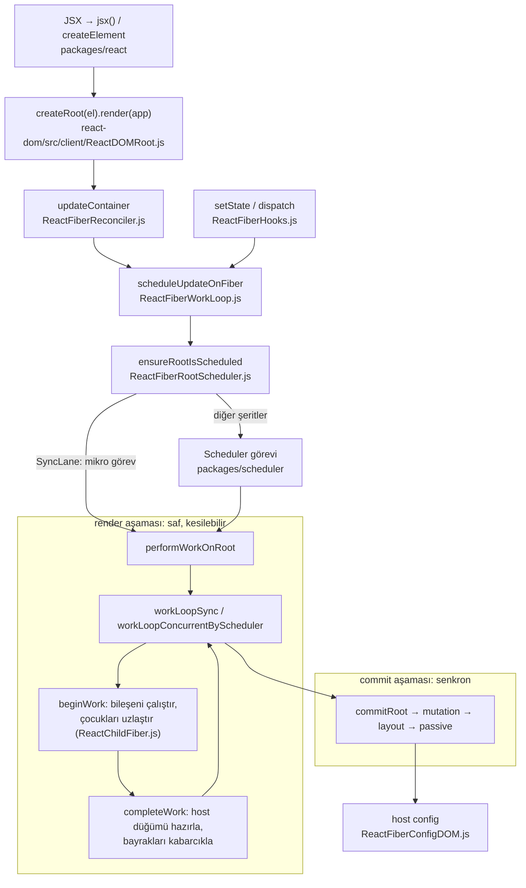
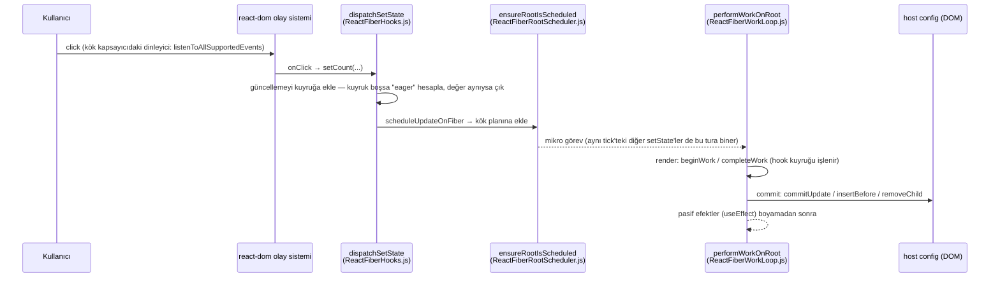
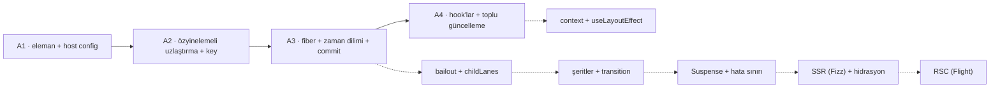

# react/react — Bildirimsel arayüz kütüphanesi: bileşen, uzlaştırma, Fiber ve hook'lar

> **Dal:** [D01 Web arayüzü ve JavaScript](../README.md) · **Tür:** kod tabanı
> **Dil:** JavaScript (Flow tipli) · **Lisans:** MIT · **Yıldız:** 252.434 (9 Kasım 2026) · **İncelenen commit:** `d71b537` (2026-11-06)

## 1. Bir bakışta

React, arayüzü durumun bir fonksiyonu olarak yazdırır: `UI = f(durum)`. Sen bileşenlerden bir eleman ağacı döndürürsün;
React önceki ağaçla farkı bulur ve yalnızca gereken değişiklikleri platforma (DOM, React Native, test ortamı) uygular.
2013'te Facebook (bugün Meta) açık kaynak yaptı; depo artık `react/react` adresinde (eskiden `facebook/react`).
Popülerliğinin üç nedeni: bileşen modeli ve tek yönlü veri akışı, aynı zihinsel modelin web'den mobile taşınması ve
çok geniş ekosistem (Next.js, React Native, binlerce kütüphane). Bu commit'te `ReactVersions.js` sürümü `19.3.0`
gösterir; monorepo 40 paket, React Compiler ve DevTools'u birlikte barındırır.

## 2. Nasıl yapılmış: mimari

### Klasör haritası

```text
packages/
  react/                       genel API: jsx/createElement (src/jsx/ReactJSXElement.js), hook yönlendirici (src/ReactHooks.js)
  react-dom/                   tarayıcı girişleri: createRoot (src/client/ReactDOMRoot.js), sunucu girişleri
  react-dom-bindings/          DOM'a özgü her şey: host config (src/client/ReactFiberConfigDOM.js), olay sistemi (src/events/)
  react-reconciler/            Fiber çekirdeği: 90 kaynak dosya, ~51 bin satır (aşağıdaki "Önce okunacak dosyalar")
  scheduler/                   görev kuyruğu + 5 ms dilim (src/forks/Scheduler.js, src/SchedulerMinHeap.js)
  shared/                      ortak sabitler: ReactSymbols.js, ReactFeatureFlags.js (+ forks/ altında www, native-fb...)
  react-server/                sunucu: Fizz = akışlı SSR (src/ReactFizzServer.js), Flight = RSC (src/ReactFlightServer.js)
  react-client/                Flight istemcisi: sunucu bileşeni yükünü çözer
  react-server-dom-webpack/    RSC paketleyici bağlayıcıları (turbopack, parcel, esm, unbundled kardeşleriyle)
  react-native-renderer/       React Native host'u; react-art/ ve react-markup/ başka host'lar
  react-noop-renderer/         testler için "hiçbir şey çizmeyen" renderer (createReactNoop.js)
  react-test-renderer/         nesne ağacına render eden eski test aracı
  react-devtools-*/            DevTools: eklenti, çekirdek, paylaşılan arayüz, kabuk
  eslint-plugin-react-hooks/   hook kurallarını denetleyen ESLint eklentisi
compiler/                      React Compiler (packages/babel-plugin-react-compiler); crates/ altında Rust portu (12 crate)
fixtures/                      elle deneme uygulamaları: dom, ssr, flight, concurrent, view-transition...
scripts/rollup/                derleme: build.js, bundles.js (paket × biçim), forks.js (derleme anında dosya değiştirme)
scripts/jest/                  test koşucusu (jest-cli.js), kanal/varyant ayarları
scripts/flow/ scripts/error-codes/ scripts/release/   tip denetimi, hata kodu çıkarımı, yayımlama
.github/workflows/             runtime_build_and_test.yml, compiler_*.yml, devtools_*.yml, runtime_sizebot_comment.yml
ReactVersions.js               tüm paket sürümleri ve kanal etiketleri
CLAUDE.md                      yapay zekâ ajanlarına not (konu olarak: Rust derleyici portu "aktif iş" diye geçiyor)
```

### Ana bileşenler ve veri akışı



Akışın özü iki aşamadır. **Render aşaması** bileşen fonksiyonlarını çağırır ve yeni bir "yapım aşamasındaki"
(work-in-progress) fiber ağacı kurar. Bu iş birim birimdir; eşzamanlı (concurrent) modda her birimden sonra
zamanlayıcıya "süre doldu mu" diye sorulur (`workLoopConcurrentByScheduler` → `shouldYield()`), gerekirse bırakılıp
sonra kaldığı yerden sürdürülür ya da daha acil bir güncelleme geldiyse çöpe atılıp baştan başlanır. Bu yüzden
render saf olmalıdır. **Commit aşaması** ise tek seferde ve kesilmeden çalışır: silmeler, eklemeler/taşımalar
(`Placement`), özellik güncellemeleri (`Update`), ref'ler ve layout efektleri; en sonda `useEffect` gibi pasif
efektler boyamadan sonra çalışır. Hangi güncellemenin önce işleneceğini **şeritler** (lanes, 31 bitlik maske;
`ReactFiberLane.js`'de `SyncLane`, `DefaultLane`, `TransitionLane*`, `IdleLane`) belirler. Aynı tick'teki
güncellemeler `ReactFiberRootScheduler.js`'de tek mikro görevde toplanır (otomatik toplu işleme).

**Bir fiber düğümü** (`ReactFiber.js` → `FiberNode`) bileşen ağacındaki bir yerin "iş kaydı"dır:

| Alan                                  | Anlamı                                                                                           |
| ------------------------------------- | ------------------------------------------------------------------------------------------------ |
| `tag`, `type`, `elementType`, `key`   | Ne tür düğüm (FunctionComponent, HostComponent...), hangi bileşen/etiket, kimlik                 |
| `stateNode`                           | Host düğümü (DOM öğesi) ya da kök için `FiberRoot`                                               |
| `return`, `child`, `sibling`, `index` | Ağaç bağlantıları: özyineleme yerine döngüyle gezilir; `index` liste uzlaştırmasında eski konum  |
| `pendingProps`, `memoizedProps`       | Bu render'ın girdisi ve son commit'teki props                                                    |
| `memoizedState`, `updateQueue`        | Fonksiyon bileşende hook bağlı listesinin başı; kökte/sınıflarda güncelleme kuyruğu              |
| `flags`, `subtreeFlags`, `deletions`  | Commit'te yapılacak yan etkiler (Placement, Update, ChildDeletion, Passive...) ve alt ağaç özeti |
| `lanes`, `childLanes`                 | Bu düğümde / altında bekleyen güncellemelerin öncelikleri (bailout kararı buradan)               |
| `alternate`                           | Ekrandaki ↔ yapım aşamasındaki ikiz düğüm (çift tamponlama)                                      |
| `mode`, `ref`, `dependencies`         | StrictMode/eşzamanlı kip bitleri, ref, context bağımlılıkları                                    |

**Bir tıklamanın yolculuğu** (`setCount(c => c + 1)`):



### Önce okunacak dosyalar

1. `packages/react/src/jsx/ReactJSXElement.js` — `ReactElement`: eleman, `$$typeof` ile işaretlenmiş düz bir
   nesnedir. Üretimde `{ $$typeof, type, key, ref, props }` olur; React 19'da `ref`, `props.ref`'ten okunur ve
   `element.ref` kaldırılmak üzeredir. DEV'de ek olarak `_owner`, `_store` ve `_debug*` alanları bulunur.
2. `packages/react-dom/src/client/ReactDOMRoot.js` — `createRoot` ve `render` nasıl `updateContainer`'a iner.
3. `packages/react-reconciler/src/ReactFiber.js` — `FiberNode` alanları (`child`, `sibling`, `return`, `alternate`, `flags`), `createWorkInProgress`.
4. `packages/react-reconciler/src/ReactFiberWorkLoop.js` (5.700 satır) — `performUnitOfWork`, `completeUnitOfWork`, `workLoopSync`, `renderRootConcurrent`, `commitRoot`.
5. `packages/react-reconciler/src/ReactChildFiber.js` — `reconcileChildrenArray`, `placeChild`, `updateSlot`, `mapRemainingChildren`.
6. `packages/react-reconciler/src/ReactFiberBeginWork.js` ve `ReactFiberCompleteWork.js` — `beginWork` anahtarı (switch), `updateFunctionComponent`, `appendAllChildren`, `bubbleProperties`.
7. `packages/react-reconciler/src/ReactFiberHooks.js` (5.265 satır) — `renderWithHooks`, `mountState`, `updateReducerImpl`, `dispatchSetState`, `HooksDispatcherOnMount/OnUpdate`.
8. `packages/react-reconciler/src/ReactFiberCommitWork.js` + `ReactFiberCommitHostEffects.js` — `commitMutationEffects`, `commitPlacement`, `getHostSibling`.
9. `packages/scheduler/src/forks/Scheduler.js` — `unstable_scheduleCallback`, `workLoop`, `shouldYieldToHost`.
10. `packages/react-reconciler/README.md` — üçüncü taraf renderer yazacaklar için host config başvurusu.

### Teknoloji yığını, derleme, test, CI, sürüm

- **Dil ve tipler:** Düz JavaScript + Flow tip açıklamaları (`@flow`); `scripts/flow/` her host config için ayrı Flow
  denetimi kurar (CI'da "Flow check" matris işi).
- **Paket yönetimi:** Yarn 1 çalışma alanları (`package.json` → `"workspaces": ["packages/*"]`, `yarn@1.22.22`).
- **Derleme:** Rollup (`scripts/rollup/build.js`). `bundles.js` hangi paketin hangi biçimlerde (NODE_DEV, NODE_PROD,
  ESM_PROD…) üretileceğini, `forks.js` ise derleme anında hangi dosyanın hangisiyle değiştirileceğini söyler:
  `packages/react-reconciler/src/ReactFiberConfig.js` kasıtlı olarak `throw` eder ve her renderer için
  `src/forks/ReactFiberConfig.dom.js` gibi bir dosyayla değiştirilir (`scripts/shared/inlinedHostConfigs.js`).
- **Özellik bayrakları:** `packages/shared/ReactFeatureFlags.js` ve `forks/ReactFeatureFlags.www.js`, `.native-fb.js`…
  Örnek: `enableThrottledScheduling = false` olduğundan eşzamanlı döngü `workLoopConcurrentByScheduler`'dır.
- **Kanallar:** stable, experimental, canary ve Meta içi (www) derlemeleri tek kaynaktan çıkar
  (`scripts/rollup/build-all-release-channels.js`, `ReactVersions.js`).
- **Hata kodları:** `scripts/error-codes/` mesajları çıkarır; üretim derlemesi uzun metin yerine kod taşır.
- **Test:** Jest, `yarn test` → `scripts/jest/jest-cli.js` (kanal ve varyant bayraklarıyla). `packages/*/src/__tests__/`
  altında ~330 test dosyası (`*-test.js`). Çekirdek (`react-reconciler`) testlerinin çoğu (79'un 67'si)
  `react-noop-renderer` ile çalışır ve "hangi sırayla ne oldu" günlüğünü denetler; `react-dom` testleri ise
  `react-dom/client` + jsdom kullanır (test ortamı: `scripts/jest/ReactJSDOMEnvironment.js`).
- **CI:** `.github/workflows/runtime_build_and_test.yml` → Flow matrisi, parçalı (`--shard`) `yarn test`, Fizz/Flight
  testleri, eslint eklentisi testi, derleme + lint; `runtime_sizebot_comment.yml` paket boyutu farkını PR'a yazar;
  `runtime_fuzz_tests.yml`. Compiler ve DevTools'un kendi iş akışları var.
- **Sürüm:** `scripts/release/` (`prepare-release-from-ci.js`, `publish.js`): yayımlanan paketler CI'da üretilen
  artefaktlardan hazırlanır.

### Tasarım kararları ve ödünleşimler

1. **Render ve commit ayrımı.** Render'ın saf olması kesilebilirliği, StrictMode'un çift çağırmasını ve eşzamanlı
   özellikleri (transition, Suspense) mümkün kılar. Bedeli: geliştirici yan etkiyi render dışına (efekt, olay
   işleyicisi) taşımak zorundadır.
2. **Host config ile platform bağımsızlık.** Aynı uzlaştırıcı DOM, Native, ART ve testler için çalışır. React içinde
   bu bağlama derleme anında yapılır (dolaylı çağrı maliyeti yok); npm'deki `react-reconciler` paketi ise yapılandırmayı
   bir argüman olarak alır (`src/forks/ReactFiberConfig.custom.js` içindeki `$$$config`).
3. **Tek yönlü liste uzlaştırma.** Fiber'larda geri işaretçi olmadığı için iki uçtan arama yapılmaz; `placeChild`
   "eski konumu, yerinde bırakılanların en büyüğünden küçükse taşı" (`lastPlacedIndex`) der. Sık durumlarda hızlıdır,
   ama son öğeyi başa almak n-1 taşıma ister. `ReactChildFiber.js`'deki yorum bu ödünleşimi açıkça yazar. Vue 3'ün
   LIS tabanlı yaklaşımıyla karşılaştır: [vue3-core](../vue3-core/README.md).
4. **Sıra tabanlı hook'lar.** Durum, bileşenin kaçıncı hook'u olduğuna göre fiber'da saklanır; `useState` aslında
   `ReactSharedInternals.H` üzerindeki aktif "dispatcher"a yönlendirir (mount ve update için farklı nesneler).
   Basit ve hızlıdır; bedeli "hook'lar koşullu çağrılamaz" kuralı ve onu denetleyen `eslint-plugin-react-hooks`.
5. **Öncelik = şeritler.** Bit maskeleri birden çok güncelleme grubunu ucuzca birleştirir, karşılaştırır, "dolanık"
   (entangled) yapar. Okuması zordur ama sıcak yolda (hot path) tahsis yapmaz.
6. **Tek kaynak, çok dağıtım.** Özellik bayrakları ve kanallar sayesinde deneysel API'ler önce Meta içinde ve canary'de
   yaşar. Bedeli: kodun önemli bir kısmı `if (enableX)` dallarıdır; okurken bayrağın değerine bakmak gerekir.
7. **Derleyici.** React Compiler bileşenleri analiz edip otomatik memoization ekler; bu commit'te TypeScript
   uygulamasının yanında `compiler/crates/` altında Rust portu sürüyor (`compiler_rust.yml`).

## 3. Öğrenmen gerekenler

| Ön koşul                                                 | Bu depo için neden                                                                   | Ücretsiz kaynak                                                                     |
| -------------------------------------------------------- | ------------------------------------------------------------------------------------ | ----------------------------------------------------------------------------------- |
| [G4 JavaScript ve Node.js](../../../govde/README.md#g4)  | Kapanış, `this`, modüller, olay döngüsü: hook'ların ve zamanlayıcının dili           | [You-Dont-Know-JS koanları](../you-dont-know-js/sifirdan/README.md)                 |
| [G5 Veri yapıları](../../../govde/README.md#g5)          | Ağaç dolaşımı, bağlı liste (fiber), min-heap (scheduler), bit maskesi (lanes, flags) | [javascript-algorithms](../../09-bilgisayar-bilimi/javascript-algorithms/README.md) |
| HTML, CSS ve DOM temelleri (dal içi kavram)              | DOM, olaylar, tarayıcının boyama döngüsü (`useEffect` boyamadan sonra çalışır)       | MDN Web Docs (developer.mozilla.org)                                                |
| [G6 Ağ ve web temelleri](../../../govde/README.md#g6)    | Yalnızca yan dallar için: SSR (Fizz) ve RSC (Flight) yanıtı HTTP üzerinden akıtır    | MDN — HTTP (developer.mozilla.org)                                                  |
| [G7 Test ve CI](../../../govde/README.md#g7)             | Depodaki testler davranış belgesidir; noop renderer ile test yazma                   | `packages/react-reconciler/src/__tests__/`                                          |
| [G8 Büyük kod tabanı okuma](../../../govde/README.md#g8) | Monorepo, derleme anı fork'lar, özellik bayrakları                                   | Bu dosyadaki okuma rotası                                                           |
| Dal içi: [vue3-core](../vue3-core/README.md)             | Aynı problemi (UI = f(durum)) farklı çözen ikinci örnek: reaktivite + derleyici      | [vue3-core/sifirdan](../vue3-core/sifirdan/README.md)                               |

Dala özgü kavramlar: sanal DOM ve uzlaştırma; değişmezlik (immutability) ve referans eşitliği (`Object.is`);
mikro görev / makro görev; "kaldır ve sürdür" (resumable) hesaplama; bileşen yaşam döngüsü ve efekt temizliği.
Ek kaynaklar: resmî belgeler [react.dev](https://react.dev) (Learn bölümü); kendi React'ini yazma rehberleri
[build-your-own-x](../../10-kuratorluk-topluluk/build-your-own-x/README.md) listesinde ("Build your own React",
"didact"); Türkçe video dersler [free-programming-books](../../10-kuratorluk-topluluk/free-programming-books/README.md)
deposunun `courses/free-courses-tr.md` dosyasında "React" başlığı altında; yol haritası
[developer-roadmap](../../02-uygulama-platformlari/developer-roadmap/README.md) → `roadmaps/react`.

## 4. Sıfırdan yol (dallanma)



| Aşama      | Ne inşa edersin                                          | Öğrendiğin kavram                                        | Bitti ölçütü                                               | Süre (tahmini)          |
| ---------- | -------------------------------------------------------- | -------------------------------------------------------- | ---------------------------------------------------------- | ----------------------- |
| A1         | `createElement` + host config ile ilk montaj             | Eleman ağacı, platform soyutlaması                       | `test/asama1.test.js` geçer; aynı ağaç iki host'ta çizilir | 2–3 saat                |
| A2         | Özyinelemeli uzlaştırıcı, `key` eşleme                   | Tür kuralı, `lastPlacedIndex`, en az değişiklik          | `asama2`: taşıma sayıları beklenen                         | 4–6 saat                |
| A3         | Fiber ağacı, kesilebilir iş döngüsü, commit              | Bağlı liste dolaşımı, zaman dilimi, iki aşama, bayraklar | `asama3`: dilim, kesinti, `getHostSibling` testleri        | 5–10 saat               |
| A4         | `useState/useReducer/useEffect/useRef`, toplu güncelleme | Sıra tabanlı durum, efekt zamanlaması, mikro görev       | `asama4` (10 test) geçer                                   | 5 saat                  |
| Yan dallar | Bailout, context, şeritler, Suspense, SSR                | Öncelik, iptal, akış                                     | Kendi testlerin                                            | 20+ saat (isteğe bağlı) |

A1–A4 toplamı **16–24 saat**; dalın [yaprak tablosu](../README.md#yapraklar) bu sayıyı ve süre kuralını kullanır.

**Mini uygulama:** [sifirdan/](sifirdan/README.md) — dört aşama, 29 test, yalnızca Node yerleşikleri. Her aşamanın
gerçek depodaki karşılığı oradaki eşleme tablosunda. Öne çıkan iki deney: (1) render yarıda kesilir, ekran yarım
ağaç görmez, gelen yeni güncelleme işi baştan başlatır; (2) aynı tick'teki üç `setState` tek render olur, bayat
kapanış ile güncelleyici fonksiyon farkı görülür.

**Gerçek ölçeğe giden yol** (eksikler ve ekleme sırası):

1. **Bailout + `childLanes`:** Mini her güncellemede kökten tüm bileşenleri çağırır. React değişmeyen alt ağaçları
   `bailoutOnAlreadyFinishedWork` ile atlar; bunun için güncellemeyi fiber'dan köke doğru işaretler.
2. **Alternate havuzu:** İki ağacı dönüşümlü kullanmak bellek tahsisini azaltır (`createWorkInProgress`).
3. **Şeritler ve geçişler:** Birden çok öncelik; acil güncelleme yarım transition'ı bekletir, sonra yeniden temellendirir (rebase).
4. **Context, ref'ler, layout efektleri:** `ReactFiberNewContext.js`, `commitLayoutEffects`.
5. **Hata sınırları ve Suspense:** render sırasında fırlatılan hata/promise ile "geri sar" (unwind) — `ReactFiberThrow.js`, `ReactFiberUnwindWork.js`.
6. **Olay sistemi:** köke tek dinleyici + sentetik olaylar (`react-dom-bindings/src/events/DOMPluginEventSystem.js`).
7. **Sunucu:** Fizz ile akışlı SSR, hidrasyon (`ReactFiberHydrationContext.js`), sonra Flight/RSC.
8. **Araçlar:** DevTools kancaları (`ReactFiberDevToolsHook.js`), Profiler, ve en son derleyici.

## 5. Gerçek depoda okuma rotası

1. `packages/react/src/jsx/ReactJSXElement.js` → `ReactElement`: `$$typeof` neden bir `Symbol`? (İpucu: JSON'dan gelen
   düz nesne eleman sayılmasın; `packages/shared/ReactSymbols.js`'de `react.transitional.element`.)
2. `packages/react-dom/src/client/ReactDOMRoot.js` → `ReactDOMRoot.prototype.render` → `updateContainer`
   (`ReactFiberReconciler.js` → `updateContainerImpl`): güncelleme nesnesi kuyruğa nasıl girer?
3. `ReactFiberWorkLoop.js` → `scheduleUpdateOnFiber` → `ReactFiberRootScheduler.js` → `ensureRootIsScheduled`:
   "kök planlandı mı" bilgisi nerede tutuluyor, mikro görev nerede kuruluyor?
4. `ReactFiberWorkLoop.js` → `renderRootConcurrent` → `workLoopConcurrentByScheduler` → `performUnitOfWork`:
   `next === null` olunca neden `completeUnitOfWork`'e geçiliyor?
5. `ReactFiberBeginWork.js` → `beginWork` içindeki `switch (workInProgress.tag)`; `updateFunctionComponent` →
   `renderWithHooks` (`ReactFiberHooks.js`): dispatcher ne zaman `HooksDispatcherOnMount`, ne zaman `OnUpdate`?
6. `ReactChildFiber.js` → `reconcileChildrenArray`: ilk döngü ne zaman kırılıyor, `mapRemainingChildren` ne zaman
   devreye giriyor? `[a b c] → [c a b]` için `placeChild` hangi fiber'lara `Placement` koyar? (Mini'deki testle doğrula.)
7. `ReactFiberCompleteWork.js` → `completeWork` (HostComponent dalı): `createInstance` + `appendAllChildren`; güncellemede
   neden yalnızca bayrak konuyor?
8. `ReactFiberWorkLoop.js` → `commitRoot` → `ReactFiberCommitWork.js` → `commitMutationEffects` →
   `ReactFiberCommitHostEffects.js` → `commitPlacement`, `getHostSibling`: taşınan düğüm nereye konuyor?
9. `ReactFiberHooks.js` → `dispatchSetState` → `dispatchSetStateInternal`: "eager state" hızlı yolu hangi koşulda render
   planlamadan çıkar?
10. Testleri belge gibi oku: `packages/react-reconciler/src/__tests__/ReactHooksWithNoopRenderer-test.js` ve
    `ReactIncrementalSideEffects-test.js`. Bir testi seç, mini'de karşılığını yaz.

## 6. Alıştırmalar ve öz değerlendirme

1. (Kolay) Mini'ye `useMemo(fn, deps)` ekle; `useEffect`'teki bağımlılık karşılaştırmasını yeniden kullan.
2. (Kolay) `useLayoutEffect` ekle: commit içinde senkron çalışsın, `useEffect`'ten önce. Sırayı test et.
3. (Orta) Bailout: props'u aynı (`===`) ve bekleyen güncellemesi olmayan bileşeni atla; kardeş bileşenin render
   sayısının artmadığını test et.
4. (Orta) `createContext` + `useContext`: sağlayıcı fiber'ı yukarı doğru arayan bir okuma.
5. (Orta) Gerçek DOM host config'i yaz (`document.createElement`, `insertBefore`…) ve mini'yi tarayıcıda çalıştır.
6. (Zor) İki şerit: senkron güncelleme, sürmekte olan düşük öncelikli render'ı beklemeden kendi sonucunu commit etsin;
   düşük öncelikli iş sonra yeniden temellensin.
7. (Zor) Hata sınırı: render'da fırlatılan hatayı en yakın "sınır" bileşeninde yakala ve yedek arayüzü göster.
8. (Zor) Mini'nin `placeChild` mantığını Vue'nun LIS yaklaşımıyla değiştir; `[a b c d e] → [e a b c d]` için taşıma
   sayısının 4'ten 1'e indiğini test et.

**Öz değerlendirme**

1. Render aşaması neden saf olmak zorunda?
   <details><summary>Cevap</summary>Eşzamanlı modda render yarıda bırakılabilir, çöpe atılıp baştan yapılabilir ve
   StrictMode'da iki kez çağrılır. Yan etki render'da olsaydı ekrana yansımayan bir ağaç için bile dış dünyayı
   değiştirirdi. Ekrana dokunan her şey commit'te, dış dünyaya dokunan her şey efektlerde olur.</details>
2. `setCount(count + 1)` üç kez çağrılınca neden 1 artar, `setCount(c => c + 1)` üç kez çağrılınca neden 3?
   <details><summary>Cevap</summary>İlkinde üç eylem de render anındaki `count` değerinden hesaplanmış aynı sayıdır
   (bayat kapanış). İkincisinde kuyruk sırayla işlenir; her güncelleyici bir öncekinin sonucunu alır. İkisi de tek
   render'da uygulanır (toplu işleme).</details>
3. Fiber'ın `alternate` alanı ne işe yarar?
   <details><summary>Cevap</summary>Ekrandaki (current) fiber ile yapım aşamasındaki (work-in-progress) karşılığını
   bağlar. Uzlaştırma eski props/durumu buradan okur; commit'te `root.current` yeni ağaca döner ve iki ağaç sonraki
   render'da roller değiştirerek yeniden kullanılır (çift tamponlama).</details>
4. Neden liste öğelerinde dizi indeksini `key` yapmak sorunludur?
   <details><summary>Cevap</summary>Araya ekleme veya yeniden sıralamada indeksler kayar; React yanlış eski fiber'ı
   yeni öğeyle eşler. Sonuç gereksiz güncellemeler ve en kötüsü durumun (input değeri, hook durumu) yanlış öğede
   kalmasıdır. Mini'deki "anahtarsız liste" testi bunu gösterir.</details>
5. Host config'in derleme anında içe gömülmesinin artısı ve eksisi nedir?
   <details><summary>Cevap</summary>Artısı: sıcak yolda dolaylı çağrı yok, paketleyici ölü kodu atabilir, Flow her
   renderer için ayrı denetlenir. Eksisi: derleme düzeni karmaşıklaşır (`forks.js`, `inlinedHostConfigs.js`) ve
   `ReactFiberConfig.js` doğrudan çalıştırılamaz (bilerek `throw` eder).</details>

## 7. İş fikri tohumları

- **Render maliyet denetimi:** React uygulamasında gereksiz render'ları ve büyük commit'leri ölçüp rapor eden
  danışmanlık ve küçük araç. **Kime:** Türkiye'de trafiği yüksek e-ticaret ve fintech ekipleri (10–50 ön yüz
  geliştiricisi).
- **Kurumsal "React içyapısı" atölyesi:** bu dosyadaki mini React'i iki günde birlikte yazdıran eğitim.
  **Kime:** yazılım evlerinin orta seviye ön yüz ekipleri, bootcamp'lerin ileri seviye sınıfları.
- **Özel renderer hizmeti:** host config ile React'i kiosk, POS ekranı ya da PDF/rapor üretimine bağlamak.
  **Kime:** perakende zincirleri ve raporlama yazılımı geliştiren KOBİ'ler.

Ayrıntılı katalog: [is-fikirleri](../../../is-fikirleri/README.md).

## 8. Kaynaklar

Depo içi bağlantılar incelenen commit'e sabitlenmiştir. Depo dışı bağlantılar bellekten verilmiştir (doğrulanmadı).

- [packages/react-reconciler/README.md](https://github.com/react/react/blob/d71b537/packages/react-reconciler/README.md) — host config başvurusu
- [ReactFiberWorkLoop.js](https://github.com/react/react/blob/d71b537/packages/react-reconciler/src/ReactFiberWorkLoop.js) · [ReactFiberHooks.js](https://github.com/react/react/blob/d71b537/packages/react-reconciler/src/ReactFiberHooks.js) · [ReactChildFiber.js](https://github.com/react/react/blob/d71b537/packages/react-reconciler/src/ReactChildFiber.js)
- [packages/scheduler/src/forks/Scheduler.js](https://github.com/react/react/blob/d71b537/packages/scheduler/src/forks/Scheduler.js)
- [CONTRIBUTING.md](https://github.com/react/react/blob/d71b537/CONTRIBUTING.md) · [scripts/release/README.md](https://github.com/react/react/blob/d71b537/scripts/release/README.md)
- [.github/workflows/runtime_build_and_test.yml](https://github.com/react/react/blob/d71b537/.github/workflows/runtime_build_and_test.yml)
- Resmî belgeler: <https://react.dev> (doğrulanmadı)
- Andrew Clark, "React Fiber Architecture": <https://github.com/acdlite/react-fiber-architecture> (doğrulanmadı)
- Dan Abramov, "React as a UI Runtime": <https://overreacted.io/react-as-a-ui-runtime/> (doğrulanmadı)
- Rodrigo Pombo, "Build your own React": <https://pomb.us/build-your-own-react/> (build-your-own-x listesinde geçer)
