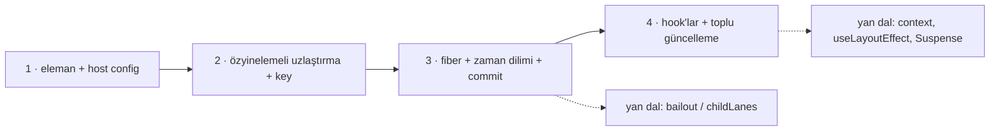

# Sıfırdan mini React

Bu klasör, React'in çekirdek fikirlerini **dört aşamada** sıfırdan kurar: eleman + host config, uzlaştırma (key'lerle),
fiber ağacı + kesilebilir iş döngüsü + commit, hook'lar + toplu güncelleme. Amaç özellik eşitliği değil,
`packages/react-reconciler` içindeki mekanizmayı **çalıştırarak** anlamaktır. Kod özgündür (React'ten kopya yok);
her parçanın gerçek depodaki karşılığı aşağıdaki tabloda.

## Gereksinimler

- Node.js 22+ (yalnızca yerleşik modüller; `npm install` gerekmez)
- JSX yok: `h('ul', null, h('li', { key: 'a' }, 'A'))` yazılır (JSX zaten bu çağrıya derlenir).

## Çalıştırma ve test

```bash
cd repo-atlasi/dallar/01-web-arayuzu/react/sifirdan
npm test                                  # = node --test "test/**/*.test.js"
node --test test/asama3.test.js           # tek aşama
```

Beklenen: 29 test, hepsi geçer. Testler aynı zamanda belgedir: her `test(...)` adı bir davranışı anlatır.

## Dosyalar ve aşamalar

| Dosya                      | Aşama | Ne öğretir                                                                             |
| -------------------------- | ----- | -------------------------------------------------------------------------------------- |
| `src/eleman.js`            | 1     | `createElement`, `key`, metin çocuklar, `Fragment`                                     |
| `src/test_host.js`         | 1–4   | DOM yerine düz nesnelere çizen **host config** + değişiklik günlüğü (`ops`)            |
| `src/asama1_render.js`     | 1     | Eleman ağacını host config üzerinden kurmak; ekran dışında kur, tek hamlede bağla      |
| `src/asama2_uzlastirma.js` | 2     | React 15 tarzı özyinelemeli uzlaştırıcı: tür kuralı, key eşleme, `lastPlacedIndex`     |
| `src/zamanlayici.js`       | 3     | Görev kuyruğu, 5 ms dilim, "devam görevi" (continuation), sahte saat                   |
| `src/asama3_fiber.js`      | 3     | Fiber (`child/sibling/return`), `beginWork`/`completeWork`, kesinti, commit, bayraklar |
| `src/asama4_hooks.js`      | 4     | `useState`, `useReducer`, `useEffect`, `useRef`; mikro görevde toplu render            |



### Aşama 1 — Host config

Çekirdek `div` nedir bilmez; `createInstance`, `appendInitialChild`, `appendChildToContainer` gibi yöntemleri
çağırır. `test/asama1.test.js` aynı eleman ağacını iki farklı host'a (nesne ağacı ve metin satırları) çizer.

### Aşama 2 — Uzlaştırma

`createStackRoot(container, host).render(el)` ikinci çağrıda eski ağaçla karşılaştırır. İki kural: tür değişirse alt
ağaç yeniden kurulur; kardeşler `key` (yoksa sıra) ile eşleşir. Yerleştirme React'in `lastPlacedIndex` kuralıyla
yapılır. Testte görülen bilinen zaaf: `[a b c d e] → [e a b c d]` dönüşümü **4 taşıma** ister
(Vue 3'ün LIS yöntemi aynı işi 1 taşımayla yapar: `../../vue3-core/sifirdan/test/asama2.test.js`).

### Aşama 3 — Fiber, zaman dilimleme, commit

- **Render aşaması** saf ve kesilebilir: `performUnitOfWork` → `beginWork` (bileşeni çalıştır, çocukları uzlaştır) →
  çocuk yoksa `completeUnitOfWork` (host düğümünü ekran dışında oluştur, kardeşe geç ya da yukarı çık).
- `scheduler.shouldYield()` her birimden sonra sorulur; 5 ms dolunca iş bırakılır, görev bir **devam fonksiyonu**
  döndürür. Testler sahte saatle zamanı kendisi ilerletir (`sahteSaat()`), bu yüzden belirlenimcidir.
- Render sürerken yeni `render()` gelirse yarım ağaç çöpe atılır (React: `prepareFreshStack`).
- **Commit aşaması** kesilmez: silmeler, `Placement` (ekle/taşı; `getHostSibling` ile doğru yer), `Update`.
  `subtreeFlags` sayesinde değişmeyen dallar gezilmez.

### Aşama 4 — Hook'lar

Hook'lar fiber'da bir dizi olarak durur; "kaçıncı hook" bilgisi durumun adresidir. `setState` güncellemeyi kuyruğa
ekler ve `ensureRootIsScheduled` ile **tek mikro görev** planlar: aynı tick'teki tüm güncellemeler tek render olur.
Kuyruk render'da değil commit'te temizlenir; böylece kesilen render güncelleme kaybetmez (testi var).
`useEffect` commit'ten sonra çalışır; önce tüm temizlikler, sonra tüm yeni efektler; çocuk efekti ebeveyninkinden önce.

## Eşleme tablosu

| Mini'deki parça                                 | Gerçek depodaki karşılığı (dosya yolu)                                                                                                                              | Fark                                                                                                      |
| ----------------------------------------------- | ------------------------------------------------------------------------------------------------------------------------------------------------------------------- | --------------------------------------------------------------------------------------------------------- |
| `createElement`, `ELEMAN` sembolü               | `packages/react/src/jsx/ReactJSXElement.js` (`createElement`, `jsxProd`, `ReactElement`)                                                                            | React metni dize olarak tutar, iç içe dizileri düzleştirmez; `$$typeof` = `react.transitional.element`    |
| `createTestHost()`                              | `packages/react-reconciler/README.md`, `src/forks/ReactFiberConfig.custom.js`, `packages/react-noop-renderer/src/createReactNoop.js`                                | React'te host config derleme anında "fork" ile içe gömülür (`scripts/shared/inlinedHostConfigs.js`)       |
| `asama1_render.js`                              | `ReactFiberCompleteWork.js` → `appendAllChildren`; ilk montajda tek `appendChildToContainer`                                                                        | Mini'de fiber yok, düz özyineleme                                                                         |
| `asama2_uzlastirma.js` → `yerlestir`            | `packages/react-reconciler/src/ReactChildFiber.js` → `reconcileChildrenArray`, `placeChild`                                                                         | React önce sıralı hızlı geçiş yapar, sonra `Map`'e düşer; mini doğrudan `Map` kullanır                    |
| `zamanlayici.js`                                | `packages/scheduler/src/forks/Scheduler.js` (`shouldYieldToHost`, `frameInterval`), `SchedulerFeatureFlags.js` (`frameYieldMs = 5`), `SchedulerMinHeap.js`          | Tek öncelik, FIFO; gerçek: 5 öncelik, son tarihe göre min-heap, `MessageChannel` (Node'da `setImmediate`) |
| `performUnitOfWork`, `completeUnitOfWork`       | `ReactFiberWorkLoop.js` (`performUnitOfWork`, `completeUnitOfWork`, `workLoopSync`, `workLoopConcurrentByScheduler`)                                                | Şerit (lane) yok; her güncelleme kökten başlar                                                            |
| `beginWork`, `completeWork`, `bubbleProperties` | `ReactFiberBeginWork.js`, `ReactFiberCompleteWork.js`                                                                                                               | Yalnızca 4 fiber türü (HostRoot, HostComponent, HostText, FunctionComponent)                              |
| `createWorkInProgress`                          | `ReactFiber.js` → `createWorkInProgress`                                                                                                                            | React iki ağacı dönüşümlü kullanır (alternate havuzu); mini her render'da yeni fiber üretir               |
| `Placement`, `Update`, `ChildDeletion`          | `ReactFiberFlags.js` (aynı bit değerleri)                                                                                                                           | —                                                                                                         |
| `commitRoot`, `getHostSibling`                  | `ReactFiberWorkLoop.js` → `commitRoot`; `ReactFiberCommitWork.js` → `commitMutationEffects`; `ReactFiberCommitHostEffects.js` → `commitPlacement`, `getHostSibling` | Layout aşaması, ref'ler, görünüm geçişleri yok                                                            |
| `ensureRootIsScheduled` (mikro görev)           | `ReactFiberRootScheduler.js` → `ensureRootIsScheduled`, `processRootScheduleInMicrotask`                                                                            | Mini'de hook güncellemesi hep senkron şeritte işlenir                                                     |
| `useReducer`, `useState`, `basicStateReducer`   | `ReactFiberHooks.js` → `mountReducer`, `updateReducerImpl`, `mountState`, `basicStateReducer`                                                                       | Hook'lar bağlı liste değil dizi; `baseQueue`/rebase yok                                                   |
| `dispatchAction` (eager bailout)                | `ReactFiberHooks.js` → `dispatchSetState`, `dispatchSetStateInternal`                                                                                               | React güncellemeyi yine kuyruğa koyar ama render planlamaz                                                |
| `useEffect`, `flushPassiveEffects`              | `ReactFiberHooks.js` → `mountEffect`/`updateEffect`; `ReactFiberWorkLoop.js` → `flushPassiveEffects`; `ReactFiberCommitWork.js` → `commitPassiveMountEffects`       | React pasif efektleri zamanlayıcı göreviyle (boyamadan sonra) çalıştırır; mini mikro görevle              |
| `surec` (geçerli hook bağlamı)                  | `packages/react/src/ReactHooks.js` → `resolveDispatcher()` + `ReactSharedInternals.H`                                                                               | React mount/update için ayrı dispatcher nesneleri kullanır (`HooksDispatcherOnMount`...)                  |

## Bilinçli eksikler

Bailout (değişmeyen alt ağacı atlama), şeritler ve geçişler (transitions), context, ref'ler, `useLayoutEffect`,
hata sınırları, Suspense, hidrasyon, olay sistemi, DevTools. Hangi sırayla ekleneceği dosyanın
[“Gerçek ölçeğe giden yol”](../README.md#4-sıfırdan-yol-dallanma) bölümünde.
