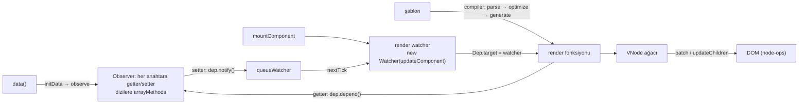
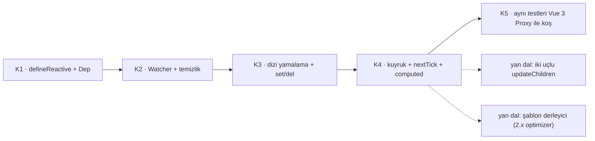

# vuejs/vue — Vue 2: defineProperty reaktivitesi, Snabbdom kökenli sanal DOM ve ömrünü tamamlamış bir çatı

> **Dal:** [D01 Web arayüzü ve JavaScript](../README.md) · **Tür:** kod tabanı (arşiv niteliğinde)
> **Dil:** TypeScript · **Lisans:** MIT · **Yıldız:** 212.625 (9 Kasım 2026) · **İncelenen commit:** `9e88707` (2024-10-10)

## 1. Bir bakışta

Bu depo Vue 2'nin kaynağıdır (son sürüm `2.7.16`). README'nin ilk satırı açık: Vue 2'nin ömrü **31 Aralık 2023'te
bitti**; yeni özellik, güncelleme ya da düzeltme almıyor, ama npm ve CDN'lerde durmaya devam ediyor. Yine de 212 bin
yıldızla GitHub'ın en çok yıldız alan depolarından biri: Vue'nun büyüme yılları (2014–2020) burada yaşandı ve
yıldızlar Vue 3 deposuna ([vue3-core](../vue3-core/README.md)) taşınmadı. Öğrenme değeri yüksek çünkü
`Object.defineProperty` ile kurulan reaktivite ve onun sınırları, Vue 3'ün neden yeniden yazıldığını en iyi anlatan
şeydir. Bu commit'te kaynak TypeScript'tir (`src/**/*.ts`); 2.7.0 sürümü (2022-07-01, `CHANGELOG.md`) Composition
API'yi ve `<script setup>`'ı Vue 3'ten geri taşıdı, bu kod `src/v3/` altında durur.

## 2. Nasıl yapılmış: mimari

### Klasör haritası

```text
src/
  core/observer/        reaktivite: index.ts (Observer, observe, defineReactive, set, del), dep.ts (Dep, pushTarget),
                        watcher.ts (Watcher), array.ts (arrayMethods), scheduler.ts (queueWatcher), traverse.ts
  core/instance/        bileşen örneği: init.ts (_init), state.ts (initData, initComputed, proxy), render.ts,
                        lifecycle.ts (mountComponent, render watcher), events.ts, inject.ts
  core/vdom/            sanal DOM: vnode.ts, create-element.ts, create-component.ts, patch.ts (Snabbdom'dan uyarlama)
  core/util/            next-tick.ts, options.ts (mergeOptions: mixin ve extends birleştirme), props.ts, error.ts
  core/global-api/      Vue.use, Vue.mixin, Vue.extend, Vue.component...
  compiler/             şablon derleyici: parser/html-parser.ts, parser/index.ts (AST), optimizer.ts (statik işaretleme),
                        codegen/index.ts (render kodu), to-function.ts
  platforms/web/        DOM'a özgü: runtime/node-ops.ts, runtime/modules/ (attrs, class, style, events), directives/
                        (v-model, v-show), giriş dosyaları entry-runtime*.ts, entry-compiler.ts
  v3/                   2.7 geri taşıması: reactive, ref, computed, watch, setup, h (Composition API)
  shared/               util.ts, constants.ts
packages/               compiler-sfc, server-renderer, template-compiler (ayrı npm paketleri)
dist/                   depoya işlenmiş derleme çıktıları (vue.common.js, vue.runtime.common.js, vue.runtime.mjs)
types/                  elle yazılmış TypeScript bildirimleri; test/ (unit, e2e, transition), benchmarks/
scripts/                build.js + config.js (Rollup hedefleri), release.js, verify-commit-msg.js
.github/workflows/      ci.yml (birim, SSR, SFC, e2e, geçiş, tip testleri), release-tag.yml
```

### Ana bileşenler ve veri akışı



`new Vue()` → `_init` (`core/instance/init.ts`) seçenekleri birleştirir, `initState` ile `data`'yı gözlemler:
`observe()` nesnenin **her anahtarını** `defineReactive` ile getter/setter'a çevirir ve iç nesnelere de aynı işlemi
**hemen** uygular. Dizilerin prototipi `arrayMethods` ile değiştirilir; `push`, `splice` gibi yedi yöntem dizinin
`__ob__.dep`'ini tetikler. Bağlama sırasında `mountComponent` bir **render watcher** oluşturur; watcher kendini
`Dep.target` yapıp render'ı çalıştırır, okunan her getter bu watcher'ı kendi `Dep`'ine ekler. Bir setter çalışınca
`dep.notify()` watcher'ları `queueWatcher` ile kuyruğa koyar, kuyruk `nextTick` ile (Promise mikro görevi) id sırasında
boşaltılır. Yeni VNode ağacı `patch.ts` ile eskisiyle karşılaştırılır: çocuk listelerinde **iki uçlu** karşılaştırma
(`updateChildren`: baş-baş, son-son, baş-son, son-baş, olmazsa anahtar haritası).

### Önce okunacak dosyalar

1. `src/core/observer/index.ts` — `Observer`, `observe`, `defineReactive`, `set`, `del`: her şeyin özü.
2. `src/core/observer/dep.ts` ve `watcher.ts` — `Dep.target` yığını, `addDep`, `cleanupDeps` (iki liste takası).
3. `src/core/observer/array.ts` — `methodsToPatch` ile prototip zincirine araya girme.
4. `src/core/observer/scheduler.ts` ve `src/core/util/next-tick.ts` — kuyruk, sıralama, `MAX_UPDATE_COUNT`.
5. `src/core/instance/state.ts` — `initData` (vekâlet: `vm.x` → `vm._data.x`), `initComputed` (tembel watcher).
6. `src/core/instance/lifecycle.ts` — `mountComponent` ve render watcher.
7. `src/core/vdom/patch.ts` — `createPatchFunction`, `updateChildren` (Snabbdom kökenli iki uçlu fark).
8. `src/compiler/parser/index.ts`, `optimizer.ts`, `codegen/index.ts` — şablondan `_c(...)` çağrılarına.
9. `src/v3/reactivity/reactive.ts` — 2.7'de `reactive()` nasıl yine `observe()`'a iniyor (ve diziler için uyarıyor).

### Teknoloji yığını, derleme, test, CI, sürüm

- **Dil:** 2.7 ile TypeScript (`tsconfig.json`, `pnpm run ts-check`); önceki sürümler Flow kullanıyordu: izleri bu
  commit'te de durur (`src/core/vdom/patch.ts` başlık yorumu "making flow understand it", `CHANGELOG.md`'de "add flow
  annotations" girdisi). Genel tipler `types/` altında elle yazılır, `api-extractor` ile birleştirilir
  (`build:types` betiği).
- **Paket yönetimi:** pnpm (`pnpm-workspace.yaml`, `"packageManager": "pnpm@8.9.2"`).
- **Derleme:** Rollup, `scripts/config.js` hedefleri (full-dev, runtime-cjs-dev, runtime-esm, server-renderer,
  compiler...). `dist/` dosyaları depoya işlenmiştir.
- **Test:** Vitest (`test/unit`, `test/e2e`), SSR ve SFC testleri; geçiş (transition) testleri için Karma.
- **CI:** `.github/workflows/ci.yml` dört iş: birim; SSR + SFC; e2e + transition; kaynak tip denetimi + tip testleri.
- **Dallar:** varsayılan `main`; eski sürüm hatları `0.10`–`2.6` ve `dev` uzak dallarda durur (ls-remote ile görüldü).

### Tasarım kararları ve ödünleşimler

1. **`Object.defineProperty` ile reaktivite.** ES5 tarayıcılarında (IE9+) çalışır, Proxy gerektirmez. Bedeli
   "değişiklik algılama uyarıları": sonradan eklenen anahtar, dizi indeksi ataması, `length` ile kısaltma ve `delete`
   fark edilmez; `Vue.set`/`Vue.delete` ve dizi yöntemleri gerekir. `Map`/`Set` desteklenmez.
2. **Hevesli derin dönüştürme.** `observe` bağlanma anında tüm nesne ağacını dolaşır. Büyük veri (ör. 10 bin satırlık
   tablo) başlangıçta pahalıdır; çözüm olarak `Object.freeze` önerilirdi. Vue 3 dönüşümü okundukça yapar.
3. **Nesneyi yerinde değiştirmek.** Ham nesnede getter/setter ve sayılamaz `__ob__` kalır; dizilerin prototipi değişir.
   Kimlik korunur (aynı nesne), ama ham ile reaktif ayrımı yoktur.
4. **Bileşen başına bir render watcher.** Güncelleme ayrıntı düzeyi bileşendir: yalnızca okuduğu veri değişen
   bileşenin render watcher'ı çalışır; çocuk bileşenler, props'ları değişmedikçe yeniden render edilmez (slot içeriği
   alan çocuklar hariç: `lifecycle.ts` → `updateChildComponent` onları `$forceUpdate` ile zorlar). React'te ise
   durumu değişen bileşenin bütün alt ağacı (`memo` yoksa) yeniden render edilir; bu yüzden Vue 2'de gereksiz render
   daha azdır.
5. **Snabbdom'dan uyarlanmış iki uçlu fark.** Ters çevirme ve uçlardan taşımaları ucuz yakalar; Vue 3 bunu LIS ile
   "en az taşıma"ya çevirdi.
6. **Seçenekler API'si ve mixin birleştirme.** `mergeOptions` stratejileri (data, hooks, methods için ayrı) güçlüdür
   ama ad çakışmaları ve tip çıkarımı zayıftır; Composition API bunun yanıtıdır.

### Neden Vue 3 diye yeniden yazıldı?

| Sorun (Vue 2)                                | Vue 3 yanıtı                                                            | Nerede (vuejs/core, `8b479a8`)                                                                                                                                              |
| -------------------------------------------- | ----------------------------------------------------------------------- | --------------------------------------------------------------------------------------------------------------------------------------------------------------------------- |
| defineProperty tuzakları, hevesli dönüştürme | Proxy + tembel derinlik                                                 | `packages/reactivity`                                                                                                                                                       |
| Tek parça kod, ağaç sarsma zor               | Paketlere bölünmüş monorepo, isimli dışa aktarımlar, derleme bayrakları | `packages/*`                                                                                                                                                                |
| Flow ve sınırlı tip desteği                  | Baştan TypeScript; Composition API tip çıkarımı için tasarlandı         | tüm depo                                                                                                                                                                    |
| Sanal DOM her düğümü karşılaştırır           | Derleyici ipuçları: patch bayrakları, blok ağacı, statik önbellek       | `packages/compiler-core`, `packages/shared/src/patchFlags.ts`                                                                                                               |
| Mixin'lerle mantık paylaşımı                 | Composition API (`setup`, composable'lar)                               | `packages/runtime-core/src/component.ts` (`setupStatefulComponent`), `apiLifecycle.ts`, `apiWatch.ts`, `apiInject.ts`; `<script setup>` makroları için `apiSetupHelpers.ts` |
| Özel renderer yazmak zor                     | `createRenderer(nodeOps)`                                               | `packages/runtime-core/src/renderer.ts`                                                                                                                                     |

## 3. Öğrenmen gerekenler

| Ön koşul                                                 | Bu depo için neden                                                                 | Ücretsiz kaynak                                                                     |
| -------------------------------------------------------- | ---------------------------------------------------------------------------------- | ----------------------------------------------------------------------------------- |
| [G4 JavaScript](../../../govde/README.md#g4)             | Özellik tanımlayıcıları (descriptor), prototip zinciri, `this`                     | [You-Dont-Know-JS koanları](../you-dont-know-js/sifirdan/README.md) → koan 3        |
| [G5 Veri yapıları](../../../govde/README.md#g5)          | Gözlemci deseni, bağımlılık grafiği, iki uçlu liste karşılaştırması                | [javascript-algorithms](../../09-bilgisayar-bilimi/javascript-algorithms/README.md) |
| [G8 Büyük kod tabanı okuma](../../../govde/README.md#g8) | Arşivlenmiş bir kod tabanında "neden böyle?" sorusunu commit geçmişiyle yanıtlamak | Bu dosyadaki okuma listesi                                                          |
| Dal içi: [vue3-core](../vue3-core/README.md)             | Bu deponun asıl öğretisi karşılaştırmadır                                          | [vue3-core/sifirdan](../vue3-core/sifirdan/README.md)                               |

## 4. Sıfırdan yol (dallanma)



| Aşama | Ne inşa edersin                             | Öğrendiğin kavram                             | Bitti ölçütü            | Süre (tahmini) |
| ----- | ------------------------------------------- | --------------------------------------------- | ----------------------- | -------------- |
| K1    | `defineReactive`, `Dep`, `Dep.target`       | Getter ile abone toplama                      | Basit akış testi        | 1–2 saat       |
| K2    | `Watcher` (`deps`/`newDeps` takası)         | Bağımlılık temizliği                          | Temizlik testi          | 1–2 saat       |
| K3    | `arrayMethods`, `set`, `del`, `__ob__.dep`  | Prototip araya girme, nesne düzeyi Dep        | Tuzak 1–4 testleri      | 2 saat         |
| K4    | `queueWatcher`, `nextTick`, tembel computed | Toplu güncelleme, `watcher.depend()` aktarımı | Computed testi          | 2 saat         |
| K5    | Karşılaştırma testleri                      | Proxy'nin neyi değiştirdiği                   | `karsilastirma.test.js` | 1 saat         |

K1–K5 toplamı **7–9 saat**; dalın [yaprak tablosu](../README.md#yapraklar) bu sayıyı ve süre kuralını kullanır.

**Mini uygulama:** [sifirdan/](sifirdan/README.md) — 14 test (10'u Vue 2 davranışı, 4'ü Vue 3 karşılaştırması).
Tek dosyada (`src/vue2_gozlemci.js`) Vue 2'nin reaktivite çekirdeği ve render watcher'lı küçük bir `yeniVue()`.

**Gerçek ölçeğe giden yol:** sanal DOM ve `updateChildren` → şablon derleyicisi (`parser` + `optimizer` statik
işaretleme + `codegen`) → bileşen sistemi (`create-component.ts`, `mergeOptions`) → SSR. Ancak Vue 2 için asıl
"gerçek ölçek" adımı **Vue 3'e geçmektir**: yeni proje Vue 2 ile başlatılmamalı.

## 5. Gerçek depoda okuma rotası

1. `src/core/observer/index.ts` → `defineReactive`: getter'da `dep.depend()` ve `childOb.dep.depend()` neden iki ayrı?
   (İpucu: ikincisi `Vue.set` ve dizi yöntemleri için.)
2. `src/core/observer/array.ts`: hangi yedi yöntem yamalanıyor, eklenen öğeler (`inserted`) neden yeniden gözlemleniyor?
3. `src/core/observer/index.ts` → `set`: dizi için neden `splice`, kök `$data` için neden uyarı (`ob.vmCount`)?
4. `src/core/observer/watcher.ts` → `get` → `cleanupDeps`: `depIds`/`newDepIds` takası ne sağlar?
5. `src/core/observer/scheduler.ts` → `flushSchedulerQueue`: neden id'ye göre sıralanıyor (ebeveyn önce, kullanıcı
   watcher'ları render watcher'dan önce)? `MAX_UPDATE_COUNT` hangi hatayı yakalar?
6. `src/core/util/next-tick.ts`: Promise → MutationObserver → setImmediate → setTimeout sırası; iOS notu neden var?
7. `src/core/vdom/patch.ts` → `updateChildren`: dört karşılaştırmanın her biri hangi işlemi (taşıma, yamalama) üretir?
8. `src/v3/reactivity/reactive.ts` → `makeReactive`: 2.7'de `reactive([])` neden uyarı verir?

## 6. Alıştırmalar ve öz değerlendirme

1. (Kolay) Mini'ye `vm.$watch(ifade, cb)` ekle (kullanıcı watcher'ı, render'dan önce çalışmalı).
2. (Kolay) `Object.freeze` edilmiş nesnenin `observe` tarafından atlandığını test et ve neden işe yaradığını açıkla.
3. (Orta) `deep: true` watcher: `traverse` ile tüm iç anahtarlara abone ol.
4. (Orta) `updateChildren`'ın iki uçlu algoritmasını Vue 3 mini'sinin host'u (`../vue3-core/sifirdan/src/test_nodeops.js`)
   üzerinde yaz; `[a b c d] → [d a b c]` için taşıma sayısını React'in `lastPlacedIndex` yöntemi (3) ve Vue 3'ün LIS
   yöntemi (1) ile karşılaştır.
5. (Zor) Mini'ye `Map` desteği eklemeye çalış ve neden defineProperty ile mümkün olmadığını göster.
6. (Zor) Aynı uygulamayı `vue-compat` ile Vue 3'e taşımanın adımlarını listele (uyarı türlerine göre).

**Öz değerlendirme**

1. `this.items[3] = 'x'` neden ekranı güncellemez?
   <details><summary>Cevap</summary>Vue 2 dizi indekslerine getter/setter koymaz (performans nedeniyle); diziyi
   yalnızca yamalanmış yöntemler (`push`, `splice`...) dizinin `__ob__.dep`'i üzerinden bildirir. Doğrudan indeks
   ataması hiçbir Dep'i tetiklemez.</details>
2. Computed değer render watcher'a nasıl bağlanır?
   <details><summary>Cevap</summary>Computed tembel bir watcher'dır. Render sırasında okunduğunda kirliyse yeniden
   hesaplanır, sonra `watcher.depend()` computed'ın tüm Dep'lerini o anki `Dep.target`'a (render watcher) ekler.
   Böylece alttaki veri değişince render watcher doğrudan haberdar olur.</details>
3. Vue 3'te `reactive(obj) !== obj` iken Vue 2.7'de `reactive(obj) === obj`. Neden?
   <details><summary>Cevap</summary>Vue 3 nesneyi Proxy ile sarar (yeni nesne); Vue 2.7 aynı nesnenin özelliklerini
   yerinde getter/setter'a çevirir ve onu geri döndürür.</details>
4. Vue 2 ile yeni proje başlatmak neden önerilmez?
   <details><summary>Cevap</summary>Resmî destek 31 Aralık 2023'te bitti: güvenlik düzeltmesi dahil güncelleme
   gelmiyor (README ücretli uzatılmış destek seçeneğine yönlendiriyor). Ekosistem de Vue 3'e geçti.</details>

## 7. İş fikri tohumları

- **Vue 2 göç denetimi:** depoyu tarayıp `Vue.set`, mixin, filtre, `$listeners` gibi kalıpları sayan ve göç maliyeti
  çıkaran rapor. **Kime:** Vue 2 ile yazılmış yönetim panellerini taşıyan yazılım evleri ve kurum BT birimleri.
- **Uzatılmış bakım + güvenlik yaması danışmanlığı:** göç edemeyen sistemler için bağımlılık denetimi ve CSP/XSS
  sertleştirme. **Kime:** kamu ve sağlık sektörüne yazılım sağlayan tedarikçiler.
- **Eğitim içeriği:** "Reaktivite nasıl çalışır: Vue 2'den Vue 3'e" atölyesi (bu dosyanın mini'si ile).
  **Kime:** bootcamp'ler ve kurum içi akademiler.

Ayrıntılı katalog: [is-fikirleri](../../../is-fikirleri/README.md).

## 8. Kaynaklar

Depo içi bağlantılar incelenen commit'e sabitlenmiştir; depo dışı bağlantılar bellekten verilmiştir (doğrulanmadı).

- [README.md (EOL duyurusu)](https://github.com/vuejs/vue/blob/9e88707/README.md)
- [src/core/observer/index.ts](https://github.com/vuejs/vue/blob/9e88707/src/core/observer/index.ts) · [watcher.ts](https://github.com/vuejs/vue/blob/9e88707/src/core/observer/watcher.ts) · [array.ts](https://github.com/vuejs/vue/blob/9e88707/src/core/observer/array.ts)
- [src/core/vdom/patch.ts](https://github.com/vuejs/vue/blob/9e88707/src/core/vdom/patch.ts) — dosya başında Snabbdom atfı
- [.github/CONTRIBUTING.md](https://github.com/vuejs/vue/blob/9e88707/.github/CONTRIBUTING.md)
- Vue 2 belgeleri, "Reactivity in Depth → Change Detection Caveats": <https://v2.vuejs.org/v2/guide/reactivity.html> (doğrulanmadı)
- Vue 3 geçiş rehberi: <https://v3-migration.vuejs.org/> (README'de bağlantı olarak geçer)
- Snabbdom: <https://github.com/snabbdom/snabbdom> (doğrulanmadı; `patch.ts` başlığı eski `paldepind/snabbdom` adresini verir)
