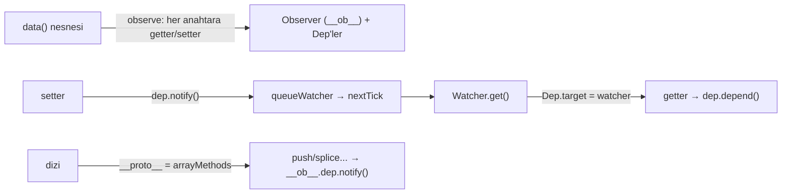

# Sıfırdan mini Vue 2 reaktivitesi (ve Vue 3 ile karşılaştırma)

Odaklı bir mini: Vue 2'nin `Object.defineProperty` tabanlı gözlemcisi (Observer), `Dep`/`Watcher` ikilisi, dizi
yöntemlerini yamalama, `Vue.set`/`Vue.delete`, computed ve `nextTick` kuyruğu. Testler Vue 2'nin bilinen
"değişiklik algılama uyarılarını" çalışan örneklere çevirir; ikinci test dosyası aynı senaryoları Vue 3 mini'sinin
Proxy reaktivitesiyle koşar ve farkı gösterir. Kod özgündür.

## Gereksinimler ve çalıştırma

- Node.js 22+, bağımlılık yok.
- `test/karsilastirma.test.js`, kardeş klasördeki Vue 3 mini'sini içe aktarır:
  `../../vue3-core/sifirdan/src/asama1_reaktivite.js`. Klasörü tek başına kopyalarsan o dosyayı da al.

```bash
cd repo-atlasi/dallar/01-web-arayuzu/vue2/sifirdan
npm test        # = node --test "test/**/*.test.js"  → 14 test
```

## İçerik

| Dosya                        | Ne öğretir                                                                                                                                             |
| ---------------------------- | ------------------------------------------------------------------------------------------------------------------------------------------------------ |
| `src/vue2_gozlemci.js`       | `Dep`, `pushTarget/popTarget`, `Observer`, `observe`, `defineReactive`, `arrayMethods`, `set`, `del`, `Watcher`, `queueWatcher`, `nextTick`, `yeniVue` |
| `test/vue2_tuzaklar.test.js` | Altı tuzak + computed + bağımlılık temizliği (Vue 2 davranışı)                                                                                         |
| `test/karsilastirma.test.js` | Aynı senaryolar Vue 3 Proxy reaktivitesiyle: hepsi kendiliğinden çalışır                                                                               |



## Tuzaklar ve nedenleri

| Tuzak                                    | Neden olur                                                                                                 | Vue 2 çözümü                            | Vue 3'te                                       |
| ---------------------------------------- | ---------------------------------------------------------------------------------------------------------- | --------------------------------------- | ---------------------------------------------- |
| Sonradan eklenen özellik reaktif değil   | `defineProperty` yalnızca o an var olan anahtarlara getter/setter koyar                                    | `Vue.set(obj, 'yeni', v)`               | Proxy `set` tuzağı yeni anahtarı da yakalar    |
| `liste[0] = x` reaktif değil             | İndekslere getter/setter konmaz (performans); dizinin kendi `Dep`'i yalnızca yamalı yöntemlerle tetiklenir | `liste.splice(0, 1, x)` ya da `Vue.set` | `set` tuzağı indeks atamasını görür            |
| `liste.length = 0` reaktif değil         | `length` yeniden tanımlanamaz                                                                              | `liste.splice(0)`                       | `length` yazımı küçülen indeksleri de tetikler |
| `delete obj.a` reaktif değil             | Silmeyi yakalayacak tuzak yok                                                                              | `Vue.delete(obj, 'a')`                  | `deleteProperty` tuzağı                        |
| Köke çalışma zamanında özellik eklenemez | Kök `$data` örneğe vekâletle bağlanır; sonradan eklenen anahtar vekâlet almaz                              | `data()` içinde baştan tanımla          | Aynı ilke (setup durumunu baştan döndür)       |
| `Map`/`Set` reaktif değil                | `observe` yalnızca düz nesne ve dizi dönüştürür                                                            | Düz nesne kullan                        | `collectionHandlers.ts` ile desteklenir        |

Ek fark: Vue 2 nesneyi **yerinde** değiştirir (getter/setter + sayılamaz `__ob__`, dizinin prototipi değişir) ve tüm
derinliği **baştan** dolaşır. Vue 3 ham nesneye dokunmaz, yeni bir Proxy döndürür ve iç nesneleri okundukça sarar.

## Eşleme tablosu

| Mini'deki parça                         | Gerçek depodaki karşılığı (vuejs/vue, `9e88707`)                                                | Fark                                                                          |
| --------------------------------------- | ----------------------------------------------------------------------------------------------- | ----------------------------------------------------------------------------- |
| `Dep`, `pushTarget`, `popTarget`        | `src/core/observer/dep.ts`                                                                      | Gerçekte bekleyen temizlik listesi (`cleanupDeps`) ve hata ayıklama kancaları |
| `Observer`, `observe`, `defineReactive` | `src/core/observer/index.ts`                                                                    | `shallow`, `mock` (SSR), salt okunur denetimleri yok                          |
| `arrayMethods`                          | `src/core/observer/array.ts` (`methodsToPatch`)                                                 | Aynı yedi yöntem                                                              |
| `set`, `del`                            | `src/core/observer/index.ts` (`set`, `del`)                                                     | Gerçekte uyarı verir; mini hata fırlatır                                      |
| `Watcher` (`deps`/`newDeps` takası)     | `src/core/observer/watcher.ts` (`get`, `addDep`, `cleanupDeps`, `update`, `evaluate`, `depend`) | `deep`, `user`, `before` seçenekleri yok                                      |
| `queueWatcher`, `flushSchedulerQueue`   | `src/core/observer/scheduler.ts`                                                                | Sonsuz döngü sınırı (`MAX_UPDATE_COUNT`) ve `activated` kancaları yok         |
| `nextTick`                              | `src/core/util/next-tick.ts`                                                                    | Gerçek: Promise → MutationObserver → setImmediate → setTimeout sırası         |
| `yeniVue` (data vekâleti, computed)     | `src/core/instance/state.ts` (`initData`, `initComputed`, `proxy`)                              | Bileşen, şablon, sanal DOM yok; render bir dize üretir                        |
| Vue 2.7 `reactive()` karşılığı          | `src/v3/reactivity/reactive.ts` (`makeReactive` → `observe`)                                    | 2.7'de Composition API de aynı gözlemciyi kullanır: aynı tuzaklar geçerli     |
