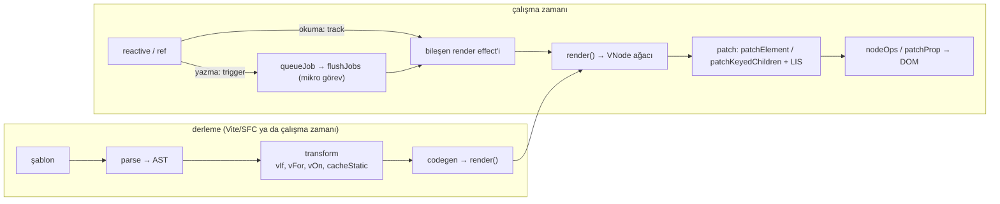
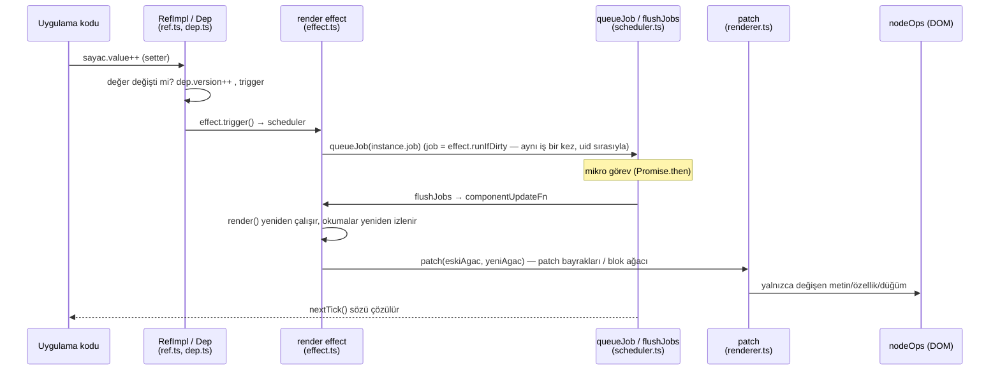
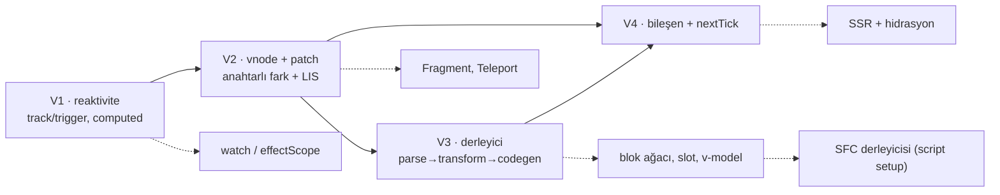

# vuejs/core — Vue 3: Proxy reaktivitesi, derleyici destekli sanal DOM ve bileşen çalışma zamanı

> **Dal:** [D01 Web arayüzü ve JavaScript](../README.md) · **Tür:** kod tabanı
> **Dil:** TypeScript · **Lisans:** MIT · **Yıldız:** 54.874 (9 Kasım 2026) · **İncelenen commit:** `8b479a8` (2026-11-05, "release: v3.5.45")

## 1. Bir bakışta

`vuejs/core`, Vue 3'ün kaynağıdır: şablon ya da render fonksiyonuyla yazılmış bileşenleri reaktif durumla bağlayan,
"kademeli benimsenebilir" bir arayüz çatısı. React'ten farkı, değişikliği **reaktivite** ile bilmesi (hangi bileşenin
hangi veriyi okuduğunu takip eder) ve **derleyicinin** çalışma zamanına ipucu bırakmasıdır (patch bayrakları, statik
önbellek). 2020'de Vue 2'nin TypeScript ile, paketlere bölünmüş biçimde yeniden yazımı olarak çıktı. Yıldız sayısı
düşük görünür çünkü topluluğun yıldızları eski depoda ([vue2](../vue2/README.md), 212 bin) kaldı. Bu commit'te `main`
dalı 3.5.45'tir; 3.6 (Vapor modu ve alien-signals'tan uyarlanmış reaktivite) `minor` dalında sürüm adayı aşamasında
(aşağıda "Tasarım kararları", madde 1).

## 2. Nasıl yapılmış: mimari

### Klasör haritası

```text
packages/
  reactivity/src/        reactive.ts, baseHandlers.ts, collectionHandlers.ts (Map/Set), dep.ts (Dep, Link, track,
                         trigger), effect.ts (ReactiveEffect, batch), ref.ts, computed.ts, watch.ts, effectScope.ts
  runtime-core/src/      renderer.ts (2.714 satır: patch, patchKeyedChildren, getSequence, mountComponent),
                         vnode.ts (VNode, blok ağacı), component.ts, scheduler.ts (queueJob, nextTick),
                         apiCreateApp.ts, apiWatch.ts, apiLifecycle.ts, components/ (KeepAlive, Suspense, Teleport)
  runtime-dom/src/       tarayıcı: nodeOps.ts, patchProp.ts, modules/ (class, style, events), directives/ (v-model, v-show)
  runtime-test/src/      test renderer: nodeOps.ts, serialize.ts, triggerEvent.ts
  compiler-core/src/     tokenizer.ts + parser.ts (baseParse), transform.ts, transforms/ (vIf, vFor, vOn, vBind,
                         transformElement, transformText, cacheStatic), codegen.ts, compile.ts (baseCompile)
  compiler-dom/          DOM'a özgü dönüşümler; compiler-sfc/ .vue dosyaları (<script setup>, <style scoped>)
  compiler-ssr/  server-renderer/   sunucu tarafı render
  shared/src/            patchFlags.ts, shapeFlags.ts, toDisplayString.ts, ortak yardımcılar
  vue/                   kullanıcıya giden paket; src/index.ts çalışma zamanı derleyicisini kaydeder
  vue-compat/            Vue 2 uyumluluk derlemesi (geçiş dönemi için)
packages-private/        sfc-playground, template-explorer, dts-test, vite-debug (yayımlanmayan araçlar)
scripts/                 build.js (Rollup), dev.js (esbuild), release.js, verify-commit.js, size-report.js
rollup.config.js         paket × biçim (esm-bundler, cjs, global, esm-browser...) derleme matrisi
vitest.config.ts         birim + e2e test projeleri
.github/workflows/       test.yml, ci.yml, release.yml, size-data.yml, size-report.yml, ecosystem-ci-trigger.yml
.github/contributing.md  dal modeli (main / minor), kod yazım ilkeleri
```

### Ana bileşenler ve veri akışı



Akış: bir bileşen bağlanırken (`mountComponent`) `setup()` çalışır, sonra `setupRenderEffect` render fonksiyonunu bir
`ReactiveEffect` içinde çağırır. Render sırasında okunan her reaktif değer bu effect'e bağımlılık olarak kaydedilir
(`track`). Değer değişince (`trigger`) effect hemen çalışmaz; scheduler'ı `queueJob` ile işi kuyruğa koyar. Kuyruk bir
mikro görevde, bileşen kimliğine göre (ebeveyn önce) bir kez boşaltılır; `nextTick()` bu boşaltmanın sözüdür.
Yeniden render yeni bir VNode ağacı üretir ve `patch` eski ağaçla karşılaştırır. Derleyiciden gelen **patch
bayrakları** ve **blok ağacı** (`dynamicChildren`) sayesinde statik kısımlar hiç gezilmez; listelerde ise
`patchKeyedChildren` en uzun artan alt diziyle (LIS) taşıma sayısını en aza indirir.

**Bir değişikliğin yolculuğu** (`sayac.value++`):



### Önce okunacak dosyalar

1. `packages/reactivity/src/dep.ts` — `targetMap`, `track`, `trigger`, `Dep` ve `Link` (sürüm sayacıyla bağımlılık).
2. `packages/reactivity/src/effect.ts` — `ReactiveEffect.run`, `prepareDeps`/`cleanupDeps`, `isDirty`, `refreshComputed`, `batch`.
3. `packages/reactivity/src/baseHandlers.ts` + `reactive.ts` — Proxy tuzakları, ham nesne ↔ proxy önbelleği.
4. `packages/reactivity/src/ref.ts`, `computed.ts` — `RefImpl`, `ComputedRefImpl`, `proxyRefs`.
5. `packages/runtime-core/src/vnode.ts` — `createVNode`, `isSameVNodeType`, `openBlock`/`createBlock`.
6. `packages/runtime-core/src/renderer.ts` — `patch` → `processElement` → `mountElement`/`patchElement` → `patchChildren` → `patchKeyedChildren` → `getSequence`; `mountComponent` → `setupRenderEffect`.
7. `packages/runtime-core/src/scheduler.ts` — `queueJob`, `findInsertionIndex`, `flushJobs`, `RECURSION_LIMIT`, `nextTick`.
8. `packages/compiler-core/src/compile.ts` — `baseCompile` ve `getBaseTransformPreset` (dönüşümlerin sırası).
9. `packages/compiler-core/src/transforms/vIf.ts`, `vFor.ts`, `cacheStatic.ts`, sonra `codegen.ts`.
10. `packages/shared/src/patchFlags.ts` — derleyici ile çalışma zamanı arasındaki sözleşme.

### Teknoloji yığını, derleme, test, CI, sürüm

- **Dil:** TypeScript (`pnpm run check` → `tsc --incremental --noEmit`); bildirim dosyaları `build-dts` ile üretilir ve
  `packages-private/dts-test` ile tip testine girer.
- **Paket yönetimi:** pnpm çalışma alanı (`pnpm-workspace.yaml`, sürümler `catalog:` ile merkezî); `package.json`
  → `"packageManager": "pnpm@12.16.1"`, Node `>=20`.
- **Derleme:** Rollup (`scripts/build.js`, `rollup.config.js`); her paket `buildOptions.formats` ile biçimlerini seçer
  (`vue` için `esm-bundler`, `esm-bundler-runtime`, `cjs`, `global`, `global-runtime`, `esm-browser`,
  `esm-browser-runtime`). Geliştirme derlemesi esbuild (`scripts/dev.js`). `__DEV__` ve
  `__FEATURE_OPTIONS_API__` gibi derleme anı bayrakları ağaç sarsma (tree-shaking) için kullanılır;
  `scripts/verify-treeshaking.js` bunu denetler.
- **Test:** Vitest (`vitest.config.ts`): `test-unit`, `test-e2e` (Puppeteer/Playwright ile tarayıcı), `test-dts`.
  Paketlerde ~250 `__tests__` dosyası.
- **CI:** `.github/workflows/test.yml` → birim, derleyici, SSR, e2e, tree-shaking, lint (ESLint + Prettier), tsc,
  tip testleri; `size-data.yml` / `size-report.yml` boyut farkı; `ecosystem-ci-trigger.yml`, PR'a yazılan
  `/ecosystem-ci run` yorumuyla ayrı `vuejs/ecosystem-ci` deposunda PR'ı popüler ekosistem projelerine karşı sınatır.
- **Sürüm:** `scripts/release.js` sürüm ve değişiklik günlüğü (conventional commits, `scripts/verify-commit.js`,
  `.github/commit-convention.md`); etiket gelince `release.yml` derleyip npm'e yayımlar. Dal modeli:
  `.github/contributing.md` → yeni API `minor`, düzeltmeler `main` dalına.

### Tasarım kararları ve ödünleşimler

1. **Proxy reaktivitesi.** Vue 2'nin `Object.defineProperty` tuzaklarını (sonradan eklenen özellik, dizi indeksi,
   silme) kökten çözer, derin dönüştürmeyi tembel yapar; bedeli IE11 desteğinin bırakılmasıdır. 3.5'te bağımlılık
   kümesi yerine **sürüm sayaçlı çift bağlı liste** (`Link`, `dep.version`, `globalVersion`) geldi: her çalıştırmada
   tüm kümeleri silip yeniden kurmak yerine kullanılmayan bağlantılar sürüm `-1` ile işaretlenip sökülür.
   `minor` dalında (`2204ecf`, 2026-11-09, `3.6.0-rc.14`) `packages/reactivity/src/system.ts` "alien-signals'tan
   uyarlandı" der ve `packages/runtime-vapor`, `packages/compiler-vapor` paketleri vardır (yalnızca ağaç listesi ve bu
   dosyaların başlığı incelendi).
2. **Derleyici bilgilendirilmiş sanal DOM.** Şablon statik olarak analiz edilebildiği için derleyici, hangi düğümde
   neyin değişebileceğini (`PatchFlags.TEXT`, `CLASS`, `PROPS`...) ve hangi alt ağaçların hiç değişmeyeceğini
   (`cacheStatic.ts`) bilir; blok ağacı yalnızca dinamik torunları düz bir listede tutar. JSX/render fonksiyonunda bu
   ipuçları yoktur, tam karşılaştırmaya düşülür.
3. **LIS ile anahtarlı fark.** `patchKeyedChildren` baştan/sondan ortak kısmı atar, ortadaki bölüm için
   `getSequence` ile yerinde kalabilecek en büyük kümeyi bulur. React'in tek yönlü sezgiseline göre taşıma sayısı en
   azdır; bedeli biraz daha karmaşık kod ve O(n log n) adım. Karşılaştırma: [react](../react/README.md).
4. **Platformdan bağımsız renderer.** `createRenderer(options)` `nodeOps` + `patchProp` alır; `runtime-dom`,
   `runtime-test` ve üçüncü taraf renderer'lar (canvas, terminal) aynı çekirdeği kullanır.
5. **Paketlere bölünmüşlük.** `@vue/reactivity` tek başına kullanılabilir; tüm API isimli dışa aktarımdır ve
   kullanılmayan özellik (ör. Options API) bayrakla atılabilir.
6. **Kuyruklu güncelleme.** Değişiklikler senkron yansımaz; aynı tick'teki değişiklikler birleşir. Bedeli: DOM'u okumak
   için `await nextTick()` gerekir.
7. **Çalışma zamanı derleyicisi isteğe bağlı.** `vue` paketinin tam derlemesi şablonu tarayıcıda `new Function` ile
   derler (`with (_ctx)` bloğu); Vite/SFC ile önceden derleyince bu kod pakete hiç girmez (`-runtime` biçimleri).

## 3. Öğrenmen gerekenler

| Ön koşul                                                 | Bu depo için neden                                                | Ücretsiz kaynak                                                                                           |
| -------------------------------------------------------- | ----------------------------------------------------------------- | --------------------------------------------------------------------------------------------------------- |
| [G4 JavaScript/TypeScript](../../../govde/README.md#g4)  | Proxy, Reflect, WeakMap, Symbol, mikro görev; kaynak TypeScript   | [You-Dont-Know-JS koanları](../you-dont-know-js/sifirdan/README.md)                                       |
| [G5 Veri yapıları](../../../govde/README.md#g5)          | LIS (ikili arama + öncül dizisi), ağaç dönüşümü, çift bağlı liste | [javascript-algorithms](../../09-bilgisayar-bilimi/javascript-algorithms/README.md)                       |
| HTML, CSS ve DOM temelleri (dal içi kavram)              | DOM işlemleri (`nodeOps`), olaylar, nitelik ile özellik farkı     | MDN Web Docs (developer.mozilla.org)                                                                      |
| [G6 Web temelleri](../../../govde/README.md#g6)          | Yalnızca SSR yan dalı için: sunucuda üretilen HTML'in akışı       | MDN — HTTP (developer.mozilla.org)                                                                        |
| [G7 Test ve CI](../../../govde/README.md#g7)             | Vitest, `runtime-test` renderer'ı ile test yazma                  | `packages/runtime-core/__tests__/`                                                                        |
| [G8 Büyük kod tabanı okuma](../../../govde/README.md#g8) | pnpm monorepo, derleme bayrakları, paketler arası bağımlılık      | Bu dosyadaki okuma rotası                                                                                 |
| Derleyici temelleri (dal içi kavram)                     | Ayrıştırma, AST, dönüşüm, kod üretimi                             | [build-your-own-x](../../10-kuratorluk-topluluk/build-your-own-x/README.md) "Programming Language" bölümü |

Dala özgü kavramlar: gözlemci deseni (observer) ve bağımlılık grafiği; tembel hesaplama ve önbellek geçersizleştirme
(computed); sanal DOM ve anahtarlı fark; mikro görev kuyruğu. Resmî belgeler vuejs.org (doğrulanmadı); Türkçe yol
haritası [developer-roadmap](../../02-uygulama-platformlari/developer-roadmap/README.md) → `roadmaps/vue`.

## 4. Sıfırdan yol (dallanma)



| Aşama      | Ne inşa edersin                                            | Öğrendiğin kavram                                           | Bitti ölçütü                                     | Süre (tahmini)          |
| ---------- | ---------------------------------------------------------- | ----------------------------------------------------------- | ------------------------------------------------ | ----------------------- |
| V1         | `reactive`, `ref`, `computed`, `effect`, scheduler         | Proxy, bağımlılık takibi, temizlik, tembel önbellek         | `test/asama1.test.js` (10 test)                  | 5 saat                  |
| V2         | `h`, `createRenderer`, `patchKeyedChildren`, `getSequence` | Sanal DOM, 5 adımlı fark, LIS                               | `asama2`: `[a b c d e] → [e a b c d]` tek taşıma | 5 saat                  |
| V3         | `parse`, `transform`, `generate`, `compile`                | AST, yapısal direktifler, patch bayrakları, statik önbellek | `asama3`: üretilen kod ve uçtan uca güncelleme   | 5–10 saat               |
| V4         | Bileşen örneği, props/emit, `queueJob`, `nextTick`         | Effect tabanlı render, kuyruk, ebeveyn-çocuk sırası         | `asama4` (6 test)                                | 5 saat                  |
| Yan dallar | watch, slot, blok ağacı, SSR, SFC                          | —                                                           | Kendi testlerin                                  | 20+ saat (isteğe bağlı) |

V1–V4 toplamı **20–25 saat**; dalın [yaprak tablosu](../README.md#yapraklar) bu sayıyı ve süre kuralını kullanır.

**Mini uygulama:** [sifirdan/](sifirdan/README.md) — 33 test, bağımlılıksız. Gerçek dosya eşlemesi oradaki tabloda.
Derleyici `render.kod` ile ürettiği JavaScript'i gösterir: `_cache[0] || (_cache[0] = ...)` statik önbelleği ve
`9 /* TEXT, PROPS */` gibi bayrak yorumları gerçek Vue çıktısına benzer biçimdedir.

**Gerçek ölçeğe giden yol:**

1. **Blok ağacı:** `openBlock`/`createBlock` ile dinamik torunları toplayıp patch'te yalnızca onları gezmek.
2. **Fragment ve çoklu kök**, ardından `Teleport` ve `Suspense` (`runtime-core/src/components/`).
3. **`watch`/`watchEffect` ve kuyruk sıraları:** `flush: 'pre' | 'post' | 'sync'` (`apiWatch.ts`, `scheduler.ts`).
4. **Koleksiyonlar ve salt okunur proxy'ler:** `collectionHandlers.ts`, `readonly`, `shallowReactive`.
5. **Slotlar, `provide/inject`, `KeepAlive`.**
6. **SFC derleyicisi:** `<script setup>` makroları, kapsamlı stil (`compiler-sfc`).
7. **SSR ve hidrasyon:** `compiler-ssr`, `server-renderer`, `runtime-core/src/hydration.ts`.
8. **Sürüm sayaçlı reaktivite** (3.5) ve Vapor modu (3.6, sanal DOM'suz derleme çıktısı).

## 5. Gerçek depoda okuma rotası

1. `packages/reactivity/src/baseHandlers.ts` → `get` tuzağı: `track` nerede çağrılıyor, iç nesne ne zaman `reactive()`
   ile sarılıyor (tembel derinlik)? `set` tuzağı `ADD` ile `SET`'i nasıl ayırıyor?
2. `packages/reactivity/src/dep.ts` → `track`: `Link` nesnesi ne zaman oluşuyor, `dep.version` neyi sayıyor?
   `effect.ts` → `prepareDeps` ve `cleanupDeps`: sürüm `-1` hilesini takip et.
3. `effect.ts` → `refreshComputed`: computed değeri değişmediyse neden `dep.version` artmıyor?
4. `runtime-core/src/renderer.ts` → `setupRenderEffect`: `componentUpdateFn` ilk bağlamada ve güncellemede ne yapıyor,
   effect'in scheduler'ı neden `queueJob`?
5. `runtime-core/src/scheduler.ts` → `queueJob` + `findInsertionIndex`: iş neden kimlik sırasına sokuluyor?
6. `renderer.ts` → `patchKeyedChildren` 5.1–5.3: `newIndexToOldIndexMap` doldurulurken `moved` ne zaman `true` oluyor?
   `getSequence` çıktısıyla hangi düğümler taşınmıyor? (Mini'deki `a b [c d e] f g` testini kâğıtta izle.)
7. `compiler-core/src/compile.ts` → `getBaseTransformPreset`: dönüşümlerin sırası neden önemli (vIf, vFor önce)?
8. `compiler-core/src/transforms/vOn.ts`: `@click="sec"` ile `@click="sayac++"` neden farklı derleniyor?
9. `compiler-core/src/codegen.ts` → `generate`: `useWithBlock` hangi koşulda doğru, hangi derlemede `_ctx.` öneki var?
10. Template explorer'ı (`packages-private/template-explorer`) yerelde açıp bir şablonun çıktısını mini'ninkiyle karşılaştır.

## 6. Alıştırmalar ve öz değerlendirme

1. (Kolay) Mini'ye `watch(kaynak, cb)` ekle: eski/yeni değeri ver, `flush: 'post'` için `nextTick` sonrasına ertele.
2. (Kolay) `readonly(obj)`: yazma denemesinde uyarı veren, okumada izleyen Proxy.
3. (Orta) Computed'a "değer değişmediyse bağımlılarını tetikleme" ekle; render sayısıyla doğrula.
4. (Orta) `Fragment` desteği: çoklu kök ve `v-for`'u ayrı bir parça olarak bağlamak (başlangıç/bitiş çapası).
5. (Orta) `v-model` (input için `value` + `onInput`) dönüşümü yaz.
6. (Zor) Blok ağacı: derleyici dinamik düğümleri `dynamicChildren`'a toplasın, patch yalnızca onları gezsin.
7. (Zor) Reaktiviteyi 3.5 tarzına çevir: `Set` yerine sürüm sayaçlı bağlantılar; mevcut testler geçmeye devam etsin.
8. (Zor, [react](../react/README.md) yaprağından sonra) Mini React'in host'unu mini Vue renderer'ına bağla: aynı
   `nodeOps` arayüzüyle iki çatıyı karşılaştır.

**Öz değerlendirme**

1. Bağımlılık temizliği olmasaydı hangi hata olurdu?
   <details><summary>Cevap</summary>Koşullu dallarda artık okunmayan anahtarlar effect'i tetiklemeye devam ederdi:
   gereksiz render'lar ve sızıntılar. Mini her çalıştırmada kümeleri silip yeniden kurar; ilk 3.x sürümleri de böyle
   yapıyordu (doğrulanmadı: eski kaynak incelenmedi). Değişiklik günlüklerine (`changelogs/CHANGELOG-3.2.md`,
   `CHANGELOG-3.4.md`, `CHANGELOG.md`) göre 3.2 (vuejs/core#4001) ve 3.4 (vuejs/core#5912) bu işi ucuzlattı; 3.5
   (vuejs/core#10397) aynı sonucu sürüm sayacı ve çift bağlı listeyle, kullanılmayan bağlantıları `-1` sürümle
   işaretleyip sökerek alır.</details>
2. LIS neden "en az taşıma" verir?
   <details><summary>Cevap</summary>Yeni sıradaki düğümlerin eski indekslerinden artan bir alt dizi, birbirine göre
   sırası zaten doğru olan düğümlerdir; onlara dokunmadan diğerlerini doğru komşunun önüne koymak yeter. En uzun
   artan alt dizi, yerinde kalabilecek en büyük kümedir; geri kalan her düğüm tam bir kez taşınır.</details>
3. Patch bayrağı `TEXT` neyi kazandırır?
   <details><summary>Cevap</summary>Çalışma zamanı o elemanın props'larını hiç karşılaştırmaz, yalnızca metin
   çocuğunu kıyaslar. Derleyici bunu şablonun statik yapısından bilir; elle yazılan render fonksiyonunda bu bilgi
   yoktur.</details>
4. Neden `count.value++` sonrası DOM hemen güncellenmez?
   <details><summary>Cevap</summary>Bileşenin render effect'inin scheduler'ı işi kuyruğa koyar; kuyruk mikro görevde
   boşaltılır. Böylece aynı tick'teki birçok değişiklik tek render olur. DOM'u okumak için `await nextTick()`.</details>
5. `with (_ctx)` neden yalnızca tarayıcıda derlemede kullanılır?
   <details><summary>Cevap</summary>Katı kipte `with` yasaktır ve optimizasyonu zorlaştırır; önceden derlemede
   (Vite/SFC) Babel ile ifadeler çözümlenip tanımlayıcılara `_ctx.` öneki eklenir (`prefixIdentifiers`). Tarayıcıda
   tam bir JS ayrıştırıcısı taşımamak için `with` bloğu tercih edilir.</details>

## 7. İş fikri tohumları

- **Vue 2 → Vue 3 geçiş hizmeti** (`vue-compat` derlemesiyle aşamalı göç + test yazımı). **Kime:** Vue 2'de kalmış
  kurumsal paneller ve kamu yazılımı tedarikçileri (Vue 2'nin desteği 31.12.2023'te bitti).
- **Şablondan hızlı panel üreticisi:** JSON şemadan Vue bileşenleri derleyen düşük kodlu araç. **Kime:** iç araç yazan
  KOBİ BT ekipleri, ajanslar.
- **Reaktivite çekirdeğiyle hesap motoru:** `@vue/reactivity` ile çevrim içi fiyat/teklif hesaplayıcı (form değişince
  bağımlı alanlar güncellenir). **Kime:** sigorta acenteleri, inşaat malzemesi bayileri.

Ayrıntılı katalog: [is-fikirleri](../../../is-fikirleri/README.md).

## 8. Kaynaklar

Depo içi bağlantılar incelenen commit'e sabitlenmiştir; depo dışı bağlantılar bellekten verilmiştir (doğrulanmadı).

- [packages/reactivity/src/dep.ts](https://github.com/vuejs/core/blob/8b479a8/packages/reactivity/src/dep.ts) · [effect.ts](https://github.com/vuejs/core/blob/8b479a8/packages/reactivity/src/effect.ts)
- [packages/runtime-core/src/renderer.ts](https://github.com/vuejs/core/blob/8b479a8/packages/runtime-core/src/renderer.ts) · [scheduler.ts](https://github.com/vuejs/core/blob/8b479a8/packages/runtime-core/src/scheduler.ts)
- [packages/compiler-core/src/compile.ts](https://github.com/vuejs/core/blob/8b479a8/packages/compiler-core/src/compile.ts) · [codegen.ts](https://github.com/vuejs/core/blob/8b479a8/packages/compiler-core/src/codegen.ts)
- [.github/contributing.md](https://github.com/vuejs/core/blob/8b479a8/.github/contributing.md) — geliştirme kurulumu, dal modeli, derleme biçimleri
- `minor` dalı (3.6, Vapor): <https://github.com/vuejs/core/tree/minor> (ağaç listesi `2204ecf` üzerinde doğrulandı)
- Resmî belgeler: <https://vuejs.org> ve "Rendering Mechanism" / "Reactivity in Depth" rehberleri (doğrulanmadı)
- Evan You'nun Vue 3 tasarım konuşmaları, ör. "The Design of Vue 3" (doğrulanmadı)
