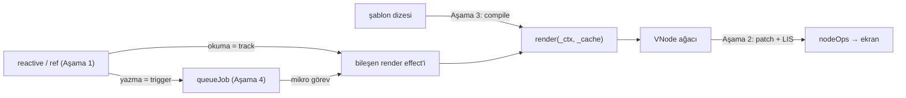

# Sıfırdan mini Vue 3

Dört aşamada Vue 3'ün çekirdeği: **Proxy reaktivitesi**, **VNode + anahtarlı fark (LIS)**, **şablon derleyici**
(parse → AST → transform → codegen) ve **bileşenler + `nextTick` kuyruğu**. Kod özgündür; Vue'dan kopyalanmadı.
Amaç `packages/reactivity`, `runtime-core` ve `compiler-core` içindeki fikirleri küçük ve test edilebilir hâlde görmek.

## Gereksinimler ve çalıştırma

- Node.js 22+, bağımlılık yok.

```bash
cd repo-atlasi/dallar/01-web-arayuzu/vue3-core/sifirdan
npm test                                   # = node --test "test/**/*.test.js"  → 33 test
node -e "import('./src/asama3_derleyici.js').then(m => console.log(m.compile('<p v-if=\"ok\">{{ a }}</p>').kod))"
```

Son komut derleyicinin ürettiği render fonksiyonunu yazdırır (Vue'nun "template explorer"ı gibi).

## Aşamalar

| Dosya                       | Aşama | Ne öğretir                                                                                  |
| --------------------------- | ----- | ------------------------------------------------------------------------------------------- |
| `src/asama1_reaktivite.js`  | 1     | `reactive`, `ref`, `computed`, `effect`; `track`/`trigger`; bağımlılık temizliği; scheduler |
| `src/asama2_vnode_patch.js` | 2     | `h()`, `createRenderer(nodeOps)`, `patch`, `patchKeyedChildren` (5 adım), `getSequence`     |
| `src/test_nodeops.js`       | 2–4   | DOM yerine düz nesne ağacı; yalnızca **görünür** değişiklikleri günlüğe yazar               |
| `src/asama3_derleyici.js`   | 3     | `parse` → `transform` (v-if, v-for, @, :, metin birleştirme, patch bayrakları) → `generate` |
| `src/asama4_bilesen.js`     | 4     | Bileşen örneği, `setup`, props/emit, render effect, `queueJob`, `nextTick`, yaşam döngüsü   |



### Aşama 1 — Reaktivite

Effect çalışırken okunan her `(nesne, anahtar)` çifti `targetMap`'e kaydedilir. Yazınca o anahtara bağlı effect'ler
çalışır ya da `scheduler`'larına verilir. Her çalıştırmadan önce eski bağımlılıklar silinir: koşullu daldan çıkılan
anahtar artık tetiklemez (testi var). Proxy `has`, `ownKeys`, `deleteProperty` tuzaklarıyla **yeni anahtar ekleme,
silme ve dizi indeksi atamayı** da yakalar — Vue 2'nin yapamadığı şeyler (karşılaştırma: `../../vue2/sifirdan`).

### Aşama 2 — Anahtarlı fark ve LIS

`patchKeyedChildren` beş adımdır: baştan eşleşenler, sondan eşleşenler, yalnız ekleme, yalnız silme, ve ortadaki
"bilinmeyen" bölüm. Son adımda yeni sıradaki her düğümün eski indeksi bir diziye yazılır; bu dizinin **en uzun artan
alt dizisi** (LIS) yerinde kalabilecek en büyük düğüm kümesidir, yalnızca geri kalanlar taşınır. Testte
`[a b c d e] → [e a b c d]` **1 taşıma** ile yapılır (React'in yöntemi 4 taşıma ister).

### Aşama 3 — Derleyici

`compile(sablon)` üç adımda çalışır ve `render.kod` ile ürettiği JavaScript'i gösterir:

```text
şablon:  <div class="kart"><h1>Alışveriş</h1><li v-for="o in ogeler" :key="o.id" @click="sec(o)">{{ o.ad }}</li></div>

üretilen (okunur olsun diye satırlara bölündü):
return function render(_ctx, _cache) {
  with (_ctx) {
    return _h("div", { "class": "kart" }, [
      _cache[0] || (_cache[0] = _h("h1", null, "Alışveriş")),        ← statik alt ağaç: bir kez üretilir
      ..._renderList(ogeler, (o) => _h("li",
          { "key": (o.id), "onClick": ($event) => { sec(o) } },
          _toDisplayString(o.ad),
          9 /* TEXT, PROPS */, ["onClick"]))                          ← patch bayrağı: yalnızca metin ve onClick
    ])
  }
}
```

`with (_ctx)` Vue'nun tarayıcıda çalışan derleyicisinin de kullandığı yöntemdir (`new Function` gövdesi katı kipte
olmadığı için mümkün). Derleme adımında (Vite/SFC) Vue bunun yerine tanımlayıcılara `_ctx.` öneki ekler.

### Aşama 4 — Bileşenler ve kuyruk

Her bileşenin render'ı bir `ReactiveEffect`'tir; scheduler'ı effect'i hemen çalıştırmaz, `queueJob` ile kuyruğa koyar.
Kuyruk mikro görevde, örnek kimliğine (`uid`) göre sıralı boşaltılır: ebeveyn çocuktan önce, aynı iş bir kez.
`nextTick()` bu boşaltmanın sözüdür. Ebeveyn çocuğu props ile güncellerse çocuğun kuyruktaki işi düşürülür
(`invalidateJob`), çocuk bir kez render edilir (testi var). Bu Vue ≤3.4'ün yöntemidir; 3.5'te kuyruktaki iş
`effect.runIfDirty` olduğu için senkron güncellemeden sonra kirli olmayan effect'te kendiliğinden boş geçer.

## Eşleme tablosu

| Mini'deki parça                                          | Gerçek depodaki karşılığı (dosya yolu)                                                                                                              | Fark                                                                                                                                   |
| -------------------------------------------------------- | --------------------------------------------------------------------------------------------------------------------------------------------------- | -------------------------------------------------------------------------------------------------------------------------------------- |
| `targetMap`, `track`, `trigger`                          | `packages/reactivity/src/dep.ts` (`targetMap`, `track`, `trigger`, `ITERATE_KEY`, `Dep`, `Link`)                                                    | 3.5 sürüm sayacı + çift bağlı liste kullanır; mini düz `Set` ve "her çalıştırmada temizle"                                             |
| `ReactiveEffect`, `effect`, `stop`                       | `packages/reactivity/src/effect.ts` (`ReactiveEffect`, `prepareDeps`, `cleanupDeps`, `batch`)                                                       | Gerçekte bayraklar (`EffectFlags`), toplu tetikleme (`startBatch/endBatch`)                                                            |
| Proxy tuzakları, dizi yöntemleri                         | `packages/reactivity/src/baseHandlers.ts`, `arrayInstrumentations.ts`, `reactive.ts`                                                                | `Map/Set` desteği yok (`collectionHandlers.ts`), `readonly` yok                                                                        |
| `ref`, `proxyRefs`, `computed`                           | `packages/reactivity/src/ref.ts`, `computed.ts`                                                                                                     | Gerçek computed değer değişmediyse bağımlılarını tetiklemez                                                                            |
| `h`, `isSameVNodeType`, `normalizeVNode`                 | `packages/runtime-core/src/vnode.ts`, `h.ts`                                                                                                        | `shapeFlag`, `Fragment`, `Teleport`, `Suspense` yok                                                                                    |
| `createRenderer`, `patch`, `move`, `unmount`             | `packages/runtime-core/src/renderer.ts` (`baseCreateRenderer`, `patch`, `processElement`, `move`, `unmount`, `getNextHostNode`)                     | Blok ağacı (`dynamicChildren`) yok: bayraklar yalnızca prop/metin karşılaştırmasını daraltır                                           |
| `patchKeyedChildren`, `getSequence`                      | `packages/runtime-core/src/renderer.ts` (`patchKeyedChildren` adım 1–5, `getSequence`)                                                              | Aynı algoritma, özgün yazım                                                                                                            |
| `test_nodeops.js`                                        | `packages/runtime-test/src/nodeOps.ts`, `serialize.ts`, `triggerEvent.ts`                                                                           | Tarayıcı karşılığı: `packages/runtime-dom/src/nodeOps.ts`, `patchProp.ts`                                                              |
| `parse`                                                  | `packages/compiler-core/src/parser.ts` (`baseParse`) + `tokenizer.ts`                                                                               | Mini özyinelemeli iniş; gerçek 3.4+ durum makinesi (htmlparser2'den uyarlama)                                                          |
| `transform`, `isaretle`                                  | `compiler-core/src/transform.ts`, `transforms/vIf.ts`, `vFor.ts`, `vOn.ts`, `vBind.ts`, `transformElement.ts`, `transformText.ts`, `cacheStatic.ts` | Slot, `v-model`, `v-show`, değiştirici (`.prevent`) yok                                                                                |
| `generate`                                               | `compiler-core/src/codegen.ts` (`generate`, `with (_ctx)` bloğu)                                                                                    | Kaynak haritası (source map) yok                                                                                                       |
| `compile` (new Function)                                 | `packages/vue/src/index.ts` (`compileToFunction`, `registerRuntimeCompiler`); `runtime-core/src/component.ts` → `finishComponentSetup`              | Vue sonucu hem şablon dizesine göre `compileCache`'te hem `Component.render`'da tutar; mini yalnızca bileşen tanımında (`__derlenmis`) |
| `PatchFlags`                                             | `packages/shared/src/patchFlags.ts`                                                                                                                 | Yalnızca TEXT, CLASS, PROPS                                                                                                            |
| `queueJob`, `nextTick`, `invalidateJob`                  | `packages/runtime-core/src/scheduler.ts` (`queueJob`, `findInsertionIndex`, `flushJobs`, `nextTick`)                                                | Ön/arka kuyruk ve özyineleme sınırı yok; 3.5'te `invalidateJob` yok (iş = `runIfDirty`)                                                |
| `mountComponent`, `setupRenderEffect`, `updateComponent` | `runtime-core/src/renderer.ts` + `component.ts` + `componentRenderUtils.ts`                                                                         | Slot, `inject`, `KeepAlive`, async bileşen yok                                                                                         |
| `onMounted`, `onUnmounted`                               | `packages/runtime-core/src/apiLifecycle.ts`                                                                                                         | Mini mounted'ı senkron çağırır; Vue post-flush kuyruğuna koyar                                                                         |

## Bilinçli eksikler

Fragment ve çoklu kök, slotlar, `v-model`, `watch`/`watchEffect`, `Map/Set` reaktivitesi, blok ağacı, SSR, SFC
(`.vue` dosyası) derleyicisi, Vapor modu. Ekleme sırası için üst klasördeki dosyanın
[“Gerçek ölçeğe giden yol”](../README.md#4-sıfırdan-yol-dallanma) bölümüne bak.
