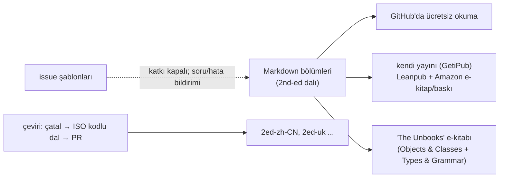
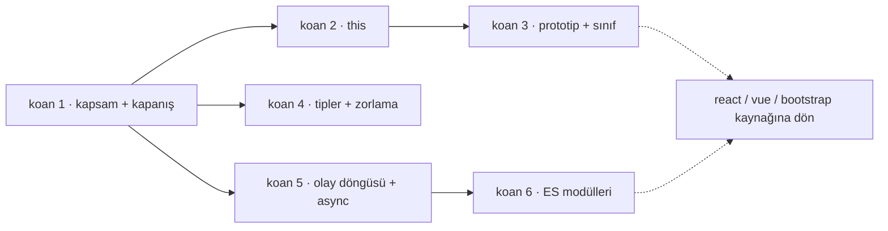

# getify/You-Dont-Know-JS — JavaScript'in çekirdek mekanizmalarını derinlemesine anlatan kitap serisi

> **Dal:** [D01 Web arayüzü ve JavaScript](../README.md) · **Tür:** eğitim içeriği
> **Dil:** Markdown (İngilizce) · **Lisans:** CC BY-NC-ND 4.0 (GitHub "NOASSERTION" gösterir) · **Yıldız:** 184.843 (9 Kasım 2026)
> **İncelenen commit:** `7a83c85` (2026-10-31, varsayılan dal `2nd-ed`) · 1. baskı için `1st-ed` dalı: `59d33b0` (2020-05-27)

## 1. Bir bakışta

Kyle Simpson'ın kitap serisi; JavaScript'i "iyi parçalar"ına indirgemek yerine **bütün parçalarını** (kapsam, kapanış,
`this`, prototipler, tipler ve zorlama, eşzamansızlık) nedenleriyle anlatır. Depo kitapların kaynağıdır: her bölüm bir
Markdown dosyası. Ücretsiz okunabildiği ve "framework öğrenmeden önce dili öğren" ihtiyacına doğrudan cevap verdiği
için GitHub'ın en çok yıldız alan eğitim depolarından biri oldu. Önsöz (`preface.md`) okurdan 6–9 ay JS deneyimi
bekler. README'ye göre seri **tamamlandı ve katkıya kapalı**; incelenen son commit yalnızca sponsor bölümünü günceller.

## 2. Nasıl yapılmış: depo yapısı ve yönetişim

### Klasör haritası (`2nd-ed` dalı)

```text
README.md                kitap listesi, okuma sırası, satın alma bağlantıları, lisans
preface.md               serinin felsefesi ("bütün parçalar"), hedef okur
CONTRIBUTING.md          katkı politikası (kapalı), çeviri kuralları
get-started/             1. kitap "Get Started": toc.md, foreword.md, ch1–ch4.md, apA–apB.md, images/ (şekiller SVG+PNG)
scope-closures/          2. kitap "Scope & Closures": ch1–ch8.md, apA–apB.md, images/
objects-classes/         "Objects & Classes" (README: "draft stable"): ch1–ch5.md
types-grammar/           "Types & Grammar" (README: "rough draft"): ch1–ch4.md
sync-async/              "Sync & Async" — iptal; yalnızca ch1.md (TODO)
es-next-beyond/          "ES.Next & Beyond" — iptal; yalnızca ch1.md (TODO)
.github/ISSUE_TEMPLATE/  içerik sorusu, teknik hata, yazım hatası, çeviri isteği şablonları
```

Boyut (sözcük sayısı, `wc -w`): Get Started ~24 bin, Scope & Closures ~46 bin, Objects & Classes ~33 bin,
Types & Grammar ~35 bin; iptal edilen iki kitap ~125'er sözcük.

**Dallar (sürümler ve çeviriler):** `2nd-ed` (varsayılan, güncel), `1st-ed` (altı kitaplık ilk baskı: `up & going`,
`scope & closures`, `this & object prototypes`, `types & grammar`, `async & performance`, `es6 & beyond`), `master`
(2019'dan kalma yönlendirme README'si), çeviri dalları `1ed-zh-CN`, `2ed-zh-CN`, `2ed-uk`. Türkçe dal yok.

### İçerik akışı



### Önce okunacak dosyalar

1. `README.md` — önerilen okuma sırası: Get Started → Scope & Closures → "The Unbooks".
2. `preface.md` — neden "bütün parçalar", hedef okur kim.
3. `get-started/ch4.md` — serinin üç sütunu: kapsam/kapanış, prototipler, tipler/zorlama.
4. `scope-closures/ch7.md` ve `ch8.md` — kapanış ve modül deseni (ES modülleri dahil).
5. `objects-classes/ch4.md` — `this`'in dört kuralı ve ok fonksiyonları.
6. `types-grammar/ch4.md` — soyut işlemler (ToPrimitive, ToNumber, ToBoolean) ve `==`.
7. `CONTRIBUTING.md` — açık kaynak bir kitabın yönetişimi: katkı kapalı, çeviri kuralları.

### Teknoloji ve yayın süreci

Derleme aracı, CI ya da test yoktur: depo yalnızca Markdown + görsellerdir. "Yayın", içeriğin e-kitap ve baskı
biçimine dönüştürülmesidir (README: GetiPub üzerinden kendi yayını, Leanpub ve Amazon bağlantıları). CONTRIBUTING
açıkça "depo okuma deneyimi için değil, yayın içeriğini izlemek için" der; bölüm içi bağlantı, gezinme gibi katkılar
kabul edilmez.

### Tasarım kararları ve ödünleşimler

1. **Açık içerik, ücretli biçim.** İçerik GitHub'da ücretsiz; e-kitap/baskı satışı ve sponsorluk geliri sağlar.
2. **Türev yasağı (ND) ve ticari olmayan (NC) lisans.** Metin, atıfla ve değiştirilmeden, ticari olmayan amaçla
   paylaşılabilir; uyarlama (türev) ve ticari kullanım yasaktır. Çeviriler yalnızca yazarın kurallarıyla, bu depoda
   ve ücretsiz kalmak şartıyla kabul edilir. Bu yüzden bu atlastaki koanlar kitaptan metin almaz, yalnızca
   bölümlere bağlantı verir.
3. **Baskıları dallarla ayırmak.** 1. ve 2. baskı ayrı dallarda; eski baskı donmuş durumda.
4. **Çeviri yönetişimi.** Çeviriler depoda, ücretsiz ve parasız kalmak zorunda; yalnızca 2. baskıdaki kitaplar için
   kabul edilir; dil koduyla dal açılır, çevirmen o dalın bakımcısı olur.
5. **Bitmiş kabul etmek.** Yazar 2. baskıda iki kitabı iptal edip seriyi "tamamlandı" ilan etti; eşzamansızlık için
   hâlâ 1. baskıdaki "Async & Performance" okunmalı.

## 3. Öğrenmen gerekenler

| Ön koşul                                                | Neden                                                             | Kaynak                                                                                                                      |
| ------------------------------------------------------- | ----------------------------------------------------------------- | --------------------------------------------------------------------------------------------------------------------------- |
| [G4 JavaScript ve Node.js](../../../govde/README.md#g4) | Seri bu düğümün derin hâlidir; koanları Node 22 ile çalıştırırsın | `get-started/` ve bu klasördeki koanlar                                                                                     |
| [G1 Terminal](../../../govde/README.md#g1)              | `node --test`, `npm run`                                          | —                                                                                                                           |
| [G2 Git](../../../govde/README.md#g2)                   | Baskılar ve çeviriler dallarda: `git switch 1st-ed`               | —                                                                                                                           |
| Programlama temeli                                      | Önsöz 6–9 ay JS deneyimi varsayar                                 | [free-programming-books](../../10-kuratorluk-topluluk/free-programming-books/README.md) Türkçe listesi (JavaScript başlığı) |

Bu dalın diğer depoları için YDKJS önkoşul niteliğindedir: React hook'ları kapanış ve olay döngüsüne, Vue
reaktivitesi Proxy, `WeakMap` ve mikro görevlere, Bootstrap eklentileri olay kabarcıklanması ve `this`'e dayanır.

## 4. Sıfırdan yol (dallanma)



| Aşama | Ne yaparsın                                         | Öğrendiğin kavram                           | Bitti ölçütü | Süre (tahmini) |
| ----- | --------------------------------------------------- | ------------------------------------------- | ------------ | -------------- |
| 1     | SC 2–8'i oku, `01_kapsam_closure` koanlarını doldur | Sözcüksel kapsam, TDZ, kapanış              | 9/9 yeşil    | 6–8 saat       |
| 2     | OC 4, `02_this`                                     | `this`'in çağrı yerinden belirlenmesi       | 8/8          | 3–4 saat       |
| 3     | OC 2, 3, 5, `03_prototip_sinif`                     | Prototip zinciri, sınıf sözdizimi, devretme | 9/9          | 4–5 saat       |
| 4     | TG 1, 2, 4 + GS 2, `04_tipler_zorlama`              | Soyut işlemler, `==` algoritması, Unicode   | 10/10        | 8–9 saat       |
| 5     | AP1 1, 3, 4, `05_olay_dongusu`                      | İş kuyruğu, promise, üreteç                 | 10/10        | 8–10 saat      |
| 6     | SC 8 + ES6 3, `06_moduller`                         | Canlı bağlama, değerlendirme sırası         | 7/7          | 2–3 saat       |

Süreler ölçülen okuma yüküne dayanır: bölümlerin sözcük sayısı (`wc -w`; ör. SC 2–8 ~30 bin, TG 1, 2, 4 + GS 2 ~39
bin, AP1 1, 3, 4 ~41 bin, ES6 3'ün "Modules" kısmı ~5,5 bin sözcük), İngilizce teknik metin için dakikada ~100 sözcük
dikkatli okuma ve koan başına 10–15 dakika. Toplam **31–39 saat**; dalın [yaprak tablosu](../README.md#yapraklar)
bu sayıyı ve süre kuralını kullanır.

**Mini uygulama:** [sifirdan/](sifirdan/README.md) — 53 koan + boşaltma aracı. `npm run bosalt` boş bir çalışma
kopyası üretir; her `__()` boşluğunu doldurdukça testler yeşile döner.

**Gerçek ölçeğe giden yol:** koanları bitirdikten sonra (1) her koanı tarayıcı konsolunda da dene (ör. `nextTick`
yok, `globalThis` farklı); (2) ECMAScript belirtiminde (tc39.es/ecma262, doğrulanmadı) koanın dayandığı soyut işlemi
bul (ör. `IsLooselyEqual`, `ToPrimitive`); (3) bu daldaki React/Vue minilerinde aynı kavramın nerede kullanıldığını
işaretle (ör. kapanış: `dispatchAction.bind`, Proxy: `createHandlers`).

## 5. Depoda okuma rotası

1. `README.md` → okuma sırası ve "The Unbooks" notu: hangi kitap hangi olgunlukta?
2. `get-started/ch4.md` → üç sütun: sonraki kitapların haritası.
3. `scope-closures/ch2.md` (bilye/kova benzetmesi) → `ch5.md` (TDZ) → `ch7.md` (kapanış) → `ch8.md` (ESM); her bölümden
   sonra ilgili koanı doldur.
4. `objects-classes/ch4.md` → `this` kuralları; `ch5.md` → sınıfsız devretme.
5. `types-grammar/ch4.md` → "Abstracts" ve "Equality Comparison" bölümleri.
6. `git switch 1st-ed` (ya da GitHub'da dal seçimi) → `async & performance/ch1.md` ("Event Loop", "Jobs") ve `ch3.md`.
7. `CONTRIBUTING.md` + `.github/ISSUE_TEMPLATE/foreign-translation-request.md` → kitap projelerinde yönetişim örneği.

## 6. Alıştırmalar ve öz değerlendirme

1. (Kolay) Koan 1'e "işlev bildirimi bloğun içinde" (block-scoped function declaration) davranışını ekle.
2. (Kolay) Koan 4'e `Array.prototype.sort` varsayılan sıralamasının sayılarda (`[10, 9, 1].sort()`) ne yaptığını ekle.
3. (Orta) Koan 5'e `AbortController` ile iptal edilebilir bir `bekle(ms, signal)` koanı ekle.
4. (Orta) Koan 6'ya `import.meta.url` ve dinamik `import()` ile koşullu modül yükleme koanı ekle.
5. (Zor) `bosalt.js`'i düzenli ifade (regex) değişmezlerini de doğru atlayacak şekilde genişlet ve test et.
6. (Zor) Bir bölüm seç ve Türkçe özetini yaz (lisans gereği çeviri değil, kendi cümlelerinle özet + kendi örneklerin).

**Öz değerlendirme**

1. `typeof` TDZ'deki bir `let` için neden hata verir ama hiç bildirilmemiş değişken için `"undefined"` döner?
   <details><summary>Cevap</summary>Bildirilmiş ama başlatılmamış bağlama vardır ve TDZ'dedir; ona her erişim
   (typeof dahil) ReferenceError verir. Hiç bildirilmemiş tanımlayıcı için typeof'un özel "güvenli" davranışı
   korunur.</details>
2. `[] == ![]` neden `true`?
   <details><summary>Cevap</summary>`![]` → `false` (dizi bir nesnedir; ToBoolean'da her nesne `true`).
   `[] == false` → boolean sayıya çevrilir: `[] == 0` → dizi ilkel değere: `'' == 0` → `0 == 0`.</details>
3. Mikro görev ile makro görev arasındaki sıra kuralı nedir?
   <details><summary>Cevap</summary>Her makro görevden (zamanlayıcı, G/Ç geri çağırması) sonra mikro görev kuyruğu
   (promise işleri, `queueMicrotask`) tamamen boşaltılır; bu yüzden `then` geri çağırması aynı anda planlanan
   `setTimeout(…, 0)`'dan önce çalışır.</details>
4. ES modüllerinde içe aktarılan `let` neden "canlı"dır?
   <details><summary>Cevap</summary>İçe aktarma bir değer kopyası değil, dışa aktaran modüldeki bağlamaya salt okunur
   bir görünümdür. Dışa aktaran değeri değiştirince içe aktaran yeni değeri görür; içe aktaran ise atayamaz.</details>

## 7. İş fikri tohumları

- **Türkçe JS derinlik kursu + otomatik değerlendirilen koanlar:** kitap bölümlerine bağlı, tarayıcıda çalışan koan
  platformu (içerik özgün, kitaba bağlantı). **Kime:** bootcamp mezunları ve iş görüşmesine hazırlanan ön yüz
  geliştiricileri.
- **Mülakat hazırlık paketi:** kapsam, `this`, olay döngüsü sorularını koan formatında, şirkete özel seviyelendirme.
  **Kime:** yazılım işe alım ekipleri (teknik ön eleme için) ve aday adaylar.
- **Kurum içi "JS temel sertifikası":** koan tamamlama oranıyla ölçülen kısa program. **Kime:** Java/C# ağırlıklı
  kurumsal ekiplerden ön yüze geçen geliştiriciler.

Ayrıntılı katalog: [is-fikirleri](../../../is-fikirleri/README.md).

## 8. Kaynaklar

Depo içi bağlantılar incelenen commit'e sabitlenmiştir; depo dışı bağlantılar bellekten verilmiştir (doğrulanmadı).

- [README.md @ 2nd-ed](https://github.com/getify/You-Dont-Know-JS/blob/7a83c85/README.md) · [preface.md](https://github.com/getify/You-Dont-Know-JS/blob/7a83c85/preface.md) · [CONTRIBUTING.md](https://github.com/getify/You-Dont-Know-JS/blob/7a83c85/CONTRIBUTING.md)
- [scope-closures/ch8.md](https://github.com/getify/You-Dont-Know-JS/blob/7a83c85/scope-closures/ch8.md) · [objects-classes/ch4.md](https://github.com/getify/You-Dont-Know-JS/blob/7a83c85/objects-classes/ch4.md) · [types-grammar/ch4.md](https://github.com/getify/You-Dont-Know-JS/blob/7a83c85/types-grammar/ch4.md)
- 1. baskı "Async & Performance": [ch1.md @ 1st-ed](https://github.com/getify/You-Dont-Know-JS/blob/59d33b0/async%20%26%20performance/ch1.md)
- Lisans metni: [LICENSE.txt](https://github.com/getify/You-Dont-Know-JS/blob/7a83c85/LICENSE.txt) (CC BY-NC-ND 4.0)
- ECMAScript belirtimi: <https://tc39.es/ecma262/> (doğrulanmadı)
- Node.js olay döngüsü rehberi: <https://nodejs.org/en/learn/asynchronous-work/event-loop-timers-and-nexttick> (doğrulanmadı)
