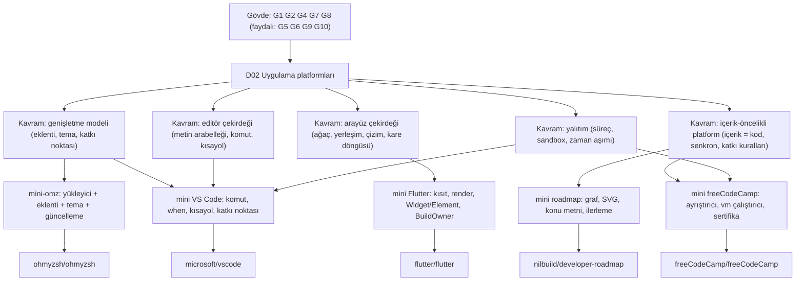

# D02 — Uygulama platformları ve geliştirici araçları

> Gövde: [G1–G11](../../govde/README.md) · Ağaç: [AGAC.md](../../AGAC.md) · İş fikirleri: [katalog](../../is-fikirleri/README.md)

Bu dal, geliştiricilerin **içinde yaşadığı** beş platformu inceler: kodu yazdığın editör (VS Code), arayüzü kurduğun
araç seti (Flutter), komutları yazdığın kabuk çerçevesi (Oh My Zsh), kodlamayı öğrendiğin okul (freeCodeCamp) ve ne
öğreneceğini gösteren yol haritaları (roadmap.sh). Hepsinin ortak noktası bir **genişletme modeli**dir: eklenti,
tema, widget, meydan okuma ya da konu metni ekleyerek binlerce kişi aynı platformu büyütür. Bu dalı bitirdiğinde
"bir platform nasıl tasarlanır ki başkaları onun üstüne inşa edebilsin?" sorusuna beş farklı cevap bilirsin.

## Ön koşullar

Beş yaprağın "Öğrenmen gerekenler" tablolarının birleşimi:

| Düğüm                                                             | Durum    | Bu dalda nerede gerekiyor                                                                                                         |
| ----------------------------------------------------------------- | -------- | --------------------------------------------------------------------------------------------------------------------------------- |
| [G1 Terminal, kabuk ve Linux](../../govde/README.md#g1)           | zorunlu  | ohmyzsh baştan sona kabuk; diğer dördünün kurulum ve testleri terminalde                                                          |
| [G2 Git ve GitHub](../../govde/README.md#g2)                      | zorunlu  | Oh My Zsh'nin güncellemesi `git pull`; freeCodeCamp ve roadmap.sh'de katkı = PR                                                   |
| [G4 JavaScript / TypeScript ve Node.js](../../govde/README.md#g4) | zorunlu  | VS Code, freeCodeCamp, roadmap betikleri TypeScript; beş mini'nin dördü JavaScript                                                |
| [G7 Test, CI ve kod kalitesi](../../govde/README.md#g7)           | zorunlu  | Katman kuralları (VS Code), golden test (Flutter), "çözümler testleri geçer" (freeCodeCamp)                                       |
| [G8 Büyük kod tabanı okuma](../../govde/README.md#g8)             | zorunlu  | VS Code 21.007, freeCodeCamp 19.823, Flutter 16.326 dosya                                                                         |
| [G5 Veri yapıları](../../govde/README.md#g5)                      | faydalı  | Kırmızı-siyah ağaç (metin arabelleği), ağaç uzlaştırma, graf                                                                      |
| [G6 Ağ ve web temelleri](../../govde/README.md#g6)                | faydalı  | freeCodeCamp API'si, roadmap senkron betikleri                                                                                    |
| [G9 Açık kaynak: lisans ve katkı](../../govde/README.md#g9)       | faydalı  | Yazılım/içerik lisans ayrımı (freeCodeCamp, roadmap.sh), CONTRIBUTING kuralları (ohmyzsh, freeCodeCamp, roadmap.sh)               |
| [G10 C ve bellek modeli](../../govde/README.md#g10)               | faydalı  | Yalnızca Flutter motoru (C++) ve gömücü API'si (C) için; çerçeve ve mini'ler için gerekmez                                        |
| [D01 Web arayüzü](../01-web-arayuzu/README.md)                    | önerilir | React'in uzlaştırma ve key kavramı Flutter'ın Element ağacıyla yakından akraba; freeCodeCamp istemcisi React, VS Code arayüzü DOM |

## Dalın ağacı

## Yapraklar

| Depo                                                      | Tür                                | Zorluk (1–5) | Mini                                                                                                                                  | Mini (saat) | Toplam (saat) |
| --------------------------------------------------------- | ---------------------------------- | ------------ | ------------------------------------------------------------------------------------------------------------------------------------- | ----------- | ------------- |
| [ohmyzsh/ohmyzsh](ohmyzsh/README.md)                      | kod tabanı (zsh)                   | 2            | [mini-omz](ohmyzsh/sifirdan/README.md): yükleyici, eklenti + tamamlama, tema, kancalar, güncelleme; 40 doğrulama                      | 10–15       | 25–36         |
| [nilbuild/developer-roadmap](developer-roadmap/README.md) | eğitim içeriği + senkron betikleri | 2            | [mini roadmap](developer-roadmap/sifirdan/README.md): model, SVG/HTML, konu metni, ilerleme; 15 test                                  | 9–13        | 22–32         |
| [freeCodeCamp/freeCodeCamp](freecodecamp/README.md)       | kod tabanı + eğitim içeriği        | 3            | [mini fCC](freecodecamp/sifirdan/README.md): ayrıştırıcı, vm çalıştırıcı, müfredat + sertifika; 18 test                               | 30–53       | 44–73         |
| [microsoft/vscode](vscode/README.md)                      | kod tabanı                         | 4            | [mini VS Code](vscode/sifirdan/README.md): parça tablosu, komut/when/kısayol, worker + RPC eklenti sunucusu, katkı noktaları; 25 test | 18–25       | 35–49         |
| [flutter/flutter](flutter/README.md)                      | kod tabanı (Dart + C++)            | 5            | [mini Flutter](flutter/sifirdan/README.md): kısıtlar, render ağacı, Widget/Element/State, kare döngüsü, ASCII ekran; 15 test          | 21–29       | 37–52         |

**Süre kuralı.** Bu daldaki bütün süreler saattir. Bir yerde hafta ya da gün geçerse varsayım şudur: 1 hafta ≈ 10 saat,
1 gün ≈ 5 saat odaklı çalışma.

- **Mini (saat):** yaprağın "Sıfırdan yol" tablosundaki numaralı aşamaların toplamı. İsteğe bağlı "Yan" satırları
  dahil değil. freeCodeCamp'in 4–5. aşamaları (tarayıcı arayüzü, API + veritabanı: 20–40 saat) ve Flutter'ın 5. aşaması
  (Dart'ta yeniden yazma: 4–6 saat) `sifirdan/` kodunun dışındadır. Yalnızca mini'nin kodu freeCodeCamp'te 10–13,
  Flutter'da 17–23 saat sürer.
- **Toplam (saat):** Mini + okuma rotası (adım başına ~1 saat) + alıştırmaların hepsi (her biri ~1–2 saat).
- **Dal toplamı:** Mini 88–135 saat; Toplam 163–242 saat. Haftada ~10 saatle yaklaşık 16–24 hafta.

## Önerilen sıra ve gerekçesi

1. **ohmyzsh** (toplam 25–36 saat) — En küçük çekirdek (347 satırlık yükleyici) ve en somut geri bildirim: istemin
   değişir. "Eklenti nasıl yüklenir, kullanıcı nasıl geçersiz kılar, güncelleme nasıl denetlenir?" sorularının en sade
   hâli. G1'i pekiştirir.
2. **developer-roadmap** (toplam 22–32 saat) — Kod azdır ama tasarım dersi büyüktür: içerik ile kodu ayırmak, kimlik
   tabanlı eşleme, iki yönlü senkron, katkı kuralları. Mini'nin dört aşaması saf fonksiyonlardan oluşur (disk işi
   yalnızca `olustur.js`'te); test yazma alışkanlığı için ideal.
3. **freecodecamp** (toplam 44–73 saat) — İlk gerçek monorepo (pnpm + Turborepo). İçerik hattını (markdown →
   ayrıştırıcı → müfredat) ve güvenilmeyen kodu yalıtarak çalıştırmayı öğrenirsin; bir öncekinin "içerik = kod"
   fikrinin büyük ölçekli hâli.
4. **vscode** (toplam 35–49 saat) — ohmyzsh'de öğrendiğin eklenti yükleme fikri (ve freeCodeCamp ayrıştırıcısının
   eklenti zinciri) burada süreç yalıtımı, RPC ve bildirim-öncelikli tembel etkinleştirmeyle olgunlaşır. Büyük kod
   tabanı okuma (G8) burada gerçekten sınanır.
5. **flutter** (toplam 37–52 saat) — En zoru: yeni bir dil (Dart), çerçeve + motor + gömücü katmanları ve kare boru
   hattı. D01'deki React bilgisi varsa geçiş kolaylaşır; mini'yi JS ile kurup sonra Dart'ta yeniden yazarsın.

**Alternatif:** Hedefin mobil/arayüz geliştirmek ise D01'den hemen sonra **flutter**'a geç, sonra vscode.
Hedefin kodlama ajanları ([D07](../07-kodlama-ajanlari/README.md)) ise **ohmyzsh → vscode** ikilisi yeter: ajanlar
tam olarak bu iki ortamda (terminal ve editör) yaşıyor.

## Beş deponun ortak desenleri

| Desen                                        | Nerede                                                                                                                                                                                 | Mini'de                                                                                                                |
| -------------------------------------------- | -------------------------------------------------------------------------------------------------------------------------------------------------------------------------------------- | ---------------------------------------------------------------------------------------------------------------------- |
| Kayıt defteri (registry) + kimlikle çağırma  | VS Code komutları, Oh My Zsh eklentileri, freeCodeCamp meydan okuma kimlikleri                                                                                                         | `CommandRegistry`, `plugins=(...)`, `challengeOrder`                                                                   |
| Önce bildirim, sonra kod (tembel yükleme)    | VS Code `package.json` katkıları ve `onCommand:` olayı                                                                                                                                 | `eklentileriTara` + `activateByEvent`                                                                                  |
| Kullanıcı geçersiz kılması                   | Oh My Zsh `custom/`, VS Code `keybindings.json` ("son kayıt kazanır", `-komut`)                                                                                                        | `_mini_kaynak`, `KeybindingResolver`                                                                                   |
| Bildirimsel ağaç + uzlaştırma                | Flutter Widget/Element, (D01'de React)                                                                                                                                                 | `Element.updateChild`, `updateChildren`                                                                                |
| Yalıtım ve zaman aşımı                       | VS Code eklenti sunucusu, freeCodeCamp tarayıcı çalıştırıcısı                                                                                                                          | `worker_threads`, `node:vm` + `timeout`                                                                                |
| İçerik = kod (depoda markdown, katkı PR ile) | freeCodeCamp müfredatı (CI'da her çözüm kendi testlerinden geçer: `node.js-tests.yml`); roadmap.sh konu metinleri (kurallar `contributing.md`'de, denetim insan incelemesiyle; CI yok) | `cozumleriDogrula` (fCC CI'ının karşılığı); `icerikFarki`, `konuDogrula` (roadmap'te elle yapılan işin otomatik hâli)  |
| Güncelleme ve senkron                        | Oh My Zsh güncelleme denetimi, roadmap.sh depo ↔ veritabanı senkronu                                                                                                                   | `guncelleme-kontrol.zsh`; `konuAyristir`/`konuYaz` + `icerikFarki`, `olustur.js`                                       |
| Cihazlar arası ilerleme birleştirme          | roadmap.sh sitesi (kodu bu depoda yok; doğrulanmadı)                                                                                                                                   | `birlestir` (son yazan kazanır)                                                                                        |
| İnsan dışarıdan veri girdiğinde kaçış        | Oh My Zsh istemindeki `%`, roadmap.sh kaynak başlıkları (`escapeMarkdownLinkText`)                                                                                                     | `${dal//\%/%%}`, `baglantiMetniKacir`; `kacis` ve `konuHtml` mini'nin kendi eklemesi (sitedeki karşılığı doğrulanmadı) |

## Dallar arası bağlantılar

- **[D01 Web arayüzü](../01-web-arayuzu/README.md):** React'in uzlaştırması ↔ Flutter'ın `updateChild`/key kuralı;
  freeCodeCamp istemcisi React + Redux; VS Code workbench'i çerçevesiz DOM ile çizilir (karşılaştırma için iyi örnek).
- **[D07 Kodlama ajanları](../07-kodlama-ajanlari/README.md):** kodlama ajanları editörde ve terminalde yaşar. VS Code
  deposunda Copilot Chat eklentisinin kaynağı (`extensions/copilot`) ve ajan oturumları penceresi (`src/vs/sessions`)
  var. Terminal ajanları ([opencode](../07-kodlama-ajanlari/opencode/README.md),
  [claw-code](../07-kodlama-ajanlari/claw-code/README.md)) kullanıcının terminalinden başlatılır ama araç
  komutlarını etkileşimsiz bir kabukta çalıştırır: claw-code `sh -lc` (`f51a33a`, `rust/crates/runtime/src/bash.rs`),
  opencode `$SHELL -c` (`12a661e`, `packages/core/src/shell/select.ts`). Bu yüzden `~/.zshrc` ve Oh My Zsh'nin takma
  adları ajanın komutlarına görünmez; iki dalı bağlayan iyi bir ders. roadmap.sh'de `claude-code`, `codex`, `openclaw`
  yol haritaları bulunuyor.
- **[D08 Ajan becerileri](../08-ajan-becerileri/README.md):** VS Code'un `AGENTS.md` + `.github/skills/` (51 beceri),
  Flutter'ın `CONTRIBUTING.ai.md`, Oh My Zsh'nin "yapay zekâ yardımıyla yazılmış katkıyı belirt" kuralı — büyük
  projelerin ajanlarla çalışma düzenleri.
- **[D09 Bilgisayar bilimi](../09-bilgisayar-bilimi/README.md):** parça ağacı (kırmızı-siyah ağaç), ağaç uzlaştırma,
  graf gezintisi (roadmap yerleşimi ve "sıradaki konular").
- **[D10 Küratörlük ve topluluk](../10-kuratorluk-topluluk/README.md):** freeCodeCamp ve roadmap.sh, free-programming-books
  gibi öğrenme kaynaklarıyla aynı aileden; içerik katkı kuralları ve lisans ayrımları (BSD yazılım + telifli müfredat;
  roadmap.sh'nin özel lisansı) burada önemli ([G9](../../govde/README.md#g9)).
- **[D03 Sistem, ağ, güvenlik](../03-sistem-ag-guvenlik/README.md):** Oh My Zsh'nin kurulum betiğini çalıştırmadan önce
  okuma tavsiyesi ("Manual Inspection") ve istem güvenliği.

## Bu dalı bitirdiğinde ne yapabilirsin

- Bir uygulamaya **eklenti sistemi** ekleyebilirsin: bildirim dosyası, katkı noktaları, tembel yükleme, hata yalıtımı.
- Bir **metin editörünün** çekirdeğini (parça tablosu, komutlar, kısayollar) ve iş parçacıkları arası (aynı
  protokolle süreçler arası da kurulabilen) **RPC** kurabilirsin.
- Bildirimsel bir **arayüz çerçevesinin** nasıl çalıştığını (kısıt tabanlı yerleşim, Element ağacı, kare döngüsü)
  anlatabilir ve Flutter'da bilinçli performans kararları verebilirsin.
- Kendi **kabuk ortamını** çerçeve düzeyinde yönetebilirsin: eklenti, tamamlama, tema, güncelleme.
- **İçerik-öncelikli bir öğrenme ürünü** kurabilirsin: içerik biçimi, ayrıştırıcı, yalıtılmış ve zaman aşımlı bir
  çalıştırıcı (güvenilmeyen kod için ayrı süreç/konteyner ya da tarayıcı sandbox'ı gerektiğini bilerek), ilerleme ve
  sertifika modeli, senkron hattı.
- Bu beş depoya **anlamlı bir katkı** yapacak kadar yolunu bilirsin (her dosyadaki "Gerçek depoda okuma rotası").
