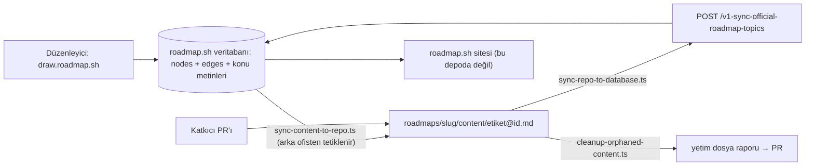
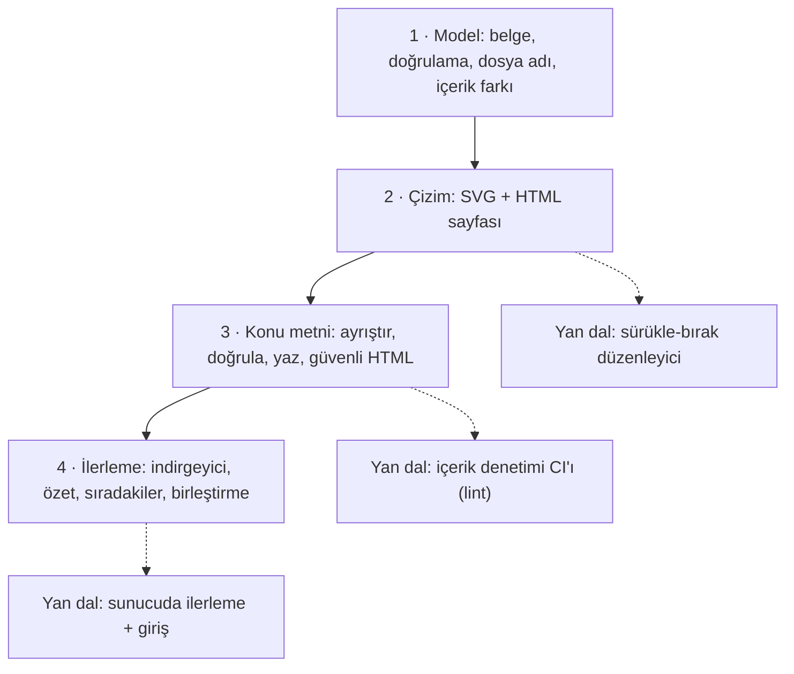

# nilbuild/developer-roadmap — roadmap.sh yol haritalarının içerik deposu

> **Dal:** [D02 Uygulama platformları](../README.md) · **Tür:** eğitim içeriği (+ içerik senkron betikleri)
> **Dil:** Markdown içerik, TypeScript betikler · **Lisans:** özel (GitHub: NOASSERTION) · **Yıldız:** 371.601 (9 Kasım 2026) · **İncelenen commit:** `f590626` (2026-11-09)

## 1. Bir bakışta

roadmap.sh, geliştiricilere "bu alanda ne öğrenmeliyim, hangi sırayla?" sorusunun cevabını tıklanabilir yol
haritalarıyla veren bir site; depo adının eski hâliyle (developer-roadmap) GitHub'ın en çok yıldızlı depolarından.
**Sürpriz:** incelenen commit'te depo bir web uygulaması değil. `contributing.md` ("Working Locally") açıkça "This
repository only holds the roadmap content, so there is no app to run" diyor; README de depoyu "the content behind the
roadmaps" diye tanıtıyor. 11.337 dosyanın 11.305'i markdown: 97 yol haritası klasörü ve her birinde konu metinleri.
Grafın kendisi (düğümler, kenarlar, konumlar) sitenin veritabanında; depo ile veritabanı arasındaki köprü üç
TypeScript betiği. Bu yüzden bu depodan öğreneceğin şey bir çerçeve değil, **içerik-öncelikli bir ürünün veri modeli,
senkron hattı ve topluluk katkı düzeni**.

## 2. Nasıl yapılmış: mimari

### Klasör haritası

```text
nilbuild/developer-roadmap @ f590626 (varsayılan dal: master)
├── roadmaps/                         97 yol haritası
│   └── <slug>/content/<etiket-slug>@<düğüm-id>.md   Bir konunun metni (ör. frontend/content/cors@AfH2zCbqzw0Nisg1yyISS.md)
├── scripts/
│   ├── sync-content-to-repo.ts       Veritabanı → depo: konu metinlerini dosyaya yazar, PR açtırır
│   ├── sync-repo-to-database.ts      Depo → veritabanı: dosyayı ayrıştırır, kaynak listesini ayırır, API'ye gönderir
│   ├── cleanup-orphaned-content.ts   Dosyaları graftaki düğümlerle karşılaştırır: yeniden adlandır / sil
│   ├── lib/official-roadmap.ts       Yol haritası belge tipi: nodes, edges, draft, seo, questions …
│   ├── lib/official-roadmap-topic.ts Konu tipi, kaynak türleri, kaynak satırı biçimi
│   ├── lib/slugger.ts, markdown.ts, html.ts   slug, markdown-it ile HTML, turndown ile geri markdown
│   └── readme.md                     Betiklerin kullanımı
├── .github/workflows/                8 iş akışı: elle (sync-*, cleanup-*, cloudfront-*), zamanlı (aws-costs …), issue etiketleme
├── .github/ISSUE_TEMPLATE/           Öneri, hata, yeni yol haritası şablonları
├── contributing.md                   İçerik kuralları (tek paragraf, en fazla 8 bağlantı, kaynak türleri)
├── license                           Kişisel kullanım dışında yeniden yayımlamayı yasaklayan özel lisans
└── package.json                      "Roadmap content for roadmap.sh"; markdown-it, node-html-parser, turndown, tsx
```

Ölçek: en kalabalık klasörler `cyber-security` (302 dosya), `seo` (216), `bi-analyst` (203), `network-engineer` (202).
Listede `claude-code`, `codex`, `openclaw`, `vibe-coding`, `ai-agents` gibi yapay zekâ çağının yol haritaları da var.

### Ana bileşenler ve veri akışı



- **Bağlantı anahtarı düğüm kimliğidir.** Dosya adı `${slugify(label)}@${nodeId}.md`; etiket değişirse slug kısmı eskir,
  kimlik aynı kalır. `cleanup-orphaned-content.ts` aynı kimlikli eski adlı dosyayı yeniden adlandırır, graftan
  silinmiş düğümün dosyasını siler. Yalnızca `topic` ve `subtopic` türündeki etiketli düğümlerin dosyası olur.
- **Senkron yönleri ayrı.** Veritabanından depoya akış PR açar (insan gözden geçirir); depodan veritabanına akış
  `--secret` ile korunan bir uç noktaya yazar. İkisi de GitHub Actions'ta `workflow_dispatch` ile çalışır.
- **Konu dosyasının biçimi:** `# Başlık`, tek paragraf açıklama, "Visit the following resources to learn more:" ve
  `- [@tür@Başlık](url)` satırları. `sync-repo-to-database.ts` dosyayı markdown-it ile HTML'e çevirir, "yalnızca
  bağlantıdan oluşan" listeyi bulup kaynaklara ayırır, kalan açıklamayı turndown ile tekrar markdown'a çevirir.
- **Belge modeli** (`scripts/lib/official-roadmap.ts`): `nodes` (id, type, data.label …), `edges`, yayımlanmamış
  değişiklikler için `draft`, `seo`, `openGraph`, `partner`, `type` (`skill`, `role`, `best-practice`), `dimensions`,
  SSS için `questions` (açıklama Tiptap JSON), `relatedRoadmaps`, `courses`.

### Önce okunacak dosyalar

1. `readme.md` → "Repository Structure" — dosya adı biçimi ve düğüm kimliğinin neden korunması gerektiği.
2. `contributing.md` → "Working Locally", "How To Structure Content" ve "Guidelines" — deponun ne olduğu ve ne
   olmadığı, içerik kuralları ve topluluk politikası.
3. `scripts/readme.md` — üç betiğin görevi.
4. `scripts/lib/official-roadmap.ts` ve `official-roadmap-topic.ts` — veri modeli.
5. `scripts/sync-repo-to-database.ts` — ayrıştırma hattı.
6. `scripts/cleanup-orphaned-content.ts` — yetim dosya mantığı.
7. Herhangi bir konu dosyası, ör. `roadmaps/frontend/content/cors@AfH2zCbqzw0Nisg1yyISS.md`.

### Teknoloji yığını, derleme, test, CI, sürüm

- **İçerik:** Markdown; biçim kuralları `contributing.md`'de, otomatik içerik denetimi (lint) iş akışı yok.
- **Betikler:** TypeScript, `tsx` ile doğrudan çalışır; bağımlılıklar `markdown-it`, `node-html-parser`, `turndown`.
  Node 24 ve pnpm 11 (iş akışlarında). Biçim: Prettier (`.prettierrc.cjs`).
- **Test:** yok. Kalite insan incelemesine ve senkron betiklerinin hata mesajlarına dayanıyor.
- **CI/CD:** `.github/workflows/` altındaki sekiz iş akışının hiçbiri push/PR'da test koşmuyor: senkron, temizlik ve
  önbellek işleri `workflow_dispatch` ile, `aws-costs.yml` ve `close-feedback-pr.yml` günlük `cron` ile,
  `label-issue.yml` yeni/düzenlenen issue'larda (etiketleme) çalışıyor. `cloudfront-api-cache.yml` ve
  `cloudfront-fe-cache.yml` önbellek temizliği için ayrı bir altyapı deposundaki (`roadmapsh/infra-ansible`) iş
  akışını tetikliyor. Yani site kodu ve altyapısı başka depolarda; sitenin nasıl yayımlandığı bu depodan görünmüyor
  (doğrulanmadı).
- **Sürüm yok:** birleştirilen içerik değişikliği senkronla siteye geçer ("Merged changes are synced to the website automatically").

### Tasarım kararları ve ödünleşimler

1. **Kod ile içeriği ayırmak.** Site kodu bu depodan çıkarılmış; depo yalnızca katkıya açık içerik. Kazanç: katkıcı
   için sıfır kurulum ("there is no app to run"), bakımcı için daha küçük saldırı yüzeyi. Bedel: depodan siteyi
   kuramazsın; grafın kendisi açık değil.
2. **Graf veritabanında, metin depoda.** Düğüm ekleme/silme gibi yapısal değişiklikler düzenleyiciden ve issue'lardan
   gelir; metin düzeltmeleri PR'dan. Bedel: iki kaynak arasında senkron ve yetim dosya temizliği gerekir.
3. **Kimlik + okunabilir slug'lı dosya adı.** `cors@AfH2…` hem insan okur hem makine eşler. Bedel: etiket değişince
   dosya adı eskir (temizlik betiği bunun için var) ve slug kuralı ASCII dışını düşürür (İngilizce içerikte sorun yok).
4. **Az ve öz içerik kuralı.** Tek paragraf, en fazla 8 bağlantı, belirli tür sırası, GeeksforGeeks bağlantısı yok,
   "her şeyi listelemek amaç değil". Kazanç: tutarlı, bakımı mümkün içerik. Bedel: kurala uymayan PR'lar geri
   çevrilir; "feedback left" etiketli bir PR 7 gün hareketsiz kalırsa `close-feedback-pr.yml` onu kendiliğinden kapatır
   (reddedilen PR oranı doğrulanmadı).
5. **Kısıtlayıcı lisans.** İçerik kişisel kullanım dışında yeniden yayımlanamaz. Kazanç: içerik çiftlikleri
   kopyalayamaz. Bedel: açık kaynak tanımına uymaz; üzerine ürün kurmak isteyen kendi içeriğini yazmalı.

## 3. Öğrenmen gerekenler

| Ön koşul                                                               | Bu depo için neden gerekli                                            | Ücretsiz kaynak                                                                                   |
| ---------------------------------------------------------------------- | --------------------------------------------------------------------- | ------------------------------------------------------------------------------------------------- |
| [G4 JavaScript / TypeScript ve Node.js](../../../govde/README.md#g4)   | Betikler TypeScript; mini uygulama JS                                 | Gövdedeki kaynaklar                                                                               |
| [G2 Git ve GitHub](../../../govde/README.md#g2)                        | Katkı = PR; iş akışları GitHub Actions                                | Gövdedeki kaynaklar                                                                               |
| [G9 Açık kaynak: lisans, katkı, topluluk](../../../govde/README.md#g9) | Özel lisans, içerik katkı politikası                                  | `license`, `contributing.md`                                                                      |
| [G5 Veri yapıları](../../../govde/README.md#g5)                        | Graf: düğüm, kenar, katmanlı yerleşim, önkoşul analizi                | [javascript-algorithms](../../09-bilgisayar-bilimi/javascript-algorithms/README.md) (graf bölümü) |
| [G6 Ağ ve web temelleri](../../../govde/README.md#g6)                  | Senkron betikleri HTTP API'ye yazar                                   | Gövdedeki kaynaklar                                                                               |
| Dal içi kavramlar                                                      | İçerik-öncelikli ürün, statik site üretimi, SVG, güvenli HTML üretimi | Bu dosyadaki mini uygulama                                                                        |

## 4. Sıfırdan yol (dallanma)



| Aşama | Ne inşa edersin                         | Öğrendiğin kavram                                             | Bitti ölçütü                                                | Süre (tahmini) |
| ----- | --------------------------------------- | ------------------------------------------------------------- | ----------------------------------------------------------- | -------------- |
| 1     | `asama1_model.js`                       | Graf doğrulama, slug, kimlik tabanlı eşleme                   | Örnek belge hatasız; bozuk belge 10 ayrı hata veriyor       | 2–3 saat       |
| 2     | `asama2_cizim.js`                       | SVG koordinatları, kaçış, BFS ile katmanlı yerleşim           | SVG'de düğüm/kenar sayısı doğru; `<script>` etiketi etkisiz | 3–4 saat       |
| 3     | `asama3_konu.js`                        | Satır tabanlı ayrıştırma, gidiş-dönüş testi, güvenli markdown | Yaz → ayrıştır aynı; `javascript:` bağlantısı açılmıyor     | 2–3 saat       |
| 4     | `asama4_ilerleme.js`                    | Saf indirgeyici, silme işareti, son yazan kazanır             | İki cihaz birleştirmesi sıradan bağımsız                    | 2–3 saat       |
| Yan   | Düzenleyici, hesap sistemi, içerik CI'ı | Arayüz, kimlik doğrulama, otomasyon                           | —                                                           | 10–30 saat     |

**Mini uygulama:** [sifirdan/](sifirdan/README.md) — dört aşama + `olustur.js` statik site üretici, 15 test, Türkçe
"Terminal ve Kabuk" yol haritası (11 konu). Aşama 1 ve 3 bu depodaki `scripts/` dosyalarının; aşama 2 ve 4 sitenin
(bu depoda olmayan) görünür davranışının karşılığıdır.

**Gerçek ölçeğe giden yol:** önce düzenleyici (belgeyi üreten araç), sonra sunucu ve iki yönlü senkron, sonra kullanıcı
hesabı ve sunucuda ilerleme, en son ölçek (CDN, önbellek temizleme) ve topluluk süreçleri (issue şablonları, otomatik
etiketleme).

## 5. Gerçek depoda okuma rotası

1. **`contributing.md` → "Working Locally" ve `readme.md` → "Repository Structure":** depoda neden çalıştırılacak bir
   uygulama yok? Dosya adındaki düğüm kimliği neden değiştirilmemeli?
2. **`roadmaps/frontend/content/` listesi:** aynı etiketli iki dosya var mı (ör. `angular@…` iki kez)? Bu neden mümkün?
   (İpucu: aynı etiket graftaki iki farklı düğümde kullanılabilir.)
3. **`scripts/lib/official-roadmap.ts`:** `nodes` ile `draft.nodes` farkı ne olabilir?
4. **`scripts/sync-content-to-repo.ts`:** dosya adı hangi satırda oluşuyor? Etiketi olmayan düğüm ne oluyor?
5. **`scripts/sync-repo-to-database.ts`:** "yalnızca bağlantı içeren liste" nasıl tespit ediliyor? `@tür@` öneki geçersizse
   ne oluyor?
6. **`scripts/cleanup-orphaned-content.ts`:** üç durum (eski slug, eski kimlik, graftan silinmiş düğüm) nasıl ayrılıyor?
7. **`.github/workflows/`:** hangi iş akışı neyle tetikleniyor? Sitenin yayımlandığı yere dair hangi ipucu var?

## 6. Alıştırmalar ve öz değerlendirme

**Alıştırmalar (kolaydan zora):**

1. Örnek yol haritasına "SSH ve Uzak Sunucu" konusunu ekle; `node --test` ve `node olustur.js` geçsin.
2. `konuDogrula`'ya "açıklama tek paragraf olmalı" kuralını ekle.
3. Bir içerik denetimi betiği yaz: `roadmaps/*/content/*.md` biçimindeki bir klasörü tarasın, bütün kural ihlallerini
   raporlasın; GitHub Actions'ta PR'da çalışacak bir iş akışı taslağı yaz.
4. `svgCiz`'e kenarları düz çizgi yerine dirsekli (ortogonal) yol olarak çizme seçeneği ekle.
5. `siradakiler`'e "öğreniyorum" durumundaki konuları öne alan bir sıralama ekle.
6. Tarayıcıda sürükle-bırak ile düğüm konumunu değiştirip JSON'u indiren küçük bir düzenleyici yaz.

**Öz değerlendirme:**

1. Bir konunun etiketi "React Hooks"tan "Hooks"a değişti. Depoda ne olur?

   <details><summary>Cevap</summary>

   Düğüm kimliği aynı kalır, beklenen dosya adı `hooks@<id>.md` olur. Eski `react-hooks@<id>.md` dosyası "eski slug"
   durumuna düşer; temizlik betiği onu yeniden adlandırır (doğru adlı dosya zaten varsa eskisini siler).

   </details>

2. Bu depo neden test içermiyor ve bu bir sorun mu?

   <details><summary>Cevap</summary>

   Depo içerikten ibaret; kod yalnızca bakımcıların çalıştırdığı senkron betikleri. Kalite insan incelemesiyle
   sağlanıyor. Yine de biçim kuralları (bağlantı sayısı, tür sırası, https) otomatik denetlenebilir; bu, PR yükünü
   azaltırdı (alıştırma 3).

   </details>

3. roadmap.sh içeriğini Türkçeye çevirip kendi sitende yayımlayabilir misin?

   <details><summary>Cevap</summary>

   Hayır, `license` dosyası içeriğin kişisel kullanım dışında hiçbir biçimde yeniden yayımlanmasını yasaklıyor ve önce
   izin istenmesini söylüyor. Kendi içeriğini yazmalı (mini'deki gibi) ya da yazılı izin almalısın.

   </details>

## 7. İş fikri tohumları

- **Kurum içi beceri yol haritası aracı** (şirketin kendi rollerine göre graf + konu metni + çalışan ilerlemesi;
  yöneticiye ekip özeti) — **kime:** 50–500 kişilik yazılım şirketlerinin mühendislik yöneticileri ve İK ekipleri.
- **Türkçe öğrenme yolları sitesi** (özgün Türkçe içerik, ücretsiz kaynaklara bağlantı, ilerleme takibi) —
  **kime:** üniversite öğrencileri ve kariyer değiştiren yetişkinler; ilk müşteri olarak üniversite kariyer merkezleri.
- **Bootcamp müfredat haritası + ilerleme paneli** (her konuya ödev ve değerlendirme bağlama) — **kime:** Türkiye'deki
  kodlama bootcamp'leri ve belediyelerin gençlik merkezlerindeki eğitim programları.

Bütün fikirler için: [İş fikirleri kataloğu](../../../is-fikirleri/README.md).

## 8. Kaynaklar

- README (depo yapısı): [readme.md](https://github.com/nilbuild/developer-roadmap/blob/f590626ad3b4a242b85a676e2a78c361936bc732/readme.md)
- Katkı kuralları ve yerel çalışma: [contributing.md](https://github.com/nilbuild/developer-roadmap/blob/f590626ad3b4a242b85a676e2a78c361936bc732/contributing.md)
- Betikler: [scripts/readme.md](https://github.com/nilbuild/developer-roadmap/blob/f590626ad3b4a242b85a676e2a78c361936bc732/scripts/readme.md)
- Veri modeli: [scripts/lib/official-roadmap.ts](https://github.com/nilbuild/developer-roadmap/blob/f590626ad3b4a242b85a676e2a78c361936bc732/scripts/lib/official-roadmap.ts)
- Lisans: [license](https://github.com/nilbuild/developer-roadmap/blob/f590626ad3b4a242b85a676e2a78c361936bc732/license)
- Yol haritası düzenleyicisi: https://draw.roadmap.sh/ (contributing.md'de geçiyor)
- Site: https://roadmap.sh — sitenin önyüz kodunun eskiden bu depoda olduğu (Astro tabanlı) bilinir; incelenen commit'te
  yok (doğrulanmadı).
