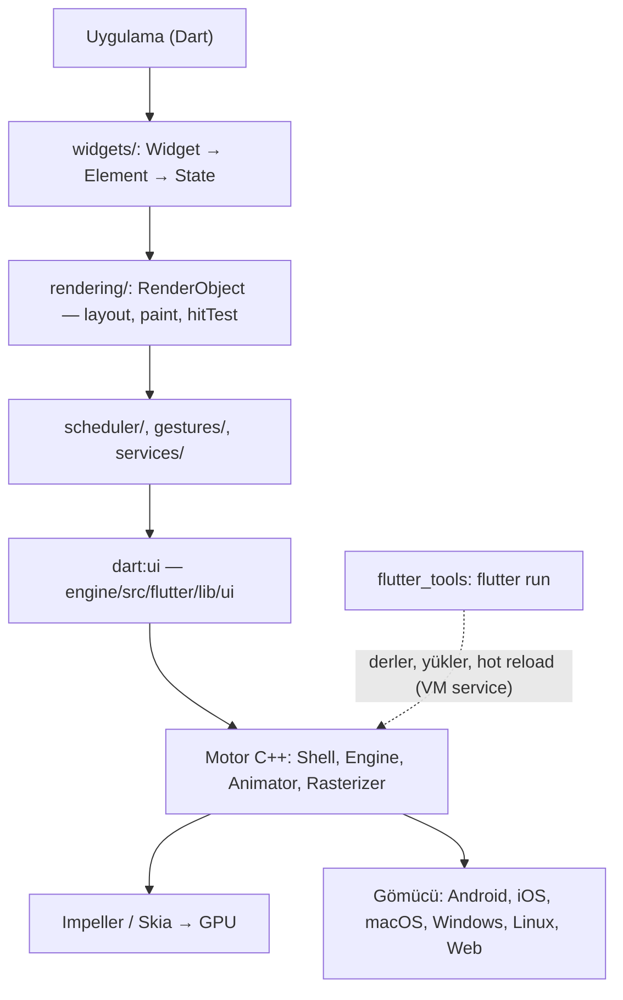
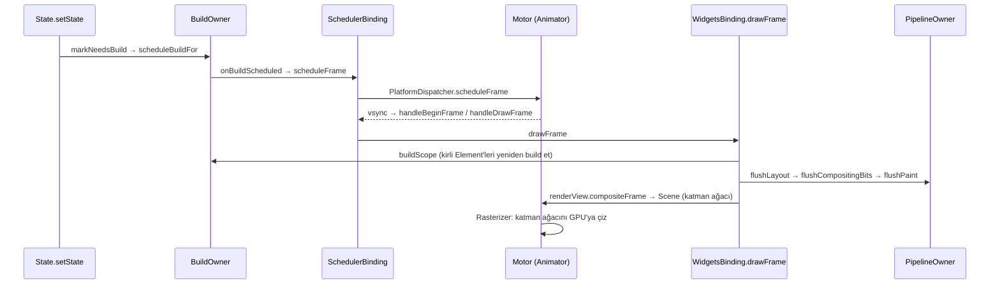
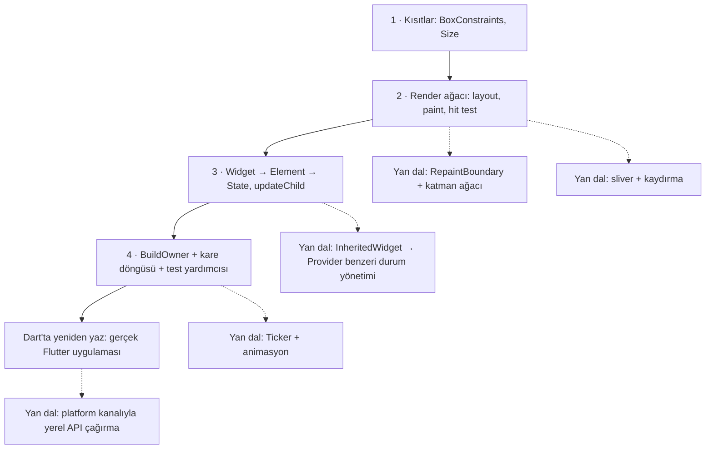

# flutter/flutter — Tek kod tabanından mobil, web ve masaüstü arayüz araç seti

> **Dal:** [D02 Uygulama platformları](../README.md) · **Tür:** kod tabanı
> **Dil:** Dart (+ motorda C++) · **Lisans:** BSD-3-Clause · **Yıldız:** 181.092 (9 Kasım 2026) · **İncelenen commit:** `acade0f` (2026-11-08)

## 1. Bir bakışta

Flutter, Google'ın Dart diliyle yazılan arayüz araç setidir: aynı kodla Android, iOS, web, Windows, macOS ve Linux
uygulaması üretir. Farkı, platformun hazır düğmelerini kullanmak yerine **her pikseli kendi motoruyla çizmesidir**;
bu yüzden arayüz her cihazda aynı görünür ve 60/120 fps hedeflenebilir. Geliştiricilerin sevdiği şey "hot reload":
kodu kaydettiğinde uygulama durumunu kaybetmeden saniyenin altında güncellenir. Depo bugün bir **monorepo**'dur:
Dart çerçevesi (`packages/flutter`), `flutter` komut satırı aracı (`packages/flutter_tools`) ve eskiden ayrı depoda
duran C++ motoru (`engine/src/flutter`) aynı ağaçta. İncelenen commit'te 16.326 dosya var; motorun Skia, Dart SDK
gibi bağımlılıkları depoya konmaz, kök dizindeki `DEPS` dosyasıyla `gclient` üzerinden çekilir.

## 2. Nasıl yapılmış: mimari

### Klasör haritası

```text
flutter/flutter @ acade0f (varsayılan dal: master)
├── bin/flutter, bin/dart            Komut satırı girişleri; bin/internal/shared.sh Dart SDK'yı indirir ve
│                                    flutter_tools'un anlık görüntüsünü (snapshot) gerekirse yeniden derler
├── bin/internal/                    Sürüm dosyaları; motor ikililerini bulan update_engine_version.sh, content_aware_hash.sh
├── packages/flutter/lib/src/        ÇERÇEVE (Dart, 682 dosya)
│   ├── foundation/                  Temel türler: ChangeNotifier, Key, tanılama (diagnostics)
│   ├── scheduler/                   Kare zamanlama: SchedulerBinding, SchedulerPhase
│   ├── gestures/                    İşaretçi olayları, jest arenası
│   ├── rendering/                   Render ağacı: object.dart, box.dart, flex.dart, sliver*.dart, view.dart
│   ├── painting/                    TextPainter, dekorasyon, resim önbelleği
│   ├── widgets/                     framework.dart (Widget/Element/State/BuildOwner), binding.dart, basic.dart
│   ├── material/, cupertino/        İki tasarım dili
│   └── services/                    Platform kanalları, klavye, pano
├── packages/flutter_test/           WidgetTester, golden (altın görüntü) testleri
├── packages/flutter_tools/          `flutter` komutu: commands/ (run, build, create, doctor…), run_hot.dart, devfs.dart
├── packages/flutter_localizations/  Yerelleştirme verileri
├── packages/integration_test/, flutter_driver/   Cihaz üstü uçtan uca testler
├── engine/src/flutter/              MOTOR (C++, 1.729 .cc dosyası)
│   ├── shell/common/                shell.cc, engine.cc, animator.cc, rasterizer.cc, vsync_waiter.cc
│   ├── shell/platform/              Gömücüler: android, darwin, linux, windows, fuchsia, embedder (C API), glfw
│   ├── lib/ui/                      dart:ui — çerçevenin motora kapısı (Canvas, Scene, PlatformDispatcher)
│   ├── lib/web_ui/                  Web motoru
│   ├── impeller/                    Yeni GPU çizim motoru (shader'ları önceden derler)
│   ├── display_list/, flow/         Çizim komut listesi ve katman ağacı
│   ├── runtime/                     Dart VM ve isolate yönetimi
│   └── txt/                         Metin yerleşimi
├── dev/bots/                        CI test çalıştırıcısı: test.dart (parçalı testler), analyze.dart
├── dev/devicelab/, dev/benchmarks/  Gerçek cihaz testleri ve performans ölçümleri
├── docs/                            about/, contributing/, engine/, tool/ … (mimari ve süreç belgeleri)
├── DEPS                             Motor bağımlılıkları (gclient)
└── .ci.yaml                         LUCI CI hedefleri (481 hedef; motorun ayrıca kendi .ci.yaml'ı var)
```

### Ana bileşenler ve veri akışı

Katmanlar yukarıdan aşağı:



Bir `setState` çağrısından ekrana giden yol:



Kodda doğrulanan noktalar: `WidgetsBinding.drawFrame` önce `buildOwner!.buildScope(rootElement!)`, sonra
`super.drawFrame()` ve en sonda `buildOwner!.finalizeTree()` çağırır (`widgets/binding.dart`).
`RendererBinding.drawFrame` sırasıyla `flushLayout`, `flushCompositingBits`, `flushPaint`, `compositeFrame`,
`flushSemantics` çalıştırır (`rendering/binding.dart`). Motor tarafında karenin hikâyesi
`docs/engine/Life-of-a-Flutter-Frame.md` belgesinde: `Animator::RequestFrame` → vsync → `BeginFrame` →
`FlutterView.render` → `LayerTree` → `Rasterizer`.

**Üç ağaç** Flutter'ın kalbidir:

- **Widget** değişmez bir tariftir; her build'de yenisi üretilir, ucuzdur.
- **Element** tarifin ağaçtaki kalıcı örneğidir; `State` ve `RenderObject` ona bağlıdır. `Widget.canUpdate`
  (aynı `runtimeType` + aynı `key`) doğruysa Element atılmaz, yeni widget'la güncellenir (`framework.dart`, satır ~384).
- **RenderObject** yerleşimi ve boyamayı yapar. Kural: "kısıtlar aşağı, boyutlar yukarı, konumu ebeveyn verir".
  Bir düğüm yerleşim sınırıysa değişikliği ebeveyne yayılmaz. `object.dart` bunu tek satırda hesaplar:
  `_isRelayoutBoundary = !parentUsesSize || sizedByParent || constraints.isTight || parent == null`.

### Önce okunacak dosyalar

1. `docs/about/The-Framework-architecture.md` ve `docs/engine/Life-of-a-Flutter-Frame.md` — resmi büyük resim.
2. `packages/flutter/lib/src/widgets/framework.dart` — `Widget`, `State.setState`, `Element.updateChild`,
   `updateChildren`, `BuildOwner` (7.480 satır; önce sınıf başlıklarını tara).
3. `packages/flutter/lib/src/rendering/object.dart` — `RenderObject.layout`, `markNeedsLayout`, `PipelineOwner.flushLayout`.
4. `packages/flutter/lib/src/rendering/box.dart` — `BoxConstraints`, `RenderBox`.
5. `packages/flutter/lib/src/rendering/flex.dart` — `RenderFlex` sınıf yorumu yerleşim algoritmasını adım adım anlatır.
6. `packages/flutter/lib/src/widgets/binding.dart` ve `scheduler/binding.dart` — `runApp`, `drawFrame`, `SchedulerPhase`.
7. `engine/src/flutter/lib/ui/platform_dispatcher.dart` — çerçevenin motorla konuştuğu kapı.
8. `packages/flutter_tools/lib/executable.dart` → `lib/src/run_hot.dart` — `flutter run` ve hot reload.

### Teknoloji yığını, derleme, test, CI, sürüm

- **Diller:** Dart (çerçeve ve araç; `pubspec.yaml` → `sdk: ^3.13.0-0`), C++ (motor), Java (Android gömücü: 276 .java dosyası),
  Objective-C++ ve Swift (iOS/macOS: .mm ve .swift), C (gömücü API'si `shell/platform/embedder/embedder.h`).
- **Paketler:** kök `pubspec.yaml` bir pub **workspace**'idir; `packages/*` ve `dev/*` alt paketleri tek çözümlemeyle yönetilir.
- **Motor derlemesi:** `gclient` + `DEPS` ile bağımlılıklar, GN/Ninja ile derleme (`BUILD.gn` dosyaları), yardımcı araç
  `engine/src/flutter/bin/et` (engine tool). Çerçeve geliştiricisi motoru derlemez: `bin/internal/update_engine_version.sh`
  hangi önceden derlenmiş motor ikililerinin indirileceğini belirler; monorepo'da bunun için içerik tabanlı özet
  kullanılır (`docs/engine/monorepo/engine_binary_hashing.md`).
- **Test:** `packages/flutter/test` altında 926 `*_test.dart` dosyası; `flutter_test` ile widget testleri, golden
  testler (`matchesGoldenFile`), `integration_test` ile cihaz testleri, `dev/devicelab` ile gerçek cihaz/performans.
  CI'da testler `dev/bots/test.dart` ile parçalara (shard) bölünür; statik denetimler `dev/bots/analyze.dart`.
- **CI:** asıl CI LUCI'dir: `.ci.yaml` her commit için çalışacak hedefleri tanımlar (481 hedef; motor için
  `engine/src/flutter/.ci.yaml` dosyasında 45 hedef daha) ve "flutter_drone" tarifinin `dev/bots/test.dart`'a
  yönlendiğini söyler. GitHub Actions daha çok otomasyon için (etiketleme, cherry-pick, araç testleri).
- **Sürüm:** `.ci.yaml`'daki `enabled_branches` → `master` ve `flutter-X.Y-candidate.Z` aday dalları; kanal düzeni
  master → beta → stable (`docs/releases/Flutter-build-release-channels.md`: beta her ay `master`'dan dallanır, kabaca
  her üçüncü beta stable olur).

### Tasarım kararları ve ödünleşimler

1. **Kendi motoruyla her pikseli çizmek.** Platform düğmelerini sarmak yerine Skia/Impeller ile çizim. Kazanç:
   tutarlı görünüm, yüksek performans, kolay özelleştirme. Bedel: platformun yerel davranışlarını (erişilebilirlik,
   metin seçimi, yazı tipi) yeniden yazmak; uygulama boyutunun büyümesi.
2. **Değişmez widget + kalıcı Element.** Her build'de yeni widget nesneleri üretmek savurgan görünür ama ucuzdur;
   pahalı nesneler (State, RenderObject) Element'te yaşar. Bedel: `key` kavramını öğrenmek zorundasın (key'siz listede
   State'in yanlış satırda kalması klasik hatadır; mini'nin testleri ikisini de gösterir).
3. **Tek geçişli kutu yerleşimi.** Kısıtlar aşağı, boyutlar yukarı; her düğüm bir kez yerleşir. Kazanç: O(n) yerleşim,
   yerleşim sınırlarıyla kısmi güncelleme. Bedel: "flex var ama kısıt sınırsız" gibi hataları anlamak için protokolü
   bilmek gerekir.
4. **Dart'ın iki derleme modu.** Geliştirmede JIT (hot reload için kod VM'e yeniden yüklenir), yayında AOT (makine
   kodu). `flutter_tools` değişen dosyaları cihaza DevFS ile gönderip VM service üzerinden `reloadSources` ister
   (`run_hot.dart`).
5. **Monorepo'ya dönüş.** Çerçeve, araç ve motor aynı commit'te değişebilir; ama motor ikilileri hâlâ önceden
   derlenip indirilir. `docs/about/Flutter's-repository-architecture.md` belgesi hâlâ eski çok depolu düzeni anlatıyor:
   belgeler kodun gerisinde kalabilir, kodu doğrula.
6. **Katmanlı kütüphaneler.** `foundation → scheduler/gestures → rendering → widgets → material/cupertino`. İstersen
   Material'ı hiç kullanmadan yalnızca `widgets` ile, hatta yalnızca `rendering` ile uygulama yazabilirsin.

Depoda yapay zekâ ajanları için dosyalar da var (`CONTRIBUTING.ai.md`, `.claude/`, `.gemini/`, `.agents/`); bunlar
ekibin ajanlarla çalışma kurallarıdır, burada yalnızca konu olarak anılır ([D08](../../08-ajan-becerileri/README.md)).

## 3. Öğrenmen gerekenler

| Ön koşul                                                                                                   | Bu depo için neden gerekli                                                  | Ücretsiz kaynak                                                                                  |
| ---------------------------------------------------------------------------------------------------------- | --------------------------------------------------------------------------- | ------------------------------------------------------------------------------------------------ |
| [G4 JavaScript / TypeScript](../../../govde/README.md#g4)                                                  | Mini uygulama JS; Dart sözdizimi de JS/TS bilen için tanıdık                | Dart dil turu: https://dart.dev/language (doğrulanmadı)                                          |
| [G8 Büyük kod tabanı okuma](../../../govde/README.md#g8)                                                   | `framework.dart` tek başına 7.480 satır; çerçeve + araç + motor             | Bu dosyanın 5. bölümü                                                                            |
| [G7 Test, CI ve kod kalitesi](../../../govde/README.md#g7)                                                 | Widget testleri, golden testler, parçalı CI                                 | `docs/contributing/testing/`                                                                     |
| [G5 Veri yapıları](../../../govde/README.md#g5)                                                            | Ağaç gezintisi, uzlaştırma (diff) algoritmaları                             | [javascript-algorithms](../../09-bilgisayar-bilimi/javascript-algorithms/README.md)              |
| [D01 Web arayüzü](../../01-web-arayuzu/README.md), özellikle [react](../../01-web-arayuzu/react/README.md) | Bildirimsel arayüz, uzlaştırma ve key kavramı React'tan tanıdık             | React dosyası                                                                                    |
| [G10 C ve bellek modeli](../../../govde/README.md#g10) (motor için)                                        | Motor C++; gömücü API'si C                                                  | Gövdedeki kaynaklar                                                                              |
| Dal içi kavramlar                                                                                          | Kısıt tabanlı yerleşim, kare zamanlama (vsync), JIT/AOT, platform kanalları | "Inside Flutter": https://docs.flutter.dev/resources/inside-flutter (depodaki belgeden bağlantı) |

## 4. Sıfırdan yol (dallanma)



| Aşama | Ne inşa edersin                                 | Öğrendiğin kavram                                                     | Bitti ölçütü                                                                     | Süre (tahmini) |
| ----- | ----------------------------------------------- | --------------------------------------------------------------------- | -------------------------------------------------------------------------------- | -------------- |
| 1     | `BoxConstraints`, `Size`, `EdgeInsets`          | Sıkı/gevşek kısıt, `enforce`, `deflate`                               | Kısıt testleri geçiyor; "SizedBox neden büyümüyor?" sorusunu cevaplayabiliyorsun | 2–3 saat       |
| 2     | Render nesneleri + ASCII tuval                  | Tek geçişli yerleşim, yerleşim sınırı, flex algoritması, isabet testi | Sıkı kısıtlı alt ağaçtaki değişiklik ebeveyni yeniden yerleştirmiyor             | 6–8 saat       |
| 3     | Widget/Element/State + somut widget'lar         | `canUpdate`, key, `updateChildren`, `InheritedWidget`                 | Key'li sıralamada State izliyor; key'sizde konumda kalıyor                       | 6–8 saat       |
| 4     | `BuildOwner`, `Binding.drawFrame`, `pumpWidget` | Kirli liste, derinlik sırası, `finalizeTree`, golden test             | Sayaç demosu ve altın görüntü testi geçiyor                                      | 3–4 saat       |
| 5     | Aynı uygulamayı Dart/Flutter'da                 | Gerçek API, `const`, `flutter_test`                                   | `flutter test` ile aynı senaryo geçiyor                                          | 4–6 saat       |

**Mini uygulama:** [sifirdan/](sifirdan/README.md) — 4 aşama, 15 test, `node ornek_sayac.js` ile ASCII sayaç.
Aşama 1–2 `rendering/box.dart`, `object.dart`, `flex.dart`, `shifted_box.dart`, `proxy_box.dart`'ın; aşama 3
`widgets/framework.dart` ve `basic.dart`'ın; aşama 4 `BuildOwner`, `widgets/binding.dart` ve `flutter_test`'in
küçük karşılığıdır. Ayrıntılı eşleme ve Dart karşılıkları mini'nin README'sinde.

**Gerçek ölçeğe giden yol:**

1. **Performans:** boyama sınırları (`RepaintBoundary`) ve katman ağacı; yalnızca değişen katmanı yeniden çiz.
2. **Etkileşim:** jest arenası, kaydırma fiziği, sliver protokolü, metin girişi.
3. **Erişilebilirlik:** semantik ağaç ve platform erişilebilirlik köprüleri.
4. **Motor:** `dart:ui` arkasındaki C++: `Animator`, `Rasterizer`, Impeller; GPU'ya gerçek çizim.
5. **Platform:** gömücüler (Android `FlutterActivity`, iOS `FlutterViewController`), platform kanalları, eklentiler.
6. **Araç:** `flutter run` (derle, yükle, DevFS, hot reload), `flutter build` (AOT, imzalama).

## 5. Gerçek depoda okuma rotası

1. **`packages/flutter/lib/src/widgets/framework.dart` → `Widget.canUpdate` (~384. satır):** iki koşulu not et; neden
   `==` değil de `runtimeType` ve `key`?
2. **Aynı dosya → `Element.updateChild` (~4002):** dört durumu kendi cümlelerinle yaz; "hot reload'da Stateful ↔
   Stateless değişirse" özel durumunu bul.
3. **Aynı dosya → `Element.updateChildren` (~4145):** baştan, sondan, ortadan eşleme bloklarını bul; mini'deki
   `updateChildren` ile karşılaştır.
4. **`BuildOwner.scheduleBuildFor` (~2956) ve `buildScope` (~3076):** build sırasında yeni kirlenen Element'ler
   nasıl ele alınıyor?
5. **`packages/flutter/lib/src/rendering/object.dart` → `markNeedsLayout` (~2683) ve `layout` (~2817):**
   `_isRelayoutBoundary` hangi satırda hesaplanıyor? Erken çıkış koşulunu bul.
6. **`rendering/flex.dart` → sınıf yorumu (~375. satırdan itibaren):** yerleşim algoritmasının adımlarını mini'deki
   `RenderFlex.performLayout` ile eşle; "children have non-zero flex but incoming … constraints are unbounded" hata
   metnini bul (~1115).
7. **`widgets/binding.dart` → `drawFrame` (~1550) ve `rendering/binding.dart` → `drawFrame` (~691):** kare
   sırasını doğrula.
8. **`engine/src/flutter/shell/common/animator.cc`:** `RequestFrame` ve `BeginFrame`'i bul; `docs/engine/Life-of-a-Flutter-Frame.md` ile birlikte oku.
9. **`packages/flutter_tools/lib/src/run_hot.dart`:** `HotRunner` sınıfında `restart` ile hot reload farkını bul;
   `devfs.dart`'ta değişen dosyaların nasıl gönderildiğine bak.

## 6. Alıştırmalar ve öz değerlendirme

**Alıştırmalar (kolaydan zora):**

1. Mini'ye `Align` widget'ı ekle (`Center`'ın genellemesi: sol-üst, sağ-alt vb.).
2. `Row`'a `mainAxisSize: 'min'` seçeneğini ekle; ana eksende yalnızca çocuklar kadar yer kaplasın.
3. `Flexible(fit: 'loose')` ekle: çocuk payı kadar büyüyebilsin ama zorunda olmasın.
4. `InheritedWidget` üstüne küçük bir "Provider": `ChangeNotifier` değiştiğinde yalnızca dinleyenleri yeniden build et.
5. Sahte saat + `Ticker` ekle; bir yükleme çubuğu karakterlerini her karede ilerlet (`pump(saniye)`).
6. `RepaintBoundary` ekle: boyamayı tüm ağaç yerine yalnızca kirli sınırın alt ağacı için yap ve kaç düğümün
   boyandığını say.
7. Sayaç uygulamasını gerçek Flutter'da yaz ve mini'deki testlerin `flutter_test` karşılıklarını yaz.

**Öz değerlendirme:**

1. Liste öğeleri StatefulWidget iken öğelerin sırası değişti, ama işaretli kutular yerinde kaldı. Neden ve çözüm ne?

   <details><summary>Cevap</summary>

   Key yoksa `updateChildren` eski ve yeni widget'ları **konuma göre** eşler; aynı tür olduğu için Element'ler
   (ve State'ler) yerinde kalır, yalnızca widget verisi değişir. Çözüm: her öğeye kalıcı bir `key` (ör. `ValueKey(id)`)
   vermek; o zaman State key'i izler. Mini'deki "klasik tuzak" testi bunu gösterir.

   </details>

2. `SizedBox(width: 50)` ekranın en üstüne konunca neden ekranı kaplıyor?

   <details><summary>Cevap</summary>

   Kök ekran boyutunu **sıkı** kısıt olarak verir. `SizedBox`'ın ek kısıtı ebeveyninkine sığdırılır (`enforce`),
   sıkı kısıt pazarlık bırakmaz. Küçük kalması için arada kısıtı gevşeten bir widget (ör. `Center`) gerekir.

   </details>

3. Bir `Text`'in içeriği değişti. Ebeveyni olan `Row` yeniden yerleşir mi?

   <details><summary>Cevap</summary>

   Duruma göre. `Row` çocuklarını `parentUsesSize: true` ile ve ana eksende sınırsız kısıtla yerleştirir; bu yüzden
   metin bir yerleşim sınırı değildir ve kirlilik `Row`'a taşınır. Metin sıkı kısıt alsaydı (ör. hem genişliği hem
   yüksekliği sabit bir `SizedBox` içinde; `isTight` iki eksenin de sıkı olmasını ister) kendisi sınır olur ve yalnızca
   o yeniden yerleşirdi.

   </details>

4. `const` bir alt ağaç neden yeniden build edilmez?

   <details><summary>Cevap</summary>

   `updateChild` önce `child.widget == newWidget` (birebir aynı nesne) kontrolü yapar; `const` widget'lar derleme
   zamanında tekil olduğu için aynı nesnedir ve alt ağaç atlanır. Mini'de aynı nesneyi yeniden kullanarak bunu taklit ediyoruz.

   </details>

## 7. İş fikri tohumları

- **Türkçe erişilebilirlik ve RTL olmayan yerelleştirme denetçisi** (golden test + semantics ağacı taraması ile
  Flutter uygulamalarında küçük dokunma alanı, eksik etiket, `i/İ` büyük harf hatalarını bulan CI aracı) —
  **kime:** Türkiye'de Flutter ile mobil uygulama yapan ajanslar ve bankaların mobil ekipleri.
- **Flutter widget testi üretip koşan "ekran görüntüsü sözleşmesi" hizmeti** (her PR'da golden farklarını görsel
  rapor olarak sunar) — **kime:** 5–30 kişilik mobil ürün ekipleri.
- **Kiosk/POS için tek kod tabanlı arayüz şablonları** (Linux gömücüsüyle düşük donanımda çalışan) — **kime:**
  restoran zincirleri ve perakende POS yazılımı geliştiren KOBİ'ler.

Bütün fikirler için: [İş fikirleri kataloğu](../../../is-fikirleri/README.md).

## 8. Kaynaklar

- README ve katkı: [README.md](https://github.com/flutter/flutter/blob/acade0f6b53278737d9af89df87afeffe040c3eb/README.md),
  [CONTRIBUTING.md](https://github.com/flutter/flutter/blob/acade0f6b53278737d9af89df87afeffe040c3eb/CONTRIBUTING.md),
  [Style guide](https://github.com/flutter/flutter/blob/acade0f6b53278737d9af89df87afeffe040c3eb/docs/contributing/Style-guide-for-Flutter-repo.md),
  [Tree hygiene](https://github.com/flutter/flutter/blob/acade0f6b53278737d9af89df87afeffe040c3eb/docs/contributing/Tree-hygiene.md)
- Mimari: [The Framework architecture](https://github.com/flutter/flutter/blob/acade0f6b53278737d9af89df87afeffe040c3eb/docs/about/The-Framework-architecture.md)
  (içinden "Inside Flutter", "Technical Overview" ve "The Mahogany Staircase" konuşmasına bağlantılar),
  [The Engine architecture](https://github.com/flutter/flutter/blob/acade0f6b53278737d9af89df87afeffe040c3eb/docs/about/The-Engine-architecture.md),
  [Life of a Flutter Frame](https://github.com/flutter/flutter/blob/acade0f6b53278737d9af89df87afeffe040c3eb/docs/engine/Life-of-a-Flutter-Frame.md)
- Kaynak: [framework.dart](https://github.com/flutter/flutter/blob/acade0f6b53278737d9af89df87afeffe040c3eb/packages/flutter/lib/src/widgets/framework.dart),
  [object.dart](https://github.com/flutter/flutter/blob/acade0f6b53278737d9af89df87afeffe040c3eb/packages/flutter/lib/src/rendering/object.dart),
  [flex.dart](https://github.com/flutter/flutter/blob/acade0f6b53278737d9af89df87afeffe040c3eb/packages/flutter/lib/src/rendering/flex.dart)
- Gömücü yazmak: [Custom Flutter Engine Embedders](https://github.com/flutter/flutter/blob/acade0f6b53278737d9af89df87afeffe040c3eb/docs/engine/Custom-Flutter-Engine-Embedders.md)
- Monorepo ve motor ikilileri: [engine_binary_hashing.md](https://github.com/flutter/flutter/blob/acade0f6b53278737d9af89df87afeffe040c3eb/docs/engine/monorepo/engine_binary_hashing.md)
- roadmap.sh'nin Flutter yol haritası içeriği aynı daldaki [developer-roadmap](../developer-roadmap/README.md) deposunda (`roadmaps/flutter/`).
