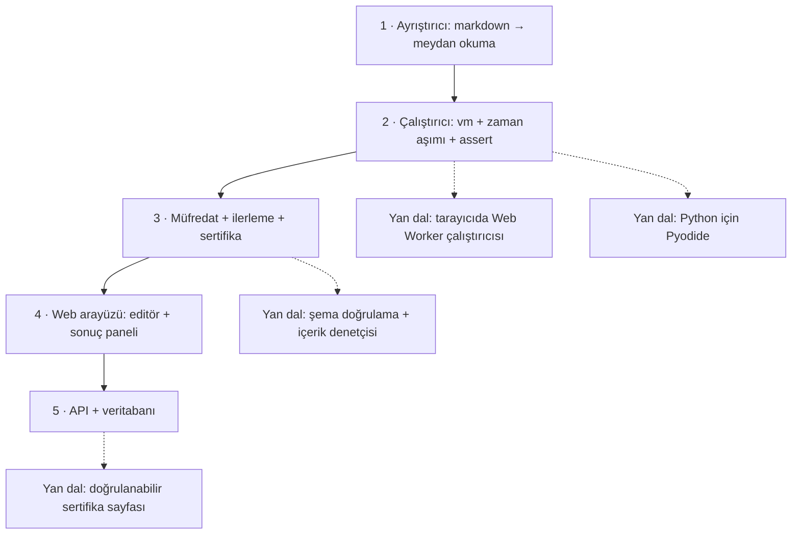

# freeCodeCamp/freeCodeCamp — Ücretsiz kodlama okulunun platformu ve müfredatı

> **Dal:** [D02 Uygulama platformları](../README.md) · **Tür:** kod tabanı (+ eğitim içeriği)
> **Dil:** TypeScript · **Lisans:** BSD-3-Clause (yazılım) · **Yıldız:** 458.792 (9 Kasım 2026) · **İncelenen commit:** `698e12e` (2026-11-09)

## 1. Bir bakışta

freeCodeCamp.org, tarayıcıda çalışan etkileşimli derslerle ücretsiz kodlama öğreten kâr amacı gütmeyen bir okul.
Bu depo hem **platformun kodunu** (öğrenme arayüzü, API, araçlar) hem de **müfredatın kendisini** (16.935 meydan okuma
dosyası) barındırıyor; GitHub'ın en çok yıldız alan depolarından biri. Öğrenci yönergeyi okur, editörde kodu yazar,
gizli testler tarayıcıda çalışır, geçince ilerleme kaydedilir; projeler bitince doğrulanabilir bir sertifika alınır.
Lisans ayrımı önemli: README'ye göre yazılım BSD-3-Clause, fakat `/curriculum` altındaki öğrenme içeriği
"copyright © 2014 freeCodeCamp.org"; yani kodu yeniden kullanabilirsin, içeriği kopyalayıp yayımlayamazsın.

## 2. Nasıl yapılmış: mimari

### Klasör haritası

```text
freeCodeCamp/freeCodeCamp @ 698e12e (varsayılan dal: main, 19.823 dosya)
├── client/                 Öğrenme arayüzü: Gatsby 5 + React 18 + Redux (saga/observable), Monaco editör, xterm
│   └── src/templates/Challenges/   classic (editörlü), projects, quiz, exam, fill-in-the-blank … şablonları
│       ├── redux/execute-challenge-saga.js   testleri çalıştıran akış (executeTests, 5 sn zaman aşımı)
│       └── utils/build.ts, frame.ts          getTestRunner: test çerçevesini (iframe/worker) kurup testleri koşma
├── api/                    Sunucu: Fastify 5 + Prisma (MongoDB) + TypeBox şemaları
│   ├── src/routes/{public,protected,apps}/   ör. protected/certificate.ts → /certificate/verify
│   └── prisma/schema.prisma                  user, Donation, … modelleri
├── curriculum/             Müfredat paketi
│   ├── challenges/english/blocks/<blok>/<id>.md   16.935 meydan okuma (markdown + gizli testler)
│   ├── challenges/english/certifications/*.yml    31 sertifika tanımı (gereken projelerin kimlikleri)
│   ├── structure/          curriculum.json → superblocks/*.json (101) → blocks/*.json (1.111)
│   ├── schema/             Joi tabanlı şemalar (challenge-schema.js …)
│   ├── src/                build-curriculum.ts, get-challenges.ts, test/test-challenges.js, challenge-auditor/
│   └── i18n-curriculum/    Çeviriler için git alt modülü
├── tools/
│   ├── challenge-parser/   Markdown → meydan okuma nesnesi (unified/remark eklenti zinciri)
│   ├── challenge-helper-scripts/   Yeni proje/adım oluşturma betikleri
│   ├── client-plugins/browser-scripts/   test-runner, python-worker (Pyodide), typescript-worker, sass-compile
│   └── challenge-editor/, daily-challenges/, scripts/seed/
├── packages/shared/        Ortak yapılandırma: challenge-types.ts, certification-settings.ts, curriculum.ts
├── packages/challenge-builder/   buildChallenge: öğrenci kodunu derler (Babel, TypeScript, döngü koruması)
├── e2e/                    Playwright uçtan uca testleri
├── docker/, .devcontainer/ Geliştirme ortamları
├── turbo.json, pnpm-workspace.yaml   Turborepo + pnpm çalışma alanı
└── .github/workflows/      node.js-tests, e2e-playwright, deploy-api, deploy-client, crowdin-*, i18n-validate-*
```

### Ana bileşenler ve veri akışı

```mermaid
flowchart LR
  subgraph Icerik["İçerik hattı (derleme zamanı)"]
    MD["curriculum/challenges/*.md"] --> PAR["tools/challenge-parser"]
    STR["curriculum/structure/*.json"] --> BLD["curriculum/src/build-curriculum.ts"]
    PAR --> BLD
    BLD --> GEN["oluşturulan müfredat JSON"]
  end
  GEN --> GAT["client: Gatsby sayfaları"]
  subgraph Tarayici["Öğrencinin tarayıcısı"]
    GAT --> ED["Monaco editör"]
    ED --> BUILD["challenge-builder: buildChallenge ile kodu derle"]
    BUILD --> RUN["getTestRunner + frame.ts: iframe / worker / Pyodide (çalıştırıcı: curriculum-helpers)"]
    RUN --> SAGA["execute-challenge-saga: sonuçlar"]
  end
  SAGA -->|"tamamlandı"| API["api: Fastify rotaları"]
  API --> DB[("MongoDB (Prisma)")]
  API -->|"/certificate/verify"| CERT["sertifika"]
```



Bir meydan okumanın hayatı:

1. **Yazım:** içerik ekibi `curriculum/challenges/english/blocks/<blok>/<id>.md` dosyasını yazar; sırası
   `structure/blocks/<blok>.json` içindeki `challengeOrder` ile belirlenir.
2. **Ayrıştırma:** `tools/challenge-parser` ön bilgiyi, `--description--`, `--hints--` (metin + test kodu),
   `--seed--`/`--seed-contents--` (başlangıç kodu, `--fcc-editable-region--`), `--solutions--` ve
   `--before-all--` gibi kanca bölümlerini çıkarır; işaretçileri `validate-sections.js` denetler.
3. **Doğrulama:** `curriculum/src/test/test-challenges.js` CI'da her çözümün kendi testlerinden geçtiğini sınar;
   şema `curriculum/schema/challenge-schema.js` ile denetlenir.
4. **Çalıştırma:** öğrenci "Kodu çalıştır"a basınca `execute-challenge-saga.js` kodu `buildChallenge` ile derler
   (`packages/challenge-builder/src/build.ts`: Babel, TypeScript, döngü koruması), `getTestRunner` ile
   (`client/src/templates/Challenges/utils/build.ts`) bir çalıştırıcı alır ve
   `executeTests(testRunner, tests, testTimeout = 5000)` ile ipuçlarını koşar.
   Çalıştırıcının kendisi `@freecodecamp/curriculum-helpers` paketindedir (`tools/client-plugins/browser-scripts/test-runner.ts`
   yalnızca tip ve sürümünü içe aktarır). Python meydan okumaları tarayıcıda Pyodide ile çalışır (`python-worker.ts`).
5. **Kayıt ve sertifika:** tamamlanan meydan okuma API'ye gönderilir; sertifika talebinde
   `api/src/routes/protected/certificate.ts` sertifikanın `tests` listesindeki her kimliğin kullanıcının
   `completedChallenges` listesinde olduğunu denetler.

### Önce okunacak dosyalar

1. `README.md` — sertifikalar, lisans ayrımı (yazılım BSD-3, müfredat telifli).
2. `curriculum/challenges/english/blocks/basic-javascript/56533eb9ac21ba0edf2244a8.md` — tipik bir meydan okuma.
3. `tools/challenge-parser/parser/index.js` — eklenti zinciri; ardından `plugins/validate-sections.js`, `add-seed.js`, `add-hooks.js`.
4. `curriculum/structure/curriculum.json` ve bir süper blok JSON'u — müfredatın iskeleti.
5. `client/src/templates/Challenges/redux/execute-challenge-saga.js` — testlerin çalıştığı akış; derleme adımı için
   `packages/challenge-builder/src/build.ts` (`buildChallenge`).
6. `packages/shared/src/config/challenge-types.ts` — `html = 0`, `js = 1`, … `jsLab = 26` gibi tür tablosu.
7. `curriculum/challenges/english/certifications/data-visualization.yml` ve `api/src/routes/protected/certificate.ts`.
8. `turbo.json`, `pnpm-workspace.yaml`, `.github/workflows/node.js-tests.yml` — monorepo nasıl derleniyor ve test ediliyor.

### Teknoloji yığını, derleme, test, CI, sürüm

- **Monorepo:** pnpm çalışma alanı (`pnpm-workspace.yaml`: `api`, `client`, `curriculum`, `e2e`, `packages/*` ve
  seçili `tools/` alt klasörleri, ör. `tools/challenge-parser`, `tools/client-plugins/*`) ve Turborepo (`turbo.json`
  görev bağımlılıkları: `setup` → `build`, `test`, `lint`, `type-check`). Node ≥ 24, pnpm ≥ 12.
- **İstemci:** Gatsby 5 (statik site üretimi), React 18, Redux + redux-saga + redux-observable, `monaco-editor`,
  `@xterm/xterm`, i18next; ödemeler için Stripe/PayPal bileşenleri (bağış).
- **API:** Fastify 5, `@fastify/*` eklentileri (çerez, CSRF, OAuth2, Swagger), Prisma (`provider = "mongodb"`), TypeBox,
  Sentry, Nodemailer.
- **Kalite:** oxlint (`format:oxlint`), Prettier (`lint:prettier`), stylelint, knip (kullanılmayan kod), husky ön-commit
  kancaları, Renovate bağımlılık güncellemeleri.
- **Test:** vitest (api, client, curriculum), Playwright (`e2e/`), müfredat içerik testi (`pnpm test-curriculum-content`:
  her blok için bir test dosyası üretilir, çözümler vitest + Puppeteer ile başsız Chrome'da koşar).
- **CI/dağıtım:** `.github/workflows/node.js-tests.yml` (lint + build + test), `e2e-playwright.yml`,
  `deploy-api.yml`, `deploy-client.yml`; çeviri için Crowdin iş akışları ve `i18n-validate-*`.
- **"Sürüm" yok:** site sürekli dağıtılır; müfredat değişiklikleri PR ile gelir ve CI'da tüm çözümler test edilir.

### Tasarım kararları ve ödünleşimler

1. **İçerik = kod.** Müfredat ayrı bir CMS'de değil, markdown dosyaları olarak depoda. Kazanç: PR ile katkı, sürüm
   geçmişi, CI'da otomatik test. Bedel: içerik yazarı git ve markdown işaretçilerini öğrenmek zorunda.
2. **Testler öğrencinin tarayıcısında çalışır.** Sunucuda güvenilmeyen kod çalıştırma riski ve maliyeti yok;
   milyonlarca kullanıcı ölçeklenir. Bedel: testler istemci tarafında görülebilir (dürüstlük politikasıyla dengelenir:
   README "Academic Honesty Policy"den söz eder) ve her dil için tarayıcıda çalışan bir ortam gerekir (Pyodide).
3. **Gizli testler ipucu olarak yazılır.** Her test bir açıklama cümlesiyle eşleşir; öğrenci hangi şartı
   karşılamadığını okur. Bedel: testler kırılgan olabilir (regex ile kod denetimi), bu yüzden `__helpers.removeJSComments` gibi yardımcılar var.
4. **Prettier müfredata dokunmaz.** Kök `.prettierignore` dosyası `/curriculum/challenges/**/*` yolunu dışarıda bırakır;
   biçimlendirici kod bloklarındaki `--fcc-editable-region--` gibi işaretleri bozardı (mini'de bunu yaşadık).
5. **Statik site + ince API.** Gatsby sayfaları derleme zamanında üretir; API yalnızca kullanıcı durumu, ilerleme,
   sertifika ve bağış için. Bedel: uzun derleme süreleri (`NODE_OPTIONS=--max-old-space-size=7168` derleme betiğinde).
6. **Sertifika = proje kimlikleri kümesi.** Bir sertifika YAML'da gereken projelerin kimlikleriyle tanımlanır;
   doğrulama basit bir küme kontrolüdür. Bedel: müfredat sürümlendiğinde (`-v9` gibi) eski ve yeni sertifikalar
   birlikte yaşar (`certification-settings.ts` içinde güncel/eski/gelecek ayrımı).

## 3. Öğrenmen gerekenler

| Ön koşul                                                                                                   | Bu depo için neden gerekli                                                 | Ücretsiz kaynak                                                                                                    |
| ---------------------------------------------------------------------------------------------------------- | -------------------------------------------------------------------------- | ------------------------------------------------------------------------------------------------------------------ |
| [G4 JavaScript / TypeScript ve Node.js](../../../govde/README.md#g4)                                       | İstemci, API ve araçların tamamı TS/JS                                     | freeCodeCamp'in kendi JavaScript sertifikası; [You Don't Know JS](../../01-web-arayuzu/you-dont-know-js/README.md) |
| [D01 Web arayüzü](../../01-web-arayuzu/README.md), özellikle [react](../../01-web-arayuzu/react/README.md) | İstemci React + Redux                                                      | D01 yaprakları                                                                                                     |
| [G6 Ağ ve web temelleri](../../../govde/README.md#g6)                                                      | REST API, çerez, CSRF, OAuth                                               | Gövdedeki kaynaklar                                                                                                |
| [G7 Test, CI ve kod kalitesi](../../../govde/README.md#g7)                                                 | vitest, Playwright, içerik testleri                                        | `node.js-tests.yml`                                                                                                |
| [G8 Büyük kod tabanı okuma](../../../govde/README.md#g8)                                                   | Monorepo, 20 bine yakın dosya                                              | Bu dosyanın 5. bölümü                                                                                              |
| [G9 Açık kaynak: lisans ve katkı](../../../govde/README.md#g9)                                             | Yazılım/içerik lisans ayrımı, büyük topluluk katkı süreci                  | https://contribute.freecodecamp.org (deponun ana sayfası)                                                          |
| Dal içi kavramlar                                                                                          | Kod yalıtımı (sandbox), içerik hattı (parser → build), statik site üretimi | Bu dosyadaki mini uygulama                                                                                         |

## 4. Sıfırdan yol (dallanma)



| Aşama | Ne inşa edersin                                         | Öğrendiğin kavram                                                       | Bitti ölçütü                                                               | Süre (tahmini) |
| ----- | ------------------------------------------------------- | ----------------------------------------------------------------------- | -------------------------------------------------------------------------- | -------------- |
| 1     | `parseChallenge`                                        | Ön bilgi, işaretçi tabanlı bölümler, kod blokları, düzenlenebilir bölge | Gerçek biçimdeki dosyalar ayrışıyor; bozuk işaretçi açık hata veriyor      | 3–4 saat       |
| 2     | `runTests`                                              | `node:vm`, zaman aşımı, async test, realm farkı, konsol yakalama        | Doğru çözüm geçiyor; sonsuz döngü 100 ms'de kesiliyor                      | 4–5 saat       |
| 3     | `mufredatiYukle`, `ilerlemeHesapla`, `sertifikaTalepEt` | Tutarlılık denetimi, saf fonksiyonlar, küme kontrolü                    | Bütün çözümler kendi testlerinden geçiyor; sertifika kuralları test edildi | 3–4 saat       |
| 4     | Tarayıcı arayüzü                                        | Editör, Web Worker, iframe yalıtımı                                     | Kod tarayıcıda çalışıyor, sonuçlar ipucu listesinde                        | 10–20 saat     |
| 5     | API + DB                                                | Kimlik doğrulama, ilerleme kaydı, sertifika sayfası                     | Oturum açan kullanıcı ilerlemesini kaybetmiyor                             | 10–20 saat     |

Aşamaların toplamı **30–53 saat**; okuma rotası ve alıştırmalarla birlikte **44–73 saat** (hesap kuralı:
[dal README'si](../README.md#yapraklar)).

**Mini uygulama:** [sifirdan/](sifirdan/README.md) — üç aşama, 18 test, Türkçe örnek müfredat (4 meydan okuma,
1 sertifika) ve `node cli.js` ile komut satırından deneme. Aşama 1 `tools/challenge-parser`'ın, aşama 2
`execute-challenge-saga.js` + curriculum-helpers çalıştırıcısının, aşama 3 `curriculum/src/build-curriculum.ts` ve
`api/src/routes/protected/certificate.ts`'in küçük karşılığıdır.

**Gerçek ölçeğe giden yol:**

1. Çalıştırıcıyı tarayıcıya taşı (Web Worker; HTML/CSS için iframe) ve güvenlik modelini tarayıcıya bırak.
2. İçerik ölçeği: JSON şema doğrulaması, içerik denetçisi, CI'da tüm çözümlerin testi, içerik yazarı için araçlar.
3. Çoklu dil: Pyodide, TypeScript derleme, Sass; çok dosyalı tohumlar.
4. Kullanıcı sistemi: kimlik doğrulama, ilerleme senkronu, sertifika doğrulama sayfası, akademik dürüstlük kontrolleri.
5. Çeviri hattı: Crowdin + alt modül; arayüz dizgileri için i18next.

## 5. Gerçek depoda okuma rotası

1. **`curriculum/structure/curriculum.json`:** kaç süper blok ve sertifika var? Bir süper blok JSON'unda `blocks` ile
   `chapters → modules` biçimleri arasındaki farkı bul (`full-stack-developer-v9.json`).
2. **Bir blok JSON'u (`structure/blocks/basic-javascript.json`):** `challengeOrder` ile dosya adları nasıl eşleşiyor?
3. **`tools/challenge-parser/parser/index.js`:** eklentiler hangi sırayla çalışıyor? Neden `validateSections`
   `addFrontmatter`'dan hemen sonra, diğer `add*` eklentilerinden önce çalışıyor?
4. **`plugins/add-seed.js`:** `findRegionMarkers` hangi durumlarda hata fırlatıyor? `editableRegionBoundaries` neyi saklıyor?
5. **`client/src/templates/Challenges/redux/execute-challenge-saga.js`:** `executeChallengeSaga` → `buildChallengeData`
   → `getTestRunner` → `executeTests` zincirini izle; zaman aşımı hatası nasıl öğrenciye gösteriliyor?
6. **`curriculum/src/test/test-challenges.js`:** CI'da çözümler hangi ortamda çalıştırılıyor?
7. **`api/src/routes/protected/certificate.ts`:** `/certificate/verify` rotasında hangi ön koşullar denetleniyor?
   Tamamlanmamış proje varsa yanıt ne?
8. **`.prettierignore`:** hangi yollar dışarıda ve neden? Mini'deki `<!-- prettier-ignore -->` çözümüyle karşılaştır.

## 6. Alıştırmalar ve öz değerlendirme

**Alıştırmalar (kolaydan zora):**

1. (Kolay) Örnek müfredata "dizi metotları" bloğu ekle (2 meydan okuma); `node --test` tutarlılık denetiminden geçsin.
2. (Kolay) Ayrıştırıcıya `# --notes--` bölümünü markdown'dan basit HTML'e çeviren bir adım ekle (yalnızca başlık,
   paragraf, kod).
3. (Orta) `assert`'e `assert.approximately(gercek, beklenen, tolerans)` ekle ve KDV laboratuvarında kullan.
4. (Orta) Çalıştırıcıya "yazdırma testi" ekle: test, öğrencinin `console.log` çıktısını `__konsol` dizisinden
   okuyabilsin.
5. (Zor) `node:vm` yerine her çalıştırmayı `worker_threads` içinde yap; zaman aşımında iş parçacığını `terminate()` et.
6. (Zor) Basit bir HTML arayüzü yaz: sol tarafta yönerge, ortada `<textarea>`, sağda ipucu listesi; çalıştırıcıyı Web
   Worker'da koş.

**Öz değerlendirme:**

1. freeCodeCamp öğrenci kodunu neden sunucuda değil tarayıcıda çalıştırıyor?

   <details><summary>Cevap</summary>

   Güvenlik ve ölçek: güvenilmeyen kodu sunucuda çalıştırmak yalıtım (konteyner, kaynak sınırı) ve büyük maliyet
   ister. Tarayıcı zaten bir sandbox; kod öğrencinin kendi makinesinde, kendi kaynaklarıyla çalışır. Bedeli, testlerin
   istemci tarafında görülebilmesidir.

   </details>

2. `node:vm` neden güvenlik sınırı değildir? Mini neden yine de kullanıyor?

   <details><summary>Cevap</summary>

   vm bağlamı aynı süreçte çalışır; prototip zinciri ve yapıcılar üzerinden ana bağlama erişim yolları bilinir ve
   kaynak tüketimi (bellek) sınırlanamaz. Mini yalnızca kendi yazdığımız alıştırmaları ve kendi çözümlerimizi çalıştırır;
   amaç mekanizmayı öğretmek. Gerçek kullanıcı kodu için ayrı süreç/konteyner ya da tarayıcı gerekir.

   </details>

3. İçerik ekibi bir meydan okumanın `title` alanını değiştirdi ama blok JSON'unu güncellemedi. Ne olur?

   <details><summary>Cevap</summary>

   Gerçek depoda hiçbir şey kırılmaz: blok JSON'undaki (`challengeOrder`) başlıklar yalnızca insanlar için tutulur ve
   denetlenmez; `curriculum/src/test/test-challenges.js` bunu bir yorumla açıkça söyler (çevirilerde başlık zaten
   farklıdır). Denetlenen şey kimliklerdir: `curriculum/src/build-superblock.ts` içindeki `validateChallenges`,
   klasörde olup `challengeOrder`'da olmayan, `challengeOrder`'da olup dosyası olmayan ve iki kez kullanılan kimlikleri
   yakalar; test de her meydan okumanın kimliğini blok JSON'unda arar. Mini daha katıdır: `mufredatiYukle` başlık
   uyuşmazlığını da hata sayar. Kısacası kimliği bozarsan CI kırılır; başlığı değiştirirsen yalnızca JSON'daki başlık
   eskir.

   </details>

4. Kod tabanının lisansı BSD-3 olduğu hâlde bir şirket müfredatı kendi sitesinde yayımlayabilir mi?

   <details><summary>Cevap</summary>

   Hayır. README'ye göre yalnızca yazılım BSD-3-Clause; `/curriculum` altındaki öğrenme içeriği freeCodeCamp.org'un
   telifindedir. Platform kodunu kullanıp kendi içeriğini yazmak gerekir (mini'deki örnek müfredat gibi).

   </details>

## 7. İş fikri tohumları

- **Türkçe, kuruma özel kodlama değerlendirme platformu** (freeCodeCamp biçiminde meydan okumalar + tarayıcıda
  çalışan testler; içerik kuruma ait) — **kime:** yazılımcı alımı yapan KOBİ'ler ve bootcamp'ler.
- **Lise bilişim öğretmenleri için otomatik notlanan ödev seti** (MEB müfredatına uygun Türkçe meydan okumalar,
  sınıf ilerleme paneli) — **kime:** devlet ve özel liselerin bilişim teknolojileri öğretmenleri.
- **Şirket içi "güvenli kodlama" eğitimi** (OWASP konularında etkileşimli alıştırmalar, sertifika kaydı) —
  **kime:** BDDK/KVKK denetimine giren bankalar ve fintech'lerin geliştirici ekipleri.

Bütün fikirler için: [İş fikirleri kataloğu](../../../is-fikirleri/README.md).

## 8. Kaynaklar

- README (sertifikalar, lisans): [README.md](https://github.com/freeCodeCamp/freeCodeCamp/blob/698e12e7e8cd4ea609577359fa541a4b43ba73ac/README.md)
- Katkı rehberi: https://contribute.freecodecamp.org (deponun resmî ana sayfası)
- Ayrıştırıcı: [tools/challenge-parser/parser/index.js](https://github.com/freeCodeCamp/freeCodeCamp/blob/698e12e7e8cd4ea609577359fa541a4b43ba73ac/tools/challenge-parser/parser/index.js)
- Test akışı: [execute-challenge-saga.js](https://github.com/freeCodeCamp/freeCodeCamp/blob/698e12e7e8cd4ea609577359fa541a4b43ba73ac/client/src/templates/Challenges/redux/execute-challenge-saga.js)
- Sertifika doğrulama: [api/src/routes/protected/certificate.ts](https://github.com/freeCodeCamp/freeCodeCamp/blob/698e12e7e8cd4ea609577359fa541a4b43ba73ac/api/src/routes/protected/certificate.ts)
- Meydan okuma türleri: [packages/shared/src/config/challenge-types.ts](https://github.com/freeCodeCamp/freeCodeCamp/blob/698e12e7e8cd4ea609577359fa541a4b43ba73ac/packages/shared/src/config/challenge-types.ts)
- Çalıştırıcı paketi: `@freecodecamp/curriculum-helpers` (ayrı depo; ayrıntıları doğrulanmadı)
- Node `vm` modülünün güvenlik uyarısı: https://nodejs.org/api/vm.html (doğrulanmadı)
