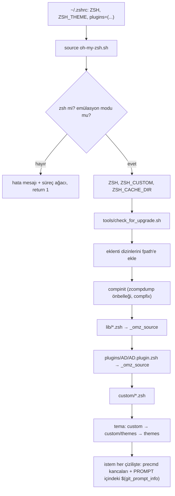
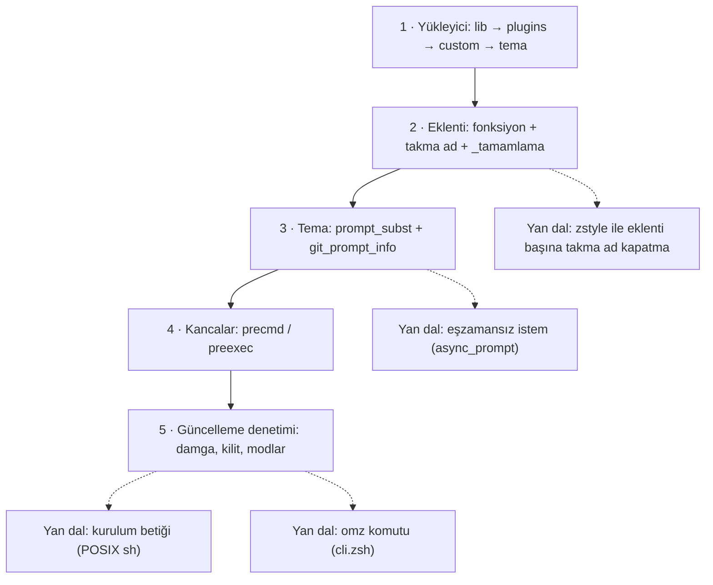

# ohmyzsh/ohmyzsh — Zsh yapılandırmasını eklenti ve temalarla yöneten çerçeve

> **Dal:** [D02 Uygulama platformları](../README.md) · **Tür:** kod tabanı
> **Dil:** Shell (zsh) · **Lisans:** MIT · **Yıldız:** 190.380 (9 Kasım 2026) · **İncelenen commit:** `cca3bdf` (2026-11-06)

## 1. Bir bakışta

Oh My Zsh, zsh kabuğunun ayarlarını tek bir `~/.zshrc` satırıyla düzenli hâle getiren topluluk çerçevesidir:
`plugins=(git docker …)` yazarsın, yüzlerce takma ad, tamamlama ve yardımcı fonksiyon gelir; `ZSH_THEME="…"` yazarsın,
istem (prompt) git dalını ve son komutun sonucunu gösterir. Planet Argon ekibi tarafından başlatıldı (README),
2009'dan beri yaşıyor. İncelenen commit'te 372 eklenti klasörü ve 143 tema dosyası var; eklentilerin 95'inde tamamlama
dosyası bulunuyor. Popülerliğinin sırrı teknik derinlik değil **kurulum kolaylığı + topluluk ölçeği**: tek komutla
kurulur, her geliştirici kendi aracının eklentisini ekleyebilir, otomatik güncellenir. Çekirdeği ise küçük ve
okunabilir; bu yüzden "çerçeve nasıl yazılır?" sorusu için ideal bir ilk ders.

## 2. Nasıl yapılmış: mimari

### Klasör haritası

```text
ohmyzsh/ohmyzsh @ cca3bdf (varsayılan dal: master, 1.199 dosya)
├── oh-my-zsh.sh              Yükleyici (347 satır): her şey buradan başlar
├── lib/                      Her zaman yüklenen ortak dosyalar (21 adet *.zsh)
│   ├── git.zsh               git_prompt_info, parse_git_dirty, git_current_branch
│   ├── async_prompt.zsh      İstem parçalarını arka planda hesaplama (precmd + dosya tanıtıcısı)
│   ├── cli.zsh               `omz` komutu: plugin/theme/update/reload (976 satır)
│   ├── completion.zsh        Tamamlama zstyle ayarları
│   ├── compfix.zsh           Güvensiz tamamlama dizinleri uyarısı
│   ├── termsupport.zsh       Terminal başlığı (precmd/preexec)
│   ├── theme-and-appearance.zsh  Renkler, ls renkleri, prompt_subst
│   └── history.zsh, key-bindings.zsh, directories.zsh …
├── plugins/<ad>/             372 eklenti; her biri <ad>.plugin.zsh + isteğe bağlı _<ad> + README.md
├── themes/*.zsh-theme        143 tema (varsayılan: robbyrussell)
├── custom/                   Kullanıcı geçersiz kılmaları (.gitignore'da; yalnızca example dosyaları izlenir)
├── tools/
│   ├── install.sh            Kurulum: depoyu klonla, .zshrc yedekle, chsh ile varsayılan kabuk yap
│   ├── check_for_upgrade.sh  Açılışta güncelleme denetimi (modlar, sıklık, kilit)
│   ├── upgrade.sh            Güncellemeyi uygula
│   └── uninstall.sh, theme_chooser.sh, changelog.sh
├── templates/zshrc.zsh-template   Kurulumda ~/.zshrc'ye kopyalanan şablon
├── cache/, log/              Çalışma zamanı dosyaları (.gitignore'da; yalnızca .gitkeep izlenir)
└── .github/
    ├── workflows/main.yml    CI: tüm dosyalara `zsh -n` sözdizimi denetimi
    ├── workflows/installer.yml   Kurulumu Ubuntu ve macOS'ta dener; install.ohmyz.sh'yi yayımlar
    ├── dependencies.yml      Başka depolardan alınan 8 eklentinin kaynağı ve sürümü
    └── CODEOWNERS            Eklenti bakımcıları
```

### Ana bileşenler ve veri akışı

Yeni bir terminal açıldığında olan biten (`oh-my-zsh.sh` sırasıyla):



Kritik ayrıntılar:

- **Sıra önemli.** Eklenti dizinleri `compinit`'ten önce `fpath`'e eklenmeli, yoksa `_ad` tamamlama dosyaları bulunmaz.
- **`_omz_source` geçersiz kılmayı sağlar:** aynı göreli yol `$ZSH_CUSTOM` altında varsa o kaynaklanır. Ayrıca
  `zstyle ':omz:plugins:git' aliases no` ile bir eklentinin takma adları kaynaklamadan önce yedeklenip sonra geri
  alınarak kapatılabilir.
- **Başlangıç süresi için önbellek:** `zcompdump` dosyasına deponun commit kimliği ve `fpath` yazılır; değişmediyse
  tamamlama dökümü yeniden üretilmez. Commit kimliği `git` süreci açmadan `.git/HEAD` okunarak bulunur (`_omz_git_head`).
- **İstem çalışma anında hesaplanır:** tema `PROMPT='… $(git_prompt_info)'` gibi tek tırnakla yazılır,
  `prompt_subst` seçeneği sayesinde her istemde yeniden çalışır. Dal adındaki `%` işaretleri `%%` yapılarak kaçırılır.

### Önce okunacak dosyalar

1. `oh-my-zsh.sh` — baştan sona oku; 347 satır, bütün mimari burada.
2. `templates/zshrc.zsh-template` — kullanıcının gördüğü yüz: hangi değişkenler var?
3. `lib/git.zsh` — `_omz_git_prompt_info`, `parse_git_dirty`; `GIT_OPTIONAL_LOCKS=0` neden var?
4. `themes/robbyrussell.zsh-theme` — 7 satırlık varsayılan tema.
5. `plugins/git/git.plugin.zsh` — 449 satır, 204 takma ad; büyük bir eklentinin düzeni.
6. `tools/check_for_upgrade.sh` — modlar, sıklık, kilit, GitHub API ile karşılaştırma.
7. `lib/async_prompt.zsh` — yavaş istem parçalarını arka planda hesaplama.
8. `tools/install.sh` — `setup_ohmyzsh`, `setup_zshrc`, `setup_shell`, `main`.

### Teknoloji yığını, derleme, test, CI, sürüm

- **Dil:** zsh (README: 4.3.9 yeterli, 5.0.8 ve üstü tercih edilir); kurulum betiği POSIX `sh` (çünkü kurulum
  anında zsh varsayılan kabuk olmayabilir).
- **Derleme yok:** dosyalar doğrudan `source` edilir; yalnızca `zcompdump` için `zrecompile` ile bayt kodu üretilir.
- **Test:** `.github/workflows/main.yml` her `oh-my-zsh.sh`, `lib/*.zsh`, `plugins/*/*.plugin.zsh`, `plugins/*/_*`
  ve `themes/*.zsh-theme` dosyası için `zsh -n` (sözdizimi) çalıştırır. Davranış testi çok az: `lib/tests/cli.test.zsh`
  (CI bunu koşmuyor; yalnızca sözdizimi denetimi var). Kurulum betiği `installer.yml` ile Ubuntu ve macOS'ta denenir.
- **Üçüncü taraf eklentiler:** `.github/dependencies.yml` 8 eklentinin (ör. `zsh-autosuggestions`,
  `zsh-syntax-highlighting`, `gitfast`) hangi depodan ve sürümden geldiğini yazar; haftalık iş akışı
  (`dependencies.yml`, `cron: "0 6 * * 0"`) `updater.py` ile güncelleme PR'ı açar.
- **Sürüm yok, sürekli teslim:** kullanıcılar `master` dalını izler; `check_for_upgrade.sh` varsayılan olarak 13 günde
  bir sorar (`UPDATE_ZSH_DAYS`/`zstyle ':omz:update' frequency`). `tools/changelog.sh` commit mesajlarından değişiklik
  günlüğü üretir; bu yüzden CONTRIBUTING commit mesajlarında Conventional Commits biçimini ister.
- **Topluluk kuralları:** CONTRIBUTING şimdilik yeni tema kabul edilmediğini, yeni takma adların "çok kişi tarafından,
  sık kullanılacak" olması gerektiğini ve yapay zekâ yardımıyla yazılmış katkıların PR açıklamasında belirtilmesini ister.

### Tasarım kararları ve ödünleşimler

1. **"Her şey source edilir" sadeliği.** Modül sistemi, bağımlılık çözümü, sürümleme yok. Kazanç: herkes okuyup
   değiştirebilir. Bedel: her eklenti küresel ad alanını kirletir; 300+ eklentide ad çakışması ve yavaş açılış riski.
2. **Geçersiz kılma = aynı yol, `custom/` altında.** Kullanıcı çerçeve dosyasını düzenlemeden ezebilir; güncelleme
   çakışması olmaz. Bedel: ezilen dosya güncellenince kullanıcının kopyası eskide kalır.
3. **Güncelleme denetimi açılışta, ama ucuz.** Sıklık damgası (`.zsh-update`), `mkdir` kilidi (iki terminal aynı anda
   güncellemesin), ağ çağrısı yalnızca zamanı gelince ve 2 saniyelik bağlantı zaman aşımıyla
   (`curl --connect-timeout 2`). Kullanıcı bir şey yazmaya başlamışsa soru sormak yerine hatırlatma gösterilir
   (`has_typed_input`).
4. **Başlangıç hızı için önbellekler.** `zcompdump` üst verisi, macOS'ta ana makine adının bir günlük önbelleği,
   `git` süreci açmadan HEAD okuma: bir kabuk çerçevesinde her fork milisaniye demektir.
5. **İstem güvenliği.** İstem dış veriden (dal adı, dizin adı) beslenir; `%` kaçırılmazsa bir dal adı istemi bozabilir.
   `git` komutları `GIT_OPTIONAL_LOCKS=0` ile çalışır ki istem kullanıcının kendi git işlemlerini kilitlemesin.
6. **Monolitik depo, dağıtık sahiplik.** Tüm eklentiler tek depoda ama `CODEOWNERS` ile eklenti başına bakımcı atanır.
   Bedel: yüzlerce bekleyen PR (CONTRIBUTING bunu açıkça söylüyor).

## 3. Öğrenmen gerekenler

| Ön koşul                                                       | Bu depo için neden gerekli                                                          | Ücretsiz kaynak                                                                                          |
| -------------------------------------------------------------- | ----------------------------------------------------------------------------------- | -------------------------------------------------------------------------------------------------------- |
| [G1 Terminal, kabuk ve Linux](../../../govde/README.md#g1)     | Depo bir kabuk çerçevesi; değişken, fonksiyon, `source`, çıkış kodu                 | Gövdedeki kaynaklar; [build-your-own-x → Shell](../../10-kuratorluk-topluluk/build-your-own-x/README.md) |
| [G2 Git ve GitHub](../../../govde/README.md#g2)                | Kurulum `git clone`, güncelleme `git pull`; istem `git status` okur                 | Gövdedeki kaynaklar                                                                                      |
| [G8 Büyük kod tabanı okuma](../../../govde/README.md#g8)       | 372 eklentiden doğru dosyayı bulmak                                                 | Bu dosyanın 5. bölümü                                                                                    |
| [G7 Test, CI ve kod kalitesi](../../../govde/README.md#g7)     | Kabuk betiği nasıl test edilir? (`zsh -n`, geçici HOME)                             | Mini'nin `test.sh` dosyası                                                                               |
| [G9 Açık kaynak: lisans ve katkı](../../../govde/README.md#g9) | 2.500+ katkıcılı bir topluluğun kuralları                                           | `CONTRIBUTING.md`                                                                                        |
| zsh'ye özgü konular                                            | `fpath`/`compinit`, istem genişletme, `zstyle`, `add-zsh-hook`, glob niteleyicileri | zsh kılavuzu: https://zsh.sourceforge.io/Doc/ (doğrulanmadı); `man zshall`                               |

## 4. Sıfırdan yol (dallanma)



| Aşama | Ne inşa edersin                | Öğrendiğin kavram                                                          | Bitti ölçütü                                                      | Süre (tahmini) |
| ----- | ------------------------------ | -------------------------------------------------------------------------- | ----------------------------------------------------------------- | -------------- |
| 1     | `mini-omz.sh` yükleyicisi      | `source`, glob niteleyicisi `(N)`, `${(%):-%x}`, geçersiz kılma sırası     | Eklentiler yükleniyor; eksik eklenti/tema uyarısı çıkıyor         | 2–3 saat       |
| 2     | `selam` eklentisi + `_selam`   | `fpath`, `compinit`, `#compdef`, `_arguments`                              | `$_comps[selam]` = `_selam`; `selam <TAB>` alt komutları öneriyor | 2–3 saat       |
| 3     | `sade` teması + `lib/git.zsh`  | `prompt_subst`, `%F{}`, `%(?..)`, `%` kaçırma                              | Temiz/kirli/depo dışı istem testleri geçiyor                      | 2–3 saat       |
| 4     | `lib/kancalar.zsh`             | `add-zsh-hook`, `EPOCHREALTIME`                                            | Uzun komutun süresi `RPROMPT`'ta                                  | 1–2 saat       |
| 5     | `tools/guncelleme-kontrol.zsh` | Damga dosyası, `mkdir` kilidi, `git ls-remote`, `merge-base --is-ancestor` | 9 güncelleme senaryosu geçiyor                                    | 3–4 saat       |

**Mini uygulama:** [sifirdan/](sifirdan/README.md) — zsh ile yazılmış `mini-omz` ve 40 doğrulamalı `test.sh`
(geçici HOME, yerel yalın git deposu, ağ yok). Her aşamanın gerçek dosya karşılığı mini'nin README'sindeki eşleme
tablosunda; ayrıca "bash ile yazsaydın ne değişirdi" tablosu var.

**Gerçek ölçeğe giden yol:**

1. **Hız:** `zprof` ile açılışı ölç; `zcompdump` üst verisi ve `zrecompile`; pahalı istem parçalarını eşzamansız yap.
2. **Güvenlik:** `compaudit` ile güvensiz dizin uyarısı; kurulum betiğini incelenebilir tut ("Manual Inspection").
3. **Kullanılabilirlik:** `omz` komutu (eklenti aç/kapa, tema seç, `.zshrc`'yi güvenle düzenle).
4. **Ekosistem:** eklenti başına README ve bakımcı, üçüncü taraf eklentilerin otomatik güncellenmesi.
5. **Dağıtım:** POSIX `sh` ile kurulum, `chsh`, mevcut `.zshrc` yedeği, gözetimsiz kurulum (`--unattended`).

## 5. Gerçek depoda okuma rotası

1. **`oh-my-zsh.sh` satır 1–48:** zsh dışı bir kabukla kaynaklanınca ne oluyor? Neden bu bölüm POSIX sözdizimiyle yazılmış?
2. **Satır 50–76:** `ZSH`, `ZSH_CUSTOM`, `ZSH_CACHE_DIR` nasıl belirleniyor? `${${(%):-%x}:a:h}` ifadesini parça parça çöz.
3. **Satır 88–98:** eklenti dizinleri neden `compinit`'ten önce `fpath`'e ekleniyor?
4. **Satır 134–265:** `_omz_git_head` git süreci açmadan HEAD'i nasıl buluyor? `zcompdump` neden silinip yeniden üretiliyor?
5. **Satır 267–306 (`_omz_source`):** `zstyle -T` ne döndürüyor? Takma adlar nasıl yedeklenip geri alınıyor?
6. **`lib/git.zsh` → `_omz_git_prompt_info`:** ayrık HEAD'de, etiketli commit'te ve doğmamış (unborn) dalda ne gösteriliyor?
7. **`lib/git.zsh` → dosyanın ortasındaki (yaklaşık 171–236. satırlar) `async-prompt` dalları:** hangi koşulda istem
   eşzamansız hesaplanıyor?
8. **`tools/check_for_upgrade.sh` → `is_update_available` ve `handle_update`:** GitHub API'den hangi başlıkla yalnızca SHA
   isteniyor? Kilit dizini ne zaman temizleniyor?
9. **`.github/workflows/main.yml`:** hangi dosyalar `zsh -n` ile denetleniyor? Neyi yakalar, neyi yakalayamaz?

## 6. Alıştırmalar ve öz değerlendirme

**Alıştırmalar (kolaydan zora):**

1. `mini-omz`'a `hava` adında bir eklenti ekle: `hava <şehir>` yerel bir JSON dosyasından sıcaklık yazsın; tamamlama
   şehir adlarını önersin.
2. `sade` temasına son komutun çıkış kodunu (`%?`) yalnızca sıfır değilken gösteren bir parça ekle.
3. `mini_omz eklenti ac <ad>` komutunu yaz: `.zshrc`'deki `plugins=(...)` satırını güvenle düzenlesin (önce yedek!).
4. `git_prompt_info`'yu eşzamansız yap: `precmd`'de arka planda hesapla, sonuç gelince `zle reset-prompt`.
5. Açılış süresini ölç (`zmodload zsh/zprof`); `compinit`'i günde bir kez tam denetim yapacak şekilde hızlandır.
6. Güncelleme denetimine gerçekteki gibi "prompt" modunu ekle: kullanıcıya sor, `n` derse damgayı güncelle.

**Öz değerlendirme:**

1. Tema dosyasında `PROMPT="… $(git_prompt_info)"` (çift tırnak) yazarsan ne olur?

   <details><summary>Cevap</summary>

   Çift tırnakta `$(git_prompt_info)` atama anında bir kez çalışır; sonuç sabit bir metin olarak `PROMPT`'a yazılır ve
   dal değişince güncellenmez. Tek tırnakla yazılınca metin olduğu gibi kalır ve `prompt_subst` sayesinde her istemde
   yeniden çalışır.

   </details>

2. Yeni bir eklentinin `_ad` tamamlama dosyası neden bulunamıyor olabilir?

   <details><summary>Cevap</summary>

   Eklenti dizini `fpath`'e `compinit`'ten **sonra** eklenmiştir ya da eski `zcompdump` önbelleği kullanılıyordur.
   Oh My Zsh dizinleri önce ekler ve `fpath` değişince dökümü yeniden üretir. Ayrıca dosyanın ilk satırı `#compdef ad`
   olmalıdır.

   </details>

3. İki terminali aynı anda açınca güncelleme neden iki kez çalışmıyor?

   <details><summary>Cevap</summary>

   `handle_update` önce `mkdir "$ZSH/log/update.lock"` dener; `mkdir` atomiktir, yalnızca biri başarılı olur. Diğeri
   sessizce çıkar. Kilit bir günden eskiyse (çökmüş bir oturumdan kalmışsa) silinir.

   </details>

4. `zstyle ':omz:plugins:git' aliases no` nasıl çalışıyor?

   <details><summary>Cevap</summary>

   `_omz_source` eklentiyi kaynaklamadan önce `aliases` ilişkisel dizisinin bir kopyasını alır, kaynakladıktan sonra
   diziyi o kopyaya geri yükler. Böylece eklentinin fonksiyonları kalır, eklediği takma adlar kaybolur.

   </details>

## 7. İş fikri tohumları

- **Kurumsal terminal profili paketi** (şirkete özel eklenti + tema + güvenli varsayılanlar, tek komutla kurulum ve
  merkezi güncelleme) — **kime:** 50+ geliştiricili şirketlerin platform/DevOps ekipleri.
- **Türkçe kabuk eğitim seti** (mini-omz gibi adım adım "kendi çerçeveni yaz" atölyesi + otomatik denetlenen
  alıştırmalar) — **kime:** bootcamp'ler ve üniversite topluluk kulüpleri.
- **Açılış süresi denetçisi** (`.zshrc`'yi analiz edip yavaş eklentileri ve gereksiz fork'ları raporlayan araç) —
  **kime:** büyük monorepo'larda çalışan ve terminali yavaşlayan geliştiriciler.

Bütün fikirler için: [İş fikirleri kataloğu](../../../is-fikirleri/README.md).

## 8. Kaynaklar

- README (kurulum, "Manual Inspection", eklenti ve tema kullanımı):
  [README.md](https://github.com/ohmyzsh/ohmyzsh/blob/cca3bdfbef8c52ef8939ce7911ff68852b949daa/README.md)
- Katkı kuralları: [CONTRIBUTING.md](https://github.com/ohmyzsh/ohmyzsh/blob/cca3bdfbef8c52ef8939ce7911ff68852b949daa/CONTRIBUTING.md)
- Yükleyici: [oh-my-zsh.sh](https://github.com/ohmyzsh/ohmyzsh/blob/cca3bdfbef8c52ef8939ce7911ff68852b949daa/oh-my-zsh.sh)
- Güncelleme: [tools/check_for_upgrade.sh](https://github.com/ohmyzsh/ohmyzsh/blob/cca3bdfbef8c52ef8939ce7911ff68852b949daa/tools/check_for_upgrade.sh)
- Git istemi: [lib/git.zsh](https://github.com/ohmyzsh/ohmyzsh/blob/cca3bdfbef8c52ef8939ce7911ff68852b949daa/lib/git.zsh)
- Proje vikisi (eklenti/tema/özelleştirme): https://github.com/ohmyzsh/ohmyzsh/wiki (CONTRIBUTING içinde bağlantısı var)
- zsh kılavuzu, "Prompt Expansion" ve "Completion System" bölümleri: https://zsh.sourceforge.io/Doc/ (doğrulanmadı)
