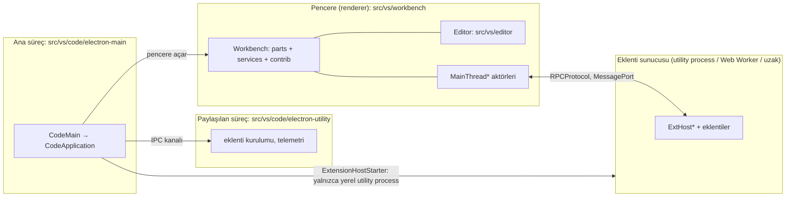
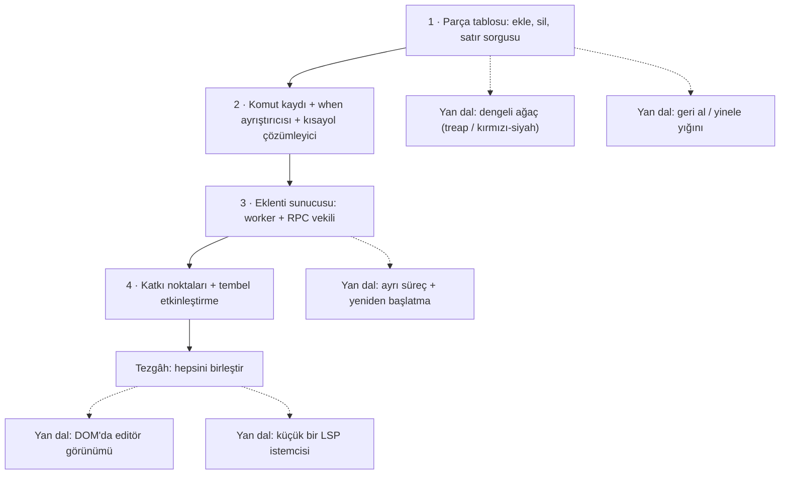

# microsoft/vscode — Visual Studio Code'un açık kaynak çekirdeği ("Code - OSS")

> **Dal:** [D02 Uygulama platformları](../README.md) · **Tür:** kod tabanı
> **Dil:** TypeScript · **Lisans:** MIT · **Yıldız:** 195.223 (9 Kasım 2026) · **İncelenen commit:** `22e0795` (2026-11-09)

## 1. Bir bakışta

Bu depo, Microsoft'un Visual Studio Code ürününü toplulukla birlikte geliştirdiği "Code - OSS" kaynağıdır
(`product.json` içinde `nameShort: "Code - OSS"`). İndirdiğin VS Code, bu kaynağın üstüne Microsoft'a özel ayarlar,
marka ve lisans eklenmiş dağıtımıdır; README bunu açıkça söyler. Çözdüğü sorun: web teknolojileriyle (TypeScript,
HTML/CSS, Electron) yazılmış, hızlı açılan, her dil için eklentiyle genişleyen bir kod editörü. Popülerliğinin
sırrı üç mimari karardır: **editör çekirdeğini küçük tutup her şeyi eklentiye bırakmak**, eklentileri **ayrı bir
süreçte** çalıştırarak arayüzü korumak ve dil desteğini **Language Server Protocol** gibi açık protokollerle
herkese açmak (yerleşik `css-language-features`, `json-language-features` eklentileri bile `vscode-languageclient` kullanır). İncelenen commit'te depo 21.007 dosya, `src/` altında 11.537 TypeScript dosyası içeriyor.

## 2. Nasıl yapılmış: mimari

### Klasör haritası

```text
microsoft/vscode @ 22e0795
├── src/main.ts                    Electron giriş noktası (package.json "main": "./out/main.js"); 10 satırlık saplama
├── src/mainImpl.ts                Asıl açılış kodu: startup() → src/vs/code/electron-main/main.ts
├── src/vs/base/                   Katman 0: ortamdan bağımsız temel (Event, Disposable, async, observable)
├── src/vs/platform/               Katman 1: servisler + bağımlılık enjeksiyonu (instantiation, commands,
│                                  contextkey, keybinding, files, extensions …)
├── src/vs/editor/                 Katman 2: metin editörü (model, viewModel, cursor, contrib); Monaco olarak da yayımlanır
│   └── common/model/pieceTreeTextBuffer/   Metin arabelleği: kırmızı-siyah ağaçta parça tablosu
├── src/vs/workbench/              Katman 3: uygulama kabuğu
│   ├── browser/                   Arayüz parçaları ve yerleşim (workbench.ts, layout.ts)
│   ├── services/                  Workbench servisleri (extensions, keybinding, configuration, …)
│   ├── contrib/                   104 özellik klasörü: chat, debug, scm, search, terminal, notebook, testing …
│   └── api/                       Eklenti API'si: common/extHost*.ts (eklenti tarafı), browser/mainThread*.ts (arayüz tarafı)
├── src/vs/sessions/               Ajan oturumları penceresi: workbench'in üstüne oturan yeni katman
├── src/vs/code/electron-main/     Ana süreç: main.ts (CodeMain) → app.ts (CodeApplication)
├── src/vs/code/electron-utility/  Paylaşılan süreç (eklenti yönetimi, telemetri gibi pencereler arası işler)
├── src/vs/server/                 Uzak sunucu: Remote-SSH, konteyner ve tarayıcıdan VS Code
├── src/vscode-dts/vscode.d.ts     Eklentilerin gördüğü kararlı API sözleşmesi (+ proposed API dosyaları)
├── extensions/                    95 yerleşik eklenti (+ yalnızca tip tanımı içeren types/): dil, git, tema, copilot
├── cli/                           Rust ile yazılmış `code` komut satırı aracı (tüneller, sunucu indirme)
├── build/                         gulp görevleri + esbuild tabanlı build/next, azure-pipelines sürüm hattı
├── test/                          unit, integration, smoke, monaco, automation testleri
├── .eslint-plugin-local/          Projeye özel ESLint kuralları (katman kuralı code-layering.ts dahil)
└── .github/                       CI iş akışları, copilot-instructions.md, 51 ajan becerisi (skills/)
```

### Ana bileşenler ve veri akışı

VS Code tek bir program değil, birbirine mesajla bağlı birkaç süreçtir:



Üç tür eklenti sunucusunu üç ayrı yer başlatır. Ana süreçteki `ExtensionHostStarter`
(`src/vs/platform/extensions/electron-main/extensionHostStarter.ts`) yalnızca **yerel** sunucuyu `WindowUtilityProcess`
olarak açar. Tarayıcıdaki **Web Worker** sunucusunu pencere (renderer) bir iframe içinde kurar
(`src/vs/workbench/services/extensions/browser/webWorkerExtensionHost.ts`). **Uzak** sunucuyu ise sunucu tarafı
`cp.fork` ile başlatır (`src/vs/server/node/extensionHostConnection.ts`).

Bir eklenti komutunun yolculuğu (mini uygulamada birebir kurduğun akış):

1. Açılışta workbench her eklentinin `package.json`'unu **okur ama çalıştırmaz**: `contributes.commands` komut
   paletini, `contributes.keybindings` kısayolları doldurur (kayıt mekanizması:
   `src/vs/workbench/services/extensions/common/extensionsRegistry.ts`; komutlar:
   `src/vs/workbench/services/actions/common/menusExtensionPoint.ts`; kısayollar:
   `src/vs/workbench/services/keybinding/browser/keybindingService.ts`).
2. Kullanıcı `ctrl+k`'ya basar: `KeybindingResolver.resolve` "devamı bekleniyor" der; ikinci tuşla komut kimliği
   bulunur (`src/vs/platform/keybinding/common/keybindingResolver.ts`). `when` ifadesi bağlam anahtarlarıyla
   değerlendirilir (`src/vs/platform/contextkey/common/contextkey.ts`).
3. `CommandService.executeCommand`, olay daha önce tamamlanmadıysa `onCommand:<id>` etkinleştirme olayını yollar;
   komut henüz kayıtlı değilse ayrıca `*` etkinleştirmesini komutun kaydedilmesiyle yarıştırır (en fazla 30 sn)
   (`src/vs/workbench/services/commands/common/commandService.ts`). Mini yalnızca "kayıtlı değilse olayı yolla"
   kısmını kurar.
4. Eklenti sunucusu eklentiyi yükler ve `activate()`'i çağırır; eklenti `vscode.commands.registerCommand` ile
   komutunu kaydeder, bu çağrı RPC ile ana tarafa `$registerCommand` olarak gider
   (`src/vs/workbench/api/common/extHostCommands.ts` ↔ `src/vs/workbench/api/browser/mainThreadCommands.ts`).
5. Komut çalışır; eklenti belgeye doğrudan dokunamaz, değişikliği yine RPC ile ister. Belge değişikliği editör
   modelinde parça ağacına uygulanır (`src/vs/editor/common/model/pieceTreeTextBuffer/pieceTreeBase.ts`).

### Önce okunacak dosyalar

1. `.github/copilot-instructions.md` — ekibin kendi mimari özeti: katmanlar, DI kuralları, kod stili. (Bu dosya
   ajanlara yazılmış talimattır; burada yalnızca mimari belge olarak okunur.)
2. `src/vs/platform/instantiation/common/instantiation.ts` — `createDecorator`: servis kimliği aynı zamanda
   parametre dekoratörüdür; her şeyin nasıl birbirine bağlandığını buradan anlarsın.
3. `src/vs/base/common/event.ts` ve `src/vs/base/common/lifecycle.ts` — `Emitter`/`Event` ve `Disposable`:
   kod tabanının her köşesinde kullanılan iki desen.
4. `src/vs/platform/commands/common/commands.ts` — `CommandsRegistry`; ardından
   `src/vs/workbench/services/commands/common/commandService.ts`.
5. `src/vs/platform/keybinding/common/keybindingResolver.ts` — `resolve` ve `_findCommand` (sondan başa arama).
6. `src/vs/workbench/services/extensions/common/rpcProtocol.ts` ve `proxyIdentifier.ts` — süreçler arası vekil.
7. `src/vs/workbench/api/common/extHost.protocol.ts` — iki tarafın sözleşmesi: `MainThreadCommandsShape`,
   `ExtHostCommandsShape`, `MainContext`, `ExtHostContext` (4.406 satır, bütün API burada).
8. `src/vs/editor/common/model/pieceTreeTextBuffer/pieceTreeBase.ts` — `PieceTreeBase.insert/delete`, `nodeAt`.
9. `src/vs/code/electron-main/main.ts` → `app.ts` — uygulamanın açılış sırası.

### Teknoloji yığını, derleme, test, CI, sürüm

- **Dil ve çalışma zamanı:** TypeScript (`package.json` → `typescript: npm:@typescript/typescript6@^6.0.2`), Electron
  (`nativeBuild.target: 43.8.6`), Node 24 (`.nvmrc` → `24.22.1`), paket yöneticisi pnpm (`packageManager: pnpm@12.16.0`,
  `pnpm-workspace.yaml`).
- **Derleme:** `gulpfile.mjs` + `build/lib` (klasik gulp görevleri) ve `build/next/` (esbuild ile hızlı derleme:
  `pnpm run build-fast`, `transpile-client`). Yerelleştirme dizgileri `vs/nls` ile dışarı çıkarılır.
- **Test:** birim testleri mocha ile (`test-node`), Electron içinde `scripts/test.sh`, tarayıcıda `test/unit/browser`
  (Playwright), entegrasyon `scripts/test-integration.sh`, uçtan uca `test/smoke`. Testler kaynakla yan yana:
  `src/vs/*/test/`.
- **Kalite kapıları:** `.eslint-plugin-local/` altında 50'yi aşkın özel kural. En önemlileri `code-layering.ts`
  (ortam katmanı: `common` yalnızca kendisine, `browser` yalnızca `common`'a, `electron-main` `common/node/electron-utility`'ye
  erişebilir) ve `code-import-patterns` (ör. `src/vs/base/~` yalnızca `vs/base/~` içe aktarabilir). Ayrıca
  `pnpm run valid-layers-check`, döngüsel bağımlılık denetimi (`build/lib/checkCyclicDependencies.ts`).
- **CI:** GitHub Actions `.github/workflows/pr.yml` ("Code OSS"): değişiklik tespiti, "Compile & Hygiene" işi
  (hygiene + ESLint + derleme ve katman denetimleri: `core-ci-pr`, `valid-layers-check`, `define-class-fields-check`,
  `vscode-dts-compile-check`, `tsec-compile-check`), Monaco işi; platform testleri `pr-linux-test.yml` ve
  `pr-win32-test.yml` (Rust CLI için `pr-linux-cli-test.yml`). macOS işi (`pr-darwin-test.yml`) incelenen commit'te
  `pr.yml` içinde yorum satırına alınmış: PR'lar macOS makinelerini beklemesin diye. macOS testleri main dalında Azure
  ürün yapısında koşuyor (`build/azure-pipelines/darwin/steps/product-build-darwin-test.yml`).
- **Sürüm:** imzalı ürün yapıları `build/azure-pipelines/` hattında üretilir; README'ye göre VS Code ayda bir
  güncellenir, her gün "Insiders" yapısı çıkar.

### Tasarım kararları ve ödünleşimler

1. **Katmanlı mimari, makineyle denetlenir.** `base → platform → editor → workbench` sırası ve
   `common/browser/node/electron-*` ortam klasörleri ESLint kurallarıyla zorlanır. Bedeli: yeni başlayan için
   "bu dosyayı neden buraya koyamıyorum?" sürtünmesi. Kazancı: aynı editör kodu masaüstünde, tarayıcıda (vscode.dev)
   ve Monaco olarak bağımsız çalışabiliyor.
2. **Bağımlılık enjeksiyonu dekoratörle.** `createDecorator('fileService')` bir kimlik üretir; sınıf kurucusunda
   `@IFileService` ile işaretlenen parametreyi `InstantiationService` doldurur. Bedeli: TypeScript dekoratörlerine ve
   servis sayısına bağımlılık; kazancı: test için servisleri sahtesiyle değiştirmek kolay.
3. **Eklentiler ayrı süreçte, yalnızca bildirilen API'yle.** Eklenti DOM'a erişemez; her şey `vscode.d.ts`
   üzerinden ve RPC ile gider. Bedeli: bazı arayüz özelleştirmeleri imkânsız (Atom'daki gibi serbest DOM yok);
   kazancı: kötü bir eklenti arayüzü donduramaz, aynı eklenti uzak makinede de çalışır.
4. **Tembel etkinleştirme.** Bildirim okunur, kod ancak `onCommand:`, `onLanguage:` gibi bir olayda yüklenir;
   `commands` katkısı otomatik `onCommand:` olayı üretir (`implicitActivationEvents.ts`). Binlerce eklentiyle
   açılış hızının sırrı budur.
5. **Metin modeli parça ağacı.** Satır dizisi yerine parça tablosu + kırmızı-siyah ağaç (geçiş 2018'de yapıldı,
   doğrulanmadı); büyük dosyada bellek ve ekleme maliyeti düşer. Bedeli: kod karmaşıklığı (`pieceTreeBase.ts` 1.882 satır, CRLF
   sınırlarını onarmak gibi ince işler).
6. **Her şey komuttur.** Menü, palet, kısayol ve eklenti aynı komut kimliğini çağırır; `when` ifadeleri bağlamı
   tek dilde anlatır. Bu da kısayolları kullanıcının `keybindings.json`'uyla tamamen yeniden tanımlanabilir yapar.

İncelenen commit'te dikkat çeken yeni gelişmeler: GitHub Copilot Chat eklentisinin kaynağı artık bu depoda
(`extensions/copilot`, 3.408 dosya), `src/vs/workbench/contrib/chat` 1.816 dosyaya ulaşmış ve `src/vs/sessions`
altında ajan oturumları için ayrı bir pencere katmanı var. Yani editör, kodlama ajanlarının yaşadığı bir platforma
dönüşüyor ([D07 Kodlama ajanları](../../07-kodlama-ajanlari/README.md) ile bağlantı).

## 3. Öğrenmen gerekenler

| Ön koşul                                                             | Bu depo için neden gerekli                                                                                                                                          | Ücretsiz kaynak                                                                                                                                          |
| -------------------------------------------------------------------- | ------------------------------------------------------------------------------------------------------------------------------------------------------------------- | -------------------------------------------------------------------------------------------------------------------------------------------------------- |
| [G4 JavaScript / TypeScript ve Node.js](../../../govde/README.md#g4) | Kodun tamamı TypeScript; arayüzler, jenerikler, dekoratörler her yerde                                                                                              | [You Don't Know JS](../../01-web-arayuzu/you-dont-know-js/README.md); TypeScript el kitabı: https://www.typescriptlang.org/docs/handbook/ (doğrulanmadı) |
| [G8 Büyük kod tabanı okuma](../../../govde/README.md#g8)             | 11.537 TypeScript dosyası; harita çıkarmadan kaybolursun                                                                                                            | Gövdedeki yöntem + bu dosyanın 5. bölümü                                                                                                                 |
| [G7 Test, CI ve kod kalitesi](../../../govde/README.md#g7)           | Katman kuralları, hygiene, platform başına test işleri                                                                                                              | `.github/workflows/pr.yml` dosyasını satır satır oku                                                                                                     |
| [G5 Veri yapıları](../../../govde/README.md#g5)                      | Kırmızı-siyah ağaç, önek toplamı, ikili arama (metin arabelleği)                                                                                                    | [javascript-algorithms](../../09-bilgisayar-bilimi/javascript-algorithms/README.md) içindeki ağaç örnekleri                                              |
| [G1 Terminal ve kabuk](../../../govde/README.md#g1)                  | Derleme, `scripts/code.sh`, test betikleri                                                                                                                          | Gövdedeki kaynaklar                                                                                                                                      |
| [D01 Web arayüzü](../../01-web-arayuzu/README.md)                    | Workbench doğrudan DOM ve CSS ile çizilir; kök `package.json`'da React gibi bir çerçeve yok, bileşenler `src/vs/base/browser/ui` altında (list, tree, splitview, …) | D01 dalının yaprakları                                                                                                                                   |
| Electron süreç modeli                                                | Ana süreç, renderer, utility process ayrımı                                                                                                                         | https://www.electronjs.org/docs/latest/tutorial/process-model (doğrulanmadı)                                                                             |
| Eklenti API'si                                                       | Katkı noktaları, etkinleştirme olayları                                                                                                                             | https://code.visualstudio.com/api (depoda bağlantısı geçiyor)                                                                                            |
| Dal içi kavramlar                                                    | RPC/vekil nesne, olay güdümlü mimari, tembel yükleme, LSP                                                                                                           | Bu dosyadaki mini uygulama                                                                                                                               |

## 4. Sıfırdan yol (dallanma)



| Aşama | Ne inşa edersin                                    | Öğrendiğin kavram                                                        | Bitti ölçütü                                                                       | Süre (tahmini) |
| ----- | -------------------------------------------------- | ------------------------------------------------------------------------ | ---------------------------------------------------------------------------------- | -------------- |
| 1     | Parça tablosu (`asama1_parca_tablosu.js`)          | Ekle-yalnız arabellek, önek toplamı, ikili arama, anlık görüntü          | 2000 adımlık rastgele test string modeliyle aynı sonucu veriyor                    | 4–6 saat       |
| 2     | Komut kaydı, `when` ayrıştırıcısı, tuş çözümleyici | Özyinelemeli iniş ayrıştırıcı, öncelik, akor durumu, "son kayıt kazanır" | `a && b \|\| c` doğru ağaca dönüşüyor; `-komut` varsayılanı siliyor                | 5–7 saat       |
| 3     | `worker_threads` + vekil nesneli RPC               | Süreç yalıtımı, istek/yanıt eşleme, `Proxy`, `require` yakalama          | Yoğun eklenti ana iş parçacığını dondurmuyor; çöken sunucu bekleyenleri reddediyor | 6–8 saat       |
| 4     | Bildirim okuma, katkı noktaları                    | Bildirim tabanlı genişletilebilirlik, örtük etkinleştirme olayı          | Palet eklenti yüklenmeden doluyor; komut ilk kullanımda yükleniyor                 | 3–4 saat       |
| Yan   | Dengeli ağaç, geri al, ayrı süreç, DOM görünümü    | O(log n) sorgu, komut deseni, süreç yönetimi                             | Mini'nin testleri yeni yapıyla da geçiyor                                          | 10–30 saat     |

**Mini uygulama:** [sifirdan/](sifirdan/README.md) — dört aşama, 25 test, `node demo.js` ile uçtan uca gösteri.
Aşama 1 `pieceTreeBase.ts`'in, aşama 2 `commands.ts` + `contextkey.ts` + `keybindingResolver.ts`'in, aşama 3
`rpcProtocol.ts` + `extHostCommands.ts` + `mainThreadCommands.ts`'in, aşama 4 `extensionsRegistry.ts` +
`implicitActivationEvents.ts`'in küçük karşılığıdır. Ayrıntılı eşleme tablosu mini'nin README'sinde.

**Gerçek ölçeğe giden yol:**

1. **Performans:** parça listesini kırmızı-siyah ağaca çevir (`size_left`, `lf_left` alanlarıyla), büyük dosyayı
   64 KB'lık parçalara böl (`AverageBufferSize = 65535`), arama önbelleği ekle.
2. **Doğruluk:** CRLF'nin parça sınırında bölünmesi, UTF-16 vekil çiftleri, geri al/yinele, çoklu imleç.
3. **Yalıtım:** iş parçacığı yerine ayrı süreç, `MessagePort`, ikili mesaj biçimi, iptal belirteçleri, yanıt vermeyen
   eklenti sunucusunu algılama ve yeniden başlatma.
4. **Uyumluluk:** `vscode.d.ts` kadar geniş bir API, proposed API mekanizması, uzak eklenti sunucusu (`src/vs/server`).
5. **Ekosistem:** eklenti pazarı, imzalama, ayar senkronu, telemetri, yerelleştirme. Bunlar kod kadar süreç işidir.

## 5. Gerçek depoda okuma rotası

1. **`src/main.ts` → `src/mainImpl.ts` (`startup()`: NLS, kod önbelleği) → `src/vs/code/electron-main/main.ts`:**
   `CodeMain.startup()` hangi servisleri kurup `CodeApplication`'ı nasıl başlatıyor? `createServices()` dönüş
   listesini çıkar.
2. **`src/vs/code/electron-main/app.ts`:** `setupSharedProcess` ve `openFirstWindow` sırasını bul. Hangi servisler
   `ProxyChannel.fromService` ile pencerelere açılıyor?
3. **`src/vs/platform/instantiation/common/instantiation.ts` ve `instantiationService.ts`:** bir sınıfın kurucu
   parametresindeki `@ILogService` nasıl doldurulur? `storeServiceDependency` kayıtlarını izle.
4. **`src/vs/workbench/common/contributions.ts`:** `WorkbenchPhase` aşamaları neler? `registerWorkbenchContribution2`
   çağrılarını `src/vs/workbench/contrib/files/browser/files.contribution.ts` içinde ara.
5. **`src/vs/platform/keybinding/common/keybindingResolver.ts`:** kafanda şu testi çalıştır: varsayılan
   `ctrl+k ctrl+c`, kullanıcı `ctrl+k` → `foo`. `ctrl+k`'ya basınca ne olur? (İpucu: `_findCommand` sondan başlar.)
6. **`src/vs/workbench/services/commands/common/commandService.ts`:** komut kayıtlı değilken `executeCommand`
   hangi iki Promise'i bekliyor? `*` etkinleştirmesi neden 30 saniyeyle yarıştırılıyor?
7. **`src/vs/workbench/services/extensions/common/rpcProtocol.ts`:** `_createProxy` neden yalnızca `$` ile başlayan
   adları uzak çağrıya çeviriyor? `MessageType` değerlerini listele.
8. **`src/vs/workbench/api/node/extHostExtensionService.ts`:** `NodeModuleRequireInterceptor` içinde
   `node_module._load` nasıl sarılıyor? `require('vscode')` hangi eklentinin API'sini döndürüyor?
9. **`src/vs/editor/common/model/pieceTreeTextBuffer/pieceTreeBase.ts`:** `insert` içinde `_lastChangeBufferPos`
   koşulunu bul: arka arkaya yazarken neden yeni düğüm açılmıyor? Sonra
   `src/vs/editor/test/common/model/pieceTreeTextBuffer/pieceTreeTextBuffer.test.ts` içindeki rastgele testlere bak.
10. **`eslint.config.js` → `local/code-layering`:** `browser` klasöründeki bir dosya `node` klasöründen içe aktarma
    yaparsa hangi hata mesajı çıkar? (`.eslint-plugin-local/code-layering.ts` → `layerbreaker`.)

## 6. Alıştırmalar ve öz değerlendirme

**Alıştırmalar (kolaydan zora):**

1. Mini'ye `ctrl+k ctrl+l` ile "satırı küçük harfe çevir" komutunu ekleyen ikinci bir eklenti yaz (Türkçe kurallarla:
   `I → ı`).
2. `when` ayrıştırıcısına `config.x` anahtarlarının `ayarlar` nesnesinden okunmasını ekle (gerçekte `config.` öneki
   ayarları bağlam anahtarı yapar).
3. `CommandService`'e `onWillExecuteCommand` olayı ekle ve bir "son kullanılan komutlar" listesi tut.
4. Parça tablosuna geri al/yinele yığını ekle; model tabanlı teste `undo` işlemini kat.
5. RPC'ye zaman aşımı ve iptal ekle: 2 saniyede yanıt gelmezse çağrı reddedilsin, eklenti tarafına "iptal" mesajı gitsin.
6. Eklenti sunucusu çökünce otomatik yeniden başlat; etkin olan eklentileri yeniden etkinleştir.
7. Parça listesini treap'e (rastgele öncelikli dengeli ağaç) çevir; her düğümde sol alt ağacın uzunluk ve satır sonu
   toplamını tut. 100.000 satırlık dosyada eski ve yeni sürümü ölç.

**Öz değerlendirme:**

1. Eklentiler neden arayüzle aynı süreçte çalışmıyor? İki somut fayda say.

   <details><summary>Cevap</summary>

   (1) Sonsuz döngüye giren ya da çöken bir eklenti arayüzü dondurmaz; mini'deki "yoğun eklenti" testi bunu gösterir.
   (2) Eklenti yalnızca RPC ile konuştuğu için aynı eklenti uzak bir makinede (SSH, konteyner) de çalışabilir.
   Ek olarak arayüzün DOM'u eklentilerden korunur ve API sözleşmesi (`vscode.d.ts`) zorunlu hâle gelir.

   </details>

2. Kullanıcı `keybindings.json`'a `{ "key": "ctrl+s", "command": "hepsiniKaydet" }` eklerse varsayılan `ctrl+s`
   neden çalışmaz?

   <details><summary>Cevap</summary>

   Çözümleyici varsayılanları ve kullanıcı kısayollarını tek listeye koyar (önce varsayılan, sonra kullanıcı) ve
   adayları **sondan başa** tarar; `when` koşulu tutan ilk aday kazanır. Kullanıcınınki sonda olduğu için önce o
   bulunur (`keybindingResolver.ts` → `_findCommand`).

   </details>

3. Parça tablosunda silme işlemi değişiklik arabelleğini neden küçültmez? Bunun bedeli ve kazancı ne?

   <details><summary>Cevap</summary>

   Silme yalnızca parçaları kırpar; arabellekler ekle-yalnızdır. Kazanç: eski parçaları gösteren anlık görüntüler
   ve geri al kayıtları geçerli kalır, büyük kopyalar yapılmaz. Bedel: uzun oturumda değişiklik arabelleği büyür;
   gerçek kod bunu ancak model yeniden kurulurken toparlar.

   </details>

4. `a || b && !c` ifadesinin ağacı nedir?

   <details><summary>Cevap</summary>

   `or(a, and(b, not(c)))`. `!` terime bağlanır, `&&` `||`'den güçlüdür. Mini'deki `komutlar.test.js` aynı kuralı test eder.

   </details>

5. Bir eklentinin `package.json`'unda `activationEvents` boşken komutu nasıl tetikleniyor?

   <details><summary>Cevap</summary>

   `contributes.commands` katkısı örtük olarak `onCommand:<id>` olayı üretir
   (`implicitActivationEvents.ts`, `menusExtensionPoint.ts` içindeki `activationEventsGenerator`). Komut
   çağrılınca `CommandService` bu olayı yollar ve eklenti yüklenir.

   </details>

## 7. İş fikri tohumları

- **Türkçe yazım ve terim denetimi eklentisi** (TDK yazım kuralları + kurum içi terim sözlüğü, LSP sunucusu olarak) —
  **kime:** teknik dokümantasyon yazan yazılım ekipleri ve çeviri büroları.
- **Kurum içi "eklenti kataloğu ve politika" aracı** (izinli eklenti listesi, sürüm sabitleme, KVKK'ya uygun
  telemetri kapatma ayarlarını dağıtan yapılandırma paketi) — **kime:** bankalar ve kamu kurumlarının BT ekipleri.
- **Monaco tabanlı tarayıcı içi sınav editörü** (`src/vs/editor` Monaco olarak gömülür; kopya önleme, otomatik
  değerlendirme) — **kime:** üniversitelerin bilgisayar bölümleri ve bootcamp'ler.

Bütün fikirler için: [İş fikirleri kataloğu](../../../is-fikirleri/README.md).

## 8. Kaynaklar

- README ve katkı rehberi: [README.md](https://github.com/microsoft/vscode/blob/22e0795fa1d777d29c441e328f0ef1d37e908bc4/README.md),
  [How to Contribute (wiki)](https://github.com/microsoft/vscode/wiki/How-to-Contribute)
- Mimari özet: [.github/copilot-instructions.md](https://github.com/microsoft/vscode/blob/22e0795fa1d777d29c441e328f0ef1d37e908bc4/.github/copilot-instructions.md)
- Kaynak düzeni: [Source Code Organization (wiki)](https://github.com/microsoft/vscode/wiki/Source-Code-Organization),
  [Coding Guidelines (wiki)](https://github.com/microsoft/vscode/wiki/Coding-Guidelines),
  [Writing Tests (wiki)](https://github.com/microsoft/vscode/wiki/Writing-Tests)
- Katman kuralı: [.eslint-plugin-local/code-layering.ts](https://github.com/microsoft/vscode/blob/22e0795fa1d777d29c441e328f0ef1d37e908bc4/.eslint-plugin-local/code-layering.ts)
- Metin arabelleği: [pieceTreeBase.ts](https://github.com/microsoft/vscode/blob/22e0795fa1d777d29c441e328f0ef1d37e908bc4/src/vs/editor/common/model/pieceTreeTextBuffer/pieceTreeBase.ts);
  ekibin yazısı "Text Buffer Reimplementation" (VS Code blogu, Mart 2018) (doğrulanmadı)
- RPC: [rpcProtocol.ts](https://github.com/microsoft/vscode/blob/22e0795fa1d777d29c441e328f0ef1d37e908bc4/src/vs/workbench/services/extensions/common/rpcProtocol.ts),
  [extHost.protocol.ts](https://github.com/microsoft/vscode/blob/22e0795fa1d777d29c441e328f0ef1d37e908bc4/src/vs/workbench/api/common/extHost.protocol.ts)
- Eklenti API sözleşmesi: [src/vscode-dts/vscode.d.ts](https://github.com/microsoft/vscode/blob/22e0795fa1d777d29c441e328f0ef1d37e908bc4/src/vscode-dts/vscode.d.ts),
  [Extension API guidelines (wiki)](https://github.com/microsoft/vscode/wiki/Extension-API-guidelines)
- Eklenti yazarı belgeleri: https://code.visualstudio.com/api/advanced-topics/using-proposed-api (depoda geçen bağlantı)
- Language Server Protocol: https://microsoft.github.io/language-server-protocol/ (doğrulanmadı)
