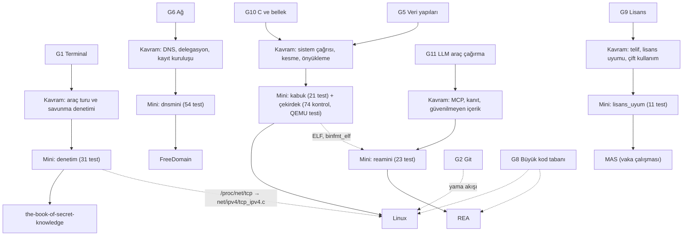

# D03 — Sistem, ağ ve güvenlik

Bu dal, yazılımın "altını" öğretir: bir program `read()` dediğinde çekirdekte ne olur, bir alan adı nasıl bir IP
adresine dönüşür, bir sunucu nasıl denetlenir, bir ikili dosyanın içinde ne vardır ve bütün bunların **hukuki ve etik
sınırları** nerededir. Beş yaprak çok farklı türlerdendir: dünyanın en büyük C kod tabanlarından biri (Linux), bir
belge deposu (FreeDomain), tek dosyalık dev bir liste (the-book-of-secret-knowledge), yepyeni bir ajan aracı (REA) ve
bir lisans atlatma aracı üzerine vaka çalışması (MAS). Dört yaprağın yanında, o deponun çekirdek mekanizmasını
sıfırdan kuran ve çevrimdışı test edilen bir mini uygulama var; MAS'ın minisi ise bilerek onun yerine meşru
karşılığını (lisans uyumu, yazılım varlık yönetimi) öğretir.

> **Etik ilke:** Bu daldaki araçlar ve alıştırmalar yalnızca **sahibi olduğun ya da yazılı yetkin olan** sistemler,
> dosyalar ve ikililer içindir. Tarama, sızma, lisans ya da koruma atlatma rehberi yoktur; savunma, anlama ve uyum
> tarafından ilerlenir.

## Ön koşullar

Liste, beş yaprağın "Öğrenmen gerekenler" bölümlerinin birleşimidir.

**Zorunlu gövde düğümleri**

- [G1 Terminal, kabuk ve Linux kullanımı](../../govde/README.md#g1) — beş yaprağın ortak dili: `strace`, `dig`, `ss`,
  `openssl`, `/proc`.
- [G2 Git ve GitHub iş akışı](../../govde/README.md#g2) — Linux'un e-postayla yama akışı: `git format-patch`,
  `git send-email`, `git bisect`.
- [G3 Python ile programlama](../../govde/README.md#g3) — dört mini Python ile yazıldı; kabuğun testleri de Python.
- [G5 Veri yapıları ve algoritmalar](../../govde/README.md#g5) — çekirdeğin listeleri ve ağaçları (rbtree, maple tree,
  XArray), halka tamponlar, kayan pencere.
- [G6 Ağ ve web temelleri](../../govde/README.md#g6) — DNS, TCP/UDP, TLS, HTTP, JSON-RPC.
- [G8 Büyük kod tabanı okuma](../../govde/README.md#g8) — 97 bin dosyalık Linux ve 7.685 dosyalık REA ağacında yol
  bulmak.
- [G9 Açık kaynak: lisans, katkı süreci, topluluk](../../govde/README.md#g9) — beş yaprak da ister: GPL-2.0 ve DCO
  (Linux), AGPL ve yıldız ekonomisi (FreeDomain), başkalarının içeriğine bağlanan MIT lisanslı liste (the-book),
  üçüncü taraf lisansları (REA) ve GPL'in başka bir yazılımın lisansını aşamayacağı (MAS).
- [G10 C ve bellek modeli](../../govde/README.md#g10) — Linux ve REA'nın ELF tarafı için şart.

**Faydalı gövde düğümleri**

- [G4 JavaScript / TypeScript ve Node.js](../../govde/README.md#g4) — REA'nın gerçek kodunu okumak için (mini Python).
- [G7 Test, CI ve kod kalitesi](../../govde/README.md#g7) — denetim minisinin CI eşiği, REA'nın mutasyon ve özellik
  tabanlı testleri.
- [G11 LLM API temelleri](../../govde/README.md#g11) — REA'nın MCP tarafı: araç çağırma, bağlam bütçesi.

**Diğer dallar**

- [D09 Bilgisayar bilimi](../09-bilgisayar-bilimi/README.md) — önce ya da birlikte: OSSU "Core systems"
  (_Operating Systems: Three Easy Pieces_) Linux yaprağının işletim sistemi kuramı ön koşuludur; system-design-primer
  "Domain name system" FreeDomain'e hazırlar.
- [D07 Kodlama ajanları](../07-kodlama-ajanlari/README.md) ve [D08 Ajan becerileri](../08-ajan-becerileri/README.md) —
  yalnız REA yaprağı için: REA'yı çağıran ajanlar ve `SKILL.md` biçimi. Paralel okunabilir.

## Dalın ağacı

## Önerilen yaprak sırası

1. **[the-book-of-secret-knowledge](the-book-of-secret-knowledge/README.md)** — araç turu. Önce elindeki aletleri
   tanı: `ss`/`lsof`, `openssl`, `ssh`, `dig`. Mini (`denetim`) Linux'un `/proc` arayüzüne ve TLS'e ilk dokunuştur;
   zorluk düşük, motivasyon yüksek.
2. **[FreeDomain](freedomain/README.md)** — DNS. Uygulama katmanında, UDP/TCP üzerinde çalışan ikili bir protokolü
   (DNS tel biçimi) sıfırdan yazmak Linux'tan önce iyi bir ısınmadır; kayıt kuruluşu modeli kötüye kullanım
   düşüncesini öğretir.
3. **[Linux](linux/README.md)** — önce kullanıcı alanı (kabuk: `fork`/`exec`/`pipe`), sonra çekirdek alanı
   (önyükleme, kesmeler). Dalın en zor ve en öğretici yaprağı; ilk iki yaprakta gördüğün `/proc`'un (`fs/proc/`) ve
   soketlerin (`net/socket.c`, `net/ipv4/tcp_ipv4.c`) kaynağını bu ağaçta bulursun.
4. **[REA](rea/README.md)** — Linux yaprağında gördüğün ELF bilgisini (`fs/binfmt_elf.c`, mini çekirdeğin
   ELF/Multiboot denetimi) ajan araçlarıyla birleştirir: MCP, kanıt, istem enjeksiyonu savunması. REA dosyası G10
   kaynağı olarak Linux dosyasını gösterdiği için Linux'tan sonra gelir.
5. **[MAS](microsoft-activation-scripts/README.md)** — yalnız hukuk ve etik vaka çalışması. the-book ile REA'yı
   "sorumlu proje kapsamını nasıl çizer?" sorusunun iki karşı örneği olarak kullandığı için en sonda okunur. Mini,
   lisans uyumunu (SAM) öğretir.

## Süre tahmini

Bu daldaki bütün süreler saattir ve şu kurallarla hesaplanır:

- **Birim çevirisi:** 1 gün ≈ 5 saat odaklı çalışma, 1 hafta ≈ 10 saat (gövdedeki "haftada ~10 saat" temposu).
  Yaprak dosyalarındaki eski gün/hafta tahminleri bu kuralla saate çevrildi.
- **Mini (saat):** yaprağın "Sıfırdan yol" tablosundaki ana aşamaların toplamı. `+` ile işaretli yan dallar ve
  Linux'un mininin ötesindeki C4-C8 ileri aşamaları dahil değildir; onlar aşağıda ayrıca verilir.
- **Toplam (saat):** Mini + okuma rotası (adım başına ~1 saat) + alıştırmalar (Kolay ~1, Orta ~3, Orta-zor ~5,
  Zor ~10 saat).

## Yapraklar

| Sıra | Depo                                                                              | Tür                                      | Zorluk (1-5) | Mini                                                                                        | Mini (saat) | Toplam (saat) |
| :--: | --------------------------------------------------------------------------------- | ---------------------------------------- | :----------: | ------------------------------------------------------------------------------------------- | ----------: | ------------: |
|  1   | [trimstray/the-book-of-secret-knowledge](the-book-of-secret-knowledge/README.md)  | liste                                    |      2       | [denetim](the-book-of-secret-knowledge/sifirdan/README.md): sshd, soketler, X.509, auth.log |          50 |            79 |
|  2   | [DigitalPlatDev/FreeDomain](freedomain/README.md)                                 | eğitim içeriği                           |      3       | [dnsmini](freedomain/sifirdan/README.md): yetkili DNS + kayıt kuruluşu                      |          60 |            91 |
|  3   | [torvalds/linux](linux/README.md)                                                 | kod tabanı                               |      5       | [kabuk + çekirdek](linux/sifirdan/README.md): sistem çağrıları, multiboot, IRQ              |       40-45 |         83-88 |
|  4   | [morluto/rea](rea/README.md)                                                      | kod tabanı                               |      4       | [reamini](rea/sifirdan/README.md): MCP sunucusu + ELF araçları                              |       40-45 |         73-78 |
|  5   | [massgravel/Microsoft-Activation-Scripts](microsoft-activation-scripts/README.md) | kod tabanı (etik sınırlı vaka çalışması) |      1       | [lisans_uyum](microsoft-activation-scripts/sifirdan/README.md): yazılım varlık yönetimi     |          20 |            44 |

Toplamın dökümü (mini + okuma rotası + alıştırmalar): the-book 50 + 8 + 21, FreeDomain 60 + 8 + 23, Linux
40-45 + 10 + 33, REA 40-45 + 10 + 23, MAS 20 + 6 + 18.

**Dal toplamı:** mini yolları 210-220 saat; okuma rotaları ve alıştırmalarla birlikte **370-380 saat**, yani haftada
~10 saatle yaklaşık **37-38 hafta**. İsteğe bağlı ek: Linux'un ileri aşamaları (sayfalama, kullanıcı kipi,
zamanlayıcı, VFS ve ELF yükleyici; C4-C8) 60-90 saat, FreeDomain'in DNSSEC/EDNS/AXFR yan dalları 10-20 saat, REA'nın
ayrık kodlama/Ghidra köprüsü yan dalı 10-20 saat; hepsi birlikte 80-130 saat (8-13 hafta) daha.

Bütün mini uygulamalar çevrimdışı test edilir: `linux/sifirdan` → `make test` (QEMU kuruluysa ayrıca
`make qemu-test` çekirdeği gerçekten açar); diğerleri kendi `sifirdan/` klasöründe
`python3 -m unittest discover -s . -t .`.

## Dallar arası bağlantılar

- **[D09 Bilgisayar bilimi](../09-bilgisayar-bilimi/README.md)** — işletim sistemi ve ağ kuramı:
  [OSSU](../09-bilgisayar-bilimi/ossu-computer-science/README.md) "Core systems" (OSTEP, _Computer Networking: a
  Top-Down Approach_) ve "Core security";
  [system-design-primer](../09-bilgisayar-bilimi/system-design-primer/README.md) "Domain name system";
  [CS-Notes](../09-bilgisayar-bilimi/cs-notes/README.md) (`notes/Linux.md`, `notes/Socket.md`).
- **[D07 Kodlama ajanları](../07-kodlama-ajanlari/README.md) ve [D08 Ajan becerileri](../08-ajan-becerileri/README.md)**
  — REA'yı çağıran ajanlar ve `SKILL.md` biçimi; Linux'un yapay zekâ araçlarına yönelik katkı politikası
  (`Documentation/process/coding-assistants.rst`) D07 için iyi bir vakadır.
- **[D10 Küratörlük, listeler ve topluluk](../10-kuratorluk-topluluk/README.md)** —
  [build-your-own-x](../10-kuratorluk-topluluk/build-your-own-x/README.md) ("Operating System", "Shell", "Network
  Stack" bölümleri) ve liste kürasyonu karşılaştırması için [awesome](../10-kuratorluk-topluluk/awesome/README.md).
- **[D02 Uygulama platformları](../02-uygulama-platformlari/README.md)** — [ohmyzsh](../02-uygulama-platformlari/ohmyzsh/README.md)
  kabuk yapılandırması; mini kabuğun kardeş konusu.

## Bu dalı bitirdiğinde ne yapabilirsin

- Bir programın sistem çağrılarını `strace` ile okuyup Linux kaynak ağacında karşılıklarını bulabilirsin; boru,
  yönlendirme ve süreç yönetimini kendi kabuğunda uygulamış olursun.
- Kesmeleri işleyen, klavyeden okuyan küçük bir x86 çekirdeğini derleyip QEMU'da açabilir, Linux'un önyükleme
  yolunu (BIOS ve UEFI girişlerinden) `init/main.c`'ye kadar izleyebilirsin.
- DNS mesajlarını bayt düzeyinde okuyup yazabilir, yetkili bir sunucu ve delegasyon yayımlayan bir kayıt kuruluşu
  modeli kurabilir, ücretsiz alt alan adı hizmetlerinin kötüye kullanımla nasıl savaştığını açıklayabilirsin.
- Kendi sunucunda SSH, açık port, sertifika ve günlük denetimini otomatikleştirip CI'a bağlayabilirsin.
- Bir ajana MCP üzerinden kanıtlı, sınırlı ve istem enjeksiyonuna dayanıklı araçlar sunan bir sunucu yazabilirsin.
- Çift kullanımlı araçlarda hukuki çerçeveyi (FSEK, lisans sözleşmeleri) ve sorumlu kapsam sınırlarını tartışabilir,
  bir kurumun lisans uyumunu ölçebilirsin.
