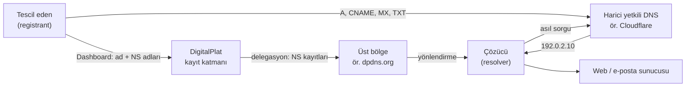
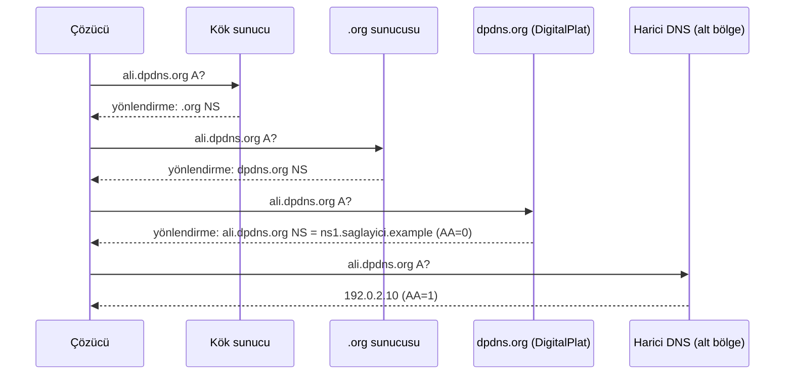
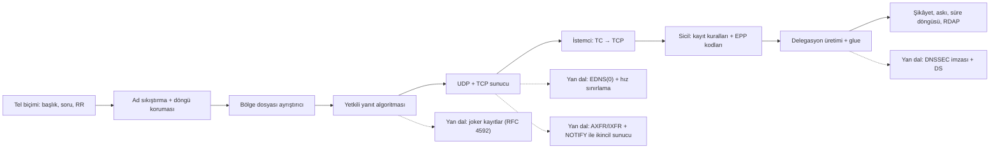

# DigitalPlatDev/FreeDomain — ücretsiz alan adı hizmetinin belgeleri ve DNS ders kitabı

> **Dal:** [D03 Sistem, ağ ve güvenlik](../README.md) · **Tür:** eğitim içeriği
> **Dil:** Markdown · **Lisans:** AGPL-3.0 · **Yıldız:** 207.632 (9 Kasım 2026) · **İncelenen commit:** `9c7c541` (2026-08-12)

## 1. Bir bakışta

DigitalPlat FreeDomain, `.DPDNS.ORG`, `.US.KG`, `.QZZ.IO`, `.XX.KG`, `.QD.JE` son ekleri altında ücretsiz alan adı
veren bir hizmettir; bu depo ise hizmetin **kodunu değil**, kamuya açık bilgilerini ve kitap uzunluğunda bir öğrenme
rehberini barındırır. README açıkça söyler: uygulama kaynak kodu ayrı bir depoda, `DigitalPlatDev/Domain-OSS`'tadır
(bu atlas kapsamında incelenmedi). README 500.000'den fazla kayıtlı alan adından söz eder ve hikâyeyi kurucunun 15
yaşında arkadaşlarına alt alan adı dağıttığı bir DNS deneyi olarak anlatır. Popülerliği "ücretsiz alan adı" ihtiyacından
geliyor; bir belge deposu için olağanüstü olan 207 bin yıldızın bir kısmının hizmetin geçmiş kampanyalarıyla ilgili
olabileceği konuşulur (doğrulanmadı) — depoda yalnızca SSS'deki "yıldız zorunlu değil ama memnun oluruz" notu var.
Ders: yıldız sayısı tek başına teknik kalite göstergesi değildir ([G9](../../../govde/README.md#g9)).

## 2. Nasıl yapılmış: mimari

### Klasör haritası

İncelenen commit'te 88 dosya var; 76'sı Markdown.

```text
README.md                         hizmet tanıtımı, son ekler, kötüye kullanım e-postası, Telegram güvenlik uyarısı
LEARN.md                          kitabın içindekiler: Kategori A (ürün) + Kategori B (genel ders kitabı)
CONTRIBUTING.md                   neyin bu depoya ait olduğu; sorunlar ayrı depoda (FreeDomain-Issues)
SECURITY.md                       açıkları özelden bildirme; kötüye kullanım ayrı kanal
documents/domains/faq.md          hesap başına 1 alan adı sınırı ve gerekçesi
documents/tutorial/BOOK_PLAN.md   kitabın yazım ilkeleri ve kategori sınırı
documents/tutorial/platform/      Kategori A: hesap, kayıt, NS bağlama, yenileme, API — hizmete özgü
documents/tutorial/foundations/   Bölüm 0: internet, terminal, alan adı ve DNS temelleri
documents/tutorial/dns/           Bölüm 2: delegasyon, kayıt türleri, TTL, sorun giderme
documents/tutorial/website/       Bölüm 3: statik site, sunucu, HTTPS, ters vekil, performans
documents/tutorial/email/         Bölüm 4: MX, SPF, DKIM, DMARC
documents/tutorial/operations/    Bölüm 5: yenileme, NS taşıma, kayıt verisi, güvenlik, kötüye kullanım, yedek
documents/tutorial/advanced/      Bölüm 6: API güvenliği, kendi yetkili DNS'in, mimari, sözlük, kaynaklar
documents/tutorial/capstone/      Bölüm 7: uçtan uca proje (kayıt → DNS → site → işletim)
documents/tutorial/appendices/    çalışma kitabı, cevaplar, karar ağaçları, kontrol listeleri
.github/PULL_REQUEST_TEMPLATE.md  doğrulama kutuları: komutları denedim, bağlantıları kontrol ettim, veri sızdırmadım
.gitattributes                    *.md dosyalarını GitHub dil istatistiğine kattırır (dil "Markdown" görünür)
```

### Ana bileşenler ve veri akışı

Belgelerin anlattığı sistem üç katmandır ve en sık hata katmanları karıştırmaktır
(`platform/1.0-product-boundaries.md`):



DigitalPlat yalnız **delegasyonu** saklar: "ali.dpdns.org'un ad sunucuları şunlardır". Sıradan kayıtları (A, MX ...)
düzenleme ekranı yoktur; kullanıcı harici bir DNS sağlayıcısında bölge açar, verilen NS adlarını DigitalPlat'e girer.
`dns/2.0-delegation.md` aynı alan adının "üç görünümünü" ayırır: kayıt görünümü (girilen NS'ler), üst bölge görünümü
(çözücünün izlediği delegasyon) ve alt bölge görünümü (SOA, NS ve sıradan kayıtlar).

### Önce okunacak dosyalar

1. `README.md` — hizmetin sınırı, kaynak kodun yeri, kötüye kullanım kanalı.
2. `documents/tutorial/BOOK_PLAN.md` — kitabın neden iki kategoriye ayrıldığı ve yazım ilkeleri.
3. `documents/tutorial/platform/1.0-product-boundaries.md` — "hangi sorun hangi katmanda" tablosu.
4. `documents/tutorial/platform/1.3-connect-nameservers.md` — NS bağlama ve sık hatalar.
5. `documents/tutorial/dns/2.0-delegation.md` — delegasyonun üç görünümü, `dig +trace`.
6. `documents/tutorial/advanced/6.2-self-hosted-dns.md` — kendi yetkili sunucun: UDP+TCP 53, glue, tutarlılık.
7. `documents/tutorial/operations/5.6-acceptable-use.md` ve `documents/domains/faq.md` — kötüye kullanım ve sınırlar.

### Teknoloji yığını, derleme, test, CI, sürüm

Saf Markdown; derleme, test ya da CI yok — GitHub'ın Markdown görüntüleyicisi "yayın" katmanıdır. Kalite güvencesi
insan elinde: PR şablonundaki kutular (komutları doğruladım, göreli bağlantıları denedim, hassas veriyi çıkardım, tek
konu), `CONTRIBUTING.md`'deki kurallar (açık İngilizce, doğrulanmış teknik iddialar). Hizmet sorunları ayrı
`FreeDomain-Issues` deposuna, açıklar e-postaya, kötüye kullanım `abusereport@` adresine gider. Bağış `FUNDING.yml`
üzerinden Hack Club HCB'ye bağlanır. Lisans AGPL-3.0: belge deposu için alışılmadık bir seçim (AGPL ağ üzerinden
sunulan yazılım için tasarlanmıştır; metin içerik için Creative Commons daha yaygındır).

### Tasarım kararları ve ödünleşimler

1. **Yalnız delegasyon, kayıt düzenleyici yok.** DigitalPlat DNS barındırmaz; bölgeyi kullanıcı harici bir sağlayıcıda
   tutar. Hizmetin işletme yükü ve saldırı yüzeyi küçülür; bedeli, yeni başlayan için fazladan bir sağlayıcı ve kafa
   karışıklığıdır — belgelerin büyük kısmı bu karışıklığı gidermek için yazılmış.
2. **Belge deposu ile kod deposu ayrı.** Topluluk katkısı (yazım, çeviri, sorun giderme) kod incelemesi gerektirmeden
   akar; ama "GitHub'daki popüler depo" ile "çalışan hizmetin kodu" farklı yerlerdedir.
3. **İki hızda değişen iki kategori.** Ürüne özgü bölümler (Kategori A) sık değişir ve "Dashboard'daki güncel duyuru
   esastır" der; genel ders kitabı (Kategori B) RFC'lere dayanır ve yavaş değişir (`platform/project-overview.md`).
4. **Ücretsizlik kötüye kullanım baskısı yaratır.** SSS'ye göre sınır "artan kötüye kullanım nedeniyle" hesap başına 1
   alan adına indirilmiş; README'de şikâyet kanalı, eski Telegram hesabının ele geçirildiği uyarısı var.
5. **Örnekler belgeleme adresleriyle.** `BOOK_PLAN.md` kurgusal adlar ve belgeleme IP aralıkları ister (`192.0.2.x`);
   kopyala-yapıştır hatası gerçek bir sisteme dokunmaz. Bu atlastaki mini de aynı kuralı izler.

## 3. Öğrenmen gerekenler

- [G6 Ağ ve web temelleri](../../../govde/README.md#g6) — UDP/TCP, DNS mesajları, HTTP/HTTPS. Kaynak:
  free-programming-books Türkçe listesindeki "Beej'in Ağ Programlama Kılavuzu" çevirisi
  ([liste](https://github.com/EbookFoundation/free-programming-books/blob/main/books/free-programming-books-tr.md#c)).
- [G1 Terminal ve Linux](../../../govde/README.md#g1) — `dig`, `nc`, sunucu yönetimi.
- [G3 Python](../../../govde/README.md#g3) — mini uygulama: `struct`, `socketserver`, `dataclasses`.
- [G9 Açık kaynak: lisans ve topluluk](../../../govde/README.md#g9) — AGPL, katkı kuralları, yıldız ekonomisi.
- [system-design-primer](../../09-bilgisayar-bilimi/system-design-primer/README.md) "Domain name system" bölümü —
  önbellekleme ve yük dağıtımı açısından DNS.
- [build-your-own-x](../../10-kuratorluk-topluluk/build-your-own-x/README.md) — "Network Stack" altındaki _Building
  a DNS server in Rust_ (dnsguide): bu minideki tel biçimini başka dilde gör.

### Dala özgü kavramlar: alan adı ekosistemi

| Rol / protokol               | Ne yapar                                                                                      | FreeDomain'de karşılığı                                             |
| ---------------------------- | --------------------------------------------------------------------------------------------- | ------------------------------------------------------------------- |
| Kayıt kuruluşu (registry)    | Bir son eki (TLD ya da alt son ek) işletir, üst bölgeyi yayımlar                              | DigitalPlat kendi son eklerinin kuruluşudur                         |
| Kayıt şirketi (registrar)    | Müşteri adına kuruluşa kayıt/yenileme işlemleri gönderir                                      | Dashboard; ayrı registrar katmanı yok                               |
| Tescil eden (registrant)     | Alan adının sahibi; iletişim verisi ondan alınır                                              | Hesap sahibi                                                        |
| EPP (RFC 5730-5734)          | Registrar ↔ registry arasında XML tabanlı kayıt protokolü; sonuç kodları (1000, 2302 ...)     | Kamuya açık bir EPP arayüzü belgelenmemiş                           |
| WHOIS / RDAP (RFC 9082/9083) | Kayıt verisini sorgulama; RDAP JSON + HTTPS ile WHOIS'in yerini alıyor, kişisel veri gizlenir | `operations/5.4-registration-data.md`                               |
| Glue (yapıştırıcı) kayıt     | NS adı devredilen alanın içindeyse, adresi üst bölgede yayımlanır                             | `advanced/6.2-self-hosted-dns.md`                                   |
| DNSSEC (RFC 4033-4035)       | Bölgeyi imzalar; üst bölgedeki DS kaydı alt bölgenin anahtarına güven zinciri kurar           | Depoda anlatılmıyor                                                 |
| Public Suffix List           | Tarayıcılara "bu son ekin altındakiler ayrı sahiplerdir" der (çerez yalıtımı)                 | Depoda anlatılmıyor; son eklerin listede olup olmadığı doğrulanmadı |

Çözümleme, delegasyonun izlenmesidir:



**Ücretsiz alt alan adı hizmeti kötüye kullanımla nasıl savaşır?** Ucuz ad = ucuz kimlik avı alanı. Katmanlar:
kayıt anında (sınırlar, hız sınırı, ayrılmış/şüpheli sözcükler, e-posta/telefon doğrulaması), yayımda (askıdaki alanın
delegasyonunu üst bölgeden çekmek — tek bir satır silmek bütün alt bölgeyi düşürür), sonrasında (şikâyet kanalı,
kara liste beslemeleri, sertifika şeffaflık kayıtlarını izleme) ve ekosistemde (Public Suffix List'e girmek, böylece
`ali.` ve `veli.` alt alanları birbirinin çerezlerini okuyamaz). FreeDomain belgelerinde görünenler: hesap başına 1
alan adı, politika onayı, şikâyet e-postası, kabul edilebilir kullanım rehberi; gerisinin nasıl uygulandığı depoda yok.

## 4. Sıfırdan yol (dallanma)



| Aşama | Ne inşa edersin                  | Öğrendiğin kavram                           | Bitti ölçütü                                        | Süre (saat) |
| ----- | -------------------------------- | ------------------------------------------- | --------------------------------------------------- | ----------- |
| 1     | `tel.py`                         | ikili protokol, ağ bayt sırası              | gidiş-dönüş testi; döngü kuran paket reddediliyor   | 10          |
| 2     | `bolge.py`                       | RFC 1035 §5, doğrulama                      | örnek bölge ayrıştırılıyor; hatalar satır numaralı  | 10          |
| 3     | `yanit.py`                       | yetki, delegasyon, olumsuz yanıtlar         | NXDOMAIN/NODATA/yönlendirme testleri yeşil          | 15          |
| 4-5   | `sunucu.py`, `istemci.py`        | UDP/TCP, TC biti, hız sınırlama             | `dig` ve kendi istemcin aynı yanıtı alıyor          | 10          |
| 6     | `sicil.py`                       | registry modeli, EPP, RDAP, kötüye kullanım | üretilen üst bölge sunuluyor, askı NXDOMAIN veriyor | 15          |
| +     | DNSSEC / EDNS / AXFR yan dalları | kriptografik imza, ikincil sunucular        | `dig +dnssec` ile RRSIG görüyorsun                  | 10-20       |

**Toplam:** ana aşamalar (1-6) 60 saat; isteğe bağlı yan dallar 10-20 saat daha. Saatler dalın ortak kuralıyla
hesaplandı (1 gün ≈ 5 saat, 1 hafta ≈ 10 saat; bkz. [dal sayfası](../README.md#süre-tahmini)).

**Mini uygulama:** [`sifirdan/`](sifirdan/README.md) — `dnsmini` paketi (tel, bölge, yanıt, sunucu, istemci, sicil)
ve 54 çevrimdışı test. Aşama 1-5 harici yetkili DNS sağlayıcısının (`advanced/6.2-self-hosted-dns.md`), aşama 6
DigitalPlat'in kayıt katmanının (`platform/1.2-domain-registration.md`, `1.3-connect-nameservers.md`) oyuncak
karşılığıdır; tam eşleme tablosu `sifirdan/README.md`'de.

**Gerçek ölçeğe giden yol.** (1) EDNS(0) ve büyük UDP yanıtları, (2) ikincil sunucular: AXFR/IXFR + NOTIFY, birden çok
ağda en az iki yetkili sunucu, (3) DNSSEC: anahtar yönetimi, imza yenileme, üst bölgeye DS gönderimi, (4) anycast ve
DDoS dayanıklılığı (RRL'nin gerçeği), (5) kalıcı veritabanı + denetim izi, (6) registrar'lar için EPP sunucusu ve
kamuya açık RDAP uç noktası, (7) kötüye kullanım boru hattı: kara listeler, sertifika şeffaflık izleme, insan
incelemesi, (8) hukuk ve gizlilik: tescil eden verisi için KVKK/GDPR, (9) Public Suffix List başvurusu.

## 5. Gerçek depoda okuma rotası

1. **`README.md`** — Hizmetin neyi yaptığını ve yapmadığını üç cümleyle yaz. Kod nerede?
2. **`documents/tutorial/BOOK_PLAN.md`** — "Kategori sınırı" neden kural olarak yazılmış? Yazım ilkelerinden hangisi
   bir güvenlik kararıdır (belgeleme IP'leri, ekran görüntüsünde kişisel veri yasağı)?
3. **`platform/1.0-product-boundaries.md`** — "Diagnose the Correct Layer" tablosunu kendi `dnsmini` kurulumunla
   doldur: hangi hata `sicil`, hangisi `DnsSunucusu` katmanında?
4. **`platform/1.3-connect-nameservers.md`** — "Common Mistakes" tablosundaki hatalardan hangilerini
   `sicil._ns_denetle()` hangi EPP koduyla reddediyor (NS yerine IP: 2005, tek NS: 2004), hangileri minide hiç
   denetlenmiyor (ör. dış sunucuda bölgenin olmaması; Alıştırma 2'deki ön kontrolü bir SOA sorgusuyla genişletebilirsin)?
5. **`dns/2.0-delegation.md`** — "Three Views" ile `tests/test_sicil.py`'deki entegrasyon testini eşleştir.
6. **`dns/2.3-ttl-and-propagation.md`** — "yayılma" (propagation) aslında nedir? Olumsuz yanıt TTL'si (SOA asgari)
   neden önemlidir? Cevabını `yanit._olumsuz_soa()` ile doğrula.
7. **`advanced/6.2-self-hosted-dns.md`** — Glue ve TCP zorunluluğu bölümleri: `dnsmini` hangisini uyguluyor, hangisi
   eksik (ikinci sunucu, izleme)?
8. **`operations/5.6-acceptable-use.md` + `documents/domains/faq.md`** — kötüye kullanım politikası ile minideki
   `kimlik_avi_supheli()`, hesap sınırı ve askıya almayı karşılaştır.

## 6. Alıştırmalar ve öz değerlendirme

1. (Kolay) `dnsmini`'ye `CAA` kayıt türünü ekle (tel biçimi + bölge ayrıştırıcı + test).
2. (Kolay) `sicil`'e "ad sunucusu çözülebiliyor mu?" ön kontrolü ekle: kayıttan önce NS adına `A` sorgusu gönder
   (testte yerel `DnsSunucusu` ile).
3. (Orta) Joker kayıtları (RFC 4592) uygula: `*.ornek.test` vardır ama `a.b.ornek.test` boş ara düğüm kuralıyla
   nasıl etkileşir?
4. (Orta) EDNS(0) OPT kaydını anla ve destekle: istemci 1232 bayt önerdiğinde TC'siz yanıt ver.
5. (Orta-zor) AXFR (TCP üzerinden tam bölge aktarımı) + NOTIFY ile ikincil bir `dnsmini` kur; SOA seri numarası
   değişince ikincil güncellensin.
6. (Zor) Sicili kalıcı yap (SQLite) ve basit bir HTTPS RDAP uç noktası (`/domain/<ad>`) yaz; kişisel verinin hiçbir
   yolda sızmadığını test et.

<details><summary>Soru 1: NS alanına neden IP adresi yazılmaz?</summary>

NS kaydının verisi bir **ad**dır (RFC 1035). Adresler o adın kendi `A`/`AAAA` kayıtlarında durur; ad içeride kalırsa
üst bölge glue olarak yayımlar. IP yazmak hem biçim hatasıdır hem de sağlayıcı adres değiştirdiğinde delegasyonu
kırar. `sicil` bunu EPP 2005 ile reddeder.

</details>

<details><summary>Soru 2: NXDOMAIN ile NODATA farkı nedir, ikisinde de neden SOA döneriz?</summary>

NXDOMAIN: ad hiç yok. NODATA: ad var (ya da boş ara düğüm) ama istenen türde kayıt yok, rcode NOERROR. İkisinde de
yetki bölümündeki SOA, çözücüye bu olumsuz cevabı ne kadar önbellekleyeceğini söyler: min(SOA TTL, SOA asgari)
(RFC 2308).

</details>

<details><summary>Soru 3: Askıya alınan bir alt alan adının harici DNS'te kayıtları dururken site neden açılmaz?</summary>

Çözücü harici DNS'e ancak üst bölgedeki delegasyonu izleyerek ulaşır. Kayıt kuruluşu delegasyonu üst bölgeden
kaldırınca (minide `bolge_metni()` askıdaki alanları atlar) zincir kökte kopar: üst bölge NXDOMAIN döner.

</details>

<details><summary>Soru 4: İşaretçi döngüsü koruması için "işaretçi kendi konumundan geride olsun" kuralı neden yetmez?</summary>

İşaretçi geriye atlayıp etiket okumaya devam ettiğinde aynı işaretçiye yeniden varabilir (ofset 12'de etiket, 14'te
12'ye işaretçi). `tel.ad_oku()` bu yüzden her atlamanın, o an okunan etiket dizisinin başladığı yerden geride olmasını
ister; sınır her seferinde küçüldüğü için döngü imkânsızdır (`test_dongu_kuran_isaretci_reddedilir`).

</details>

## 7. İş fikri tohumları

- **Yönetilen DNS + kesinti izleme (Türkçe)** — bölge düzenleme, ikincil sunucu ve "alan adın 30 gün içinde doluyor"
  uyarıları. **Kime:** web ajansları ve onlarca müşteri alan adı yöneten serbest geliştiriciler.
- **Alt alan adı kötüye kullanım tarayıcısı (API)** — yeni kayıtları kimlik avı sözcükleri, homoglifler ve sertifika
  şeffaflık kayıtlarıyla puanlar. **Kime:** ücretsiz alt alan adı/barındırma sağlayıcıları ve kayıt şirketleri.
- **Kampüs alt alan adı hizmeti** — `kulup.universite.edu.tr` altında otomatik kayıt, delegasyon ve HTTPS. **Kime:**
  üniversitelerin bilgi işlem daireleri ve öğrenci kulüpleri.

Ayrıntılı katalog: [is-fikirleri](../../../is-fikirleri/README.md).

## 8. Kaynaklar

- Depo (incelenen commit):
  [LEARN.md](https://github.com/DigitalPlatDev/FreeDomain/blob/9c7c54110705760267b07b6e6a6d406d1172a1bf/LEARN.md) ·
  [BOOK_PLAN.md](https://github.com/DigitalPlatDev/FreeDomain/blob/9c7c54110705760267b07b6e6a6d406d1172a1bf/documents/tutorial/BOOK_PLAN.md) ·
  [2.0-delegation.md](https://github.com/DigitalPlatDev/FreeDomain/blob/9c7c54110705760267b07b6e6a6d406d1172a1bf/documents/tutorial/dns/2.0-delegation.md) ·
  [6.2-self-hosted-dns.md](https://github.com/DigitalPlatDev/FreeDomain/blob/9c7c54110705760267b07b6e6a6d406d1172a1bf/documents/tutorial/advanced/6.2-self-hosted-dns.md) ·
  [CONTRIBUTING.md](https://github.com/DigitalPlatDev/FreeDomain/blob/9c7c54110705760267b07b6e6a6d406d1172a1bf/CONTRIBUTING.md)
- Temel RFC'ler: [1034](https://www.rfc-editor.org/rfc/rfc1034) ve [1035](https://www.rfc-editor.org/rfc/rfc1035)
  (DNS) · [2181](https://www.rfc-editor.org/rfc/rfc2181) (açıklamalar) · [2308](https://www.rfc-editor.org/rfc/rfc2308)
  (olumsuz önbellek) · [7766](https://www.rfc-editor.org/rfc/rfc7766) (TCP) · [8020](https://www.rfc-editor.org/rfc/rfc8020)
  (NXDOMAIN altı) · [6604](https://www.rfc-editor.org/rfc/rfc6604) (CNAME ve rcode) · [4592](https://www.rfc-editor.org/rfc/rfc4592)
  (joker) · [6891](https://www.rfc-editor.org/rfc/rfc6891) (EDNS) · [5737](https://www.rfc-editor.org/rfc/rfc5737) ve
  [3849](https://www.rfc-editor.org/rfc/rfc3849) (belgeleme adresleri)
- Kayıt ekosistemi: [EPP RFC 5730](https://www.rfc-editor.org/rfc/rfc5730) ·
  [RDAP RFC 9083](https://www.rfc-editor.org/rfc/rfc9083) · [DNSSEC RFC 4033](https://www.rfc-editor.org/rfc/rfc4033) ·
  [Public Suffix List](https://publicsuffix.org/) · [ICANN Lookup](https://lookup.icann.org/)
