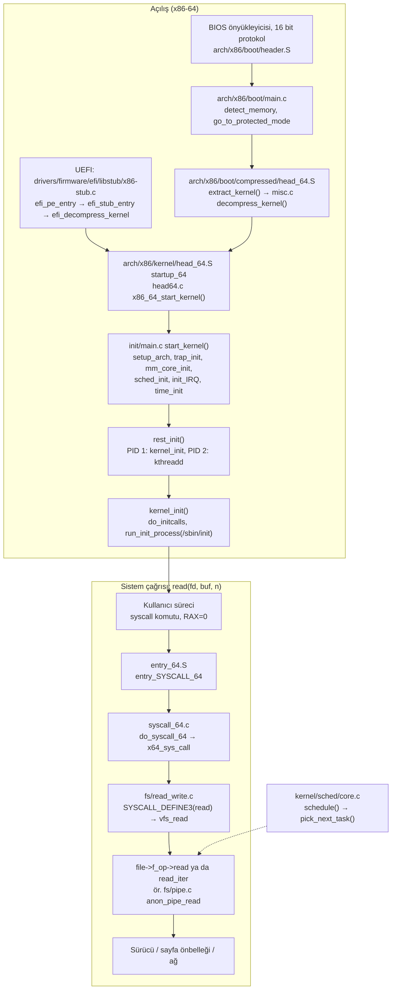
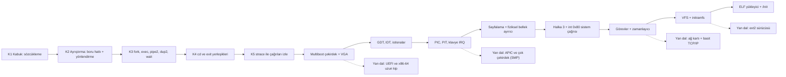

# torvalds/linux — Linux çekirdeğinin kaynak ağacı

> **Dal:** [D03 Sistem, ağ ve güvenlik](../README.md) · **Tür:** kod tabanı
> **Dil:** C (+ assembly, Rust) · **Lisans:** GPL-2.0-only WITH Linux-syscall-note (GitHub "NOASSERTION" gösterir; bkz. `COPYING`) · **Yıldız:** 254.946 (9 Kasım 2026) · **İncelenen commit:** `7475ea8` (2026-11-08, "Linux 7.4-rc2")

## 1. Bir bakışta

Linux, donanım ile programlar arasındaki katmandır: süreçleri zamanlar, belleği sayfalar hâlinde dağıtır, dosya
sistemlerini tek bir arayüz (VFS) arkasında birleştirir, ağ yığınını ve binlerce aygıt sürücüsünü taşır. İncelenen
commit'te ağaçta **97.362 dosya** var; bunların **38.199'u (%39) `drivers/`** altında, `arch/` altında ise 21 mimari
dizini duruyor (20 işlemci ailesi + Linux'u sıradan bir kullanıcı süreci olarak çalıştıran `um`, User-Mode Linux). Android'in, sunucuların ve bulutun büyük kısmının, gömülü cihazların çekirdeği olduğu için
popülerdir; GitHub'daki bu depo ise Linus Torvalds'ın ağacının salt okunur aynasıdır — asıl geliştirme e-posta
listelerinde (lore.kernel.org) yürür. `Makefile`'ın başı sürümü söyler: `VERSION = 7`, `PATCHLEVEL = 4`,
`EXTRAVERSION = -rc2`, `NAME = Baby Opossum Posse`.

## 2. Nasıl yapılmış: mimari

### Klasör haritası

```text
arch/                   21 mimari (x86, arm64, riscv, ...); işlemciye özgü her şey burada
arch/x86/boot/          gerçek kip kurulum kodu: header.S ("HdrS" önyükleme başlığı), main.c, pm.c
arch/x86/boot/compressed/  sıkıştırılmış çekirdeği açan ara program (head_64.S, misc.c: extract_kernel)
arch/x86/entry/         kullanıcı → çekirdek geçişi: entry_64.S, syscall_64.c, syscalls/syscall_64.tbl
arch/x86/kernel/        head_64.S, head64.c, idt.c, traps.c, i8259.c, apic/, setup.c
init/                   main.c: start_kernel() → rest_init() → kernel_init() → PID 1
kernel/                 fork.c, exit.c, sys.c, signal, irq/, time/, printk/
kernel/sched/           core.c (__schedule), fair.c (EEVDF), rt.c, deadline.c, ext/ (BPF ile sched_ext)
mm/                     page_alloc.c (buddy), slub.c (nesne ayırıcı), memory.c (sayfa hatası), mmap.c, vma.c
fs/                     VFS: open.c, read_write.c, namei.c, dcache.c, file.c, pipe.c, exec.c + ext4/, proc/ ...
include/linux/          çekirdek içi başlıklar: fs.h, sched.h, syscalls.h, list.h, rbtree.h
include/uapi/           kullanıcı alanına açık ABI başlıkları (Linux-syscall-note istisnası burada)
drivers/                38.199 dosya: gpu/ (8.489), net/ (6.959), media/, usb/, input/, tty/ ...
net/                    ağ yığını: socket.c, ipv4/tcp.c, ipv4/udp.c, ipv6/
block/ io_uring/ ipc/   blok G/Ç katmanı, eşzamansız G/Ç, süreçler arası iletişim
security/ crypto/ virt/ LSM'ler (SELinux...), kripto API, KVM
rust/                   Rust soyutlamaları: kernel/ (174 dosya) + ağaca kopyalanmış (vendored) crate'ler (syn, zerocopy ...)
scripts/                Kbuild/Kconfig araçları, checkpatch.pl, get_maintainer.pl
tools/                  kullanıcı alanı araçları: perf/, testing/selftests/, testing/kunit/
Documentation/          11.611 dosya; process/ (geliştirme süreci), kbuild/, arch/x86/boot.rst
MAINTAINERS             31.034 satır, 3.406 girdi: kim, hangi liste, hangi dosyalar
Kconfig Kbuild Makefile yapılandırma ve derleme sisteminin kökü
README / AGENTS.md      rol bazlı rehber; AGENTS.md, README'ye sembolik bağdır
```

### Ana bileşenler ve veri akışı



**Açılış.** İki giriş yolu vardır. Eski BIOS yolunda (16 bit önyükleme protokolü) `arch/x86/boot/header.S`,
önyükleyicinin okuduğu kurulum başlığını taşır (`"HdrS"` imzası, `boot_flag 0xAA55`); `arch/x86/boot/main.c: main()`
belleği keşfeder, ekran kipini ayarlar ve `pm.c` içindeki `go_to_protected_mode()` ile korumalı kipe geçer;
sıkıştırılmış çekirdek `arch/x86/boot/compressed/head_64.S` içinden çağrılan `extract_kernel()` ile açılır (KASLR,
açma, ELF ayrıştırma: `compressed/misc.c`). UEFI'de ise gerçek kip kodu hiç çalışmaz: EFI stub
(`drivers/firmware/efi/libstub/x86-stub.c`: `efi_pe_entry` → `efi_stub_entry` → `efi_decompress_kernel`) çekirdeği
kendisi açar ve doğrudan açılmış çekirdeğe atlar. İki yol `arch/x86/kernel/head_64.S: startup_64`'te birleşir;
`head64.c: x86_64_start_kernel()` zinciri `start_kernel()`'e varır. `init/main.c` içindeki bu fonksiyon (1044.
satır) sırayla `setup_arch`, `trap_init`, `mm_core_init`, `sched_init`, `init_IRQ`, `time_init`, `console_init`,
`vfs_caches_init` çağırır ve `rest_init()` ile biter. `rest_init()` önce `kernel_init`'i (PID 1) sonra `kthreadd`'yi
(PID 2) oluşturur; kendisi boşta görevine (`cpu_startup_entry`) dönüşür. `kernel_init()` initcall'ları çalıştırır ve
sırasıyla initramfs'teki `/init`'i, `init=` parametresini, `CONFIG_DEFAULT_INIT`'i, sonra `/sbin/init`, `/etc/init`,
`/bin/init`, `/bin/sh`'yi dener; hiçbiri yoksa panik.

**Sistem çağrısı.** Numaralar `arch/x86/entry/syscalls/syscall_64.tbl`'dadır (0 `read`, 1 `write`, 22 `pipe`,
57 `fork`, 59 `execve`, 61 `wait4`). `syscall` komutu `entry_SYSCALL_64`'e düşer (`swapgs`, yazmaçlar `pt_regs`'e),
`do_syscall_64()` → `x64_sys_call()` çağrılır. İlginç ayrıntı: `syscall_64.c`'deki yoruma göre `sys_call_table[]`
artık sistem çağrıları için kullanılmıyor, yalnız `kernel/trace/trace_syscalls.c` adresleri için duruyor; dağıtım
bir `switch` ile yapılıyor. Yorum bu seçimin gerekçesini vermez. Yaygın açıklama, dolaylı çağrıyı doğrudan dallanmayla
değiştirip BHI gibi spekülatif yürütme saldırılarının yüzeyini daraltmaktır (doğrulanmadı; bağlam için
`arch/x86/Kconfig` › `MITIGATION_SPECTRE_BHI`). Aynı dosyada çağrı numarası `switch`'e girmeden önce
`array_index_nospec()` ile spekülatif sınır aşımına karşı kırpılır. Her çağrı `SYSCALL_DEFINEn` makrosuyla tanımlanır: `read` için
`fs/read_write.c` (`ksys_read` → `vfs_read`), `fork`/`clone`/`clone3` için `kernel/fork.c` (`kernel_clone` →
`copy_process`), `execve` için `fs/exec.c` (`do_execveat_common` → `bprm_execve` → `search_binary_handler`),
`wait4`/`exit` için `kernel/exit.c`, `pipe2` için `fs/pipe.c`, `dup2`/`dup3` için `fs/file.c`.

**VFS: C'de nesne yönelimi.** `include/linux/fs.h` içindeki `struct file_operations` (1922. satır) bir işlev işaretçisi
tablosudur; her dosya sistemi ve sürücü kendi tablosunu doldurur. `vfs_read()` bu yüzden pipe'tan, ext4'ten ya da
`/proc`'tan okuduğunu bilmez. `struct inode`, `struct file` aynı dosyada; `struct super_block` ve
`struct super_operations` artık `include/linux/fs/super_types.h`'e taşınmış. Yol çözümü `fs/namei.c`, dizin girdisi
önbelleği `fs/dcache.c`, dosya tanıtıcı tablosu `fs/file.c` (`alloc_fd`, `fd_install`).

**Zamanlayıcı.** `kernel/sched/core.c: __schedule()` sıradaki görevi `pick_next_task()` ile seçer; seçim, öncelik
sırasıyla zamanlayıcı **sınıflarına** sorulur (`kernel/sched/sched.h: struct sched_class`): stop, deadline
(`deadline.c`), gerçek zamanlı (`rt.c`), adil (`fair.c` — `DEFINE_SCHED_CLASS(fair)`, `pick_eevdf()` ile EEVDF
algoritması), BPF ile programlanabilen `sched_ext` (`kernel/sched/ext/ext.c`) ve boşta (`idle.c`). Bağlam değişimi
`context_switch()`, periyodik tik `sched_tick()`.

### Önce okunacak dosyalar

1. `README` — rol bazlı yol haritası; hangi belgenin kime göre olduğu.
2. `Documentation/process/2.Process.rst` — birleştirme penceresi, `-rc` sürümleri, linux-next, kararlı ağaç.
3. `init/main.c` — `start_kernel()` ve `kernel_init()`: çekirdeğin "main"i.
4. `arch/x86/entry/syscalls/syscall_64.tbl` → `arch/x86/entry/entry_64.S` → `arch/x86/entry/syscall_64.c`.
5. `include/linux/syscalls.h` (`SYSCALL_DEFINE`) ve `fs/read_write.c` (en kısa uçtan uca çağrı).
6. `include/linux/fs.h` (`struct file_operations`) → `fs/pipe.c` (somut bir uygulama).
7. `kernel/fork.c` → `fs/exec.c` → `kernel/exit.c`: bir sürecin doğumu, dönüşümü, ölümü.
8. `kernel/sched/core.c` (`__schedule`) → `kernel/sched/fair.c` (`pick_eevdf`).
9. `MAINTAINERS` başı (alan sözlüğü) + `scripts/get_maintainer.pl` — kime yazacağını nasıl bulursun.

### Teknoloji yığını, derleme, test, CI, sürüm

- **Dil ve araçlar:** GNU C (GCC ya da Clang), GNU make, assembly; Rust (`rust/`, `samples/rust/rust_minimal.rs`).
  Gereken sürümler `Documentation/process/changes.rst`'te.
- **Kconfig (ne derlenecek):** kök `Kconfig` `source "init/Kconfig"`, `source "mm/Kconfig"` ... ile ağacı dolaşır.
  Örnek seçenek `init/Kconfig`'te: `config EPOLL` / `bool "Enable eventpoll support" if EXPERT` / `default y`.
  `make menuconfig` (`scripts/kconfig/mconf.c`) seçimleri `.config` dosyasına yazar.
- **Kbuild (nasıl derlenecek):** her dizinde kısa Makefile'lar: `kernel/sched/Makefile` → `obj-y += core.o`;
  `fs/Makefile` → `obj-$(CONFIG_EPOLL) += eventpoll.o`. Değer `y` ise çekirdeğe gömülür, `m` ise modül olur, boşsa
  derlenmez. Kök `Kbuild`, derleme öncesi `include/generated/bounds.h`, `asm-offsets.h`, `timeconst.h` üretir.
  Kurallar `scripts/Makefile.build` ve `Documentation/kbuild/makefiles.rst`'te.
- **Tipik derleme:** `make defconfig && make -j$(nproc)` → `vmlinux` ve `arch/x86/boot/bzImage`;
  `make modules_install`. Küçük bir çekirdek için `Documentation/admin-guide/quickly-build-trimmed-linux.rst`.
- **Test:** kselftest (`tools/testing/selftests/`, `Documentation/dev-tools/kselftest.rst`), KUnit
  (`tools/testing/kunit/kunit.py`). Ağaçta GitHub Actions yok; sürekli test dış servislerle (0-day "kernel test robot",
  KernelCI, syzbot) yürür (doğrulanmadı: bu servisler depoda tanımlı değil).
- **Değişikliğin yolculuğu:** yama → `scripts/checkpatch.pl` → `scripts/get_maintainer.pl` ile bulunan alt sistem
  listesine e-posta (`git format-patch` + `git send-email`) → gözden geçirme → bakımcının ağacı (`MAINTAINERS`'taki
  `T:` satırı) → linux-next (Mark Brown, `2.Process.rst`) → birleştirme penceresinde Linus'a çekme isteği.
- **Sürüm döngüsü:** ~2 haftalık birleştirme penceresi → `-rc1`; sonra 6-10 hafta boyunca yalnız düzeltmeler
  (`-rc2`, `-rc3` ...) → kararlı sürüm. Kararlı güncellemeleri "stable team" (Greg Kroah-Hartman, Sasha Levin) yürütür.
  İncelenen commit `7.4-rc2`: 7.4'ün birleştirme penceresi kapanmış, düzeltme haftalarındayız.
- **Yapay zekâ politikası:** `Documentation/process/coding-assistants.rst` — yapay zekâ araçları `Signed-off-by`
  ekleyemez (Developer Certificate of Origin'i yalnız insan onaylar); hata bulan araç yeniden üretici ve düzeltme
  hazırlamalı, gönderimi insan yapar. [D07 kodlama ajanları](../../07-kodlama-ajanlari/README.md) için iyi bir vaka.

### Tasarım kararları ve ödünleşimler

1. **Monolitik çekirdek + yüklenebilir modüller.** Sürücüler çekirdek adres alanında çalışır: çağrılar ucuzdur ama
   bir sürücü hatası bütün sistemi düşürebilir. Mikroçekirdeklerin yalıtımı yerine performans ve basitlik seçilmiş.
2. **"Gerilemeye yol açmayız".** `Documentation/admin-guide/reporting-regressions.rst` bunu geliştirmenin ilk kuralı
   sayar. Kullanıcı alanı ABI'si (`include/uapi/`, sistem çağrısı numaraları) kırılmaz; `Linux-syscall-note` ise
   normal sistem çağrısı kullanan programların GPL'in "türev eser" kapsamına girmediğini açıkça yazar.
3. **İçeride kararlı API yok.** `Documentation/process/stable-api-nonsense.rst`: çekirdek içi arayüzler serbestçe
   değişir; bunun bedelini ağaç dışı sürücüler öder, ödülü ise sürekli yeniden düzenlenebilen bir koddur. Bu yüzden
   sürücülerin ağaca girmesi teşvik edilir — `drivers/`'ın büyüklüğünün bir sebebi bu.
4. **İşlev işaretçisi tablolarıyla soyutlama.** `file_operations`, `inode_operations`, `sched_class`: dil desteği
   olmadan çok biçimlilik. Yeni bir dosya sistemi ya da zamanlayıcı sınıfı, çekirdeğin geri kalanına dokunmadan eklenir.
5. **E-posta ve hiyerarşik güven.** 3.406 bakım girdisi, her alt sistemin bir listesi ve ağacı; Linus yalnız bir
   avuç bakımcıdan çeker. Ölçeklenir ve kayıt (lore arşivi) kalıcıdır; bedeli yeni gelenler için yüksek giriş eşiğidir.
6. **Derleme zamanı yapılandırma.** Tek kaynak ağacından saat çipinden süper bilgisayara binlerce farklı çekirdek
   çıkar; bedeli, her yapılandırmanın test edilememesidir.

## 3. Öğrenmen gerekenler

- [G1 Terminal, kabuk ve Linux kullanımı](../../../govde/README.md#g1) — çekirdeği derleyip açmak, `strace`, `dmesg`,
  `/proc` okumak için. Kaynak: free-programming-books Türkçe listesindeki "Linux Sistem Yönetimi" (LKD)
  ([liste](https://github.com/EbookFoundation/free-programming-books/blob/main/books/free-programming-books-tr.md#linux)).
- [G10 C ve bellek modeli](../../../govde/README.md#g10) — işaretçiler, yapı düzeni, bağlayıcı betikleri, `volatile`,
  satır içi assembly. Çekirdek kodunun neredeyse tamamı C. Kaynak: [build-your-own-x](../../10-kuratorluk-topluluk/build-your-own-x/README.md)
  "Operating System" bölümündeki _The little book about OS development_ ve _How to create an OS from scratch_.
- [G5 Veri yapıları](../../../govde/README.md#g5) — çift bağlı liste (`include/linux/list.h`), kırmızı-siyah ağaç
  (`include/linux/rbtree.h`: zamanlayıcının `tasks_timeline`'ı, dosya eşlemelerinin `i_mmap` aralık ağacı), maple tree
  (`include/linux/maple_tree.h`: bir sürecin VMA'ları, `mm_struct.mm_mt`), XArray (`include/linux/xarray.h`), halka
  tampon (`include/linux/kfifo.h`). Kaynak: [TheAlgorithms/Python](../../09-bilgisayar-bilimi/thealgorithms-python/README.md).
- [G2 Git](../../../govde/README.md#g2) — `git format-patch`, `git send-email`, `git bisect` (gerileme avı).
- [G9 Açık kaynak: lisans ve katkı](../../../govde/README.md#g9) — GPL-2.0-only, DCO, `Signed-off-by`.
- [G8 Büyük kod tabanı okuma](../../../govde/README.md#g8) — 97 bin dosyada yolunu bulmak: `MAINTAINERS`, `git grep`,
  `cscope`/`clangd`.
- [G6 Ağ temelleri](../../../govde/README.md#g6) — `net/` ve soket API'si için.
- **İşletim sistemi kuramı** — süreç, sanal bellek, kilitler, dosya sistemleri:
  [OSSU](../../09-bilgisayar-bilimi/ossu-computer-science/README.md) "Core systems" altındaki _Operating Systems:
  Three Easy Pieces_ (OSTEP).
- **Dala özgü kavramlar** — x86 korumalı/uzun kip, kesmeler ve istisnalar, sistem çağrısı ABI'si, eşzamanlılık
  (spinlock, RCU: `Documentation/RCU/whatisRCU.rst`), kilit kuralları (`Documentation/kernel-hacking/locking.rst`).

## 4. Sıfırdan yol (dallanma)



| Aşama         | Ne inşa edersin                         | Öğrendiğin kavram                                | Bitti ölçütü                                                                       | Süre (saat) |
| ------------- | --------------------------------------- | ------------------------------------------------ | ---------------------------------------------------------------------------------- | ----------- |
| K1-K4         | `sifirdan/kabuk` (hazır)                | süreç yaşam döngüsü, dosya tanıtıcıları          | `make -C kabuk test` yeşil; `ls \| wc -l` çalışıyor                                | 10          |
| K5            | `strace -f` ile kendi kabuğunu izle     | kullanıcı/çekirdek sınırı, sistem çağrısı ABI    | n komutluk boru hattında n−1 `pipe2` + n `clone` görüyorsun (`ls \| wc -l`: 1 + 2) | 5           |
| C1            | `sifirdan/cekirdek` Ç1-Ç2 (hazır)       | önyükleme, bellek eşlemeli G/Ç                   | QEMU'da metin görünüyor                                                            | 15-20       |
| C2-C3         | Ç3-Ç5 (hazır)                           | kesmeler, sürücü iskeleti, eşzamanlılık          | tuşlar ekrana düşüyor, sayaç ilerliyor (`make qemu-test`)                          | 10          |
| C4 (ileri)    | sayfa tabloları + çerçeve ayırıcı       | sanal bellek, sayfa hatası                       | bilerek hatalı adrese erişim, sayfa hatası basıyor                                 | 20          |
| C5 (ileri)    | halka 3'e geçiş, `int 0x80` ile `write` | ayrıcalık düzeyleri, TSS, sistem çağrısı tablosu | kullanıcı kipindeki kod çekirdeğe yazdırabiliyor                                   | 10-20       |
| C6 (ileri)    | iki görev arasında PIT ile geçiş        | bağlam değişimi, zamanlayıcı politikası          | iki görev dönüşümlü ekrana yazıyor                                                 | 10-20       |
| C7-C8 (ileri) | bellekteki cpio'dan dosya okuma + ELF   | VFS soyutlaması, ikili yükleme                   | initramfs'teki bir programı çalıştırıyorsun                                        | 20-30       |

**Toplam:** ana yol (K1-K5, C1-C3; mininin kapsadığı kısım) 40-45 saat; mininin ötesindeki ileri aşamalar (C4-C8)
60-90 saat daha. Saatler dalın ortak kuralıyla hesaplandı (1 gün ≈ 5 saat, 1 hafta ≈ 10 saat; bkz.
[dal sayfası](../README.md#süre-tahmini)).

**Mini uygulama:** [`sifirdan/`](sifirdan/README.md) iki parçadır. `kabuk/` K1-K4'ü (sözcükleme, ayrıştırma,
`pipe2` + `fork` + `dup2` + `execvp` + `waitpid`, `cd`/`exit` yerleşikleri ve `chdir`) kapsar ve 21 senaryo testiyle
gelir; `cekirdek/` C1-C3'ü (Multiboot başlığı, GDT/IDT, PIC/PIT, klavye IRQ'su, VGA) kapsar, 74 birim kontrolü,
ELF/Multiboot doğrulayıcısı ve QEMU varsa çekirdeği gerçekten açan `make qemu-test` ile denetlenir. Aşama-depo
eşlemesi: kabuğun her çağrısı `fs/pipe.c`, `kernel/fork.c`, `fs/exec.c`, `kernel/exit.c`'e; çekirdeğin `kmain`'i
`init/main.c: start_kernel()`'e, `kesme.asm` `arch/x86/entry/entry_64.S`'e (mini 32 bit olduğu için doğrudan
karşılığı `arch/x86/entry/entry_32.S`), `pic.c` `arch/x86/kernel/i8259.c`'e karşılık gelir (tam tablo
`sifirdan/README.md`'de).

**Gerçek ölçeğe giden yol.** Mini çekirdekte olmayanlar ve eklenme sırası: (1) sayfalama ve fiziksel bellek yönetimi
(`mm/page_alloc.c`'nin buddy algoritması), (2) kullanıcı kipi ve sistem çağrıları, (3) süreçler ve zamanlayıcı,
(4) VFS ve gerçek bir dosya sistemi, (5) aygıt modeli (veri yolu/sürücü eşleştirme: `drivers/base/`), (6) çok çekirdek
ve kilitleme (spinlock → RCU → per-CPU veri), (7) ağ yığını, (8) güvenlik (LSM, ad alanları, cgroups),
(9) taşınabilirlik (21 mimari), (10) ölçek: on binlerce sürücü, sürekli test, yıllarca ABI uyumluluğu. İlk dördü
bir öğrenciyi xv6/OSTEP düzeyine getirir; geri kalanı Linux'u Linux yapan otuz yıllık mühendisliktir.

## 5. Gerçek depoda okuma rotası

1. **`arch/x86/entry/syscalls/syscall_64.tbl`** — Soru: `fork` ile `clone3` ayrı numaralar mı? Kabuğunun `strace`
   çıktısındaki her çağrıyı burada bul.
2. **`arch/x86/entry/entry_64.S` → `entry_SYSCALL_64`** — `swapgs` neden ilk iş? `swapgs`'tan `call do_syscall_64`'e
   kadar yazmaçların `pt_regs`'e nasıl kaydedildiğini (`pushq`, `PUSH_AND_CLEAR_REGS`), oradan `sysretq`'ya kadar
   nasıl geri yüklendiğini (`POP_REGS`) izle.
3. **`arch/x86/entry/syscall_64.c`** — `x64_sys_call()`'daki `switch` ve `sys_call_table[]` yorumu: tablo neden
   hâlâ duruyor? (İpucu: `kernel/trace/trace_syscalls.c`.)
4. **`fs/read_write.c`** — `SYSCALL_DEFINE3(read, ...)` → `ksys_read` → `vfs_read`. `vfs_read` hangi denetimleri
   yapıyor (izin bitleri, `rw_verify_area`) ve işi kime devrediyor?
5. **`fs/pipe.c`** — `anon_pipe_read`: veri yoksa okuyucu nerede uyuyor (`wait_event_interruptible_exclusive`)?
   Kabuğunda yazma ucunu kapatmasaydın `cat` neden sonsuza dek beklerdi — cevabı burada gör.
6. **`kernel/fork.c`** — `kernel_clone()` → `copy_process()`: hangi yapılar kopyalanıyor, hangileri paylaşılıyor
   (`CLONE_FILES`, `CLONE_VM`)? `rest_init()`'teki `kthreadd` çağrısındaki bayraklarla karşılaştır.
7. **`fs/exec.c`** — `bprm_execve` → `search_binary_handler`: ELF (`fs/binfmt_elf.c`) ile `#!` betiklerini kim ayırt
   ediyor?
8. **`kernel/sched/core.c` ve `fair.c`** — `__schedule()` içinden `pick_next_task()`'a, oradan `pick_eevdf()`'e in.
   Bir görev uyuduğunda (pipe okuması) bu yol nasıl tetikleniyor?
9. **`init/main.c`** — `start_kernel()`'deki çağrı sırasını kendi `kmain()`'inle yan yana koy: hangi adım neden önce?
10. **`MAINTAINERS`** — `SCHEDULER` ve `FILESYSTEMS (VFS and infrastructure)` girdilerini oku: `M:`, `R:`, `L:`,
    `T:`, `F:` satırları bir yamanın kime gideceğini nasıl belirliyor?

## 6. Alıştırmalar ve öz değerlendirme

1. (Kolay) Kabuğa `pwd` ve `export AD=DEĞER` yerleşiklerini ekle; neden `export`'un yerleşik olması gerektiğini yaz.
2. (Kolay) Çekirdekte Türkçe Q klavye düzenini ekle: tarama kodu tablosunu değiştir; `ğ ş ı` için CP437 yerine
   CP857 yazı tipi yüklemenin neden gerektiğini araştır.
3. (Orta) Kabuğa `&&`, `||` ve `;` ekle. `false && echo x; echo $?` çıktısını bash ile karşılaştır.
4. (Orta) Çekirdeğe bölü sıfır istisnasını tetikleyen bir tuş ekle; `kesme_isleyici`'nin bastığı EIP'yi
   `objdump -d cekirdek.elf` ile eşleştir.
5. (Orta-zor) Kabuğa iş denetimi ekle: `&` ile arka plan, `setpgid`, `tcsetpgrp`, `SIGCHLD`. `kernel/exit.c`'deki
   `wait4` seçenekleriyle (`WNOHANG`) ilişkilendir.
6. (Zor) Çekirdeğe 4 KiB sayfalama ekle: kimlik eşlemeli ilk 4 MiB + bir sayfa hatası işleyicisi (vektör 14, CR2).
7. (Zor) Gerçek çekirdeği `make tinyconfig` ile derle, QEMU'da `rdinit=` ile kendi kabuğunu PID 1 olarak çalıştır.

<details><summary>Soru 1: Kabukta <code>cd</code> neden harici bir program olamaz?</summary>

Çalışma dizini sürece aittir (`struct fs_struct`, `fs/fs_struct.c`). Harici bir `cd` programı çocuk süreçte
`chdir()` yapar, çıkınca değişiklik onunla birlikte yok olur. Bu yüzden `cd` kabuğun kendi sürecinde çalışmalıdır;
testlerdeki `cd / | true` örneği bunu gösterir (boru içinde alt kabukta çalışır, ana kabuğu etkilemez).

</details>

<details><summary>Soru 2: PIC'i neden 32-47 vektörlerine yeniden eşliyoruz?</summary>

Açılışta PIC IRQ0-7'yi 8-15 vektörlerine eşler; bunlar işlemcinin ayrılmış istisna vektörleridir (8 = çift hata,
13 = genel koruma). Eşlemeden kesmeleri açarsak her zamanlayıcı tikinde "çift hata" görürüz. Linux'ta karşılığı
`arch/x86/kernel/i8259.c`.

</details>

<details><summary>Soru 3: <code>vfs_read()</code> pipe'tan mı diskten mi okuduğunu nasıl bilmeden çalışır?</summary>

`struct file` içindeki `f_op` işaretçisi, dosya açılırken o nesnenin `struct file_operations` tablosuna bağlanır.
`vfs_read()` denetimlerden (`FMODE_READ`, `rw_verify_area`) sonra `f_op->read` tanımlıysa onu, değilse
`new_sync_read()` üzerinden `f_op->read_iter`'i çağırır; ikisi de yoksa `-EINVAL` döner. Pipe (`anon_pipe_read`) ve
ext4 (`ext4_file_read_iter`) yalnız `read_iter` tanımlar; bazı sürücüler ve `/proc` dosyaları hâlâ `read` kullanır.

</details>

<details><summary>Soru 4: 7.4-rc2 etiketi geliştirme döngüsü hakkında ne söyler?</summary>

Birleştirme penceresi kapanmış ve `-rc1` çıkmıştır; ağaç ikinci düzeltme haftasındadır. Bu noktada yeni özellik
değil yalnız düzeltme kabul edilir; yeni özellikler linux-next'te bir sonraki pencereyi bekler (`2.Process.rst`).

</details>

## 7. İş fikri tohumları

- **Çekirdek yükseltme etki raporu** — iki çekirdek sürümü arasında kullanılan sürücüler ve `CONFIG_` seçenekleri
  için değişiklik/gerileme özeti üreten araç. **Kime:** gömülü Linux ürünleri geliştiren KOBİ'ler (ör. akıllı sayaç,
  POS cihazı üreticileri).
- **Kurumsal sistem çağrısı denetimi** — `strace`/eBPF ile uygulamaların beklenmedik çağrılarını (ağ, `execve`)
  raporlayan hafif ajan. **Kime:** bankalarda ve kamu kurumlarında BT güvenlik ekipleri.
- **Linux sistem programlama atölyesi** — bu dosyadaki kabuk + çekirdek yolunu izleyen, otomatik değerlendirilen
  laboratuvarlar. **Kime:** bilgisayar mühendisliği bölümleri ve bootcamp'ler.

Ayrıntılı katalog: [is-fikirleri](../../../is-fikirleri/README.md).

## 8. Kaynaklar

- Depo belgeleri (incelenen commit'te):
  [README](https://github.com/torvalds/linux/blob/7475ea8b58616b33c04afb976cf0fbaad9dd63fb/README) ·
  [2.Process.rst](https://github.com/torvalds/linux/blob/7475ea8b58616b33c04afb976cf0fbaad9dd63fb/Documentation/process/2.Process.rst) ·
  [submitting-patches.rst](https://github.com/torvalds/linux/blob/7475ea8b58616b33c04afb976cf0fbaad9dd63fb/Documentation/process/submitting-patches.rst) ·
  [coding-assistants.rst](https://github.com/torvalds/linux/blob/7475ea8b58616b33c04afb976cf0fbaad9dd63fb/Documentation/process/coding-assistants.rst) ·
  [boot.rst (x86)](https://github.com/torvalds/linux/blob/7475ea8b58616b33c04afb976cf0fbaad9dd63fb/Documentation/arch/x86/boot.rst) ·
  [vfs.rst](https://github.com/torvalds/linux/blob/7475ea8b58616b33c04afb976cf0fbaad9dd63fb/Documentation/filesystems/vfs.rst) ·
  [sched-eevdf.rst](https://github.com/torvalds/linux/blob/7475ea8b58616b33c04afb976cf0fbaad9dd63fb/Documentation/scheduler/sched-eevdf.rst) ·
  [kconfig-language.rst](https://github.com/torvalds/linux/blob/7475ea8b58616b33c04afb976cf0fbaad9dd63fb/Documentation/kbuild/kconfig-language.rst) ·
  [stable-api-nonsense.rst](https://github.com/torvalds/linux/blob/7475ea8b58616b33c04afb976cf0fbaad9dd63fb/Documentation/process/stable-api-nonsense.rst)
- Çevrimiçi belgeler: <https://www.kernel.org/doc/html/latest/> · e-posta arşivi: <https://lore.kernel.org/>
- Multiboot belirtimi (mini çekirdek için): <https://www.gnu.org/software/grub/manual/multiboot/multiboot.html>
- OSDev wiki (x86 ayrıntıları: GDT, IDT, PIC, PIT, PS/2): <https://wiki.osdev.org/>
- _Operating Systems: Three Easy Pieces_ — <https://pages.cs.wisc.edu/~remzi/OSTEP/>
