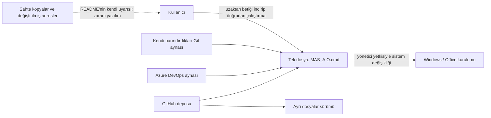
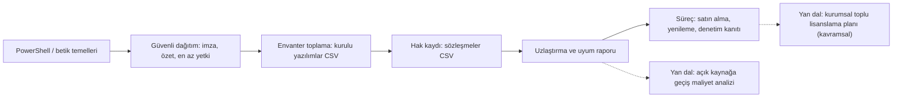

# massgravel/Microsoft-Activation-Scripts — lisans atlatma aracı üzerine hukuk ve etik vaka çalışması

> **Dal:** [D03 Sistem, ağ ve güvenlik](../README.md) · **Tür:** kod tabanı (etik sınırlı vaka çalışması)
> **Dil:** Batchfile (+ PowerShell) · **Lisans:** GPL-3.0 · **Yıldız:** 198.229 (9 Kasım 2026) · **İncelenen commit:** `6401d2f` (2026-07-04)

> **Bu dosya neden diğerlerinden farklı?** Bu depo, Windows ve Office'i lisans satın almadan etkinleştirmek için
> yazılmış betiklerdir; yani bir yazılım üreticisinin lisans ve etkinleştirme denetimini **atlatır**. Atlas burada
> yalnız şunları anlatır: ne olduğu, neden popüler olduğu, hukuki durumu ve aynı merakı hangi **meşru** konulara
> yönlendirebileceğin. Sıfırdan yapım rehberi, betiklerin iç işleyişi ya da yöntemlerin nasıl çalıştığına dair
> uygulanabilir bir açıklama **bilerek yoktur**. Betiklerin içeriği bu dosya için incelenmedi; yalnız dosya listesi,
> README ve lisans okundu. Bu dosya hukuki tavsiye değildir.

## 1. Bir bakışta

Microsoft Activation Scripts (MAS), Windows ve Office'i etkinleştirmek için kullanılan, menü güdümlü Windows toplu iş
(`.cmd`) betiklerinden oluşan bir pakettir. Depo açıklaması dört yöntem adı sayar (HWID, Ohook, TSforge, Online KMS);
bu dosya bunların nasıl çalıştığını anlatmaz. README'ye göre güncel sürüm 3.12'dir (04 Temmuz 2026). Popülerliğinin
nedenleri: ücretsiz olması, ikili "crack" dosyaları yerine okunabilir betik olarak dağıtılması (zararlı yazılım
korkusunu azaltan bir güven sinyali), tek komutla başlatılabilmesi, sorun giderme araçları ve büyük bir topluluk
(Discord, Reddit). Dikkat çekici bir paradoks da var: araç, Microsoft'a ait GitHub'da yıllardır duruyor. Ders açık:
**bir platformda erişilebilir olmak, kullanımın yasal olduğu anlamına gelmez.**

## 2. Nasıl yapılmış: mimari

Bu bölüm yalnız paketleme ve dağıtım düzeyindedir; etkinleştirme mantığı anlatılmaz.

### Klasör haritası

İncelenen commit'te 15 dosya izleniyor:

```text
README.md                                   tanıtım, dağıtım kanalları, "sahte kopyalara dikkat" uyarısı
LICENSE                                     GPL-3.0 (betiklerin kendi kodu için)
MAS/All-In-One-Version-KL/MAS_AIO.cmd       tek dosyalık sürüm (~762 KB)
MAS/Separate-Files-Version/Activators/      dört ayrı etkinleştirme betiği + _ReadMe.txt (içerik incelenmedi)
MAS/Separate-Files-Version/*.cmd            sürüm değiştirme, durum görüntüleme, OEM klasörü, sorun giderme betikleri
MAS/Separate-Files-Version/_ReadMe.html     kısa yönlendirme
```

### Ana bileşenler ve veri akışı



Güvenlik açısından öğretici olan kısım dağıtım biçimidir. README, uzaktaki bir betiği indirip bir yorumlayıcıya
doğrudan veren tek satırlık bir PowerShell komutu önerir (komut ve adres burada bilerek verilmez) ve hemen ardından
adresi değiştirilmiş sahte kopyaların zararlı yazılım yaydığı konusunda uyarır. Bu "indir ve hemen çalıştır" kalıbı,
bütünlük denetimi olmadan internetten gelen kodu kullanıcının — çoğu zaman yöneticinin — yetkisiyle çalıştırır;
saldırganların da en sevdiği dağıtım kanalıdır. README ayrıca bazı internet servis sağlayıcılarının alan adlarını
engellediğini belirtir; bu, aracın birçok yargı alanında hukuki sorun olarak görüldüğünün dolaylı bir işaretidir.

### Önce okunacak dosyalar

1. `README.md` — dağıtım kanalları ve uyarılar (yalnız güvenlik ve hukuk analizi için).
2. `LICENSE` — GPL-3.0'ın neyi verdiğini ve neyi **veremeyeceğini** anlamak için (bkz. 3. bölüm).

Betiklerin kendisini bir öğrenme kaynağı olarak okumanı önermiyoruz: Windows betik yazmayı öğrenmenin yasal ve daha
iyi yolları var (aşağıda).

### Teknoloji yığını, derleme, test, CI, sürüm

Windows toplu iş dili (`.cmd`) ve gömülü PowerShell; derleme ya da test altyapısı depoda görünmüyor (iş akışı dosyası
yok). İki dağıtım biçimi var: tek dosya (AIO) ve ayrı dosyalar; AIO'nun nasıl üretildiği depoda görünmüyor
(doğrulanmadı). Sürüm numarası ve tarihi README'nin sonunda elle tutuluyor. Dağıtım birden çok aynaya yayılmış
(GitHub, Azure DevOps, kendi Git sunucuları).

### Tasarım kararları ve ödünleşimler

Bu kararlar ürün tasarımı ve risk açısından incelenmeye değer:

1. **Tek dosya + menü arayüzü.** Teknik olmayan kullanıcıya erişimi kolaylaştırır; aynı kolaylık kurumsal BT için
   denetlenmesi zor bir "gölge BT" riskidir.
2. **Kaynak kod olarak dağıtım.** Okunabilirlik bir güven sinyalidir, ama betiği okuyan kullanıcı azdır ve uzaktan
   çalıştırma kalıbı bu avantajı ortadan kaldırır.
3. **Çoklu ayna.** Kaldırma ve engellemeye karşı dayanıklılık; aynı zamanda sahte kopyaların ayırt edilmesini
   zorlaştırır.
4. **Yönetici yetkisiyle sistem değişikliği.** Herhangi bir hata ya da kötü niyetli kopya, sistemin tamamını etkiler.
5. **Açık kaynak lisansı (GPL-3.0).** Betiklerin kendi kodu üzerinde hak verir; Microsoft yazılımını kullanma hakkı
   vermez — bu ayrım, vakanın en önemli dersidir.

## 3. Öğrenmen gerekenler

### Hukuki durum (genel çerçeve, hukuki tavsiye değildir)

- **Türkiye — 5846 sayılı Fikir ve Sanat Eserleri Kanunu (FSEK):** bilgisayar programları "ilim ve edebiyat eseri"
  sayılır (md. 2); çoğaltma ve kullanma yetkisi hak sahibindedir. Lisanslı kullanıcıya tanınan istisnalar sınırlıdır
  (md. 38: amaca uygun kullanım, yedek kopya gibi). İzinsiz çoğaltma ve kullanım hukuki tazminat (md. 68) ve ceza (md. 71) sorumluluğu doğurabilir; md. 72 ise "koruyucu programları etkisiz kılan programları" üretmeyi, satışa sunmayı,
  satmayı ya da kişisel kullanım dışında bulundurmayı ayrıca cezalandırır (doğrulanmadı: madde numaralarını ve güncel
  metni <https://www.mevzuat.gov.tr/> üzerinden 5846 sayılı Kanun'dan okuyun).
- **Sözleşme:** Windows ve Office lisans koşulları etkinleştirmeyi atlatmayı yasaklar; ihlal ayrıca sözleşme ihlalidir.
- **Uluslararası:** ABD'de DMCA §1201 (teknik koruma önlemlerini aşma), AB'de 2009/24/AT Yazılım Yönergesi md. 7 ve
  2001/29/AT Bilgi Toplumu Yönergesi md. 6 benzer koruma sağlar (doğrulanmadı: ayrıntılar için resmi metinler).
- **Kurumlar için:** iş yerinde lisanssız yazılım, yazılım denetimlerinde geriye dönük lisans bedeli, tazminat ve
  itibar kaybı demektir; ayrıca güvenlik olayıdır (kaynağı doğrulanmamış betik, yönetici yetkisi).

### Aynı merakı yönlendirebileceğin meşru konular

- [G1 Terminal, kabuk ve Linux kullanımı](../../../govde/README.md#g1) — **Windows betik yazma:** PowerShell (nesne
  boru hatları, modüller, `PSScriptAnalyzer` ile statik denetim), betik imzalama ve yürütme ilkeleri (execution
  policy), uzaktan betiği çalıştırmadan önce denetleme alışkanlığı. Kaynak: <https://learn.microsoft.com/powershell/>.
- [G9 Açık kaynak: lisans, katkı süreci](../../../govde/README.md#g9) — lisansların neyi kapsadığı: GPL bir aracın
  kendi koduna dair haklardır, başka bir yazılımın lisansını geçersiz kılamaz.
- **Kurumlar için toplu lisanslama (kavramsal):** toplu lisans sözleşmesi olan bir kurum, Microsoft'un belgelediği
  yöntemlerle etkinleştirmeyi merkezi yönetir — kendi ağında bir Anahtar Yönetim Hizmeti (KMS) ana makinesi, Active
  Directory tabanlı etkinleştirme ya da Çoklu Etkinleştirme Anahtarı (MAK). Hepsinin ortak noktası, **satın alınmış
  bir hakka** dayanmasıdır. Kaynak: Microsoft Learn'deki "Volume Activation" belgeleri.
- **Yazılım varlık yönetimi (SAM, ISO/IEC 19770-1):** envanter, hak kaydı, uzlaştırma, yenileme ve denetime hazırlık.
  Bu dosyanın mini uygulaması tam olarak bu.
- **Ücretsiz ve yasal seçenekler:** açık kaynak işletim sistemleri ve ofis paketleri (bkz. [linux](../linux/README.md)),
  eğitim kurumlarının öğrenci lisans programları, üreticilerin değerlendirme sürümleri (güncel koşulları resmi
  sitelerden doğrulayın).
- [the-book-of-secret-knowledge](../the-book-of-secret-knowledge/README.md) ve [rea](../rea/README.md) — çift kullanımlı
  araçlarda sorumlu projelerin kapsam sınırını nasıl çizdiğine dair iki karşı örnek (REA'nın `DISCLAIMER.md`'si lisans
  atlatmayı açıkça kapsam dışı sayar).

## 4. Sıfırdan yol (dallanma)

Bu depo için sıfırdan yol **yazılmaz**. Onun yerine, aynı alanın meşru tarafı olan lisans uyumu için bir yol:



| Aşama | Ne inşa edersin                                     | Öğrendiğin kavram                        | Bitti ölçütü                                        | Süre (saat) |
| ----- | --------------------------------------------------- | ---------------------------------------- | --------------------------------------------------- | ----------- |
| 1     | Kurulu yazılımları CSV'ye döken bir envanter betiği | kayıt defteri/paket yöneticisi sorgulama | kendi makinenin listesi CSV olarak çıkıyor          | 5           |
| 2     | Hak kaydı tablosu                                   | lisans ölçütleri: cihaz, kullanıcı, site | her sözleşme ölçüt, adet ve bitiş tarihiyle kayıtlı | 5           |
| 3     | `lisans_uyum.py` (hazır)                            | normalleme, uzlaştırma, uyum durumları   | örnek veride 5 farklı durum doğru sınıflanıyor      | 5           |
| 4     | Aylık rapor + eşik                                  | süreç otomasyonu, kanıt arşivi           | eksik lisans çıkınca görev kırmızı yanıyor          | 5           |

**Toplam:** dört aşama 20 saat (yan dallar süresiz, isteğe bağlı). Saatler dalın ortak kuralıyla hesaplandı
(1 gün ≈ 5 saat; bkz. [dal sayfası](../README.md#süre-tahmini)).

**Mini uygulama:** [`sifirdan/`](sifirdan/README.md) — `lisans_uyum.py` ve 11 test. Gerçek depoyla aşama eşlemesi
yoktur, bilerek: MAS eksik lisansı gizler, SAM görünür kılar. Eşleme tablosu bu ayrımı `sifirdan/README.md`'de gösterir.

**Gerçek ölçeğe giden yol.** Otomatik envanter ajanları (osquery, uç nokta yönetim araçlarının dışa aktarımı), ürün
kataloğu ve ad eşleme veritabanı, karmaşık lisans ölçütleri (sunucu çekirdeği, erişim lisansları, sürüm hakları),
sözleşme yönetimi ve yenileme takvimi, denetim için değiştirilemez kanıt arşivi, maliyet optimizasyonu (atıl hakların
yeniden dağıtımı).

## 5. Gerçek depoda okuma rotası

Bu depo için okuma rotası kodu değil, **vakayı** inceler:

1. **`README.md`** — Dağıtım kanalları neler, kullanıcıya hangi güvenlik uyarıları veriliyor? "Sahte kopya" uyarısı
   neden önemli?
2. **`LICENSE`** — GPL-3.0'ın 0-2. bölümleri neyi verir? Bu haklar Microsoft yazılımının lisansını etkiler mi?
3. **Dosya listesi (`git ls-tree`)** — iki dağıtım biçimi; tek dosyalık sürümün boyutu bir denetçi için ne anlama gelir?
4. **REA `DISCLAIMER.md` ve the-book-of-secret-knowledge'ın açılış cümlesi** — çift kullanımlı projelerde sorumluluk
   nasıl ifade ediliyor? Bu depoda benzer bir kapsam sınırı var mı?
5. **FSEK md. 38, 68, 71, 72 (mevzuat.gov.tr)** — kişisel kullanım, ticari kullanım ve araç dağıtımı arasındaki farkı
   kendi cümlelerinle yaz.
6. **Microsoft Learn "Volume Activation"** — kurumların meşru toplu etkinleştirmesi hangi sözleşmeye dayanıyor?

## 6. Alıştırmalar ve öz değerlendirme

1. (Kolay) `lisans_uyum.py`'ye "kurulum tarihi, hakkın bitişinden sonra" uyarısı ekle.
2. (Kolay) Kendi bilgisayarındaki kurulu yazılımları CSV'ye döken bir betik yaz (Windows'ta PowerShell ile kayıt
   defterindeki kaldırma anahtarları ya da `winget list`; Linux'ta `dpkg-query -W`) ve mini ile çalıştır.
3. (Orta) Yeni bir lisans ölçütü ekle: çekirdek başına sunucu lisansı (asgari çekirdek sayısı parametresiyle).
4. (Orta) "Uzaktan betiği çalıştırmadan önce" kontrol listesi yaz: kaynak doğrulama, özet (SHA-256) karşılaştırma,
   imza, statik analiz (`PSScriptAnalyzer`, ShellCheck), en az yetki, yalıtılmış ortamda deneme.
5. (Zor) 50 kişilik bir ofis için yasal lisanslama planı hazırla: abonelik, kalıcı lisans ve açık kaynak senaryolarının
   üç yıllık maliyet tablosu ve risk karşılaştırması.

<details><summary>Soru 1: GPL-3.0 lisanslı bir araç, başka bir yazılımın lisans koşullarını aşmak için yasal olarak kullanılabilir mi?</summary>

Hayır. GPL yalnız aracın kendi kodunu kopyalama, değiştirme ve dağıtma koşullarını belirler. Windows ve Office'in
kullanımı onların lisans sözleşmesine ve telif hukukuna tabidir; bir aracın açık kaynak olması bu hakları devretmez.
Türk hukukunda koruma önlemlerini etkisiz kılan araçlar ayrıca düzenlenir (FSEK md. 72, doğrulanmadı).

</details>

<details><summary>Soru 2: "Uzaktan betiği indir ve hemen çalıştır" kalıbı neden risklidir?</summary>

Bütünlük ve kaynak doğrulaması yoktur; alan adı ele geçirilir, benzer adla taklit edilir ya da arada değiştirilirse
kullanıcı farkında olmadan saldırganın kodunu kendi (çoğu zaman yönetici) yetkisiyle çalıştırır. MAS'ın README'si de
sahte kopyaların zararlı yazılım yaydığını söyler.

</details>

<details><summary>Soru 3: Kurumlar toplu etkinleştirmeyi meşru olarak nasıl yapar (kavramsal)?</summary>

Bir toplu lisans sözleşmesiyle hak satın alırlar; etkinleştirmeyi kendi altyapılarında (KMS ana makinesi, Active
Directory tabanlı etkinleştirme) ya da sınırlı sayıda MAK anahtarıyla yönetirler. Yazılım varlık yönetimi, kurulu
kopya sayısının satın alınan hakla örtüştüğünü düzenli olarak kanıtlar.

</details>

<details><summary>Soru 4: Lisanssız yazılım bir şirket için hangi riskleri doğurur?</summary>

Yazılım denetiminde geriye dönük lisans bedeli ve tazminat, ceza hukuku riski, kaynağı belirsiz betiklerle gelen
zararlı yazılım, güncelleme ve destek kaybı, müşteri ve iş ortağı nezdinde itibar kaybı.

</details>

## 7. İş fikri tohumları

- **Türkçe yazılım varlık yönetimi (SAM) hizmeti** — envanter içe aktarma, sözleşme kaydı, aylık uyum raporu.
  **Kime:** 20-200 çalışanlı KOBİ'lerin BT sorumluları ve onlara hizmet veren mali müşavirlik büroları.
- **Lisans denetimine hazırlık paketi** — denetim bildirimi alan şirket için envanter temizliği, eksik/atıl hak
  analizi ve kanıt dosyası. **Kime:** yazılım üreticisinden denetim yazısı almış orta ölçekli şirketler.
- **Açık kaynağa geçiş maliyet analizi** — ofis paketi ve masaüstü işletim sistemi için üç yıllık maliyet ve geçiş
  planı. **Kime:** belediyeler, okullar ve sivil toplum kuruluşları.

Ayrıntılı katalog: [is-fikirleri](../../../is-fikirleri/README.md).

## 8. Kaynaklar

- Depo (incelenen commit; yalnız vaka analizi için):
  [README.md](https://github.com/massgravel/Microsoft-Activation-Scripts/blob/6401d2f36975dc07bcb6d22ea823a8498a75ec01/README.md) ·
  [LICENSE](https://github.com/massgravel/Microsoft-Activation-Scripts/blob/6401d2f36975dc07bcb6d22ea823a8498a75ec01/LICENSE)
- 5846 sayılı Fikir ve Sanat Eserleri Kanunu: <https://www.mevzuat.gov.tr/>
- GNU GPL-3.0 metni ve SSS: <https://www.gnu.org/licenses/gpl-3.0.html>, <https://www.gnu.org/licenses/gpl-faq.html>
- AB 2009/24/AT Yazılım Yönergesi: <https://eur-lex.europa.eu/eli/dir/2009/24/oj>
- ISO/IEC 19770-1 (yazılım varlık yönetimi süreçleri): <https://www.iso.org/standard/68531.html> (doğrulanmadı)
- PowerShell belgeleri: <https://learn.microsoft.com/powershell/> · Microsoft Learn "Volume Activation" belgeleri
