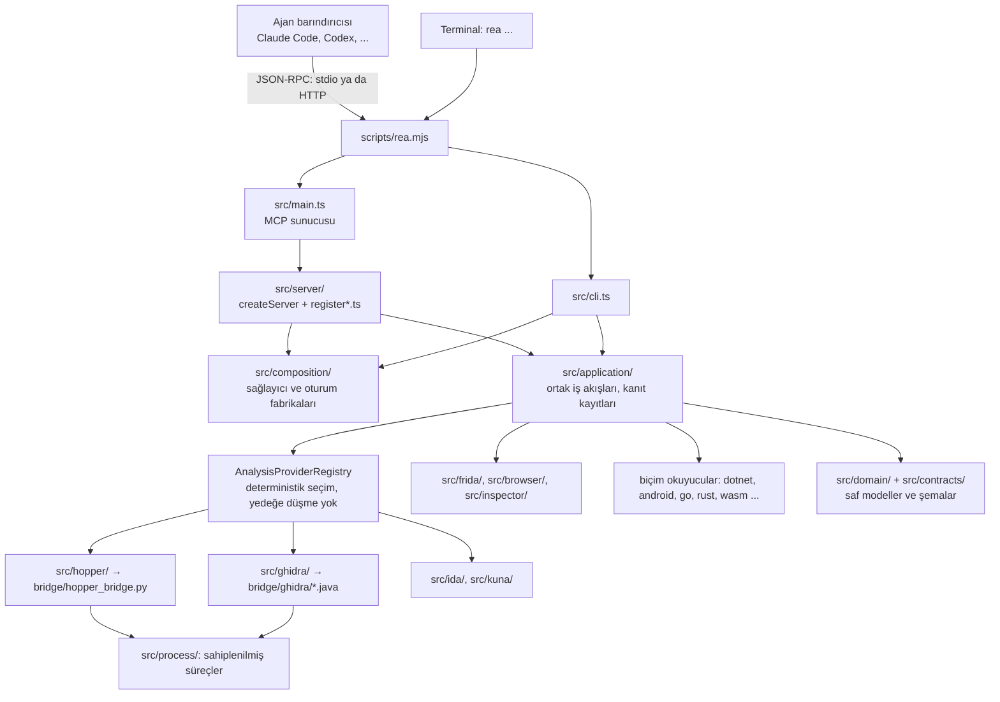
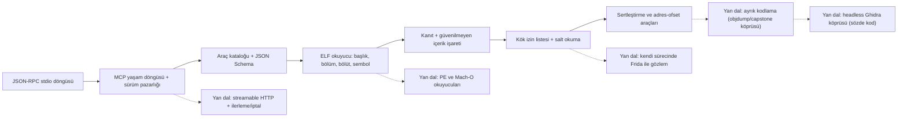

# morluto/rea — ajanlarla tersine mühendislik için tek MCP sunucusu ve CLI

> **Dal:** [D03 Sistem, ağ ve güvenlik](../README.md) · **Tür:** kod tabanı
> **Dil:** TypeScript (+ Python, Java, Swift, C++ köprüleri) · **Lisans:** MIT · **Yıldız:** 445.426 (9 Kasım 2026) · **İncelenen commit:** `dda2d40` (2026-11-09)

> **Etik çerçeve.** Bu dosya REA'nın mimarisini ve **meşru** tersine mühendisliği öğretir: kendi ikililerini anlamak,
> birlikte çalışabilirlik, yazılım koruma (preservation), zararlı yazılım ve güvenlik analizi, CTF. DRM, lisans
> denetimi, hile önleme ya da erişim denetimini aşmaya dair yönlendirme içermez — REA'nın kendi `DISCLAIMER.md` ve
> `CONTRIBUTING.md` kapsam sınırı da bunları açıkça dışarıda bırakır. Hukuki tavsiye değildir.

## 1. Bir bakışta

REA ("Reverse Engineer Anything"), bir kodlama ajanını (Claude Code, Codex, Cursor, Gemini CLI, Grok Build, DeepSeek
Harness ve diğerleri) **MCP** üzerinden tersine mühendislik araçlarına bağlayan bir sunucu ve aynı iş akışlarını sunan
bir komut satırı aracıdır. Yerel ikililer için Hopper, Ghidra, IDA ya da Kuna motorlarını köprülerle sürer; JavaScript/
Electron paketlerini, .NET derlemelerini, Android APK'larını, web sitelerini (Chrome), ağ kayıtlarını, donanım
yazılımlarını ve onlarca dosya biçimini doğrudan okur. Her sonuç kanıtıyla (dosya özeti, adres, ofset) ve
sınırlarıyla döner. npm paketi `rea-agents` 6.8.0; depo 14 Nisan 2026'da açılmış ve yedi ayda 445 bin yıldıza
ulaşmış (README "400.000 yıldız" kutlaması yapıyor) — bu atlasın eğitim verisinden yeni bir proje, her şey klondan
doğrulandı. Popülerliğinin kaynağı vaadi: "beğendiğin bir özelliğin nasıl çalıştığını ikili düzeyine kadar anla".

## 2. Nasıl yapılmış: mimari

### Klasör haritası

İncelenen commit'te 7.685 dosya; `src/` altında 2.610 TypeScript kaynak dosyası ve yanlarında 1.253 test dosyası.

```text
scripts/rea.mjs              tek giriş: "mcp" → MCP sunucusu (stdio; --http ile streamable HTTP), diğerleri → CLI
src/main.ts + src/main/      MCP sunucu bağdaştırıcısı: yapılandırma, oturum, süreç ömrü, sinyal ile kapanış
src/cli.ts + src/cli/        tek atımlık CLI: kurulum (rea setup), teşhis, analiz komutları
src/server/                  MCP isteklerini uygulamaya çevirir: createServer.ts + 74 register*.ts modülü, http/
src/composition/             bileşim kökü: sağlayıcı ve oturum fabrikaları (binary.ts: derin analiz adayları)
src/application/             CLI ve MCP'nin ORTAK iş akışları: soruşturmalar, kanıt kayıtları, oturum yönlendirme
src/contracts/               çağıranın gördüğü şemalar (Zod): toolContracts.ts = tüm araçların sıralı envanteri
src/domain/                  yan etkisiz saf modüller (1.320 dosya): kanıt modeli, biçim okuyucular (elf*.ts ...)
src/config/                  Zod ile doğrulanan ortam değişkenleri
src/process/ src/filesystem/ sahiplenilmiş süreç grupları, süre sınırları, güvenli dosya tanıtıcıları, temizlik
src/hopper/ src/ghidra/      derin analiz sağlayıcıları (Hopper: Unix soket protokolü; Ghidra: headless betik)
src/ida/ src/kuna/           IDA (üst akış MCP sözleşmesi) ve Kuna sağlayıcıları
src/frida/                   Frida ile çalışma zamanı enstrümantasyonu (isteğe bağlı bağımlılık)
src/browser/ src/inspector/  Chrome DevTools Protocol / Playwright ile web ve V8 gözlemi
src/dotnet/ src/android/ ... yönetilen kod, APK (JADX), ADB, firmware, pcap, wasm, evm, go, rust, gpu okuyucuları
bridge/                      dış araçların İÇİNDE çalışan kod: hopper_bridge.py, ghidra/*.java, android/ReaJadxBridge.java
native/windows/              Node-API C++ eklentisi: Windows iş nesneleri (Job Object), NTFS erişim denetimi
server.json                  MCP kayıt defteri bildirimi: npm paketi rea-agents, stdio taşıması, "mcp" argümanı
.claude-plugin/ .codex-plugin/  Claude Code ve Codex eklenti bildirimleri (MCP başlatıcı + beceriler)
.agents/skills/              ajan becerileri: reverse-engineer-anything/SKILL.md ve geliştirici becerileri
docs/                        391 dosya: başvuru (mcp-contracts.md), rehberler, mimari diyagramı, 22 dilde README
tests/                       vitest: boundary/ (1.449), acceptance/, conformance/, fixtures/, evaluation/model-evals/
website/                     rea.tools sitesi ve vaka çalışmaları
```

### Ana bileşenler ve veri akışı

`docs/architecture/architecture.mermaid` katmanları tanımlar; `AGENTS.md` kuralı tek cümleyle verir: "bağımlılıklar
içe doğru akar: alan semantiği ve sözleşmeler, sağlayıcı bağdaştırıcıları, ortak uygulama iş akışları, sonra CLI/MCP
bağdaştırıcıları".



**Bir soruşturmanın akışı.** Ajan önce oturumu açar (`binary_session` / `open_binary`). Bileşim katmanı hedefe uygun
derin analiz sağlayıcısını **deterministik** olarak seçer; seçilemezse yedeğe düşmez, nedeniyle hata döner. Ajan
ardından sağlayıcının resmi işlemlerini vekâleten çağırır: `list_procedures`, `procedure_pseudo_code`,
`procedure_callers`, `xrefs`, `list_strings` ... (`src/contracts/officialToolContracts.ts`; adlar Hopper API'sinin
diline benzer). Hopper için TypeScript tarafı (`src/hopper/protocol.ts`) Hopper'ın içinde çalışan Python köprüsüyle
(`bridge/hopper_bridge.py`) bir Unix soketi üzerinden kimlikli JSON istek/yanıt ve ilerleme olaylarıyla konuşur; her
istek bir belirteç taşır ve köprü onu `hmac.compare_digest` ile sabit zamanda karşılaştırır. Her sonuç bir **kanıt** kaydı taşır (`src/domain/evidence.ts`: özne = ad + sha256 + yerel yol; konum = adres,
adres aralığı, dosya ofseti ...). Ajan bu kanıtlarla bir açıklama ya da yeniden yazım (reconstruction) üretir; REA'nın
"yükümlülük defteri" ve "kapsam" araçları (`build_reconstruction_obligation_ledger`, `evaluate_reconstruction_coverage`)
yeniden yazımın hangi iddiasının kanıtlandığını izler.

**Güvenilmeyen içerik.** Hedeften gelen dizgiler, semboller, sözde kod, sayfa metni ajana talimat gibi görünebilir
("şunu çalıştır", "şunu indir"). `docs/reference/mcp-contracts.md` › "Untrusted target content": bu tür içerik döndüren
araçların sonuçları `_meta` içinde `{"provenance": {"untrusted_content": true, "source": "analysis_target"}}` taşır
(hata sonuçları dâhil) ve sunucu talimatları ajana bunları veri sayıp istem enjeksiyonu girişimi olarak bildirmesini söyler.

### Önce okunacak dosyalar

1. `README.md` ve `DISCLAIMER.md` — neyi analiz eder, neyi kapsam dışı sayar.
2. `docs/architecture/architecture.mermaid` — katmanlar ve bağımlılık yönleri.
3. `AGENTS.md` — depoya katkı veren ajanlar/insanlar için kurallar (konu olarak okuyun): kanıt, sahiplik, "fail-closed".
4. `scripts/rea.mjs` → `src/main.ts` — tek giriş noktası, stdio/HTTP ayrımı.
5. `src/server/createServer.ts` — araç ailelerinin kaydı, yanıt bütçesi, şema profilleri.
6. `src/contracts/toolContracts.ts` → `src/contracts/fridaToolContracts.ts` — bir aracın sözleşmesi neye benzer.
7. `src/domain/evidence.ts` — kanıt modeli.
8. `src/hopper/protocol.ts` + `bridge/hopper_bridge.py` — bir köprü protokolünün iki ucu.
9. `docs/reference/mcp-contracts.md` — sonuç biçimi, güvenilmeyen içerik, şema duyurusu, taşıma katmanları.
10. `server.json`, `.claude-plugin/plugin.json`, `.codex-plugin/mcp.json` — dağıtım ve barındırıcı entegrasyonu.

### Teknoloji yığını, derleme, test, CI, sürüm

- **Çalışma zamanı:** Node.js `^22.23.4 || ^24.22.1 || >=26.12.1`, ESM TypeScript. Bağımlılıklar: resmi MCP SDK
  (`@modelcontextprotocol/server` ve `client` 2.3.1), Zod 4 + Ajv (şemalar), `playwright-core` (tarayıcı),
  `@lydell/node-pty` (süreç yakalama), `isomorphic-git`, `pino` (günlük); `frida` 17.23.2 isteğe bağlı bağımlılık.
- **Derleme ve kalite:** Turborepo görev grafiği (`turbo.json`), oxlint + oxfmt, knip (ölü kod), jscpd (kopya kod),
  Stryker (mutasyon testi), fast-check (özellik tabanlı test), husky + lint-staged. `package.json`'da 237 npm betiği var;
  `npm run check` tip denetimi, lint, biçim, knip, meta veri ve mimari doğrulamayı birlikte koşar.
- **Test:** Vitest projeleri: `boundary`, `mcp-boundary`, `cli-boundary`, `process-boundary`, `acceptance`;
  `tests/fixtures/` sahte başlatıcı, köprü ve CDP dikişleri sağlar; `tests/evaluation/model-evals/` ajan sürüm
  değerlendirmesi (oturum dökümü puanlama) içerir; Python köprülerinin kendi testleri var (`npm run test:python`).
- **CI:** 35 GitHub Actions iş akışı; bunların 19'u `real-*` (gerçek Hopper, Ghidra-Windows, tarayıcı, Termux,
  pcap ... ile uçtan uca), ayrıca CodeQL, mutasyon testi ve sayfa yayınları. Değişiklik sınıflandırması yalnız
  etkilenen hatları koşar.
- **Sürüm:** release-please (`CHANGELOG.md`, sürüm 6.8.0 — 2026-10-25), npm yayını ve MCP kayıt defterine yayın
  (`.github/actions/publish-mcp/`). Belgeler 22 dilde README çevirisi içerir; Türkçesi `docs/readme/README_tr.md`.

### Tasarım kararları ve ödünleşimler

1. **Tek uygulama katmanı, iki bağdaştırıcı.** CLI ve MCP aynı iş akışlarını çağırır; bir hata düzeltmesi iki yüzeye
   birden yansır. Bedeli: her iş akışının hem insan hem model için anlaşılır sonuç üretmesi gerekir.
2. **Kanıt önce gelir.** Sonuçlar gözlem, türetme, çıkarım ve bilinmeyeni ayırır (`AGENTS.md`). Model halüsinasyonuna
   karşı en güçlü savunma, her iddiayı bir dosya özeti ve adrese bağlamaktır.
3. **Hedef içeriği güvenilmezdir.** Tersine mühendislik, saldırganın yazdığı metni modele okutmak demektir; işaret +
   talimat + barındırıcı kancaları (ör. işaretli içerik okunduktan sonra süreç başlatan araçlar için onay) katmanlı
   bir istem enjeksiyonu savunmasıdır.
4. **Kendi motorunu getir.** Hopper, Ghidra, IDA, Kuna kullanıcının kurulumudur; REA lisans, anahtar ya da etkinleştirme
   sağlamaz ve "kırık kopyaları" açıkça reddeder. Köprüler motorun içinde çalışır (Python, Java), REA protokolle konuşur.
5. **Katalog büyüklüğü ile bağlam bütçesi.** Varsayılan katalog 241 araç ve ~4,26 MB şema (`docs/verification/`
   2026-11-06 ölçümü); çözüm olarak kompakt girdi şeması profili, çıktı şeması profilleri, sıcak/soğuk aşamalı keşif
   ve araç ailesi kapsamı. Ders: MCP'de her aracın bir bağlam maliyeti vardır.
6. **Kapsamda "fail-closed".** `CONTRIBUTING.md`: yetki, yan etki ya da doğrulama soruları çözülmemiş bir yetenek
   birleştirilmez; çalışma zamanı enstrümantasyonu ayrı inceleme ister; koruma aşma iş akışları hiç kabul edilmez.
7. **Süreç sahipliği birinci sınıf.** `src/process/` ve Windows Job Object eklentisi: dış motorlar her durumda (iptal,
   zaman aşımı, yarım el sıkışma) temizlenir; "PID ve yol tek başına sahiplik kanıtı değildir".

## 3. Öğrenmen gerekenler

- [G11 LLM API temelleri](../../../govde/README.md#g11) — araç çağırma, yapılandırılmış çıktı, bağlam bütçesi; MCP bunun
  üzerine kurulu bir protokoldür. Kaynak: MCP belirtimi (<https://modelcontextprotocol.io/specification>).
- [G4 JavaScript / TypeScript ve Node.js](../../../govde/README.md#g4) — REA'nın dili; ESM, alt süreçler, akışlar.
- [G10 C ve bellek modeli](../../../govde/README.md#g10) — ELF, bağlama, çağrı kuralları, assembly okuma. Kaynak:
  [linux dosyası](../linux/README.md) (`fs/binfmt_elf.c`) ve OSSU "Core systems".
- [G6 Ağ ve web temelleri](../../../govde/README.md#g6) — JSON-RPC, HTTP, WebSocket (CDP), pcap.
- [G7 Test, CI ve kod kalitesi](../../../govde/README.md#g7) — mutasyon testi, özellik tabanlı test, sınır testleri.
- [G9 Açık kaynak: lisans](../../../govde/README.md#g9) — MIT kod + üçüncü taraf lisansları (`THIRD_PARTY_NOTICES.md`).
- [D07 Kodlama ajanları](../../07-kodlama-ajanlari/README.md) — REA'yı çağıran taraf; özellikle
  [deepseek-harness](../../07-kodlama-ajanlari/deepseek-harness/README.md) (REA kurulumu `dsh` istemcisini tanır) ve
  [opencode](../../07-kodlama-ajanlari/opencode/README.md).
- [D08 Ajan becerileri](../../08-ajan-becerileri/README.md) — `SKILL.md` biçimi; REA'nın `reverse-engineer-anything`
  becerisi bunun bir örneği ([anthropic-skills](../../08-ajan-becerileri/anthropic-skills/README.md)).
- **Hukuk ve etik** — tersine mühendislik yargı alanına ve yazılımın lisansına göre kısıtlanabilir (`DISCLAIMER.md`).
  Türkiye'de 5846 sayılı FSEK md. 38'deki bilgisayar programlarına özgü istisnalar (yedek kopya, birlikte
  çalışabilirlik için gerekli bilgiyi elde etme) ve AB 2009/24/AT Yönergesi md. 6 (birlikte çalışabilirlik için kaynak
  koda dönüştürme) temel çerçevedir (doğrulanmadı: güncel metni mevzuat.gov.tr ve EUR-Lex'ten okuyun).

## 4. Sıfırdan yol (dallanma)



| Aşama | Ne inşa edersin                               | Öğrendiğin kavram                                     | Bitti ölçütü                                       | Süre (saat) |
| ----- | --------------------------------------------- | ----------------------------------------------------- | -------------------------------------------------- | ----------- |
| 1     | stdio üzerinde JSON-RPC (`sunucu.py`)         | istek/yanıt/bildirim, hata kodları                    | bozuk JSON → -32700, bildirime yanıt yok           | 5           |
| 2     | `initialize`, `tools/list`, `tools/call`      | MCP yaşam döngüsü, yetenekler                         | gerçek bir MCP istemcisi bağlanıp aracı listeliyor | 5           |
| 3     | ELF okuyucu (`elf.py`)                        | ikili biçim, tablolar, bayt sırası                    | `readelf` ile çapraz denetim yeşil                 | 15          |
| 4     | kanıt + işaret + kök sınırı (`araclar.py`)    | kanıta dayalı sonuç, istem enjeksiyonu, yol güvenliği | sembolik bağ kaçışı reddediliyor                   | 5-10        |
| 5     | sertleştirme, adres-ofset, fonksiyon baytları | PIE/NX/RELRO, yükleme, sanal adres                    | kendi derlediğin üç değişkeni doğru sınıflıyor     | 10          |
| +     | ayrık kodlama / Ghidra köprüsü                | dış motoru süreç olarak sahiplenmek                   | `topla` fonksiyonunun assembly'sini döndürüyor     | 10-20       |

**Toplam:** ana aşamalar (1-5) 40-45 saat; isteğe bağlı yan dal 10-20 saat daha. Saatler dalın ortak kuralıyla
hesaplandı (1 gün ≈ 5 saat, 1 hafta ≈ 10 saat; bkz. [dal sayfası](../README.md#süre-tahmini)).

**Mini uygulama:** [`sifirdan/`](sifirdan/README.md) — `reamini` paketi: ELF ayrıştırıcı, 10 araçlık katalog, stdio
MCP sunucusu ve küçük istemci; 23 test kendi C programını derleyip sorgular. Aşama 1-2 `src/main.ts` +
`src/server/createServer.ts`'e, aşama 3 `src/domain/elf*.ts`'e, aşama 4 `src/domain/evidence.ts` ve
"Untrusted target content" sözleşmesine, aşama 5 `inspect_binary_hardening` ve `address_to_file_offset` araçlarına
karşılık gelir; tam tablo `sifirdan/README.md`'de.

**Gerçek ölçeğe giden yol.** (1) Biçim çeşitliliği: PE, Mach-O, APK, .NET, wasm; (2) derin analiz için motor köprüleri
ve onların yaşam döngüsü (başlatma, el sıkışma, zaman aşımı, temizlik); (3) oturum ve anlık görüntü önbelleği;
(4) kanıt defteri, bilinmeyenler ve yeniden yazım yükümlülükleri; (5) katalog ölçeği: araç aileleri, kompakt şemalar,
yanıt bütçesi; (6) taşıma: streamable HTTP, ilerleme, iptal; (7) çok platform (Linux/macOS/Windows/Termux) ve
gerçek motorlarla CI; (8) barındırıcı kurulumu (`rea setup`: yedekli, onaylı yapılandırma yazımı); (9) kapsam yönetişimi.

## 5. Gerçek depoda okuma rotası

1. **`scripts/rea.mjs`** — `mcp`, `mcp --http` ve diğer komutlar nasıl ayrılıyor? Derlenmiş çalışma zamanı yoksa ne olur?
2. **`src/main.ts`** — `serveStdio` nereden geliyor, HTTP neden yalnız gerektiğinde içe aktarılıyor?
3. **`src/server/createServer.ts`** — araç aileleri hangi sırayla kaydediliyor; yanıt bütçesi ve şema profilleri
   nerede okunuyor?
4. **`src/contracts/toolContracts.ts`** — `TOOL_CONTRACTS` neden "kayıt ve doğrulama için tam sıralı envanter"?
   Bir aracın sözleşmesini (`fridaToolContracts.ts`) oku: girdi şeması nasıl kısıtlanmış (`strictObject`, `refine`)?
5. **`src/domain/evidence.ts`** — özne (`subject`) ve konum (`location`) türleri; reamini'nin `kanit` alanıyla karşılaştır.
6. **`docs/reference/mcp-contracts.md` › "Untrusted target content"** — hangi araçlar işaretsiz, neden?
7. **`src/hopper/protocol.ts` ve `bridge/hopper_bridge.py`** — istek kimliği, hata türleri, ilerleme olayları; köprü
   belirteci neden `==` yerine `hmac.compare_digest` ile (sabit zamanda) karşılaştırıyor?
8. **`src/frida/FridaInstrumentationManager.ts`** — uygulama katmanındaki "port" arayüzü
   (`src/application/frida/FridaInstrumentationPort.ts`) ile bağdaştırıcı nasıl ayrılmış?
9. **`CONTRIBUTING.md` › "Contribution scope" ve "Fail-closed integration"** — hangi yetenekler hiçbir koşulda
   kabul edilmiyor; "yalnız yerel çalışır" demek neden yeterli güvence değil?
10. **`docs/verification/recent-tools-progressive-catalog-2026-11-06.md`** — 241 araçlık katalog ölçümü ve aşamalı
    keşif: bağlam maliyeti nasıl düşürülmüş?

## 6. Alıştırmalar ve öz değerlendirme

1. (Kolay) `reamini`'ye `bolum_ozeti` aracı ekle: her bölümün Shannon entropisi (yüksek entropi = sıkıştırılmış ya da
   şifreli veri ipucu; REA'da `inspect_byte_entropy`).
2. (Kolay) `sembolleri_listele`'ye `bag` (LOCAL/GLOBAL/WEAK) süzgeci ekle; şemayı ve testini güncelle.
3. (Orta) `DT_NEEDED` kitaplıkları için "hangi sembol hangi kitaplıktan" eşlemesi (`.gnu.version_r`) çıkar.
4. (Orta) `objdump` köprüsü: kök izin listesi içindeki dosya için `objdump -d --start-address --stop-address` çalıştır;
   süre sınırı, çıktı boyutu sınırı ve güvenilmeyen içerik işaretiyle döndür (REA'nın `inspect_with_objdump` aracı).
5. (Orta-zor) PE başlığı okuyucusu ekle (DOS başlığı → `PE\0\0` → COFF → bölüm tablosu); kendi derlediğin bir
   MinGW ikilisiyle test et.
6. (Zor) MCP ilerleme bildirimleri: uzun `dizgileri_cikar` çağrısında `notifications/progress` gönder ve
   `notifications/cancelled` ile iptali destekle.

<details><summary>Soru 1: Protokol hatası ile araç yürütme hatası neden ayrı tutulur?</summary>

Bilinmeyen yöntem ya da bozuk JSON, istemcinin (barındırıcının) hatasıdır: JSON-RPC `error` döner. Yanlış yol, şemaya
uymayan argüman, ELF olmayan dosya ise modelin seçiminden doğar: sonuç `isError: true` olarak döner ki model mesajı
görüp kendini düzeltebilsin. REA'nın sözleşme belgesi doğrulama hatalarını da işaretli hata sonucu olarak anlatır.

</details>

<details><summary>Soru 2: Kök izin listesi denetiminde neden <code>realpath</code> kullanılır?</summary>

`/izinli/../etc/passwd` ya da izinli dizindeki `/bin/ls`'e işaret eden bir sembolik bağ, metin önekine bakan bir
denetimi aşar. `realpath` yolu gerçek hedefine çözer; karşılaştırma ondan sonra yapılır (`test_sembolik_bag_kacisi_engellenir`).

</details>

<details><summary>Soru 3: İkili içinde "tüm dosyaları sil" yazan bir dizgi bulunursa ne olmalı?</summary>

Hiçbir şey çalıştırılmamalı. Dizgi analiz edilen hedefin verisidir; sonuç `untrusted_content` ile işaretlenir, sunucu
talimatları ajana bunu istem enjeksiyonu girişimi olarak kullanıcıya bildirmesini söyler. Barındırıcı, işaretli içerik
okunduktan sonra yan etkili araçlar için ek onay isteyebilir.

</details>

<details><summary>Soru 4: Soyulmuş (stripped) bir ikilide fonksiyon listesi neden boş döner ve REA bu durumda ne yapar?</summary>

`.symtab` silinmiştir; `.dynsym`'de yalnız dışa açık ve içe aktarılan semboller kalır. Fonksiyon sınırlarını bulmak
için ayrık kodlama ve akış analizi gerekir; REA bunu Hopper/Ghidra/IDA gibi motorlara devreder. Mini, uydurmak yerine
`bilinmeyenler` alanında bunu açıkça söyler — REA'nın "bilinmeyeni 'yok' sayma" ilkesi.

</details>

## 7. İş fikri tohumları

- **Kendi ürünün için ikili sertleştirme ve SBOM raporu** — derlenmiş yazılımda PIE/RELRO/kanarya, gömülü kitaplık
  sürümleri ve lisanslar. **Kime:** gömülü/IoT cihaz üreticileri ve yazılım tedarik zinciri güvenliği ekipleri.
- **Kaynağı kaybolmuş iç yazılımın belgelenmesi** — şirketin kendi eski ikililerinden fonksiyon haritası ve göç planı.
  **Kime:** kaynak kodu kaybolmuş üretim/muhasebe yazılımını taşımak zorunda kalan KOBİ'ler (yazılım kendilerine ait).
- **Zararlı yazılım analizi laboratuvarı** — yalıtılmış ortamda ajan destekli, kanıtlı analiz eğitimi. **Kime:**
  SOC ekipleri ve üniversite siber güvenlik kulüpleri.

Ayrıntılı katalog: [is-fikirleri](../../../is-fikirleri/README.md).

## 8. Kaynaklar

- Depo (incelenen commit):
  [README.md](https://github.com/morluto/rea/blob/dda2d4029548f820bf5621b3bc1dd1ce381446a2/README.md) ·
  [DISCLAIMER.md](https://github.com/morluto/rea/blob/dda2d4029548f820bf5621b3bc1dd1ce381446a2/DISCLAIMER.md) ·
  [architecture.mermaid](https://github.com/morluto/rea/blob/dda2d4029548f820bf5621b3bc1dd1ce381446a2/docs/architecture/architecture.mermaid) ·
  [mcp-contracts.md](https://github.com/morluto/rea/blob/dda2d4029548f820bf5621b3bc1dd1ce381446a2/docs/reference/mcp-contracts.md) ·
  [CONTRIBUTING.md](https://github.com/morluto/rea/blob/dda2d4029548f820bf5621b3bc1dd1ce381446a2/CONTRIBUTING.md) ·
  [README_tr.md](https://github.com/morluto/rea/blob/dda2d4029548f820bf5621b3bc1dd1ce381446a2/docs/readme/README_tr.md)
- MCP belirtimi: <https://modelcontextprotocol.io/specification> (REA belgeleri 2025-06-18 şemasına bağlanır; testleri
  2025-11-25 sürümünü kullanır)
- JSON-RPC 2.0: <https://www.jsonrpc.org/specification>
- ELF: System V gABI ve `elf(5)` — <https://man7.org/linux/man-pages/man5/elf.5.html>
- Ghidra (NSA, açık kaynak): <https://ghidra-sre.org/> · Frida: <https://frida.re/docs/>
