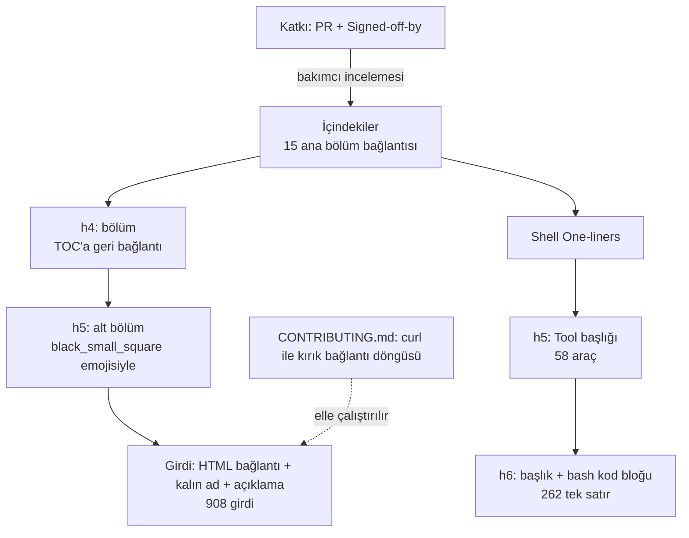
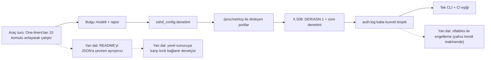

# trimstray/the-book-of-secret-knowledge — sistem yöneticisinin ve güvenlikçinin cep kitabı

> **Dal:** [D03 Sistem, ağ ve güvenlik](../README.md) · **Tür:** liste
> **Dil:** Markdown + gömülü HTML · **Lisans:** MIT · **Yıldız:** 257.061 (9 Kasım 2026) · **İncelenen commit:** `7d37069` (2024-11-19)

## 1. Bir bakışta

Tek bir dev `README.md` (4.442 satır, ~212 KB): sistem/ağ yöneticileri, DevOps, sızma testi uzmanları ve güvenlik
araştırmacıları için seçilmiş CLI/GUI/web araçları, el kitapları, bloglar, kopya kâğıtları ve **262 tek satırlık
komut** (one-liner). Yazarı trimstray "her gün işimde kullandığım malzemeler" diyor; değeri, tek yerde ve Ctrl+F ile
aranabilir olmasından geliyor. Son commit 19 Kasım 2024 tarihli: atlasın anlık görüntüsünde (9 Kasım 2026) iki yıldır
güncellenmemiş, yani bağlantı çürümesine açık bir "donmuş başvuru kitabı". Açılış cümlesi tonu belirler:
"_Knowledge is powerful, be careful how you use it!_" — aynı sayfada savunma ve saldırı araçları yan yana durur.

## 2. Nasıl yapılmış: mimari

### Klasör haritası

```text
README.md                                     kitabın tamamı: içindekiler + 15 ana bölüm
LICENSE.md                                    MIT
.github/CONTRIBUTING.md                       PR kuralları, Signed-off-by kancası, kırık bağlantı betiği
.github/CODE_OF_CONDUCT.md                    davranış kuralları
.github/FUNDING.yml                            Open Collective + GitHub Sponsors
static/img/the-book-of-secret-knowledge-preview.png   başlık görseli
```

`README.md`'nin içi (ölçüm: incelenen commit):

| Bölüm (h4)                     | Alt bölüm (h5) | Bağlantılı girdi | Not                                                                       |
| ------------------------------ | -------------: | ---------------: | ------------------------------------------------------------------------- |
| CLI Tools                      |             18 |              178 | Shells, Network, Network (DNS), SSL, Security, Auditing …                 |
| GUI Tools                      |              7 |               24 | terminaller, tarayıcılar, parola yöneticileri                             |
| Web Tools                      |             19 |              170 | SSL/Security, DNS, HTTP başlıkları, kitle tarayıcılar …                   |
| Systems/Services               |              5 |               28 | işletim sistemleri, DNS hizmetleri, Security/hardening                    |
| Networks                       |              3 |                4 |                                                                           |
| Containers/Orchestration       |              4 |               25 |                                                                           |
| Manuals/Howtos/Tutorials       |             13 |              115 | kabuk, Python, sed/awk, sistem sıkılaştırma, e-kitaplar                   |
| Inspiring Lists                |              4 |               58 | başka "awesome" listeler                                                  |
| Blogs/Podcasts/Videos          |             11 |               75 |                                                                           |
| Hacking/Penetration Testing    |              9 |              202 | araçlar, laboratuvarlar, CTF platformları                                 |
| Your daily knowledge and news  |              4 |               16 |                                                                           |
| Other Cheat Sheets             |              — |               13 |                                                                           |
| Shell One-liners               |   58 araç (h5) |    262 tek satır | her araç bir h5 `Tool:` başlığı, her komut bir h6 başlık + bash kod bloğu |
| Shell Tricks / Shell functions |              — |                — | etkileşimli kabuk düzeltme adımları; `DomainResolve`, `GetASN`            |

### Ana bileşenler ve veri akışı



Kitap üç katmanlı bir ağaçtır: bölüm (`####`) → alt bölüm (`#####`, başında `:black_small_square:` emojisi) → girdi.
Girdiler Markdown listesi değil **HTML**'dir: her alt bölüm bir `<p>` bloğudur ve her girdi o blokta
`&nbsp;&nbsp; <a href="..."><b>Ad</b></a> - açıklama<br>` biçiminde bir satırdır (908 girdi). Bu seçim sayfayı
sıkışık ve görsel olarak düzenli yapar ama makineyle işlemeyi ve biçim denetimini zorlaştırır. Başlıklardaki emoji
kısa kodları (`:anger:`) bağlantı çapalarına da girer: her bölüm başlığındaki `[TOC]` bağlantısı içindekilere
`#anger-table-of-contents` çapasıyla döner. Tek satırlıklar bölümü kendi içindekiler listesiyle ayrı bir küçük kitaptır.

### Önce okunacak dosyalar

1. `README.md` 1-110. satırlar — amaç, kimin için, katkı kuralları, içindekiler.
2. `README.md` › CLI Tools › SSL, Security, Auditing Tools — savunma tarafının çekirdeği.
3. `README.md` › Shell One-liners içindekiler — 58 aracın listesi; ardından `Tool: openssl`, `Tool: ssh`, `Tool: lsof`.
4. `.github/CONTRIBUTING.md` — katkı süreci ve kırık bağlantı betiği.

### Teknoloji yığını, derleme, test, CI, sürüm

Derleme, test ya da CI yok; "yayın" GitHub'ın Markdown görüntüleyicisidir. Güncellemeleri izlemek için README
commit'lerin RSS/Atom akışını önerir. Katkı kuralları: `master` dalına PR, tek satırlık açıklama, ve her commit'te
`signed-off-by` satırı (CONTRIBUTING, bunu bir `prepare-commit-msg` git kancasıyla otomatikleştirmeyi tarif eder).
Kalite denetimi elle: CONTRIBUTING'deki bash döngüsü README'deki her `href`'i `curl` ile yoklayıp 2xx dışı durumları
listeler; geçici olarak ulaşılamayan bağlantılar `*` ile işaretlenir ("kalıcı olarak öldüğü doğrulanmadan silmeyin").
Sürüm etiketi yok; kitap sürekli düzenlenen tek bir belge.

### Tasarım kararları ve ödünleşimler

1. **Tek dosya.** Arama ve paylaşım kolay, katkı eşiği düşük; bedeli birleştirme çakışmaları, devasa diff'ler ve
   GitHub'ın büyük dosya görüntüleme sınırları.
2. **Markdown içinde HTML.** Sıkışık ve tutarlı görünüm; bedeli `awesome-lint` gibi araçların ve ayrıştırıcıların
   işini zorlaştırması. Karşılaştır: [sindresorhus/awesome](../../10-kuratorluk-topluluk/awesome/README.md) saf Markdown
   ve katı kurallar kullanır.
3. **"Her şey değil, yalnız kaliteli olan."** README'deki ilke (`This repository is not meant to contain everything
but only good quality stuff.`); seçicilik tek bakımcının zevkine bağlıdır.
4. **Bilgi + çalıştırılabilir bilgi.** Bağlantı listesinin yanında doğrudan yapıştırılabilir tek satırlar: öğrenmeyi
   hızlandırır, ama anlamadan kopyalanan komut risklidir (ör. `kill -9 $$` ile geçmişi kaydetmeden çıkmak).
5. **Çift kullanımlı içerik.** Hacking bölümü ve "Shell Tricks" (sızma testinde elde edilen kabuğu kararlı hâle
   getirme) yalnız **yetkili** testlerde meşrudur. Bu atlas o bölümleri yalnız kategori düzeyinde anar; öğrenme
   rotası savunma tarafından ve yasal laboratuvarlardan (Labs, CTF platformları alt bölümleri) ilerler.

## 3. Öğrenmen gerekenler

- [G1 Terminal, kabuk ve Linux](../../../govde/README.md#g1) — tek satırlıkların dili: borular, `awk`, `sed`,
  `xargs`. Kaynak: free-programming-books Türkçe listesi › Linux
  ([liste](https://github.com/EbookFoundation/free-programming-books/blob/main/books/free-programming-books-tr.md#linux)).
- [G6 Ağ ve web temelleri](../../../govde/README.md#g6) — TCP durumları, TLS, DNS, HTTP başlıkları.
- [G7 Test, CI ve kod kalitesi](../../../govde/README.md#g7) — kırık bağlantı denetimini CI'a taşımak; minideki çıkış
  kodları.
- [G9 Açık kaynak: lisans ve topluluk](../../../govde/README.md#g9) — MIT lisanslı bir listenin başkalarının
  içeriğine bağlantı vermesi, tek bakımcılı projelerin sürdürülebilirliği.
- [G3 Python](../../../govde/README.md#g3) — mini uygulama için.
- Güvenlik temelleri: "Özgür Yazılım Derneği Güvenlik Rehberi" (free-programming-books Türkçe listesi › Güvenlik ve
  Gizlilik).
- Dala özgü kavramlar: SSH sıkılaştırma (anahtar tabanlı giriş, zayıf algoritmalar), dinleyen portlar ve saldırı
  yüzeyi, X.509 ve sertifika ömrü, günlük analizi ve kaba kuvvet, "yetki" kavramı (yalnız kendi sistemin).

## 4. Sıfırdan yol (dallanma)



| Aşama | Ne inşa edersin                      | Öğrendiğin kavram                       | Bitti ölçütü                                    | Süre (saat) |
| ----- | ------------------------------------ | --------------------------------------- | ----------------------------------------------- | ----------- |
| 0     | 10 tek satırı `explainshell` ile çöz | boru, alt kabuk, yönlendirme            | her birini kendi cümlenle açıklayabiliyorsun    | 10          |
| 1-2   | `bulgu.py` + `sshd.py`               | yapılandırma semantiği, varsayılanlar   | zayıf örnekte 11 bulgu (10 kural), sağlamda 0   | 10          |
| 3     | `soketler.py`                        | çekirdeğin `/proc` arayüzü, bayt sırası | `ss -ltn` ile aynı listeyi üretiyorsun          | 5           |
| 4     | `sertifika.py`                       | ASN.1 DER, X.509, TLS el sıkışması      | `openssl x509 -dates` ile aynı tarihler         | 10          |
| 5     | `kaba_kuvvet.py`                     | kayan pencere, tespit mühendisliği      | örnek günlükte 4 farklı bulgu türü              | 10          |
| 6     | `__main__.py` + CI                   | çıkış kodu sözleşmesi, JSON çıktı       | bir CI işi zayıf yapılandırmada kırmızı yanıyor | 5           |

**Toplam:** ana aşamalar (0-6) 50 saat; yan dallar (README ayrıştırıcısı, bağlantı denetçisi, nftables) bu tabloda
süre verilmemiş isteğe bağlı işlerdir. Saatler dalın ortak kuralıyla hesaplandı (1 gün ≈ 5 saat; bkz.
[dal sayfası](../README.md#süre-tahmini)).

**Mini uygulama:** [`sifirdan/`](sifirdan/README.md) — `denetim` paketi (bulgu, sshd, soketler, sertifika, kaba
kuvvet) ve 31 çevrimdışı test. Listede karşılık gelen araçlar: ssh-audit (CLI Tools › Network), testssl.sh (CLI Tools
› SSL), Lynis (CLI Tools › Auditing Tools), `lsof`/`netstat` tek satırlıkları; eşleme tablosu `sifirdan/README.md`'de.

**Gerçek ölçeğe giden yol.** (1) Kontrol sayısını kural dosyalarına taşı (CIS benzeri kıyaslamalar), (2) `sshd -T`
gibi "etkin yapılandırma" kaynaklarını oku, (3) soket → süreç → paket eşlemesi, (4) X.509 zinciri, SAN, OCSP,
protokol/şifre taraması (testssl.sh düzeyi), (5) journald ve döndürülmüş günlükler, (6) çok makineli toplama
(osquery/SIEM), (7) SARIF gibi standart rapor biçimleri ve panolar.

## 5. Gerçek depoda okuma rotası

1. **README başı** — Kitap kimin için yazılmış, katkı kuralları neler? "`*` işaretli bağlantı" kuralı neden var?
2. **İçindekiler → CLI Tools › SSL ve Security** — Hangi araçlar istemci, hangileri sunucu denetliyor?
3. **CLI Tools › Auditing Tools** — Lynis'in açıklamasını oku; minideki `bulgu.py` raporuyla karşılaştır.
4. **Web Tools › SSL/Security** — crt.sh nedir? Sertifika şeffaflığı (CT) kayıtları kendi alan adın için ne gösterir?
5. **Shell One-liners › `Tool: openssl`** — "Testing connection to the remote host" komutunu yalnız kendi
   sunucuna karşı çalıştır; çıktıdaki `notAfter`'ı `denetim tls --sunucu` ile karşılaştır.
6. **Shell One-liners › `Tool: lsof` ve `Tool: netstat`** — "Show open ports (LISTEN)" çıktısını
   `denetim soket` ile karşılaştır; hangi sütun inode'u gösteriyor?
7. **Systems/Services › Security/hardening ve Manuals › System hardening** — sıkılaştırma kılavuzlarından bir kontrol
   seç ve `sshd.py`'ye yeni kural olarak ekle.
8. **`.github/CONTRIBUTING.md`** — kırık bağlantı döngüsünü oku: hangi durum kodlarını yanlışlıkla "kırık" sayar
   (ör. 301/302, 403 döndüren ama çalışan siteler)?

## 6. Alıştırmalar ve öz değerlendirme

1. (Kolay) `README.md`'yi bölüm → alt bölüm → girdi ağacı olarak JSON'a çeviren bir ayrıştırıcı yaz (yalnız standart
   kitaplık; HTML girdileri için `html.parser`).
2. (Kolay) `sshd.py`'ye `PermitUserEnvironment yes` ve `AllowTcpForwarding yes` kontrollerini ekle, testleriyle.
3. (Orta) Kırık bağlantı denetçisi: `http.server` ile yerel test sunucusu kur (200, 301, 404, zaman aşımı
   senaryoları); denetçin yönlendirmeyi izlesin, hız sınırı uygulasın, `robots.txt`'ye saygı göstersin.
4. (Orta) `soketler.py`'ye süreç eşlemesi ekle: `/proc/*/fd/*` sembolik bağlarındaki `socket:[inode]` değerleriyle.
5. (Orta) `sertifika.py`'ye SAN uzantısını (OID 2.5.29.17) ayrıştırmayı ve ana makine adı eşleşmesini ekle.
6. (Zor) `kaba_kuvvet.py`'yi akış hâline getir: `tail -F` gibi büyüyen dosyayı izle, döndürülen dosyayı fark et.

<details><summary>Soru 1: <code>sshd_config</code>'de aynı anahtar iki kez yazılırsa hangisi geçerlidir?</summary>

İlki. `sshd_config(5)`: "her anahtar sözcük için ilk elde edilen değer kullanılır". Bu yüzden dosya başındaki
`Include` ile gelen dosyalar sonraki ayarları ezer; doğrusunu `sshd -T` gösterir.

</details>

<details><summary>Soru 2: <code>/proc/net/tcp</code>'deki <code>0100007F:1538</code> neyi ifade eder?</summary>

`127.0.0.1:5432`. Adres, ağ bayt sırasındaki 32 bitlik değerin little-endian makinede `%08X` ile basılmasıdır (baytlar
ters görünür); port ise sayı olarak basılır: `0x1538 = 5432` (PostgreSQL).

</details>

<details><summary>Soru 3: IP başına "10 dakikada 5 başarısız deneme" kuralı hangi saldırıyı kaçırır?</summary>

Dağıtık (parola püskürtme) saldırıyı: çok sayıda IP'nin her biri aynı hesaba birkaç deneme yapar, hiçbiri eşiği aşmaz.
Hesap bazlı sayım (`LOG-004`) ve parola girişini tümden kapatmak gerekir.

</details>

<details><summary>Soru 4: Sertifika süresi denetiminde doğrulamayı neden kapatıyoruz?</summary>

Amaç güvenli bir bağlantı kurmak değil, sertifikayı **gözlemlemek**: doğrulama açık olsaydı süresi dolmuş ya da
kendinden imzalı sertifikada el sıkışma başarısız olur, tam da yakalamak istediğimiz durumu göremezdik. Bu bağlantı
üzerinden veri gönderilmez.

</details>

## 7. İş fikri tohumları

- **KOBİ sunucu sağlık karnesi** — haftalık SSH/port/sertifika/günlük taraması ve Türkçe, sade bir rapor. **Kime:**
  kendi VPS'ini yöneten küçük e-ticaret siteleri ve ajanslar.
- **Sertifika ve alan adı süre bekçisi** — yüzlerce uç noktanın sertifika ve alan adı bitişlerini izleyip
  Slack/e-posta ile uyarır. **Kime:** çok sayıda müşteri sitesi barındıran web ajansları ve MSP'ler.
- **Mevzuata uygun denetim kanıtı paketi** — kontrollerin çıktısını denetim dönemleri için imzalı arşive dönüştürür.
  **Kime:** ISO 27001 hazırlığındaki fintech ve sağlık girişimleri.

Ayrıntılı katalog: [is-fikirleri](../../../is-fikirleri/README.md).

## 8. Kaynaklar

- Depo (incelenen commit):
  [README.md](https://github.com/trimstray/the-book-of-secret-knowledge/blob/7d37069a361d3fd9f214480755f7969744e866fa/README.md) ·
  [CONTRIBUTING.md](https://github.com/trimstray/the-book-of-secret-knowledge/blob/7d37069a361d3fd9f214480755f7969744e866fa/.github/CONTRIBUTING.md)
- `sshd_config(5)` kılavuz sayfası: <https://man.openbsd.org/sshd_config>
- `proc(5)` ve `/proc/net/tcp`: <https://man7.org/linux/man-pages/man5/proc.5.html> ·
  çekirdekte `net/ipv4/tcp_ipv4.c` ([linux dosyası](../linux/README.md))
- RFC 5280 (X.509 profili), ITU-T X.690 (DER kodlama)
- Benzer listeler: [awesome](../../10-kuratorluk-topluluk/awesome/README.md) ·
  [awesome-selfhosted](../../10-kuratorluk-topluluk/awesome-selfhosted/README.md) ·
  [public-apis](../../04-veri-araclari-otomasyon/public-apis/README.md)
