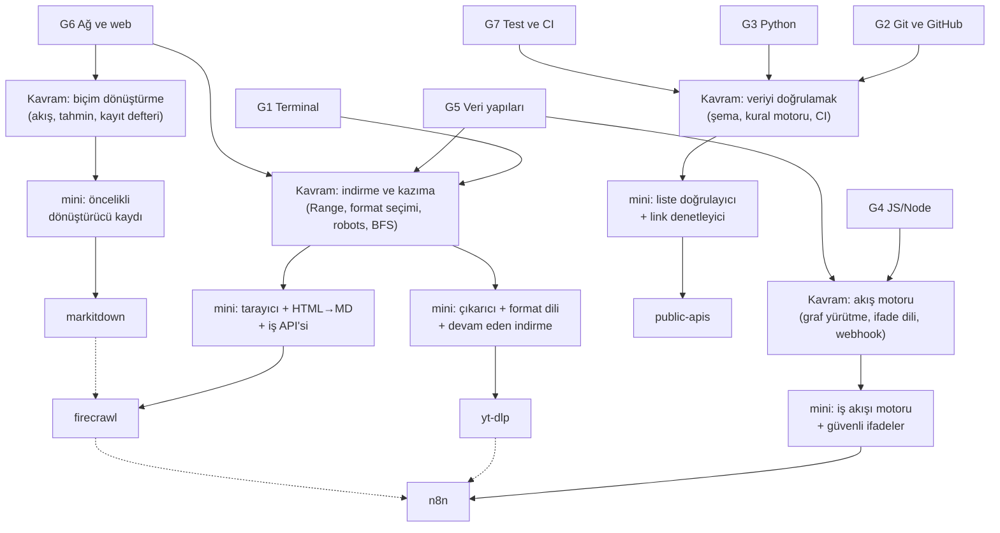

# D04 — Veri araçları ve otomasyon

Bu dal, **dağınık veriyi toplayan, dönüştüren ve otomatik olarak işleyen** araçları inceler: bir API
kataloğu (public-apis), belgeleri Markdown'a çeviren bir dönüştürücü (markitdown), binlerce siteden medya
indiren bir araç (yt-dlp), web sitelerini LLM'e hazır metne çeviren bir tarama servisi (firecrawl) ve bütün
bunları akışlara bağlayan bir otomasyon platformu (n8n). Ortak tema, **"ham girdi → yapılandırılmış veri →
eylem"** hattıdır. Bu dalı bitirdiğinde bir yapay zekâ uygulamasının veri tarafını (D05, D06) baştan sona
kurabilirsin.

## Ön koşullar

Bu liste, beş dossier'in "Öğrenmen gerekenler" tablolarındaki gövde düğümlerinin birleşimidir; parantez içinde
o düğümü isteyen yapraklar yazar. **Zorunlu**, mini'leri yazmak için gereken; **faydalı**, depoyu bağlamıyla
okumak (lisans, büyük kod tabanı) için gereken bilgidir.

Zorunlu:

- [G1 Terminal, kabuk ve Linux](../../govde/README.md#g1) — ffmpeg, curl, çıkış kodları, süreçler (yt-dlp;
  bütün mini'ler komut satırından çalışır).
- [G2 Git ve GitHub iş akışı](../../govde/README.md#g2) — fork, squash, PR şablonu (public-apis).
- [G3 Python ile programlama](../../govde/README.md#g3) — public-apis, markitdown ve yt-dlp mini'leri Python.
- [G4 JavaScript / TypeScript ve Node.js](../../govde/README.md#g4) — firecrawl ve n8n mini'leri Node.
- [G5 Veri yapıları ve algoritmalar](../../govde/README.md#g5) — BFS, kümelerle tekrar engelleme, yönlü graf,
  yığın (firecrawl, n8n). İlk üç yaprak için gerekmez.
- [G6 Ağ ve web temelleri](../../govde/README.md#g6) — HTTP, Range, robots.txt, webhook, CORS (beş yaprak).
- [G7 Test, CI ve kod kalitesi](../../govde/README.md#g7) — her mini yerel sunucuyla, internetsiz test edilir
  (beş yaprak).

Faydalı:

- [G8 Büyük kod tabanı okuma](../../govde/README.md#g8) — 33.318 dosyalık monorepoda yol bulmak (n8n); her
  dossier'in 5. bölümündeki okuma rotası bu yöntemi uygular.
- [G9 Açık kaynak: lisans, katkı süreci](../../govde/README.md#g9) — Unlicense, MIT, AGPL, fair-code ve CLA bu
  dalda yan yana (public-apis, n8n).

Önceki bir dal gerekmez. [D05](../05-yapay-zeka-altyapisi/README.md) ve
[D06](../06-ajan-platformlari/README.md) bu dalın **ardından** gelir; dossier'lerde "isteğe bağlı, bu daldan
sonra" diye geçerler.

## Dalın ağacı



## Önerilen yaprak sırası

1. **[public-apis](public-apis/README.md)** — en kolay giriş: tek bir Markdown dosyası ve onu koruyan küçük
   Python betikleri. Ayrıştırma, kural motoru, CI ve eş zamanlı HTTP'yi ufak ölçekte öğretir; sonraki
   yaprakların hepsi bu becerileri büyütür.
2. **[markitdown](markitdown/README.md)** — tek süreçte, ağsız çalışan saf bir dönüştürme hattı. "Sözleşme +
   kayıt defteri + öncelik" mimarisini öğrenirsin; firecrawl'daki HTML→Markdown adımını ve n8n'deki düğüm
   kaydını anlamak kolaylaşır.
3. **[yt-dlp](yt-dlp/README.md)** — ağ işin içine girer: Range ile devam eden indirme, ilerleme kancaları,
   iki küçük dil (format seçimi ve çıktı şablonu) ve son işlem zinciri. Eklenti mimarisinin 1.750 sınıfa nasıl
   ölçeklendiğini görürsün.
4. **[firecrawl](firecrawl/README.md)** — tarama graf gezintisidir: BFS, tekrar kilidi, robots.txt, nezaket ve
   uzun süren işler için asenkron API deseni. Önceki yapraklardaki HTML dönüştürme ve HTTP bilgisi burada birleşir.
5. **[n8n](n8n/README.md)** — en kapsamlı yaprak: yönlü graf yürütme, ifade dili yorumlayıcısı, sandbox,
   webhook. Diğer dört aracı bir akışa bağlamayı düşünerek bitirirsin.

Sıra, yaprakların kendi ön koşullarıyla uyumludur: ilk üç yaprak Python (G3) ister; son ikisi Node (G4) ve
graf/yığın bilgisi (G5) ister. Bu yüzden G4 ve G5'i 4. yaprağa gelene kadar tamamlaman yeter.

## Yapraklar

| Depo                                             | Tür        | Zorluk (1–5) | Mini                                                                                                   | Mini (saat) | Toplam (saat) |
| ------------------------------------------------ | ---------- | ------------ | ------------------------------------------------------------------------------------------------------ | ----------- | ------------- |
| [public-apis/public-apis](public-apis/README.md) | liste      | 1            | [liste doğrulayıcı, link denetleyici, JSON](public-apis/sifirdan/README.md) (Python, 23 test)          | 10          | 26            |
| [microsoft/markitdown](markitdown/README.md)     | kod tabanı | 2            | [öncelikli dönüştürücü kaydı, HTML/CSV/JSON/DOCX/ZIP](markitdown/sifirdan/README.md) (Python, 28 test) | 19          | 44            |
| [yt-dlp/yt-dlp](yt-dlp/README.md)                | kod tabanı | 4            | [çıkarıcı, format dili, indirici, şablon, son işlem](yt-dlp/sifirdan/README.md) (Python, 30 test)      | 25          | 50            |
| [firecrawl/firecrawl](firecrawl/README.md)       | kod tabanı | 4            | [URL, robots, HTML→MD, tarayıcı, iş API'si](firecrawl/sifirdan/README.md) (Node, 28 test)              | 23          | 48            |
| [n8n-io/n8n](n8n/README.md)                      | kod tabanı | 5            | [ifade dili, düğümler, motor, webhook](n8n/sifirdan/README.md) (Node, 22 test)                         | 24          | 49            |
| **Dal toplamı**                                  |            |              |                                                                                                        | **101**     | **217**       |

**Süre kuralı.** "Mini (saat)", dossier'in 4. bölümündeki "Sıfırdan yol" tablosunda aşama sürelerinin
toplamıdır. "Toplam (saat)" = mini + okuma rotası (5. bölüm, adım başına ~1 saat) + alıştırmalar (6. bölüm;
kolay ~1, orta ~2, zor ~4 saat; öz değerlendirme soruları dahil). Bu dalda süreler hep saat cinsindendir; gün
ya da hafta cinsinden bir tahmin görürsen 1 gün ≈ 5 saat odaklı çalışma, 1 hafta ≈ 10 saat say.

**Dal toplamı:** ~217 saat; haftada ~10 saatle yaklaşık 22 hafta (yalnızca mini'ler: 101 saat, ~10 hafta). Her
yaprak için önce dossier'in 2. bölümünü oku, sonra mini'yi aşama aşama yeniden yaz, en sonda 5. bölümdeki
okuma rotasıyla gerçek depoya dön.

## Testleri çalıştırma

```bash
# Python mini'leri (her biri kendi sifirdan/ klasörü içinden)
python3 -m unittest discover -s . -t .
# Node mini'leri (sifirdan/ içinden; Node 22'de klasör argümanı yerine otomatik keşif)
node --test
```

Hiçbir test internete çıkmaz: indirme, tarama ve webhook testleri `127.0.0.1` üzerinde kurulan yerel
sunuculara karşı çalışır. yt-dlp mini'sinin birleştirme/ses çıkarma testleri ffmpeg yoksa açıklamayla atlanır.

## Dallar arası bağlantılar

- **[D05 Yapay zekâ altyapısı](../05-yapay-zeka-altyapisi/README.md):** markitdown ve firecrawl çıktısı
  (Markdown) RAG hatlarının girdisidir; [transformers](../05-yapay-zeka-altyapisi/transformers/README.md) ve
  [ollama](../05-yapay-zeka-altyapisi/ollama/README.md) dossier'lerinde bu metinlerin nasıl gömüldüğünü ve
  modellere verildiğini görürsün.
- **[D06 Ajan platformları](../06-ajan-platformlari/README.md):** n8n'in AI ajan düğümleri ve MCP desteği,
  [autogpt](../06-ajan-platformlari/autogpt/README.md) gibi platformlarla aynı "araç çağıran ajan" sorusunu
  çözer; markitdown'un MCP sunucusu ajanlara doğrudan araç olarak bağlanır.
- **[D10 Kuratörlük ve topluluk](../10-kuratorluk-topluluk/README.md):** public-apis bir "awesome" listesi
  gibi yönetilir; [awesome](../10-kuratorluk-topluluk/awesome/README.md) ve
  [awesome-selfhosted](../10-kuratorluk-topluluk/awesome-selfhosted/README.md) dossier'lerindeki kuratörlük
  araçlarıyla karşılaştır. Bu daldaki doğrulayıcı ve link denetleyici o listelere de uygulanabilir.
- **[D03 Sistem, ağ ve güvenlik](../03-sistem-ag-guvenlik/README.md):** SSRF, sandbox, zip bombası ve XML varlık
  saldırıları bu dalın minilerinde karşına çıkar.

## Projelerin yapay zekâ ajanlarına bakışı

Bu dalda ilginç bir karşıtlık var: yt-dlp, katkılarda yapay zekâ ve LLM kullanımını açıkça yasaklar
(`.NO_AI/README.md`, `CONTRIBUTING.md`); firecrawl ve n8n ise depolarında ajanlar için geliştirme notları
(`AGENTS.md`, `CLAUDE.md`) tutar. Katkı vermeden önce her projenin politikasını oku.

## Etik ve hukuk

İndirme ve kazıma araçları hukuken tarafsız değildir. Telif hakkıyla korunan içeriği izinsiz indirmek
(Türkiye'de 5846 sayılı FSEK), sitelerin kullanım koşullarını çiğnemek ve kişisel verileri toplamak (KVKK)
sorumluluk doğurur. Bu daldaki mini'lerin testleri yalnızca `127.0.0.1` üzerindeki yerel sunuculara bağlanır.
Araçların kendisinde: yt-dlp mini'si varsayılan olarak yalnızca `127.0.0.1`/`localhost`'a izin verir. Firecrawl
mini'si doğrudan yazılmış özel ağ adreslerini ve oraya giden yönlendirmeleri (SSRF) reddeder; `--yerel` bu engeli
kaldırır. İç IP'ye çözülen alan adları (DNS rebinding) kapsam dışıdır. Tarayıcısı (`tara`) ayrıca robots.txt'ye ve
`Crawl-delay`'e uyar. Tek sayfa kazıma (`kazi`, `/v2/scrape`) robots.txt'ye bakmaz. Firecrawl tarayıcısı ve
public-apis mini'sinin bağlantı denetleyicisi dürüst bir User-Agent kullanır, hız ve eş zamanlılık sınırı sunar. Bu
varsayılanları gevşetmeden önce izin aldığından emin ol.

## Bu dalı bitirdiğinde ne yapabilirsin

- Bir Markdown/CSV veri setine kural motoru ve CI doğrulaması ekleyebilir, binlerce linki nazikçe denetleyebilirsin.
- PDF dışındaki yaygın ofis ve web biçimlerini LLM'e uygun Markdown'a çeviren, eklentiyle genişleyen bir
  dönüştürücü yazabilirsin.
- Kesilen indirmeleri kaldığı yerden sürdüren, format seçimi için küçük bir dil yorumlayan bir indirici kurabilirsin.
- robots.txt'ye uyan, tekrarları engelleyen, hızını sınırlayan bir tarayıcıyı asenkron bir API arkasına koyabilirsin.
- Graf tabanlı bir iş akışı motoru, `eval` kullanmayan bir ifade dili ve webhook tetikleyicisi yazabilir; n8n'in
  ve benzer platformların içini okuyup katkı verebilirsin.

[Ağacın tamamı](../../AGAC.md) · [Gövde (G1–G11)](../../govde/README.md) · [İş fikirleri](../../is-fikirleri/README.md)
