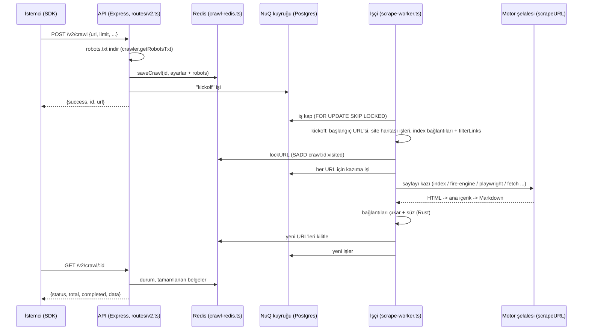
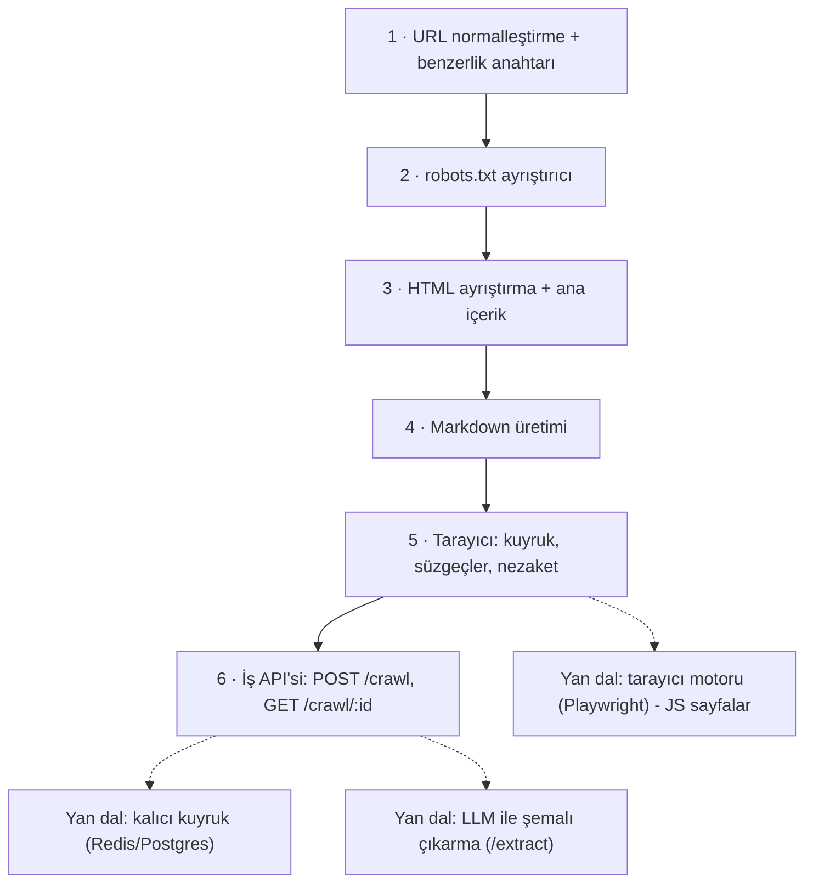

# firecrawl/firecrawl — web sitelerini LLM'e hazır Markdown/JSON'a çeviren kazıma ve tarama API'si

> **Dal:** [D04 Veri araçları ve otomasyon](../README.md) · **Tür:** kod tabanı
> **Dil:** TypeScript (+ Rust, Go) · **Lisans:** AGPL-3.0 (SDK'lar ve bazı arayüz bileşenleri MIT) · **Yıldız:** 199.963 (9 Kasım 2026) · **İncelenen commit:** `a0535ec` (2026-11-09)

## 1. Bir bakışta

Firecrawl, bir URL'yi ya da bütün bir siteyi alıp dil modellerinin doğrudan kullanabileceği temiz Markdown,
yapılandırılmış JSON, ekran görüntüsü veya bağlantı haritasına çeviren bir HTTP API'sidir. "Kazı" (tek sayfa),
"tara" (bağlantıları izleyerek çok sayfa), "harita" (sitedeki URL'ler), "ara" ve "çıkar" (LLM ile şemalı veri)
uç noktaları sunar; JavaScript ile çizilen sayfaları tarayıcıyla, PDF/DOCX'i ayrı motorlarla işler. RAG ve
ajan uygulamaları web'den veri toplamak zorunda olduğu için hızla yayıldı. Açık kaynak sürüm kendin
barındırabileceğin bir taban sunar; bulut sürümünde ek özellikler vardır (README "Open Source vs Cloud").

## 2. Nasıl yapılmış: mimari

### Klasör haritası

```text
apps/
  api/                          # ASIL ÜRÜN: Express 5 + TypeScript API ve işçiler (src altında 1.064 dosya)
    src/index.ts, harness.ts    # sunucu girişi; geliştirme/test için API+işçi+Postgres+RabbitMQ başlatan "harness"
    src/routes/v2.ts            # uç noktalar: /scrape /batch/scrape /map /crawl /search /extract /agent /parse ...
    src/controllers/v0|v1|v2/   # her uç noktanın denetleyicisi (crawl.ts, crawl-status.ts, crawl-cancel.ts ...)
    src/scraper/WebScraper/crawler.ts   # WebCrawler: robots, site haritası, bağlantı süzme, red nedenleri
    src/scraper/scrapeURL/      # tek sayfa kazıma: motor "şelalesi", dönüştürücüler, son işlemler
      engines/                  # fire-engine (ayrı servis), playwright, fetch, pdf, document, index (önbellek) ...
      lib/removeUnwantedElements.ts   # onlyMainContent: header/footer/nav/çerez öğelerini atma
    src/lib/crawl-redis.ts      # tarama durumu Redis'te: saveCrawl, lockURL, normalizeURL, permütasyonlar
    src/lib/html-to-markdown.ts # Go HTTP servisi -> Go paylaşımlı kütüphane (koffi) -> turndown yedeği
    src/services/worker/nuq.ts  # NuQ: Postgres tablosu üzerinde iş kuyruğu (+ RabbitMQ bildirim)
    src/services/worker/scrape-worker.ts  # kazıma/tarama işlerini işleyen işçi (kickoff, bağlantı keşfi)
    src/services/queue-service.ts         # BullMQ yan kuyrukları (extract, llmstxt, billing, precrawl ...)
    native/                     # Rust (napi) modülü @mendable/firecrawl-rs: filterLinks, HTML dönüşümleri, PDF
  go-html-to-md-service/        # HTML -> Markdown Go servisi
  playwright-service-ts/        # JS ile çizilen sayfalar için tarayıcı mikro servisi
  nuq-postgres/                 # kuyruk şeması (nuq.sql) ve Postgres ayarları
  js-sdk, python-sdk, go-sdk, rust-sdk, java-sdk, dot-net-sdk, elixir-sdk, php-sdk, ruby-sdk/
  test-site/                    # tarayıcı testleri için örnek site (Astro)
firecrawl-cli/, firecrawl-cli-skills/, firecrawl-skills/, firecrawl-workflows/
                                # her biri yalnızca README: ayrı depolara (CLI, beceri kataloğu, iş akışları) yönlendirir
skills/                         # ajanlar için SKILL.md "beceri" dosyaları (CI ile kataloğa aynalanır)
docker-compose.yaml             # api, playwright-service, redis, rabbitmq, nuq-postgres, (deneysel) foundationdb
SELF_HOST.md, CONTRIBUTING.md, AGENTS.md, CLAUDE.md
```

### Ana bileşenler ve veri akışı



Tarama tek bir döngü değil, **birbirini doğuran işlerdir**. Denetleyici bir kimlik (UUIDv7) üretir,
robots.txt'yi indirip ayarlarla birlikte Redis'e yazar (`saveCrawl`) ve bir "kickoff" işi kuyruğa koyar;
istemci hemen kimliği alır. İşçi kickoff'ta (`processKickoffJob`) başlangıç URL'sini kilitleyip kazıma işini
açar, site haritaları için ayrı `kickoff_sitemap` işleri başlatır (adresler robots.txt'deki `Sitemap:`
satırlarından ve tahmin edilen `sitemap.xml` yollarından gelir) ve önbellekteki (index) bilinen bağlantıları
`filterLinks` ile süzüp kuyruğa ekler. Her sayfa kazındığında bağlantılar çıkarılır, `filterLinks` ile
(derinlik, robots, geriye tarama, dış bağlantı) süzülür ve Redis'te `SADD` ile "kilitlenir": aynı URL'yi
ikinci kez kilitlemek mümkün olmadığından iki işçi aynı sayfayı kazımaz. İstemci durumu yoklar (polling) ya
da WebSocket ile izler.

**API alışverişi** (v2; alan adları denetleyicilerden doğrulandı, değerler kurgusal):

```bash
curl -s -X POST https://api.firecrawl.dev/v2/crawl -H "Authorization: Bearer $ANAHTAR" \
  -H 'content-type: application/json' -d '{"url":"https://ornek.example","limit":20,"maxDiscoveryDepth":2}'
# -> {"success":true,"id":"0193...","url":"https://api.firecrawl.dev/v2/crawl/0193..."}

curl -s https://api.firecrawl.dev/v2/crawl/0193... -H "Authorization: Bearer $ANAHTAR"
# -> {"success":true,"status":"scraping","completed":7,"total":20,"creditsUsed":7,"expiresAt":"...",
#     "next":null,"data":[{"markdown":"# Başlık ...","metadata":{"sourceURL":"...","statusCode":200}}]}

curl -s https://api.firecrawl.dev/v2/crawl/0193.../errors -H "Authorization: Bearer $ANAHTAR"
# -> {"errors":[{"id":"...","url":"...","error":"..."}],"robotsBlocked":["https://ornek.example/gizli"]}
```

Uzun süren iş için "hemen kimlik dön, sonucu sonra sorgula" deseni, HTTP isteğinin zaman aşımına takılmadan
dakikalarca süren taramalara izin verir; sonuçlar Redis'te 24 saat saklanır (`getCrawlExpiry`).

### Önce okunacak dosyalar

1. `apps/api/src/routes/v2.ts` — ürünün yüzeyi: hangi uç nokta hangi ara katmanlardan geçiyor (kimlik, kredi,
   engelleme listesi, idempotency).
2. `apps/api/src/controllers/v2/crawl.ts` — iş nasıl doğuyor: `uuidv7`, `saveCrawl`, kickoff işi, yanıt şekli.
3. `apps/api/src/lib/crawl-redis.ts` → `normalizeURL`, `generateURLPermutations`, `lockURL` — tekrar engelleme.
4. `apps/api/src/scraper/WebScraper/crawler.ts` — `WebCrawler`, `DenialReason` mesajları, `filterLinks`.
5. `apps/api/src/scraper/WebScraper/utils/maxDepthUtils.ts` — "derinlik" = yol parçası sayısı.
6. `apps/api/src/services/worker/scrape-worker.ts` → `processKickoffJob` ve bağlantı keşfi bölümü.
7. `apps/api/src/scraper/scrapeURL/engines/index.ts` → `engineOptions` (özellik bayrakları + kalite puanı) ve
   `buildFallbackList`.
8. `apps/api/src/lib/html-to-markdown.ts` ve `scrapeURL/lib/removeUnwantedElements.ts` — çıktının kalitesi.
9. `apps/api/src/services/worker/nuq.ts` ve `apps/nuq-postgres/nuq.sql` — Postgres'i kuyruk yapmak.

### Teknoloji yığını, derleme, test, CI, sürüm

- **API:** Node 22, TypeScript, Express 5, pnpm çalışma alanı. Öne çıkan bağımlılıklar: `zod` (girdi
  şemaları), `ioredis`, `bullmq`, `pg`, `amqplib` (RabbitMQ), `foundationdb`, `cheerio`, `jsdom`,
  `robots-parser`, `turndown`, `undici`, `koffi` (Go kütüphanesini FFI ile yükleme) ve çok sayıda `@ai-sdk/*`
  sağlayıcısı (LLM ile çıkarma özellikleri için).
- **Yerel kod:** `apps/api/native` bir Rust `cdylib`'dir (napi-rs): `lol_html`, `kuchikiki` (HTML),
  `texting_robots` (robots.txt), `psl` (kamu son ek listesi), `pdf-inspector`. Sıcak yollar (bağlantı süzme,
  HTML dönüştürme, Markdown son işlemesi) burada.
- **Hizmetler (docker-compose):** `api`, `playwright-service`, `redis`, `rabbitmq`, `nuq-postgres`;
  `NUQ_BACKEND=fdb` ile deneysel FoundationDB kuyruğu.
- **Test:** `vitest`; `pnpm harness pnpm test:snips` API'yi, işçileri, Postgres'i ve RabbitMQ'yu başlatıp
  uçtan uca "snips" testlerini çalıştırır. `AGENTS.md`/`CLAUDE.md` (yapay zekâ ajanları için yazılmış geliştirme
  notları) uçtan uca testi birim testine tercih ettiğini söyler.
- **CI:** `.github/workflows/` altında `test-server.yml`, her SDK için `test-*-sdk.yml` ve `publish-*-sdk.yml`,
  imaj dağıtımları (`deploy-*.yml`), `npm-audit.yml`, kazıma kalitesi değerlendirmeleri (`scrape-evals.yml`,
  `eval-prod.yml`).
- **Kendin barındırma:** `SELF_HOST.md` başlangıç düzeni: kimlik doğrulama kapalı, kuyruk NuQ/PostgreSQL,
  kazıma Playwright + fetch (fire-engine ayrıca bağlanmazsa yok), AI sağlayıcısı yok, kuyruk yönetim arayüzü kapalı.

### Tasarım kararları ve ödünleşimler

1. **İş tabanlı tarama.** Her sayfa ayrı bir kuyruk işi; ölçeklemek için işçi eklemek yeter, bir sayfanın
   çökmesi taramayı düşürmez. Bedeli: "bitti mi?" sorusu dağıtık bir sayaç sorusudur (`crawl-redis.ts`'teki
   `addCrawlJobDone`, `isCrawlFinished`, onarım fonksiyonları bunu çözer).
2. **Redis kümesiyle tekrar engelleme.** `SADD` atomiktir: ilk ekleyen kazanır. `deduplicateSimilarURLs`
   açıksa `www.`/`http(s)`/`index.html` permütasyonlarından ilki kilitlenir; "aynı sayfa" tanımı tek bir
   fonksiyonda toplanır.
3. **Kendi kuyruğu (NuQ).** Ana kazıma işleri BullMQ yerine Postgres tablosunda tutulur ve
   `FOR UPDATE SKIP LOCKED` ile kapılır; bildirim RabbitMQ ya da `LISTEN/NOTIFY` ile yapılır. Kalıcılık ve
   sorgulanabilirlik kazanılır; `nuq.sql`'deki ayrıntılı Postgres ayarları ise bunun operasyonel maliyetini
   gösterir. Yan kuyruklar hâlâ BullMQ'dadır.
4. **Motor şelalesi.** Her motorun desteklediği özellikler (`actions`, `screenshot`, `pdf`, `mobile`,
   `stealthProxy` ...) ve bir kalite puanı vardır; istek gereken özelliklere göre motor listesi kurar ve sırayla
   dener. Önbellek (`index`) en önce, gizli proxy'ler negatif puanla en sonda.
5. **Sıcak yolları Rust/Go'ya taşımak.** Bağlantı süzme ve HTML işleme Rust'ta, HTML→Markdown Go'da; JS
   yalnızca yedek. Hız kazanılır, ama derleme ve hata ayıklama karmaşıklaşır (napi, koffi).
6. **Varsayılan olarak nazik.** robots.txt uygulanır (`ignoreRobotsTxt: false`), red nedeni kullanıcıya açık
   bir mesajla döner (`DenialReason`), `delay` (en fazla 60 sn) ve `maxConcurrency` seçenekleri vardır. Ancak
   robots.txt'deki `Crawl-delay` okunduğu hâlde (`WebCrawler.getRobotsCrawlDelay`) bu commit'te uygulanmaz:
   onu `delay`'e aktaran satırlar `controllers/v2/crawl.ts`'te yorum satırı hâlindedir. Gecikme yalnızca
   kullanıcı `delay` verirse işler.
7. **İki "derinlik".** `maxDepth` yol derinliğidir (başlangıç yoluna göre ayarlanır), `maxDiscoveryDepth`
   bağlantı adımıdır. İsim benzerliği kafa karıştırır; dokümantasyonda ve red mesajlarında açıkça ayrılır.

## 3. Öğrenmen gerekenler

| Ön koşul                                                                                     | Bu depo için neden gerekli                                                     | Ücretsiz kaynak                                                                                           |
| -------------------------------------------------------------------------------------------- | ------------------------------------------------------------------------------ | --------------------------------------------------------------------------------------------------------- |
| [G4 JavaScript/TypeScript ve Node.js](../../../govde/README.md#g4)                           | Async/await, akışlar, Express ara katmanları, `zod`                            | [You-Dont-Know-JS dossier'i](../../01-web-arayuzu/you-dont-know-js/README.md)                             |
| [G6 Ağ ve web temelleri](../../../govde/README.md#g6)                                        | HTTP, yönlendirme, `robots.txt`, site haritası, SSRF                           | [RFC 9309 (robots.txt)](https://www.rfc-editor.org/rfc/rfc9309)                                           |
| [G5 Veri yapıları ve algoritmalar](../../../govde/README.md#g5)                              | Graf gezintisi (BFS), kümelerle tekrar engelleme                               | [javascript-algorithms dossier'i](../../09-bilgisayar-bilimi/javascript-algorithms/README.md) (BFS, graf) |
| [G7 Test, CI](../../../govde/README.md#g7)                                                   | Yerel test sitesiyle uçtan uca test, servisleri ayağa kaldıran harness         | [Node test runner](https://nodejs.org/api/test.html)                                                      |
| Kuyruk ve dağıtık sistemler                                                                  | İş kapma, kilitler, idempotency, en az bir kez teslim                          | [system-design-primer dossier'i](../../09-bilgisayar-bilimi/system-design-primer/README.md)               |
| HTML ve DOM                                                                                  | Ana içerik ayıklama, hata affeden ayrıştırma                                   | [MDN: HTML](https://developer.mozilla.org/en-US/docs/Web/HTML)                                            |
| Lisans bilinci (AGPL)                                                                        | Ağ üzerinden hizmet olarak sunulan değiştirilmiş kopyanın kaynağı paylaşılmalı | [GNU AGPL SSS](https://www.gnu.org/licenses/gpl-faq.html)                                                 |
| [D05](../../05-yapay-zeka-altyapisi/README.md) / [D06](../../06-ajan-platformlari/README.md) | İsteğe bağlı, bu daldan sonra: çıktının tüketicileri RAG hatları ve ajanlar    | [autogpt dossier'i](../../06-ajan-platformlari/autogpt/README.md)                                         |

## 4. Sıfırdan yol (dallanma)



| Aşama | Ne inşa edersin                                                   | Öğrendiğin kavram                          | Bitti ölçütü                                            | Süre (tahmini) |
| ----- | ----------------------------------------------------------------- | ------------------------------------------ | ------------------------------------------------------- | -------------- |
| 1     | `normalizeEt`, `benzerlikAnahtari`, `urlDerinligi`, `ozelAdresMi` | Kanonik biçim, SSRF                        | `/blog/`, `/blog/index.html`, `http://www.` tek anahtar | 2 saat         |
| 2     | `robotsAyristir`                                                  | RFC 9309: en uzun eşleşme, gruplar         | Allow/Disallow eşitlik testi geçiyor                    | 3 saat         |
| 3     | `htmlAyristir`, `anaIcerik`                                       | Hata affeden ayrıştırma, sezgisel ayıklama | `<nav>`/çerez/footer metni çıktıda yok                  | 5 saat         |
| 4     | `markdownaCevir`                                                  | Ağaç gezintisi, iç içe liste, tablo        | Kod bloğu ve tablo testleri geçiyor                     | 3 saat         |
| 5     | `Tarayici`                                                        | BFS, işçi havuzu, red nedenleri, gecikme   | `delay` aralıkları ölçülerek doğrulanıyor               | 6 saat         |
| 6     | `apiSunucusu`, `IsKuyrugu`                                        | Asenkron iş deseni, polling, iptal         | `POST` → `GET` döngüsü `completed` veriyor              | 4 saat         |

**Süre toplamı:** mini ~23 saat; okuma rotası (9 adım × 1 saat) ve alıştırmalarla (2 kolay + 3 orta + 2 zor =
2 + 6 + 8 saat) toplam ~48 saat ([dal README'sindeki kural](../README.md#yapraklar)).

**Mini uygulama:** [`sifirdan/`](sifirdan/README.md) — altı aşama dosyası, CLI ve 22 test (yerel test
sitesiyle robots, tekrar, derinlik, nezaket, iptal ve API akışı). Firecrawl'un v2 yanıt şekillerini
(`{success, id, url}`, `{status, total, completed, data}`, `{errors, robotsBlocked}`, `{status: "cancelled"}`)
taklit eder.

**Gerçek ölçeğe giden yol:** (1) JS ile çizilen sayfalar için başsız tarayıcı (Playwright) motoru ve motor
şelalesi. (2) Kalıcı, dağıtık kuyruk (önce Redis + BullMQ, sonra Postgres `SKIP LOCKED`) ve işçileri ayrı
süreçlere ayırmak. (3) Tarama durumunu paylaşılan depoya taşımak (Redis kümeleri, TTL, "bitti" sayacı).
(4) PDF/DOCX motorları ve önbellek (index). (5) Çok kiracılı ürün katmanı: API anahtarı, kredi, hız sınırı,
engelleme listeleri. (6) Performans: sıcak yolları Rust/Go'ya taşımak. (7) LLM ile şemalı çıkarma ve
"agent" uç noktaları.

## 5. Gerçek depoda okuma rotası

1. `routes/v2.ts`: `/crawl` için hangi ara katmanlar sırayla çalışıyor? `idempotencyMiddleware` v2'de neden
   yalnızca `POST /crawl`'da var?
2. `controllers/v2/crawl.ts`: yanıttaki `url` alanı nasıl kuruluyor? Kickoff işi hangi fonksiyonla kuyruğa giriyor
   (adındaki "BullMQ" ifadesine rağmen dönüş tipinin `NuQJob` olduğuna dikkat et)?
3. `controllers/v2/types.ts`: `crawlerOptions` şemasında `delay` için koyulan sınır ve hata mesajı ne?
4. `lib/crawl-redis.ts` → `lockURL`: `limit`'e ulaşıldığında ne dönüyor? Pipeline neden 3 kez deneniyor ve
   "SADD önceden başarılı olduysa" durumu nasıl ele alınıyor?
5. `scraper/WebScraper/crawler.ts` → `filterLinks`: Rust sürümü başarısız olursa JS yedeği hangi kontrolleri yapıyor?
6. `services/worker/scrape-worker.ts`: bir sayfa bittiğinde bağlantılar nerede çıkarılıyor, hangi derinlikle süzülüyor?
7. `scrapeURL/engines/index.ts`: `quality` değerleri ve `buildFallbackList`'teki sıralama; `actions` isteyen bir
   kazıma hangi motorları eler?
8. `services/worker/nuq.ts` → `getJobToProcess` ve `apps/nuq-postgres/nuq.sql`: iş kapma sorgusunu oku; neden `SKIP LOCKED`?
9. `lib/html-to-markdown.ts`: üç katmandan hangisi hangi ortam değişkeniyle seçiliyor?

## 6. Alıştırmalar ve öz değerlendirme

1. (Kolay) Mini'ye `excludePaths` için tam URL üzerinde eşleme seçeneği (`regexOnFullURL`) ekle.
2. (Kolay) Site haritası dizini (`<sitemapindex>`) desteği ekle: iç içe site haritalarını bir seviye izle.
3. (Orta) `GET /v2/crawl/:id` yanıtına sayfalama ekle: 10 belgeden fazlası için `next` bağlantısı üret.
4. (Orta) `IsKuyrugu`'nu Redis'e taşı: `redis-server` ile `LPUSH`/`BRPOP` kullanan bir işçi yaz (Redis bu ortamda kurulu).
5. (Orta) `ozelAdresMi`'yi DNS çözümlemesi sonrası IP denetimiyle güçlendir (DNS rebinding'e karşı).
6. (Zor) Postgres'e erişimin varsa `FOR UPDATE SKIP LOCKED` ile iş kapan küçük bir kuyruk yaz ve iki işçinin
   aynı işi asla almadığını test et.
7. (Zor) Ana içerik ayıklamayı ölç: 10 yerel sayfa için elle "doğru metin" hazırla, bizim sezgimizle
   Firecrawl'un seçici listesini karşılaştır (kesinlik/duyarlılık).

<details><summary>Cevap: Neden tarama tek döngü değil de iş zinciri?</summary>

Tek döngü tek sürece bağlıdır: çökerse tarama kaybolur, hızlandırmak için o süreci büyütmek gerekir. İş
zincirinde her sayfa bağımsız, yeniden denenebilir bir iştir; işçi sayısı artırılarak yatay ölçeklenir ve
durum (ziyaret kümesi, tamamlanan işler) paylaşılan depoda tutulduğu için herhangi bir işçi devralabilir.
</details>

<details><summary>Cevap: SADD neden "kilit" gibi davranır?</summary>

Redis tek iş parçacıklıdır ve `SADD` atomiktir: aynı üyeyi ekleyen iki istemciden yalnızca biri `1`
(yeni eklendi) alır, diğeri `0` alır. `1` alan sayfayı kuyruğa koyar; böylece ayrı makinelerdeki işçiler
koordinasyon olmadan aynı URL'yi iki kez kazımaz.
</details>

<details><summary>Cevap: `maxDepth: 2` ile `/blog/2024/10/yazi` neden reddedilir?</summary>

Firecrawl'da derinlik bağlantı adımı değil, yol parçası sayısıdır (`getURLDepth`): `/blog/2024/10/yazi` 4
parçadır. Başlangıç `/` (0) ise izin verilen en fazla 2'dir. Bağlantı adımını sınırlamak için
`maxDiscoveryDepth` kullanılır.
</details>

<details><summary>Cevap: AGPL bu projeyi ticari kullanmayı nasıl etkiler?</summary>

Kendi sunucunda değiştirmeden çalıştırmak serbesttir. Değiştirilmiş bir sürümü kullanıcılara ağ üzerinden
hizmet olarak sunarsan, o kullanıcılara değiştirilmiş kaynak kodunu sağlamak zorundasın. SDK'lar MIT
olduğundan istemci uygulamaları bu yükümlülüğü taşımaz. (Hukuki tavsiye değildir; lisans metnini oku.)
</details>

## 7. İş fikri tohumları

- **Kurumsal sitenin "LLM sürümü":** müşterinin kendi web sitesini düzenli tarayıp `llms.txt` ve Markdown
  bilgi bankası üreten, değişiklikleri bildiren servis. **Kime:** içerik ekipleri olan e-ticaret siteleri,
  belediyeler, üniversiteler.
- **Rakip fiyat/katalog izleme (izinli kaynaklar):** robots ve kullanım koşullarına uyan, yalnızca herkese açık
  ürün sayfalarındaki fiyat/stok değişimini raporlayan pano. **Kime:** KOBİ e-ticaret satıcıları, pazar yeri mağazaları.
- **Mevzuat ve duyuru takipçisi:** resmî kurumların duyuru sayfalarını tarayıp yeni kayıtları özetleyen
  bülten. **Kime:** hukuk büroları, ihale takip eden firmalar, dernekler.

Ayrıntılı katalog: [İş fikirleri](../../../is-fikirleri/README.md).

## 8. Kaynaklar

- README: <https://github.com/firecrawl/firecrawl/blob/a0535ec3e53abd41b60e6a60aa57d3a3397fc792/README.md>
- Kendin barındırma: <https://github.com/firecrawl/firecrawl/blob/a0535ec3e53abd41b60e6a60aa57d3a3397fc792/SELF_HOST.md>
- Katkı rehberi: <https://github.com/firecrawl/firecrawl/blob/a0535ec3e53abd41b60e6a60aa57d3a3397fc792/CONTRIBUTING.md>
- Tarayıcı: <https://github.com/firecrawl/firecrawl/blob/a0535ec3e53abd41b60e6a60aa57d3a3397fc792/apps/api/src/scraper/WebScraper/crawler.ts>
- Tarama durumu ve kilitler: <https://github.com/firecrawl/firecrawl/blob/a0535ec3e53abd41b60e6a60aa57d3a3397fc792/apps/api/src/lib/crawl-redis.ts>
- NuQ kuyruğu: <https://github.com/firecrawl/firecrawl/blob/a0535ec3e53abd41b60e6a60aa57d3a3397fc792/apps/api/src/services/worker/nuq.ts>
- Motor listesi: <https://github.com/firecrawl/firecrawl/blob/a0535ec3e53abd41b60e6a60aa57d3a3397fc792/apps/api/src/scraper/scrapeURL/engines/index.ts>
- API belgeleri: <https://docs.firecrawl.dev>
- RFC 9309 (Robots Exclusion Protocol): <https://www.rfc-editor.org/rfc/rfc9309>
- Ağaç ve dal haritası: [AGAC.md](../../../AGAC.md)
