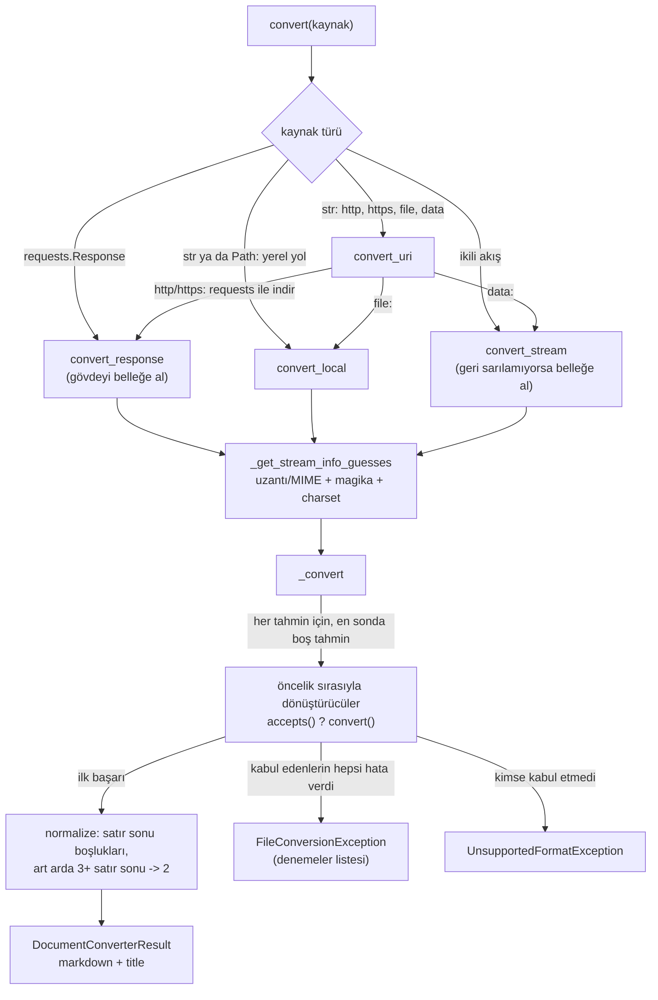
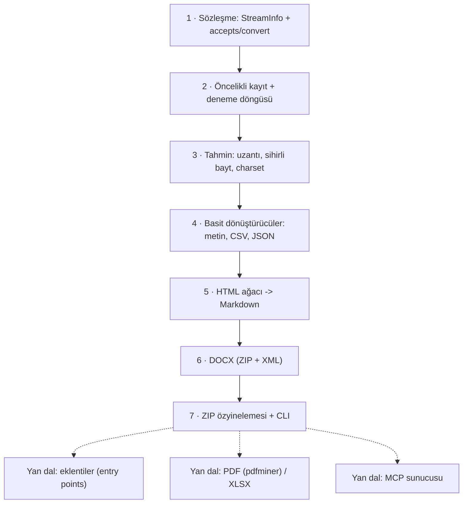

# microsoft/markitdown — Office belgelerini ve dosyaları LLM'e hazır Markdown'a çeviren Python aracı

> **Dal:** [D04 Veri araçları ve otomasyon](../README.md) · **Tür:** kod tabanı
> **Dil:** Python · **Lisans:** MIT · **Yıldız:** 194.528 (9 Kasım 2026) · **İncelenen commit:** `ed17895` (2026-11-06)

## 1. Bir bakışta

MarkItDown; PDF, Word, PowerPoint, Excel, HTML, CSV, JSON, EPUB, ZIP, resim (EXIF + isteğe bağlı LLM
açıklaması), ses (konuşmadan metne) ve YouTube/Wikipedia sayfası gibi kaynakları **Markdown'a** çeviren
küçük bir Python kütüphanesi ve komut satırı aracıdır. Amaç güzel bir belge değil, bir dil modelinin
yapıyı (başlıklar, listeler, tablolar) anlayabileceği ve az token harcayacağı metindir. Paketin yazarı
Microsoft'tan Adam Fourney'dir (`packages/markitdown/pyproject.toml`), GitHub konu etiketleri arasında
`autogen` ve `langchain` vardır; Kasım 2024'te açılan depo LLM uygulamalarında "her şeyi metne çevir" adımı
olarak hızla yayıldı. İncelenen sürüm `0.1.9`'dur (`packages/markitdown/src/markitdown/__about__.py`). Depo
artık bir MCP sunucusu (`markitdown-mcp`) ve bir OCR eklentisi (`markitdown-ocr`) de içeriyor.

## 2. Nasıl yapılmış: mimari

### Klasör haritası

```text
packages/
  markitdown/                       # ana paket (PyPI: markitdown)
    pyproject.toml                  # zorunlu ve biçim başına isteğe bağlı bağımlılıklar
    src/markitdown/
      _markitdown.py                # MarkItDown sınıfı: giriş türleri, tahmin, kayıt, deneme döngüsü (861 satır)
      _stream_info.py               # StreamInfo: mimetype, extension, charset, filename, local_path, url
      _base_converter.py            # DocumentConverter (accepts/convert) + DocumentConverterResult
      _exceptions.py                # MissingDependency, UnsupportedFormat, FileConversionException
      _uri_utils.py                 # file: ve data: URI çözümleme
      __main__.py                   # `markitdown` komutu (argparse)
      converters/                   # 19 dönüştürücü modülü (20 sınıf) + 4 yardımcı modül
        _html_converter.py          # BeautifulSoup + özel markdownify
        _markdownify.py             # başlık stili, javascript: linkleri, data URI kırpma
        _docx_converter.py          # mammoth ile DOCX -> HTML -> Markdown
        _pdf_converter.py           # pdfminer.six + pdfplumber (tablo ve form çıkarımı)
        _xlsx_converter.py          # pandas -> HTML tablo -> Markdown
        _pptx_converter.py, _csv_converter.py, _zip_converter.py, _epub_converter.py ...
        _doc_intel_converter.py     # Azure Document Intelligence (bulut OCR/düzen)
        _cu_converter.py            # Azure Content Understanding
      converter_utils/docx/         # DOCX ön işleme, matematik (OMML -> LaTeX), görseller
    tests/                          # test vektörleri (_test_vectors.py) + test_files/
  markitdown-mcp/                   # MCP sunucusu: convert_to_markdown(uri) aracı (stdio / HTTP)
  markitdown-ocr/                   # eklenti: belge içindeki görselleri LLM görme modeliyle okur
  markitdown-sample-plugin/         # örnek eklenti: RTF dönüştürücü, giriş noktası 'markitdown.plugin'
.github/workflows/tests.yml         # Python 3.10–3.14 + Windows matrisi; ocr ve mcp testleri
```

### Ana bileşenler ve veri akışı



Her şey bir **ikili akışa** indirgenir: `http(s)`, `file:` ve `data:` adresleri `convert_uri` üzerinden
`convert_response`, `convert_local` ya da `convert_stream`'e dağıtılır. Akış hakkında bilinenler
`StreamInfo`'da tutulur ve `_get_stream_info_guesses` bu bilgiyi Google'ın `magika` modeliyle (içerikten
dosya türü tahmini) ve `charset_normalizer` ile zenginleştirir. Uzantı ile içerik çelişirse **iki tahmin**
üretilir: önce uzantının/kullanıcının söylediği, sonra magika'nınki; `_convert` listenin sonuna bir de boş
`StreamInfo()` ekler. Her tahmin için kayıtlı dönüştürücüler öncelik sırasıyla denenir. `accepts()` hızlı bir
"bakarım" kararıdır; `convert()` hata verirse hata biriktirilir ve sıradaki denenir. Sonraki tahmine ancak o
tahmin için hiçbir dönüştürücü **başarılı olamazsa** geçilir. Bu yüzden `.txt` adı taşıyan bir DOCX'te
ikinci tahmin (DOCX) devreye girmez: ilk tahmindeki `PlainTextConverter` `.txt`'yi kabul eder, ikili veriyi
`charset_normalizer`'ın tahminiyle ya da tahmin yoksa `errors="ignore"` ile çözer ve "başarılı" döner.
`packages/markitdown/tests/test_module_misc.py`'deki "Undetectable charsets" testleri, metin uzantılı ikili
verinin hata vermeden geçtiğini gösterir. Mini sürümün düz metin dönüştürücüsü ikili veride hata verdiği için
orada ikinci tahmine, yani DOCX'e geçilir.

### Önce okunacak dosyalar

1. `packages/markitdown/src/markitdown/_base_converter.py` — sözleşmenin tamamı ve `accepts()`'in akış
   konumunu geri alma zorunluluğu (belge yorumunda "IMPORTANT").
2. `_stream_info.py` — 30 satırlık değişmez veri sınıfı; `copy_and_update` deseni.
3. `_markitdown.py` → `register_converter` ve `_convert` — öncelik, kararlı sıralama, deneme döngüsü.
4. `_markitdown.py` → `_get_stream_info_guesses` — uyumluluk kontrolü ve iki tahmin kuralı.
5. `converters/_plain_text_converter.py` ve `_csv_converter.py` — en sade iki dönüştürücü.
6. `converters/_docx_converter.py` + `_html_converter.py` — "ara gösterim olarak HTML" fikri.
7. `packages/markitdown-sample-plugin/src/markitdown_sample_plugin/_plugin.py` — eklenti sözleşmesi.
8. `packages/markitdown-mcp/src/markitdown_mcp/__main__.py` — aynı motorun MCP aracı olarak sunulması.

### Teknoloji yığını, derleme, test, CI, sürüm

- **Paketleme:** `hatchling`, Python `>=3.10,<3.15`. Zorunlu bağımlılıklar küçük tutulmuş:
  `beautifulsoup4`, `requests`, `certifi`, `markdownify`, `magika`, `charset-normalizer`, `defusedxml`.
  Ağır kütüphaneler biçim başına ekstra olarak gelir: `[docx]` (mammoth, lxml), `[pdf]` (pdfminer.six,
  pdfplumber), `[xlsx]` (pandas, openpyxl), `[pptx]`, `[outlook]`, `[audio-transcription]`,
  `[youtube-transcription]`, `[az-doc-intel]`, `[az-content-understanding]`, hepsi için `[all]`.
- **Eksik bağımlılık stratejisi:** dönüştürücü modülü içe aktarılırken hata yakalanır ve saklanır;
  kullanıcı o biçimi dönüştürmeye çalıştığında `MissingDependencyException` hangi ekstranın
  kurulacağını söyler (`_docx_converter.py` başındaki `_dependency_exc_info` kalıbı).
- **Test:** `hatch test` (pytest). `tests/_test_vectors.py` 25 `FileTestVector` tanımlar (23 genel + 2
  `data:` URI vektörü): her test dosyası için çıktıda bulunması ve bulunmaması gereken dizgiler; CLI ve modül
  aynı vektörlerle sınanır.
- **CI:** `tests.yml` yalnızca PR'larda çalışır; Ubuntu'da Python 3.10–3.14, ayrıca Windows (x64 ve ARM)
  3.12; exiftool ve ffmpeg kurulur; `markitdown-ocr` ve `markitdown-mcp` için ayrı işler var.
  `pre-commit.yml` biçim denetimi yapar. Eylemler commit SHA'sıyla sabitlenmiş (tedarik zinciri güvenliği).
- **Dağıtım:** PyPI paketi + Dockerfile; MCP sunucusu ayrı paket ve ayrı Dockerfile.

### Tasarım kararları ve ödünleşimler

1. **Öncelik + kararlı sıralama.** `register_converter` yeni kaydı listenin BAŞINA ekler; çağrı anında
   `sorted(..., key=priority)` yapılır. Aynı öncelikte en son kaydedilen önce denenir; eklentiler
   önceliği sayıyla ayarlayarak yerleşiklerin önüne ya da arkasına geçebilir. "Genel" dönüştürücüler
   (düz metin, HTML, ZIP) 10.0, özeller 0.0 önceliktedir.
2. **"Kabul" ile "dönüştür"ün ayrılması.** `accepts()` ucuz ve yan etkisizdir; pahalı iş `convert()`'tedir.
   Akıştan okuyan bir `accepts()` konumu geri almak zorundadır; çekirdek `assert` ile bunu denetler.
3. **Tahminlerin çoğulluğu.** Uzantı yalan söyleyebilir; içerik tanıma da yanılabilir. Tek bir doğru
   yerine sıralı tahmin listesi tutmak hatayı tolere eden basit bir stratejidir.
4. **HTML'i ortak ara gösterim yapmak.** DOCX (mammoth), XLSX (pandas `to_html`) ve diğerleri önce HTML'e,
   sonra tek bir HTML→Markdown yoluna gider. Kod tekrarı azalır; bedeli bazı biçimlerde bilgi kaybı
   ve çift dönüşüm maliyetidir.
5. **Ağır bağımlılıkları isteğe bağlı yapmak.** Kurulum hafif kalır, yalnızca ihtiyaç duyulan biçimin
   kütüphanesi yüklenir. Hata mesajı kullanıcıyı doğru ekstraya yönlendirir.
6. **LLM'leri seçenek olarak bağlamak.** Resim açıklaması (`llm_client`, `llm_model`) ve Azure Document
   Intelligence / Content Understanding parametreyle açılır; varsayılan kurulum çevrimdışı ve deterministiktir.
7. **Ajanlara doğrudan sunmak.** HTTP isteklerinde `Accept: text/markdown` önceliği (sunucu Markdown
   verebiliyorsa onu iste) ve MCP sunucusu, aracın ajan ekosistemine nasıl yerleştiğini gösterir.

## 3. Öğrenmen gerekenler

| Ön koşul                                                            | Bu depo için neden gerekli                                                                                     | Ücretsiz kaynak                                                                                              |
| ------------------------------------------------------------------- | -------------------------------------------------------------------------------------------------------------- | ------------------------------------------------------------------------------------------------------------ |
| [G3 Python](../../../govde/README.md#g3)                            | `dataclass(frozen=True)`, `BinaryIO`, `io.BytesIO`, istisna zincirleri, `importlib.metadata`                   | [Python-100-Days dossier'i](../../09-bilgisayar-bilimi/python-100-days/README.md)                            |
| [G6 Ağ ve web temelleri](../../../govde/README.md#g6)               | MIME türleri, `Content-Type` charset, `Content-Disposition`, `data:` URI                                       | [MDN: MIME types](https://developer.mozilla.org/en-US/docs/Web/HTTP/MIME_types)                              |
| [G7 Test, CI](../../../govde/README.md#g7)                          | Vektör tabanlı testler, matris CI, isteğe bağlı bağımlılıklı testler                                           | [pytest parametrize](https://docs.pytest.org/en/stable/how-to/parametrize.html)                              |
| Metin kodlamaları                                                   | UTF-8, BOM, Windows-1254 (Türkçe), sezgisel tespit                                                             | [Python codecs](https://docs.python.org/3/library/codecs.html)                                               |
| Dosya biçimleri                                                     | DOCX/XLSX/PPTX = XML dosyalarından oluşan ZIP (Office Open XML); PDF'te "metin" yoktur, konumlu glifler vardır | [ECMA-376 (OOXML)](https://ecma-international.org/publications-and-standards/standards/ecma-376/)            |
| HTML DOM                                                            | Ağaç yapısı, blok/satır içi öğeler, varlıklar                                                                  | [MDN: DOM](https://developer.mozilla.org/en-US/docs/Web/API/Document_Object_Model)                           |
| Eklenti mimarisi                                                    | Giriş noktaları (entry points) ile keşif                                                                       | [Python packaging: plugins](https://packaging.python.org/en/latest/guides/creating-and-discovering-plugins/) |
| [D05 Yapay zekâ altyapısı](../../05-yapay-zeka-altyapisi/README.md) | İsteğe bağlı, bu daldan sonra: çıktının tüketicisi LLM; token maliyeti ve bağlam penceresi                     | [transformers dossier'i](../../05-yapay-zeka-altyapisi/transformers/README.md)                               |

## 4. Sıfırdan yol (dallanma)



| Aşama | Ne inşa edersin                       | Öğrendiğin kavram                                | Bitti ölçütü                                     | Süre (tahmini) |
| ----- | ------------------------------------- | ------------------------------------------------ | ------------------------------------------------ | -------------- |
| 1     | `AkisBilgisi`, `Donusturucu`, `Sonuc` | Değişmez veri, sözleşme sınıfı                   | `guncelle()` yalnızca dolu alanları ezer         | 1 saat         |
| 2     | Kayıt defteri, `_donustur`            | Öncelik, kararlı sıralama, hata biriktirme       | Bozuk dönüştürücü sonrası yedek devreye giriyor  | 2 saat         |
| 3     | `tahminleri_uret`                     | Sihirli baytlar, kodlama tespiti                 | `.txt` adlı DOCX iki tahmin üretiyor             | 3 saat         |
| 4     | Metin/CSV/JSON                        | Tablo kaçışları, BOM                             | Türkçe cp1254 CSV doğru tabloya dönüyor          | 2 saat         |
| 5     | HTML → Markdown                       | Ağaç kurma, örtük kapanış, liste girintisi       | İç içe liste ve tablo testleri geçiyor           | 5 saat         |
| 6     | DOCX                                  | OOXML: `w:p`, `w:r`, `w:tbl`, stiller, ilişkiler | Türkçe Word stil kimliği (`Balk1`) başlık oluyor | 4 saat         |
| 7     | ZIP + CLI                             | Özyineleme, zip bombası sınırı, stdin            | `cat x.csv \| cli -x csv` çalışıyor              | 2 saat         |

**Süre toplamı:** mini ~19 saat; okuma rotası (9 adım × 1 saat) ve alıştırmalarla (2 kolay + 3 orta + 2 zor =
2 + 6 + 8 saat) toplam ~44 saat ([dal README'sindeki kural](../README.md#yapraklar)).

**Mini uygulama:** [`sifirdan/`](sifirdan/README.md) — dört aşama dosyası, eklenti örneği ve 28 test.
DOCX'i doğrudan XML'den okur (asıl proje mammoth ile HTML'e çevirir); Türkçe Word belgelerindeki stil
kimliği tuzağını (`Balk1` = "heading 1") stil ADINA bakarak çözer.

**Gerçek ölçeğe giden yol:** (1) Gerçek içerik tanıma: sihirli bayt tablosu yerine `magika` ya da `libmagic`.
(2) PDF: metin katmanı (pdfminer), tablo tespiti (pdfplumber), taranmış sayfalar için OCR (eklenti ya da
Azure). (3) XLSX/PPTX: çalışma sayfaları, slayt notları, grafik verisi. (4) Büyük dosyalar için akışlı
işleme ve bellek sınırları. (5) Güvenlik: `defusedxml`, zip bombası ve iç içe arşiv sınırları, URL
girişinde SSRF koruması. (6) Dağıtım: eklenti sürüm arayüzü (`__plugin_interface_version__`), MCP sunucusu,
Docker imajı.

## 5. Gerçek depoda okuma rotası

1. `_markitdown.py` → `convert`: bir `str` girdinin URL mi yerel yol mu olduğuna nasıl karar veriliyor?
2. `convert_stream`: geri sarılamayan akış (`seekable() == False`) ne oluyor? Neden?
3. `_get_stream_info_guesses`: magika `.docx` derken kullanıcı `extension='.txt'` verirse kaç tahmin çıkar ve
   hangisi önce denenir? `_convert` ikinci tahmine ne zaman geçer? Charset uyuşmazlığı uyumluluğu nasıl etkiler?
4. `_convert`: `failed_attempts` ne zaman `FileConversionException`'a dönüşüyor, ne zaman
   `UnsupportedFormatException` atılıyor?
5. `converters/_html_converter.py`: `RecursionError` neden yakalanıyor ve yedek yol ne?
6. `converters/_csv_converter.py` → `_escape_table_cell`: bir `|` karakterinden hemen önce gelen ters eğik çizgi
   dizisi neden ikiye katlanıyor (`_PIPE_ESCAPE_RE`)?
7. `converters/_docx_converter.py`: stil haritası (`style_map`) hangi üç kaynaktan birleşiyor?
8. `packages/markitdown-sample-plugin/pyproject.toml`: `[project.entry-points."markitdown.plugin"]` satırını bul;
   `_load_plugins` bunu nasıl yüklüyor ve bozuk eklentide ne yapıyor?
9. `tests/_test_vectors.py`: bir vektör hangi alanlardan oluşuyor? Yeni bir biçim eklesen hangi vektörü yazardın?

## 6. Alıştırmalar ve öz değerlendirme

1. (Kolay) `.md` dosyaları şu an genel `DuzMetinDonusturucu` (öncelik 10.0) üzerinden geçiyor. 0.0 öncelikli
   ayrı bir `MarkdownDonusturucu` kaydet, `--listele` çıktısında yerini doğrula ve `markdown_normalize`'ın
   içeriği nasıl değiştirdiğini gözlemle.
2. (Kolay) `<br>`'nin `markdown_normalize` sonrası kaybolduğunu gözlemle; markdownify'daki `newline_style`
   seçeneğini araştır ve bunu koruyan bir düzeltme öner.
3. (Orta) DOCX dönüştürücüsüne numaralı liste desteği ekle: `word/numbering.xml`'den `numFmt` oku.
4. (Orta) XLSX dönüştürücüsü yaz: `xl/sharedStrings.xml` + `xl/worksheets/sheet1.xml` ile ilk sayfayı tabloya çevir.
5. (Orta) `MiniMarkItDown.convert`'e `http(s)://` desteği ekle; `Content-Type` başlığındaki charset'i `AkisBilgisi`'ne aktar.
6. (Zor) Eklenti öncelik deneyi: 5.0 öncelikli bir HTML dönüştürücü eklentisi yaz; hangi dosyalarda yerleşiğin
   önüne geçtiğini test et.
7. (Zor) PDF için sihirli bayt tanıması zaten var; `pypdf` gibi bir kütüphane olmadan yalnızca sıkıştırılmamış
   metin akışlarını okuyan deneysel bir dönüştürücü yaz ve neden çoğu PDF'te yetmediğini açıkla.

<details><summary>Cevap: Neden aynı öncelikte en son kaydedilen önce denenir?</summary>

Kayıt listenin başına eklenir ve sıralama kararlıdır. Yerleşikler "genelden özele" sırayla kaydedildiği için
özeller öne geçer; eklentiler de sonradan kaydedildiğinden aynı öncelikte yerleşiklerden önce denenir.
Böylece bir eklenti yerleşik bir dönüştürücüyü kolayca "geçersiz kılabilir".
</details>

<details><summary>Cevap: accepts() akış konumunu bozarsa ne olur?</summary>

`convert()` akışın başta olduğunu varsayar; konumu kaymış bir akıştan okumak dosyanın başını atlatır ve
bozuk/eksik çıktı üretir. Hata sessiz olacağı için çekirdek her `accepts()` sonrası konumu `assert` ile
denetler ve sözleşmeyi bozan dönüştürücüyü hemen yakalar.
</details>

<details><summary>Cevap: DOCX'i neden doğrudan Markdown'a değil HTML'e çeviriyorlar?</summary>

HTML zaten zengin bir yapı dilidir ve olgun bir HTML→Markdown yolu (markdownify) mevcuttur. mammoth DOCX'i
anlamlı HTML'e çok iyi çevirir. İki olgun parçayı birleştirmek, Markdown'a özel yeni bir DOCX
ayrıştırıcısı yazmaktan daha az koddur; ayrıca resim kancası gibi özellikler HTML seviyesinde kolayca eklenir.
</details>

<details><summary>Cevap: Türkçe Word'de "Başlık 1" stilini neden kimlikten değil addan tanımalıyız?</summary>

Word stil kimliğini (styleId) yerelleştirilmiş adın ASCII olmayan harfleri atılmış hâlinden üretir
("Başlık 1" → `Balk1`), ama yerleşik stillerin adı `styles.xml`'de İngilizce saklanır (`heading 1`).
Kimliğe bakan kod Türkçe belgelerde başlıkları kaçırır; ada bakan kod her dilde çalışır.
</details>

## 7. İş fikri tohumları

- **Kurumsal belge → RAG hattı:** şirketin paylaşılan sürücüsündeki Word/Excel/PDF arşivini düzenli olarak
  Markdown'a çevirip bölümleyen ve bir vektör veritabanına yazan servis. **Kime:** iç bilgi bankası kurmak
  isteyen 50–500 kişilik hukuk büroları, muhasebe ve danışmanlık firmaları.
- **E-fatura/irsaliye ve sözleşme okuyucu:** PDF/DOCX sözleşmeleri Markdown'a çevirip tarihleri, tutarları ve
  tarafları çıkaran, KVKK uyumlu yerel çalışan araç. **Kime:** KOBİ muhasebe departmanları, emlak ofisleri.
- **Erişilebilir ders materyali dönüştürücü:** öğretmenlerin PPTX/DOCX dosyalarını ekran okuyucu dostu
  Markdown/HTML'e çeviren web aracı. **Kime:** özel eğitim kurumları, üniversite engelli öğrenci birimleri.

Ayrıntılı katalog: [İş fikirleri](../../../is-fikirleri/README.md).

## 8. Kaynaklar

- README: <https://github.com/microsoft/markitdown/blob/ed178952a6672abdfd35b5f9e76a80b6cefc086e/README.md>
- Çekirdek: <https://github.com/microsoft/markitdown/blob/ed178952a6672abdfd35b5f9e76a80b6cefc086e/packages/markitdown/src/markitdown/_markitdown.py>
- Dönüştürücü sözleşmesi: <https://github.com/microsoft/markitdown/blob/ed178952a6672abdfd35b5f9e76a80b6cefc086e/packages/markitdown/src/markitdown/_base_converter.py>
- Örnek eklenti: <https://github.com/microsoft/markitdown/tree/ed178952a6672abdfd35b5f9e76a80b6cefc086e/packages/markitdown-sample-plugin>
- MCP sunucusu: <https://github.com/microsoft/markitdown/tree/ed178952a6672abdfd35b5f9e76a80b6cefc086e/packages/markitdown-mcp>
- Test vektörleri: <https://github.com/microsoft/markitdown/blob/ed178952a6672abdfd35b5f9e76a80b6cefc086e/packages/markitdown/tests/_test_vectors.py>
- magika (içerik tabanlı dosya türü tanıma): <https://github.com/google/magika>
- Ağaç ve dal haritası: [AGAC.md](../../../AGAC.md)
