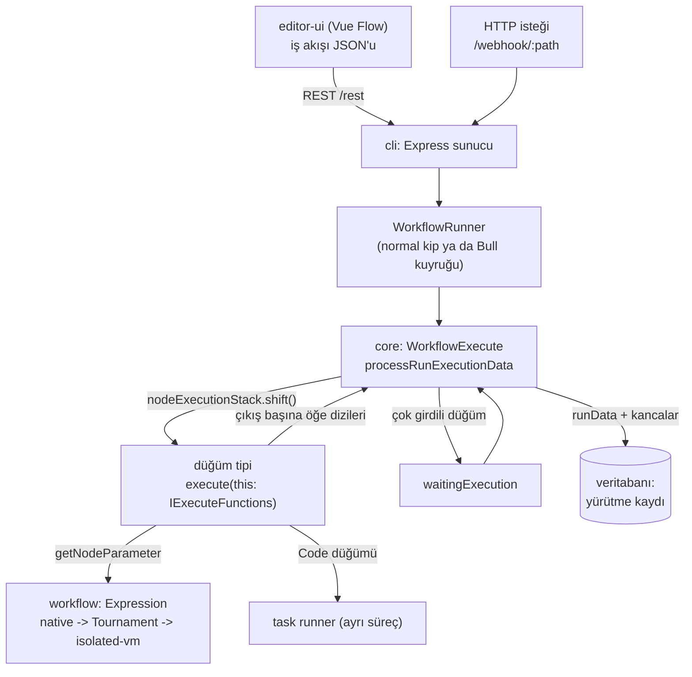
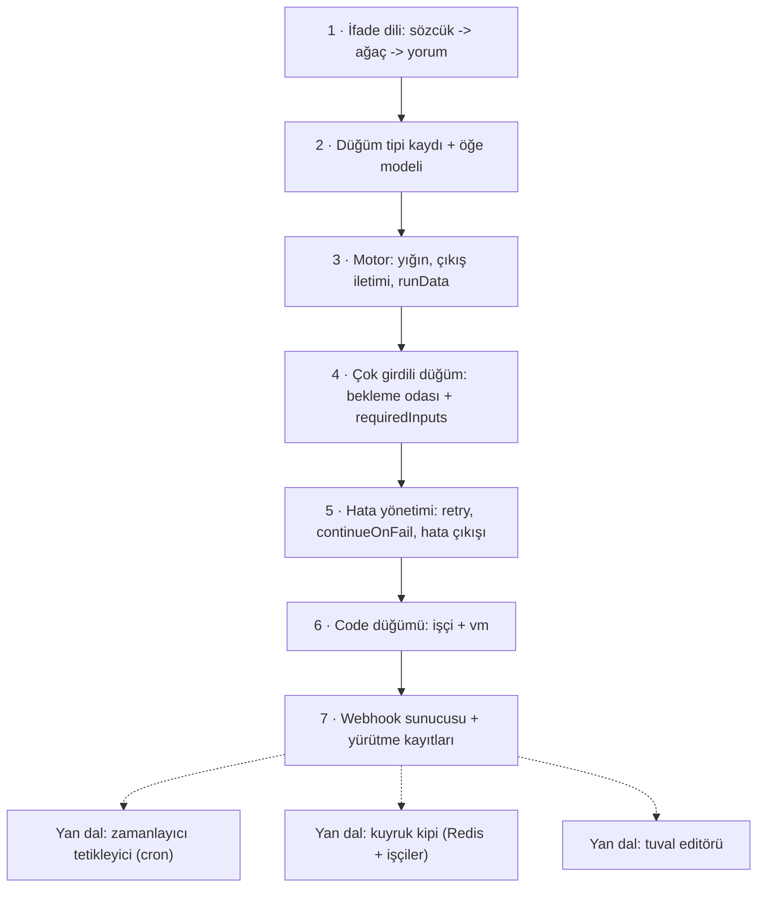

# n8n-io/n8n — görsel iş akışı otomasyonu ve yapay zekâ ajanları platformu

> **Dal:** [D04 Veri araçları ve otomasyon](../README.md) · **Tür:** kod tabanı
> **Dil:** TypeScript (+ Vue, Python) · **Lisans:** Sustainable Use License (fair-code) + dosya adında `.ee.`, klasör adında `.ee` geçen kod için n8n Enterprise License · **Yıldız:** 209.893 (9 Kasım 2026) · **İncelenen commit:** `5ee06d3` (2026-11-09)

## 1. Bir bakışta

n8n, düğümleri bir tuvalde birbirine bağlayarak iş akışı kurduğun, ister kendi sunucunda ister bulutta
çalıştırdığın bir otomasyon platformudur: "form gelince CRM'e yaz, Slack'e bildir, tabloyu güncelle" gibi
akışlar kodsuz kurulur, gerektiğinde JavaScript/Python düğümüyle kod eklenir. README kendini "AI ajanları ve
iş akışı otomasyonu platformu" olarak tanıtır: görsel tuval + özel kod, kendin barındırma ya da bulut,
1500+ entegrasyon ve LLM/MCP desteği. Monorepo sürümü `2.47.0`'dır. Lisansı klasik açık kaynak değildir:
kendi iç işin için kullanabilir ve değiştirebilirsin ama ücretli hizmet olarak yeniden satamazsın.

## 2. Nasıl yapılmış: mimari

### Klasör haritası

```text
packages/
  workflow/                 # n8n-workflow: çekirdek tipler ve saf mantık (tarayıcıda da çalışır)
    src/interfaces.ts       # INode, IConnections, INodeExecutionData, INodeType ... (4.760 satır)
    src/workflow.ts         # Workflow sınıfı: düğümler, bağlantılar, ebeveyn/çocuk sorguları
    src/expression.ts       # ifade değerlendirme girişi ('=' ile başlayan parametreler)
    src/expressions/native-evaluation/   # kapalı alt dil için süreç içi yorumlayıcı
    src/workflow-data-proxy.ts           # $json, $input, $('Düğüm'), $node ... değişkenleri
  core/                     # n8n-core: yürütme motoru ve düğüm çalıştırma bağlamları
    src/execution-engine/workflow-execute.ts   # WorkflowExecute: yığın, bekleme odası, runData (3.271 satır)
    src/execution-engine/node-execution-context/  # execute/trigger/webhook/poll bağlamları, yardımcılar
    src/execution-engine/partial-execution-utils/ # editörde "buradan çalıştır" için alt graf bulma
  cli/                      # n8n sunucusu: Express API, veritabanı, webhook'lar, kuyruk kipi
    src/webhooks/           # live/test/waiting webhook'lar, yanıt kipleri
    src/scaling/            # kuyruk kipi: Bull + Redis, işçiler, çoklu ana süreç (.ee)
    src/task-runners/       # Code düğümü için görev çalıştırıcı aracısı
  nodes-base/nodes/         # yerleşik düğümler (308 klasör): If, Set, HttpRequest, Code, Merge, Webhook ...
  @n8n/nodes-langchain/     # yapay zekâ düğümleri (ajan, LLM, vektör deposu, araçlar)
  @n8n/task-runner/, @n8n/task-runner-python/   # kullanıcı kodunu ayrı süreçte çalıştıranlar
  @n8n/expression-runtime/  # ifadeler için izole V8 (isolated-vm) çalışma ortamı
  @n8n/tournament/          # ifade şablonunu JS'e çeviren ve sandbox kancaları ekleyen kütüphane
  @n8n/engine/              # yürütme motoru v2 (iskelet; README'ye göre henüz bağlı değil)
  @n8n/config/, @n8n/db/, @n8n/di/, @n8n/permissions/ ...   # yapılandırma, veritabanı, DI, yetki
  frontend/editor-ui/       # Vue 3 + Pinia + Vue Flow tuval editörü
LICENSE.md, LICENSE_EE.md, CONTRIBUTOR_LICENSE_AGREEMENT.md, AGENTS.md, CLAUDE.md
turbo.json, pnpm-workspace.yaml   # Turborepo + pnpm monorepo
```

### Ana bileşenler ve veri akışı



Her şey **öğe dizileridir**: bir düğüm girdisinde `[{ json, binary?, pairedItem? }, ...]` alır, her çıkışı için
ayrı bir dizi döndürür (If düğümü: `[doğrular, yanlışlar]`). İş akışı JSON'unda bağlantılar **kaynak düğümün
adına** göre tutulur: `connections["If"].main[1] = [{ node: "Hata", type: "main", index: 0 }]`. Motor bir
yığınla çalışır: tetikleyiciden başlar, çalışan düğümün dolu çıkışlarını bağlı düğümlere iletir; boş çıkışın
dalı hiç çalışmaz. İki girdili bir düğüm (Merge) diğer girdisi gelene kadar `waitingExecution`'da bekler;
yığın boşalırsa `requiredInputs` kuralına göre eksik girdiyle çalıştırılabilir. Her düğüm çalışması
`runData`'ya zaman, süre, çıktılar ve hata ile kaydedilir; arayüzdeki "yürütme" ekranı bu kayıttır.

**Dışa aktarılmış bir akışın iskeleti** (kısaltılmış, kurgusal; alan adları gerçek biçimle aynı):

```json
{
  "name": "Sipariş kontrolü",
  "nodes": [
    {
      "name": "Webhook",
      "type": "n8n-nodes-base.webhook",
      "typeVersion": 2,
      "position": [0, 0],
      "parameters": { "httpMethod": "POST", "path": "siparis", "responseMode": "lastNode" }
    },
    {
      "name": "Tutar büyük mü?",
      "type": "n8n-nodes-base.if",
      "typeVersion": 2,
      "position": [220, 0],
      "parameters": {
        "conditions": {
          "combinator": "and",
          "conditions": [
            {
              "leftValue": "={{ $json.body.tutar }}",
              "rightValue": 100,
              "operator": { "type": "number", "operation": "gt" }
            }
          ]
        }
      }
    }
  ],
  "connections": {
    "Webhook": { "main": [[{ "node": "Tutar büyük mü?", "type": "main", "index": 0 }]] }
  },
  "settings": { "executionOrder": "v1" }
}
```

**Motorun ana döngüsü** sözde kodla (`workflow-execute.ts`'teki `processRunExecutionData`'nın özeti):

```text
yığın = [tetikleyici]
döngü:
  iş = yığın.başından_al()  ya da  (yığın boşsa) bekleme odasından requiredInputs'u karşılayan düğüm
  iş yoksa: bitir
  çıktılar = düğüm.execute(girdiler)       # yeniden deneme, continueOnFail, onError burada
  runData[düğüm].ekle(kayıt)
  her DOLU çıkış i için, connections[düğüm].main[i] içindeki her hedef:
      hedefin tek girdisi varsa  -> yığına ekle (v1: başına, v0: sonuna)
      birden çok girdisi varsa   -> bekleme odasına koy; hepsi geldiyse yığına al
```

### Önce okunacak dosyalar

1. Bir test akışı, ör. `packages/nodes-base/nodes/If/test/v2/IfV2.number.json` — gerçek JSON biçimi:
   `nodes`, `connections`, `pinData`, `={{ $json.count }}` ifadesi.
2. `packages/workflow/src/interfaces.ts` → `IConnection`, `IConnections`, `INode`, `INodeExecutionData`, `INodeType`.
3. `packages/nodes-base/nodes/ManualTrigger/ManualTrigger.node.ts` — en küçük düğüm (tek boş öğe yayar).
4. `packages/nodes-base/nodes/If/V2/IfV2.node.ts` — iki çıkışlı düğüm, koşul parametresi.
5. `packages/core/src/execution-engine/workflow-execute.ts` → `processRunExecutionData`, `addNodeToBeExecuted`,
   "top-left first" sıralaması, `getRetryParams`, `continuesOnError`.
6. `packages/workflow/src/expressions/native-evaluation/index.ts` — baştaki uzun yorum: alt dil, "parse, don't validate".
7. `packages/workflow/src/expression-evaluator-proxy.ts` ve `packages/@n8n/expression-runtime/README.md` — Tournament ve izole çalışma ortamı.
8. `packages/cli/src/webhooks/webhook-helpers.ts` ve `webhook-on-received-response-extractor.ts` — yanıt kipleri.
9. `packages/nodes-base/nodes/Code/Code.node.ts` + `JsTaskRunnerSandbox.ts` — kod düğümü ve görev çalıştırıcı.

### Teknoloji yığını, derleme, test, CI, sürüm

- **Monorepo:** pnpm 12.4.2 + Turborepo; Node `>=24` (kök `package.json`). `pnpm build` → `turbo run build`.
- **Arka uç:** TypeScript, Express, TypeORM'un n8n çatalı (`@n8n/typeorm`), SQLite (varsayılan) ya da Postgres,
  kuyruk kipi için `bull` (Redis). Bağımlılık enjeksiyonu `@n8n/di`.
- **Ön yüz:** Vue 3, Pinia, Vue Flow (tuval), Vite (`packages/frontend/editor-ui/package.json`).
- **Kod çalıştırma:** Code düğümü JS ve Python görev çalıştırıcılarına gider (`JsTaskRunnerSandbox`,
  `PythonTaskRunnerSandbox`); ifadeler varsayılan olarak `isolated-vm` motorunda (`@n8n/expression-runtime`
  README'si: `N8N_EXPRESSION_ENGINE=legacy` ile kapatılabilir), tarayıcıda isteğe bağlı QuickJS.
- **Test:** Vitest (kökte `vitest.workspace.ts`), düğüm testleri JSON iş akışlarıyla (`nodes/*/test/*.json`),
  uçtan uca testler Playwright paketiyle (`pnpm dev:e2e` → `n8n-playwright`).
- **CI:** `.github/workflows/` altında 109 dosya: `ci-pull-requests.yml`, `ci-master.yml`, `ci-python.yml`,
  `ci-cla-check.yml` (katkı sözleşmesi imzası zorunlu), sahiplik/inceleme kuralları, sürüm iş akışları.
- **Lisans ayrımı:** dosya adında `.ee.` ya da klasör adında `.ee` geçen kod (ör. `multi-main-setup.ee.ts`) yalnızca
  kurumsal lisansla kullanılabilir; geri kalanı Sustainable Use License.

### Tasarım kararları ve ödünleşimler

1. **Öğe dizisi evrensel veri modeli.** Her düğüm aynı şekli alıp verir; düğümler birbirinden habersiz
   birleşebilir. Bedeli: tablo dışı veriler (büyük dosyalar) `binary` alanı ve ayrı depolama gerektirir;
   öğe eşleştirmesi için `pairedItem` soyu taşınmak zorundadır.
2. **Ad tabanlı bağlantılar.** `connections` düğüm ADINA göre tutulur; insan okunur ve elle düzenlenebilir
   JSON verir. Bedeli: yeniden adlandırma bütün ifadeleri ve bağlantıları güncellemeyi gerektirir
   (`node-parameters/rename-node-utils.ts`).
3. **Yürütme sırası bir ayardır.** `settings.executionOrder: 'v1'` bir dalı bitirmeden diğerine geçmez ve
   kardeşler arasında tuvalde **sol üstteki** önce çalışır; eski `v0` katman katman ilerler. Görsel konumun
   anlamı olması kullanıcı için sezgiseldir ama "düğümü taşıyınca sonuç değişti" şaşkınlığı da yaratabilir.
4. **Boş çıkış = dal yok.** Bir çıkıştan öğe çıkmazsa alt dal hiç çalışmaz; "If yanlış dalı neden çalışmadı?"
   sorusunun cevabı budur. Merge gibi düğümler `requiredInputs` ile eksik girdiyle çalışmaya karar verir.
5. **Katmanlı ifade güvenliği.** İfadeler kullanıcı girdisidir. Önce kapalı bir alt dil süreç içinde
   yorumlanır (eval yok, izin listesi, adım ve boyut sınırları); sığmayanlar Tournament ile JS'e çevrilip
   sandbox kancalarıyla izole V8'de çalışır. Kod düğümü ise tamamen ayrı süreçte.
6. **Fair-code lisans + CLA.** Kaynak açık, ticari yeniden satış kısıtlı; katkılar CLA ile alınır, kurumsal
   özellikler `.ee.` ile ayrılır. Bu, iş modelini koruyan bir mühendislik kararıdır.
7. **Normal ve kuyruk kipi.** Tek süreçte çalışabilir; yük artınca ana süreç işleri Bull/Redis kuyruğuna
   koyar ve ayrı işçiler çalıştırır (`packages/cli/src/scaling/`).

## 3. Öğrenmen gerekenler

| Ön koşul                                                           | Bu depo için neden gerekli                                                                               | Ücretsiz kaynak                                                                                                                                                                              |
| ------------------------------------------------------------------ | -------------------------------------------------------------------------------------------------------- | -------------------------------------------------------------------------------------------------------------------------------------------------------------------------------------------- |
| [G4 JavaScript/TypeScript ve Node.js](../../../govde/README.md#g4) | Tipler, async akış, monorepo paketleri, Vue                                                              | [You-Dont-Know-JS dossier'i](../../01-web-arayuzu/you-dont-know-js/README.md)                                                                                                                |
| [G5 Veri yapıları ve algoritmalar](../../../govde/README.md#g5)    | Yönlü graf, yığın/kuyruk, topolojik düşünme, döngü işleme                                                | [javascript-algorithms dossier'i](../../09-bilgisayar-bilimi/javascript-algorithms/README.md)                                                                                                |
| [G6 Ağ ve web temelleri](../../../govde/README.md#g6)              | Webhook, REST, OAuth2, HTTP gövde biçimleri                                                              | [MDN: HTTP](https://developer.mozilla.org/en-US/docs/Web/HTTP)                                                                                                                               |
| [G7 Test, CI](../../../govde/README.md#g7)                         | JSON iş akışı tabanlı düğüm testleri, uçtan uca testler                                                  | [Vitest belgeleri](https://vitest.dev/)                                                                                                                                                      |
| Ayrıştırıcı/yorumlayıcı                                            | İfade dili kendi başına küçük bir dildir                                                                 | [build-your-own-x: Template Engine](https://github.com/codecrafters-io/build-your-own-x#build-your-own-template-engine) ([dossier](../../10-kuratorluk-topluluk/build-your-own-x/README.md)) |
| Sandbox ve izolasyon                                               | `node:vm` neden güvenlik sınırı değil; süreç/isolate ayrımı                                              | [Node vm belgeleri](https://nodejs.org/api/vm.html)                                                                                                                                          |
| [G8 Büyük kod tabanı okuma](../../../govde/README.md#g8)           | 33.318 dosyalık monorepoda okuma rotasının dosyalarını bulmak, bir yürütmeyi uçtan uca izlemek           | [The Architecture of Open Source Applications](https://aosabook.org/en/)                                                                                                                     |
| [G9 Açık kaynak lisansları](../../../govde/README.md#g9)           | Fair-code, CLA, `.ee.`/`.ee` ayrımı                                                                      | [faircode.io](https://faircode.io)                                                                                                                                                           |
| [D06 Ajan platformları](../../06-ajan-platformlari/README.md)      | İsteğe bağlı, bu daldan sonra: n8n'in AI ajan düğümleri ve MCP, ajan platformlarıyla aynı soruları çözer | [autogpt dossier'i](../../06-ajan-platformlari/autogpt/README.md)                                                                                                                            |

## 4. Sıfırdan yol (dallanma)



| Aşama | Ne inşa edersin                           | Öğrendiğin kavram                              | Bitti ölçütü                                     | Süre (tahmini) |
| ----- | ----------------------------------------- | ---------------------------------------------- | ------------------------------------------------ | -------------- |
| 1     | `asama1_ifade.js`                         | Sözcük ayırma, öncelik tırmanışı, izin listesi | `constructor`/`process` saldırıları reddediliyor | 6 saat         |
| 2     | Düğüm kaydı: ManualTrigger, Set, If, NoOp | Çok çıkışlı düğüm, `assignments` biçimi        | If öğeleri iki çıkışa bölüyor                    | 3 saat         |
| 3     | Motor çekirdeği                           | Yığın, ad tabanlı bağlantılar, v1/v0 sırası    | Dallanan akışta beklenen sıra                    | 4 saat         |
| 4     | Merge + bekleme odası                     | Birleşme noktası, eksik girdi kuralı           | Boş dal varken Merge yine çalışıyor              | 3 saat         |
| 5     | Hata yönetimi                             | Sınırlandırılmış yeniden deneme, hata yolu     | 2 kez 503 sonrası başarı                         | 2 saat         |
| 6     | Code düğümü                               | İşçi iş parçacığı, vm, JSON sınırı             | Sonsuz döngü zaman aşımıyla kesiliyor            | 3 saat         |
| 7     | Webhook sunucusu                          | Yanıt kipleri, gövde sınırı, kayıt deposu      | `lastNode` yanıtı son düğümün öğesi              | 3 saat         |

**Süre toplamı:** mini ~24 saat; okuma rotası (9 adım × 1 saat) ve alıştırmalarla (2 kolay + 3 orta + 2 zor =
2 + 6 + 8 saat) toplam ~49 saat ([dal README'sindeki kural](../README.md#yapraklar)).

**Mini uygulama:** [`sifirdan/`](sifirdan/README.md) — n8n'den dışa aktarılan biçimde iki örnek akış, dört
aşama dosyası, kod işçisi ve 22 test. Örnek akışlar gerçek parametre şekillerini kullanır (Set v3.3+
`assignments`, If v2 `conditions`, Merge v3 `mode`).

**Gerçek ölçeğe giden yol:** (1) Kalıcılık: iş akışlarını ve yürütmeleri veritabanında saklamak, kimlik
bilgilerini şifreli tutmak. (2) Tetikleyiciler: zamanlayıcı, yoklama (poll) ve olay tabanlı tetikleyicilerin
etkinleştirilmesi/devre dışı bırakılması (`active-workflow-manager.ts`). (3) `pairedItem` soyu ve
`$('Düğüm').item` eşleştirmesi. (4) İkili veri ve dosya depolama. (5) Kod için ayrı süreçli görev
çalıştırıcı, ifadeler için izole V8. (6) Kuyruk kipi ile yatay ölçekleme. (7) Tuval editörü, kısmi
çalıştırma ve pinlenmiş veriyle geliştirme deneyimi. (8) AI ajan düğümleri ve araç çağırma.

## 5. Gerçek depoda okuma rotası

1. `IfV2.number.json`: `connections["If"].main` kaç eleman içeriyor ve hangisi "yanlış" çıkışı?
2. `interfaces.ts` → `INodeExecutionData`: `json`, `binary`, `pairedItem`, `error` alanları ne zaman dolu?
3. `workflow-execute.ts` → `addNodeToBeExecuted`: `executionOrder === 'v1'` iken `unshift`, değilse `push` —
   aynı dallanan akışta iki sıra nasıl farklılaşır? Mini'deki testi zihninde yürüt.
4. `processRunExecutionData` içinde "top-left first" sıralamasını bul; konumlar nasıl karşılaştırılıyor?
5. Aynı dosyada yığın boşalınca `waitingExecution`'daki düğümlerin ele alındığı bölüm: `requiredInputs`
   bir sayı mı, dizi mi olabilir? Merge v3'te değeri ne (`Merge/v3/actions/versionDescription.ts`)?
6. `getRetryParams`: `maxTries` ve `waitBetweenTries` hangi aralıklara sıkıştırılıyor?
7. `native-evaluation/grammar.ts`: `MAX_STEPS`, `MAX_RESULT_LENGTH`, `MAX_DEPTH` neyi sınırlıyor?
8. `webhook-on-received-response-extractor.ts`: `onReceived` kipinde varsayılan yanıt ne?
9. `packages/@n8n/engine/README.md`: v2 motoru neden "yalnızca arayüzlere bağımlı" olmak istiyor?

## 6. Alıştırmalar ve öz değerlendirme

1. (Kolay) Mini'ye `n8n-nodes-base.filter` ekle: koşulu sağlamayan öğeleri at (tek çıkışlı If).
2. (Kolay) İfade diline `$json.liste.length > 0 ? ... : ...` gibi zincirleri kapsayan yeni testler yaz;
   `toLocaleUpperCase('tr-TR')` ile `toUpperCase()` farkını `'istanbul'` üzerinde göster.
3. (Orta) `n8n-nodes-base.switch` düğümü: kurallara göre N çıkış; motorun çok çıkışlı iletimini dene.
4. (Orta) `pairedItem` soyunu uygula: Set ve If'in koyduğu `pairedItem` ile `$('Düğüm').item`'ı gerçekten
   eşleşen öğeyi bulacak şekilde değiştir.
5. (Orta) Zamanlayıcı tetikleyici: cron ifadesini (yalnızca `*/N` dakikalar) ayrıştıran ve akışı düzenli
   çalıştıran bir modül yaz.
6. (Zor) Kuyruk kipi: webhook sunucusu işi Redis listesine yazsın, ayrı bir işçi süreci çalıştırsın
   (`redis-server` bu ortamda kurulu).
7. (Zor) İfade yorumlayıcısına ok fonksiyonlu `filter`/`map` ekle; adım bütçesi koyarak sonsuz işi engelle.

<details><summary>Cevap: If'in yanlış çıkışına öğe düşmezse ne olur?</summary>

Motor yalnızca öğe içeren çıkışları iletir; boş çıkışa bağlı alt dal hiç yığına girmez ve `runData`'da kaydı
olmaz. Bu dal bir Merge'e bağlıysa Merge diğer girdiyi bekler; yığın boşaldığında `requiredInputs` izin
veriyorsa eksik girdiyi boş dizi sayarak çalışır.
</details>

<details><summary>Cevap: `={{ $json.tutar }}` ile `=Tutar: {{ $json.tutar }}` neden farklı tür döndürür?</summary>

Şablon tam olarak tek bir ifadeyse değerlendirme sonucunun kendisi döner (sayı sayı olarak kalır). Etrafında
metin varsa her parça metne çevrilip birleştirilir; sonuç her zaman string olur. Bu yüzden sayısal karşılaştırma
yapan bir If koşuluna metin karışık bir şablon vermek tür hatasına yol açar.
</details>

<details><summary>Cevap: Kullanıcı kodu için `node:vm` neden yetmez?</summary>

`vm` aynı süreçte ayrı bir global bağlam açar ama izolasyon garantisi vermez: ana süreçten sızan herhangi bir
nesne referansı (`constructor.constructor` zinciri) dış dünyaya kapı açabilir ve sonsuz bir mikro görev olay
döngüsünü kilitleyebilir. n8n bu yüzden kodu ayrı görev çalıştırıcı süreçlerinde, ifadeleri izole V8
örneklerinde çalıştırır; mini sürüm de en azından sonlandırılabilir bir işçi ve yalnızca JSON metni geçirir.
</details>

<details><summary>Cevap: v1'de iki kardeş düğümden hangisi önce çalışır?</summary>

Tuvalde daha yukarıda olan (küçük y); y eşitse daha solda olan (küçük x). Motor kardeşleri önce y'ye, sonra x'e
göre büyükten küçüğe sıralar ve her birini yığının başına ekler; böylece en sol üstteki en öne geçer.
</details>

## 7. İş fikri tohumları

- **Hazır KOBİ otomasyon paketleri:** e-fatura, kargo takip ve WhatsApp/e-posta bildirimlerini bağlayan, kurulumu
  yapılmış n8n akış şablonları + bakım hizmeti (lisans kurallarına uygun danışmanlık). **Kime:** e-ticaret yapan
  KOBİ'ler, muhasebe büroları.
- **Belge işleme hattı:** webhook ile gelen PDF/DOCX'i [markitdown](../markitdown/README.md) ile Markdown'a
  çevirip özetleyen ve ilgili kişiye yönlendiren akış. **Kime:** sigorta acenteleri, insan kaynakları ekipleri.
- **Kurum içi "akış denetçisi":** n8n iş akışı JSON'larını tarayıp sırları açıkta bırakan, hata yolu olmayan ya da
  sonsuz döngüye açık akışları raporlayan statik analiz aracı. **Kime:** n8n'i kendi sunucusunda çalıştıran BT ekipleri.

Ayrıntılı katalog: [İş fikirleri](../../../is-fikirleri/README.md).

## 8. Kaynaklar

- README: <https://github.com/n8n-io/n8n/blob/5ee06d32a475e28b597d8a07bd4ffa5cdffb2ccb/README.md>
- Lisans: <https://github.com/n8n-io/n8n/blob/5ee06d32a475e28b597d8a07bd4ffa5cdffb2ccb/LICENSE.md>
- Katkı rehberi (CLA dahil): <https://github.com/n8n-io/n8n/blob/5ee06d32a475e28b597d8a07bd4ffa5cdffb2ccb/CONTRIBUTING.md>
- Yürütme motoru: <https://github.com/n8n-io/n8n/blob/5ee06d32a475e28b597d8a07bd4ffa5cdffb2ccb/packages/core/src/execution-engine/workflow-execute.ts>
- Arayüzler: <https://github.com/n8n-io/n8n/blob/5ee06d32a475e28b597d8a07bd4ffa5cdffb2ccb/packages/workflow/src/interfaces.ts>
- Native ifade değerlendirme: <https://github.com/n8n-io/n8n/tree/5ee06d32a475e28b597d8a07bd4ffa5cdffb2ccb/packages/workflow/src/expressions/native-evaluation>
- Resmî belgeler (düğüm geliştirme, kendin barındırma): <https://docs.n8n.io>
- Fair-code tanımı: <https://faircode.io>
- Ağaç ve dal haritası: [AGAC.md](../../../AGAC.md)
