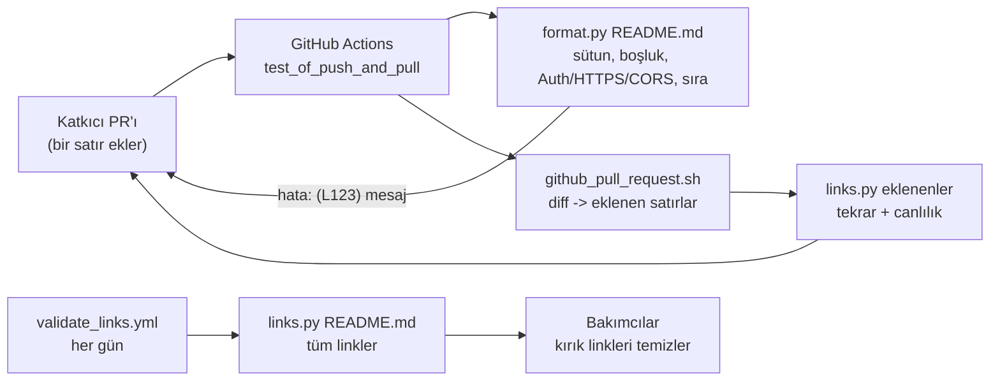
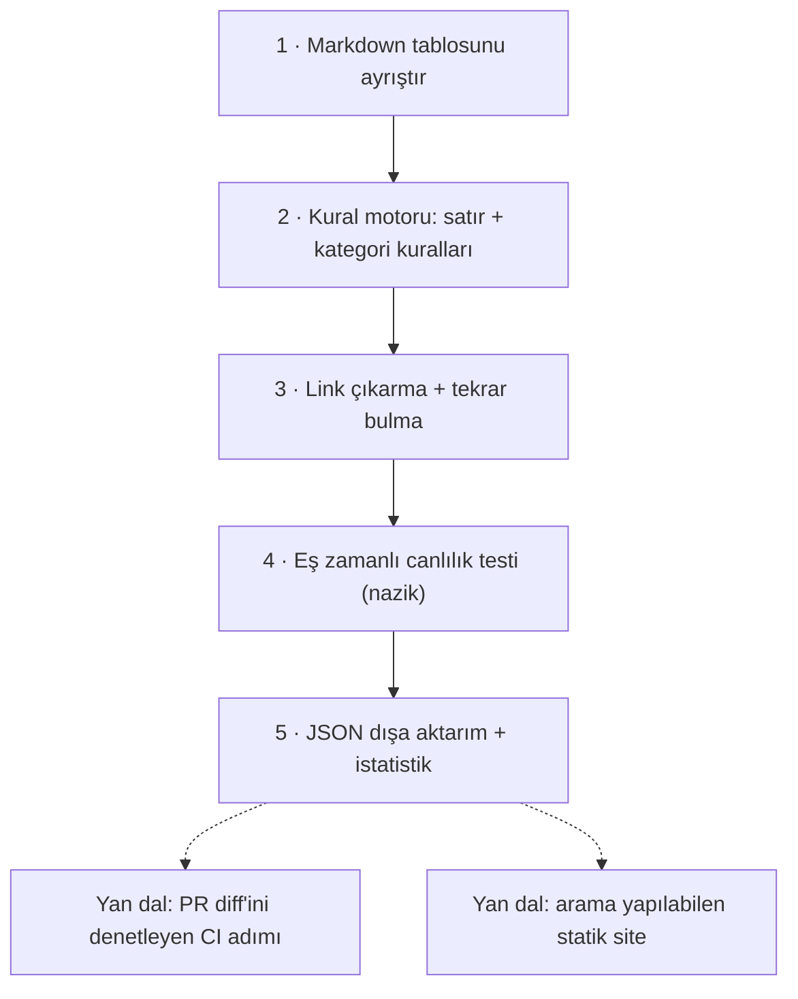

# public-apis/public-apis — ücretsiz kullanılabilen web API'lerinin topluluk listesi

> **Dal:** [D04 Veri araçları ve otomasyon](../README.md) · **Tür:** liste
> **Dil:** Markdown (+ Python doğrulama betikleri) · **Lisans:** MIT · **Yıldız:** 497.439 (9 Kasım 2026) · **İncelenen commit:** `8870667` (2026-11-08)

## 1. Bir bakışta

public-apis, ücretsiz ya da ücretsiz katmanı olan herkese açık API'leri kategori kategori listeleyen tek bir
`README.md` dosyasıdır: her satırda API adı ve belgesine bağlantı, kısa açıklama, kimlik doğrulama türü
(`Auth`), HTTPS ve CORS desteği yazar. Proje bir yazılım değil, **bakımı yapılan bir veri setidir**; asıl
mühendislik bu dosyayı tutarlı tutan doğrulama betiklerinde, CI'da ve katkı kurallarındadır. Yeni başlayanların
"hangi API ile proje yapsam?" sorusuna cevap olduğu için GitHub'ın en çok yıldızlanan depolarından biridir.
İncelenen commit'te 51 kategori ve (bizim ayrıştırıcımıza göre) 2.338 kayıt var; README'nin başında
sponsor (APILayer) bölümleri ve ayrı biçimde bir **MCP Servers** tablosu bulunuyor.

## 2. Nasıl yapılmış: mimari

### Klasör haritası

```text
README.md                      # LİSTENİN KENDİSİ (2.896 satır): sponsor bölümü, MCP Servers, Index, 51 kategori
CONTRIBUTING.md                # biçim ve PR kuralları: sütunlar, Auth/CORS değerleri, alfabetik sıra, "API" son eki yasağı
LICENSE                        # MIT
.github/
  PULL_REQUEST_TEMPLATE.md     # PR'da işaretlenecek denetim listesi (sıralama, 100 karakter, 3 kayıt ...)
  ISSUE_TEMPLATE.md            # "öneri için issue değil PR aç"
  workflows/
    test_of_push_and_pull.yml  # push/PR: format.py; PR'da yalnızca EKLENEN satırların linkleri; push'ta tekrar kontrolü
    test_of_validate_package.yml  # doğrulama paketinin birim testleri
    validate_links.yml         # her gün 00:00 UTC (cron) tüm linklerin canlılık testi + elle tetikleme
  assets/, *.png               # sponsor görselleri
scripts/
  validate/format.py           # biçim doğrulayıcı
  validate/links.py            # link çıkarma, tekrar bulma, canlılık testi
  github_pull_request.sh       # PR diff'ini indirip yalnızca eklenen satırları denetler
  tests/test_validate_format.py, test_validate_links.py   # unittest
  requirements.txt             # requests (>=2.32.4) ve sabit sürümlü bağımlılıkları
```

### Ana bileşenler ve veri akışı



Liste insan tarafından yazılır, makine tarafından denetlenir. `format.py` dosyayı satır satır okur: `###` ile
başlayan satır yeni kategoridir, `|` ile başlayan satırlar kayıttır. Her kayıt için başlığın `[BAŞLIK](LINK)`
biçiminde olduğu, "API" ile bitmediği, açıklamanın büyük harfle başlayıp noktalama ile bitmediği ve 100
karakteri aşmadığı, Auth değerinin ters tırnak içinde ve izinli kümede (`apiKey`, `OAuth`, `X-Mashape-Key`,
`User-Agent`, `No`) olduğu, HTTPS'in `Yes/No`, CORS'un `Yes/No/Unknown` olduğu, her hücrenin tam bir
boşlukla çevrili olduğu denetlenir. Her kategorinin **kayıtları** başlığa göre alfabetik sıralı olmalıdır
(`check_alphabetical_order` kategorilerin kendi sırasına bakmaz); kategori başlığı Index'te yer almalı ve
kategori en az 3 kayıt içermelidir. Hatalar `(L042) mesaj` biçiminde basılır ve çıkış kodu 1 olur.

### Önce okunacak dosyalar

1. `CONTRIBUTING.md` — kuralların insan diliyle tanımı; MCP sunucuları için ayrı tablo biçimi (Transport: `stdio`, `HTTP`, `SSE`).
2. `scripts/validate/format.py` — kuralların koda dönüşmüş hâli (~280 satır).
3. `scripts/tests/test_validate_format.py` — örnek girdilerle beklenen hata mesajları.
4. `scripts/validate/links.py` — link düzenli ifadesi, tekrar kontrolü, Cloudflare koruması tespiti.
5. `.github/workflows/test_of_push_and_pull.yml` ve `scripts/github_pull_request.sh` — PR'da yalnızca eklenen satırları denetleme hilesi.

### Araçlar, CI ve yönetişim

- **Teknoloji:** Python 3.8 ile çalışan CI (eski `actions/checkout@v2`), `requests`; testler `unittest`.
- **PR akışı:** katkıcı tek satır ekler; CI biçimi doğrular, PR diff'inden `+` içeren satırları çıkarıp
  (`egrep "\+"`: pratikte eklenen satırlar, ama `+++` başlığı ve içinde `+` geçen her satır da gelir) onların
  linklerini dener (`github_pull_request.sh`, diff URL'sini bilerek "şema" ayrı değişkende kurar ki link
  doğrulayıcı onu link sanmasın).
- **Günlük bakım:** `validate_links.yml` her gece tüm linkleri dener; bozuklar elle temizlenir.
- **Kurallar:** "pazarlama amaçlı PR kabul edilmez", "ücretsiz erişim ya da ücretsiz katman şart",
  "aynı API'nin yeni sürümü eklenmez", "PR başına bir link", "commit'ler tek commit'te birleştirilsin".
- **Yönetişim notu:** README'nin başındaki APILayer bölümleri (sponsor tablosu, kayıt bağlantıları) projenin
  ticari bir sponsorla yürüdüğünü gösterir; README ayrıca `publicapis.lol`'u listenin "resmî evi" olarak
  tanıtır. Topluluk listesi ile sponsor içeriği aynı dosyada yaşar.

### Tasarım kararları ve ödünleşimler

1. **Tek dosya = tek gerçek kaynak.** Her şey `README.md`'de: GitHub'da doğrudan okunur, PR'ı herkes anlar.
   Bedeli: makine için yapı zayıftır (tablo ayrıştırma kırılgan); JSON gerekirse ayrı bir projeye
   (`davemachado/public-api`) ihtiyaç duyulur.
2. **Kuralları koda dökmek.** İnsan incelemesi sürekli gelen PR'ların biçimini tek tek denetleyemez; biçim kuralları otomatik denetlenir,
   insan yalnızca "bu API gerçekten ücretsiz ve yararlı mı?" sorusuna odaklanır.
3. **PR'da yalnızca değişeni denetlemek.** 2.000+ linki her PR'da denemek yavaş ve gürültülüdür; diff'teki
   eklenen satırlar denenir, tam tarama gece yapılır.
4. **Bot korumasına karşı tolerans.** Cloudflare'in 403/503 "tarayıcı denetimi" sayfaları kırık sayılmaz;
   link denetleyici tarayıcı taklidi yapan rastgele User-Agent kullanır. Yanlış pozitif azalır ama sitelerin
   bot politikası atlatılmış olur; mini sürüm bu yüzden dürüst UA tercih eder.
5. **Biçim kayması.** Betikler eski bir biçime göre yazılmış: README'nin başındaki
   `### APIs Covered Under APILayer Suite!` dahil tüm `###` başlıklarını kategori sayar ve son kategorinin kayıt
   sayısını hiç denetlemez. `##` başlıkları kategoriyi kapatmadığı için APILayer ve MCP tablolarının satırları
   da bu sponsor "kategorisinin" kayıtları gibi denetlenir. Bizim ayrıştırıcımız gerçek README'de normal kipte
   53, betiği taklit eden kipte 146 bulgu üretiyor; CI'ın bugünkü durumunu doğrulayamadık (doğrulanmadı).

## 3. Öğrenmen gerekenler

| Ön koşul                                              | Neden gerekli                                                                     | Ücretsiz kaynak                                                                                                                                                                                                          |
| ----------------------------------------------------- | --------------------------------------------------------------------------------- | ------------------------------------------------------------------------------------------------------------------------------------------------------------------------------------------------------------------------ |
| [G2 Git ve GitHub](../../../govde/README.md#g2)       | Fork, dal, tek commit'e indirme (squash), PR şablonu                              | [GitHub Docs: Pull requests](https://docs.github.com/en/pull-requests)                                                                                                                                                   |
| [G3 Python](../../../govde/README.md#g3)              | Doğrulama betikleri, düzenli ifadeler, `unittest`                                 | [free-programming-books Türkçe liste](https://github.com/EbookFoundation/free-programming-books/blob/main/books/free-programming-books-tr.md) ([dossier](../../10-kuratorluk-topluluk/free-programming-books/README.md)) |
| [G6 Ağ ve web temelleri](../../../govde/README.md#g6) | REST, API anahtarı ve OAuth farkı, HTTPS, **CORS** (tarayıcıdan çağrılabilir mi?) | [MDN: CORS](https://developer.mozilla.org/en-US/docs/Web/HTTP/CORS)                                                                                                                                                      |
| [G7 Test, CI](../../../govde/README.md#g7)            | Push/PR/cron tetiklemeli iş akışları, çıkış kodlarıyla başarısızlık               | [GitHub Actions belgeleri](https://docs.github.com/en/actions)                                                                                                                                                           |
| [G9 Açık kaynak](../../../govde/README.md#g9)         | Kuratörlük, katkı kuralları, sponsorlu topluluk projeleri                         | [D10 Kuratörlük ve topluluk dalı](../../10-kuratorluk-topluluk/README.md)                                                                                                                                                |

## 4. Sıfırdan yol (dallanma)



| Aşama | Ne inşa edersin                      | Öğrendiğin kavram                               | Bitti ölçütü                          | Süre (tahmini) |
| ----- | ------------------------------------ | ----------------------------------------------- | ------------------------------------- | -------------- |
| 1     | `ayristir()`                         | Satır tabanlı ayrıştırma, durum makinesi        | Örnek dosyada 3 kategori, 9 kayıt     | 2 saat         |
| 2     | `belgeyi_denetle()`                  | Kural başına fonksiyon, satır numaralı hata     | Her kural için kırmızı-yeşil test     | 3 saat         |
| 3     | `linkleri_bul()`, `tekrarlari_bul()` | Düzenli ifade sınırları, normalleştirme         | `/` farkı tekrar sayılıyor            | 1 saat         |
| 4     | `linkleri_denetle()`                 | Thread havuzu, host başına semafor, zaman aşımı | Aynı anda en fazla 2 istek ölçülüyor  | 3 saat         |
| 5     | `disa_aktar()`                       | Normalizasyon, özet istatistik                  | Gerçek README'den 2.338 kayıtlık JSON | 1 saat         |

**Süre toplamı:** mini ~10 saat; okuma rotası (7 adım × 1 saat) ve alıştırmalarla (1 kolay + 2 orta + 1 zor =
1 + 4 + 4 saat) toplam ~26 saat ([dal README'sindeki kural](../README.md#yapraklar)).

**Mini uygulama:** [`sifirdan/`](sifirdan/README.md) — dört aşama, CLI ve 23 test (yerel sunucuyla link
testleri). Asıl betiklerdeki iki boşluğu kapatır (son kategori sayımı, boş olmayan fazla sütun).

**Gerçek ölçeğe giden yol:** PR diff'ini okuyup yalnızca eklenen satırları denetleyen CI adımı; link
sonuçlarını önbelleğe alıp "üç gecedir kırık" gibi geçmişe dayalı karar; Türkçe/ICU harmanlamalı sıralama;
JSON'dan statik bir arama sitesi üretmek (README'nin listenin "resmî evi" diye tanıttığı `publicapis.lol` bu
fikrin işleyen bir örneği).

## 5. Gerçek depoda okuma rotası

1. `README.md`'de `## Index` ile ilk `###` kategori arasını incele: Index maddesi ile başlık nasıl eşleşiyor?
2. `format.py` → `check_file_format`: "en az 3 kayıt" sayımı hangi satırda yapılıyor? Son kategori neden kaçıyor?
3. `format.py` → `get_categories_content`: `API | ...` (borusuz) başlık satırı neden kayıt sayılmıyor, `| API | ...` sayılır mı?
4. `links.py` → `find_links_in_file`: neden `## Index` öncesi atlanıyor?
5. `links.py` → `has_cloudflare_protection`: hangi koşulda bir 403 "kırık değil" sayılıyor?
6. `github_pull_request.sh`: `DUMMY_SCHEME` değişkeni neden var?
7. `test_validate_format.py`: başlık satırı örnekleri hangi biçimde yazılmış; gerçek README ile aynı mı?

## 6. Alıştırmalar ve öz değerlendirme

1. (Kolay) Mini doğrulayıcıya "başlık alan adı (TLD) içermesin" kuralını ekle (`Gmail.com` yerine `Gmail`).
2. (Orta) Türkçe harmanlama: `casefold()` ile `Çay`/`Cam`/`Zeytin` sıralamasını dene; `locale` ya da kendi
   karşılaştırıcınla Türk alfabesine göre sırala.
3. (Orta) `github_pull_request.sh`'nin Python karşılığını yaz: `git diff` çıktısından yalnızca eklenen tablo
   satırlarını alıp doğrula.
4. (Zor) Link sonuçlarını SQLite'a yaz; bir linki ancak 3 ardışık gecede kırıksa "kırık" raporla.

<details><summary>Cevap: CORS sütunu neden önemli?</summary>

CORS desteklemeyen bir API'ye tarayıcıdaki JavaScript doğrudan istek atamaz (tarayıcı yanıtı engeller);
çağrı ancak sunucu tarafında yapılabilir. Statik bir web sitesi yapacak geliştirici için bu, API'nin
kullanılabilir olup olmadığını belirler.
</details>

<details><summary>Cevap: Neden PR'da tüm linkler değil yalnızca eklenenler denenir?</summary>

2.000+ linkin bir kısmı her an geçici olarak bozuktur; hepsini denemek hem dakikalar sürer hem de katkıcının
eklemediği bir link yüzünden PR'ı kırmızıya boyar. Eklenen satırlar katkıcının sorumluluğundadır; tam
tarama gece ayrı bir işte yapılır.
</details>

<details><summary>Cevap: Bir listenin "test"i neden olur?</summary>

Liste bir veri setidir; tutarlılığı (sütunlar, değer kümeleri, sıra) olmadan ne insan okuyabilir ne de
makine ayrıştırabilir. Testler çok sayıda katkıcının aynı biçimde yazmasını zorlar ve doğrulama betiklerinin
kendisinin doğru çalıştığını garanti eder.
</details>

## 7. İş fikri tohumları

- **API keşif ve sağlık panosu (Türkçe):** listeyi JSON'a çevirip kategori, Auth ve CORS'a göre süzülebilir,
  günlük canlılık geçmişi gösteren site. **Kime:** bootcamp öğrencileri ve proje arayan yeni geliştiriciler.
- **Kurum içi API kataloğu:** aynı biçim + doğrulayıcıyı bir şirketin iç API'leri için uygulayan şablon ve CI
  paketi. **Kime:** mikroservis sayısı artan orta ölçekli yazılım ekipleri.
- **"Awesome" liste bakım botu:** başka listelerde de biçim, tekrar ve kırık link denetimi yapan GitHub
  uygulaması (bkz. [D10](../../10-kuratorluk-topluluk/README.md)). **Kime:** popüler awesome-* liste bakımcıları.

Ayrıntılı katalog: [İş fikirleri](../../../is-fikirleri/README.md).

## 8. Kaynaklar

- README: <https://github.com/public-apis/public-apis/blob/88706670ac0ffaad7bf3c6307747e2515f638bed/README.md>
- Katkı rehberi: <https://github.com/public-apis/public-apis/blob/88706670ac0ffaad7bf3c6307747e2515f638bed/CONTRIBUTING.md>
- Biçim doğrulayıcı: <https://github.com/public-apis/public-apis/blob/88706670ac0ffaad7bf3c6307747e2515f638bed/scripts/validate/format.py>
- Link doğrulayıcı: <https://github.com/public-apis/public-apis/blob/88706670ac0ffaad7bf3c6307747e2515f638bed/scripts/validate/links.py>
- CI: <https://github.com/public-apis/public-apis/tree/88706670ac0ffaad7bf3c6307747e2515f638bed/.github/workflows>
- Projenin API'si (ayrı depo): <https://github.com/davemachado/public-api>
- Ağaç ve dal haritası: [AGAC.md](../../../AGAC.md)
