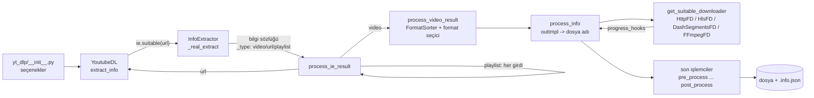
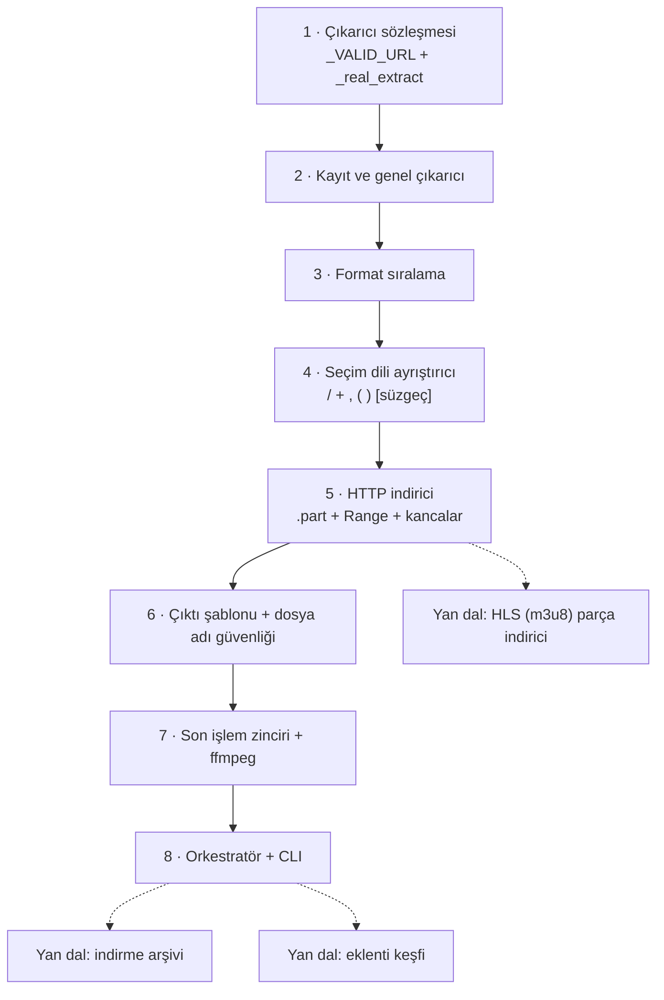

# yt-dlp/yt-dlp — binlerce siteden ses/video indiren komut satırı aracı

> **Dal:** [D04 Veri araçları ve otomasyon](../README.md) · **Tür:** kod tabanı
> **Dil:** Python · **Lisans:** Unlicense (kamu malı) · **Yıldız:** 206.369 (9 Kasım 2026) · **İncelenen commit:** `412e7f0` (2026-11-04)

## 1. Bir bakışta

yt-dlp, bir web sayfası adresi verildiğinde o sayfadaki ses/video akışlarını bulan, en uygun formatı seçen,
indiren ve isteğe göre ffmpeg ile işleyen bir Python komut satırı aracı ve kütüphanesidir. README'ye göre
youtube-dl'ın, artık bakımı yapılmayan youtube-dlc üzerinden gelen bir çatalıdır. İncelenen sürüm
`2026.10.26`'dır (`yt_dlp/version.py`). Gücü üç yerden gelir: siteye özel ~1.750 "çıkarıcı" (extractor)
sınıfı, son derece esnek format seçim dili ve hızlı sürüm döngüsü (stable, nightly ve master kanalları;
siteler değiştikçe çıkarıcılar sık güncellenir). Arşivciler, gazeteciler, araştırmacılar, medya ekipleri ve
onu kütüphane olarak gömen uygulamalar tarafından kullanılır.

## 2. Nasıl yapılmış: mimari

### Klasör haritası

```text
yt_dlp/
  __init__.py            # komut satırı girişi: seçenekleri YoutubeDL parametrelerine çevirir
  options.py             # optparse tanımları (2.000+ satır seçenek)
  YoutubeDL.py           # ORKESTRATÖR (4.552 satır): çıkar -> çöz -> seç -> indir -> son işle
  extractor/             # 941 girdi; siteye özel çıkarıcılar
    common.py            # InfoExtractor taban sınıfı ve yardımcıları (4.185 satır)
    _extractors.py       # tüm çıkarıcı sınıflarını içe aktaran dev liste (~1.750 *IE adı)
    extractors.py        # kayıt: tembel (lazy) arama tablosu, YouTube önce, Generic en son
    generic.py           # GenericIE: hiçbir şey tanımazsa sayfada gömülü video arar
    youtube/             # en karmaşık çıkarıcı ailesi (ayrı alt paket)
  downloader/            # protokole göre indiriciler
    __init__.py          # PROTOCOL_MAP + get_suitable_downloader
    common.py            # FileDownloader: ilerleme, hız, .part, yeniden deneme
    http.py              # HttpFD: Range ile devam, Content-Range denetimi
    hls.py, dash.py, fragment.py, external.py  # parçalı akışlar ve harici indiriciler (aria2c, ffmpeg)
  postprocessor/         # son işlemciler: ffmpeg.py (birleştir, ses çıkar, alt yazı göm ...), sponsorblock.py
  networking/            # istek katmanı: _urllib, _requests, _curlcffi (tarayıcı taklidi), _websockets
  utils/_utils.py        # 5.747 satır yardımcı: FormatSorter, sanitize_filename, tarih/sayı ayrıştırma
  plugins.py             # yt_dlp_plugins ad alanı paketi üzerinden eklenti keşfi
  cookies.py, aes.py, jsinterp.py   # tarayıcı çerezleri, şifre çözme, küçük JS yorumlayıcı
devscripts/              # make_lazy_extractors.py, run_tests.py, make_supportedsites.py ...
test/                    # pytest testleri (test_YoutubeDL.py, test_downloader_http.py ...)
supportedsites.md        # otomatik üretilen site listesi (1.741 satır)
.NO_AI/README.md         # yapay zekâ ile katkı yasağı politikası
```

### Ana bileşenler ve veri akışı



Akışın kalbi **bilgi sözlüğüdür** (info dict). Çıkarıcı yalnızca sözlük üretir; indirmez. Sözlükte
`id` ile `title` ve bunlara ek olarak tek bir `url` ya da bir `formats` listesi bulunur (`common.py`'deki
uzun belge yorumu bu sözleşmeyi alan alan tanımlar). `_type` alanı `url` ise "bunu başka bir çıkarıcı çözsün" demektir
(oynatma listeleri böyle çalışır); `playlist` ise `entries` içindeki her girdi yeniden işlenir. Video
sonucu gelince formatlar `FormatSorter` ile kötüden iyiye sıralanır, `-f` ifadesi seçici fonksiyona
derlenir ve seçilen her format için `process_info` dosya adını şablondan üretir, uygun indiriciyi
`PROTOCOL_MAP`'ten seçer ve son işlemcileri çalıştırır.

**Bir çıkarıcının iskeleti.** Aşağıdaki kurgusal örnek (`ornek.example` diye bir site yok) bütün çıkarıcıların
izlediği kalıbı gösterir; kullanılan yardımcılar `common.py`'de tanımlıdır:

```python
class OrnekSiteIE(InfoExtractor):
    _VALID_URL = r'https?://(?:www\.)?ornek\.example/video/(?P<id>\d+)'
    _TESTS = [{  # test üreteci bunu gerçek siteye karşı "indirme testi" olarak çalıştırır
        'url': 'https://ornek.example/video/42',
        'info_dict': {'id': '42', 'ext': 'mp4', 'title': 'Örnek video'},
    }]

    def _real_extract(self, url):
        video_id = self._match_id(url)                       # _VALID_URL'deki (?P<id>...)
        webpage = self._download_webpage(url, video_id)      # hata yönetimi, karakter kodlaması, ilerleme notu
        data = self._search_json(r'window\.__VERI__\s*=', webpage, 'video verisi', video_id)
        return {
            'id': video_id,
            'title': data.get('baslik') or self._og_search_title(webpage),
            'formats': self._extract_m3u8_formats(data['hls'], video_id, 'mp4'),  # HLS manifesti -> format listesi
        }
```

Çıkarıcı hiçbir şey indirmez, yalnızca "ne var" sorusunu yanıtlar. Yeni bir site desteklemek çoğu zaman tek
dosyalık bir sınıf ve `_extractors.py`'ye bir içe aktarma satırı demektir.

### Önce okunacak dosyalar

1. `yt_dlp/extractor/common.py` (ilk ~800 satır) — `InfoExtractor` belge yorumu: bilgi sözlüğünün
   bütün alanları burada; `_match_valid_url`, `suitable`, `extract`, `_real_extract`.
2. `yt_dlp/extractor/extractors.py` ve `__init__.py` — kayıt sırası neden önemli (YouTube önce, Generic en son).
3. Küçük bir çıkarıcı, ör. `yt_dlp/extractor/academicearth.py` — `_VALID_URL`, `_TESTS`, `_real_extract` kalıbı.
4. `yt_dlp/YoutubeDL.py` → `extract_info`, `__extract_info`, `process_ie_result` — çözümleme döngüsü.
5. `YoutubeDL.py` → `build_format_selector` ve `_default_format_spec` — seçim dili ve ffmpeg yoksa ne olur.
6. `yt_dlp/utils/_utils.py` → `class FormatSorter` — varsayılan sıralama alanları.
7. `yt_dlp/downloader/__init__.py` ve `downloader/http.py` — protokol eşlemesi ve devam eden indirme.
8. `yt_dlp/postprocessor/common.py` ve `YoutubeDL.run_pp` — son işlem sözleşmesi ve dosya silme kararı.

### Teknoloji yığını, derleme, test, CI, sürüm

- **Dil ve paketleme:** Python ≥ 3.11 (`pyproject.toml`), derleme arka ucu `hatchling`. Çekirdeğin zorunlu
  bağımlılığı **yok** (`dependencies = []`); `default` ekstrası `brotli`, `certifi`, `mutagen`,
  `pycryptodomex`, `requests`, `urllib3`, `websockets` ve `yt-dlp-ejs`'i getirir. `curl-cffi` ekstrası
  tarayıcı TLS parmak izi taklidi içindir.
- **Harici araçlar:** `ffmpeg`/`ffprobe` birleştirme ve son işlem için şiddetle önerilir. README'ye göre tam
  YouTube desteği için `yt-dlp-ejs` ve bir JavaScript çalışma ortamı (deno önerilir; node, bun, QuickJS) gerekir.
- **Test:** `pytest`. `Makefile`'da `make offlinetest` → `pytest -m "not download"` (ağ gerektirmeyenler),
  `devscripts/run_tests.py core|download|<çıkarıcı>`. İndirici testleri yerel `http.server` ile Range
  yanıtları üretir (`test/test_downloader_http.py`). Her çıkarıcının `_TESTS` listesi gerçek siteye karşı
  "indirme testi" olarak çalıştırılabilir.
- **CI:** `.github/workflows/core.yml` yalnızca çekirdek dosyalar değişince çalışır (ubuntu + windows,
  CPython 3.11–3.15 ve PyPy); `quick-test.yml` çekirdek testler + `ruff` + `autopep8` + tembel çıkarıcı
  üretimi; `build.yml` tek dosyalık ikili paketler (PyInstaller); `release*.yml` stable/nightly/master
  kanalları.
- **Sürüm:** tarih tabanlı sürüm numarası (`devscripts/update-version.py`), üç kanal (stable, nightly, master)
  ve yerleşik güncelleyici (`yt_dlp/update.py`: indirilen ikiliyi sürümün `SHA2-256SUMS` dosyasındaki
  özetle karşılaştırır). Sürümlerdeki GPG imzalı özet dosyaları, README'de anlatıldığı gibi kökteki
  `public.key` ile elle doğrulanır; güncelleyici bu imzayı kendisi denetlemez.

### Tasarım kararları ve ödünleşimler

1. **Bilgi sözlüğü sözleşmesi.** Çıkarıcı ile indirici arasında tek ortak dil gevşek bir sözlüktür. Yeni
   site eklemek, motoru değiştirmeden yalnızca sözlük üretmek demektir. Bedeli: tip güvencesi yok; alanlar
   belge yorumuyla ve testlerle korunur.
2. **Kayıt sırası = öncelik.** `extractors.py` arama tablosunu YouTube önce, `GenericIE` en son olacak
   şekilde kurar; ilk `suitable()` diyen kazanır. Başlangıç süresini kısaltmak için
   `devscripts/make_lazy_extractors.py` yalnızca URL eşleme ve listeleme için gereken alanları (`_VALID_URL`,
   `IE_NAME`, `suitable` ...) içeren "tembel" bir modül (`lazy_extractors.py`) üretir; gerçek sınıf ancak
   gerektiğinde içe aktarılır (`YTDLP_NO_LAZY_EXTRACTORS` ile kapatılabilir).
3. **Sıralama ile seçimin ayrılması.** `FormatSorter` "iyi"nin tanımını (çözünürlük, codec, bit hızı,
   protokol ...) yapar; `-f` dili yalnızca "hangisi" sorusunu sorar. `-S res:720` gibi tercihleri değiştirmek
   seçim ifadesine dokunmadan sonucu değiştirir.
4. **Seçim dili için `tokenize` ödünç almak.** `build_format_selector` ifadeyi Python'un `tokenize`
   modülüyle parçalar. Hızlı bir çözümdür ama kırılgandır: kodda Python 3.12'deki ayrıştırıcı değişikliği
   için bir "HACK" ve "tokenize'a dayanmayan ayrıştırıcı yaz" diyen bir TODO bulunur. Mini sürüm bu yüzden
   kendi ayrıştırıcısını yazar.
5. **ffmpeg'e göre değişen varsayılan.** `_default_format_spec`: ffmpeg birleştirebiliyorsa
   `bestvideo*+bestaudio/best`, yoksa `best/bestvideo+bestaudio`; ikisi farklı sonuç veriyorsa uyarı basar.
   Ayrı video/ses akışları (DASH) yüksek kaliteyi getirir ama birleştirme aracı ister.
6. **Sıfır zorunlu bağımlılık + ekstralar.** Çekirdek yalnızca standart kütüphaneyle çalışır; HTTP
   katmanı (`yt_dlp/networking/`) mevcut olana göre `urllib`, `requests` ya da `curl_cffi` işleyicisi
   seçer. Tek dosyalık ikililer ve kısıtlı ortamlar için kritik bir karar.
7. **Yapay zekâya kapalı katkı politikası.** `CONTRIBUTING.md` ve `.NO_AI/README.md`, katkıların (issue,
   PR, yorum, çeviri) yapay zekâ araçlarıyla hazırlanmasını yasaklar ve ihlalde engelleme öngörür. Bu
   depoya katkı vermek istersen kodu ve açıklamaları kendin yazmalısın.

## 3. Öğrenmen gerekenler

| Ön koşul                                              | Bu depo için neden gerekli                                                             | Ücretsiz kaynak                                                                                                                                                                                                                          |
| ----------------------------------------------------- | -------------------------------------------------------------------------------------- | ---------------------------------------------------------------------------------------------------------------------------------------------------------------------------------------------------------------------------------------- |
| [G3 Python](../../../govde/README.md#g3)              | Sınıflar, `classmethod`, üreteçler, sözlükler, `re` modülü her dosyada                 | [Python-100-Days dossier'i](../../09-bilgisayar-bilimi/python-100-days/README.md), [free-programming-books Türkçe Python](https://github.com/EbookFoundation/free-programming-books/blob/main/books/free-programming-books-tr.md#python) |
| [G6 Ağ ve web temelleri](../../../govde/README.md#g6) | HTTP başlıkları, `Range`/`206`/`416`, yönlendirmeler, çerezler, HLS/DASH manifestleri  | [MDN: HTTP range requests](https://developer.mozilla.org/en-US/docs/Web/HTTP/Range_requests)                                                                                                                                             |
| [G7 Test, CI](../../../govde/README.md#g7)            | Yerel sunucuyla indirici testi, ağsız/ağlı test ayrımı, matris CI                      | [pytest belgeleri](https://docs.pytest.org/)                                                                                                                                                                                             |
| [G1 Terminal](../../../govde/README.md#g1)            | ffmpeg/ffprobe komutları, PATH, çıkış kodları                                          | [ffmpeg belgeleri](https://ffmpeg.org/ffmpeg.html)                                                                                                                                                                                       |
| Düzenli ifadeler                                      | `_VALID_URL`, `_search_regex`, gömülü JSON avı                                         | [build-your-own-x: Regex Engine](https://github.com/codecrafters-io/build-your-own-x#build-your-own-regex-engine)                                                                                                                        |
| Ayrıştırıcı yazımı                                    | `-f` seçim dili ve çıktı şablonu birer küçük dildir                                    | [Let's Build A Simple Interpreter](https://ruslanspivak.com/lsbasi-part1/) ([project-based-learning dossier'i](../../10-kuratorluk-topluluk/project-based-learning/README.md))                                                           |
| Medya temelleri                                       | Kap (mp4, webm, mkv) ile codec (h264, vp9, aac, opus) farkı; neden birleştirme gerekir | [ffmpeg wiki: Formats/Codecs](https://trac.ffmpeg.org/wiki)                                                                                                                                                                              |

## 4. Sıfırdan yol (dallanma)



| Aşama | Ne inşa edersin                                     | Öğrendiğin kavram                                          | Bitti ölçütü                                  | Süre (tahmini) |
| ----- | --------------------------------------------------- | ---------------------------------------------------------- | --------------------------------------------- | -------------- |
| 1     | `BilgiCikarici` + gömülü JSON okuyan örnek çıkarıcı | Sözleşme tabanlı eklenti mimarisi                          | Yerel sayfadan `{id, title, formats}` dönüyor | 3 saat         |
| 2     | `__init_subclass__` kaydı, `GenelIE`                | Kayıt sırası = öncelik, son çare deseni                    | Tanımadığı yerel URL'yi Genel çözüyor         | 2 saat         |
| 3     | `formatlari_sirala` + `-S` alanları                 | Çok anahtarlı sıralama, sınırlı tercih                     | `res:480` ile en iyi 360p oluyor              | 2 saat         |
| 4     | `-f` ayrıştırıcı ve yorumlayıcı                     | Sözcük ayırma, öncelik, özyinelemeli iniş                  | `(bv+ba/b)[height<=?500]` doğru sonuç         | 6 saat         |
| 5     | `HttpIndirici`                                      | Range, Content-Range, 416, geri çekilme                    | Kopan bağlantı kaldığı yerden tamamlanıyor    | 4 saat         |
| 6     | Çıktı şablonu                                       | printf biçimi, dosya sistemi kısıtları, dizin dışına çıkma | `../` ile kaçış engelleniyor                  | 2 saat         |
| 7     | Son işlemciler                                      | Zincir, sorumluluk ayrımı (silme kararı orkestratörde)     | ffmpeg ile birleşik dosyada ses+görüntü var   | 3 saat         |
| 8     | `MiniYDL` + CLI                                     | Orkestrasyon, `_type` özyinelemesi                         | Oynatma listesi alt klasöre iniyor            | 3 saat         |

**Süre toplamı:** mini ~25 saat; okuma rotası (9 adım × 1 saat) ve alıştırmalarla (2 kolay + 3 orta + 2 zor =
2 + 6 + 8 saat) toplam ~50 saat ([dal README'sindeki kural](../README.md#yapraklar)).

**Mini uygulama:** [`sifirdan/`](sifirdan/README.md) — altı aşama dosyası, CLI ve 30 test (ffmpeg varsa
gerçek medya ile birleştirme/ses çıkarma da test edilir). Çıkarıcılar yalnızca `127.0.0.1`/`localhost`
tanır; orkestratör varsayılan olarak başka sunucuya bağlanmaz. Aşama ↔ gerçek dosya eşlemesi mini'nin
README'sindeki tablodadır.

**Gerçek ölçeğe giden yol:** (1) Parçalı protokoller: HLS (`downloader/hls.py`) ve DASH
(`downloader/dash.py`) ile manifest ayrıştırma (`common.py` → `_extract_m3u8_formats`, `_extract_mpd_formats`).
(2) Ağ katmanı soyutlaması: işleyici seçimi, proxy, çerez kavanozu, yeniden deneme politikası
(`yt_dlp/networking/`). (3) Çıkarıcı başına test vektörleri (`_TESTS`) ve bunları çalıştıran test üreteci.
(4) İndirme arşivi (`--download-archive`) ve `--match-filters` ile toplu işler. (5) Tembel çıkarıcı üretimi ve
eklenti keşfi (`plugins.py`). (6) Son olarak, siteye özgü zorluklar: imzalı URL'ler, JavaScript ile üretilen
parametreler (bu yüzden `jsinterp.py` ve harici JS çalışma ortamı). Bu son adım hukuki ve etik açıdan en
hassas bölgedir: erişim denetimlerini aşmak telif ve sözleşme ihlali doğurabilir.

## 5. Gerçek depoda okuma rotası

1. `yt_dlp/__init__.py` → `main` / `_real_main`: komut satırı nasıl bir `YoutubeDL(params)` nesnesine dönüşüyor?
   Soru: `-x` seçeneği hangi son işlemciyi ekliyor?
2. `yt_dlp/extractor/common.py` belge yorumu: `formats` içindeki bir formatın zorunlu alanı hangisi?
   `vcodec == 'none'` ne anlama geliyor?
3. `yt_dlp/extractor/extractors.py`: `_CLASS_LOOKUP` hangi sırayla kuruluyor? Neden `dict` ile kurulduğu
   hâlde YouTube başta kalıyor? (İpucu: aynı anahtara yeniden atama sırayı değiştirmez.)
4. `YoutubeDL.extract_info` → `__extract_info` → `process_ie_result`: `_type: 'url'` sonucunu zihninde izle;
   `extract_flat` açıkken ne değişiyor?
5. `YoutubeDL.build_format_selector`: `bv*+ba/b` için oluşan `FormatSelector` ağacını kâğıda çiz;
   `_merge` iki birleşik formatı birleştirmeye çalışınca hangisini atıyor?
6. `utils/_utils.py` → `FormatSorter.default`: `hasvid`, `ie_pref`, `res` alanlarının sırası neden böyle?
7. `downloader/http.py` → `real_download`: sunucu Range'i yok sayıp 200 dönerse ne oluyor? 416 alınca
   dosya boyutu neden `Content-Length` ile karşılaştırılıyor?
8. `test/test_downloader_http.py`: yerel sunucu Range'i nasıl taklit ediyor? Mini'deki `sahte_site.py` ile karşılaştır.
9. `YoutubeDL.run_pp` / `post_process`: `--keep-video` kararı nerede veriliyor?

## 6. Alıştırmalar ve öz değerlendirme

1. (Kolay) Mini'ye `%(duration_string)s` alanını ekle: saniyeyi `SS:DD:ss` metnine çevir.
2. (Kolay) `-F` çıktısına `fps` sütunu ekle ve `-S fps` ile sıralamayı dene.
3. (Orta) Seçim dilindeki `.N` sonekinin ("N'inci en iyi": `bv.2`, `ba*.2` gibi) doğru çalıştığını gösteren
   test yaz; sonra `mergeall` seçicisini ekle.
4. (Orta) İndiriciye `--download-archive` ekle: indirilen `extractor id` çiftlerini dosyaya yaz, tekrarları atla.
5. (Orta) Sahte siteye HLS (m3u8) sun: 5 parçalı bir oynatma listesi ve parçaları birleştiren bir `HlsIndirici` yaz.
6. (Zor) Seçim dilini `tokenize` kullanan bir sürümle karşılaştır: `7_a` gibi bir format kimliği
   neden Python 3.12'de sorun çıkarır? Kendi sözcük ayırıcın aynı sorunu yaşar mı?
7. (Zor) `asama1`'e eklenti keşfi ekle: `yt_dlp_plugins` benzeri bir ad alanı paketinden `*IE` sınıflarını yükle.

<details><summary>Cevap: Çıkarıcı neden indirme yapmaz?</summary>

Sorumluluk ayrımı: çıkarıcı yalnızca "ne var" sorusunu yanıtlar (bilgi sözlüğü). Hangisinin
indirileceği (format seçimi), nereye yazılacağı (şablon) ve nasıl indirileceği (protokole göre indirici)
kullanıcı tercihlerine bağlıdır ve tüm siteler için ortaktır. Böylece 1.750 çıkarıcı aynı motoru paylaşır.
</details>

<details><summary>Cevap: `bv*+ba/b` ile `b/bv*+ba` arasındaki fark nedir?</summary>

İlki önce en iyi videoyu (sesli olabilir) en iyi sesle birleştirmeyi dener, olmazsa en iyi birleşik
formatı alır: kalite önceliklidir ama ffmpeg gerekir. İkincisi önce hazır birleşik formatı dener; bu
çoğu sitede daha düşük kalitedir ama ffmpeg gerektirmez. yt-dlp ffmpeg yoksa bu yüzden ikinciye benzer
bir varsayılan kullanır.
</details>

<details><summary>Cevap: Range ile devam ederken neden Content-Range denetlenir?</summary>

Bazı sunucular `Range` başlığını yok sayıp `200 OK` ile dosyanın tamamını gönderir. Gelen veriyi
`.part`'ın sonuna eklemek bozuk dosya üretir. `206` ve `Content-Range` başlangıcı yereldeki boyutla
eşleşmiyorsa doğru davranış baştan yazmaktır.
</details>

<details><summary>Cevap: Çıktı şablonunda başlıktaki '/' neden dizin açmaz?</summary>

Alan DEĞERLERİ dosya adı için temizlenir ('/' → '⧸' gibi tam genişlikli karaktere çevrilir), şablonun
kendisindeki '/' ise ayırıcı olarak kalır. Böylece kullanıcı klasör yapısını şablonla kurar, site
kontrolündeki başlık ise dosya sistemine yol enjekte edemez.
</details>

## 7. İş fikri tohumları

- **Kurum içi medya arşivleyici:** şirketin kendi web/YouTube kanallarındaki videoları `--download-archive`
  ile düzenli yedekleyen, meta verileri `.info.json`'dan veritabanına yazan servis. **Kime:** kendi içerik
  arşivini kaybetmek istemeyen belediyeler, üniversite iletişim ofisleri, medya ajansları.
- **Ders kaydı → metin + özet hattı:** kurumun kendi ders/eğitim videolarından sesi çıkarıp yazıya döken,
  Markdown özet ve bölüm başlıkları üreten araç (bkz. [markitdown](../markitdown/README.md)). **Kime:** online
  eğitim veren kurslar, kurum içi akademiler.
- **Yayıncı izin denetimi panosu:** bir medya şirketinin lisanslı içeriğinin hangi platformlarda
  yayımlandığını yalnızca meta veri çıkararak (indirmeden) raporlayan izleme aracı. **Kime:** hak sahibi
  yapımcılar ve dijital yayın ekipleri.

Ayrıntılı katalog: [İş fikirleri](../../../is-fikirleri/README.md).

## 8. Kaynaklar

- README ve seçenek belgeleri: <https://github.com/yt-dlp/yt-dlp/blob/412e7f0a4b0588fe884a02b344ac66a06538475b/README.md>
- Katkı rehberi (çıkarıcı yazma bölümü ve yapay zekâ politikası): <https://github.com/yt-dlp/yt-dlp/blob/412e7f0a4b0588fe884a02b344ac66a06538475b/CONTRIBUTING.md>
- `InfoExtractor` sözleşmesi: <https://github.com/yt-dlp/yt-dlp/blob/412e7f0a4b0588fe884a02b344ac66a06538475b/yt_dlp/extractor/common.py>
- Orkestratör: <https://github.com/yt-dlp/yt-dlp/blob/412e7f0a4b0588fe884a02b344ac66a06538475b/yt_dlp/YoutubeDL.py>
- HTTP indirici: <https://github.com/yt-dlp/yt-dlp/blob/412e7f0a4b0588fe884a02b344ac66a06538475b/yt_dlp/downloader/http.py>
- Desteklenen siteler: <https://github.com/yt-dlp/yt-dlp/blob/412e7f0a4b0588fe884a02b344ac66a06538475b/supportedsites.md>
- Yapay zekâ politikası: <https://github.com/yt-dlp/yt-dlp/blob/412e7f0a4b0588fe884a02b344ac66a06538475b/.NO_AI/README.md>
- Proje wiki'si (EJS, kurulum): <https://github.com/yt-dlp/yt-dlp/wiki>
- Ağaç ve dal haritası: [AGAC.md](../../../AGAC.md)
