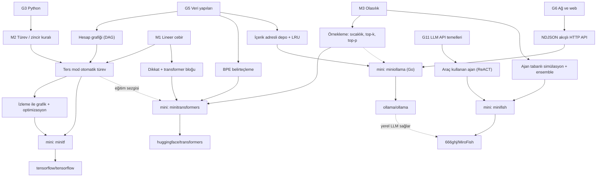

# D05 — Yapay zekâ altyapısı

Bu dal, bugünkü yapay zekâ uygulamalarının altında duran dört katmanı sırayla açar:

1. **Hesap çekirdeği** — tensörler, otomatik türev, grafik derleme: [tensorflow](tensorflow/README.md)
2. **Model tanımı** — belirteçleyici, transformer, `generate()`, kaydet/yükle, ortak API: [transformers](transformers/README.md)
3. **Model sunumu** — paketleme, indirme, belleğe alma/boşaltma, HTTP API: [ollama](ollama/README.md)
4. **LLM ile kurulan uygulama** — çok ajanlı simülasyon ve rapor ajanı: [mirofish](mirofish/README.md)

Her yaprağın bir dosyası (dossier) ve `sifirdan/` altında testli, internetsiz çalışan bir mini uygulaması var.
Minilerin hepsi kendi küçük dünyasında gerçeğin **mekanizmasını** taklit eder: `minitf` (numpy ile ters mod türev +
izleme), `minitransformers` (numpy ile GPT, KV önbelleği, BPE, elle geri yayılım), `miniollama` (Go stdlib ile
NDJSON API, içerik adresli depo, zamanlayıcı), `minifish` (stdlib ile ajan simülasyonu, ReACT raporu, ensemble).

## Ön koşullar

Bu liste dört yaprağın "Öğrenmen gerekenler" tablolarının birleşimidir; parantez içinde düğümü isteyen yapraklar
yazıyor. Her dalda olduğu gibi [G1 Terminal, kabuk ve Linux](../../govde/README.md#g1) (ollama'da süreç başlatma,
ortam değişkenleri, servis olarak çalıştırma) ve [G2 Git ve GitHub](../../govde/README.md#g2) varsayılır.

Zorunlu gövde düğümleri:

- [G3 Python ile programlama](../../govde/README.md#g3) — üç mini Python; sınıflar, dekoratörler, bağlam
  yöneticileri (tensorflow, transformers, mirofish).
- [G5 Veri yapıları ve algoritmalar](../../govde/README.md#g5) — hesap grafiği (DAG), topolojik sıra, hash, LRU,
  öncelik tablosu (dört yaprak).
- [G6 Ağ ve web](../../govde/README.md#g6) — ollama'nın NDJSON akışlı HTTP API'si, Hub indirmeleri, MiroFish'in
  REST uç noktaları (transformers, ollama, mirofish).
- [G7 Test, CI ve kod kalitesi](../../govde/README.md#g7) — sonlu farkla gradyan testleri, `go test -race`; dört
  mini de testle ilerler (tensorflow).
- [G11 LLM API temelleri](../../govde/README.md#g11) — belirteç, istem, sıcaklık, akış, araç çağrısı
  (transformers, ollama, mirofish).

Faydalı (gerçek depoyu okurken):

- [G8 Büyük kod tabanı okuma](../../govde/README.md#g8) — TensorFlow'un 37 bin dosyasında "op adından çekirdeğe" iz
  sürmek (tensorflow).
- [G9 Açık kaynak: lisans, katkı süreci, topluluk](../../govde/README.md#g9) — model ağırlıklarının ayrı lisansı,
  AGPL-3.0'ın SaaS etkisi (transformers, mirofish).
- [G10 C ve bellek modeli](../../govde/README.md#g10) — TensorFlow çekirdekleri, cgo ve llama.cpp, VRAM hesabı
  (tensorflow, ollama).

Dal içinde öğrenilenler: **Go dili** (yalnızca ollama; goroutine, kanal, `context` — Türkçe kaynaklar ollama
dosyasında), aşağıdaki M1–M3 matematik düğümleri ve yaprağa özgü kavramlar: sayısal kararlılık ve sinir ağı
temelleri (tensorflow), dikkat mekanizması (transformers), nicemleme (ollama), ajan tabanlı modelleme ve bilgi
grafiği (mirofish).

Önceki dal: [D09 Bilgisayar bilimi](../09-bilgisayar-bilimi/README.md) — en azından
[thealgorithms-python](../09-bilgisayar-bilimi/thealgorithms-python/README.md) (algoritma pratiği) ve
[ossu-computer-science](../09-bilgisayar-bilimi/ossu-computer-science/README.md) içindeki iki bölüm: "Core math"
(Calculus 1A, M2 için) ve "Advanced math" (Essence of Linear Algebra ile MIT 18.06 M1 için, Probability/Stat 110 M3
için). [D04 Veri araçları](../04-veri-araclari-otomasyon/README.md) hiçbir yaprağın ön koşulu değildir; ilişkisi
aşağıdaki "Dallar arası bağlantılar" bölümünde.

Dal içi matematik düğümleri (bu dalda ayrıca gerekir):

| Düğüm                         | Nerede kullanılır                                                                   | Ücretsiz kaynak                                                                                                                                                                                                                                                                                                    |
| ----------------------------- | ----------------------------------------------------------------------------------- | ------------------------------------------------------------------------------------------------------------------------------------------------------------------------------------------------------------------------------------------------------------------------------------------------------------------ |
| **M1 Lineer cebir**           | matris çarpımı ve devriği, yayınlama, dikkat = `softmax(QKᵀ/√d)V`                   | [Essence of Linear Algebra (3Blue1Brown)](https://www.youtube.com/playlist?list=PLZHQObOWTQDPD3MizzM2xVFitgF8hE_ab) ve [MIT 18.06](https://ocw.mit.edu/courses/mathematics/18-06sc-linear-algebra-fall-2011/) — ikisi de [ossu](../09-bilgisayar-bilimi/ossu-computer-science/README.md) "Advanced math" bölümünde |
| **M2 Türev ve zincir kuralı** | ters mod otomatik türev (`GradientTape`), elle geri yayılım (`minitransformers`)    | [MIT Calculus 1A](https://openlearninglibrary.mit.edu/courses/course-v1:MITx+18.01.1x+2T2019/about) (ossu "Core math"); [Derin Öğrenmeye Dalış — Türkçe d2l](https://tr.d2l.ai/d2l-tr-pytorch.pdf) ([free-programming-books TR](../10-kuratorluk-topluluk/free-programming-books/README.md) listesinden)           |
| **M3 Olasılık ve istatistik** | softmax, örnekleme, sıcaklık, çapraz entropi; simülasyonda tohum, varyans, ensemble | [Harvard Stat 110](https://stat110.hsites.harvard.edu/) (ossu "Advanced math", Probability); [TheAlgorithms `maths/monte_carlo.py`](https://github.com/TheAlgorithms/Python/blob/574d100b7181956e9c8384552fd078165e4cc326/maths/monte_carlo.py)                                                                    |

Uygulamalı tamamlayıcılar: [build-your-own-x → Neural Network](https://github.com/codecrafters-io/build-your-own-x/blob/b2daa235c4fb774402d219c48adfea2a81d94ce7/README.md#build-your-own-neural-network)
(Karpathy'nin "Neural Networks: Zero to Hero" listesi dahil), [TheAlgorithms/Python](../09-bilgisayar-bilimi/thealgorithms-python/README.md)
içindeki `strings/bpe_tokenizer.py`, `graphs/markov_chain.py`, `neural_network/back_propagation_neural_network.py`,
`neural_network/sliding_window_attention.py`.

## Dal ağacı

## Önerilen yaprak sırası

1. **tensorflow** — Dalın matematik ve sistem temeli: ters mod türev, hesap grafiği, "izle ve derle". Sonraki her
   şey (eğitim, KV önbelleği, çıkarım motorları) bu sezgiye dayanır. Mini en kısa geri bildirim döngüsünü verir:
   sonlu farkla gradyan testi geçiyorsa doğru yoldasın.
2. **transformers** — Modern dil modelinin kendisi: belirteçleme, dikkat, `generate()`; artı büyük bir kütüphanenin
   "her model aynı kalıba" mimarisi. transformers dosyası tensorflow yaprağını açıkça ön koşul sayar: oradaki türev
   sezgisi, buradaki elle geri yayılımı anlaşılır kılar.
3. **ollama** — Eğitilmiş bir modeli insanlara **sunmanın** mühendisliği: paketleme, doğrulamalı indirme, belleğe
   alma/boşaltma, akışlı API. Dil değişir (Go); eşzamanlılık ve sistem programlama öne çıkar. ollama dosyası G11
   için transformers dosyasını ve mini'sini kaynak gösterir (belirteç, şablon, örnekleme).
4. **mirofish** — Modelleri bir ürün içinde kullanmak: LLM çağrılarını bir hatta dizmek, JSON'a güvenmemek, araç
   kullanan bir rapor ajanı ve en önemlisi **çıktının ne iddia edebileceğini** sorgulamak (ensemble, sınırlılıklar).
   LLM tarafı için transformers'a dayanır; alıştırma 7'de ollama yerel LLM sunucusu olarak bağlanır. Buradan
   [D06 ajan platformları](../06-ajan-platformlari/README.md)'na doğal bir geçiş var.

## Yapraklar

| Depo                                               | Tür        | Zorluk (1–5) | Mini                                                                          | Mini (saat) | Toplam (saat) |
| -------------------------------------------------- | ---------- | ------------ | ----------------------------------------------------------------------------- | ----------- | ------------- |
| [tensorflow/tensorflow](tensorflow/README.md)      | kod tabanı | 5            | [minitf](tensorflow/sifirdan/README.md) — Python + numpy, 36 test             | 23          | ~50           |
| [huggingface/transformers](transformers/README.md) | kod tabanı | 4            | [minitransformers](transformers/sifirdan/README.md) — Python + numpy, 23 test | 25–27       | ~52–54        |
| [ollama/ollama](ollama/README.md)                  | kod tabanı | 4            | [miniollama](ollama/sifirdan/README.md) — Go stdlib, 28 test                  | 23          | ~47           |
| [666ghj/MiroFish](mirofish/README.md)              | kod tabanı | 3            | [minifish](mirofish/sifirdan/README.md) — Python stdlib, 19 test              | 17          | ~41           |
| **Dal toplamı**                                    |            |              |                                                                               | **88–90**   | **~190–192**  |

**Süreler nasıl hesaplandı:** "Mini (saat)" her dosyanın "Sıfırdan yol" tablosundaki aşamaların toplamıdır.
"Toplam (saat)" = mini + okuma rotası (§5; adım başına ~1 saat, her yaprakta 10 adım) + alıştırmalar (§6; kolay 1,
orta 2, zor 3 saat). Bu daldaki bütün tahminler saat cinsindendir; bir kaynak gün ya da hafta verirse 1 gün ≈ 5 saat
odaklı çalışma, 1 hafta ≈ 10 saat sayılır. tensorflow'daki "Yan" dallar §6 alıştırmalarıyla aynı işler olduğu için
ayrıca eklenmedi. **Dal toplamı yaklaşık 190 saat; haftada ~10 saatle ≈ 19 hafta (4–5 ay).** Yalnızca minileri
yazmak 88–90 saat (≈ 9 hafta) sürer.

Zorluk puanı minilerin değil gerçek deponun okunma zorluğudur: TensorFlow'un 37 bin dosyası ve C++/Python/Bazel
karışımı en zorudur. MiroFish küçüktür ama iki dış servise (bir LLM API'si ve Zep Cloud) ve OASIS simülatörüne
(yerel Python kütüphanesi `camel-oasis`) bağımlıdır; her etkin ajan her turda LLM çağırdığı için tam çalıştırması
pahalıdır.

## Dallar arası bağlantılar

- **[D06 Ajan platformları](../06-ajan-platformlari/README.md):** [openclaw](../06-ajan-platformlari/openclaw/README.md),
  [hermes-agent](../06-ajan-platformlari/hermes-agent/README.md) ve [autogpt](../06-ajan-platformlari/autogpt/README.md)
  bu dalın ürettiği şeyi tüketir: bir LLM API'si. Ollama'nın OpenAI/Anthropic uyumlu uç noktaları bu ajanları yerel
  modellerle çalıştırmanın bir yoludur; `ollama launch openclaw` ve `ollama launch hermes` bunu tek komutla kurar
  (`cmd/launch/openclaw.go`, `cmd/launch/hermes.go`). MiroFish'in rapor ajanı (`report_agent.py`) ise bölüm başına
  bir ReACT döngüsü kuran bir ajandır; D06 bu döngüyü derinleştirir.
- **[D07 Kodlama ajanları](../07-kodlama-ajanlari/README.md):** `ollama launch` komutu Claude Code, Codex,
  [opencode](../07-kodlama-ajanlari/opencode/README.md), [deepseek-harness](../07-kodlama-ajanlari/deepseek-harness/README.md)
  gibi araçları yerel modele bağlar (`cmd/launch/`). Bir kodlama ajanının "modeli" bu dalın sunduğu bir uç noktadır.
- **[D04 Veri araçları ve otomasyon](../04-veri-araclari-otomasyon/README.md):** ön koşul değil, tamamlayıcı.
  [markitdown](../04-veri-araclari-otomasyon/markitdown/README.md) belgeleri modele/simülasyona verilecek metne
  çevirir; [firecrawl](../04-veri-araclari-otomasyon/firecrawl/README.md) tohum metin toplar (hakları sizde olan
  içerik için); [n8n](../04-veri-araclari-otomasyon/n8n/README.md) iş akışlarından Ollama'yı çağırır.
- **[D09 Bilgisayar bilimi](../09-bilgisayar-bilimi/README.md):** algoritma ve matematik temeli
  ([thealgorithms-python](../09-bilgisayar-bilimi/thealgorithms-python/README.md),
  [ossu-computer-science](../09-bilgisayar-bilimi/ossu-computer-science/README.md)); model sunumunun ölçeklenmesi
  için [system-design-primer](../09-bilgisayar-bilimi/system-design-primer/README.md).
- **[D08 Ajan becerileri](../08-ajan-becerileri/README.md):** LLM'e iş yaptırmanın istem ve beceri tarafı.

## Bu dalı bitirdiğinde ne yapabilirsin

- Bir hesap grafiğinin türevini elle ve otomatik alabilir, bir gradyan hatasını sonlu farklarla yakalayabilirsin.
- `tf.function`/izleme mantığını, yeniden izlemenin ve durumlu op'ların neden önemli olduğunu açıklayabilirsin.
- Bir GPT'yi sıfırdan kurup BPE belirteçleyicisini Türkçe metinle eğitebilir, KV önbelleğinin neden çıktıyı
  değiştirmediğini test ile gösterebilirsin.
- transformers kütüphanesine yeni bir model mimarisi eklemenin adımlarını (config, modular dosya, Auto kaydı,
  testler) takip edebilirsin.
- Akışlı bir LLM sunucusu yazabilir; içerik adresli depolama, doğrulamalı indirme ve keep_alive zamanlayıcısı kurabilirsin.
- LLM tabanlı bir simülasyon/rapor hattı kurup sonuçlarını **belirsizliğiyle** sunabilir, "tahmin" iddialarını
  eleştirel olarak değerlendirebilirsin.

Ağacın tamamı: [AGAC.md](../../AGAC.md) · İş fikirleri: [is-fikirleri](../../is-fikirleri/README.md)
