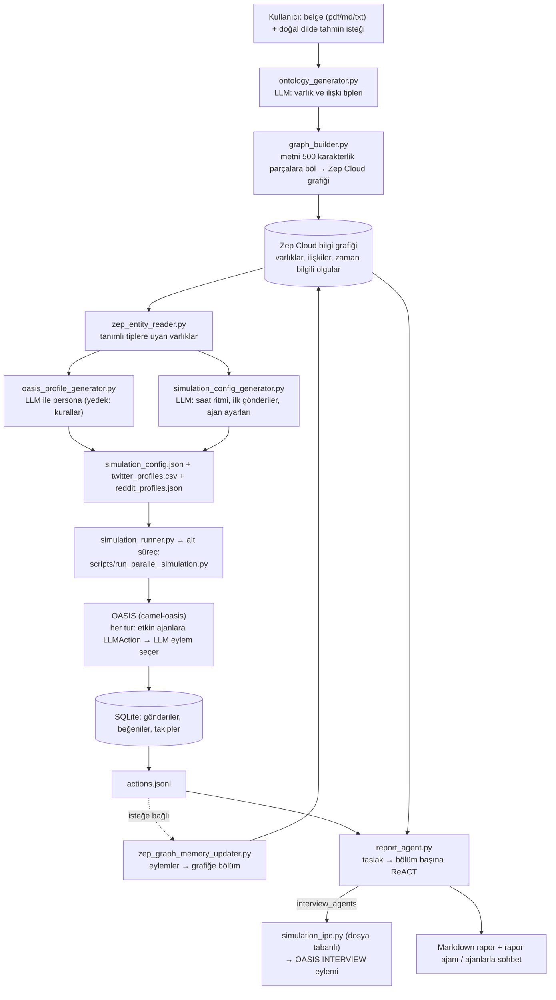
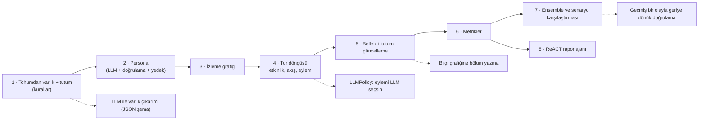

# 666ghj/MiroFish — LLM ajanlarıyla sosyal medya simülasyonu kuran "tahmin motoru"

> **Dal:** [D05 Yapay zekâ altyapısı](../README.md) · **Tür:** kod tabanı
> **Dil:** Python (arka uç) + Vue 3 (ön yüz) · **Lisans:** AGPL-3.0 · **Yıldız:** 84.987 (9 Kasım 2026) · **İncelenen commit:** `7657031` (2026-10-02)

## 1. Bir bakışta

MiroFish, kendini "her şeyi tahmin eden, basit ve evrensel bir sürü zekâsı motoru" olarak tanıtıyor. Pratikte
yaptığı şu: yüklediğiniz bir belgeden (haber, rapor, politika taslağı, hatta bir roman) **aktörleri** çıkarır, her
aktör için LLM ile bir **persona** yazar, bu personaları açık kaynak **OASIS** (camel-ai) sosyal medya
simülatöründe Twitter ve Reddit benzeri iki ortamda saatler boyunca **LLM'e karar verdirerek** etkileştirir, olup
biteni bir bilgi grafiğine (Zep Cloud) yazar ve sonunda araç kullanan bir **rapor ajanına** "geleceğe dönük tahmin
raporu" yazdırır; ardından tek tek ajanlarla "röportaj" yapabilirsiniz. Depo 26 Kasım 2025'te açılmış ve bir yıldan
kısa sürede ~85 bin yıldıza ulaşmış; README'ye göre Shanda Group'un desteğiyle geliştiriliyor. Popülerliğinin
sebebi fikrin çekiciliği ("geleceği dijital bir kum havuzunda prova et"), etkileyici demolar (Wuhan Üniversitesi
kamuoyu simülasyonu, Kızıl Köşk Rüyası'nın kayıp sonu) ve tek komutla ayağa kalkan, görsel bir arayüz.

**"Tahmin" burada ne demek?** Koddaki anlamıyla: "verilen belge + seçilen LLM + persona istemleri + simülasyon
parametreleri altında, LLM ajanlarının ürettiği sanal sosyal medya akışının bir LLM tarafından yorumlanması."
Rapor ajanının planlama istemi bunu açıkça söylüyor: "Simülasyon dünyasının evrimi, gelecekte olabileceklerin
tahminidir… Ajanların sözleri ve davranışları, gelecekteki kalabalık davranışının tahminidir"
(`backend/app/services/report_agent.py`, `PLAN_SYSTEM_PROMPT`, Çinceden çeviri). İncelenen kodda **kalibrasyon,
geçmiş olaylarla geriye dönük doğrulama (backtest), olasılık aralığı ya da çoklu koşu (ensemble) yok**. Bu yüzden
çıktıyı bir olasılık tahmini değil, **senaryo keşfi / beyin fırtınası** aracı olarak okumak gerekir (ayrıntı §2,
"Tasarım kararları").

## 2. Nasıl yapılmış: mimari

### Klasör haritası

Depoda 128 dosya var; arka uç testler hariç yaklaşık 24 bin satır Python (`backend/app` ~19,8 bin,
`backend/scripts` ~4,6 bin; testler ~3,4 bin satır).

```text
backend/
├── run.py                              Flask sunucusu (0.0.0.0:5001); önce Config.validate (LLM_API_KEY, ZEP_API_KEY)
├── app/
│   ├── __init__.py                     create_app: CORS, blueprint'ler /api/graph, /api/simulation, /api/report
│   ├── config.py                       .env'den LLM_BASE_URL / LLM_MODEL_NAME, Zep anahtarı, OASIS eylem listeleri
│   ├── api/graph.py                    proje, ontoloji üretimi, grafik kurma uç noktaları
│   ├── api/simulation.py               create, prepare, start/stop, run-status, actions, timeline, interview (2.878 satır)
│   ├── api/report.py                   rapor üretimi, ilerleme, bölümler, ajan günlüğü (from_line ile artımlı okuma), rapor ajanıyla sohbet
│   ├── services/ontology_generator.py  LLM: sosyal medyada "konuşabilen" 10 varlık tipi + 6–10 ilişki tipi
│   ├── services/graph_builder.py       Zep Cloud: grafik oluştur, ontolojiyi ayarla, metin parçalarını toplu gönder, bekle
│   ├── services/zep_entity_reader.py   grafikten tanımlı tiplere uyan varlıkları ve kenarlarını oku
│   ├── services/oasis_profile_generator.py   varlık → persona (LLM + Zep araması; kural tabanlı yedek) → OASIS CSV/JSON
│   ├── services/simulation_config_generator.py  LLM: zaman ritmi, ilk gönderiler, ajan etkinlik/tutum/etki ayarları
│   ├── services/simulation_manager.py  hazırlık hattını yönetir (prepare_simulation)
│   ├── services/simulation_runner.py   simülasyon betiğini alt süreç olarak başlatır, actions.jsonl'i izler
│   ├── services/simulation_ipc.py      dosya tabanlı komut/yanıt kanalı (simülasyon klasöründe ipc_commands/ ve ipc_responses/)
│   ├── services/zep_graph_memory_updater.py   ajan eylemlerini metin "bölüm"leri olarak Zep grafiğine geri yazar
│   ├── services/zep_tools.py           rapor araçları: insight_forge, panorama_search, quick_search, interview_agents
│   ├── services/report_agent.py        ReportAgent: taslak planı + bölüm başına ReACT döngüsü (2.619 satır)
│   └── utils/llm_client.py             OpenAI uyumlu istemci; JSON yanıt temizleme ve doğrulama
├── scripts/run_parallel_simulation.py  OASIS'te Twitter + Reddit'i paralel koşturan asıl simülasyon döngüsü
├── scripts/run_twitter_simulation.py, run_reddit_simulation.py   tek platformlu sürümler
├── scripts/action_logger.py            platform başına actions.jsonl
└── tests/                              18 dosya, 110 test (çoğu Zep Cloud sözleşmeleri ve JSON sağlamlığı)
frontend/src/
├── views/ (Home, MainView, Process, SimulationView, SimulationRunView, ReportView, InteractionView)
├── components/Step1GraphBuild.vue … Step5Interaction.vue   beş adımlı sihirbaz
└── components/GraphPanel.vue           d3 kuvvet yönlendirmeli grafik görselleştirme
locales/ (zh.json, en.json, languages.json)  ·  Dockerfile, docker-compose.yml  ·  .env.example  ·  package.json (concurrently ile iki sunucu)
```

### Ana bileşenler ve veri akışı



Adım adım (kod düzeyinde):

1. **Grafik kurma.** Yüklenen metin `TextProcessor.split_text` ile parçalanır (varsayılan 500 karakter, 50 örtüşme;
   `config.py`). `OntologyGenerator` LLM'den, sosyal medyada **konuşabilen** varlık tipleri ister — "tam 10 tip,
   son ikisi yedek tip `Person` ve `Organization`; soyut kavramlar varlık olamaz" (istem
   `ontology_generator.py` içinde). `GraphBuilderService` Zep Cloud'da bir grafik oluşturur, ontolojiyi dinamik
   Pydantic sınıflarıyla (`EntityModel`, `EdgeModel`) ayarlar ve parçaları toplu (`client.batch.*`) gönderir;
   **varlık/ilişki çıkarımını Zep yapar**. README bu aşamayı "GraphRAG construction" olarak anlatıyor.
2. **Ortam hazırlığı.** `/api/simulation/prepare` uzun süren bir arka plan görevidir: grafikten varlıklar okunur,
   her biri için persona üretilir (paralel; LLM başarısızsa `_generate_profile_rule_based`), ardından
   `SimulationConfigGenerator` zaman ayarlarını (varsayılan 72 simüle saat, tur başına 60 dakika), ilk gönderileri
   ve ajan başına etkinlik düzeyi, aktif saatler, tutum (`stance`), etki ağırlığı gibi değerleri LLM'e ürettirir.
   Günlük ritim varsayılanı Çin saat düzenine göre: gece 0,05, sabah 0,4, mesai 0,7, akşam zirvesi 1,5
   (`CHINA_TIMEZONE_CONFIG`). Dikkat: simülasyon betiğindeki `get_active_agents_for_round` bunlardan yalnızca zirve
   ve gece çarpanlarını uygular, diğer saatlerde 1,0 kullanır; sabah ve mesai çarpanları yapılandırmaya yazılır ama
   okunmaz.
3. **Simülasyon.** `SimulationRunner` betiği yeni bir süreç grubunda alt süreç olarak başlatır. Betik her platform
   için `oasis.make(...)` ile bir ortam kurar (SQLite veritabanı, en fazla 30 eşzamanlı LLM isteği), 0. turda ilk
   gönderileri `ManualAction` ile yayımlar, sonra her turda `get_active_agents_for_round` ile etkin ajanları seçip
   hepsine `LLMAction()` verir: **hangi eylemi yapacağına (gönderi, beğeni, paylaşım, takip, yorum, hiçbir şey) her
   ajanın LLM'i karar verir**. Eylemler SQLite'tan okunup `actions.jsonl`'e yazılır. Simülasyon bitince ortam
   kapanmaz; röportaj komutlarını dosya tabanlı IPC ile bekler.
4. **Rapor.** `ReportAgent` önce 2–5 bölümlük bir taslak planlar, sonra her bölüm için ReACT döngüsünde araç
   çağırır (`<tool_call>{...}</tool_call>` biçimi; `_parse_tool_calls`): `insight_forge` (soruyu alt sorulara bölüp
   grafikte arar), `panorama_search` (güncel ve süresi dolmuş olgular dahil tüm grafik), `quick_search`,
   `interview_agents` (ilgili ajanları seçip canlı OASIS ortamında soru sorar). Bölüm metni "Final Answer:" ile gelir.

### Önce okunacak dosyalar

1. `README.md` ve `.env.example` — iddia ve gereken anahtarlar (LLM + Zep Cloud).
2. `backend/app/config.py` — tüm ayar yüzeyi, OASIS eylem listeleri, rapor ajanı sınırları.
3. `backend/app/services/ontology_generator.py` — istem tasarımı: "konuşabilen varlık" kısıtı.
4. `backend/app/services/graph_builder.py` — dış servise toplu yükleme, idempotentlik ve bekleme.
5. `backend/app/services/oasis_profile_generator.py` — persona üretimi ve yedekleme stratejisi.
6. `backend/app/services/simulation_config_generator.py` — simülasyonun sayısal varsayımları.
7. `backend/scripts/run_parallel_simulation.py` — `get_active_agents_for_round` ve tur döngüsü.
8. `backend/app/services/report_agent.py` — istemler, ReACT döngüsü, araç çağrısı ayrıştırma.
9. `backend/app/services/zep_tools.py` — rapor araçlarının gerçekte ne getirdiği.

### Teknoloji yığını, derleme, test, CI, sürüm

- **Arka uç:** Python ≥3.11, <3.13 (`backend/pyproject.toml`), Flask + flask-cors, `openai` SDK (OpenAI uyumlu her
  API; README Alibaba Bailian'daki `qwen-plus`'ı öneriyor), `zep-cloud==3.25.0`, `camel-oasis==0.2.5`,
  `camel-ai==0.2.78`, PyMuPDF, pydantic; bağımlılıklar `uv` ile (`uv.lock`).
- **Ön yüz:** Vue 3 + Vite + vue-router + vue-i18n + axios + d3.
- **Çalıştırma:** kökteki `package.json` `concurrently` ile iki sunucuyu birlikte başlatır (`npm run dev`: ön yüz 3000,
  arka uç 5001). Docker imajı da `npm run dev` ile — yani geliştirme sunucularıyla — çalışır.
- **Test:** `backend/tests/` altında pytest testleri (18 dosya, 110 test fonksiyonu); ağırlıkla Zep Cloud API
  sözleşmeleri, sayfalama, yeniden deneme ve LLM'den gelen bozuk JSON'a dayanıklılık. Simülasyon sonuçlarının
  doğruluğunu ölçen bir test yok (zaten "doğru" tanımı yok).
- **CI:** `.github/workflows/docker-image.yml` (etiketlerde çok mimarili imajı GHCR'a gönderir) ve yıldız geçmişi
  güncelleyen bir iş akışı. Sürüm `package.json`'da `0.1.0`.

### Tasarım kararları ve ödünleşimler

1. **Ağır işleri dış servislere bırakmak.** Varlık çıkarımı ve bellek Zep Cloud'da, ajan davranışı OASIS'te,
   akıl yürütme bir LLM API'sinde. Uygulama kodu bunları birbirine bağlayan bir **orkestrasyon katmanı**. Kazanç:
   hızlı ürünleşme. Bedel: üç dış bağımlılık, maliyet (README "tüketim yüksek, önce 40 turdan az deneyin" diyor),
   veri gizliliği (belgeniz hem LLM sağlayıcısına hem Zep'e gider) ve tekrarlanabilirliğin zorlaşması.
2. **Eylemi LLM seçiyor, görüş açık bir değişken değil.** Ajanların "tutumu" metinlerin içinde örtük; bir görüş
   dinamiği modeli (ör. sınırlı güven, eşik modelleri) yok. Bu, zengin ve doğal metin üretir ama sonucu
   açıklamayı ve ölçmeyi zorlaştırır; sonuç büyük ölçüde LLM'in eğitim verisindeki önyargılara ve istemlere bağlıdır.
3. **"Tahmin" çerçevesi.** Rapor istemi simülasyonu "geleceğin provası" olarak tanımlıyor; sistemde kalibrasyon,
   geriye dönük doğrulama, belirsizlik aralığı veya çoklu koşu yok. README "tanrı bakışıyla değişkenleri dinamik
   olarak enjekte etme"den söz ediyor; incelenen kodda ise olay enjeksiyonu yalnızca 0. turdaki ilk gönderiler
   (`event_config.initial_posts`) ile simülasyon sonrası röportajlardan ibaret — `EventConfig.scheduled_events`
   alanı tanımlı ama `_parse_event_config` onu her zaman boş liste yapıyor ve betiklerde kullanılmıyor.
4. **Uzun işler = arka plan iş parçacığı + alt süreç + dosya tabanlı IPC.** Flask içinde görevler `threading.Thread`
   ile, simülasyon ayrı süreç grubunda; iletişim simülasyon klasöründeki `ipc_commands/` ve `ipc_responses/`
   klasörlerinde JSON dosyalarıyla (modülün docstring'i kısaca `commands/` ve `responses/` der).
   Basit ve hata ayıklaması kolay; ölçeklenmesi ve çoklu kullanıcıya açılması zor.
5. **LLM çıktısına güvenmemek.** Kodun önemli bir kısmı LLM'den gelen JSON'u temizlemeye, onarmaya
   (`_fix_truncated_json`, `_try_fix_json`) ve alanları normalize etmeye ayrılmış; testlerin önemli bir kısmı da bunu
   sınıyor. Bu, LLM tabanlı ürünlerin gerçekçi bir dersidir.
6. **Üretim sertleştirmesi eksik.** `/api/*` için CORS herkese açık, `SECRET_KEY` için sabit bir varsayılan var, Flask
   geliştirme sunucusu ve `npm run dev` ile servis ediliyor. Kendi sunucunuza kurarken bunları kapatmanız gerekir.
   Lisans **AGPL-3.0**: değiştirilmiş sürümü ağ üzerinden hizmet olarak sunarsanız kaynak kodu kullanıcılara açma
   yükümlülüğü doğar.

## 3. Öğrenmen gerekenler

| Düğüm                                                         | Bu depo için neden gerekli                                                        | Ücretsiz kaynak                                                                                                                                                                                                                |
| ------------------------------------------------------------- | --------------------------------------------------------------------------------- | ------------------------------------------------------------------------------------------------------------------------------------------------------------------------------------------------------------------------------ |
| [G11 LLM API temelleri](../../../govde/README.md#g11)         | Her aşama bir LLM çağrısı: istem tasarımı, JSON çıktısı, araç çağrısı, maliyet.   | [anthropic-skills dosyası](../../08-ajan-becerileri/anthropic-skills/README.md); bu daldaki [transformers](../transformers/README.md)                                                                                          |
| [G3 Python](../../../govde/README.md#g3)                      | Flask, dataclass, threading, subprocess, asyncio (OASIS betikleri).               | [Python-100-Days](../../09-bilgisayar-bilimi/python-100-days/README.md)                                                                                                                                                        |
| [G6 Ağ ve web](../../../govde/README.md#g6)                   | REST uç noktaları, uzun görevler için durum yoklama, günlüğün artımlı okunması.   | [system-design-primer](../../09-bilgisayar-bilimi/system-design-primer/README.md)                                                                                                                                              |
| [G5 Veri yapıları](../../../govde/README.md#g5)               | Bilgi grafiği, izleme grafiği, akış sıralaması.                                   | [TheAlgorithms/Python `graphs/`](https://github.com/TheAlgorithms/Python/tree/574d100b7181956e9c8384552fd078165e4cc326/graphs)                                                                                                 |
| [G9 Açık kaynak ve lisans](../../../govde/README.md#g9)       | AGPL-3.0'ın SaaS etkisi; bağımlılık PyMuPDF de AGPL lisanslı (doğrulanmadı).      | [free-programming-books](../../10-kuratorluk-topluluk/free-programming-books/README.md)                                                                                                                                        |
| [D06 ajan platformları](../../06-ajan-platformlari/README.md) | Ön koşul değil, sonraki dal: rapor ajanındaki ReACT döngüsü D06'da derinleşir.    | [hermes-agent](../../06-ajan-platformlari/hermes-agent/README.md), [autogpt](../../06-ajan-platformlari/autogpt/README.md)                                                                                                     |
| Dal içi: **olasılık ve istatistik**                           | Rastgelelik, tohum, ortalama/standart sapma, "tek koşu ≠ dağılım".                | [Harvard Stat 110](https://stat110.hsites.harvard.edu/) (ossu listesinden); [TheAlgorithms `maths/monte_carlo.py`](https://github.com/TheAlgorithms/Python/blob/574d100b7181956e9c8384552fd078165e4cc326/maths/monte_carlo.py) |
| Dal içi: **ajan tabanlı modelleme ve görüş dinamiği**         | Etkinlik ritmi, ağ yapısı (homofili), sınırlı güven modelleri, yayılım (cascade). | Mini'deki `simulation.py`; Deffuant ve ark. (2000), "Mixing beliefs among interacting agents" (doğrulanmadı)                                                                                                                   |
| Dal içi: **bilgi grafiği ve GraphRAG**                        | Belgeden varlık/ilişki çıkarmak ve sorgulamak.                                    | Zep belgeleri (doğrulanmadı): <https://help.getzep.com>                                                                                                                                                                        |

## 4. Sıfırdan yol (dallanma)



| Aşama | Ne inşa edersin                               | Öğrendiğin kavram                                    | Bitti ölçütü                                         | Süre (tahmini) |
| ----- | --------------------------------------------- | ---------------------------------------------------- | ---------------------------------------------------- | -------------- |
| 1     | kural tabanlı çıkarıcı + ontoloji             | bilgi çıkarımı, Türkçe özne sezgisi, sınırlılıkları  | tohumdaki 10 aktör doğru tip ve tutumla bulunuyor    | 3 saat         |
| 2–3   | persona + izleme grafiği                      | LLM çıktısını doğrulama, yedek yol, homofili         | bozuk LLM yanıtında da ajanlar üretiliyor            | 3 saat         |
| 4–5   | tur döngüsü, akış, bellek, görüş güncellemesi | ajan tabanlı modelleme, günlük ritim, sınırlı güven  | aynı tohum aynı kayıt; gece etkinlik yok             | 5 saat         |
| 6–7   | metrikler + ensemble                          | belirsizlik, varyans, senaryo karşılaştırması        | iki senaryonun farkı yayılımla birlikte raporlanıyor | 3 saat         |
| 8     | ReACT rapor ajanı                             | araç çağrısı ayrıştırma, döngü sınırı, gözlem biçimi | sahte LLM ile iki araç çağrısı ve nihai cevap        | 3 saat         |

**Toplam:** aşamalar 17 saat. Okuma rotası (§5, 10 adım × ~1 saat) ve alıştırmalarla (§6: kolay 1, orta 2, zor
3 saat; 2 + 6 + 6 = 14 saat) birlikte yaklaşık **41 saat**. Hesap kuralı: [dal README'si](../README.md#yapraklar).

**Mini uygulama:** [`sifirdan/`](sifirdan/README.md) — `minifish` (stdlib, ~760 satır kod + 19 test). Tohum metin
kurgusaldır. README'deki eşleme tablosu, mini'nin hangi parçasının gerçek depoda nerede durduğunu ve **hangi
parçaların gerçekte hiç olmadığını** (açık görüş modeli, ensemble, tur ortasında olay) gösterir.

**Gerçek ölçeğe giden yol:** (1) kural tabanlı çıkarıcı yerine şemalı LLM çıkarımı ve bir grafik veritabanı;
(2) `LLMPolicy` ile eylemleri LLM'e seçtirmek ve maliyeti ölçmek (ajan × tur × platform kadar çağrı); (3) eşzamanlı
LLM çağrıları ve hız sınırı (MiroFish'te semafor 30); (4) kalıcı depolama ve iş kuyruğu (thread + dosya IPC yerine);
(5) **değerlendirme**: geçmiş bir olayın ilk gününü tohum yapıp sonraki günlerin gerçek verisiyle karşılaştırmak —
bu adım olmadan "tahmin" iddiası sınanamaz; (6) çoklu koşu ve duyarlılık analizi; (7) güvenlik ve gizlilik
(kişisel veri, KVKK, model sağlayıcısının veri politikası).

## 5. Gerçek depoda okuma rotası

1. **`README.md`** → "Workflow" beş adımı. Her adımı bir dosyaya eşleyin (bu dosyadaki diyagram yardımcı olur).
2. **`backend/app/__init__.py`** ve **`api/__init__.py`**: üç blueprint ve `/health`. Soru: uzun görevler neden
   hemen `task_id` döndürüp durum uç noktasıyla izleniyor?
3. **`services/ontology_generator.py`** → `ONTOLOGY_SYSTEM_PROMPT` ve `_validate_and_process`: LLM "11 tip" dönerse ne olur?
4. **`services/graph_builder.py`** → `_build_graph_worker`, `add_text_batches`, `_wait_for_batch`: dış servise yazarken
   kaybolan yanıtları (idempotentlik) nasıl ele alıyor (`build_operation_id`, `create_graph` uzlaştırması)?
5. **`services/oasis_profile_generator.py`** → `generate_profile_from_entity`, `_try_fix_json`,
   `_generate_profile_rule_based`: hangi durumda kural tabanlı persona kullanılıyor?
6. **`services/simulation_config_generator.py`** → `CHINA_TIMEZONE_CONFIG`, `AgentActivityConfig`,
   `_parse_event_config`: `scheduled_events` neden hep boş?
7. **`scripts/run_parallel_simulation.py`** → `get_active_agents_for_round`, `run_twitter_simulation`: bir turda kaç
   LLM çağrısı yapılıyor? 72 saat × 60 dakikalık tur × 20 etkin ajan × 2 platform için kabaca hesaplayın.
8. **`services/simulation_runner.py`** → `start_simulation`, `_monitor_simulation`, `_read_action_log`: süreç yönetimi.
9. **`services/report_agent.py`** → `PLAN_SYSTEM_PROMPT`, `_generate_section_react`, `_parse_tool_calls`: "Final Answer"
   gelmezse ne oluyor (`REACT_FORCE_FINAL_MSG`)?
10. **`backend/tests/test_llm_json_responses.py`**: LLM'den gelen hangi bozuk biçimler sınanıyor?

## 6. Alıştırmalar ve öz değerlendirme

1. (Kolay) Mini'de `confidence` eşiğini 0,3 ve 1,5 yapıp kutuplaşmanın nasıl değiştiğini ensemble ile ölçün.
2. (Kolay) Akış ağırlıklarını (`weights`) "yalnızca popülerlik" yapın; en büyük yayılım nasıl değişiyor?
3. (Orta) Yeni bir eylem ekleyin: `FOLLOW` — ajan, hemfikir olduğu yazarı izlemeye başlasın; ağ zamanla nasıl kümeleşiyor?
4. (Orta) `seed.py`'ye "X, Y'yi eleştirdi" gibi iki varlıklı cümlelerde hedefe yönelik ilişki (OPPOSES → Y) çıkarın.
5. (Orta) Senaryo karşılaştırmasına basit bir anlamlılık ölçüsü ekleyin: fark / birleşik standart hata.
6. (Zor) Geriye dönük doğrulama tasarlayın: kurgusal ama "gerçek" kabul ettiğiniz bir destek yüzdesi zaman serisi
   üretin, modeli ilk günle başlatın, parametreleri (açıklık, eşik) ızgara aramasıyla uydurun; ayrı bir günde sınayın.
7. (Zor) Gerçek bir LLM'i (OpenAI uyumlu yerel bir sunucu, ör. Ollama) `LLMClient` olarak bağlayın; kural tabanlı
   politikayla aynı senaryoda dağılımları karşılaştırın ve çağrı başına maliyeti kaydedin.

<details><summary>Soru 1: MiroFish'in raporundaki bir "tahmin" neyin ürünüdür?</summary>

Belgeden çıkarılan aktörler + LLM'in yazdığı personalar + LLM'in önerdiği simülasyon parametreleri + her turda
LLM'in seçtiği eylemler + rapor yazan LLM'in yorumu. Kalibrasyon veya geçmişe dönük doğrulama olmadığı için bu bir
olasılık tahmini değil, koşullu bir senaryo anlatısıdır.

</details>

<details><summary>Soru 2: Neden tek bir simülasyon koşusuna güvenmemek gerekir?</summary>

Rastgelelik (hangi ajanın ne zaman etkin olduğu, LLM örneklemesi) sonucu değiştirir. Aynı senaryoyu farklı
tohumlarla koşturup dağılıma bakmadan iki senaryonun farkının gürültüden büyük olup olmadığı bilinemez. Mini'nin
örneğinde olayın etkisi (≈0,01) koşular arası oynamadan (≈0,07) küçük.

</details>

<details><summary>Soru 3: README'deki "tanrı bakışıyla dinamik değişken enjeksiyonu" kodda nasıl karşılanıyor?</summary>

İncelenen commit'te simülasyonun 0. turunda LLM'in önerdiği ilk gönderiler yayımlanıyor ve simülasyon bittikten
sonra ajanlarla röportaj yapılabiliyor. `scheduled_events` alanı yapılandırmada var ama hep boş bırakılıyor ve
simülasyon betiklerinde kullanılmıyor; tur ortasında olay enjeksiyonu görünmüyor.

</details>

<details><summary>Soru 4: Persona üretiminde LLM bozuk JSON döndürürse sistem ne yapar?</summary>

Önce yanıtı temizleyip onarmayı dener (kod çitlerini, `<think>` bloklarını atar, kesik JSON'u kapatır); olmazsa
varlık tipine göre kural tabanlı bir persona üretir. Mini'de `persona.from_llm` aynı stratejiyi uygular.

</details>

<details><summary>Soru 5: AGPL-3.0 bir girişim için ne anlama gelir?</summary>

MiroFish'i değiştirip ağ üzerinden (SaaS) kullanıcılara sunarsanız, o kullanıcılara değiştirilmiş kaynak kodunu da
AGPL altında sunmanız gerekir. Kendi kodunuzu ayrı tutmak istiyorsanız MiroFish'i ayrı bir servis olarak çalıştırıp
lisans etkisini hukukçuyla değerlendirmek gerekir.

</details>

## 7. İş fikri tohumları

- **Duyuru öncesi "kriz provası" atölyesi:** kurumun açıklama metnini tohum yapıp olası tepkileri, en sesli itiraz
  gruplarını ve soruları çıkaran, sonuçları "senaryo" diliyle ve belirsizlik aralığıyla sunan danışmanlık. **Kime:**
  belediyelerin ve orta ölçekli şirketlerin kurumsal iletişim ekipleri.
- **Eğitimde kullanılan "kamuoyu simülasyonu" laboratuvarı:** iletişim ve siyaset bilimi öğrencilerinin parametreleri
  değiştirip ensemble sonuçlarını karşılaştırdığı, Türkçe, açıklanabilir bir simülatör. **Kime:** üniversitelerin
  iletişim, kamu yönetimi ve sosyoloji bölümleri.
- **Ürün lansmanı persona testi:** ürün sayfası metnine karşı farklı müşteri personalarının yorumlarını üretip itiraz
  temalarını kümeleyen araç (karar değil, hazırlık aracı olarak). **Kime:** e-ticaret ve D2C markalarının pazarlama ekipleri.

Daha fazlası: [iş fikirleri kataloğu](../../../is-fikirleri/README.md).

## 8. Kaynaklar

Depo içi (incelenen commit'te):

- [README.md](https://github.com/666ghj/MiroFish/blob/7657031ac01184afe2cb220f5ee3545573b5e843/README.md),
  [.env.example](https://github.com/666ghj/MiroFish/blob/7657031ac01184afe2cb220f5ee3545573b5e843/.env.example),
  [backend/app/config.py](https://github.com/666ghj/MiroFish/blob/7657031ac01184afe2cb220f5ee3545573b5e843/backend/app/config.py)
- [ontology_generator.py](https://github.com/666ghj/MiroFish/blob/7657031ac01184afe2cb220f5ee3545573b5e843/backend/app/services/ontology_generator.py),
  [simulation_config_generator.py](https://github.com/666ghj/MiroFish/blob/7657031ac01184afe2cb220f5ee3545573b5e843/backend/app/services/simulation_config_generator.py),
  [run_parallel_simulation.py](https://github.com/666ghj/MiroFish/blob/7657031ac01184afe2cb220f5ee3545573b5e843/backend/scripts/run_parallel_simulation.py),
  [report_agent.py](https://github.com/666ghj/MiroFish/blob/7657031ac01184afe2cb220f5ee3545573b5e843/backend/app/services/report_agent.py)

Dış kaynaklar (bağlantılar çevrimdışı doğrulanmadı):

- OASIS (camel-ai): <https://github.com/camel-ai/oasis> — MiroFish README'sinde simülasyon motoru olarak anılıyor
- Zep: <https://www.getzep.com>
- Canlı demo (README'den): <https://666ghj.github.io/mirofish-demo/>
- Dal ağacı: [AGAC.md](../../../AGAC.md)
