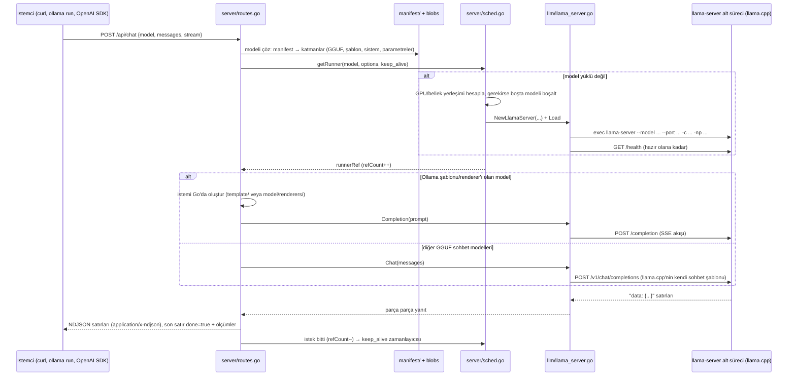
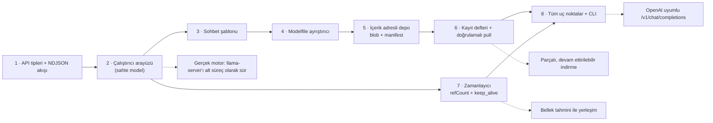

# ollama/ollama — açık modelleri yerelde (ve bulutta) çalıştıran model sunucusu

> **Dal:** [D05 Yapay zekâ altyapısı](../README.md) · **Tür:** kod tabanı
> **Dil:** Go (+ C/C++ yerel bileşenler) · **Lisans:** MIT · **Yıldız:** 186.431 (9 Kasım 2026) · **İncelenen commit:** `d63b702` (2026-11-07)

## 1. Bir bakışta

Ollama, açık ağırlıklı dil modellerini (Gemma, Qwen, Llama, gpt-oss, DeepSeek...) tek komutla indirip
çalıştırmayı sağlayan bir **model sunucusu ve komut satırı aracıdır**: `ollama run gemma4` modeli kayıt defterinden
çeker, belleğe alır ve sohbet başlatır; arka planda `127.0.0.1:11434` adresinde bir HTTP API'si sunar. "Docker
deneyimini modellere getirmesi" (Modelfile, katmanlı içerik adresli depolama, `pull`/`push`), geliştirici dostu REST
API'si ve OpenAI/Anthropic uyumlu uç noktaları sayesinde yerel yapay zekânın varsayılan aracı oldu. İncelenen
commit'te iki önemli gerçek var: (1) **GGUF modellerin çıkarımı artık llama.cpp'nin kendi `llama-server`'ı ile
yapılıyor** — Ollama onu ayrı bir alt süreç olarak başlatıp yerel HTTP ile konuşuyor; llama.cpp kaynağı depoya
gömülü değil, `LLAMA_CPP_VERSION` (`b12177`) ile sabitlenip derlemede CMake ile çekiliyor. (2) safetensors modeller
için Apple'ın **MLX** motorunu kullanan ikinci bir çalıştırıcı var (`mlxrunner/`). README artık modelleri kodlama
ajanlarına bağlamayı (`ollama launch claude`, `codex`, `opencode` ...) ve bulut modellerini de öne çıkarıyor.

## 2. Nasıl yapılmış: mimari

### Klasör haritası

Depoda 1.631 dosya var. En önemli yollar:

```text
main.go                 cobra CLI'yi başlatır (cmd.NewCLI)
cmd/                    CLI: cmd.go (run, pull, create, serve, stop ...), launch/ (Claude Code, Codex, OpenCode... entegrasyonları), tui/
api/                    API tipleri (types.go) ve Go istemcisi (client.go)
server/                 HTTP sunucusu: routes.go (uç noktalar), sched.go (zamanlayıcı), images.go/download.go (pull/push),
                        create.go, prompt.go (sohbet istemini hazırlama ve kırpma), cloud_proxy.go
llm/                    çalıştırıcı soyutlaması: server.go (LlamaServer arayüzü), llama_server.go (llama-server alt süreci)
llama/                  llama.cpp'nin KAYNAĞI DEĞİL: server/CMakeLists.txt (derleme yapıştırıcısı) + compat/ (yama ve uyumluluk katmanı)
mlx/, mlxrunner/        MLX motoru: Go bağları ve "ollama runner" alt sürecinin modelleri, önbelleği, örnekleyicisi
model/                  renderers/ (modele özgü istem biçimlendirme, Go kodu), parsers/ (araç çağrısı / düşünme ayrıştırma)
template/               Go text/template sohbet şablonları (*.gotmpl) + index.json (Jinja şablonu → Go şablonu eşlemesi)
parser/                 Modelfile ayrıştırıcı (parser.go)
manifest/               manifest + katman (layer) tipleri, disk düzeni (paths.go: manifests/, manifests-v2/, blobs/)
create/                 model oluşturma hattı: safetensors okuma, nicemleme, model ailelerine özgü dönüşümler
compatmigrate/          eski Ollama GGUF manifestlerini llama.cpp uyumlu manifest listelerine dönüştürme
discover/               GPU/CPU keşfi (CUDA, ROCm, Vulkan, Metal), native_probe*.go
fs/                     gguf/ ve safetensors/ dosya okuyucuları
envconfig/              OLLAMA_* ortam değişkenleri (OLLAMA_HOST, OLLAMA_MODELS, OLLAMA_KEEP_ALIVE ...)
middleware/, openai/, anthropic/   OpenAI ve Anthropic uyumlu API katmanları
thinking/, harmony/     "düşünme" bloklarını ve gpt-oss Harmony biçimini ayrıştırma
decision/               "System One" karar modelleri için /v1/systemone (sınıflandırma, evet/hayır olasılığı, puanlama)
app/                    masaüstü uygulaması (ui/, webview/, wintray/, updater/)
integration/            gerçek modellerle uçtan uca testler
CMakeLists.txt, CMakePresets.json, LLAMA_CPP_VERSION, MLX_VERSION, MLX_C_VERSION   yerel derleme ve sürüm sabitleme
docs/                   belgeler (api, modelfile, development.md, capabilities/ ...)
```

### Ana bileşenler ve veri akışı



Akışın kalbi üç parçadır:

1. **Depolama (manifest + blob):** Bir model, OCI imajlarına benzer şekilde bir **manifest** (hangi katmanlar) ve
   `sha256` özetiyle adlandırılmış **blob**'lardan oluşur. Katman tipleri `manifest/layer.go` içinde:
   `application/vnd.ollama.image.model` (ağırlıklar), `.template`, `.system`, `.params`, `.license`, `.messages`,
   `.projector`, `.adapter`... Blob'lar `<OLLAMA_MODELS>/blobs/sha256-<özet>` yolunda (`manifest/paths.go`,
   `BlobsPath`). Aynı ağırlığı paylaşan iki model diski iki kez harcamaz. Çekme işlemi önce manifesti
   (`/v2/<ad alanı>/<model>/manifests/<etiket>`), sonra eksik blob'ları indirir, her birini özetiyle doğrular
   ("verifying sha256 digest") ve manifesti en son yazar (`server/images.go`, `PullModel`).
2. **Zamanlayıcı:** `server/sched.go` içindeki `Scheduler`, durumunu kanallarla yöneten goroutine'lerdir
   (`pendingReqCh`, `finishedReqCh`, `expiredCh`, `unloadedCh`). Her yüklü model bir `runnerRef`'tir:
   `refCount` aktif istek sayısı, `sessionDuration` keep_alive süresi, `expireTimer` boşta kalma sayacı. Varsayılan
   keep_alive 5 dakikadır (`OLLAMA_KEEP_ALIVE`); `keep_alive: 0` hemen boşaltır, negatif değer sonsuza dek tutar
   (`api.Duration.UnmarshalJSON`). `ollama stop` aslında `keep_alive: 0` ile boş bir istek gönderir (`cmd/cmd.go`,
   `StopHandler`); boş istem modeli yalnızca yükler ve `done_reason: "load"` döner.
3. **Çalıştırıcı:** `llm/server.go` içindeki `LlamaServer` arayüzü (`Load`, `Completion`, `Chat`, `Tokenize`,
   `Embedding`...) çıkarımı sunucudan ayırır. Uygulaması `llm/llama_server.go`: boş bir port bulur, `llama-server`'ı
   `--model`, `--port`, `--host 127.0.0.1`, `--no-webui`, `--offline`, `-c`, `-np` gibi bayraklarla başlatır; GPU
   katmanı sayısını ve iş parçacığını kullanıcı açıkça vermediyse llama-server'ın kendisine bıraktırır. Dosyanın
   başındaki yorum iki sohbet yolunu açıklar: Ollama'nın kendi renderer/parser'ı, Harmony, MLX ya da Go `TEMPLATE`
   katmanı olan modellerde istem Go'da hazırlanıp `/completion`'a gider; diğer GGUF sohbet modellerinde llama.cpp'nin
   kendi sohbet şablonu (`/v1/chat/completions`) kullanılır.

### Önce okunacak dosyalar

1. `docs/development.md` ve `AGENTS.md` — yerel derleme modeli: `cmake -B build . && cmake --build build`, Go'ya
   özel hızlı döngü için `go run . serve`.
2. `api/types.go` — tüm istek/yanıt sözleşmesi; özellikle `GenerateRequest`, `ChatRequest`, `Metrics`, `Duration`.
3. `server/routes.go` — `GenerateRoutes` (uç nokta listesi), `GenerateHandler`, `ChatHandler`, `streamResponse`.
4. `server/sched.go` — `getRunner`, `processPending`, `processCompleted`, `load`, `useLoadedRunner`.
5. `llm/server.go` ve `llm/llama_server.go` — `startLlamaServer`, `Completion`, `Chat`.
6. `manifest/manifest.go`, `manifest/layer.go`, `manifest/paths.go` — disk düzeni.
7. `server/images.go` (`PullModel`) ve `server/download.go`.
8. `parser/parser.go` ve `template/template.go` — Modelfile ve şablonlar.
9. `llama/README.md` ve `llama/compat/README.md` — llama.cpp güncelleme süreci ve geçici uyumluluk katmanı.

### Teknoloji yığını, derleme, test, CI, sürüm

- **Go** (`go.mod`: `go 1.26.10`, modül `github.com/ollama/ollama`); HTTP için gin, CLI için cobra, TUI için
  bubbletea; yerel kod cgo ile.
- **Yerel çıkarım:** llama.cpp (`llama-server`) CMake `FetchContent` ile `LLAMA_CPP_VERSION`'daki sürümden çekilir,
  `llama/compat/*.patch` yamaları uygulanır; MLX ve MLX-C `MLX_VERSION`/`MLX_C_VERSION` ile sabitlenir. GPU arka
  uçları derlemede seçilir: `-DOLLAMA_LLAMA_BACKENDS="cuda_v13;vulkan"` (`cuda_v12`, `cuda_v13`, `rocm_v7_1`,
  `rocm_v7_2`, `vulkan`, Jetson için `cuda_jetpack5`/`cuda_jetpack6`; `docs/development.md`). macOS arm64'te Metal
  ve MLX varsayılan.
- **Test:** `go test ./...`; CI'da `go test -count=1 -bench=. -benchtime=1x ./...` (`.github/workflows/test.yaml`),
  ayrıca `go mod tidy` temizliği, bağımlılık lisans denetimi, yamaların temiz uygulandığı ve üretilmiş dosyaların
  güncel olduğu denetlenir. `integration/` gerçek modellerle uçtan uca testler içerir.
- **CI/sürüm:** `test.yaml`, `test-llamacpp-update.yaml`, `test-tokenizer.yaml`, `test-xgrammar.yaml`,
  `test-install.yaml`, `release.yaml`, `latest.yaml`. Sürüm ikili dosyalara derlemede gömülür (`version/`).

### Tasarım kararları ve ödünleşimler

1. **Çıkarımı alt sürece koymak.** Model bir çökme (bellek taşması, sürücü hatası) yaşarsa ana sunucu ayakta kalır;
   farklı GPU kütüphaneleriyle derlenmiş çalıştırıcılar aynı sunucudan seçilebilir. Bedeli: süreçler arası HTTP,
   başlatma gecikmesi, iki tarafın sözleşmesini (bayraklar, SSE biçimi, günlük satırları) sürekli uyumlu tutmak —
   `llama/README.md` bir llama.cpp güncellemesinde nelerin gözden geçirileceğini uzun uzun listeler.
2. **Kendi motorundan upstream'e dönüş.** Ollama bir dönem GGML'i Go'dan doğrudan çağıran kendi motorunu
   geliştiriyordu (doğrulanmadı: bu commit'te o koddan geriye `ml/` altında yalnızca cihaz yardımcıları kalmış).
   Şimdi `llm/server.go` açıkça "All GGUF models are served via the upstream llama-server subprocess" diyor.
   Yayımlanmış eski modelleri yeniden indirtmemek için `llama/compat/` yükleme anında meta veriyi ve tensör
   düzenini çeviriyor; `compatmigrate/` ise yerel depodaki eski manifestleri dönüştürüyor. Bu, büyük bir göçün
   "geçiş köprüsü" mimarisinin canlı bir örneği.
3. **İçerik adresli, katmanlı paketleme.** Docker/OCI'den ödünç alınan bu fikir sayesinde `FROM llama3` diyen bir
   Modelfile yalnızca birkaç küçük katman (şablon, sistem, parametre) ekler; ağırlık blob'u paylaşılır, indirme
   devam ettirilebilir ve doğrulanabilir.
4. **Varsayılan olarak bellekte tut, sonra boşalt.** 5 dakikalık keep_alive, art arda gelen isteklerde yükleme
   maliyetini (saniyeler) ortadan kaldırır; bellek baskısında boşta modeller atılır. Bedeli: GPU belleğinin
   "boşta" görünürken dolu kalması — kullanıcılar `keep_alive` ve `OLLAMA_MAX_LOADED_MODELS` ile ayarlar.
5. **Şablonun sunucuda olması.** Her model ailesinin özel işaretleri vardır. Ollama bunu Modelfile `TEMPLATE`
   katmanı (Go `text/template`), Go ile yazılmış `model/renderers/` ve llama.cpp'nin şablonu arasında seçerek çözer;
   istemci yalnızca `messages` gönderir. Bedeli: şablon hataları sessizce kalite düşürür.
6. **Uyumluluk katmanları.** OpenAI (`/v1/chat/completions`, `/v1/responses`), Anthropic (`/v1/messages`)
   uç noktaları aynı `ChatHandler`'a ara katmanlarla bağlanır; böylece mevcut SDK'lar ve kodlama ajanları değişmeden
   çalışır (`cmd/launch/`).

## 3. Öğrenmen gerekenler

| Düğüm                                                  | Bu depo için neden gerekli                                                               | Ücretsiz kaynak                                                                                                                                                                                                                                     |
| ------------------------------------------------------ | ---------------------------------------------------------------------------------------- | --------------------------------------------------------------------------------------------------------------------------------------------------------------------------------------------------------------------------------------------------- |
| Go dili                                                | Sunucu, zamanlayıcı, CLI Go; goroutine, kanal, `context`, `sync` şart.                   | [Türkçe Go Eğitimi ve Go El Kitabı](https://github.com/EbookFoundation/free-programming-books/blob/8bc5e371226d32ce14ee85ce304f56d4ba190a1c/books/free-programming-books-tr.md#go); [awesome-go](../../10-kuratorluk-topluluk/awesome-go/README.md) |
| [G6 Ağ ve web](../../../govde/README.md#g6)            | REST, akış (NDJSON, SSE), HTTP durum kodları, yerel port yönetimi.                       | [system-design-primer](../../09-bilgisayar-bilimi/system-design-primer/README.md)                                                                                                                                                                   |
| [G1 Terminal ve Linux](../../../govde/README.md#g1)    | Süreç başlatma, ortam değişkenleri, `LD_LIBRARY_PATH`, systemd servis olarak çalıştırma. | [the-book-of-secret-knowledge](../../03-sistem-ag-guvenlik/the-book-of-secret-knowledge/README.md)                                                                                                                                                  |
| [G10 C ve bellek modeli](../../../govde/README.md#g10) | cgo, llama.cpp/GGML, GPU belleği (VRAM) hesabı, dinamik kütüphane yükleme.               | [build-your-own-x](../../10-kuratorluk-topluluk/build-your-own-x/README.md)                                                                                                                                                                         |
| [G11 LLM API temelleri](../../../govde/README.md#g11)  | Sohbet şablonu, belirteç, `num_ctx`, sıcaklık, durdurma dizisi, araç çağrısı.            | [transformers dosyası](../transformers/README.md) ve mini'si                                                                                                                                                                                        |
| [G5 Veri yapıları](../../../govde/README.md#g5)        | İçerik adresleme (hash), referans sayımı, LRU atma, zamanlayıcı kuyrukları.              | [TheAlgorithms/Python](../../09-bilgisayar-bilimi/thealgorithms-python/README.md)                                                                                                                                                                   |
| Dal içi: **olasılık** (örnekleme)                      | Sıcaklık, top-k/top-p, tohum ile tekrarlanabilirlik; Markov zinciri sezgisi.             | [TheAlgorithms `graphs/markov_chain.py`](https://github.com/TheAlgorithms/Python/blob/574d100b7181956e9c8384552fd078165e4cc326/graphs/markov_chain.py)                                                                                              |
| Dal içi: **nicemleme (quantization)**                  | Q4_K_M, Q8_0 gibi GGUF tipleri bellek/kalite ödünleşimini belirler.                      | llama.cpp belgeleri (doğrulanmadı); `fs/gguf/file_type.go` içindeki tip listesi                                                                                                                                                                     |

## 4. Sıfırdan yol (dallanma)



| Aşama | Ne inşa edersin                         | Öğrendiğin kavram                                  | Bitti ölçütü                                                   | Süre (tahmini) |
| ----- | --------------------------------------- | -------------------------------------------------- | -------------------------------------------------------------- | -------------- |
| 1     | `api` tipleri, `/api/generate` iskeleti | JSON sözleşmesi, NDJSON akışı, `http.Flusher`      | curl ile satır satır yanıt geliyor                             | 3 saat         |
| 2–3   | `Runner` arayüzü, Markov, şablon        | arayüzle ayrıştırma, örnekleme, `text/template`    | yankı çalıştırıcıyla şablon çıktısı test ediliyor              | 4 saat         |
| 4     | Modelfile ayrıştırıcı                   | küçük bir DSL ayrıştırma, hata mesajı tasarımı     | satır numaralı hatalar ve gidiş-dönüş testi                    | 3 saat         |
| 5–6   | depo + kayıt defteri + pull             | içerik adresleme, atomik yazma, bütünlük doğrulama | kurcalanmış blob reddediliyor, yarım model görünmüyor          | 5 saat         |
| 7     | zamanlayıcı                             | eşzamanlılık, referans sayımı, zamanlayıcılar      | `go test -race` temiz; keep_alive/LRU/bekleme testleri geçiyor | 5 saat         |
| 8     | kalan uç noktalar + CLI                 | API bütünlüğü                                      | `create` → `serve` → `curl` akışı çalışıyor                    | 3 saat         |

**Toplam:** aşamalar 23 saat. Okuma rotası (§5, 10 adım × ~1 saat) ve alıştırmalarla (§6: kolay 1, orta 2, zor
3 saat; 2 + 6 + 6 = 14 saat) birlikte yaklaşık **47 saat**. Hesap kuralı: [dal README'si](../README.md#yapraklar).

**Mini uygulama:** [`sifirdan/`](sifirdan/README.md) — `miniollama` Go modülü (yalnızca stdlib, 28 test).
Eşleme tablosu her paketin gerçek depodaki karşılığını gösterir.

**Gerçek ölçeğe giden yol:** (1) Markov yerine gerçek bir motor: önce yerel bir `llama-server`'ı alt süreç olarak
başlatıp `/health` ve `/completion` ile konuşmak; (2) GGUF meta verisini okuyup (`fs/gguf/`) bağlam uzunluğunu ve
bellek ihtiyacını hesaplamak; (3) GPU keşfi ve VRAM'e göre yerleşim; (4) paralel istek yuvaları (`-np`) ve bağlam
paylaşımı; (5) parçalı/devam ettirilebilir indirme ve kimlik doğrulama; (6) OpenAI/Anthropic uyumluluk ara
katmanları; (7) araç çağrısı ve "düşünme" ayrıştırıcıları; (8) güvenlik: API'yi yalnızca yerelde dinlemek,
dışarı açarken kimlik doğrulama ve hız sınırı.

## 5. Gerçek depoda okuma rotası

1. **`server/routes.go` → `GenerateRoutes`**: uç nokta listesini çıkar (`/api/*`, `/v1/*`). Soru: OpenAI ve Anthropic
   uç noktaları hangi ortak işleyiciye bağlanıyor?
2. **`ChatHandler`** → `chatPrompt` (`server/prompt.go`): bağlam dolunca hangi mesajlar atılıyor, sistem mesajı neden
   korunuyor?
3. **`server/sched.go` → `processPending`**: yeni bir istek geldiğinde model yüklü değilse ve bellek yetmiyorsa
   hangi model, hangi koşulla boşaltılıyor? `runnerToExpire.sessionDuration = 0` satırını bul.
4. **`processCompleted`**: `refCount` sıfıra düşünce `expireTimer` nasıl kuruluyor? Mini'deki `release` ile karşılaştır.
5. **`llm/llama_server.go` → `startLlamaServer`**: hangi bayraklar her zaman veriliyor, hangileri yalnızca kullanıcı
   açıkça ayarladığında? Port nasıl seçiliyor?
6. **`Completion`**: SSE satırları (`data: `) nasıl okunuyor, akış satır boyu sınırı neden var?
7. **`manifest/paths.go`**: `manifests` ve `manifests-v2` farkı; `BlobsPath` özeti dosya adına nasıl çeviriyor?
8. **`server/images.go` → `PullModel`**: ilerleme durumları ("pulling manifest", "verifying sha256 digest",
   "writing manifest", "success") hangi sırayla, hangi koşulda gönderiliyor?
9. **`parser/parser.go` → `ParseFile`**: durum makinesi; `"""` nasıl işleniyor? Mini'deki satır tabanlı yaklaşımla kıyasla.
10. **`llama/compat/README.md`**: geçici uyumluluk katmanı hangi kancalarla (hooks) llama.cpp yükleyicisine giriyor?

## 6. Alıştırmalar ve öz değerlendirme

1. (Kolay) Mini'ye `POST /api/copy` ekle: yeni ad için aynı manifesti yaz (blob kopyalanmaz — neden?).
2. (Kolay) `GET /api/version` yanıtına derleme zamanında `-ldflags "-X ..."` ile sürüm göm.
3. (Orta) `POST /v1/chat/completions`: OpenAI biçimini mini'nin `ChatRequest`'ine çeviren bir ara katman; akış için SSE.
4. (Orta) Kayıt defterinden indirmeyi `Range` başlığıyla devam ettirilebilir yap; yarıda kesilen indirmeyi test et.
5. (Orta) Zamanlayıcıyı gerçekteki gibi tek goroutine + kanallarla yeniden yaz; aynı testlerin geçtiğini göster.
6. (Zor) `runner` paketine, sisteminizde kuruluysa gerçek bir `llama-server` ikilisini alt süreç olarak başlatan bir
   uygulama ekle (`/health` bekle, `/completion` SSE oku); kurulu değilse test atlansın.
7. (Zor) Bellek bütçesi: her modelin `Size()` değerine göre toplam bütçeyi aşmayacak şekilde yükleme/atma yap.

<details><summary>Soru 1: Model neden ana süreçte değil de alt süreçte çalışıyor?</summary>

Yalıtım (motor çökerse sunucu yaşar), farklı GPU kütüphaneleriyle derlenmiş motorlar arasında seçim yapabilme ve
upstream llama.cpp'yi olduğu gibi kullanabilme. Bedeli süreçler arası iletişim ve başlatma gecikmesidir.

</details>

<details><summary>Soru 2: keep_alive: 0 ile boş bir istem göndermek ne yapar?</summary>

Model gerekiyorsa yüklenir, istek "load" nedeniyle hemen biter; referans sayısı sıfıra inince keep_alive 0 olduğu
için model hemen boşaltılır. `ollama stop` bunu kullanır.

</details>

<details><summary>Soru 3: Pull sırasında manifest neden en son yazılır?</summary>

Manifest "bu model kurulu" demektir. Blob'lar doğrulanmadan yazılırsa yarım ya da bozuk bir model listede görünür.
Önce tüm blob'lar indirilip özetleri doğrulanır, sonra manifest atomik olarak yazılır.

</details>

<details><summary>Soru 4: İki model aynı ağırlıkları paylaşıyorsa disk ve bellek ne olur?</summary>

Diskte blob özetle adlandırıldığı için bir kez saklanır (içerik adresleme). Bellekte ise her yüklü model kendi
çalıştırıcısında ayrı yüklenir; paylaşım disk düzeyindedir. Silmede blob ancak hiçbir manifest göstermiyorsa toplanır.

</details>

<details><summary>Soru 5: Durdurma dizisi ("stop") akışta neden tampon gerektirir?</summary>

Dizi birkaç belirteç boyunca parça parça gelebilir. Olası bir durdurma dizisinin başı görüldüğünde metin
gönderilmeden bekletilir; dizi tamamlanırsa atılır, tamamlanmazsa bekletilen metin gönderilir. Mini'de
`mayBeginStop` bunu yapar.

</details>

## 7. İş fikri tohumları

- **KVKK uyumlu "ofis içi yapay zekâ kutusu":** küçük bir sunucuya kurulu Ollama + Türkçe belge sorgulama arayüzü,
  verinin şirket dışına çıkmadığını gösteren denetim kaydıyla. **Kime:** hukuk büroları, muhasebe ofisleri, özel
  klinikler (müşteri verisini buluta gönderemeyen 5–50 kişilik ofisler).
- **Yerel model performans ve maliyet danışmanlığı:** şirketin donanımında hangi modelin, hangi nicemleme ile, kaç
  eşzamanlı kullanıcıya yettiğini ölçen kıyaslama raporu (`cmd/bench` benzeri). **Kime:** yapay zekâyı kendi
  sunucusunda çalıştırmak isteyen KOBİ BT yöneticileri.
- **Türkçe Modelfile kataloğu:** Türkçe sistem istemleri, şablonları ve parametreleri ayarlanmış, işe özel
  (müşteri hizmetleri, e-ticaret ürün açıklaması) hazır modeller. **Kime:** Ollama kullanan Türk geliştiriciler ve ajanslar.

Daha fazlası: [iş fikirleri kataloğu](../../../is-fikirleri/README.md).

## 8. Kaynaklar

Depo içi (incelenen commit'te):

- [README.md](https://github.com/ollama/ollama/blob/d63b702609c4300a2ca07be2bdb0adb9834725e5/README.md),
  [CONTRIBUTING.md](https://github.com/ollama/ollama/blob/d63b702609c4300a2ca07be2bdb0adb9834725e5/CONTRIBUTING.md),
  [docs/development.md](https://github.com/ollama/ollama/blob/d63b702609c4300a2ca07be2bdb0adb9834725e5/docs/development.md)
- [llama/README.md](https://github.com/ollama/ollama/blob/d63b702609c4300a2ca07be2bdb0adb9834725e5/llama/README.md),
  [llama/compat/README.md](https://github.com/ollama/ollama/blob/d63b702609c4300a2ca07be2bdb0adb9834725e5/llama/compat/README.md)
- [server/sched.go](https://github.com/ollama/ollama/blob/d63b702609c4300a2ca07be2bdb0adb9834725e5/server/sched.go),
  [llm/llama_server.go](https://github.com/ollama/ollama/blob/d63b702609c4300a2ca07be2bdb0adb9834725e5/llm/llama_server.go),
  [api/types.go](https://github.com/ollama/ollama/blob/d63b702609c4300a2ca07be2bdb0adb9834725e5/api/types.go)
- [docs/capabilities/decision.mdx](https://github.com/ollama/ollama/blob/d63b702609c4300a2ca07be2bdb0adb9834725e5/docs/capabilities/decision.mdx) ("System One" karar modelleri)

Dış kaynaklar (bağlantılar çevrimdışı doğrulanmadı):

- API belgeleri: <https://docs.ollama.com/api>, Modelfile: <https://docs.ollama.com/modelfile>
- llama.cpp: <https://github.com/ggml-org/llama.cpp> (README'deki "Supported backends" bağlantısı)
- OCI Distribution Specification: <https://github.com/opencontainers/distribution-spec>
- Dal ağacı: [AGAC.md](../../../AGAC.md)
