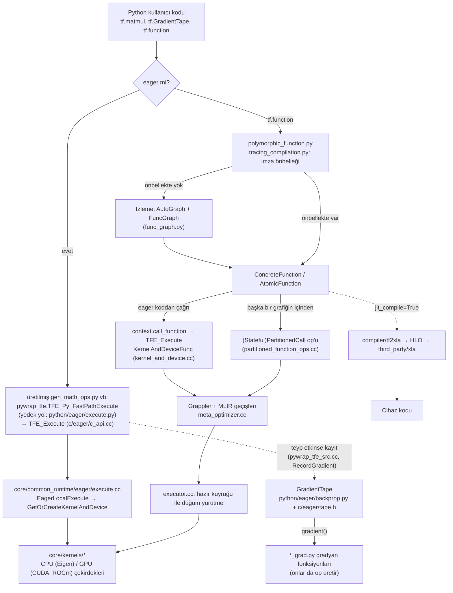
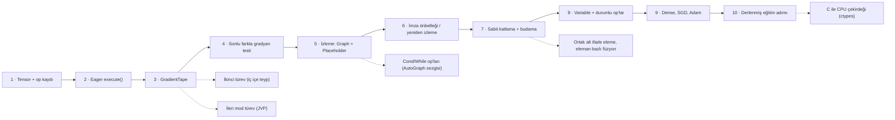

# tensorflow/tensorflow — Google'ın uçtan uca makine öğrenmesi çerçevesi

> **Dal:** [D05 Yapay zekâ altyapısı](../README.md) · **Tür:** kod tabanı
> **Dil:** C++ ve Python · **Lisans:** Apache-2.0 · **Yıldız:** 201.408 (9 Kasım 2026) · **İncelenen commit:** `15014f3` (2026-11-09)

## 1. Bir bakışta

TensorFlow, tensörler (çok boyutlu diziler) üzerinde işlem yapan programları **hem hemen (eager) hem de
grafik olarak** çalıştırabilen, bu programların türevini otomatik alabilen ve onları CPU, GPU ve TPU'lara
dağıtabilen bir makine öğrenmesi çerçevesidir. 2015'te Google Brain'den açık kaynak olarak çıktı; araştırmada
ve özellikle üretimde (mobil, sunucu, tarayıcı) uzun süre standarttı. Popülerliğini Google'ın desteğine,
"modeli eğit, aynı grafiği her yerde çalıştır" vaadine (SavedModel, TF Serving, TF Lite) ve Keras'ın kolay
API'sine borçlu. Bugünkü depo bir **platform çekirdeği** gibi: Keras ayrı depoya taşındı, TF Lite bakım
modunda (aktif geliştirme LiteRT'de), XLA derleyicisi OpenXLA projesinin `third_party/xla` altındaki kopyası.
Yani bu depoyu okurken "her şeyin yapıldığı yer" değil, **op/çekirdek/çalışma zamanı/derleyici sözleşmelerinin**
yaşadığı yer olarak düşün.

Bu dalın matematik ve sistem temelini burada kurarız: ters mod otomatik türev, izleme ile grafik çıkarma ve
grafik optimizasyonu. Sonraki yapraklar ([transformers](../transformers/README.md), [ollama](../ollama/README.md))
bu fikirleri başka biçimlerde tekrar kullanır.

## 2. Nasıl yapılmış: mimari

### Klasör haritası

Depoda 37.696 dosya var (`git ls-tree -r HEAD | wc -l`); en önemli yollar:

```text
tensorflow/
├── core/
│   ├── framework/            op_kernel.h, op.h, tensor.h, op_def.proto, graph.proto: temel sözleşmeler
│   ├── ops/                  REGISTER_OP tanımları (math_ops.cc ...); compat/ = op imzalarının geçmişi (2.831 dosya)
│   ├── kernels/              çekirdekler: cihaz × veri tipi başına uygulama (1.467 .cc dosyası)
│   ├── common_runtime/       executor.cc (grafik yürütücü), direct_session.cc (TF1 Session), eager/ (EagerExecute)
│   ├── grappler/             grafik optimize edici: optimizers/meta_optimizer.cc (geçiş sırası), optimizers/constant_folding.cc, optimizers/model_pruner.cc
│   ├── ir/, transforms/      MLIR tabanlı TFG lehçesi ve geçişleri
│   ├── tfrt/                 yeni nesil çalışma zamanı entegrasyonu (mlrt/, ifrt/, saved_model/ ...)
│   ├── distributed_runtime/  çok makineli yürütme
│   ├── data/                 tf.data'nın C++ tarafı
│   └── api_def/base_api/     her op için belge/görünürlük dosyaları (api_def_AddV2.pbtxt ...)
├── c/                        kararlı C API (c_api.h) + eager C API (c/eager/c_api.cc, c/eager/tape.h)
├── cc/                       C++ istemci API'si
├── python/
│   ├── eager/                backprop.py (GradientTape), context.py, execute.py, polymorphic_function/ (tf.function)
│   ├── framework/            ops.py (Graph, Operation), func_graph.py, tensor.py, auto_control_deps.py
│   ├── ops/                  Python op API'si; math_grad.py, nn_grad.py, array_grad.py = gradyan kayıtları
│   ├── autograph/            Python if/for/while'ı grafik kontrol akışına çeviren dönüştürücü
│   ├── saved_model/          SavedModel kaydet/yükle
│   └── keras/                ESKİ kopya: README'si "STOP! ... about to be deleted" diyor
├── compiler/
│   ├── tf2xla/               TF grafiğini XLA HLO'ya indirme (xla_compiler.cc)
│   ├── jit/                  XLA otomatik kümeleme (mark_for_compilation_pass.cc)
│   └── mlir/                 TF ve TFLite MLIR lehçeleri, dönüştürücüler
├── lite/                     TensorFlow Lite — README: bakım modunda, aktif iş LiteRT'de (google-ai-edge/LiteRT)
├── dtensor/                  dağıtık tensör API'si
└── tools/                    pip_package/ (wheel (.whl) paketi üretimi), api/golden/ (genel API'nin "altın" dökümü), ci_build/
third_party/xla/              OpenXLA'nın gömülü kopyası (xla/ altında 9.033 dosya; tsl/ dahil)
ci/official/                  resmi CI betikleri ve ortam profilleri (envs/linux_x86_cuda, envs/py313 ...)
.bazelversion, MODULE.bazel, WORKSPACE, configure.py   Bazel 8.8.2 derlemesi
pr_review_agent/, .gemini/    Gemini tabanlı PR inceleme ajanı ve stil rehberi
```

### Ana bileşenler ve veri akışı



Çekirdek döngü şu: her işlem bir **op**'tur. Op'un imzası C++'ta `REGISTER_OP` ile tanımlanır
(`tensorflow/core/ops/math_ops.cc` içinde `REGISTER_OP("AddV2")...SetShapeFn(shape_inference::BroadcastBinaryOpShapeFn)`),
cihaz ve veri tipi başına bir ya da daha çok **çekirdek** kaydedilir (`tensorflow/core/kernels/cwise_op_add_1.cc`:
`REGISTER6(BinaryOp, CPU, "AddV2", functor::add, float, ...)`). Python'daki `tf.add` ise
`tensorflow/python/ops/math_ops.py` içinde **elle yazılmış** bir sarmalayıcıdır (`@tf_export("math.add", "add")`
ile `def add(x, y, name=None)`); asıl op'u, derlemede `AddV2` tanımından **üretilen** `gen_math_ops.add_v2`
çağırır. Üretimi `tensorflow/python/ops/BUILD` içindeki `math_ops_gen` hedefi yapar
(`tf_gen_op_strict_wrapper_private_py` → `tensorflow/tensorflow.bzl` içindeki `tf_gen_op_wrapper_py`); bu yüzden
`gen_math_ops.py` depoda yoktur. Üretilen sarmalayıcı eager modda hızlı yoldan (`pywrap_tfe.TFE_Py_FastPathExecute`)
C++'a iner, grafik modunda grafiğe düğüm ekler.

Eager modda op hemen çalışır; etkin bir `GradientTape` varsa op ve girdileri kaydedilir (hızlı yolda bunu C++
tarafı yapar: `tensorflow/python/eager/pywrap_tfe_src.cc`, `RecordGradient`). `tape.gradient()` C++'taki
`ComputeGradient`'e iner (`tensorflow/c/eager/tape.h`). Bu fonksiyon önce `PrepareBackprop` ile her tensörün kaç
kez kullanıldığını (`tensor_usage_counts`) ve her op'un kaç çıktı gradyanını beklediğini (`op_missing_tensor`)
sayar. Sonra bütün çıktı gradyanları tamamlanan op'ları bir hazır listesinden (`op_stack`) alıp Python'da kayıtlı
gradyan fonksiyonlarını (`@ops.RegisterGradient("Mul")`, `tensorflow/python/ops/math_grad.py`) çağırır. Gradyan
fonksiyonları da op ürettiği için ikinci türev ve "grafik içinde türev" ek bir mekanizma gerektirmez.

`tf.function` ise Python fonksiyonunu bir **girdi imzası** için bir kez izler: argümanlar yerine sembolik
tensörler (placeholder) verilir, AutoGraph Python kontrol akışını grafik op'larına çevirir
(`polymorphic_function/autograph_util.py`), sonuç bir `FuncGraph` olur. Aynı imzayla yapılan sonraki çağrılar
önbellekten gelir (`tracing_compilation.py`, `_maybe_define_function`). İzlenmiş grafiğin nasıl çağrılacağını
`AtomicFunction.call_flat` (`atomic_function.py`) seçer. Eager koddan çağrıldığında fonksiyon, adıyla doğrudan
yürütülür: `context.call_function` → `execute.execute` → `TFE_Execute`; C++'ta bunu
`core/common_runtime/eager/kernel_and_device.cc` içindeki `KernelAndDeviceFunc` yapar. Başka bir grafiğin
içinden (iç içe `tf.function`, TF1 grafiği, SavedModel) çağrıldığında ise `make_call_op_in_graph` bir
`PartitionedCall` (durumlu op varsa `StatefulPartitionedCall`) op'u ekler (çekirdeği
`core/kernels/partitioned_function_ops.cc`). İki yolda da çalışma zamanı grafiği Grappler ile optimize eder
(`optimize_graph_fn = grappler::OptimizeGraph`) ve yürütücü düğümleri bağımlılıkları hazır oldukça çalıştırır.

### Önce okunacak dosyalar

1. `tensorflow/python/eager/backprop.py` — `GradientTape` sınıfı; `watch`, `gradient`, `jacobian`. Kullanıcıya görünen sözleşme.
2. `tensorflow/c/eager/tape.h` — gerçek geri yayılım algoritması (`PrepareBackprop`, `ComputeGradient`); kalıcı olmayan teybin neden bir kez kullanılabildiği burada (ara değerler ilk çağrıda silinir).
3. `tensorflow/python/ops/math_grad.py` — `_MulGrad`, `_MatMulGrad`, `SmartBroadcastGradientArgs`: zincir kuralı + yayınlamayı (broadcasting) geri alma.
4. `tensorflow/core/ops/math_ops.cc` ve `tensorflow/core/kernels/cwise_op_add_1.cc` — op sözleşmesi ile çekirdek ayrımı.
5. `tensorflow/python/eager/polymorphic_function/polymorphic_function.py` → `tracing_compilation.py` → `tensorflow/python/framework/func_graph.py` — `tf.function`'ın izleme ve önbellek hattı.
6. `tensorflow/python/eager/polymorphic_function/atomic_function.py` — izlenmiş grafiğin nasıl çağrıldığı (`call_flat`: eager çağrı ya da `PartitionedCall` op'u).
7. `tensorflow/core/grappler/optimizers/meta_optimizer.cc` ve `constant_folding.cc` — hangi geçişler, hangi sırayla; yan etkili düğümlere neden dokunulmuyor.
8. `tensorflow/core/common_runtime/executor.cc` — grafik yürütücü.
9. `tensorflow/compiler/tf2xla/xla_compiler.cc` — XLA'ya indirme köprüsü.

### Teknoloji yığını, derleme, test, CI, sürüm

- **Diller:** C++ (çekirdek, çalışma zamanı, çekirdekler; `absl::Status` gibi Abseil türleri yaygın), Python
  (API, gradyanlar, `tf.function`), Python–C++ bağlantısı pybind11 ile (`tensorflow/python/tfe_wrapper.cc`).
  Sayısal çekirdeklerde Eigen; GPU'da CUDA/ROCm; veri yapıları protobuf (`graph.proto`, `op_def.proto`); derleyici
  tarafında MLIR/LLVM.
- **Derleme:** Bazel (`.bazelversion` = 8.8.2), hem `MODULE.bazel` (bzlmod) hem `WORKSPACE`; `configure.py`
  derleme seçeneklerini (CUDA, ROCm ...) sorar. Python sürümü başına kilitli bağımlılık dosyaları:
  `requirements_lock_3_10.txt` … `requirements_lock_3_14_freethreaded.txt`. Pip için wheel (.whl) paketi
  `tensorflow/tools/pip_package/build_pip_package.py` ile üretilir.
- **Test:** Bazel test kuralları (`tf_cc_test`, `tf_py_test` — `tensorflow/tensorflow.bzl`); genel Python API'si
  `tensorflow/tools/api/golden/` altındaki "altın" dosyalarla karşılaştırılır, böylece istemeden API değişmez.
- **CI:** `.github/workflows/` (ör. `ci-build.yml`, `arm-ci.yml`, `pylint-presubmit.yml`) ve `ci/official/`
  betikleri; ortam profilleri `ci/official/envs/` altında (linux_x86_cuda, macos_arm64, py310…py314, rbe ...).
- **Geliştirme akışı:** TensorFlow Google'ın iç deposunda geliştirilir ve GitHub'a eşitlenir; incelenen commit'in
  mesajında `PiperOrigin-RevId` satırı ve "TensorFlower Gardener" adına birleştirme var. Dış PR'lar önce içeri
  alınır, sonra dışarı yansır. Ayrıca `pr_review_agent/` altında, "Agent Review" etiketiyle tetiklenen,
  Google ADK + Gemini kullanan bir PR inceleme ajanı bulunuyor (yalnızca `COMMENT` türünde inceleme bırakır).
- **Sürüm:** `tensorflow/tf_version.bzl` içinde `TF_VERSION = "2.23.0"`; değişiklikler `RELEASE.md`'ye yazılır.

### Tasarım kararları ve ödünleşimler

1. **Op sözleşmesi ile çekirdek ayrı.** Yeni bir cihaz ya da veri tipi eklemek op'u değiştirmez, yalnızca çekirdek
   ekler. Bedeli: her op için üç yerde kod (op tanımı, çekirdekler, gradyan) ve devasa çekirdek klasörü.
   Eski grafiklerin yıllar sonra yüklenebilmesi için op imzalarının geçmişi `core/ops/compat/` altında saklanır.
2. **İki yürütme modu.** TF1 "önce grafiği kur, sonra `Session.run`" diyordu (hızlı ama hata ayıklaması zor);
   TF2 eager'ı varsayılan yaptı ve grafiği `tf.function` ile isteğe bağlı kıldı. Ödünleşim: izleme kuralları
   (Python yan etkileri yalnızca izlemede çalışır, yeni Python değerleri yeniden izleme tetikler) öğrenmesi zor.
3. **Gradyan = op üreten Python fonksiyonu.** Bu sayede ikinci türev, grafik içinde türev ve dağıtık türev aynı
   mekanizmayla çalışır. Bedeli: Python'a bağımlılık ve gradyan grafiğinin optimize edilmesi gerekliliği.
4. **Katmanlı derleyici yığını.** Grappler (klasik grafik geçişleri), MLIR tabanlı TFG geçişleri ve isteğe bağlı
   XLA derlemesi bir arada. XLA bugün OpenXLA olarak ayrı bir proje ve JAX/PyTorch ile paylaşılıyor; TF onun bir
   kopyasını `third_party/xla` altında taşıyor.
5. **Parçalanma ve ayrışma.** Keras 3 çok arka uçlu ve ayrı depoda; TF Lite → LiteRT; dağıtık tensörler
   `dtensor/`, yeni çalışma zamanı `core/tfrt/`. Depo giderek "uyumluluk + çekirdek" rolüne kayıyor; yeni
   başlayan biri için doğru dosyayı bulmak bu yüzden zor.
6. **Durumlu op'lar ve otomatik kontrol bağımlılıkları.** Değişken okuma/yazma op'larının sırası Python'daki
   sırayla aynı kalsın diye `tf.function` otomatik kontrol bağımlılıkları ekler
   (`tensorflow/python/framework/auto_control_deps.py`); optimize ediciler yan etkisi olan düğümleri katlamaz/silmez.

## 3. Öğrenmen gerekenler

| Düğüm                                                           | Bu depo için neden gerekli                                                                                | Ücretsiz kaynak                                                                                                                                                                                                                                                                                                         |
| --------------------------------------------------------------- | --------------------------------------------------------------------------------------------------------- | ----------------------------------------------------------------------------------------------------------------------------------------------------------------------------------------------------------------------------------------------------------------------------------------------------------------------- |
| [G3 Python](../../../govde/README.md#g3)                        | API, gradyan kayıtları, `tf.function` tamamen Python; dekoratörler, bağlam yöneticileri, kapanışlar şart. | [free-programming-books Türkçe liste → Python](https://github.com/EbookFoundation/free-programming-books/blob/8bc5e371226d32ce14ee85ce304f56d4ba190a1c/books/free-programming-books-tr.md#python)                                                                                                                       |
| [G5 Veri yapıları ve algoritmalar](../../../govde/README.md#g5) | Hesap grafiği bir DAG; topolojik sıralama, ters sırada dolaşma, kullanım sayacı.                          | [TheAlgorithms/Python](../../09-bilgisayar-bilimi/thealgorithms-python/README.md) (`graphs/` klasörü)                                                                                                                                                                                                                   |
| [G10 C ve bellek modeli](../../../govde/README.md#g10)          | Çekirdekler ve çalışma zamanı C++; tampon (buffer), hizalama, iş parçacığı havuzu.                        | [build-your-own-x](../../10-kuratorluk-topluluk/build-your-own-x/README.md)                                                                                                                                                                                                                                             |
| [G7 Test ve CI](../../../govde/README.md#g7)                    | Bazel testleri, altın API dosyaları, sayısal gradyan testleri.                                            | [ossu/computer-science](../../09-bilgisayar-bilimi/ossu-computer-science/README.md)                                                                                                                                                                                                                                     |
| [G8 Büyük kod tabanı okuma](../../../govde/README.md#g8)        | 37 bin dosya; "op adından çekirdeğe" iz sürme becerisi gerekiyor.                                         | Bu dosyadaki okuma rotası (§5)                                                                                                                                                                                                                                                                                          |
| Dal içi: **lineer cebir** (matris çarpımı, devrik, yayınlama)   | `MatMul` gradyanı `g @ Bᵀ` ve `Aᵀ @ g`; şekil uyumu her hatanın kaynağı.                                  | [Essence of Linear Algebra (3Blue1Brown)](https://www.youtube.com/playlist?list=PLZHQObOWTQDPD3MizzM2xVFitgF8hE_ab) — [ossu](https://github.com/ossu/computer-science/blob/8f8272b1d378d31494240aa1d667aa6b045c6552/README.md) listesinden                                                                              |
| Dal içi: **türev ve zincir kuralı**                             | Ters mod otomatik türev, zincir kuralının hesap grafiği üzerinde sondan başa uygulanmasıdır.              | [MIT Calculus 1A](https://openlearninglibrary.mit.edu/courses/course-v1:MITx+18.01.1x+2T2019/about) (ossu "Core math"); [Derin Öğrenmeye Dalış (Türkçe d2l)](https://tr.d2l.ai/d2l-tr-pytorch.pdf)                                                                                                                      |
| Dal içi: **sayısal kararlılık** (kayan nokta, log-sum-exp)      | Softmax/log taşmaları, sonlu farkla gradyan kontrolünün ε seçimi.                                         | [TheAlgorithms/Python `maths/softmax.py`](https://github.com/TheAlgorithms/Python/blob/574d100b7181956e9c8384552fd078165e4cc326/maths/softmax.py)                                                                                                                                                                       |
| Dal içi: **sinir ağı temelleri**                                | Dense katman, aktivasyon, kayıp, SGD/Adam.                                                                | [TheAlgorithms `neural_network/`](https://github.com/TheAlgorithms/Python/tree/574d100b7181956e9c8384552fd078165e4cc326/neural_network); [build-your-own-x → Neural Network](https://github.com/codecrafters-io/build-your-own-x/blob/b2daa235c4fb774402d219c48adfea2a81d94ce7/README.md#build-your-own-neural-network) |

## 4. Sıfırdan yol (dallanma)



| Aşama | Ne inşa edersin                                          | Öğrendiğin kavram                               | Bitti ölçütü                                                      | Süre (tahmini) |
| ----- | -------------------------------------------------------- | ----------------------------------------------- | ----------------------------------------------------------------- | -------------- |
| 1–2   | `Tensor`, `register_op`, `execute()`                     | op sözleşmesi, şekil fonksiyonu, eager yürütme  | `a @ b + c` numpy ile aynı sonucu veriyor                         | 3 saat         |
| 3–4   | `GradientTape`, gradyan kayıtları, yayınlamayı geri alma | ters mod AD, zincir kuralı, birikim             | 10+ op'un gradyanı sonlu farklarla 1e-5 içinde uyuşuyor           | 6 saat         |
| 5–6   | `Graph`, `Placeholder`, `Function` + önbellek            | izleme, sembolik tensör, imza, yeniden izleme   | izlenen grafik eager ile aynı sonucu veriyor; `trace_count` doğru | 5 saat         |
| 7     | `constant_fold`, `prune`                                 | derleyici geçişi, ölü kod, durumlu op istisnası | düğüm sayısı azalıyor, sonuç değişmiyor                           | 3 saat         |
| 8–10  | `Variable`, `ApplyAdam`, `Dense`, `fit`                  | durum, yan etki sırası, optimize ediciler       | derlenmiş adım eager adımla aynı kayıpları üretiyor               | 6 saat         |
| Yan   | JVP, Cond, CSE/füzyon, C çekirdeği                       | yüksek mertebe türev, kontrol akışı, performans | kendi testlerin geçiyor                                           | §6'da sayıldı  |

**Toplam:** aşamalar 23 saat. Okuma rotası (§5, 10 adım × ~1 saat) ve alıştırmalarla (§6: kolay 1, orta 2, zor
3 saat; 2 + 6 + 9 = 17 saat) birlikte yaklaşık **50 saat**. Yan dallar §6'daki alıştırmalarla aynı işlerdir, ayrıca
eklenmez. Hesap kuralı: [dal README'si](../README.md#yapraklar).

**Mini uygulama:** [`sifirdan/`](sifirdan/README.md) — `minitf` paketi (~1.000 satır kod + 36 test). Yukarıdaki
yolun numaralarıyla: aşama 1–2 ve 8 → `minitf/core.py` (op kaydı, `execute()`, `Variable`,
`ReadVariable`/`AssignVariable`); 3 → `minitf/tape.py`; 4 → `tests/test_tape.py` (`kontrol`) + `tests/yardimci.py`;
5–7 → `minitf/graph.py`; 9–10 → `minitf/keras.py` (`make_train_step(compiled=True)`). Mini'nin kendi README'si ve
`ornek.py` aynı dosyaları 1a/1b/2/3 diye numaralar; örneğin `ornek.py`'deki "Aşama 1: GradientTape" bu yolun 1–4.
aşamalarıdır. Yan dallardan ikinci türev mini'de var (`test_ikinci_turev_ic_ice_teyp`,
`test_kalici_teyp_baglam_icinde_ikinci_turev`); JVP, Cond/While, CSE/füzyon ve C çekirdeği sana kalıyor (§6
alıştırma 6, 5, 3/7, 8). README'deki eşleme tablosu her parçanın gerçek depodaki dosyasını gösterir.

**Gerçek ölçeğe giden yol:** mini'de olmayanlar, eklenme sırasıyla: (1) veri tipleri ve tam şekil çıkarımı
(bilinmeyen boyutlar, `None`), (2) cihaz yerleşimi ve bellek yönetimi (GPU, sabitlenmiş bellek), (3) C++ çalışma
zamanı ve paralel yürütücü (iş parçacığı havuzu, hazır kuyruğu), (4) kontrol akışı op'ları ve AutoGraph,
(5) grafiği cihazlara bölme ve Send/Recv, (6) dağıtık eğitim (all-reduce, parametre sunucusu), (7) SavedModel ile
grafiğin ve değişkenlerin taşınabilir kaydı, (8) XLA ile füzyon ve derleme, (9) nicemleme (quantization) ve mobil
çalışma zamanı. Her adım bir öncekinin üstüne kurulur; örneğin XLA, sabit şekilli bir grafik olmadan anlamsızdır.

## 5. Gerçek depoda okuma rotası

1. **`tensorflow/python/eager/backprop.py`** → `GradientTape.gradient`. Soru: hedef bir liste olduğunda ve
   `output_gradients` verildiğinde ne değişiyor? İz: `imperative_grad.imperative_grad` → `pywrap_tfe.TFE_Py_TapeGradient`.
2. **`tensorflow/c/eager/tape.h`** → `PrepareBackprop`, `ComputeGradient`. Soru: mini'nin "tersten dolaş" yaklaşımı
   ile `tensor_usage_counts`/`op_missing_tensor` sayaçları neden aynı sonucu verir? Ne zaman farklılaşırdı?
3. **`tensorflow/python/ops/math_grad.py`** → `_MulGrad`, `_MatMulGrad`, `_SumGrad`. Mini'deki `core.py`
   gradyanlarıyla satır satır karşılaştır; `skip_input_indices` ne işe yarıyor?
4. **`tensorflow/core/ops/math_ops.cc`** → `REGISTER_OP("AddV2")` ve `SetShapeFn`; ardından
   `tensorflow/core/kernels/cwise_op_add_1.cc`. Soru: GPU'da `int32` toplama neden `HostMemory` ile kaydedilmiş?
5. **`tensorflow/python/ops/math_ops.py`** → `def add` (elle yazılmış) → `gen_math_ops.add_v2` (üretilmiş). Üretimi
   `tensorflow/python/ops/BUILD` (`math_ops_gen`) ve `tensorflow/tensorflow.bzl` (`tf_gen_op_wrapper_py`) yapar.
   İzi baştan sona sür: `tf.add` → `math_ops.add` → `gen_math_ops.add_v2` → `REGISTER_OP("AddV2")` →
   `cwise_op_add_1.cc`. Soru: `gen_math_ops.py` neden depoda yok?
6. **`polymorphic_function.py`** → `Function.__call__` → `_call` → `tracing_compilation.call_function` →
   `trace_function` → `_maybe_define_function` (önbellek: `function_cache.lookup`). Soru: önbellek anahtarına neler
   giriyor (şekil, dtype, Python değeri, yakalanan tensörler)?
7. **`tensorflow/python/framework/func_graph.py`** → `func_graph_from_py_func`. Mental test: içinde `print()` olan
   bir fonksiyon iki kez aynı imzayla çağrılırsa kaç kez yazdırır? (Cevap: bir kez — yalnızca izlemede.)
8. **`atomic_function.py`** → `AtomicFunction.call_flat`: eager dal (`context.call_function`) ile grafik dalı
   (`make_call_op_in_graph` → `PartitionedCall` ya da `StatefulPartitionedCall`) nerede ayrılıyor?
9. **`tensorflow/core/grappler/optimizers/meta_optimizer.cc`** → geçişlerin sırası; ardından
   `constant_folding.cc` içinde `IsFreeOfSideEffect` kontrolü. Mini'deki `stateful`/`side_effect` bayraklarıyla eşleştir.
10. **`tensorflow/compiler/tf2xla/xla_compiler.cc`** ve `compiler/jit/mark_for_compilation_pass.cc`: hangi op'lar
    XLA kümesine alınabiliyor?

## 6. Alıştırmalar ve öz değerlendirme

1. (Kolay) `minitf`'e `Sigmoid` op'u ve gradyanını ekle; `tests/test_tape.py`'deki `kontrol` ile sına.
2. (Kolay) `Function`'a "son 10 çağrının en az 5'i izleme yaptıysa uyar (en fazla 2 kez)" özelliği ekle (gerçeği:
   `polymorphic_function.py` içindeki `_FrequentTracingDetector` ve `FREQUENT_TRACING_WARNING_*` sabitleri).
3. (Orta) Ortak alt ifade eleme (CSE) geçişi yaz: aynı op + aynı girdiler + aynı özniteliklere sahip düğümleri birleştir.
4. (Orta) `GradientTape.jacobian(y, x)`: çıktının her elemanı için ayrı gradyan alarak.
5. (Orta) Grafik modunda `cond(pred, true_fn, false_fn)`: iki dalı da izle, yürütmede yalnızca birini çalıştır.
6. (Zor) İleri mod türev: her op için JVP kuralı yaz, `ForwardAccumulator` benzeri bir bağlam yöneticisi kur.
7. (Zor) Eleman bazlı op zincirlerini (ör. `tanh(x*w+b)`) tek bir "kaynaşık" düğüme indiren bir geçiş yaz ve
   hızını ölç (XLA'nın temel fikrinin küçük hâli).
8. (Zor) `MatMul` için C ile yazılmış bir çekirdeği `ctypes` ile yükleyip op kaydına ekle; sonuçları numpy ile karşılaştır.

<details><summary>Soru 1: Kalıcı olmayan bir teyp neden yalnızca bir kez gradient() çağırabilir?</summary>

Geri yayılım ara değerlere (aktivasyonlara) ihtiyaç duyar. Kalıcı olmayan teyp belleği korumak için bunları ilk
`ComputeGradient` çağrısında siler (`tensorflow/c/eager/tape.h` içindeki yoruma bak). `persistent=True` ara
değerleri tutar; bedeli bellektir.

</details>

<details><summary>Soru 2: tf.function içindeki print() neden bazen hiç çalışmaz?</summary>

`print` bir Python yan etkisidir; yalnızca izleme sırasında çalışır. Aynı imzayla yapılan sonraki çağrılar
önbellekteki grafiği çalıştırır, Python gövdesi hiç çalışmaz. Her çağrıda yazdırmak için grafik op'u olan
`tf.print` kullanılır.

</details>

<details><summary>Soru 3: Sabit katlama neden değişken okumalarına, budama neden atamalara dokunmamalı?</summary>

Değişken okuması derleme anında değil çalışma anında geçerli olan değeri döndürmelidir; katlanırsa eski değer
grafiğe gömülür. Atama ise çıktıya bağlı olmasa da dünyayı değiştirir (yan etki); silinirse eğitim hiç ilerlemez.
Mini'de bunlar `stateful` ve `side_effect` bayraklarıyla, TF'de `IsFreeOfSideEffect` ve otomatik kontrol
bağımlılıklarıyla korunur.

</details>

<details><summary>Soru 4: Gradyan fonksiyonları neden numpy kodu değil de op üretiyor?</summary>

Böylece gradyan hesabı da bir hesap grafiğidir: dıştaki bir teyp onu kaydedip ikinci türev alabilir, `tf.function`
içinde gradyan grafiğe girer ve optimize edilir, dağıtık yürütmede cihazlara bölünebilir.

</details>

<details><summary>Soru 5: Aynı fonksiyonu 1.0, 2.0, 3.0 Python sayılarıyla çağırmak neden üç izleme yapar?</summary>

Python değerleri imzanın parçasıdır; her yeni değer ayrı bir grafik demektir (sabit olarak gömülür). Tensör olarak
geçirilirse yalnızca şekil ve tip imzaya girer, tek izleme yeter. Mini'de `test_python_sayisi_her_degerde_yeniden_izletir`.

</details>

## 7. İş fikri tohumları

- **TF Lite → LiteRT geçiş denetimi:** uygulamasına `.tflite` model gömmüş ekiplerin modellerini envanterleyip
  LiteRT'ye geçiş, hız ve boyut raporu çıkaran hizmet. **Kime:** Türkiye'deki mobil ajanslar ve banka/perakende
  uygulama ekipleri.
- **"Sıfırdan derin öğrenme" atölye paketi:** `minitf` tarzı, testli, Türkçe bir müfredat + otomatik
  değerlendirici. **Kime:** üniversite topluluklarının eğitmenleri ve yazılım bootcamp'leri.
- **Eski TF1/Keras 2 modellerini taşıma:** `Session` tabanlı veya eski Keras API'li üretim modellerini TF2/Keras 3'e
  taşıyıp sayısal eşdeğerliği testle belgeleyen danışmanlık. **Kime:** 2017–2020 arasında model üretime almış KOBİ
  ve kurumsal veri ekipleri.

Daha fazlası: [iş fikirleri kataloğu](../../../is-fikirleri/README.md).

## 8. Kaynaklar

Depo içi (incelenen commit'te):

- [README.md](https://github.com/tensorflow/tensorflow/blob/15014f33f716bcd1a8ee8e85a8c8afe8fe6d33d5/README.md),
  [CONTRIBUTING.md](https://github.com/tensorflow/tensorflow/blob/15014f33f716bcd1a8ee8e85a8c8afe8fe6d33d5/CONTRIBUTING.md),
  [RELEASE.md](https://github.com/tensorflow/tensorflow/blob/15014f33f716bcd1a8ee8e85a8c8afe8fe6d33d5/RELEASE.md)
- [tensorflow/python/keras/README.md](https://github.com/tensorflow/tensorflow/blob/15014f33f716bcd1a8ee8e85a8c8afe8fe6d33d5/tensorflow/python/keras/README.md) (eski Keras uyarısı),
  [tensorflow/lite/README.md](https://github.com/tensorflow/tensorflow/blob/15014f33f716bcd1a8ee8e85a8c8afe8fe6d33d5/tensorflow/lite/README.md) (LiteRT'ye geçiş)
- [tensorflow/c/eager/tape.h](https://github.com/tensorflow/tensorflow/blob/15014f33f716bcd1a8ee8e85a8c8afe8fe6d33d5/tensorflow/c/eager/tape.h),
  [tensorflow/python/eager/backprop.py](https://github.com/tensorflow/tensorflow/blob/15014f33f716bcd1a8ee8e85a8c8afe8fe6d33d5/tensorflow/python/eager/backprop.py),
  [polymorphic_function.py](https://github.com/tensorflow/tensorflow/blob/15014f33f716bcd1a8ee8e85a8c8afe8fe6d33d5/tensorflow/python/eager/polymorphic_function/polymorphic_function.py)
- [ci/official/README.md](https://github.com/tensorflow/tensorflow/blob/15014f33f716bcd1a8ee8e85a8c8afe8fe6d33d5/ci/official/README.md),
  [pr_review_agent/README.md](https://github.com/tensorflow/tensorflow/blob/15014f33f716bcd1a8ee8e85a8c8afe8fe6d33d5/pr_review_agent/README.md)

Resmî belgeler ve makaleler (bağlantılar çevrimdışı doğrulanmadı):

- Kılavuzlar: [Otomatik türev](https://www.tensorflow.org/guide/autodiff), [Grafiklere giriş](https://www.tensorflow.org/guide/intro_to_graphs),
  [tf.function ile performans](https://www.tensorflow.org/guide/function), [Özel op yazmak](https://www.tensorflow.org/guide/create_op), [OpenXLA](https://openxla.org/xla)
- Abadi ve ark., "TensorFlow: A system for large-scale machine learning", OSDI 2016 — [arXiv:1605.08695](https://arxiv.org/abs/1605.08695)
- Agrawal ve ark., "TensorFlow Eager: A Multi-Stage, Python-Embedded DSL for Machine Learning", 2019 — [arXiv:1903.01855](https://arxiv.org/abs/1903.01855)
- Moldovan ve ark., "AutoGraph: Imperative-style Coding with Graph-based Performance", 2019 — [arXiv:1810.08061](https://arxiv.org/abs/1810.08061)
- Dal ağacı: [AGAC.md](../../../AGAC.md)
