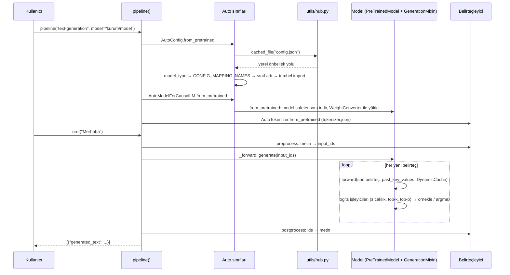
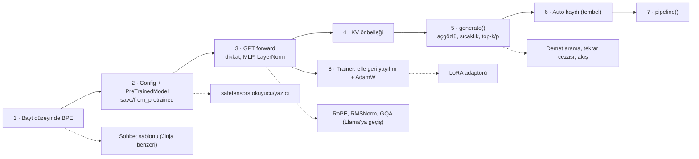

# huggingface/transformers — açık modellerin ortak "model tanımı" kütüphanesi

> **Dal:** [D05 Yapay zekâ altyapısı](../README.md) · **Tür:** kod tabanı
> **Dil:** Python · **Lisans:** Apache-2.0 · **Yıldız:** 168.685 (9 Kasım 2026) · **İncelenen commit:** `b255688` (2026-11-09)

## 1. Bir bakışta

Transformers, metin, görüntü, ses ve çok kipli (multimodal) modellerin **referans tanımlarını** tek bir kalıpta
toplayan bir Python kütüphanesidir: `AutoModelForCausalLM.from_pretrained("kurum/model")` dediğinizde
yapılandırmayı ve ağırlıkları Hugging Face Hub'dan indirir, doğru sınıfı bulur, modeli kurar; `generate()` ile
metin üretir, `Trainer` ile eğitir, `pipeline()` ile tek satırda kullandırır. README'deki ifadesiyle kendini
ekosistemin "pivotu" olarak konumlar: bir model burada tanımlıysa eğitim araçları (DeepSpeed, FSDP, Unsloth...)
ve çıkarım motorları (vLLM, SGLang, TGI...) o tanımı kullanabilir. Popülerliğinin sebepleri: yüzlerce mimariyi
aynı API ile sunması, Hub'daki milyonu aşkın kontrol noktası (README "1M+" diyor) ve "okunabilir tek dosya" modeli.
İncelenen sürüm **v5** dönemindedir (`setup.py`: `5.23.0.dev0`): TensorFlow ve JAX desteği kaldırıldı, yalnızca
PyTorch kaldı (`MIGRATION_GUIDE_V5.md`).

## 2. Nasıl yapılmış: mimari

### Klasör haritası

```text
src/transformers/
├── __init__.py                     _LazyModule ile tembel genel API (import anında 500+ model yüklenmez)
├── configuration_utils.py          PreTrainedConfig: config.json okuma/yazma
├── modeling_utils.py               PreTrainedModel: save_pretrained / from_pretrained, ağırlık bağlama, AttentionInterface
├── core_model_loading.py           v5 dinamik ağırlık yükleme: WeightConverter, WeightRenaming, Chunk, Concatenate...
├── conversion_mapping.py           model başına ağırlık adı/biçim dönüşüm kuralları
├── cache_utils.py                  KV önbelleği: DynamicCache, StaticCache, QuantizedCache ...
├── masking_utils.py                nedensel / kayan pencere maskeleri
├── tokenization_utils_base.py      PreTrainedTokenizerBase: ortak belirteçleyici API'si
├── tokenization_utils_tokenizers.py  Rust `tokenizers` arka ucu (TokenizersBackend)
├── tokenization_python.py          saf Python arka ucu (PythonBackend, Trie)
├── generation/                     utils.py (GenerationMixin.generate), logits_process.py, configuration_utils.py, continuous_batching/
├── pipelines/                      pipeline() fabrikası ve görev sınıfları (text_generation.py ...)
├── trainer.py, training_args.py    eğitim döngüsü ve argümanları (+ trainer_callback.py)
├── models/                         540 alt klasör
│   ├── auto/                       auto_mappings.py (üretilir), configuration_auto.py, modeling_auto.py, auto_factory.py
│   ├── llama/                      configuration_llama.py, modeling_llama.py, tokenization_llama.py, convert_llama_weights_to_hf.py
│   ├── gpt2/                       klasik GPT-2 (modeling_gpt2.py, tokenization_gpt2.py)
│   └── qwen2/                      modular_qwen2.py  →  üretilmiş modeling_qwen2.py
├── integrations/                   accelerate, peft, deepspeed, fsdp, sdpa/flash/flex attention, gguf, nicemleme köprüleri
├── quantizers/                     nicemleme arka uçları
├── utils/hub.py                    Hub'dan indirme ve önbellek: cached_file, cached_files
├── dynamic_module_utils.py         trust_remote_code: Hub'daki özel model kodunu yükleme
└── cli/                            `transformers` komutu: chat, serve (OpenAI uyumlu), download, add_new_model_like
tests/                              tests/models/<ad>/test_modeling_<ad>.py; ortak: test_modeling_common.py (ModelTesterMixin), causal_lm_tester.py
utils/                              modular_model_converter.py, check_copies.py, check_auto.py, tests_fetcher.py
docs/source/en/                     add_new_model.md, modular_transformers.md, philosophy.md, model_doc/ (550 dosya)
.ai/AGENTS.md                       ajan kuralları (kökteki AGENTS.md ve CLAUDE.md buna sembolik bağ)
```

Sayılar: `src/transformers/models/` altında 540 klasör, 525 `modeling_*.py` ve 319 `modular_*.py` dosyası var
(`git ls-tree` ile sayıldı).

### Ana bileşenler ve veri akışı



Çekirdek fikir **"yapılandırmadan kurulum"**dur: her checkpoint'in `config.json` dosyasında bir `model_type` vardır
(ör. `"llama"`). Auto sınıfları bu anahtarı `models/auto/auto_mappings.py` içindeki `CONFIG_MAPPING_NAMES`
tablosunda sınıf **adına** çevirir ve modülü ancak o anda içe aktarır (`_LazyAutoMapping`, `auto_factory.py`).
Model sınıfı yalnızca config'e bakarak katmanlarını kurar; ağırlıklar ayrı bir dosyadan (safetensors) okunur ve
v5'te gerekirse `core_model_loading.py` içindeki dönüştürücülerle (ör. birleşik MoE uzman ağırlıklarını bölme)
modelin beklediği düzene getirilir.

Metin üretimi tüm kod çözücü modeller için ortaktır: model yalnızca `forward()`'u ve önbelleği doğru uygular,
`GenerationMixin.generate()` (`generation/utils.py`) döngüyü yönetir. Döngü, `generate` → `_sample` (açgözlü ve
örnekleme aynı fonksiyonda; `do_sample` bayrağı `argmax` ile `multinomial` arasında seçer) şeklinde ilerler;
logitler `LogitsProcessorList` içindeki işleyicilerden geçer. KV önbelleği (`cache_utils.py`) her katmanın
anahtar/değer tensörlerini dizi ekseninde biriktirir (`DynamicLayer.update` → `torch.cat(..., dim=-2)`), böylece her
adımda yalnızca son belirteç işlenir.

### Yeni bir model nasıl eklenir

Bu deponun en öğretici süreci budur (`docs/source/en/add_new_model.md`, `modular_transformers.md`, `.ai/AGENTS.md`):

1. **Başlangıç:** en yakın mevcut modelden türet. `transformers add-new-model-like` komutu
   (`src/transformers/cli/add_new_model_like.py`) iskeleti kopyalar.
2. **Modular dosya:** `models/<ad>/modular_<ad>.py` başka modellerden **miras alabilir** (ör. `modular_qwen2.py`,
   `LlamaMLP`, `LlamaAttention` ve `MistralModel`'den türetir). `make fix-repo` bu dosyadan bağımsız
   `modeling_<ad>.py` üretir (`utils/modular_model_converter.py`); üretilen dosyanın başında "elle düzenleme"
   uyarısı vardır ve CI tutarlılığı denetler. Eski yöntem `# Copied from ...` yorumlarıydı; yenisi önerilmiyor.
3. **Yapılandırma:** `configuration_<ad>.py` içinde `model_type` tanımlanır; `auto_mappings.py` elle değil
   `python utils/check_auto.py --fix_and_overwrite` ile üretilir (dosyanın başlığı böyle diyor). Görev eşlemeleri
   `models/auto/modeling_auto.py` içindedir (ör. `MODEL_FOR_CAUSAL_LM_MAPPING_NAMES`).
4. **Ağırlık dönüştürme:** orijinal kontrol noktası için betik (ör. `models/llama/convert_llama_weights_to_hf.py`)
   ya da `conversion_mapping.py` kuralları.
5. **Test ve belge:** `tests/models/<ad>/test_modeling_<ad>.py` ortak test karışımlarını (`ModelTesterMixin`,
   `CausalLMModelTester`) kullanır; belge `docs/source/en/model_doc/<ad>.md`.

### Önce okunacak dosyalar

1. `src/transformers/models/llama/modeling_llama.py` — ~500 satırda modern bir kod çözücü: `LlamaRMSNorm`,
   `LlamaRotaryEmbedding`, `LlamaAttention`, `LlamaDecoderLayer`, `LlamaForCausalLM`.
2. `src/transformers/models/qwen2/modular_qwen2.py` ve üretilmiş `modeling_qwen2.py` — modular sistem.
3. `src/transformers/models/auto/auto_factory.py` (`_BaseAutoModelClass.from_pretrained`, `_LazyAutoMapping`) ve `configuration_auto.py`.
4. `src/transformers/configuration_utils.py` — `PreTrainedConfig`.
5. `src/transformers/modeling_utils.py` — `post_init`, `save_pretrained`, `from_pretrained`.
6. `src/transformers/generation/utils.py` — `generate` → `_sample`; `logits_process.py`.
7. `src/transformers/cache_utils.py` — `DynamicLayer`, `DynamicCache`.
8. `src/transformers/pipelines/base.py` ve `text_generation.py`.
9. `src/transformers/trainer.py` — `train` → `_inner_training_loop` → `training_step` → `compute_loss`.

### Teknoloji yığını, derleme, test, CI, sürüm

- **Çalışma zamanı:** Python 3.11–3.14 (`setup.py`, `SUPPORTED_PYTHON_VERSIONS = (11, 14)`), PyTorch ≥ 2.6,
  `huggingface-hub` ≥ 1.31, `tokenizers` 0.23.x (Rust), `safetensors` ≥ 0.8.
- **Kalite:** `Makefile` hedefleri `style` (ruff), `typing` (ty tip denetleyicisi + model yapısı kuralları),
  `check-repository-consistency`, `fix-repo` (modular dönüşümleri, kopyalar, belge içindekiler);
  denetleyiciler `utils/checkers.py` üzerinden çalışır.
- **Test:** pytest (`make test`: `-n auto` paralel, rastgele sıra). Çoğu ağır test "slow" işaretli ve CI'da
  atlanır (`RUN_SLOW=1`). `utils/tests_fetcher.py` değişiklikten etkilenen testleri seçer; CircleCI yapılandırması
  `.circleci/create_circleci_config.py` ile üretilir.
- **CI:** GitHub Actions'ta 60'tan fazla iş akışı: NVIDIA/AMD/Intel için zamanlanmış GPU koşuları
  (`self-scheduled-*.yml`), aşağı akış projelerle uyum (`vllm-ci-caller.yml`, `sglang-ci-caller.yml`,
  `trl-ci-bot.yml`), belge üretimi. İlginç bir ayrıntı: `anti-slop.yml` şüpheli PR'lara "Code agent slop" etiketi
  koyar; `.ai/AGENTS.md` ilk kez katkı yapanların ajan yazımı PR açmamasını ister.
- **Sürüm:** `setup.py` sürümü `5.23.0.dev0`; `Makefile` içinde `pre-release`/`post-release` hedefleri.

### Tasarım kararları ve ödünleşimler

1. **"Tek model, tek dosya".** Her modelin kodu kendi dosyasında, başka modelden çalışma anında miras almadan durur
   (`docs/source/en/philosophy.md`). Okunabilirlik ve "kopyala-değiştir" kolaylığı kazanılır; bedeli kod tekrarıdır.
   Tekrar, kaynakta mirasa izin veren **modular** dosyalar ve otomatik üretimle yönetilir — yani DRY derleme
   zamanına taşınmıştır.
2. **Yapılandırma + tembel kayıt.** `model_type` → sınıf adı eşlemesi ve tembel içe aktarma, 500+ modeli
   `import transformers` maliyetine eklemeden sunar. Bedeli: dolaylılık; bir sınıfın nereden geldiğini bulmak için
   eşleme tablolarını bilmek gerekir.
3. **Hub öncelikli dağıtım.** `from_pretrained` bir ad alır, indirir, önbelleğe koyar. Ağırlıklar safetensors ile
   (yüklerken kod çalıştırmayan biçim); Hub'daki özel kod ancak `trust_remote_code=True` ile çalışır
   (`dynamic_module_utils.py`). Bedeli: güvenlik ve sürüm sabitleme (revision) sorumluluğu kullanıcıda.
4. **Ortak üretim motoru.** Modeller yalnızca `forward` ve önbellek sözleşmesine uyar; arama stratejileri, logit
   işleyicileri, durdurma kriterleri herkes için tek yerde. Bedeli: `generation/utils.py` 4.500 satırı aşan,
   çok dallı bir dosya.
5. **Dikkat ve paralellik "planları" sınıf özniteliği.** `ALL_ATTENTION_FUNCTIONS` kaydı aynı model kodunu
   eager/SDPA/flash çekirdekleriyle çalıştırır; `LlamaForCausalLM` gibi sınıflarda `_tp_plan`, `_pp_plan`
   (tensör/boru hattı paralelliği) bildirimsel olarak yazılır.
6. **v5 sadeleşmesi.** TensorFlow/JAX kaldırıldı, belirteçleyici arka uçları birleştirildi, ağırlık yükleme
   dönüştürücülerle yeniden yazıldı. Bedeli: v4 kodunun bir kısmı göç gerektiriyor (`MIGRATION_GUIDE_V5.md`).

## 3. Öğrenmen gerekenler

| Düğüm                                                   | Bu depo için neden gerekli                                                              | Ücretsiz kaynak                                                                                                                                                                                                                                        |
| ------------------------------------------------------- | --------------------------------------------------------------------------------------- | ------------------------------------------------------------------------------------------------------------------------------------------------------------------------------------------------------------------------------------------------------ |
| [G3 Python](../../../govde/README.md#g3)                | Sınıf hiyerarşileri, mixin'ler, `classmethod`, tembel içe aktarma.                      | [Python-100-Days](../../09-bilgisayar-bilimi/python-100-days/README.md)                                                                                                                                                                                |
| [G11 LLM API temelleri](../../../govde/README.md#g11)   | Belirteç, sıcaklık, top-k/top-p, akış: `generate()` parametrelerinin anlamı.            | Bu dosyadaki mini + [`generation_strategies.md`](https://github.com/huggingface/transformers/blob/b25568817a6cb458f6d8b180a32698c2ab11fd26/docs/source/en/generation_strategies.md)                                                                    |
| [G5 Veri yapıları](../../../govde/README.md#g5)         | BPE birleştirme sırası, öncelik (rank) tablosu, trie.                                   | [TheAlgorithms `strings/bpe_tokenizer.py`](https://github.com/TheAlgorithms/Python/blob/574d100b7181956e9c8384552fd078165e4cc326/strings/bpe_tokenizer.py)                                                                                             |
| [G6 Ağ ve web](../../../govde/README.md#g6)             | Hub indirmeleri, önbellek, `transformers serve`'in OpenAI uyumlu HTTP API'si.           | [system-design-primer](../../09-bilgisayar-bilimi/system-design-primer/README.md)                                                                                                                                                                      |
| [G9 Açık kaynak ve lisans](../../../govde/README.md#g9) | Kod Apache-2.0 ama **model ağırlıklarının lisansı ayrıdır** (Llama, Gemma, Apache ...). | [free-programming-books](../../10-kuratorluk-topluluk/free-programming-books/README.md)                                                                                                                                                                |
| [D05 tensorflow](../tensorflow/README.md)               | Otomatik türev ve hesap grafiği sezgisi `Trainer`'ı anlamak için temel.                 | `../tensorflow/sifirdan/`                                                                                                                                                                                                                              |
| Dal içi: **lineer cebir**                               | Dikkat = `softmax(QKᵀ/√d)·V`; başlara bölme = yeniden şekillendirme + devrik.           | [Essence of Linear Algebra](https://www.youtube.com/playlist?list=PLZHQObOWTQDPD3MizzM2xVFitgF8hE_ab) (ossu listesinden)                                                                                                                               |
| Dal içi: **olasılık**                                   | Softmax dağılımı, örnekleme, çapraz entropi, perplexity.                                | [Harvard Stat 110](https://stat110.hsites.harvard.edu/) (ossu listesinden); [TheAlgorithms `maths/softmax.py`](https://github.com/TheAlgorithms/Python/blob/574d100b7181956e9c8384552fd078165e4cc326/maths/softmax.py)                                 |
| Dal içi: **türev/zincir kuralı**                        | Eğitim döngüsü ve mini'deki elle geri yayılım.                                          | [Derin Öğrenmeye Dalış (Türkçe)](https://tr.d2l.ai/d2l-tr-pytorch.pdf); [build-your-own-x → Neural Network](https://github.com/codecrafters-io/build-your-own-x/blob/b2daa235c4fb774402d219c48adfea2a81d94ce7/README.md#build-your-own-neural-network) |
| Dal içi: **dikkat mekanizması**                         | Nedensel maske, kayan pencere, KV önbelleği.                                            | [TheAlgorithms `neural_network/sliding_window_attention.py`](https://github.com/TheAlgorithms/Python/blob/574d100b7181956e9c8384552fd078165e4cc326/neural_network/sliding_window_attention.py)                                                         |

## 4. Sıfırdan yol (dallanma)



| Aşama | Ne inşa edersin                       | Öğrendiğin kavram                                        | Bitti ölçütü                                               | Süre (tahmini) |
| ----- | ------------------------------------- | -------------------------------------------------------- | ---------------------------------------------------------- | -------------- |
| 1     | BPE eğitimi, kodlama, çözme, kaydetme | alt sözcük birimleri, UTF-8, birleştirme önceliği        | Türkçe + emoji gidiş-dönüş testi geçiyor                   | 4 saat         |
| 2     | `PretrainedConfig`, `PreTrainedModel` | yapılandırmadan kurulum, ağırlık sözlüğü, yükleme raporu | kaydet → yükle aynı logitleri veriyor                      | 3 saat         |
| 3     | GPT forward                           | gömme, çok başlı dikkat, nedensel maske, artık bağlantı  | nedensellik testi: gelecek belirteç geçmişi değiştirmiyor  | 5 saat         |
| 4–5   | KV önbelleği, `generate()`            | otoregresif üretim, O(n²) → O(n), örnekleme              | önbellekli = önbelleksiz; top_k=1 = açgözlü                | 4 saat         |
| 6–7   | Auto kaydı, `pipeline()`              | tembel içe aktarma, eklenti kaydı, cephe (facade)        | yerel hub'dan `pipeline("text-generation", ...)` çalışıyor | 3 saat         |
| 8     | Trainer                               | zincir kuralı, softmax/LayerNorm türevi, AdamW           | gradyanlar sonlu farklarla uyuşuyor; kayıp düşüyor         | 6–8 saat       |

**Toplam:** aşamalar 25–27 saat. Okuma rotası (§5, 10 adım × ~1 saat) ve alıştırmalarla (§6: kolay 1, orta 2, zor
3 saat; 2 + 6 + 9 = 17 saat) birlikte yaklaşık **52–54 saat**. Hesap kuralı: [dal README'si](../README.md#yapraklar).

**Mini uygulama:** [`sifirdan/`](sifirdan/README.md) — `minitransformers` (~970 satır kod + 23 test). Klasör
düzeni kasıtlı olarak gerçek depoyu taklit eder: `configuration_utils.py`, `modeling_utils.py`,
`generation_utils.py`, `models/gpt/configuration_gpt.py`, `models/gpt/modeling_gpt.py`, `models/auto.py`.

**Gerçek ölçeğe giden yol:** (1) PyTorch'a geçiş (autograd, GPU) — mini'deki elle türev ortadan kalkar;
(2) RoPE + RMSNorm + gruplanmış sorgu dikkati (GQA) ile Llama mimarisi; (3) dikkat maskesi ve dolgu ile toplu üretim;
(4) safetensors ve parçalı ağırlıklar, `device_map` ile katmanları cihazlara dağıtma; (5) Rust `tokenizers` hızında
belirteçleme ve sohbet şablonları; (6) demet arama, varsayımsal çözme (assisted decoding), sürekli toplu işleme
(continuous batching); (7) nicemleme (bitsandbytes, GGUF, FP8) ve PEFT/LoRA; (8) dağıtık eğitim (FSDP, DeepSpeed).

## 5. Gerçek depoda okuma rotası

1. **`models/llama/modeling_llama.py`** baştan sona. Soru: `LlamaAttention.forward` önbelleği nerede güncelliyor ve
   dikkat çekirdeğini nasıl seçiyor (`ALL_ATTENTION_FUNCTIONS`)? Mini'deki `modeling_gpt.py` ile karşılaştır.
2. **`models/qwen2/modular_qwen2.py`** → **`modeling_qwen2.py`**. Soru: modular dosyada olmayan ama üretilen dosyada
   olan sınıflar nereden geliyor?
3. **`models/auto/auto_mappings.py`** başlığı ve **`auto_factory.py`** `_LazyAutoMapping.__getitem__`. Mental test:
   config.json'da bilinmeyen bir `model_type` olursa hata nerede ve hangi mesajla çıkar?
4. **`modeling_utils.py`** `from_pretrained` (uzun bir fonksiyon): adları sırayla izle — yapılandırma, dosya
   çözümleme (`cached_file`), modelin kurulması, ağırlıkların yüklenmesi, bağlı ağırlıklar (`_tied_weights_keys`).
5. **`core_model_loading.py`** `WeightConverter` ve **`conversion_mapping.py`**: bir checkpoint'teki ağırlık adları
   modelinkilerden farklıysa ne oluyor?
6. **`generation/utils.py`** `generate` → `_sample`: döngünün içinde `prepare_inputs_for_generation`,
   `_update_model_kwargs_for_generation`, `do_sample` dalı. Mini'deki `generate()` ile aynı adımları bul.
7. **`cache_utils.py`** `DynamicLayer.update`. Soru: kayan pencereli önbellek (`DynamicSlidingWindowLayer`) neyi farklı yapıyor?
8. **`pipelines/__init__.py`** `SUPPORTED_TASKS["text-generation"]` → **`pipelines/text_generation.py`**
   `_sanitize_parameters`, `preprocess`, `_forward`, `postprocess`.
9. **`trainer.py`** `training_step` ve `compute_loss`; **`trainer_callback.py`**: eğitim döngüsüne nasıl kanca takılıyor?
10. **`tests/causal_lm_tester.py`**: yeni bir modelin hangi ortak testlerden otomatik geçmesi gerekiyor?

## 6. Alıştırmalar ve öz değerlendirme

1. (Kolay) Mini'ye `RepetitionPenaltyLogitsProcessor` ekle; daha önce üretilmiş belirteçlerin logitini cezalandır.
2. (Kolay) `TextStreamer` benzeri bir geri çağrı: `generate()` her belirteçte çözülmüş metni yazdırsın.
3. (Orta) Sol dolgu (left padding) + dikkat maskesiyle farklı uzunlukta istemleri tek toplu işte üret.
4. (Orta) safetensors biçimini stdlib ile yaz/oku: 8 baytlık başlık uzunluğu + JSON başlık + ham baytlar.
5. (Orta) Öğrenilmiş konum gömmesi yerine RoPE uygula; KV önbelleği eşitlik testinin hâlâ geçtiğini göster.
6. (Zor) Demet arama (beam search) ekle; demet genişliği 1'de açgözlü ile aynı sonucu verdiğini test et.
7. (Zor) Küçük bir "modular dönüştürücü": bir üst sınıf dosyası + geçersiz kılınan metotlardan bağımsız tek bir
   modül dosyası üreten betik (Python `ast` ile).
8. (Zor) Dikkat ağırlıklarına LoRA adaptörü ekle; yalnızca adaptörü eğit, temel ağırlıkları dondur.

<details><summary>Soru 1: KV önbelleği neden çıktıyı değiştirmez ama üretimi hızlandırır?</summary>

Nedensel maske yüzünden geçmiş belirteçlerin anahtar/değer vektörleri sonradan gelen belirteçlerden etkilenmez;
her adımda yeniden hesaplamak aynı sayıları üretir. Önbellek bunları saklar ve her adımda yalnızca yeni belirtecin
Q/K/V'sini hesaplar: adım başına iş dizinin uzunluğuyla doğrusal kalır. Mini'de `test_kv_onbellek_onbelleksiz_ile_ayni`.

</details>

<details><summary>Soru 2: Auto eşlemeleri neden sınıfın kendisini değil adını tutuyor?</summary>

Sınıfı tutmak için modülü içe aktarmak gerekirdi; 500+ model için bu `import transformers`'ı saniyeler, bazen
eksik isteğe bağlı bağımlılıklar yüzünden hatalar demek. Ad tutulur, modül yalnızca o model istendiğinde içe aktarılır.

</details>

<details><summary>Soru 3: config.json'da ne olur, ağırlık dosyasında ne olur?</summary>

config.json mimariyi tarif eder (katman sayısı, gizli boyut, başlık sayısı, sözlük boyutu, `model_type`); ağırlık
dosyası yalnızca adlandırılmış tensörleri içerir. Model sınıfı config'ten iskeleti kurar, sonra ağırlıkları adlarına
göre yerleştirir. Biri olmadan diğeri anlamsızdır; adlar uyuşmazsa yükleme raporu eksik/fazla anahtarları gösterir.

</details>

<details><summary>Soru 4: Neden pickle (pytorch_model.bin) yerine safetensors?</summary>

Pickle yüklenirken keyfî Python kodu çalıştırabilir; Hub'dan indirilen bir dosya bilgisayarınızda kod çalıştırabilir.
safetensors yalnızca başlık + ham sayı baytlarıdır, ayrıca bellek eşleme (mmap) ile hızlı ve tembel yüklenebilir.
v5 artık `safe_serialization=False` desteklemiyor (`MIGRATION_GUIDE_V5.md`).

</details>

<details><summary>Soru 5: "Tek model, tek dosya" ilkesi kod tekrarını nasıl yönetir?</summary>

Model dosyaları çalışma anında birbirinden miras almaz. Geliştirici `modular_<ad>.py` içinde miras ile yazar;
`make fix-repo` bunu bağımsız `modeling_<ad>.py` dosyasına açar ve CI ikisinin tutarlı olduğunu denetler.
Böylece okuyan kişi tek dosyada her şeyi görür, yazan kişi tekrar etmek zorunda kalmaz.

</details>

## 7. İş fikri tohumları

- **Türkçe belirteç maliyeti denetimi:** aynı Türkçe içeriğin farklı modellerin belirteçleyicilerinde kaç belirteç
  tuttuğunu ölçüp API faturası ve bağlam penceresi için en uygun modeli öneren araç. **Kime:** Türkçe içerik üreten
  e-ticaret, çağrı merkezi ve medya şirketlerinin yapay zekâ ekipleri.
- **Kurum içi (on-prem) Türkçe ince ayar paketi:** açık bir modeli müşteri verisiyle LoRA ile ince ayarlayıp KVKK
  sınırları içinde, kendi sunucusunda değerlendirme raporuyla teslim eden hizmet. **Kime:** bankalar, sigorta ve
  sağlık kuruluşlarının veri ekipleri.
- **Açık model lisans ve model kartı denetimi:** Hub'dan seçilen modellerin lisans koşullarını, kullanım kısıtlarını ve
  veri kaynaklarını özetleyen uyum raporu. **Kime:** açık model kullanmaya başlayan KOBİ'lerin hukuk ve BT birimleri.

Daha fazlası: [iş fikirleri kataloğu](../../../is-fikirleri/README.md).

## 8. Kaynaklar

Depo içi (incelenen commit'te):

- [README.md](https://github.com/huggingface/transformers/blob/b25568817a6cb458f6d8b180a32698c2ab11fd26/README.md),
  [CONTRIBUTING.md](https://github.com/huggingface/transformers/blob/b25568817a6cb458f6d8b180a32698c2ab11fd26/CONTRIBUTING.md),
  [MIGRATION_GUIDE_V5.md](https://github.com/huggingface/transformers/blob/b25568817a6cb458f6d8b180a32698c2ab11fd26/MIGRATION_GUIDE_V5.md)
- [docs/source/en/add_new_model.md](https://github.com/huggingface/transformers/blob/b25568817a6cb458f6d8b180a32698c2ab11fd26/docs/source/en/add_new_model.md),
  [modular_transformers.md](https://github.com/huggingface/transformers/blob/b25568817a6cb458f6d8b180a32698c2ab11fd26/docs/source/en/modular_transformers.md),
  [philosophy.md](https://github.com/huggingface/transformers/blob/b25568817a6cb458f6d8b180a32698c2ab11fd26/docs/source/en/philosophy.md),
  [cache_explanation.md](https://github.com/huggingface/transformers/blob/b25568817a6cb458f6d8b180a32698c2ab11fd26/docs/source/en/cache_explanation.md)
- [.ai/AGENTS.md](https://github.com/huggingface/transformers/blob/b25568817a6cb458f6d8b180a32698c2ab11fd26/.ai/AGENTS.md) (katkı ve modular kuralları — inceleme konusu olarak okundu)

Makaleler ve resmî kaynaklar (bağlantılar çevrimdışı doğrulanmadı):

- Vaswani ve ark., "Attention Is All You Need", 2017 — [arXiv:1706.03762](https://arxiv.org/abs/1706.03762)
- Wolf ve ark., "Transformers: State-of-the-Art Natural Language Processing", EMNLP 2020 (demo) — [arXiv:1910.03771](https://arxiv.org/abs/1910.03771)
- Sennrich ve ark., "Neural Machine Translation of Rare Words with Subword Units" (BPE), 2016 — [arXiv:1508.07909](https://arxiv.org/abs/1508.07909)
- Hugging Face LLM kursu: <https://huggingface.co/learn/llm-course>
- Dal ağacı: [AGAC.md](../../../AGAC.md)
