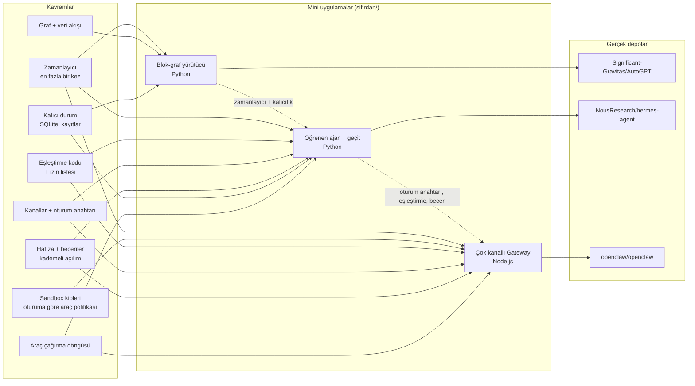

# D06 — Kişisel ve otonom ajan platformları

Bu dal, bir dil modelini **uzun ömürlü bir ürüne** çeviren katmanı öğretir: tek bir sohbet çağrısının ötesinde
ajanların nasıl **kalıcı durum** tuttuğu, **araç ve beceri** kaydettiği, **birden çok kanaldan** mesaj aldığı,
**zamanlanmış işler** çalıştırdığı ve bütün bunları **güvenli** yaptığı. Üç yaprak aynı soruya üç farklı cevap verir:

- **AutoGPT** — "Ajan bir **graf**tır": akışı insan çizer, LLM yalnızca bir düğümdür; yürütücü veriyi düğümden
  düğüme taşır.
- **Hermes Agent** — "Ajan bir **döngü**dür ve **öğrenir**": araçlı sohbet döngüsü, iş bitince kendi becerisini
  ve hafızasını yazar, sonraki oturumda kullanır.
- **OpenClaw** — "Ajan bir **ağ geçidinin** arkasındadır": tek Gateway süreci onlarca sohbet kanalını, oturumları,
  cihazları ve otomasyonları yönetir; politika kodla uygulanır.

## Önkoşullar

Bu liste, üç yaprağın "Öğrenmen gerekenler" bölümlerinin birleşimidir. **Zorunlu**, mini'leri yazmak ve gerçek
depoyu okumak için gereken; **faydalı**, depoyu bağlamıyla anlamak için gereken; **isteğe bağlı**, alıştırmalar ya
da karşılaştırma için gereken bilgidir.

| Düğüm                                                                                  | Tür          | Hangi yaprak     | Bu dalda neden gerekli                                                                                     |
| -------------------------------------------------------------------------------------- | ------------ | ---------------- | ---------------------------------------------------------------------------------------------------------- |
| [G1 Terminal](../../govde/README.md#g1) · [G2 Git ve GitHub](../../govde/README.md#g2) | zorunlu      | üçü              | Mini'ler komut satırından çalışır; gerçek depoyu incelenen commit'te açmak; Docker, daemon, kabuk araçları |
| [G3 Python](../../govde/README.md#g3)                                                  | zorunlu      | AutoGPT, Hermes  | İki mini Python (standart kütüphane); iki depo da Python çekirdekli                                        |
| [G4 JS/TS ve Node.js](../../govde/README.md#g4)                                        | zorunlu      | OpenClaw         | OpenClaw TypeScript; mini Node.js yerleşik modülleriyle yazıldı                                            |
| [G6 Ağ ve web temelleri](../../govde/README.md#g6)                                     | zorunlu      | üçü              | Webhook, WebSocket, bot API'leri, localhost'a bağlanmanın güvenlik anlamı                                  |
| [G7 Test, CI ve kod kalitesi](../../govde/README.md#g7)                                | zorunlu      | üçü              | Sahte modelle deterministik test; minilerin hepsi buna dayanır                                             |
| [G8 Büyük kod tabanı okuma](../../govde/README.md#g8)                                  | zorunlu      | üçü              | 10.818 / 23.484 / 65.873 dosyalık depolarda yol bulmak                                                     |
| [G11 LLM API temelleri](../../govde/README.md#g11)                                     | zorunlu      | üçü              | Üç projenin de kalbi araç çağırma döngüsü, istem önbelleği ve bağlam penceresi                             |
| [G5 Veri yapıları ve algoritmalar](../../govde/README.md#g5)                           | faydalı      | AutoGPT          | Graf doğrulama: topolojik sıra (Kahn), döngü tespiti, veri akışı                                           |
| [G9 Açık kaynak: lisans](../../govde/README.md#g9)                                     | faydalı      | AutoGPT          | PolyForm Shield + MIT: hangi klasörden kod alınamaz, "rekabet yasağı" neyi kapsar                          |
| [D08 Ajan becerileri](../08-ajan-becerileri/README.md)                                 | faydalı      | Hermes, OpenClaw | SKILL.md biçimi ve kademeli açılım; önce becerinin ne olduğunu orada öğren                                 |
| [D10 → build-your-own-x](../10-kuratorluk-topluluk/build-your-own-x/README.md)         | faydalı      | OpenClaw         | Bot yazma temelleri: "Build your own Bot" (Node.js ile Telegram botu örneği)                               |
| [D05 Yapay zekâ altyapısı → ollama](../05-yapay-zeka-altyapisi/ollama/README.md)       | isteğe bağlı | Hermes, OpenClaw | Mini'ler sahte modelle çalışır; gerçek ama ücretsiz, yerel bir modelle denemek isteyen alıştırmalar için   |
| [D04 → n8n](../04-veri-araclari-otomasyon/n8n/README.md)                               | isteğe bağlı | AutoGPT          | Graf fikrinin genel amaçlı akrabası; LLM'in grafın neresinde durduğunu karşılaştırmak için                 |
| [D07 → opencode](../07-kodlama-ajanlari/opencode/README.md)                            | isteğe bağlı | OpenClaw         | Aynı araç döngüsünün tek kullanıcılı, terminal odaklı hâli; izin sistemi karşılaştırması için              |

## Dalın ağacı

## Önerilen yaprak sırası

1. **[AutoGPT](autogpt/README.md) — graflar.** Çekirdeği (veri akışlı yürütücü) LLM'siz anlaşılır: tipli bloklar,
   kuyruk, durum makinesi, kalıcı yürütme kayıtları (gerçekte Prisma + PostgreSQL, minide sqlite), kimlik bilgisi
   referansı, cron. Belirlenimci (deterministik) düşünmeyi önce burada oturtursun; "LLM'i nereye koymalı?"
   sorusuna sağlam bir zemin kazanırsın.
2. **[Hermes Agent](hermes-agent/README.md) — öğrenme döngüsü.** Aynı dilde (Python) kalırsın; AutoGPT'den gelen
   kalıcılık ve zamanlayıcı bilgisi üzerine araç döngüsü, iki tür hafıza, beceri yazma ve mesajlaşma geçidi eklenir.
3. **[OpenClaw](openclaw/README.md) — ağ geçidi.** En büyük depo (65.873 dosya); dil TypeScript'e geçer. Kanal
   sayısında Hermes'le başa baştır (25 kanal eklentisi; Hermes'te 26 platform eklentisi). Hermes'te gördüğün
   kavramların (`agent:main:…` oturum anahtarları, 8 karakterlik eşleştirme kodları, SKILL.md, istem önbelleği
   kuralı, cron) neredeyse aynılarını burada sıkı bir güvenlik modeliyle (DM politikası, oturuma göre sandbox
   kipleri, cihaz eşleştirme) görürsün; OpenClaw dosyası birçok kararı Hermes'le karşılaştırarak anlatır. İki proje
   birbirine göç aracı bile sunuyor (Hermes'te `agent-importers` eklentisiyle `hermes import-agent openclaw`,
   OpenClaw'da `extensions/migrate-hermes`).

Sıra, yaprakların kendi önkoşullarıyla uyumludur: ilk iki yaprak Python (G3) ister, üçüncüsü TypeScript (G4).
G4'ü OpenClaw'a gelene kadar tamamlaman yeter; G5 ve G9 yalnızca AutoGPT dosyasında faydalıdır.

**Başka sıra ne zaman daha iyi?** JavaScript'i Python'dan iyi biliyorsan OpenClaw minisini ilk yap (en kapsamlı
gateway örneği o) ve Hermes'i karşılaştırma için sona bırak. Hedefin kodsuz otomasyon işi kurmaksa AutoGPT'den sonra
[n8n](../04-veri-araclari-otomasyon/n8n/README.md)'e geç, OpenClaw'ı sona bırak.

## Yapraklar

| Depo                                                | Tür        | Zorluk (1–5) | Mini                                                                                                  | Mini (saat) | Toplam (saat) |
| --------------------------------------------------- | ---------- | ------------ | ----------------------------------------------------------------------------------------------------- | ----------- | ------------- |
| [Significant-Gravitas/AutoGPT](autogpt/README.md)   | kod tabanı | 3            | [blok-graf yürütücü](autogpt/sifirdan/README.md) — 5 dosya / 8 aşama, 52 test (Python)                | 40          | 66            |
| [NousResearch/hermes-agent](hermes-agent/README.md) | kod tabanı | 4            | [öğrenen ajan + geçit + cron](hermes-agent/sifirdan/README.md) — 6 dosya / 8 aşama, 43 test (Python)  | 35          | 61            |
| [openclaw/openclaw](openclaw/README.md)             | kod tabanı | 5            | [çok kanallı Gateway](openclaw/sifirdan/README.md) — 6 dosya + `gateway.js` / 7 aşama, 31 test (Node) | 35          | 61            |
| **Dal toplamı**                                     |            |              |                                                                                                       | **110**     | **188**       |

**Süre kuralı.** Bu daldaki bütün süreler saattir. Birim varsayımı: 1 gün ≈ 5 saat odaklı çalışma, 1 hafta ≈ 10 saat
(gövdedeki "haftada ~10 saat" temposu); yaprak dosyalarındaki eski "gün" tahminleri bu kuralla saate çevrildi.

- **Mini (saat):** yaprağın "Sıfırdan yol" tablosundaki aşamaların toplamı. Akış şemasındaki "Yan dal" ve "İleri"
  düğümleri dahil değildir.
- **Toplam (saat):** Mini + okuma rotası (§5, adım başına ~1 saat; her yaprakta 10 adım = 10 saat) + alıştırmalar
  (§6; Kolay ~1, Orta ~2, Zor ~4 saat; her yaprakta 2 kolay + 3 orta + 2 zor = 16 saat, öz değerlendirme soruları
  dahil).
- OpenClaw'ın okuma rotası öbürleriyle aynı adım sayısındadır, ama depo AutoGPT'nin altı, Hermes'in yaklaşık üç
  katıdır: belgeden koda inmek uzun sürerse okuma payını iki katına çıkar (+10 saat).

**Dal toplamı:** ~188 saat; haftada ~10 saatle yaklaşık 19 hafta. Yalnızca mini'ler: 110 saat, yaklaşık 11 hafta.

## Üç projenin karşılaştırması

| Boyut              | AutoGPT (Platform)                                                                                          | Hermes Agent                                                                                | OpenClaw                                                                                 |
| ------------------ | ----------------------------------------------------------------------------------------------------------- | ------------------------------------------------------------------------------------------- | ---------------------------------------------------------------------------------------- |
| Dil                | Python (arka uç) + TypeScript/Next.js (ön yüz)                                                              | Python (çekirdek) + TypeScript (TUI, Electron, web)                                         | TypeScript/Node.js + Swift, Kotlin, Rust (uygulamalar)                                   |
| Çekirdek soyutlama | Blok (tipli pinler) + graf; veri akışlı yürütücü                                                            | `AIAgent` araç döngüsü + öğrenme döngüsü                                                    | Gateway (kontrol düzlemi) + oturum başına ajan turu                                      |
| Hafıza             | Düğüm yürütme kayıtları (PostgreSQL); copilot'ta Graphiti grafı                                             | MEMORY.md / USER.md (küçük, istemde) + SQLite FTS5 oturum araması                           | Çalışma alanı dosyaları (MEMORY.md, günlük notlar) + SQLite FTS5/vektör hafıza eklentisi |
| Kanallar           | Web arayüzü, REST/WebSocket API, webhook tetikleyicileri; copilot için Discord/Slack/Telegram/Teams köprüsü | CLI/TUI, masaüstü, ACP, 26 platform eklentisi (Telegram, Discord, Slack, WhatsApp, Signal…) | Control UI, CLI/TUI, cihaz düğümleri, 25 kanal eklentisi (WhatsApp, Telegram, iMessage…) |
| Zamanlama          | APScheduler + PostgreSQL iş deposu, ayrı süreç                                                              | `cron/` (jobs.json, gateway içinde 60 sn'lik tick)                                          | `src/cron/` (Gateway içinde, SQLite'ta; at / every / cron / on-exit / stream)            |
| Genişletme         | Blok yazmak (`Block` alt sınıfı), `ProviderBuilder` SDK'sı, pazar yeri                                      | Araç kaydı, eklentiler, beceriler (hub, ClawHub dahil), MCP                                 | Eklentiler (183 manifestli; `openclaw.plugin.json`), beceriler (ClawHub), MCP, kancalar  |
| Güvenlik modeli    | Kimlik referansı + Fernet, SSRF engeli, geri alınamaz bloklara insan onayı, moderasyon                      | "Sınır işletim sistemidir": terminal arka ucu / tüm süreç yalıtımı; onay kapısı sezgisel    | DM eşleştirme varsayılan, oturuma göre sandbox kipleri, cihaz eşleştirme, Gateway token  |
| Dağıtım            | Tek konteyner imajı ya da Docker Compose (çok servis); barındırılan ücretli sürüm                           | Kurulum betiği, Docker, Nix, Termux, masaüstü paketleri                                     | npm + `onboard --install-daemon`, Docker, yerel uygulamalar                              |
| Lisans             | `autogpt_platform/` PolyForm Shield (rekabet yasağı), gerisi MIT                                            | MIT                                                                                         | MIT                                                                                      |

## Dallar arası bağlantılar

- **[D07 Kodlama ajanları](../07-kodlama-ajanlari/README.md):** [opencode](../07-kodlama-ajanlari/opencode/README.md)
  ve [claw-code](../07-kodlama-ajanlari/claw-code/README.md) aynı araç döngüsünün tek kullanıcılı, kod odaklı
  hâlidir. Oradaki izin sistemi ile buradaki DM eşleştirme ve sandbox kiplerini karşılaştır: biri "araç bu dosyaya
  dokunabilir mi?", öbürü "bu kişi ajanla konuşabilir mi, bu oturum hangi aracı kullanabilir?" sorusunu cevaplar.
- **[D08 Ajan becerileri](../08-ajan-becerileri/README.md):** Hermes ve OpenClaw, SKILL.md biçimini ve kademeli
  açılımı kullanır; [anthropic-skills](../08-ajan-becerileri/anthropic-skills/README.md) bu biçimin kaynağıdır.
  Fark: burada ajanlar becerileri **kendileri yazar** (Hermes `skill_manage`, OpenClaw Skill Workshop).
- **[D04 → n8n](../04-veri-araclari-otomasyon/n8n/README.md):** genel amaçlı iş akışı motoru; AutoGPT'nin graf
  yürütücüsünün kuzeni. İkisinde de düğüm, bağlantı, kimlik bilgisi ve tetikleyici vardır. Fark: n8n'de LLM/ajan
  düğümleri eklenebilir bir paket (`@n8n/nodes-langchain`) olarak gelir, AutoGPT'de LLM ve blok kavramı çekirdeğe
  gömülüdür.
- **[D05 → ollama](../05-yapay-zeka-altyapisi/ollama/README.md):** üç projenin de yerel model desteği var
  (AutoGPT'de `ollama` bağımlılığı, Hermes'te `agent/agent_init_ollama.py`, OpenClaw'da `extensions/ollama`).
- **[D09 → system-design-primer](../09-bilgisayar-bilimi/system-design-primer/README.md):** kuyruklar ve asenkron
  işçiler — AutoGPT'nin RabbitMQ + ayrı yürütücü süreci tam bu konunun uygulamasıdır.

## Bu dalı bitirdiğinde ne yapabilirsin

- Bir ajanın çalıştığı ortamı **dört katmanda** tasarlayabilirsin: kanal (mesaj nereden gelir), yönlendirme (hangi
  oturum), çalışma zamanı (hangi araçlar, hangi sırayla), kalıcılık (ne saklanır, ne isteme girer).
- Sahte modelle **deterministik testleri** olan bir ajan yazabilir, sonra modeli Ollama ya da bir API ile
  değiştirebilirsin.
- İstem önbelleğini bozmadan hafıza ve beceri ekleyebilir; "oturum ortasında istemi değiştirme" kuralının nedenini
  maliyet üzerinden açıklayabilirsin.
- Bir mesajlaşma botunu **varsayılan olarak kapalı** kurabilirsin: eşleştirme kodu, izin listesi, grupta anılma
  kapısı, ana oturum dışında kısıtlı araçlar.
- Zamanlanmış işleri "en fazla bir kez" kuralıyla çalıştırıp sonucu doğru kanala teslim edebilirsin.
- 10.000–65.000 dosyalık ajan depolarında belgeden koda inerek bir özelliğin uçtan uca yolunu bulabilirsin.

İş fikirleri için: [is-fikirleri/README.md](../../is-fikirleri/README.md) · Ağacın tamamı: [AGAC.md](../../AGAC.md)
